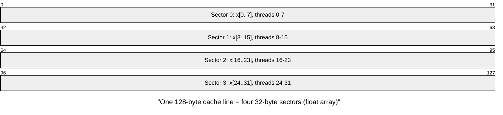
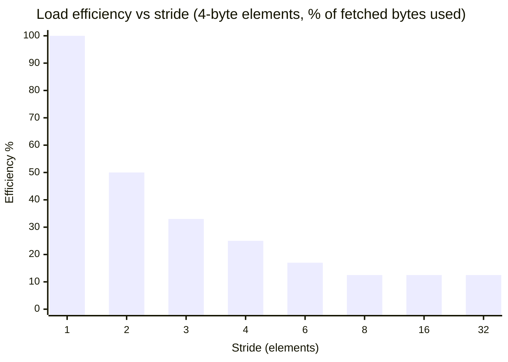

---
tags:
  - gpu-programming
  - kernels-optimization
  - memory
  - cuda
  - performance
status: complete
sources:
  - https://docs.nvidia.com/cuda/pdf/CUDA_C_Best_Practices_Guide.pdf
  - https://docs.nvidia.com/nsight-compute/2023.1/ProfilingGuide/index.html
  - https://developer.nvidia.com/blog/how-access-global-memory-efficiently-cuda-c-kernels/
  - https://developer.nvidia.com/blog/unlock-gpu-performance-global-memory-access-in-cuda/
  - https://developer.nvidia.com/blog/using-nsight-compute-to-inspect-your-kernels
  - https://developer.nvidia.com/blog/efficient-matrix-transpose-cuda-cc
  - https://developer.nvidia.com/blog/cuda-pro-tip-increase-performance-with-vectorized-memory-access
  - https://gwern.net/doc/www/siboehm.com/d4b3e9d6de0655f490fe6369f4d004936248a833.html
  - https://docs.nvidia.com/cuda/archive/13.2.0/cuda-programming-guide/02-basics/writing-cuda-kernels.html
  - https://developer.nvidia.com/blog/nvidia-hopper-architecture-in-depth/
  - https://www.nvidia.com/en-us/data-center/h100/
  - https://arxiv.org/html/2512.02189v3
created: 2026-11-26
updated: 2026-11-26
---

## Table Of Contents

---

- [[#TL;DR|TL;DR]]
- [[#The Problem|The Problem]]
- [[#Foundations|Foundations]]
    - [[#Warp-Wide Requests|Warp-Wide Requests]]
    - [[#Sectors and Cache Lines|Sectors and Cache Lines]]
    - [[#What Coalesced Means|What Coalesced Means]]
- [[#How We Got Here|How We Got Here]]
- [[#How It Works|How It Works]]
    - [[#Counting Sectors|Counting Sectors]]
    - [[#Stride and Efficiency|Stride and Efficiency]]
    - [[#Misalignment|Misalignment]]
    - [[#Row-Major Indexing, the Classic Bug|Row-Major Indexing, the Classic Bug]]
    - [[#Fixing Unavoidable Strides with Shared Memory|Fixing Unavoidable Strides with Shared Memory]]
    - [[#Structure of Arrays|Structure of Arrays]]
    - [[#Vectorized Loads|Vectorized Loads]]
    - [[#Measuring It|Measuring It]]
- [[#Where It Is Now|Where It Is Now]]
- [[#Trade-offs & Open Problems|Trade-offs & Open Problems]]
- [[#Resources|Resources]]
- [[#Related Notes|Related Notes]]

## ***TL;DR***
---
*When the 32 threads of a warp load from global memory, the hardware fetches whole 32-byte chunks. If the threads' addresses sit next to each other, a few chunks serve them all; if they are scattered, every thread pulls its own chunk and most of each one is wasted. Arranging addresses so a warp reads contiguous memory is called coalescing, and getting it wrong can make a kernel up to 8x slower.*

- **The rule:** "the concurrent accesses of the threads of a warp will coalesce into a number of transactions equal to the number of 32-byte transactions" needed to cover them ([CUDA Best Practices Guide 13.4](https://docs.nvidia.com/cuda/pdf/CUDA_C_Best_Practices_Guide.pdf)).
- **Ideal case:** 32 threads each reading a consecutive 4-byte float touch 128 contiguous bytes, which is 4 sectors. Worst case: 32 sectors, using 4 of every 32 bytes ([NVIDIA, 2025](https://developer.nvidia.com/blog/unlock-gpu-performance-global-memory-access-in-cuda/)).
- **Stride hurts in proportion:** stride 2 gives 50% load efficiency; stride 8 or more gives 12.5% for 4-byte elements.
- **The fixes:** map `threadIdx.x` to the contiguous dimension; stage awkward accesses through [[Shared Memory and Bank Conflicts|shared memory]]; use structure-of-arrays layouts; use 16-byte vector loads.
- **Where it is now (Nov 2026):** still the first optimization in every CUDA tutorial and profiler, but the fastest Hopper and Blackwell kernels move tiles with the [[TMA and Asynchronous Copies|TMA]] copy engine, where whole tiles are fetched from a descriptor and coalescing becomes a question of tile layout rather than per-thread indexing.

## ***The Problem***
---
*HBM delivers its headline bandwidth only in wide, aligned chunks. A warp issues one load instruction for 32 threads at once, and the memory system has to translate those 32 addresses into chunk fetches. Every byte fetched but not used is bandwidth thrown away.*

An H100 SXM reads HBM at 3.35 TB/s ([H100 page](https://www.nvidia.com/en-us/data-center/h100/)), but that number assumes every byte delivered is used. Most simple kernels are [[Roofline Model and Arithmetic Intensity|memory-bound]], so their speed is set directly by *useful* bytes per second. If a warp's access pattern makes the hardware fetch 8 bytes for each useful one, the kernel runs at one-eighth of the bandwidth it could have, and no amount of arithmetic optimization helps.

The same code can be fast or slow depending only on which thread reads which address. NVIDIA's 2019 Nsight Compute example changes one line, `C[idx][idy]` to `C[idy][idx]`, and cuts memory transactions 8x ([Crovella, 2019](https://developer.nvidia.com/blog/using-nsight-compute-to-inspect-your-kernels)).

## ***Foundations***
---
*Three facts: loads are issued per warp, memory is fetched in 32-byte sectors grouped into 128-byte lines, and "coalesced" just means the warp's addresses need as few sectors as possible.*

#### **Warp-Wide Requests**
A load instruction in a kernel, say `x[i]`, is executed by all 32 threads of a [[GPU Architecture Basics#Warps and SIMT|warp]] together. Each thread supplies its own address. The load/store unit collects the 32 addresses into one *request* and works out which memory chunks it needs. Coalescing is about the shape of those 32 addresses, not about any single thread.

#### **Sectors and Cache Lines**
| Unit | Size | Definition |
|---|---|---|
| Sector | 32 bytes | "Aligned 32 byte-chunk of memory in a cache line or device memory" |
| Cache line | 128 bytes | "An L1 or L2 cache line is four sectors, i.e. 128 bytes" |
| Request | 1 per warp instruction | "A command into a HW unit to perform some action"; it accesses one or more sectors |

Source: [Nsight Compute Profiling Guide](https://docs.nvidia.com/nsight-compute/2023.1/ProfilingGuide/index.html).



(Here the "bits" axis counts bytes.) A warp reading `x[0]` through `x[31]` in order fills exactly one line, four sectors: perfect.

#### **What Coalesced Means**
A warp access is *coalesced* when the number of sectors it touches is as small as the data allows. For 32 threads × 4 bytes = 128 bytes, the minimum is 4 sectors. "The minimum number here would be four transactions to cover a 128-byte warp-wide request (each transaction is 32 bytes)" ([Crovella, 2019](https://developer.nvidia.com/blog/using-nsight-compute-to-inspect-your-kernels)). Not every thread has to take part, and on current GPUs the order of threads within the span does not matter; what matters is how many distinct 32-byte sectors the addresses fall in ([Best Practices Guide](https://docs.nvidia.com/cuda/pdf/CUDA_C_Best_Practices_Guide.pdf)).

## ***How We Got Here***
---
*The first CUDA GPUs had harsh, exact rules: half-warps had to read aligned, in-order addresses or pay eightfold. Caches and smarter load units relaxed alignment over time, but the core cost of scattered access never went away, and Hopper moved bulk copies into dedicated hardware.*

| Era | Rule | Source |
|---|---|---|
| CC 1.0 (2006–07, e.g. Tesla C870) | Coalescing within half-warps of 16 threads; a misaligned or out-of-order half-warp "results in 16 separate 32-byte transactions", about an 8x bandwidth loss | [Harris, 2013](https://developer.nvidia.com/blog/how-access-global-memory-efficiently-cuda-c-kernels/) |
| CC 1.2/1.3 (Tesla C1060) | Misaligned contiguous accesses served by a few covering transactions; penalty smaller | [Harris, 2013](https://developer.nvidia.com/blog/how-access-global-memory-efficiently-cuda-c-kernels/) |
| CC 2.0 (Fermi, Tesla C2050) | L1 with 128-byte lines; "negligible effect of alignment on throughput" for sequential access, but large strides still poor | [Harris, 2013](https://developer.nvidia.com/blog/how-access-global-memory-efficiently-cuda-c-kernels/) |
| CC 6.0 and later | Warp accesses coalesce into the number of 32-byte transactions needed | [Best Practices Guide](https://docs.nvidia.com/cuda/pdf/CUDA_C_Best_Practices_Guide.pdf) |
| CC 9.0 (Hopper, 2022) | TMA: a single thread builds a copy descriptor and "address generation and data movement are handled in hardware" | [Hopper in depth](https://developer.nvidia.com/blog/nvidia-hopper-architecture-in-depth/) |

The lesson of the timeline: alignment rules got easier, locality rules did not. "Alignment was critical on early hardware but is much less of a concern on recent GPUs", while strided access still hurts on every architecture ([Harris, 2013](https://developer.nvidia.com/blog/how-access-global-memory-efficiently-cuda-c-kernels/)).

## ***How It Works***
---
*Count the distinct 32-byte sectors a warp's addresses touch and divide the useful bytes by the fetched bytes: that is the load efficiency. Then change the thread-to-data mapping, the layout, or the path through memory until the count reaches its minimum.*

#### **Counting Sectors**
$$
\text{load efficiency} = \frac{\text{bytes the warp needs}}{32 \times \text{distinct sectors touched}}
$$

*In plain English: of all the bytes the memory system fetched for this warp, what fraction did the threads actually use?*

| Pattern (4-byte elements) | Sectors touched | Efficiency |
|---|---|---|
| `x[i]`, consecutive, aligned | 4 | 128 / 128 = 100% |
| `x[i + 1]`, consecutive, off by one element | 5 | 128 / 160 = 80% |
| `x[2*i]`, stride 2 | 8 | 128 / 256 = 50% |
| `x[8*i]` or larger stride | 32 | 128 / 1,024 = 12.5% |
| All threads read `x[0]` | 1 | Broadcast, fine |

Rows from the Best Practices Guide ("five 32-byte segments" when misaligned; "a stride of 2 results in a 50% of load/store efficiency") and NVIDIA's 2025 post (32 sectors per request at large stride, "only 4.0 of the 32 bytes" used) ([Best Practices Guide](https://docs.nvidia.com/cuda/pdf/CUDA_C_Best_Practices_Guide.pdf); [NVIDIA, 2025](https://developer.nvidia.com/blog/unlock-gpu-performance-global-memory-access-in-cuda/)).

#### **Stride and Efficiency**
For 4-byte elements read with stride $s$, each warp touches $\min(s, 8) \times 4$ sectors, so efficiency is $1/\min(s, 8)$:



Past stride 8 every thread lands in its own sector, so the curve flattens at 12.5%, which is the "up to 8x" penalty NVIDIA quotes ([NVIDIA, 2025](https://developer.nvidia.com/blog/unlock-gpu-performance-global-memory-access-in-cuda/)). In that post's 1D test, the uncoalesced kernel read 2.15 GB of DRAM against 268 MB for the coalesced one, for the same useful work. Caches can rescue some of this when neighbouring warps reuse the extra sectors, but you cannot count on it.

#### **Misalignment**
If a warp's 128 contiguous bytes start partway into a sector, they straddle five sectors instead of four. The guide expects "approximately 4/5th of the memory throughput"; measured, it was about 9/10, because adjacent warps reuse the cached lines ([Best Practices Guide](https://docs.nvidia.com/cuda/pdf/CUDA_C_Best_Practices_Guide.pdf)). Misalignment is a small tax on modern GPUs; stride is the real enemy. `cudaMalloc` returns well-aligned pointers, so misalignment usually comes from offsets (`ptr + 1`) or odd-sized row pitches, which `cudaMallocPitch` exists to fix.

#### **Row-Major Indexing, the Classic Bug**
C and CUDA store 2D arrays row-major: `A[row][col]` is at `row * width + col`, so consecutive columns are adjacent in memory. Consecutive `threadIdx.x` values are in the same warp, because "the first index `x` moves the fastest" ([Writing CUDA Kernels](https://docs.nvidia.com/cuda/archive/13.2.0/cuda-programming-guide/02-basics/writing-cuda-kernels.html)). So `x` must index columns.

```cuda
int col = blockIdx.x * blockDim.x + threadIdx.x;   // neighbours in a warp...
int row = blockIdx.y * blockDim.y + threadIdx.y;
out[row * width + col] = in[row * width + col];    // ...read neighbouring addresses
```

- Lines 1–2: threads 0 to 31 of a warp get consecutive `col` values and the same `row`.
- Line 3: their addresses are consecutive, 128 bytes, 4 sectors. Coalesced.

Swap the roles (`row` from `threadIdx.x`) and the 32 threads read 32 different rows, `width × 4` bytes apart: 32 sectors per request. That is exactly the one-line change in NVIDIA's Nsight example, which measured 32 sectors per request uncoalesced against 4 coalesced, an 8:1 reduction ([Crovella, 2019](https://developer.nvidia.com/blog/using-nsight-compute-to-inspect-your-kernels)). Simon Boehm's SGEMM worklog makes the same fix in "Kernel 2": remapping threads so neighbours walk along a row lifted global memory throughput from 15 GB/s to 110 GB/s and the kernel from 309 to 1,987 GFLOP/s on an RTX A6000 ([Boehm, 2022](https://gwern.net/doc/www/siboehm.com/d4b3e9d6de0655f490fe6369f4d004936248a833.html)).

#### **Fixing Unavoidable Strides with Shared Memory**
Some algorithms must read one way and write another. Matrix transpose reads rows and writes columns, so one side is always strided. The fix is to load a tile coalesced into shared memory, then write it out coalesced from a transposed position in shared memory, where strided access is cheap:

```cuda
#define TILE 32
__global__ void transpose(float* out, const float* in, int n) {
    __shared__ float tile[TILE][TILE + 1];             // +1 column avoids bank conflicts
    int x = blockIdx.x * TILE + threadIdx.x;
    int y = blockIdx.y * TILE + threadIdx.y;
    tile[threadIdx.y][threadIdx.x] = in[y * n + x];    // coalesced read along a row
    __syncthreads();
    x = blockIdx.y * TILE + threadIdx.x;               // swap block coordinates
    y = blockIdx.x * TILE + threadIdx.y;
    out[y * n + x] = tile[threadIdx.x][threadIdx.y];   // coalesced write along a row
}
```

- Line 3: a 32×33 tile in shared memory per block; the extra column shifts each row by one bank so reading a column does not hit one bank 32 times (see [[Shared Memory and Bank Conflicts]]).
- Lines 4–6: each thread reads one element; consecutive `threadIdx.x` read consecutive addresses.
- Line 7: wait until the whole tile is loaded.
- Lines 8–9: the output block sits at the transposed block position.
- Line 10: consecutive `threadIdx.x` write consecutive output addresses, reading the tile down a column instead.

(Simplified to one element per thread and square `n` divisible by 32; Harris's version uses 32×8 threads each handling four elements.) Mark Harris's measurements on a Tesla K20c: copy 136.0 GB/s, naive transpose 55.3, coalesced via shared memory 97.6, plus padding 144.3 GB/s, about the speed of a plain copy ([Harris, 2013](https://developer.nvidia.com/blog/efficient-matrix-transpose-cuda-cc)). The same staging idea is the core of [[Tiled Matrix Multiplication (GEMM)]].

#### **Structure of Arrays**
Data layout decides coalescing before any kernel is written. Take particles with `x, y, z, mass` as 4-byte floats.

| Layout | Memory | A warp reading only `x` |
|---|---|---|
| Array of structures (AoS): `struct P {float x,y,z,m;}; P p[N];` | `x0 y0 z0 m0 x1 y1 ...` | Stride 4: 16 sectors for 128 useful bytes, 25% efficiency |
| Structure of arrays (SoA): `float x[N], y[N], z[N], m[N];` | `x0 x1 x2 ... y0 y1 ...` | Stride 1: 4 sectors, 100% |

The arithmetic follows from the sector rule above. AoS is fine when every thread uses every field (a `float4` load per particle reads the whole struct at once), but when kernels touch only some fields, SoA wins.

#### **Vectorized Loads**
Coalescing counts sectors; it does not count instructions. Having each thread load 16 bytes (`float4`) instead of 4 cuts load instructions 4x while the warp still reads contiguous memory (512 bytes, 16 sectors, all used). NVIDIA's 2025 Pro Tip: 64- and 128-bit loads (`LDG.E.64/128`) give "fewer executed instructions" and better bandwidth use, but "require aligned data" and raise register pressure, so register-limited kernels may prefer scalar loads ([Luitjens & Devaramani, 2025](https://developer.nvidia.com/blog/cuda-pro-tip-increase-performance-with-vectorized-memory-access)). Wider loads also put more bytes in flight per thread, which helps saturate HBM (see the latency example in [[GPU Architecture Basics#Latency Hiding, Worked Example|GPU Architecture Basics]]).

#### **Measuring It**
Nsight Compute reports the two counters that define coalescing ([NVIDIA, 2025](https://developer.nvidia.com/blog/unlock-gpu-performance-global-memory-access-in-cuda/); [Crovella, 2019](https://developer.nvidia.com/blog/using-nsight-compute-to-inspect-your-kernels)):

```bash
ncu --metrics l1tex__t_sectors_pipe_lsu_mem_global_op_ld.sum,l1tex__t_requests_pipe_lsu_mem_global_op_ld.sum ./app
```

- `..._sectors_..._ld.sum`: global-load sectors fetched.
- `..._requests_..._ld.sum`: warp-level global-load requests.
- Divide sectors by requests. About 4 for 4-byte loads (16 for `float4`) is ideal; 32 means every thread is fetching its own sector.

The full `--set full` profile also flags uncoalesced loads in its memory workload analysis, with an estimated speedup. More in [[Profiling with Nsight Compute and Nsight Systems]].

## ***Where It Is Now***
---
*In late 2026 coalescing is still the first thing to check in any memory-bound CUDA kernel, and the profilers say so directly. But the frontier kernels on Hopper and Blackwell no longer load tiles thread by thread: a copy engine fetches whole tiles, and the question moves from "which thread reads which address" to "which tile shape and layout does the copy use".*

- **TMA changes who generates addresses.** On Hopper and Blackwell, a single thread builds a copy descriptor, and the Tensor Memory Accelerator fetches 1D to 5D tiles from global to shared memory with "address generation and data movement ... handled in hardware", freeing the threads for other work ([Hopper in depth](https://developer.nvidia.com/blog/nvidia-hopper-architecture-in-depth/)). Ampere's asynchronous copies still had threads "generating all addresses and looping across the whole copy region". Tile loads through TMA read contiguous rows of the tile, so the old per-thread coalescing rule becomes a rule about tile shape and the global layout's leading dimension. See [[TMA and Asynchronous Copies]].
- **Libraries hide it.** [[CUTLASS and CuTe]], [[Triton]] and CUDA Tile all express loads at the tile level and pick coalesced or TMA-based copies automatically when the layout allows. Hand-written CUDA is still where uncoalesced access shows up.
- **NVIDIA still teaches it first.** NVIDIA republished its global-memory access and vectorized-load guidance in 2025, profiled on Ada and Hopper-class GPUs (CC 8.9 and 9.0), with bandwidth falling steadily with stride on a GH200 ([NVIDIA, Sep 2025](https://developer.nvidia.com/blog/unlock-gpu-performance-global-memory-access-in-cuda/); [Luitjens & Devaramani, Aug 2025](https://developer.nvidia.com/blog/cuda-pro-tip-increase-performance-with-vectorized-memory-access)).
- **Peak bandwidth needs everything right.** Even a simple STREAM Triad kernel, fully coalesced, measured about 52% of a B200's 8 TB/s peak in one 2026 study ([Jarmusch & Chandrasekaran](https://arxiv.org/html/2512.02189v3)). Coalescing is necessary for high bandwidth, not sufficient: enough bytes in flight ([[Occupancy and Latency Hiding]]) and wide loads matter too.

## ***Trade-offs & Open Problems***
---
*Coalescing is rarely in tension with correctness, but it often fights with other goals: the natural data layout, bank-conflict-free shared memory, register budgets and code clarity.*

| Technique | Gain | Cost |
|---|---|---|
| Remap `threadIdx.x` to the contiguous dimension | Free, often 8x on the access | None, once you see it |
| Stage through shared memory | Coalesced on both sides of a transpose or gather | Shared memory, a barrier, possible [[Shared Memory and Bank Conflicts|bank conflicts]] |
| SoA layout | Coalesced per-field access | Harder to read; pointer-per-field APIs; whole-record access needs several loads |
| Vector loads (`float4`) | 4x fewer instructions, more bytes in flight | Alignment requirements; more registers per thread |
| TMA tile copies | No per-thread address math; async | Hopper+ only; descriptors, barriers and tile shapes to manage |

Open problems:

- **Irregular access.** [[Sparse Linear Algebra on GPUs|Sparse matrices]], graph algorithms and gather-heavy workloads such as MoE token routing or paged KV-cache lookups have data-dependent addresses that no remapping can make contiguous. The tools are reordering ([[Sorting and Hashing on GPUs|sorting]] by destination), and blocking (pages of contiguous data, as in paged attention); neither is general.
- **Layout across the stack.** The best layout for one kernel (say, row-major for a GEMM's A operand) may be the worst for the next. Frameworks increasingly let compilers choose layouts per kernel and insert transposes, which [[Kernel Fusion]] then tries to hide.

## ***Resources***
---
*Read the Best Practices Guide's coalescing section and NVIDIA's 2025 global-memory post together: the first gives the rules, the second shows them in Nsight Compute numbers. Harris's transpose post is the classic worked fix.*

**Primary documentation**
- [CUDA C++ Best Practices Guide 13.4, Coalesced Access to Global Memory](https://docs.nvidia.com/cuda/pdf/CUDA_C_Best_Practices_Guide.pdf): NVIDIA, Oct 2026.
- [Nsight Compute Profiling Guide](https://docs.nvidia.com/nsight-compute/2023.1/ProfilingGuide/index.html): sectors, cache lines, requests.
- [NVIDIA Hopper Architecture In-Depth](https://developer.nvidia.com/blog/nvidia-hopper-architecture-in-depth/): TMA.

**Engineering posts**
- [Unlock GPU Performance: Global Memory Access in CUDA](https://developer.nvidia.com/blog/unlock-gpu-performance-global-memory-access-in-cuda/): Devaramani, Bentz, Scudiero, NVIDIA, Sep 2025.
- [CUDA Pro Tip: Increase Performance with Vectorized Memory Access](https://developer.nvidia.com/blog/cuda-pro-tip-increase-performance-with-vectorized-memory-access): Luitjens & Devaramani, Aug 2025.
- [Using Nsight Compute to Inspect your Kernels](https://developer.nvidia.com/blog/using-nsight-compute-to-inspect-your-kernels): Bob Crovella, 2019.
- [How to Access Global Memory Efficiently in CUDA C/C++ Kernels](https://developer.nvidia.com/blog/how-access-global-memory-efficiently-cuda-c-kernels/): Mark Harris, 2013. History across compute capabilities.
- [An Efficient Matrix Transpose in CUDA C/C++](https://developer.nvidia.com/blog/efficient-matrix-transpose-cuda-cc): Mark Harris, 2013.

**Practitioners**
- [How to Optimize a CUDA Matmul Kernel for cuBLAS-like Performance](https://gwern.net/doc/www/siboehm.com/d4b3e9d6de0655f490fe6369f4d004936248a833.html): Simon Boehm, 2022. Kernel 2 is a coalescing fix.

## ***Related Notes***
---
*Coalescing is the HBM half of memory efficiency; bank conflicts are the shared-memory half, and tiling and TMA are how fast kernels get both.*

- [[GPU Memory Hierarchy]] — Where sectors, cache lines and HBM sit.
- [[GPU Architecture Basics]] — Warps, and why loads are issued 32 threads at a time.
- [[CUDA Programming Model]] — How `threadIdx` maps to data, which decides coalescing.
- [[Roofline Model and Arithmetic Intensity]] — Why wasted bytes slow memory-bound kernels one for one.
- [[Shared Memory and Bank Conflicts]] — The shared-memory equivalent of this rule.
- [[Occupancy and Latency Hiding]] — Enough bytes in flight to use the bandwidth you coalesced.
- [[Tiled Matrix Multiplication (GEMM)]] — Coalesced tile loads plus shared-memory reuse.
- [[TMA and Asynchronous Copies]] — Hardware tile copies on Hopper and Blackwell.
- [[Kernel Fusion]] — Avoiding the memory traffic altogether.
- [[Profiling with Nsight Compute and Nsight Systems]] — Sectors per request and the memory workload analysis.
- [[CUTLASS and CuTe]] — Layouts that make coalescing a property of the type.
- [[Triton]] — Block-level loads that the compiler coalesces.
