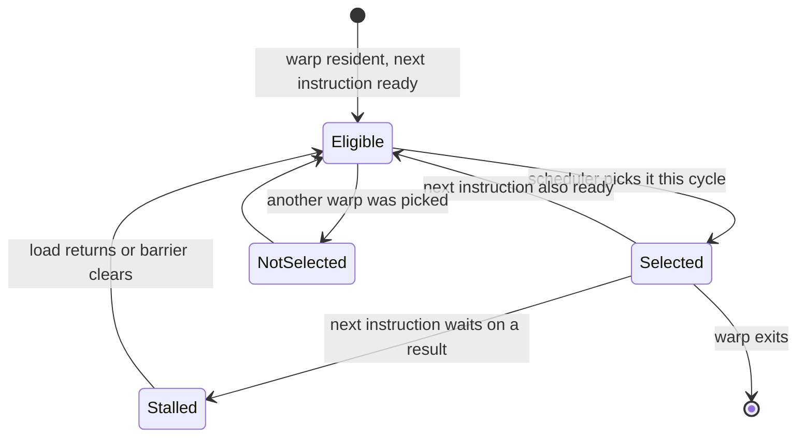
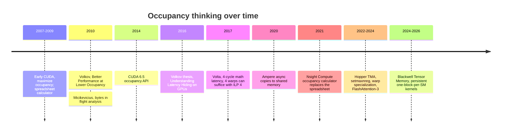
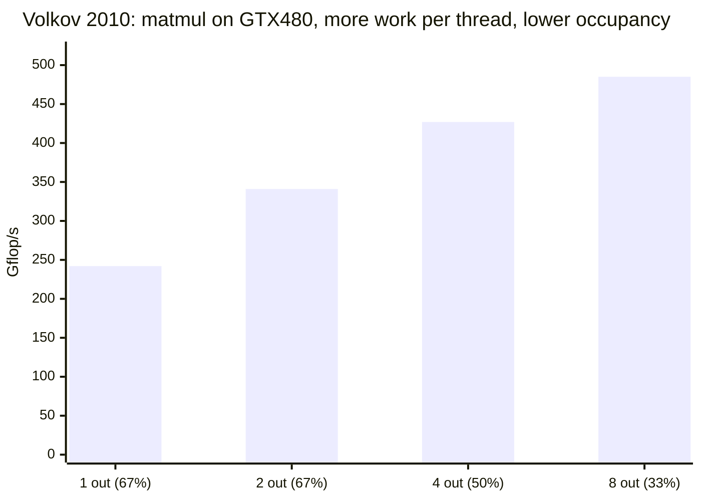

---
tags:
  - gpu-programming
  - kernels-and-optimization
  - cuda
  - occupancy
  - latency-hiding
  - performance
status: complete
sources:
  - https://docs.nvidia.com/cuda/cuda-programming-guide/05-appendices/compute-capabilities.html
  - https://docs.nvidia.com/cuda/cuda-programming-guide/05-appendices/cpp-language-extensions.html.md
  - https://docs.nvidia.com/cuda/archive/10.2/pdf/CUDA_C_Best_Practices_Guide.pdf
  - https://docs.nvidia.com/cuda/archive/11.4.2/pdf/Volta_Tuning_Guide.pdf
  - https://docs.nvidia.com/cuda/hopper-tuning-guide/index.html
  - https://docs.nvidia.com/cuda/blackwell-tuning-guide
  - https://docs.nvidia.com/cuda/cuda-runtime-api/cuda_runtime_api/group__CUDART__OCCUPANCY.html
  - https://docs.nvidia.com/cuda/archive/12.2.0/cuda-occupancy-calculator/index.html
  - https://docs.nvidia.com/nsight-compute/ProfilingGuide/index.html
  - https://docs.nvidia.com/nsight-compute/2023.3/ProfilingGuide/index.html
  - https://docs.nvidia.com/nsight-compute/ComputeTriage/index.html
  - https://docs.nvidia.com/nsight-compute/OccupancyCalculatorPythonInterface/index.html
  - https://developer.nvidia.com/blog/cuda-pro-tip-occupancy-api-simplifies-launch-configuration
  - https://developer.nvidia.com/blog/optimizing-gpu-utilization-with-nsight-compute-2021-3/
  - https://developer.nvidia.com/blog/navigating-gpu-architecture-support-a-guide-for-nvidia-cuda-developers
  - https://developer.nvidia.com/cuda/gpus.md
  - https://bilbo.iut-bm.univ-fcomte.fr/and/gitweb/these_gilles.git/blob_plain/HEAD:/DOCS/volkov10-GTC.pdf
  - https://www2.eecs.berkeley.edu/Pubs/TechRpts/2016/EECS-2016-143.pdf
  - https://nvidia.com/content/gtc-2010/pdfs/2012_gtc2010.pdf
  - https://arxiv.org/pdf/1804.06826
  - https://arxiv.org/html/2402.13499v1
  - https://arxiv.org/html/2512.02189v3
  - https://arxiv.org/html/2407.08608
  - https://nvidia.github.io/cccl/unstable/libcudacxx/ptx/instructions/setmaxnreg.html
  - https://pytorch.org/blog/cutlass-ping-pong-gemm-kernel/
  - https://docs.nvidia.com/cutlass/latest/media/docs/cpp/efficient%5Fgemm.html
  - https://docs.nvidia.com/cutlass/latest/media/docs/cpp/gemm%5Fapi%5F3x.html
  - https://docs.nvidia.com/cutlass/latest/overview.html
  - https://hazyresearch.stanford.edu/blog/2024-05-12-tk
  - https://hazyresearch.stanford.edu/blog/2025-03-15-tk-blackwell
  - https://docs.nvidia.com/deeplearning/performance/dl-performance-matrix-multiplication/index.html
  - https://leimao.github.io/blog/CUDA-Occupancy-Calculation
  - https://forums.developer.nvidia.com/t/what-is-warp-allocation-granulatity-for/365269
  - https://docs.nvidia.com/cuda/archive/13.0.0/cuda-toolkit-release-notes/index.html
  - https://www.nvidia.com/en-us/data-center/h100/
created: 2026-11-26
updated: 2026-11-26
---

## Table Of Contents

- [[#TL;DR|TL;DR]]
- [[#The Problem|The Problem]]
- [[#Foundations|Foundations]]
    - [[#Latency Hiding by Switching Warps|Latency Hiding by Switching Warps]]
    - [[#Little's Law|Little's Law]]
    - [[#Occupancy, Defined|Occupancy, Defined]]
- [[#How We Got Here|How We Got Here]]
- [[#How It Works|How It Works]]
    - [[#The Four Limits|The Four Limits]]
    - [[#Computing Occupancy by Hand|Computing Occupancy by Hand]]
    - [[#Controlling It in Code|Controlling It in Code]]
    - [[#Two Ways to Get Parallelism: Warps or ILP|Two Ways to Get Parallelism: Warps or ILP]]
    - [[#Waves and the Tail Effect|Waves and the Tail Effect]]
    - [[#Diagnosing It in Nsight Compute|Diagnosing It in Nsight Compute]]
- [[#Where It Is Now|Where It Is Now]]
    - [[#Low Occupancy by Design|Low Occupancy by Design]]
    - [[#Limits on Current GPUs|Limits on Current GPUs]]
- [[#Trade-offs & Open Problems|Trade-offs & Open Problems]]
- [[#Resources|Resources]]
- [[#Related Notes|Related Notes]]

## ***TL;DR***
---
*A GPU hides the long wait for memory by switching to other warps that are ready to run. Occupancy is how many warps an SM has to choose from, as a fraction of the most it can hold. It matters because too few warps leave the SM idle while it waits, but it is a means to an end: the real goal is enough independent work in flight, which can also come from more work per thread or from asynchronous copies.*

- **Definition.** "Occupancy is the ratio of the number of active warps per multiprocessor to the maximum number of possible active warps" ([Best Practices Guide](https://docs.nvidia.com/cuda/archive/10.2/pdf/CUDA_C_Best_Practices_Guide.pdf)). An H100 SM holds up to 64 warps (2,048 threads); 32 resident warps is 50% occupancy.
- **What limits it.** Four per-SM budgets, whichever runs out first: registers (64K 32-bit registers per SM), shared memory (up to 228 KB on Hopper), threads or warps (64 warps), and blocks (32) ([Compute Capabilities](https://docs.nvidia.com/cuda/cuda-programming-guide/05-appendices/compute-capabilities.html)). Registers are the usual culprit: at 100% occupancy each thread gets only 32.
- **Why it hides latency.** Little's Law: work in flight = latency × throughput. With 4-cycle arithmetic and ~480-cycle global memory, an SM needs many independent instructions in flight at once to stay busy ([Jia et al.](https://arxiv.org/pdf/1804.06826); [Luo et al.](https://arxiv.org/html/2402.13499v1)).
- **But more is not always better.** "Higher occupancy does not always result in higher performance" ([Nsight Compute](https://docs.nvidia.com/nsight-compute/ProfilingGuide/index.html)). Volkov's 2010 talk showed matrix multiply getting *faster* as occupancy dropped from 67% to 33%, because each thread did more independent work in registers ([Volkov](https://bilbo.iut-bm.univ-fcomte.fr/and/gitweb/these_gilles.git/blob_plain/HEAD:/DOCS/volkov10-GTC.pdf)).
- **Where it is now (Nov 2026):** the fastest Hopper and Blackwell kernels run **one block per SM** at low occupancy on purpose. CUTLASS's ping-pong GEMM gives producer warps 40 registers and consumer warps 232 using `setmaxnreg`, and relies on [[TMA and Asynchronous Copies|TMA]] and [[Warp Specialization|warp specialization]] instead of many warps to hide latency ([PyTorch](https://pytorch.org/blog/cutlass-ping-pong-gemm-kernel/)). For ordinary kernels, occupancy is still the first thing to check.

## ***The Problem***
---
*Memory is slow compared to arithmetic, and a single warp spends most of its life waiting. A CPU hides that wait with big caches and out-of-order execution; a GPU instead keeps many warps resident and runs whichever one is ready.*

Measured latencies in clock cycles:

| Operation | V100 | A100 | H800 |
|---|---|---|---|
| Dependent FP32 add or FMA | 4 | | |
| Shared memory | 19 | 29.0 | 29.0 |
| L1 hit | 28 | 37.9 | 40.7 |
| L2 hit | about 193 | 261.5 | 263.0 |
| Global memory (HBM) | about 375 | 466.3 | 478.8 |

(V100: [Jia et al. 2018](https://arxiv.org/pdf/1804.06826); A100 PCIe and H800 PCIe: [Luo et al. 2024](https://arxiv.org/html/2402.13499v1).)

A warp that issues a global load and then needs the result waits roughly 480 cycles on an H800. In that time the SM's four schedulers could have issued nearly 2,000 instructions. Unless other warps have independent work ready, those issue slots are wasted, and a GPU with 132 SMs runs at a small fraction of its rated speed.

Also, latency rises under load: Volkov's thesis notes memory latency grows as bandwidth use approaches peak, so the parallelism you need grows too ([Volkov 2016](https://www2.eecs.berkeley.edu/Pubs/TechRpts/2016/EECS-2016-143.pdf)).

## ***Foundations***
---
*Three ideas: the scheduler switches warps every cycle for free; Little's Law says how much independent work must be in flight; and occupancy is one way (not the only way) to supply that work.*

### Latency Hiding by Switching Warps

Each SM has four schedulers (sub-partitions). Every cycle, each one picks a warp whose next instruction has its inputs ready and issues it. All resident warps keep their registers on chip, so switching costs nothing; there's no context to save. See [[GPU Architecture Basics]].



Nsight Compute names the reasons a warp is *Stalled*: "Long Scoreboard" (waiting on an L1TEX operation such as a global load), "Short Scoreboard" (shared memory and other MIO operations), "Wait" (fixed-latency dependency), "Math Pipe Throttle" (execution unit busy) and "Barrier" (waiting at `__syncthreads()`) ([Nsight Compute 2023.3](https://docs.nvidia.com/nsight-compute/2023.3/ProfilingGuide/index.html)). Latency is hidden when, on almost every cycle, at least one warp per scheduler is eligible.

### Little's Law

From queueing theory: the average number of items in a system equals arrival rate × time in the system. For a GPU, Volkov's form is:

$$\text{Needed parallelism} = \text{Latency} \times \text{Throughput}$$

([Volkov, GTC 2010](https://bilbo.iut-bm.univ-fcomte.fr/and/gitweb/these_gilles.git/blob_plain/HEAD:/DOCS/volkov10-GTC.pdf))

In plain words: to keep a pipe full, you need as many independent operations in flight as the pipe can accept during one latency period.

**Worked example 1: arithmetic on Volta.** FMA latency is 4 cycles, and an SM's 4 schedulers can each issue 1 warp-instruction per cycle. So the SM needs $4 \times 4 = 16$ independent warp-instructions in flight: 16 warps each with one independent instruction ready, or 4 warps each with 4. The Volta Tuning Guide says the same: latency "can be hidden by as few as 4 warps per SM" with an instruction-level parallelism of 4 ([Volta Tuning Guide](https://docs.nvidia.com/cuda/archive/11.4.2/pdf/Volta_Tuning_Guide.pdf)).

**Worked example 2: memory on H100.** H100 SXM's HBM3 delivers 3.35 TB/s ([NVIDIA](https://www.nvidia.com/en-us/data-center/h100/)). Take a round illustrative loaded latency of 500 ns (unloaded global latency is about 480 cycles, and latency grows under load). Then

$$3.35 \times 10^{12}\ \text{B/s} \times 500 \times 10^{-9}\ \text{s} \approx 1.7\ \text{MB in flight}$$

Spread over 132 SMs, that is about **12.7 KB of outstanding loads per SM**. If each thread has one 16-byte load outstanding, that's about 800 threads (25 warps) per SM; with four independent loads per thread, about 6 warps would do. Micikevicius's 2010 rule for Fermi was the same idea at a smaller scale: you need "(mem_latency)x(bandwidth) bytes in flight", 30 to 50 128-byte transactions per SM ([Micikevicius](https://nvidia.com/content/gtc-2010/pdfs/2012_gtc2010.pdf)).

Volkov's thesis adds a subtlety: when a kernel must hide arithmetic *and* memory latency at once, it can need more warps than either alone, and older models underestimated the occupancy needed by up to about 2× ([Volkov 2016](https://www2.eecs.berkeley.edu/Pubs/TechRpts/2016/EECS-2016-143.pdf)).

### Occupancy, Defined

$$\text{Occupancy} = \frac{\text{active warps per SM}}{\text{maximum warps per SM}}$$

- **Theoretical occupancy** is what the launch configuration and resource use allow (Nsight's `sm__maximum_warps_per_active_cycle_pct`).
- **Achieved occupancy** is what was actually resident on average during the run. "Large discrepancies between the theoretical and the achieved occupancy... typically indicates highly imbalanced workloads" ([Nsight Compute](https://docs.nvidia.com/nsight-compute/ProfilingGuide/index.html)).

Occupancy is a proxy. What the scheduler needs is *eligible* warps, and a resident warp stalled on a barrier is no help. That is why occupancy alone doesn't predict speed.

## ***How We Got Here***
---
*Early CUDA guidance pushed for high occupancy. By 2010 practitioners showed that the fastest libraries ran at low occupancy, and since Hopper the best kernels deliberately run a single block per SM, using hardware copies and specialized warps instead of thread count to hide latency.*



- **High occupancy as the rule.** NVIDIA's original guidance and its Excel occupancy calculator encouraged filling the SM. The Best Practices Guide always added the caveat that "higher occupancy does not always equate to higher performance" ([Best Practices Guide](https://docs.nvidia.com/cuda/archive/10.2/pdf/CUDA_C_Best_Practices_Guide.pdf)).
- **Volkov, 2010.** "Faster codes run at lower occupancy": [[cuBLAS and cuDNN|CUBLAS]] went from 128 to 204 Gflop/s between versions 1.1 and 2.0 while occupancy fell from 67% to 33%; [[FFT on GPUs|CUFFT]] went from 45 to 93 Gflop/s while occupancy fell from 33% to 17%. A copy kernel reached 87% of peak memory bandwidth "with only 4 warps per SM" ([Volkov](https://bilbo.iut-bm.univ-fcomte.fr/and/gitweb/these_gilles.git/blob_plain/HEAD:/DOCS/volkov10-GTC.pdf)).
- **The API (2014).** CUDA 6.5 added `cudaOccupancyMaxActiveBlocksPerMultiprocessor` and `cudaOccupancyMaxPotentialBlockSize` ([Harris](https://developer.nvidia.com/blog/cuda-pro-tip-occupancy-api-simplifies-launch-configuration)).
- **Tools.** The Excel calculator was deprecated in favor of Nsight Compute's Occupancy Calculator, added in Nsight Compute 2021.3 ([CUDA docs](https://docs.nvidia.com/cuda/archive/12.2.0/cuda-occupancy-calculator/index.html); [NVIDIA blog](https://developer.nvidia.com/blog/optimizing-gpu-utilization-with-nsight-compute-2021-3/)).
- **Hopper and after.** Tensor cores got so fast that deep software pipelines, not more blocks, became the way to keep them fed; see [[#Low Occupancy by Design|Low Occupancy by Design]].

## ***How It Works***
---
*Occupancy is set by whichever per-SM resource runs out first. You can compute it by hand, ask the runtime, or let the profiler report it, and you can steer it with launch bounds and block size.*

### The Four Limits

For an H100 (compute capability 9.0) ([Compute Capabilities](https://docs.nvidia.com/cuda/cuda-programming-guide/05-appendices/compute-capabilities.html); [Hopper Tuning Guide](https://docs.nvidia.com/cuda/hopper-tuning-guide/index.html)):

| Resource per SM | Limit | How it's consumed |
|---|---|---|
| Warps / threads | 64 warps / 2,048 threads | Block size ÷ 32, rounded up |
| Blocks | 32 | One per resident block |
| Registers | 65,536 (max 255 per thread) | Registers per thread × 32, rounded up to 256 per warp |
| Shared memory | up to 228 KB (227 KB per block) | Static + dynamic per block, plus 1 KB reserved per block |

Blocks are all-or-nothing: an SM takes a whole block or none of it, so the resident block count is

$$\text{blocks per SM} = \min\left(\left\lfloor \tfrac{\text{max warps}}{\text{warps per block}} \right\rfloor, \text{max blocks}, \left\lfloor \tfrac{\text{registers}}{\text{regs per block}} \right\rfloor, \left\lfloor \tfrac{\text{shared mem}}{\text{smem per block}} \right\rfloor\right)$$

The register allocation unit (256 registers per warp, i.e. per-thread counts rounded up to a multiple of 8) is documented in Nsight Compute's calculator data and community sources rather than in the guide text ([NVIDIA forums](https://forums.developer.nvidia.com/t/what-is-warp-allocation-granulatity-for/365269); [Nsight Python calculator](https://docs.nvidia.com/nsight-compute/OccupancyCalculatorPythonInterface/index.html); [Lei Mao](https://leimao.github.io/blog/CUDA-Occupancy-Calculation)).

### Computing Occupancy by Hand

**Worked example on H100.** A kernel with 256 threads per block, 64 registers per thread and 48 KB of shared memory per block:

| Limit | Calculation | Blocks |
|---|---|---|
| Warps | 256 threads = 8 warps; 64 ÷ 8 | 8 |
| Blocks | hardware cap | 32 |
| Registers | 64 × 32 = 2,048 per warp; × 8 warps = 16,384 per block; 65,536 ÷ 16,384 | **4** |
| Shared memory | 48 + 1 KB reserved = 49 KB; 228 ÷ 49 = 4.65 | **4** |

Four blocks × 8 warps = 32 warps of 64: **50% occupancy**. Registers and shared memory tie as the limit.

Now add a few registers: at **72 per thread**, a warp needs 2,304 registers and a block 18,432; $\lfloor 65{,}536 / 18{,}432 \rfloor = 3$ blocks, so occupancy drops to 24 warps, **37.5%**. Occupancy moves in steps, so a small change in register count can lose a whole block. The reverse also holds: trimming to 64 registers buys back a block. At 100% occupancy (2,048 threads), each thread can have at most $65{,}536 / 2{,}048 = 32$ registers.

The Best Practices Guide's own example shows block size matters too: at 37 registers per thread, 128-thread blocks give 75% occupancy and 320-thread blocks 63% on compute capability 7.0, because of how whole blocks pack ([Best Practices Guide](https://docs.nvidia.com/cuda/archive/10.2/pdf/CUDA_C_Best_Practices_Guide.pdf)).

### Controlling It in Code

```cuda
__global__ void __launch_bounds__(256, 4)      // at most 256 threads/block; aim for 4 blocks/SM
scale(float* x, float a, int n) { /* ... */ }

int blocksPerSM = 0;
cudaOccupancyMaxActiveBlocksPerMultiprocessor(&blocksPerSM, scale, 256, /*dynamic smem*/ 0);

int minGridSize = 0, blockSize = 0;
cudaOccupancyMaxPotentialBlockSize(&minGridSize, &blockSize, scale, 0, 0);
```

- **`__launch_bounds__(256, 4)`** tells the compiler the kernel never launches with more than 256 threads per block and that you want at least 4 blocks resident per SM. The compiler then caps registers so 4 × 256 threads fit (here 64 per thread on a 64K-register SM). If the kernel needs more, it spills, which "often increases local memory use and instruction count". A third argument, `maxBlocksPerCluster`, exists for Hopper clusters ([Programming Guide §5.4](https://docs.nvidia.com/cuda/cuda-programming-guide/05-appendices/cpp-language-extensions.html.md)).
- **`cudaOccupancyMaxActiveBlocksPerMultiprocessor`** returns how many blocks of this kernel, at this block size and dynamic shared memory, fit on one SM, so you can compute occupancy at runtime ([Runtime API](https://docs.nvidia.com/cuda/cuda-runtime-api/cuda_runtime_api/group__CUDART__OCCUPANCY.html)).
- **`cudaOccupancyMaxPotentialBlockSize`** suggests the block size with the highest occupancy and the smallest grid that fills the GPU. Harris pitches it for kernels that aren't the main bottleneck ([Harris](https://developer.nvidia.com/blog/cuda-pro-tip-occupancy-api-simplifies-launch-configuration)).
- **Other knobs:** `__maxnreg__(N)` sets a per-kernel register cap (not combinable with `__launch_bounds__`); `--maxrregcount N` caps every kernel in a file. For clusters, NVIDIA recommends `cudaOccupancyMaxActiveClusters` ([Hopper Tuning Guide](https://docs.nvidia.com/cuda/hopper-tuning-guide/index.html)).
- **Block size rules of thumb:** a multiple of 32; at least 64 threads, and only if several blocks fit per SM; 128 to 256 is a reasonable start ([Best Practices Guide](https://docs.nvidia.com/cuda/archive/10.2/pdf/CUDA_C_Best_Practices_Guide.pdf)).

### Two Ways to Get Parallelism: Warps or ILP

Little's Law counts *independent operations*, not warps. A warp whose thread computes 8 independent outputs gives the scheduler 8 instructions to issue back to back while earlier ones are still in the pipe: *instruction-level parallelism* (ILP). Volkov's GTX480 slide puts numbers on it: hiding arithmetic latency needed 576 threads per SM with no ILP, 320 with ILP 2, 256 with ILP 3 and 192 with ILP 4 ([Volkov](https://bilbo.iut-bm.univ-fcomte.fr/and/gitweb/these_gilles.git/blob_plain/HEAD:/DOCS/volkov10-GTC.pdf)).

ILP costs registers, which lowers occupancy, but registers are also the fastest memory. Volkov's matrix multiply on a GTX480:

| Outputs per thread | Registers | Occupancy | Gflop/s |
|---|---|---|---|
| 1 | | 67% | 242 |
| 2 | 28 | 67% | 341 |
| 4 | 41 | 50% | 427 |
| 8 | 63 | **33%** | **485** |



Doubling occupancy would have meant halving registers, and the extra reuse from register tiles was worth more. This is the core idea behind [[Tiled Matrix Multiplication (GEMM)|register-tiled GEMM]].

### Waves and the Tail Effect

The number of blocks the whole GPU runs at once is a *wave*: blocks per SM × number of SMs. A grid that is slightly more than a whole number of waves leaves most SMs idle during the last partial wave. Nsight reports this as `launch__waves_per_multiprocessor` and warns that "partial waves can lead to tail effects where some SMs become idle" ([Nsight Compute](https://docs.nvidia.com/nsight-compute/ProfilingGuide/index.html)).

NVIDIA's GEMM guide has a stark example on an A100 (108 SMs, one 256×128 tile per SM): at $N = 1536$ the GEMM has exactly 108 tiles, one wave; at $N = 1544$ it has 117 tiles, and the extra 9-tile wave uses 8.33% of the SMs, so "GFLOPS roughly halve and duration roughly doubles" ([NVIDIA DL Performance Guide](https://docs.nvidia.com/deeplearning/performance/dl-performance-matrix-multiplication/index.html)). Higher occupancy shrinks this effect (smaller, more numerous blocks); persistent kernels and Stream-K attack it directly. See [[Tiled Matrix Multiplication (GEMM)]].

### Diagnosing It in Nsight Compute

NVIDIA's [[Profiling with Nsight Compute and Nsight Systems|Nsight Compute]] Triage Guide gives practical thresholds ([Compute Triage](https://docs.nvidia.com/nsight-compute/ComputeTriage/index.html)):

- Flag "achieved occupancy is below 60% unless the workload is dominated by Tensor Core usage".
- An eligible-to-active warp ratio "below ~0.5 is a strong latency signal".
- If occupancy is low but a pipe is already busy, "launching extra warps is counter-productive".
- "Issue-slot utilization is the direct optimization target — not stall counts."
- Many `long_scoreboard` stalls mean too few bytes in flight: add loads per thread or warps.
- `sm__cycles_active.max / avg` above about 1.2 means SMs are unevenly loaded.

`launch__occupancy_limit_registers` and its siblings name which of the four limits is binding, and the Occupancy Calculator view shows how occupancy would change with block size, registers or shared memory.

## ***Where It Is Now***
---
*As of November 2026: per-SM limits have barely changed since Volta, but the best kernels have moved away from occupancy as the main tool. Hopper and Blackwell kernels hide latency with asynchronous hardware copies, register reallocation between warp roles, and accumulators kept outside the register file.*

### Low Occupancy by Design

- **CUTLASS says so directly.** "The accumulator elements typically occupy at least half a thread's total register budget", so occupancy "is relatively low compared to other classes of GPU workloads", which "limits the GPU's ability to hide memory latency" ([CUTLASS](https://docs.nvidia.com/cutlass/latest/media/docs/cpp/efficient%5Fgemm.html)). CUTLASS 3.x's automatic pipeline-stage builder targets "1 threadblock / multiprocessor occupancy" ([CUTLASS GEMM API](https://docs.nvidia.com/cutlass/latest/media/docs/cpp/gemm%5Fapi%5F3x.html)).
- **Ping-pong GEMM.** One producer warpgroup issues [[TMA and Asynchronous Copies|TMA]] loads with "only 40 registers, while consumers will get 232". PyTorch's explanation: "On earlier architectures, latency was usually hidden by running multiple thread blocks per SM. However, with Hopper, the Tensor Core throughput is so high that it necessitates moving to deeper pipelines. These deeper pipelines then hinder running multiple thread blocks per SM" ([PyTorch](https://pytorch.org/blog/cutlass-ping-pong-gemm-kernel/)). By arithmetic: 128 × 40 + 256 × 232 = 64,512 registers, 98% of the SM's 65,536, in one 384-thread block: 12 warps, under 19% occupancy.
- **`setmaxnreg`** (PTX ISA 8.0, sm_90a and later Blackwell targets) lets a warpgroup give up or claim registers at runtime ([CCCL PTX docs](https://nvidia.github.io/cccl/unstable/libcudacxx/ptx/instructions/setmaxnreg.html)). [[FlashAttention]]-3 uses it so "those warps doing MMAs can obtain a larger share of RMEM than those just issuing TMA", and reaches up to 740 TFLOPS FP16 on H100, about 75% utilization ([FlashAttention-3](https://arxiv.org/html/2407.08608)). See [[Warp Specialization]].
- **Practitioner view.** Hazy Research (ThunderKittens): "the H100 is less reliant on occupancy than previous generations", "registers are generally the key resource", and "while occupancy is merely useful on the H100, we have found it to be increasingly important on the A100 and RTX 4090" ([Hazy Research](https://hazyresearch.stanford.edu/blog/2024-05-12-tk)).
- **Blackwell** keeps the same register file but moves [[Tensor Cores|tensor-core]] accumulators into 256 KB of Tensor Memory per SM, taking the biggest register consumer out of the register file ([Jarmusch and Chandrasekaran](https://arxiv.org/html/2512.02189v3)). ThunderKittens' Blackwell kernels are persistent and use 2-block MMAs ([Hazy Research](https://hazyresearch.stanford.edu/blog/2025-03-15-tk-blackwell)).

For everything else, the ordinary elementwise, reduction and stencil kernels, the old advice holds: get occupancy up until memory bandwidth is saturated, and use ILP where registers allow.

### Limits on Current GPUs

From the CUDA 13 Programming Guide's tables, with products from NVIDIA's GPU list ([Compute Capabilities](https://docs.nvidia.com/cuda/cuda-programming-guide/05-appendices/compute-capabilities.html); [CUDA GPUs](https://developer.nvidia.com/cuda/gpus.md)). All have 64K registers per SM and 255 per thread:

| Compute capability | Example | Warps / SM | Threads / SM | Blocks / SM | Shared / SM |
|---|---|---|---|---|---|
| 7.5 | T4, RTX 20 | 32 | 1,024 | 16 | 64 KB |
| 8.0 | A100 | 64 | 2,048 | 32 | 164 KB |
| 8.6 / 8.9 | RTX 30 / RTX 40, L4 | 48 | 1,536 | 16 / 24 | 100 KB |
| 9.0 | H100, H200 | 64 | 2,048 | 32 | 228 KB |
| 10.0 / 10.3 | B200 / B300 | 64 | 2,048 | 32 | 228 KB |
| 10.7 | Rubin per CUTLASS's SM107 | 32 | 1,024 | 16 | 328 KB (opt-in) |
| 11.0 | Jetson T5000 / T4000 | 48 | 1,536 | 24 | 228 KB |
| 12.x | RTX 50, RTX PRO Blackwell, GB10 | 48 | 1,536 | 24 | 100 KB |

- **Compute capability 10.7** halves the warp and thread limits while raising shared memory to 328 KB, which fits the direction above: fewer, fatter blocks. NVIDIA's GPU list doesn't name a product for it; CUTLASS 4.8 associates SM107 with Rubin ([CUTLASS overview](https://docs.nvidia.com/cutlass/latest/overview.html)).
- **Docs disagree on 12.0.** The Blackwell Tuning Guide says max blocks per SM is "32 for devices of compute capability 10.0 and 12.0", while the Programming Guide's table shows 24 for 12.x ([Blackwell Tuning Guide](https://docs.nvidia.com/cuda/blackwell-tuning-guide)). Query `cudaDeviceProp::maxBlocksPerMultiProcessor` rather than hard-coding it.
- **Volta is gone from CUDA 13.** CUDA 13.0 removed offline compilation for Maxwell, Pascal and Volta ([NVIDIA blog](https://developer.nvidia.com/blog/navigating-gpu-architecture-support-a-guide-for-nvidia-cuda-developers)).
- **Register spills got cheaper.** CUDA 13.0 lets registers spill to shared memory, "approximately 10x lower latency than spilling to L2", which softens the cost of capping registers for occupancy ([CUDA 13.0 release notes](https://docs.nvidia.com/cuda/archive/13.0.0/cuda-toolkit-release-notes/index.html)).

## ***Trade-offs & Open Problems***
---
*Every resource that buys speed inside a thread (registers, shared memory, big blocks) costs occupancy, and occupancy is only worth having until the bottleneck moves elsewhere. Finding that point is still mostly empirical.*

| More of this | Buys | Costs |
|---|---|---|
| Registers per thread | ILP, register tiles, fewer spills | Fewer warps per SM; cliffs at block boundaries |
| Shared memory per block | Bigger tiles, deeper pipelines | Fewer blocks per SM |
| Larger blocks | Fewer blocks to schedule, more sharing | Coarser packing, worse tail effects |
| Capping registers (`__launch_bounds__`) | More warps | Spills to local (or now shared) memory |
| Warp specialization + TMA | Latency hidden without many warps | Complex code, tied to Hopper/Blackwell |

Open problems:

- **No simple predictor.** Volkov showed simple models mispredict throughput by up to 1.7× and underestimate needed occupancy by up to 2× ([Volkov 2016](https://www2.eecs.berkeley.edu/Pubs/TechRpts/2016/EECS-2016-143.pdf)). Autotuning over block size and register caps remains the practical answer ([[Triton]], CUTLASS profilers).
- **Limits differ by product line.** Data-center parts allow 64 warps per SM, client parts 48, and compute capability 10.7 32, so a kernel tuned on one may be badly occupied on another.
- **Docs lag the hardware.** Register-allocation granularity and some per-architecture limits are documented only in tool data or forum posts, and NVIDIA documents disagree for compute capability 12.0.
- **Low-occupancy kernels are fragile.** One-block-per-SM designs leave no slack: any unexpected stall (a bank conflict, an L2 miss on the far partition) stalls the whole SM.

## ***Resources***
---
*Read Volkov's 2010 slides first: they reframe the whole topic. Then the Best Practices Guide's occupancy chapter and the Nsight Compute Triage Guide for practice, and the CUTLASS ping-pong post for how modern kernels sidestep occupancy.*

**NVIDIA documentation**
- [CUDA Programming Guide: Compute Capabilities](https://docs.nvidia.com/cuda/cuda-programming-guide/05-appendices/compute-capabilities.html): per-architecture limits.
- [CUDA Programming Guide: Launch Bounds and `__maxnreg__`](https://docs.nvidia.com/cuda/cuda-programming-guide/05-appendices/cpp-language-extensions.html.md).
- [CUDA C++ Best Practices Guide (10.2 PDF)](https://docs.nvidia.com/cuda/archive/10.2/pdf/CUDA_C_Best_Practices_Guide.pdf): Occupancy chapter.
- [Volta](https://docs.nvidia.com/cuda/archive/11.4.2/pdf/Volta_Tuning_Guide.pdf), [Hopper](https://docs.nvidia.com/cuda/hopper-tuning-guide/index.html) and [Blackwell](https://docs.nvidia.com/cuda/blackwell-tuning-guide) tuning guides.
- [CUDA Runtime API: Occupancy](https://docs.nvidia.com/cuda/cuda-runtime-api/cuda_runtime_api/group__CUDART__OCCUPANCY.html).
- [Nsight Compute Profiling Guide](https://docs.nvidia.com/nsight-compute/ProfilingGuide/index.html), [Compute Triage Guide](https://docs.nvidia.com/nsight-compute/ComputeTriage/index.html) and [Occupancy Calculator Python interface](https://docs.nvidia.com/nsight-compute/OccupancyCalculatorPythonInterface/index.html).
- [Matrix Multiplication Background User's Guide](https://docs.nvidia.com/deeplearning/performance/dl-performance-matrix-multiplication/index.html): wave quantization.

**Talks and papers**
- [Better Performance at Lower Occupancy](https://bilbo.iut-bm.univ-fcomte.fr/and/gitweb/these_gilles.git/blob_plain/HEAD:/DOCS/volkov10-GTC.pdf): Vasily Volkov, GTC 2010.
- [Understanding Latency Hiding on GPUs](https://www2.eecs.berkeley.edu/Pubs/TechRpts/2016/EECS-2016-143.pdf): Volkov, PhD thesis, UC Berkeley, 2016.
- [Analysis-Driven Optimization](https://nvidia.com/content/gtc-2010/pdfs/2012_gtc2010.pdf): Paulius Micikevicius, GTC 2010.
- [Dissecting the NVIDIA Volta GPU Architecture via Microbenchmarking](https://arxiv.org/pdf/1804.06826): Jia et al., 2018.
- [Benchmarking and Dissecting the Nvidia Hopper GPU Architecture](https://arxiv.org/html/2402.13499v1): Luo et al., 2024.
- [FlashAttention-3](https://arxiv.org/html/2407.08608): Shah et al., 2024.

**Practitioners**
- [CUDA Pro Tip: Occupancy API Simplifies Launch Configuration](https://developer.nvidia.com/blog/cuda-pro-tip-occupancy-api-simplifies-launch-configuration): Mark Harris, 2014.
- [Deep Dive on CUTLASS Ping-Pong GEMM Kernel](https://pytorch.org/blog/cutlass-ping-pong-gemm-kernel/): PyTorch, Nov 2024.
- [CUTLASS Efficient GEMM](https://docs.nvidia.com/cutlass/latest/media/docs/cpp/efficient%5Fgemm.html).
- [GPUs Go Brrr](https://hazyresearch.stanford.edu/blog/2024-05-12-tk) and [ThunderKittens on Blackwell](https://hazyresearch.stanford.edu/blog/2025-03-15-tk-blackwell): Hazy Research.
- [CUDA Occupancy Calculation](https://leimao.github.io/blog/CUDA-Occupancy-Calculation): Lei Mao.

## ***Related Notes***
---
*The hardware that schedules warps, the resources that limit how many fit, and the techniques that hide latency without them.*

- [[GPU Architecture Basics]] — SMs, sub-partitions, warps and schedulers.
- [[GPU Memory Hierarchy]] — The latencies being hidden.
- [[CUDA Programming Model]] — Blocks, grids and clusters, the units occupancy counts.
- [[Shared Memory and Bank Conflicts]] — Shared memory as an occupancy limit.
- [[Memory Coalescing]] — Making each load in flight count.
- [[Roofline Model and Arithmetic Intensity]] — When latency hiding is enough to reach the roof.
- [[Warp Divergence and Warp-Level Primitives]] — Warps that are resident but doing half the work.
- [[Tiled Matrix Multiplication (GEMM)]] — Register tiles, wave quantization and persistent kernels.
- [[Warp Specialization]] — Producer and consumer warps instead of many warps.
- [[TMA and Asynchronous Copies]] — Hardware copies that keep bytes in flight without threads.
- [[Tensor Cores]] — Why Hopper kernels need deep pipelines.
- [[FlashAttention]] — Low occupancy, high utilization in practice.
- [[CUTLASS and CuTe]] — Kernels built for one block per SM.
- [[Profiling with Nsight Compute and Nsight Systems]] — Theoretical vs achieved occupancy and stall reasons.
- [[Blackwell Architecture]] — Tensor Memory and what it frees in the register file.
- [[Register Pressure and Spilling]] — What happens when registers are capped to raise occupancy.
- [[Persistent Kernels and Stream-K]] — Launching exactly one wave of resident blocks.
