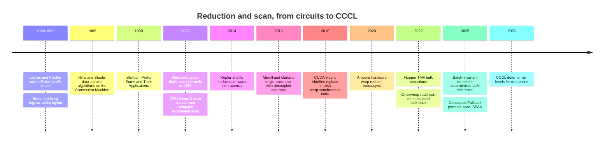
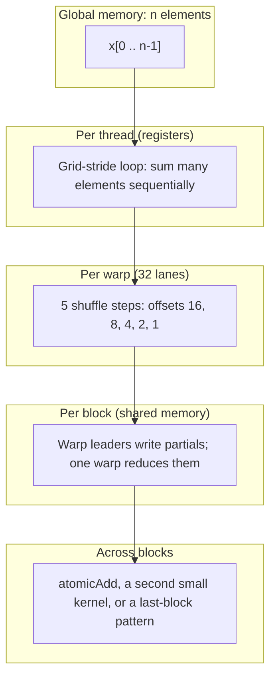
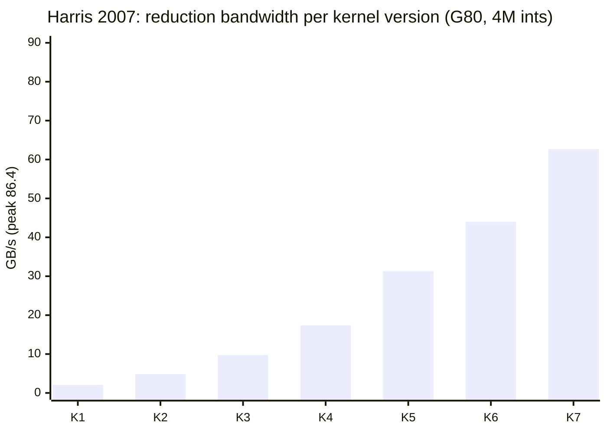
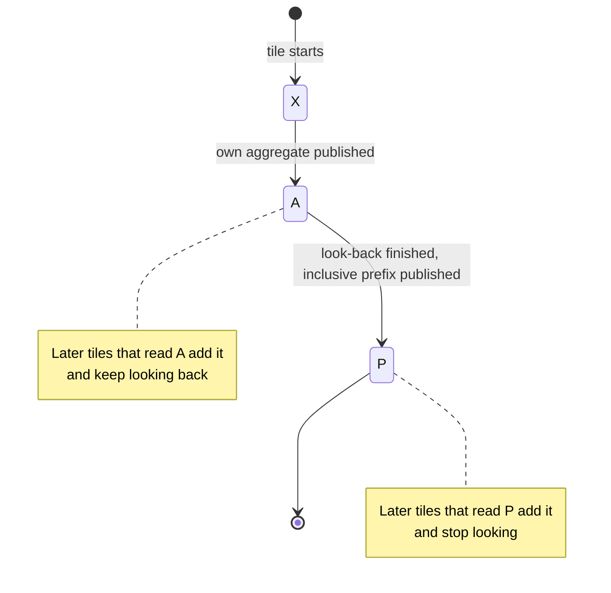

---
tags:
  - gpu-programming
  - kernels-and-optimization
  - cuda
  - reduction
  - prefix-sum
  - scan
  - cub
status: complete
sources:
  - https://developer.download.nvidia.com/compute/cuda/1.1-Beta/x86_website/projects/reduction/doc/reduction.pdf
  - http://www.cs.cmu.edu/~guyb/papers/Ble93.pdf
  - https://en.wikipedia.org/wiki/Prefix_sum
  - https://developer.nvidia.com/gpugems/GPUGems3/gpugems3_ch39.html
  - https://www.eecis.udel.edu/~cavazos//cisc879/papers/ScanPrimitives.pdf
  - https://maths-people.anu.edu.au/~brent/pub/pub060.html
  - https://research.nvidia.com/sites/default/files/pubs/2016-03_Single-pass-Parallel-Prefix/nvr-2016-002.pdf
  - https://nvidia.github.io/cccl/cub/api/structcub_1_1DeviceScan.html
  - https://nvidia.github.io/cccl/cub/api/classcub_1_1BlockReduce.html
  - https://arxiv.org/abs/2206.01784
  - https://raphlinus.github.io/gpu/2021/11/17/prefix-sum-portable.html
  - https://escholarship.org/uc/item/0bk9z4bt
  - https://gridwise-webgpu.github.io/gridwise/scan-and-reduce
  - https://developer.nvidia.com/blog/parallelforall/faster-parallel-reductions-kepler
  - https://developer.nvidia.com/blog/using-cuda-warp-level-primitives/
  - https://docs.nvidia.com/cuda/archive/13.2.0/cuda-programming-guide/04-special-topics/cooperative-groups.html
  - https://forums.developer.nvidia.com/t/reduce-add-sync-float-is-possibl/197932
  - https://nvidia.github.io/cccl/unstable/libcudacxx/ptx/instructions/cp_reduce_async_bulk.html
  - https://thinkingmachines.ai/blog/defeating-nondeterminism-in-llm-inference/
  - https://developer.nvidia.com/blog/controlling-floating-point-determinism-in-nvidia-cccl
  - https://github.com/NVIDIA/cccl/releases/tag/v3.1.0
  - https://docs.pytorch.org/docs/stable/generated/torch.use_deterministic_algorithms.md
  - https://github.com/nvidia/cccl
  - https://nvidia.github.io/cccl/python/compute.html
  - https://pypi.org/project/cuda-cccl/
  - https://developer.nvidia.com/blog/delivering-the-missing-building-blocks-for-nvidia-cuda-kernel-fusion-in-python
  - https://developer.nvidia.com/blog/topping-the-gpu-mode-kernel-leaderboard-with-nvidia-cuda-compute
  - https://yencal.github.io/gpu-parallel-reduction
  - https://nvidia.github.io/cccl/unstable/cub/api_docs/device_topk_requirements.html
  - https://arxiv.org/abs/1805.02867
  - https://www.nvidia.com/en-us/data-center/h100/
created: 2026-11-26
updated: 2026-11-26
---

## Table Of Contents

- [[#TL;DR|TL;DR]]
- [[#The Problem|The Problem]]
- [[#Foundations|Foundations]]
    - [[#Reduce and Scan, Defined|Reduce and Scan, Defined]]
    - [[#Work and Depth|Work and Depth]]
    - [[#Why It Is Memory-Bound|Why It Is Memory-Bound]]
- [[#How We Got Here|How We Got Here]]
- [[#How It Works|How It Works]]
    - [[#The Reduction Hierarchy|The Reduction Hierarchy]]
    - [[#Harris's Seven Kernels|Harris's Seven Kernels]]
    - [[#A Modern Reduction, Line by Line|A Modern Reduction, Line by Line]]
    - [[#Combining Blocks|Combining Blocks]]
    - [[#Scan Inside a Block|Scan Inside a Block]]
    - [[#Scan Across the Whole Array|Scan Across the Whole Array]]
    - [[#Decoupled Look-Back|Decoupled Look-Back]]
- [[#Where It Is Now|Where It Is Now]]
    - [[#Libraries Do This for You|Libraries Do This for You]]
    - [[#Determinism Became a Feature|Determinism Became a Feature]]
    - [[#Portability Beyond NVIDIA|Portability Beyond NVIDIA]]
- [[#Trade-offs & Open Problems|Trade-offs & Open Problems]]
- [[#Resources|Resources]]
- [[#Related Notes|Related Notes]]

## ***TL;DR***
---
*Reduction (combine everything into one value) and scan (give every position the running total up to it) are the two basic ways threads combine their results. They show up inside softmax, normalization, sorting, compaction and top-k, and they are the standard exercise in getting a GPU to run at memory speed.*

- **Reduce** turns `[3 1 7 0 4 1 6 3]` into `25`. **Scan** (prefix sum) turns it into `[3 4 11 11 15 16 22 25]` (inclusive) or `[0 3 4 11 11 15 16 22]` (exclusive) ([Blelloch 1990](http://www.cs.cmu.edu/~guyb/papers/Ble93.pdf)).
- **Both are memory-bound.** A sum does one add per 4-byte float, far below what any GPU's math units can sustain, so the goal is to read the input once at full bandwidth and do everything else on-chip.
- **The shape is a tree, built in levels:** each thread sums many elements in registers, each warp combines 32 values with `__shfl_down_sync`, each block combines its warps through [[Shared Memory and Bank Conflicts|shared memory]], and blocks combine through atomics or a second pass.
- **The classic lesson** is Mark Harris's 2007 deck: seven versions of one reduction kernel, from **2.08 GB/s to 62.7 GB/s** on a G80 with an 86.4 GB/s peak, a 30× speedup from addressing, unrolling and doing more work per thread ([Harris](https://developer.download.nvidia.com/compute/cuda/1.1-Beta/x86_website/projects/reduction/doc/reduction.pdf)).
- **Scan is harder** because every output depends on everything before it. The modern answer is *single-pass scan with decoupled look-back* (Merrill and Garland, 2016): it reads and writes each element once, about **2n** memory traffic instead of 3n, and runs at roughly `memcpy` speed ([NVR-2016-002](https://research.nvidia.com/sites/default/files/pubs/2016-03_Single-pass-Parallel-Prefix/nvr-2016-002.pdf)).
- **Where it is now (Nov 2026):** you almost never hand-write these; CUB in NVIDIA's CCCL does them (C++ and, since 2025, Python). The live issues are *determinism* (CCCL 3.1 added run-to-run and GPU-to-GPU reproducible float reductions; batch-invariant LLM inference depends on fixed reduction order) and *portability* of single-pass scan to GPUs without forward-progress guarantees.

## ***The Problem***
---
*A loop like `for i: sum += x[i]` is one long chain: each add waits for the one before. A GPU has tens of thousands of threads that each need independent work, so the chain has to be reshaped into a tree, and the tree has to be laid out so that memory, warps and blocks are all used well.*

Two things make this hard:

- **Data dependence.** Addition is associative, so `((a+b)+c)+d` equals `(a+b)+(c+d)` in exact arithmetic. That lets you regroup a chain of `n` adds into a tree of depth $\log_2 n$. But every level of the tree has half as many active threads as the one before, so most threads go idle near the root.
- **No global barrier inside a kernel.** Threads in a block can synchronize with `__syncthreads()`, but blocks cannot wait for each other in a normal launch ([[CUDA Programming Model]]). Combining partial results across blocks needs atomics, a second kernel, a special cooperative launch, or a clever protocol like decoupled look-back.

Scan adds a third problem: the output for element `i` depends on *all* elements before it, including ones owned by blocks that may not have run yet.

These patterns are everywhere: softmax needs a max and a sum per row, LayerNorm and RMSNorm need sums of squares, stream compaction and radix sort are built on scan, and top-k selection uses both ([Blelloch](http://www.cs.cmu.edu/~guyb/papers/Ble93.pdf); [Milakov and Gimelshein](https://arxiv.org/abs/1805.02867)).

## ***Foundations***
---
*Three ideas carry the whole topic: the definitions of reduce and scan over any associative operator, the work-versus-depth trade-off between scan algorithms, and the fact that both are limited by memory bandwidth rather than arithmetic.*

### Reduce and Scan, Defined

For an associative operator $\oplus$ (add, max, min, bitwise and/or) with identity $I$ and input $x_0, \dots, x_{n-1}$:

| Operation | Output | Example on `[3 1 7 0 4 1 6 3]` with + |
|---|---|---|
| Reduce | $x_0 \oplus x_1 \oplus \dots \oplus x_{n-1}$ | `25` |
| Inclusive scan | $y_i = x_0 \oplus \dots \oplus x_i$ | `[3 4 11 11 15 16 22 25]` |
| Exclusive scan | $y_i = I \oplus x_0 \oplus \dots \oplus x_{i-1}$ | `[0 3 4 11 11 15 16 22]` |

Blelloch calls scan "a vector all-prefix-sums operation" and lists what it enables: radix sort, quicksort, deleting marked elements (stream compaction), processor allocation, lexical analysis, recurrences, polynomial evaluation and more ([Blelloch 1990](http://www.cs.cmu.edu/~guyb/papers/Ble93.pdf)). *Segmented* scan restarts the running total at flagged boundaries, which lets one launch scan many variable-length lists at once ([Sengupta et al. 2007](https://www.eecis.udel.edu/~cavazos//cisc879/papers/ScanPrimitives.pdf)).

Only associativity is required, not commutativity. That matters for operators like "take the later of two (value, timestamp) pairs".

### Work and Depth

A parallel algorithm has two costs: **work** (total operations) and **depth** (longest chain of dependent steps, the time with unlimited processors). Sequential scan has work $n$ and depth $n$. The parallel options:

| Algorithm (circuit name) | Depth (steps) | Work (adds) | Notes |
|---|---|---|---|
| Hillis-Steele / Kogge-Stone | $\log_2 n$ | $O(n \log_2 n)$ | Each step, every element adds the one $2^d$ to its left. Simple, "not work-efficient" |
| Sklansky | $\log_2 n$ | $O(n \log_2 n)$ | Minimum depth, high fan-out |
| Blelloch / Brent-Kung | $2\log_2 n$ | $O(n)$ | Up-sweep (a reduce tree), then down-sweep. About $2(n-1)$ adds |

(Sources: [Merrill and Garland](https://research.nvidia.com/sites/default/files/pubs/2016-03_Single-pass-Parallel-Prefix/nvr-2016-002.pdf), [GPU Gems 3 ch. 39](https://developer.nvidia.com/gpugems/GPUGems3/gpugems3_ch39.html), [Brent and Kung 1982](https://maths-people.anu.edu.au/~brent/pub/pub060.html), [Wikipedia](https://en.wikipedia.org/wiki/Prefix_sum).) The lower bound is $\log_2 n$ steps and $n-1$ operators, and you can't have both at once.

On a GPU the answer is *both*: inside a warp, where 32 lanes run in lockstep anyway, the extra work of Hillis-Steele costs nothing, so its short depth wins. Across many elements, work-efficiency wins, because extra adds mean extra memory traffic and instructions.

**Brent's theorem** gives the other key idea: with $p$ processors, time is about $\text{work}/p + \text{depth}$. So use far fewer threads than elements, have each thread first sum many elements *sequentially* (cheap, in registers), and only then do the tree. Harris quotes it directly: "Brent's theorem suggests O(N/log N) threads… Each thread does O(log N) sequential work", a trick "sometimes called algorithm cascading" ([Harris](https://developer.download.nvidia.com/compute/cuda/1.1-Beta/x86_website/projects/reduction/doc/reduction.pdf)).

### Why It Is Memory-Bound

Use the [[Roofline Model and Arithmetic Intensity|roofline]]. A float sum does 1 add per 4 bytes read:

$$\text{AI} = \frac{1\ \text{FLOP}}{4\ \text{bytes}} = 0.25\ \text{FLOP/byte}$$

**Worked example, H100 SXM.** NVIDIA lists 3.35 TB/s of HBM3 bandwidth and 67 TFLOPS of FP32 ([NVIDIA H100](https://www.nvidia.com/en-us/data-center/h100/)). The ridge point is $67 \times 10^{12} / 3.35 \times 10^{12} \approx 20$ FLOP/byte, so a sum sits **80× below** it: the math units will be almost idle no matter what. Summing $2^{28}$ floats (1.07 GB) can't take less than

$$t_{\min} = \frac{1.07 \times 10^{9}\ \text{B}}{3.35 \times 10^{12}\ \text{B/s}} \approx 0.32\ \text{ms}$$

So a reduction is judged by **achieved bandwidth as a fraction of peak**, not FLOPs. A December 2025 write-up of hand-tuned H100 reductions reports about 3,100 to 3,200 GB/s with 16-byte vector loads (about 93% to 95% of peak) but only about 2,300 GB/s with plain 4-byte loads ([Yenusah](https://yencal.github.io/gpu-parallel-reduction)). The same logic applies to scan, which must also *write* $n$ elements, so its floor is reading plus writing the array once: the cost of a copy.

## ***How We Got Here***
---
*Scan is older than GPUs: it comes from 1970s and 1980s adder circuits and 1980s data-parallel machines. GPUs added the problem of mapping it onto warps, blocks and a memory system, which took from 2007 to 2016 to settle, and the 2020s added hardware help and a focus on reproducibility.*



- **Circuits.** Kogge-Stone, Sklansky and Brent-Kung are names of parallel-prefix *adder* designs, because a carry chain is a scan. Brent and Kung's "A regular layout for parallel adders" (IEEE Trans. Computers, 1982) gave the work-efficient $2\log_2 n$-depth form ([Brent](https://maths-people.anu.edu.au/~brent/pub/pub060.html)). Wikipedia credits the first work-efficient parallel prefix to Ladner and Fischer, 1980 ([Wikipedia](https://en.wikipedia.org/wiki/Prefix_sum)).
- **Data-parallel machines.** Hillis and Steele's "Data Parallel Algorithms" (CACM, 1986) popularized the step-efficient scan on the Connection Machine. Blelloch's 1990 report made scan a primitive in its own right, with the up-sweep/down-sweep algorithm and a long list of uses ([Blelloch](http://www.cs.cmu.edu/~guyb/papers/Ble93.pdf)).
- **First CUDA GPUs (2007).** Harris's reduction deck became the standard tutorial ([Harris](https://developer.download.nvidia.com/compute/cuda/1.1-Beta/x86_website/projects/reduction/doc/reduction.pdf)). GPU Gems 3 chapter 39 (Harris, Sengupta, Owens) did the same for scan, "up to 20 times faster" than a fast CPU ([GPU Gems 3](https://developer.nvidia.com/gpugems/GPUGems3/gpugems3_ch39.html)), and Sengupta et al. added segmented scan, sorting 4M keys in 165 ms against 572 ms for CPU STL sort on an 8800 GTX ([Sengupta et al.](https://www.eecis.udel.edu/~cavazos//cisc879/papers/ScanPrimitives.pdf)).
- **Shuffles (Kepler, 2012 onward).** Warp shuffles let lanes read each other's registers without shared memory. Luitjens' 2014 post found "warpReduceSum followed by atomics is the fastest" on a K20X ([NVIDIA blog](https://developer.nvidia.com/blog/parallelforall/faster-parallel-reductions-kepler)). See [[Warp Divergence and Warp-Level Primitives]].
- **Single-pass scan (2016).** Merrill and Garland's decoupled look-back, shipped in CUB, got scan down to one read and one write per element ([NVR-2016-002](https://research.nvidia.com/sites/default/files/pubs/2016-03_Single-pass-Parallel-Prefix/nvr-2016-002.pdf)).
- **The `_sync` fix (2018).** Volta's independent thread scheduling broke the old trick of skipping barriers in the last warp. NVIDIA's guidance: "Such implicit warp-synchronous programming is unsafe and may not work correctly", use `*_sync` intrinsics or `__syncwarp()` ([Lin and Grover](https://developer.nvidia.com/blog/using-cuda-warp-level-primitives/)).
- **Hardware help (2020 to 2022).** Ampere (compute capability 8.0) added a one-instruction integer warp reduce, `__reduce_add_sync` (PTX `redux.sync`); Hopper (9.0) added bulk asynchronous reductions through the [[TMA and Asynchronous Copies|Tensor Memory Accelerator]].

## ***How It Works***
---
*A fast reduction is a tree mapped onto the GPU's own hierarchy: registers, then warps, then blocks, then the grid. Scan uses the same levels, plus a way to pass running totals from one block to the next.*

### The Reduction Hierarchy



Each level exists to keep the level above it cheap. Registers are free to add into, so threads do as much sequential work as possible. Shuffles move data between lanes without touching memory. [[Shared Memory and Bank Conflicts|Shared memory]] is only used to pass one value per warp. Global memory sees the input once, read with [[Memory Coalescing|coalesced]] loads, and one write (or atomic) per block.

### Harris's Seven Kernels

Harris's deck takes one block-level reduction through seven versions on a G80 (GeForce 8800 GTX), 4M integers, 128 threads per block, against an 86.4 GB/s peak (384-bit bus × 1,800 MT/s ÷ 8) ([Harris](https://developer.download.nvidia.com/compute/cuda/1.1-Beta/x86_website/projects/reduction/doc/reduction.pdf)):

| # | Change | Time | Bandwidth | Cumulative speedup |
|---|---|---|---|---|
| 1 | Interleaved addressing, `if (tid % (2*s) == 0)` | 8.054 ms | 2.08 GB/s | 1× |
| 2 | Strided index so active threads are contiguous (no divergence, but bank conflicts) | 3.456 ms | 4.85 GB/s | 2.33× |
| 3 | Sequential addressing: `if (tid < s)` with `s` halving | 1.722 ms | 9.74 GB/s | 4.68× |
| 4 | First add during the global load (half the threads idle otherwise) | 0.965 ms | 17.38 GB/s | 8.34× |
| 5 | Unroll the last warp | 0.536 ms | 31.29 GB/s | 15.01× |
| 6 | Unroll completely with templates | 0.381 ms | 44.00 GB/s | 21.16× |
| 7 | Many elements per thread (algorithm cascading) | 0.268 ms | 62.67 GB/s | 30.04× |



What each step teaches:

- **1 → 2: divergence.** `tid % (2*s) == 0` leaves active threads scattered across every warp, so every warp runs the branch with most lanes masked off. See [[Warp Divergence and Warp-Level Primitives]].
- **2 → 3: bank conflicts.** Strided shared-memory indexing makes many lanes hit the same bank; contiguous indexing fixes it. See [[Shared Memory and Bank Conflicts]].
- **3 → 4 and 6 → 7: give threads real work.** In kernel 3, half the threads do nothing after loading. Adding during the load, then summing many elements per thread, applies Brent's theorem. Kernel 7 reaches 73 GB/s on 32M elements.
- **4 → 6: cut overhead.** Loop and barrier instructions cost as much as the adds. Harris's conclusion: algorithm changes gave 11.84×, unrolling 2.54×; "Optimize your algorithm, then unroll loops."

**Warning about kernel 5.** It skipped `__syncthreads()` in the last 32 threads by relying on the warp running in lockstep, using a `volatile` shared array. Since Volta, lanes of a warp can be scheduled independently, and NVIDIA says this "implicit warp-synchronous programming is unsafe" ([Lin and Grover](https://developer.nvidia.com/blog/using-cuda-warp-level-primitives/)). Use shuffles with `_sync` instead, as below.

### A Modern Reduction, Line by Line

This follows the structure of Luitjens' Kepler post with today's `_sync` intrinsics ([NVIDIA blog](https://developer.nvidia.com/blog/parallelforall/faster-parallel-reductions-kepler); [Lin and Grover](https://developer.nvidia.com/blog/using-cuda-warp-level-primitives/)):

```cuda
__inline__ __device__ float warpReduceSum(float val) {
  for (int offset = 16; offset > 0; offset /= 2)
    val += __shfl_down_sync(0xffffffff, val, offset);
  return val;                                  // lane 0 holds the warp's sum
}

__inline__ __device__ float blockReduceSum(float val) {
  __shared__ float partial[32];                // one slot per warp (max 32 warps)
  int lane = threadIdx.x % 32, warp = threadIdx.x / 32;
  val = warpReduceSum(val);                    // 1: reduce inside each warp
  if (lane == 0) partial[warp] = val;          // 2: each warp's lane 0 publishes
  __syncthreads();
  val = (threadIdx.x < blockDim.x / 32) ? partial[lane] : 0.0f;
  if (warp == 0) val = warpReduceSum(val);     // 3: warp 0 reduces the partials
  return val;                                  // thread 0 holds the block's sum
}

__global__ void reduceSum(const float* in, float* out, size_t n) {
  float sum = 0.0f;
  for (size_t i = blockIdx.x * blockDim.x + threadIdx.x; i < n;
       i += (size_t)blockDim.x * gridDim.x)    // grid-stride loop
    sum += in[i];
  sum = blockReduceSum(sum);
  if (threadIdx.x == 0) atomicAdd(out, sum);   // one atomic per block
}
```

- **`__shfl_down_sync(0xffffffff, val, offset)`**: every lane gets `val` from the lane `offset` places above it. The mask `0xffffffff` says all 32 lanes take part. After offsets 16, 8, 4, 2, 1 (five steps, $\log_2 32$), lane 0 has added all 32 values. Lanes near the top read garbage they never use.
- **`partial[32]`**: a block has at most 1,024 threads, so at most 32 warps, so 32 slots is always enough.
- **`if (lane == 0) partial[warp] = val;` then `__syncthreads()`**: each warp leader writes one value; the barrier makes those writes visible to the whole block.
- **The `partial[lane]` read**: the first warp loads the partials (zero for slots past the number of warps, which assumes `blockDim.x` is a multiple of 32), and one more shuffle reduction finishes the block.
- **The grid-stride loop**: each thread walks the array in steps of the whole grid's size, so you can launch just enough blocks to fill the GPU and every thread sums many elements in a register first. Neighboring threads read neighboring addresses, so loads are coalesced. See [[CUDA Programming Model]].
- **`atomicAdd(out, sum)`**: one global atomic per block combines the blocks. `*out` must be zeroed before the launch. Float atomics land in whatever order blocks finish, so the last bits of the result can change from run to run; see [[#Determinism Became a Feature|Determinism Became a Feature]].

Two hardware shortcuts exist. On compute capability 8.0+, `__reduce_add_sync(mask, x)` does a whole warp's integer sum in one instruction (PTX `redux.sync`), but it does not take `float` ([NVIDIA forums](https://forums.developer.nvidia.com/t/reduce-add-sync-float-is-possibl/197932)). Cooperative Groups' `cg::reduce(tile, x, cg::plus<float>())` picks the hardware path when it can: "Hardware acceleration is used for reductions when available (requires Compute Capability 8.0 or greater)… Only 4B types are accelerated by hardware", with a software fallback elsewhere ([CUDA 13.2 Programming Guide](https://docs.nvidia.com/cuda/archive/13.2.0/cuda-programming-guide/04-special-topics/cooperative-groups.html)).

### Combining Blocks

| Method | How | Cost and catch |
|---|---|---|
| Atomics | One `atomicAdd` per block into the output | One kernel, fastest; float result order varies |
| Two kernels | Kernel 1 writes one partial per block; kernel 2 reduces the partials | Deterministic; one extra launch (small, since partials number in the hundreds) |
| Last-block pattern | Each block writes its partial, does `__threadfence()`, then bumps an atomic counter; the block that sees the final count reduces all partials | One kernel, deterministic order; CUDA's `threadFenceReduction` sample shows it ("Single-pass reduction requires global atomic instructions") |
| Grid sync | `cudaLaunchCooperativeKernel` plus `grid.sync()` | Grid must fit on the GPU at once; compute capability 6.0+ ([Programming Guide](https://docs.nvidia.com/cuda/archive/13.2.0/cuda-programming-guide/04-special-topics/cooperative-groups.html)) |
| Clusters (Hopper+) | Blocks in a [[CUDA Programming Model|thread block cluster]] read each other's shared memory, so up to 8 blocks (the portable limit) can combine on-chip first | Compute capability 9.0+ |
| TMA bulk reduce (Hopper+) | `cp.reduce.async.bulk` adds a whole shared-memory buffer into global memory (or another block's shared memory) asynchronously; supports add, min, max, and/or/xor on integer and float types | PTX ISA 8.0, `sm_90` ([CCCL PTX docs](https://nvidia.github.io/cccl/unstable/libcudacxx/ptx/instructions/cp_reduce_async_bulk.html)) |

### Scan Inside a Block

**Inside a warp**, use Hillis-Steele with shuffles: five steps, each adding the value $2^d$ lanes to the left.

```cuda
__device__ int warpInclusiveScan(int x) {
  int lane = threadIdx.x % 32;
  for (int d = 1; d < 32; d *= 2) {
    int y = __shfl_up_sync(0xffffffff, x, d);  // value from lane - d
    if (lane >= d) x += y;                       // lanes below d have no such neighbor
  }
  return x;                                      // lane i holds x[0] + ... + x[i]
}
```

- **`__shfl_up_sync(mask, x, d)`** gives each lane the `x` of the lane `d` below it. Lanes `0 .. d-1` get their own value back, so the `if` skips them.
- After `d = 1, 2, 4, 8, 16`, lane `i` has summed lanes `0..i`: 5 steps instead of 31, at the cost of $O(32 \log 32)$ adds, which is free because all 32 lanes run each step anyway.

**Across a block**, the same three-level trick as reduction works: scan inside each warp, write each warp's total to shared memory, scan those totals with one warp, then add each warp's offset back.

**The textbook alternative** is Blelloch's work-efficient up-sweep/down-sweep in shared memory. On `[3 1 7 0 4 1 6 3]`:

| Phase | Array after the step |
|---|---|
| Input | `3 1 7 0 4 1 6 3` |
| Up-sweep, stride 1 (pairwise sums into odd slots) | `3 4 7 7 4 5 6 9` |
| Up-sweep, stride 2 | `3 4 7 11 4 5 6 14` |
| Up-sweep, stride 4 (last slot holds the total, 25) | `3 4 7 11 4 5 6 25` |
| Down-sweep: set root to 0 | `3 4 7 11 4 5 6 0` |
| Stride 4: left child gets parent; right gets parent + old left | `3 4 7 0 4 5 6 11` |
| Stride 2 | `3 0 7 4 4 11 6 16` |
| Stride 1: exclusive scan | `0 3 4 11 11 15 16 22` |

GPU Gems 3 implements this per block and pads shared-memory indices to avoid [[Shared Memory and Bank Conflicts|bank conflicts]] at large strides ([GPU Gems 3](https://developer.nvidia.com/gpugems/GPUGems3/gpugems3_ch39.html)). Two cautions if you copy it: it assumes the G80's 16 banks (today's GPUs have 32), and the `CONFLICT_FREE_OFFSET` macro as printed has an operator-precedence problem (`+` binds tighter than `>>`), so most reimplementations use `((n) >> LOG_NUM_BANKS)`.

### Scan Across the Whole Array

Blocks run in no fixed order, so block 7 can't simply wait for block 6's total. The classic answers, with their global memory traffic for $n$ elements ([Merrill and Garland](https://research.nvidia.com/sites/default/files/pubs/2016-03_Single-pass-Parallel-Prefix/nvr-2016-002.pdf)):

| Strategy | Passes | Global traffic |
|---|---|---|
| Scan-then-propagate: scan each block, scan the block totals, add offsets back | 3 | about $4n$ |
| Reduce-then-scan: reduce each block, scan the totals, then rescan each block with its offset | 3 | about $3n$ ($2n$ reads, $n$ writes) |
| Chained scan / decoupled look-back | 1 | about $2n$ ($n$ reads, $n$ writes) |

Since scan is memory-bound, traffic is time: going from $3n$ to $2n$ is a theoretical 1.5× speedup, and $2n$ is the same as a copy, which is why "copy serves as an ideal performance ceiling for prefix scan".

### Decoupled Look-Back

The idea: each block (a *tile*) publishes what it knows as soon as it knows it, and later tiles combine those published values instead of waiting for a strict chain.

1. A tile takes its index from a global atomic counter, not from `blockIdx`, so every earlier tile is guaranteed to have already started.
2. It reduces its own data and publishes its **aggregate** with flag `A`.
3. It *looks back* at predecessors' status words, newest first: flag `X` (nothing yet) means wait; `A` means add that aggregate and keep looking further back; `P` (inclusive prefix available) means add it and stop.
4. It publishes its own **inclusive prefix** with flag `P`, then scans its tile with that offset and writes the output.



Because most tiles find a `P` within a few steps, the look-back costs little, and the input is read only once. Merrill and Garland used tiles of 128 threads × 16 items = 2,048 elements, and report that "CUB throughput is able to match the performance ceiling of memcpy for large problems" on Kepler and Maxwell, with harmonic-mean speedups of 1.11× over StreamScan and 2.27× over Thrust at the time ([NVR-2016-002](https://research.nvidia.com/sites/default/files/pubs/2016-03_Single-pass-Parallel-Prefix/nvr-2016-002.pdf)). CUB's docs still describe DeviceScan as "~2n data movement" that "typically proceeds at 'memcpy' speeds" ([CUB DeviceScan](https://nvidia.github.io/cccl/cub/api/structcub_1_1DeviceScan.html)).

The catch is the spin in step 3: it is only safe if the hardware guarantees that a waiting tile can't starve the tile it waits on. The paper says it "will run to completion if the system guarantees forward-progress for all processors". The same structure powers **Onesweep**, a single-pass radix sort that reaches about 29.4 billion 32-bit keys per second on an A100, about 1.5× CUB's previous sort ([Adinets and Merrill 2022](https://arxiv.org/abs/2206.01784)).

## ***Where It Is Now***
---
*As of November 2026: reduction and scan are solved problems on NVIDIA hardware and live in CCCL. The active work is about making float results reproducible on purpose, getting single-pass scan to run on GPUs without forward-progress guarantees, and pushing these primitives into Python and fused kernels.*

### Libraries Do This for You

- **CUB, Thrust and libcu++** now ship together as the CUDA C++ Core Libraries (CCCL). The repository's version table lists CCCL 3.2 paired with CUDA 13.2; CCCL 3.0 (with CUDA 13.0) made C++17 the minimum and removed `cub::GridBarrier` in favor of Cooperative Groups ([CCCL](https://github.com/nvidia/cccl)).
- **Block and warp building blocks:** `cub::WarpReduce`, `cub::WarpScan`, `cub::BlockReduce` (with warp-reductions, raking and commutative-only raking variants; result valid in thread 0) and `cub::BlockScan` drop into your own kernels ([CUB BlockReduce](https://nvidia.github.io/cccl/cub/api/classcub_1_1BlockReduce.html)). Device-wide `cub::DeviceReduce`, `DeviceScan` (including `*ByKey` segmented forms) and a newer `cub::DeviceTopK` handle whole arrays ([CUB TopK](https://nvidia.github.io/cccl/unstable/cub/api_docs/device_topk_requirements.html)).
- **Python.** NVIDIA's `cuda.compute` exposes device-wide reduce, scan and sort, for example `reduce_into(d_input, d_output, OpKind.PLUS, n, h_init)` ([docs](https://nvidia.github.io/cccl/python/compute.html)). NVIDIA's July 2025 post showed a custom reduction at about 28 µs against about 690 µs in CuPy on an RTX 6000 Ada ([NVIDIA blog](https://developer.nvidia.com/blog/delivering-the-missing-building-blocks-for-nvidia-cuda-kernel-fusion-in-python)). The `cuda-cccl` package was at 1.3.0 on October 27, 2026 ([PyPI](https://pypi.org/project/cuda-cccl/)).
- **Competition results.** In February 2026 NVIDIA reported that the CCCL team took the most first places on the GPU MODE kernel leaderboard across B200, H100, A100 and L4, including PrefixSum, with a sort "two-to-four times faster than the next best submission" ([NVIDIA blog](https://developer.nvidia.com/blog/topping-the-gpu-mode-kernel-leaderboard-with-nvidia-cuda-compute)). No official CUB bandwidth-versus-peak figure for H100 or B200 turned up.
- **Inside fused kernels**, reductions are usually not separate launches at all: softmax, RMSNorm and [[FlashAttention]] do their row reductions in registers and shared memory as part of a larger kernel. The online softmax trick (one pass computing max and sum together) was published in 2018 with up to 1.3× speedup, 5× when fused with top-k ([Milakov and Gimelshein](https://arxiv.org/abs/1805.02867)). See [[Kernel Fusion]].

### Determinism Became a Feature

Floating-point addition isn't associative: $(0.1 + 10^{20}) - 10^{20} = 0$, while $0.1 + (10^{20} - 10^{20}) = 0.1$. Any change in tree shape or atomic order can change the low bits of a sum.

- **The LLM inference case.** Thinking Machines Lab (Sep 2025) showed that the main source of run-to-run differences in LLM serving is not atomics (the forward pass uses none) but *batch size changing the reduction order* inside RMSNorm, split-K matmuls and attention. Their fix is *batch-invariant* kernels: "the reduction order for each element must be fixed regardless of the batch-size". With them, 1,000 temperature-0 completions from Qwen3-235B were identical (80 distinct outputs before), at a cost of 26 s → 42 s for their test with the improved attention kernel ([Thinking Machines](https://thinkingmachines.ai/blog/defeating-nondeterminism-in-llm-inference/)).
- **CCCL determinism levels (CCCL 3.1, described Mar 2026).** `cub::DeviceReduce` now takes a requirement: `not_guaranteed` (atomics, single kernel, fastest), `run_to_run` (the default: a fixed tree, two kernels, same answer every run on the same GPU) and `gpu_to_gpu` (a reproducible floating-point accumulator, the same bits on any GPU, "increasing execution time by 20% to 30% for large problem sizes"), benchmarked on H200 ([NVIDIA blog](https://developer.nvidia.com/blog/controlling-floating-point-determinism-in-nvidia-cccl); [CCCL v3.1.0](https://github.com/NVIDIA/cccl/releases/tag/v3.1.0)). CUB's scan docs still warn that results "are not deterministic for pseudo-associative operators (e.g., addition of floating-point types)" ([CUB DeviceScan](https://nvidia.github.io/cccl/cub/api/structcub_1_1DeviceScan.html)).
- **Frameworks.** PyTorch's `torch.use_deterministic_algorithms(True)` swaps in deterministic versions of ops like `index_add`, `scatter_add_` and float `cumsum` on CUDA, raises errors on ops like `histc`, and warns that "this setting alone is not always enough to make an application reproducible" ([PyTorch](https://docs.pytorch.org/docs/stable/generated/torch.use_deterministic_algorithms.md)).

### Portability Beyond NVIDIA

Decoupled look-back assumes forward progress. Raph Levien found in 2021 that it works on Vulkan and DX12 fairly portably but not on Metal or WebGPU, and that some Apple and ARM GPUs don't guarantee forward progress; piet-gpu fell back to a tree ([Levien](https://raphlinus.github.io/gpu/2021/11/17/prefix-sum-portable.html)). The Gridwise WebGPU project reports decoupled look-back "locked up the entire machine" on Apple hardware ([Gridwise](https://gridwise-webgpu.github.io/gridwise/scan-and-reduce)).

The 2025 answer is **Decoupled Fallback** (Smith, Levien and Owens, SPAA 2025): a tile that finds a predecessor stalled stops spinning and recomputes that predecessor's reduction itself. It needs neither 64-bit atomics nor memory barriers for correctness, doesn't depend on subgroup size, and reaches "near-Memcpy speeds" on Apple M1 Max and M3 under WebGPU ([eScholarship](https://escholarship.org/uc/item/0bk9z4bt)). On AMD, the same CUDA-style code ports through [[ROCm and HIP]], where a wavefront can be 64 lanes rather than 32, so warp-level loops must not hard-code 32.

## ***Trade-offs & Open Problems***
---
*The algorithms are settled; the open questions are about which guarantees to pay for: bit-for-bit reproducibility, portability across vendors, and whether to fuse the reduction into a bigger kernel or call a library.*

| Choice | Gains | Costs |
|---|---|---|
| Atomics across blocks | One kernel, least traffic | Float results vary run to run; contention if many blocks hit one address |
| Fixed tree (two kernels) | Run-to-run reproducible | Extra launch; still varies across GPU models if tile sizes change |
| Reproducible accumulator (`gpu_to_gpu`) | Same bits on any GPU | 20% to 30% slower at large sizes in CCCL's measurements |
| Hillis-Steele scan | Fewest steps | $O(n \log n)$ work; only sensible within a warp |
| Blelloch scan | Work-efficient | Twice the steps; bank-conflict care in shared memory |
| Decoupled look-back | One pass, `memcpy` speed | Needs forward-progress guarantees; status-word protocol is subtle |
| Library (CUB) | Tuned per architecture, maintained | A separate launch unless you use the block/warp primitives inside your own kernel |
| Hand-fused | No extra memory round trip | Every kernel reimplements, and must get determinism right itself |

Open problems:

- **Batch invariance has a price.** Fixing reduction order constrains split-K and split-KV parallelism, which is how small batches get enough parallelism. Thinking Machines' deterministic run took 42 s against 26 s for the default ([Thinking Machines](https://thinkingmachines.ai/blog/defeating-nondeterminism-in-llm-inference/)).
- **Forward progress is not a portable assumption.** Single-pass scan on Apple, ARM and WebGPU needs fallbacks like Decoupled Fallback, and Gridwise reports that without native subgroup operations scans are much slower ([Gridwise](https://gridwise-webgpu.github.io/gridwise/scan-and-reduce)).
- **Low precision.** Summing FP16, BF16 or FP8 values needs a wider accumulator; choosing where to widen is a per-kernel decision with accuracy and bandwidth costs.
- **Hardware reductions are still narrow.** `__reduce_add_sync` is integer-only, and `cg::reduce` accelerates only 4-byte types ([Programming Guide](https://docs.nvidia.com/cuda/archive/13.2.0/cuda-programming-guide/04-special-topics/cooperative-groups.html)); float warp reductions still take five shuffles.

## ***Resources***
---
*Read Harris's deck for the craft of making a reduction fast, Blelloch and GPU Gems 3 for scan, and Merrill and Garland for how production scan works today. The CCCL determinism post and the Thinking Machines post show what people care about in 2025 and 2026.*

**Primary papers and reports**
- [Optimizing Parallel Reduction in CUDA](https://developer.download.nvidia.com/compute/cuda/1.1-Beta/x86_website/projects/reduction/doc/reduction.pdf): Mark Harris, NVIDIA, 2007.
- [Prefix Sums and Their Applications](http://www.cs.cmu.edu/~guyb/papers/Ble93.pdf): Guy Blelloch, CMU-CS-90-190, 1990.
- [Parallel Prefix Sum (Scan) with CUDA](https://developer.nvidia.com/gpugems/GPUGems3/gpugems3_ch39.html): Harris, Sengupta and Owens, GPU Gems 3 ch. 39, 2007.
- [Scan Primitives for GPU Computing](https://www.eecis.udel.edu/~cavazos//cisc879/papers/ScanPrimitives.pdf): Sengupta, Harris, Zhang and Owens, Graphics Hardware 2007.
- [A regular layout for parallel adders](https://maths-people.anu.edu.au/~brent/pub/pub060.html): Brent and Kung, IEEE Trans. Computers, 1982.
- [Single-pass Parallel Prefix Scan with Decoupled Look-back](https://research.nvidia.com/sites/default/files/pubs/2016-03_Single-pass-Parallel-Prefix/nvr-2016-002.pdf): Merrill and Garland, NVIDIA NVR-2016-002, 2016.
- [Onesweep: A Faster Least Significant Digit Radix Sort for GPUs](https://arxiv.org/abs/2206.01784): Adinets and Merrill, 2022.
- [Decoupled Fallback: A Portable Single-Pass GPU Scan](https://escholarship.org/uc/item/0bk9z4bt): Smith, Levien and Owens, SPAA 2025.
- [Online normalizer calculation for softmax](https://arxiv.org/abs/1805.02867): Milakov and Gimelshein, 2018.

**NVIDIA docs and blog**
- [Faster Parallel Reductions on Kepler](https://developer.nvidia.com/blog/parallelforall/faster-parallel-reductions-kepler): Justin Luitjens, 2014.
- [Using CUDA Warp-Level Primitives](https://developer.nvidia.com/blog/using-cuda-warp-level-primitives/): Lin and Grover, 2018.
- [Cooperative Groups, CUDA 13.2 Programming Guide](https://docs.nvidia.com/cuda/archive/13.2.0/cuda-programming-guide/04-special-topics/cooperative-groups.html).
- [cp.reduce.async.bulk](https://nvidia.github.io/cccl/unstable/libcudacxx/ptx/instructions/cp_reduce_async_bulk.html): Hopper bulk reductions.
- [CUB DeviceScan](https://nvidia.github.io/cccl/cub/api/structcub_1_1DeviceScan.html) and [CUB BlockReduce](https://nvidia.github.io/cccl/cub/api/classcub_1_1BlockReduce.html).
- [Controlling Floating-Point Determinism in NVIDIA CCCL](https://developer.nvidia.com/blog/controlling-floating-point-determinism-in-nvidia-cccl): Mar 2026.
- [Delivering the Missing Building Blocks for NVIDIA CUDA Kernel Fusion in Python](https://developer.nvidia.com/blog/delivering-the-missing-building-blocks-for-nvidia-cuda-kernel-fusion-in-python): Jul 2025.
- [Topping the GPU MODE Kernel Leaderboard with NVIDIA CUDA.compute](https://developer.nvidia.com/blog/topping-the-gpu-mode-kernel-leaderboard-with-nvidia-cuda-compute): Feb 2026.
- [CCCL repository](https://github.com/nvidia/cccl) and [cuda.compute docs](https://nvidia.github.io/cccl/python/compute.html).

**Practitioners**
- [Defeating Nondeterminism in LLM Inference](https://thinkingmachines.ai/blog/defeating-nondeterminism-in-llm-inference/): Thinking Machines Lab, Sep 2025.
- [Prefix sum on portable compute shaders](https://raphlinus.github.io/gpu/2021/11/17/prefix-sum-portable.html): Raph Levien, 2021.
- [Gridwise: scan and reduce](https://gridwise-webgpu.github.io/gridwise/scan-and-reduce): WebGPU implementation of Decoupled Fallback.
- [GPU parallel reduction on H100](https://yencal.github.io/gpu-parallel-reduction): Yenusah, Dec 2025.

## ***Related Notes***
---
*The hardware features each reduction level leans on, and the kernels that use reductions inside them.*

- [[Warp Divergence and Warp-Level Primitives]] — Shuffles, `_sync` masks and why kernel 5's old trick broke.
- [[Shared Memory and Bank Conflicts]] — Why sequential addressing beats strided addressing in the block-level tree.
- [[Memory Coalescing]] — Reading the input at full bandwidth.
- [[Roofline Model and Arithmetic Intensity]] — Why reductions are judged by bandwidth.
- [[GPU Memory Hierarchy]] — Registers, shared memory and HBM, the levels the tree is mapped onto.
- [[Occupancy and Latency Hiding]] — How many blocks and warps to launch so loads overlap.
- [[CUDA Programming Model]] — Blocks, grids, clusters and why blocks can't wait for each other.
- [[GPU Architecture Basics]] — Warps, SMs and SIMT.
- [[TMA and Asynchronous Copies]] — Hopper's bulk asynchronous reductions.
- [[Kernel Fusion]] — Doing the reduction inside a larger kernel instead of a separate launch.
- [[Tiled Matrix Multiplication (GEMM)]] — Split-K, a reduction across tiles that affects determinism.
- [[FlashAttention]] — Online softmax, a fused per-row reduction.
- [[CUTLASS and CuTe]] — Where reductions appear in GEMM epilogues.
- [[Triton]] — `tl.sum` and `tl.cumsum` as block-level reductions.
- [[ROCm and HIP]] — 64-lane wavefronts and portable warp code.
- [[Profiling with Nsight Compute and Nsight Systems]] — Measuring achieved bandwidth against peak.
- [[Thread Block Clusters and Distributed Shared Memory]] — Cross-block reductions through distributed shared memory.
