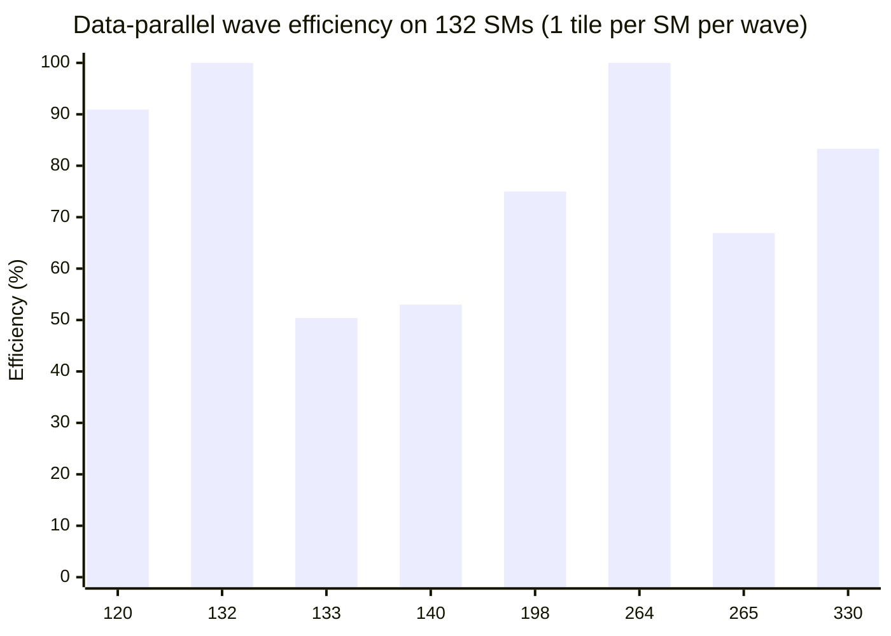
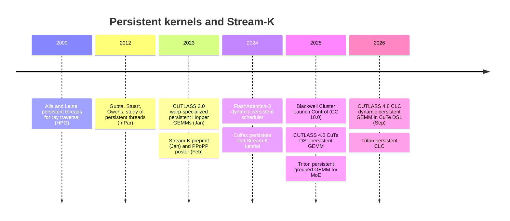
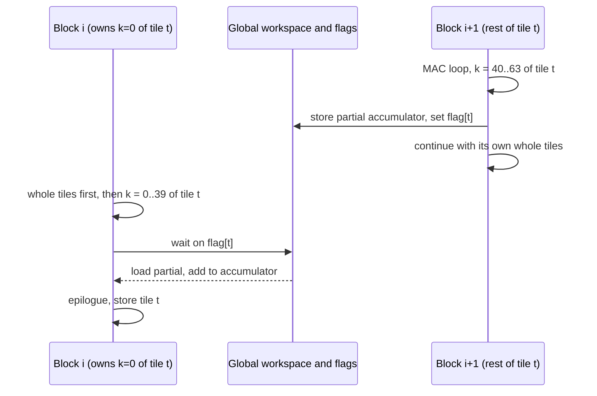
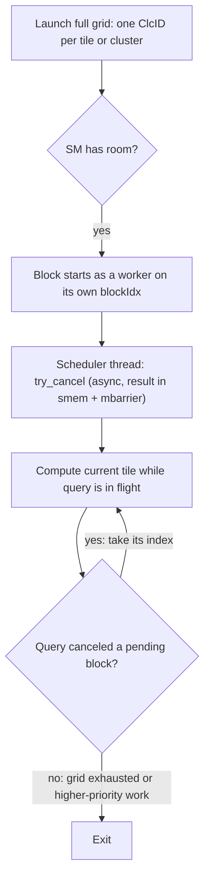

---
tags:
  - gpu-programming
  - kernels-optimization
  - persistent-kernels
  - stream-k
  - gemm
  - scheduling
  - load-balancing
status: complete
sources:
  - https://ppopp23.sigplan.org/details/PPoPP-2023-papers/36/POSTER-Stream-K-Work-centric-Parallel-Decomposition-for-Dense-Matrix-Matrix-Multipl
  - https://arxiv.org/abs/2408.11417
  - https://arxiv.org/abs/2407.00044
  - https://users.aalto.fi/~laines9/publications/aila2009hpg_paper.pdf
  - https://research.nvidia.com/publication/2009-08_understanding-efficiency-ray-traversal-gpus
  - https://klasses.cs.uchicago.edu/archive/2016/winter/32001-1/papers/AStudyofPersistentThreadsStyleGPUProgrammingforGPGPUWorkloads.pdf
  - https://search.isc.ac/inventory/49/1954847.htm
  - https://ar5iv.labs.arxiv.org/html/2301.03598
  - https://arxiv.org/abs/2301.03598
  - https://research.colfax-intl.com/cutlass-tutorial-persistent-kernels-and-stream-k/
  - https://docs.nvidia.com/cutlass/4.8.0/media/docs/cpp/blackwell_cluster_launch_control.html
  - https://docs.nvidia.com/cutlass/4.8.0/media/docs/cpp/grouped_scheduler.html
  - https://docs.nvidia.com/cutlass/4.8.0/CHANGELOG.html
  - https://docs.nvidia.com/cuda/cuda-programming-guide/04-special-topics/cluster-launch-control.html
  - https://triton-lang.org/main/getting-started/tutorials/09-persistent-matmul.html
  - https://triton-lang.org/main/getting-started/tutorials/gluon/cluster-launch-control.html
  - https://triton-lang.org/main/getting-started/tutorials/gluon/persistence.html
  - https://pytorch.org/blog/accelerating-moes-with-a-triton-persistent-cache-aware-grouped-gemm-kernel/
  - https://pytorch.org/blog/cutlass-ping-pong-gemm-kernel/
  - https://huggingface.co/kernels-community/flash-attn3/blob/f935a7486c4a0b4c146da2d6c7a1003948d5c370/flash-attn/tile_scheduler.hpp
  - https://arxiv.org/html/2407.08608v2
  - https://docs.nvidia.com/deeplearning/performance/dl-performance-matrix-multiplication/index.html
  - https://developer.nvidia.com/blog/nvidia-hopper-architecture-in-depth/
  - https://developer.nvidia.com/blog/improving-gemm-kernel-auto-tuning-efficiency-on-nvidia-gpus-with-heuristics-and-cutlass-4-2/
  - https://docs.nvidia.com/cuda/nvidia-matmul-heuristics/
  - https://gau-nernst.github.io/tcgen05/
  - https://arxiv.org/pdf/2407.00044
  - https://arxiv.org/pdf/2408.11417
created: 2026-11-26
updated: 2026-11-26
---

## Table Of Contents

---

- [[#TL;DR|TL;DR]]
- [[#The Problem|The Problem]]
- [[#Foundations|Foundations]]
    - [[#What Persistent Means|What Persistent Means]]
    - [[#Waves and the Tail Effect|Waves and the Tail Effect]]
    - [[#Four Reasons to Persist|Four Reasons to Persist]]
- [[#How We Got Here|How We Got Here]]
- [[#How It Works|How It Works]]
    - [[#A Persistent Tile Loop in CUDA|A Persistent Tile Loop in CUDA]]
    - [[#Tile Order and L2 Swizzle|Tile Order and L2 Swizzle]]
    - [[#Data-Parallel, Split-K and Stream-K|Data-Parallel, Split-K and Stream-K]]
    - [[#The Stream-K Fix-Up|The Stream-K Fix-Up]]
    - [[#Hybrid Stream-K and Data-Parallel|Hybrid Stream-K and Data-Parallel]]
    - [[#CUTLASS Tile Schedulers|CUTLASS Tile Schedulers]]
    - [[#Hopper Cooperative and Ping-Pong Kernels|Hopper Cooperative and Ping-Pong Kernels]]
    - [[#Blackwell Cluster Launch Control|Blackwell Cluster Launch Control]]
    - [[#Triton, PyTorch and FlashAttention-3|Triton, PyTorch and FlashAttention-3]]
- [[#Where It Is Now|Where It Is Now]]
- [[#Trade-offs & Open Problems|Trade-offs & Open Problems]]
- [[#Resources|Resources]]
- [[#Related Notes|Related Notes]]

## ***TL;DR***
---
*A persistent kernel launches only as many thread blocks as the GPU can run at once, and each block loops over many work tiles chosen by a tile scheduler. Stream-K goes one step further and splits the GEMM's inner-loop iterations, not its output tiles, evenly across those blocks, so no SM sits idle at the end.*

- **The idea:** instead of one thread block per output tile (a grid sized to the problem), launch about one block per SM, or occupancy × SMs, and let each block fetch tile after tile until the work runs out. The hardware block scheduler is replaced by a software **tile scheduler**.
- **Why it exists:** it pays the per-block setup (barrier init, descriptor prefetch, pipeline fill) once instead of once per tile, lets the epilogue of one tile overlap the mainloop of the next, and lets the kernel choose an L2-friendly tile order. It also makes the **tail** of the grid something the kernel can manage.
- **Wave quantization:** with 140 tiles on a 132-SM H100 SXM, a one-tile-per-block GEMM runs two waves, and the second wave keeps only 8 of 132 SMs (about 6%) busy. Overall efficiency is $140/264 = 53\%$.
- **Decompositions:** **data-parallel** (one block per tile), **Split-K** (several blocks share a tile, split along K, then reduce), **Stream-K** (Osama, Merrill, Cecka, Garland, Owens; arXiv preprint and PPoPP 2023 poster): every block gets an equal share of all MAC-loop iterations, and tiles that straddle two blocks are "fixed up" by adding partial sums. A **hybrid** runs most tiles data-parallel and uses Stream-K only for the tail.
- **History:** "persistent threads" come from Aila and Laine's ray tracer (HPG 2009) and were studied by Gupta, Stuart and Owens (InPar 2012).
- **Where it is now (Nov 2026):** every fast Hopper and Blackwell GEMM in CUTLASS 4.x is persistent, with static, Stream-K or grouped schedulers. Blackwell adds **Cluster Launch Control (CLC)**, hardware [[Work Stealing and Dynamic Load Balancing|work stealing]] that makes persistent scheduling dynamic. Triton has persistent matmul tutorials and CLC support, and FlashAttention-3 uses a dynamic persistent scheduler for causal attention. [[Megakernels]] apply the same loop to a whole model.

## ***The Problem***
---
*A GEMM's output is cut into tiles, and a GPU runs tiles in "waves" of one per SM. When the tile count is not a multiple of the SM count, the last wave runs with most SMs idle, and the kernel pays a full tile's time for a fraction of a tile's work.*

The classic launch is one thread block (CTA) per output tile of $C$ ([[Tiled Matrix Multiplication (GEMM)]]). The hardware scheduler places blocks on SMs as resources free up. Three costs come with that:

1. **Tail effect.** Blocks run in waves. If a GEMM has 133 tiles on a 132-SM H100, 132 run together and the 133rd runs alone. NVIDIA's GEMM guide shows the same on an A100 (108 SMs): going from $N = 1536$ (108 tiles, one wave) to $N = 1544$ (117 tiles) adds a 9-tile wave, and "GFLOPS roughly halve and duration roughly doubles" ([NVIDIA guide](https://docs.nvidia.com/deeplearning/performance/dl-performance-matrix-multiplication/index.html); [[Occupancy and Latency Hiding]]).
2. **Per-block overhead.** Each new block repeats its setup: computing addresses, initializing [[TMA and Asynchronous Copies|mbarriers]] and descriptors, and filling the shared-memory pipeline. On Hopper and Blackwell a deep pipeline takes many K-steps to fill and drain, and that ramp happens once per tile.
3. **No overlap between tiles.** When a block finishes its mainloop it runs the epilogue (scale, convert, store $C$) while the [[Tensor Cores|tensor cores]] idle, then exits. A new block cannot start its mainloop on that SM until the old one has left.

Shrinking tiles makes more, smaller waves, which softens the tail but lowers arithmetic intensity ([[Roofline Model and Arithmetic Intensity]]). Persistent kernels and Stream-K attack the problem without giving up big tiles.



The x axis is the number of output tiles. Efficiency drops off a cliff each time the count passes a multiple of 132, and the cliffs get shallower as the wave count grows.

## ***Foundations***
---
*Three ideas carry the topic: what makes a kernel "persistent", how to compute the waste from a partial wave, and the handful of distinct reasons a kernel would want to stay resident.*

### What Persistent Means

| | Non-persistent (data-parallel) | Persistent |
|---|---|---|
| Grid size | One block per work unit (e.g. per output tile) | About SMs × blocks-per-SM (occupancy) |
| Who picks the next tile | Hardware block scheduler | Software tile scheduler inside the kernel |
| Block lifetime | One tile | Many tiles, until the scheduler says "done" |
| Setup cost | Paid per tile | Paid once per block |
| Tail and order control | None | Kernel chooses order and split |

Colfax's CUTLASS tutorial puts it this way: the grid is fixed, typically at the SM count read from `cudaDevAttrMultiProcessorCount`, and "each CTA stays on its SM and processes multiple work units" ([Colfax, Dec 2024](https://research.colfax-intl.com/cutlass-tutorial-persistent-kernels-and-stream-k/)). The key consequence is that **scheduling becomes the kernel's job**. A tile scheduler answers three questions: which tile first, which tile next, and is there any work left.

The CUDA Programming Guide frames the same choice as "fixed work per thread block" versus "fixed number of thread blocks". The first gets load balancing and preemption from the hardware; the second gets lower per-block overhead and can share prologue work, but loses preemption and load balancing ([CUDA Programming Guide, CLC](https://docs.nvidia.com/cuda/cuda-programming-guide/04-special-topics/cluster-launch-control.html)). The rest of this note is about clawing those two back.

### Waves and the Tail Effect

Let $T$ be the number of work tiles, $S$ the number of SMs and $b$ the number of blocks that fit on one SM ([[Occupancy and Latency Hiding|occupancy]]). One wave runs $S \cdot b$ tiles, so a data-parallel launch needs $\lceil T / (S b) \rceil$ waves. If every tile takes the same time, the fraction of SM time doing useful work is

$$
E_{\text{wave}} = \frac{T}{\left\lceil \dfrac{T}{S\,b} \right\rceil \cdot S\,b}
$$

In plain words: useful tiles divided by the tile slots the launch pays for.

**Worked example (H100 SXM, 132 SMs, $b = 1$).** A BF16 GEMM with $M = 1280$, $N = 1792$ and 128×128 tiles has $10 \times 14 = 140$ tiles ([H100 SM count](https://developer.nvidia.com/blog/nvidia-hopper-architecture-in-depth/)).

$$
E_{\text{wave}} = \frac{140}{\lceil 140/132 \rceil \cdot 132} = \frac{140}{2 \cdot 132} = \frac{140}{264} \approx 53.0\%
$$

The first wave fills all 132 SMs. The second wave runs only 8 tiles, so $8/132 \approx 6.1\%$ of the GPU is busy for the whole second tile-time. The GEMM takes as long as a 264-tile GEMM. A perfectly balanced split of the same work would need $140/132 \approx 1.06$ tile-times instead of 2, a best case of about 1.9× faster.

A persistent kernel with a plain round-robin scheduler does not fix this by itself: block $i$ still gets tiles $i, i+132, \dots$, so 8 blocks do two tiles and 124 do one. Fixing the tail needs either finer work units (Split-K, Stream-K) or a smarter assignment.

### Four Reasons to Persist

Gupta, Stuart and Owens (UC Davis, InPar 2012) gave the first systematic study of the "persistent threads" (PT) style and named four use cases ([Gupta et al.](https://klasses.cs.uchicago.edu/archive/2016/winter/32001-1/papers/AStudyofPersistentThreadsStyleGPUProgrammingforGPGPUWorkloads.pdf); [InPar 2012](https://search.isc.ac/inventory/49/1954847.htm)):

| Use case | What persistence buys | GEMM-era example |
|---|---|---|
| CPU-GPU synchronization | No host round-trip when the next launch depends on this one's output | Device-side grouped GEMM scheduling |
| Load balancing of irregular work | A software queue hands out work as blocks free up | Causal attention, MoE grouped GEMM ([[Grouped GEMM and Ragged Batches]]) |
| Producer-consumer locality | Results passed on chip instead of through DRAM | Epilogue overlapping the next mainloop; [[Megakernels]] |
| Global synchronization | Barriers across blocks without relaunching | Stream-K fix-up flags; [[Cooperative Groups]] grid sync |

Their verdict was cautious: PT "can achieve up to an order-of-magnitude speedup over nonPT kernels" but "can also result in performance loss in many cases", and "the hardware scheduler will always best an ad hoc software scheduler" when there are many uniform work items. They also flagged the costs that still apply: the programmer "is required to manually account for changes in occupancy", global barriers risk deadlock, and atomic queues contend.

## ***How We Got Here***
---
*Persistent threads began as a workaround for the hardware scheduler in ray tracing, became standard for GEMM once Hopper's deep pipelines made per-tile setup expensive, and got hardware support with Blackwell's Cluster Launch Control.*



- **2009, persistent threads.** Timo Aila and Samuli Laine (NVIDIA Research) found that the hardware work distributor was the main gap between simulated and measured ray-tracing speed on a GTX 285, because "long-running rays or warps keep distribution slots hostage". Their fix: launch only enough threads to fill the GPU once, and have warps pull batches of rays from a global pool with an atomic counter "until the pool is empty". A small per-warp local pool "reduces pressure from the atomic counter". Persistent packet traversal became 1.5–2.2× faster and within 10–20% of the simulated upper bound ([Aila & Laine, HPG 2009](https://users.aalto.fi/~laines9/publications/aila2009hpg_paper.pdf); [NVIDIA Research](https://research.nvidia.com/publication/2009-08_understanding-efficiency-ray-traversal-gpus)).
- **2012, the study.** Gupta, Stuart and Owens formalized the style and measured when it helps (see [[#Four Reasons to Persist|above]]). They noted it "lacks native hardware and programming API support", which stayed true for a decade.
- **2023, Hopper and Stream-K.** CUTLASS 3.0 introduced warp-specialized Hopper kernels, whose cooperative and ping-pong schedules run persistently ([[CUTLASS and CuTe]], [[Warp Specialization]]). In parallel, Muhammad Osama (UC Davis), Duane Merrill, Cris Cecka, Michael Garland (NVIDIA) and John Owens (UC Davis) released **Stream-K** as an arXiv preprint on 9 January 2023 and presented it as a poster at PPoPP 2023 in Montreal on 26 February. It splits work by MAC-loop iterations ([Stream-K](https://ar5iv.labs.arxiv.org/html/2301.03598), [PPoPP 2023 program](https://ppopp23.sigplan.org/details/PPoPP-2023-papers/36/POSTER-Stream-K-Work-centric-Parallel-Decomposition-for-Dense-Matrix-Matrix-Multipl)).
- **2024.** FlashAttention-3 shipped static and dynamic persistent tile schedulers for attention ([FA3 scheduler source](https://huggingface.co/kernels-community/flash-attn3/blob/f935a7486c4a0b4c146da2d6c7a1003948d5c370/flash-attn/tile_scheduler.hpp)). Colfax published the clearest public walkthrough of CUTLASS's persistent and Stream-K schedulers.
- **2025.** Blackwell (compute capability 10.0) introduced **Cluster Launch Control**, letting a running block cancel a not-yet-launched one and take its work ([CUDA Programming Guide](https://docs.nvidia.com/cuda/cuda-programming-guide/04-special-topics/cluster-launch-control.html)). CUTLASS 4.0 added a persistent dense GEMM with static scheduling to the CuTe DSL ([changelog](https://docs.nvidia.com/cutlass/4.8.0/CHANGELOG.html)). PyTorch published a persistent, cache-aware Triton grouped GEMM for MoE ([PyTorch, Aug 2025](https://pytorch.org/blog/accelerating-moes-with-a-triton-persistent-cache-aware-grouped-gemm-kernel/)).
- **2026.** CUTLASS 4.8 (Sep 17, 2026) added a "CLC scheduler / dynamic persistent GEMM" to the CuTe DSL; Triton gained compiler-generated CLC persistent loops ([[Triton]]).

## ***How It Works***
---
*A persistent kernel is a loop around an ordinary tile computation. Everything interesting is in the scheduler: the order it hands out tiles, how it splits them, how partial results get combined, and whether the hardware helps.*

### A Persistent Tile Loop in CUDA

This sketch shows the skeleton every persistent GEMM shares: a fixed grid, a static first tile, then a global atomic counter for dynamic tiles, the Aila-Laine pattern applied to GEMM tiles.

```cpp
// Host: grid = SMs x blocks-per-SM, and a zeroed counter.
int sms, per_sm;
cudaDeviceGetAttribute(&sms, cudaDevAttrMultiProcessorCount, dev);
cudaOccupancyMaxActiveBlocksPerMultiprocessor(&per_sm, gemm_persistent, THREADS, SMEM);
cudaMemsetAsync(d_counter, 0, sizeof(int), stream);
gemm_persistent<<<sms * per_sm, THREADS, SMEM, stream>>>(p, d_counter);

// Device
__global__ void gemm_persistent(GemmParams p, int* counter) {
  __shared__ int next_tile;
  int tile = blockIdx.x;                              // first tile: static
  while (tile < p.num_tiles) {
    int m, n;
    swizzle(tile, p, &m, &n);                         // L2-friendly order
    mainloop(p, m, n);                                // load + MMA over K
    if (threadIdx.x == 0)
      next_tile = gridDim.x + atomicAdd(counter, 1);  // claim next tile
    epilogue(p, m, n);                                // store C tile
    __syncthreads();                                  // next_tile visible
    tile = next_tile;
    __syncthreads();                                  // before next overwrite
  }
}
```

Line by line:

- **Host, first two calls:** read the SM count and ask the occupancy calculator how many copies of this kernel fit on one SM with its thread count and shared memory. The product is the largest grid that is guaranteed to be resident at once on an otherwise idle GPU.
- **`cudaMemsetAsync`:** the work counter must start at zero on every launch. The Gluon CLC tutorial points out that this reset is an extra cost of atomic-counter scheduling that "may cancel the benefit for reasonably balanced workloads" ([Triton CLC tutorial](https://triton-lang.org/main/getting-started/tutorials/gluon/cluster-launch-control.html)).
- **`tile = blockIdx.x`:** the first round needs no atomics; block $i$ starts on tile $i$.
- **`while (tile < p.num_tiles)`:** the persistent loop. A block exits only when the scheduler runs out of tiles.
- **`swizzle(...)`:** maps a linear tile index to $(m, n)$ in an order that keeps operands in L2 (next section).
- **`mainloop` / `epilogue`:** the normal tile GEMM. Here they are serial; in a [[Warp Specialization|warp-specialized]] kernel, different warps run them so the epilogue of tile $t$ overlaps the mainloop of tile $t+1$.
- **`atomicAdd(counter, 1)`:** one thread claims the next tile. Adding `gridDim.x` skips the tiles already handed out statically. Claiming it *before* the epilogue hides the atomic's latency behind the stores, the same trick CUTLASS and Gluon use for CLC queries.
- **Two `__syncthreads()`:** the first makes the shared `next_tile` visible to all threads; the second stops thread 0 from overwriting it in the next iteration before everyone has read it.

The static variant drops the counter and uses `tile += gridDim.x`, the grid-stride loop. It costs nothing per tile but cannot react if some tiles take longer or some SMs are busy.

### Tile Order and L2 Swizzle

Because the kernel now chooses the order, it can pick one that reuses data in L2. Launching tiles row by row means concurrent blocks share an $A$ panel but each needs a different $B$ panel. CUTLASS offers two knobs ([Colfax](https://research.colfax-intl.com/cutlass-tutorial-persistent-kernels-and-stream-k/)):

- **Raster order** (`AlongM`, `AlongN`, `Heuristic`): walk tiles along the shorter dimension so one operand panel stays hot. In Colfax's 6-SM example this halves wave 0's operand loads from HBM, 12 to 6.
- **Swizzle size** (1, 2, 4 or 8): visit tiles in small blocks across both dimensions. Over six waves, swizzle 2 needs 30 operand loads instead of 42. It only pays when there are enough tiles in the rastered direction; on a 114-SM H100 PCIe the cutoffs are 57, 31 and 15 tiles for swizzle 2, 4 and 8.

Triton calls the same idea grouped ordering (`GROUP_SIZE_M`), shown in [[Tiled Matrix Multiplication (GEMM)#Tile Order and L2 Reuse|the GEMM note]]. PyTorch measured a 1.33× speedup and a 60% higher L2 hit rate from grouped ordering in its persistent MoE grouped GEMM ([PyTorch, Aug 2025](https://pytorch.org/blog/accelerating-moes-with-a-triton-persistent-cache-aware-grouped-gemm-kernel/)).

### Data-Parallel, Split-K and Stream-K

The Stream-K paper compares three ways to cut a GEMM into work for $g$ blocks ([Osama et al., 2023](https://ar5iv.labs.arxiv.org/html/2301.03598)):

| Decomposition | Unit of work | Who writes a tile | Tail behavior |
|---|---|---|---|
| **Data-parallel** | One whole output tile ($BLK_M \times BLK_N$, all of K) | The one block that computed it | Partial last wave |
| **Fixed-split (Split-K)** | $1/s$ of a tile's K range; $s$ blocks per tile | The $k=0$ block, after adding the others' partials | Finer waves, but $s\times$ more partials |
| **Stream-K** | An equal, contiguous range of MAC-loop iterations, which may cross tile boundaries | The block that ran the tile's $k=0$ iteration | No waves; every block does the same work |

The paper's toy example: a 384×384×128 GEMM on a hypothetical 4-SM GPU with 128×128 tiles has 9 tiles, so data-parallel is capped at 75% (three waves, 2.25 of them useful). Halving the tile gives 18 tiles and a 90% cap but worse blocking; Split-K with $s = 2$ also reaches about 90%. Stream-K gives each of 4 blocks exactly 72 MAC iterations and nearly 100%.

Applied to the 140-tile H100 example with $K = 4096$ and a K-step of 64, each tile is 64 MAC-loop iterations:

$$
\frac{140 \times 64}{132} = \frac{8960}{132} \approx 67.9 \ \text{iterations per block}
$$

So every block runs 67 or 68 iterations, about 1.06 tiles of work, instead of 8 blocks running 128 iterations while 124 idle after 64. Ignoring fix-up cost, efficiency rises from 53% to $8960 / (132 \times 68) \approx 99.8\%$.

The iteration split itself is a few lines:

```cpp
int ipt   = K / BK;                         // iterations per tile, e.g. 64
int total = num_tiles * ipt;                // 140 * 64 = 8960
int base  = total / gridDim.x;              // 67
int rem   = total % gridDim.x;              // 116 blocks get one extra
int it    = blockIdx.x * base + min(blockIdx.x, rem);
int end   = it + base + (blockIdx.x < rem ? 1 : 0);
while (it < end) {
  int tile = it / ipt, k0 = it % ipt;
  int k1   = min(ipt, k0 + (end - it));     // stop at tile end or range end
  mac_loop(tile, k0, k1, acc);              // partial or full tile
  fixup(tile, k0, k1, acc);                 // see next section
  it += k1 - k0;
}
```

- `base` and `rem` spread the 8,960 iterations so block counts differ by at most one.
- `it` and `end` are this block's half-open range in the flattened m → n → k order the paper uses.
- Each loop turn clips the range to one tile, runs the MAC loop for K-steps `k0` to `k1`, and hands the accumulator to the fix-up logic.

### The Stream-K Fix-Up

A tile whose iterations are split across blocks needs its partial sums combined. In the paper's basic scheme, "each output tile in C is written by the CTA that performed that tile's k=0 MAC-loop iteration"; any other contributor stores its partial accumulators to a global workspace and sets a flag ([Osama et al.](https://ar5iv.labs.arxiv.org/html/2301.03598)).



- Because every block walks its range in increasing order, it finishes the **tail** of the first tile it touches (and signals) before reaching the **head** of the last tile it touches (and waits). Waits always point at a later block that signals early, so the chain has no cycle, provided all those blocks are actually running.
- CUTLASS implements the combine as a **turnstile** by default: contributors reduce into the workspace one after another, and the last one runs the epilogue. That order is fixed, so results are deterministic. `ReductionMode::Nondeterministic` lets contributors reduce atomically without waiting on each other, faster but run-to-run variable because floating-point addition is not associative ([Colfax](https://research.colfax-intl.com/cutlass-tutorial-persistent-kernels-and-stream-k/); [[Parallel Reduction and Scan]]).
- Costs: extra global-memory traffic for partials, a workspace allocated before launch, and **skew**: blocks working on different K offsets of different tiles at the same time hurt L2 hit rates.

### Hybrid Stream-K and Data-Parallel

Pure Stream-K splits most tiles, which wastes bandwidth when only the tail was the problem. The paper's **"two-tile Stream-K + data-parallel"** hybrid runs one fewer full data-parallel wave than $w = \lfloor T/p \rfloor$, and gives the leftover tiles to Stream-K so each block gets more than one and fewer than two tiles of iterations. When $w \ge 2$, each owning block receives partials from only one other block, which keeps synchronization short ([Osama et al.](https://ar5iv.labs.arxiv.org/html/2301.03598)).

Worked example on 132 SMs with 300 tiles: $w = \lfloor 300/132 \rfloor = 2$. The hybrid runs $w - 1 = 1$ data-parallel wave (132 whole tiles, no fix-up, good L2 reuse) and streams the remaining 168 tiles over 132 blocks, about 1.27 tiles each. Data-parallel alone would need 3 waves at $300/396 = 75.8\%$ efficiency.

Colfax describes CUTLASS's version the same way: Stream-K covers "1 to 2 full waves plus any leftover partial wave", each SM gets at most two partial tiles, and the remaining whole-tile count is divisible by the SM count ([Colfax](https://research.colfax-intl.com/cutlass-tutorial-persistent-kernels-and-stream-k/)).

The paper's results on A100 across 32,824 GEMM shapes: up to 14× faster than CUTLASS's data-parallel kernel with the same blocking and up to 6.7× faster than cuBLAS on badly quantized shapes, "virtually no slowdown" on compute-bound ones, and higher, more consistent average performance, all with **one tile size per precision** where cuBLAS chooses among many kernels.

### CUTLASS Tile Schedulers

In CUTLASS 3.x and 4.x the scheduler is a template parameter of `GemmUniversal`, separate from the mainloop and epilogue ([[CUTLASS and CuTe]]). Its interface is an iterator: `get_initial_tile`, `is_valid`, `get_next_tile`, plus workspace sizing and a flag that says whether this block owns a tile's epilogue ([Colfax](https://research.colfax-intl.com/cutlass-tutorial-persistent-kernels-and-stream-k/)).

| Scheduler | Arch | Behavior |
|---|---|---|
| Persistent (default for warp-specialized kernels) | SM90, SM100 | Static: start at `blockIdx.x`, step by grid size, with raster order and swizzle |
| `StreamKScheduler` (params `PersistentTileSchedulerSm90StreamKParams`) | SM90 (Colfax, CUTLASS 3.6); SM100 convolution Stream-K added in 4.3 | `DecompositionMode` = `DataParallel`, `SplitK`, `StreamK` or `Heuristic` (default) |
| Grouped (problem visitor) | Grouped kernels (docs example on A100) | Persistent, round-robin tiles across many GEMMs in one launch; `kDeviceOnly` or `kHostPrecompute` |
| `PersistentTileSchedulerSm100` with CLC | SM100 | Dynamic: hardware work stealing, 3-deep CLC pipeline |

Notes from the docs and Colfax:

- Stream-K on Hopper requires the **cooperative** mainloop and epilogue (`KernelTmaWarpSpecializedCooperative`, `TmaWarpSpecializedCooperative`). Scheduler arguments are `{splits, swizzle, raster, decomp}`; `splits != 1` forces Split-K.
- The `Heuristic` mode falls back to **data-parallel** when there is no quantization or the tail wave is at least half full, and to Split-K when the Stream-K block count is a multiple of the Stream-K tile count. In Colfax's H100 PCIe sweeps, it tracked the better of data-parallel and Stream-K.
- The grouped scheduler "launches multiple problems (e.g., GEMMs, SYR2Ks) within a single CUDA kernel launch"; the docs suggest sorting problems by descending K to reduce idle blocks ([CUTLASS grouped scheduler](https://docs.nvidia.com/cutlass/4.8.0/media/docs/cpp/grouped_scheduler.html)).
- With [[Thread Block Clusters and Distributed Shared Memory|clusters]], the scheduler hands out cluster-sized regions so TMA multicast can share operand loads, and Stream-K blocks in a cluster work on the same K offsets together.

### Hopper Cooperative and Ping-Pong Kernels

On Hopper, CUTLASS's fast GEMMs are warp-specialized **and** persistent: a deep TMA pipeline and large register accumulators leave room for one block per SM, so that block loops over tiles and the pipeline never drains ([[Warp Specialization#Cooperative vs Ping-Pong|Warp Specialization]]).

- **Cooperative:** two consumer warpgroups split one tile and run its epilogue together. Simple and compatible with Stream-K, but the tensor cores idle during each epilogue.
- **Ping-pong:** each consumer warpgroup owns a different tile, and they alternate, so "one can be using the tensor cores for MMA while the other performs the epilogue" ([PyTorch, 2024](https://pytorch.org/blog/cutlass-ping-pong-gemm-kernel/)). This epilogue/mainloop overlap is only possible because the block is persistent; a non-persistent block has no "next tile" to overlap with.

### Blackwell Cluster Launch Control

Static persistent scheduling has a blind spot: the kernel assumes it owns every SM. The CUTLASS docs call it "a fundamental limitation of persistent scheduling" that "the number of SMs this kernel can utilize is unknown in real time", because "some SMs might be occupied by another kernel" ([CUTLASS CLC](https://docs.nvidia.com/cutlass/4.8.0/media/docs/cpp/blackwell_cluster_launch_control.html)). Atomic counters fix load balance but not preemption.

CLC, new in Blackwell (compute capability 10.0), flips the model: launch the **full** grid, one block or cluster per tile, as if non-persistent. A running block issues `clusterlaunchcontrol.try_cancel`; if a not-yet-started block exists, the hardware cancels its launch and returns its index, and the running block does that work instead ([CUDA Programming Guide](https://docs.nvidia.com/cuda/cuda-programming-guide/04-special-topics/cluster-launch-control.html)).



- Every tile index is processed exactly once, either by a normal launch or by a successful cancel: "Every ClcID is guaranteed to be processed by either (1) or (2)".
- A failed cancel usually means the grid is exhausted, but it can also mean a higher-priority kernel is waiting; the block exits, that kernel runs, and the rest of the grid resumes later. That restores **preemption** and lets the kernel use only the SMs it actually gets.
- The result is a 16-byte response written to shared memory and signalled through an mbarrier. Rules: only one thread should issue the request, and submitting another request after observing a failure, or reading the index of a failed request, is undefined behavior.
- For clusters, `try_cancel_multicast` delivers the same result to every block in the cluster, and a query consumes a whole cluster's worth of IDs.
- CUTLASS's SM100 kernels dedicate a **scheduler warp** to CLC with a pipeline depth of 3, so queries are in flight while tiles compute (class `PersistentTileSchedulerSm100`, pipeline `PipelineCLCFetchAsync`).

In NVIDIA's own summary table CLC is the only option that is good at all three of low overhead, preemption and load balancing ([CUDA Programming Guide](https://docs.nvidia.com/cuda/cuda-programming-guide/04-special-topics/cluster-launch-control.html)). On a GB200, the Gluon tutorial's 8192³ FP16 matmul ran at 1,040 TFLOPS with a static persistent scheduler and 1,081 TFLOPS with CLC, about 4% faster, from rebalancing tiles whose time varies with L2 hits and misses ([Triton CLC tutorial](https://triton-lang.org/main/getting-started/tutorials/gluon/cluster-launch-control.html)).

### Triton, PyTorch and FlashAttention-3

- **Triton persistent matmul.** The tutorial launches `min(NUM_SMS, num_tiles)` programs, with `NUM_SMS` from `torch.cuda.get_device_properties(...).multi_processor_count`, and loops with `tl.range(start_pid, num_tiles, NUM_SMS, flatten=True)`. Variants add TMA descriptors, warp specialization (`warp_specialize=True`, Blackwell) and a CLC version that keeps the full grid and passes `clc=True` so the compiler wraps it in a CLC loop (needs compute capability 10.0). It also uses **epilogue subtiling**, storing the accumulator in two halves to free shared memory for more pipeline stages ([Triton tutorial](https://triton-lang.org/main/getting-started/tutorials/09-persistent-matmul.html)). Gluon has its own persistence and CLC tutorials with explicit schedulers ([Gluon persistence](https://triton-lang.org/main/getting-started/tutorials/gluon/persistence.html)).
- **PyTorch MoE grouped GEMM.** A persistent Triton kernel with `grid = (NUM_SMS, 1, 1)` (132 on H100) loops over tiles of all experts, builds TMA descriptors on device for the routed expert, and uses grouped ordering. It reached up to 1.50× over a non-persistent Triton grouped GEMM and 1.42–2.62× end-to-end over a PyTorch for-loop when training a 16B DeepSeek-V3-style model on 8× H100 ([PyTorch, Aug 2025](https://pytorch.org/blog/accelerating-moes-with-a-triton-persistent-cache-aware-grouped-gemm-kernel/); [[Mixture of Experts]]).
- **FlashAttention-3.** Its `tile_scheduler.hpp` has a non-persistent `SingleTileScheduler`, a `StaticPersistentTileScheduler` (start at `blockIdx.x`, step by `gridDim.x`), and a `DynamicPersistentTileScheduler` for causal and local attention, where tiles take different times. There, a producer thread `atomicAdd`s a `tile_count_semaphore`, so "the longest remaining tile is assigned to the first SM that's free", and heads are grouped into L2-sized sections (a 32 MB budget for K and V) so concurrent blocks share K and V. The backward pass uses a longest-processing-time-first order ([FA3 source](https://huggingface.co/kernels-community/flash-attn3/blob/f935a7486c4a0b4c146da2d6c7a1003948d5c370/flash-attn/tile_scheduler.hpp); [[FlashAttention]]).
- **Megakernels** run the same persistent loop over a whole model's instruction list instead of one operator's tiles ([[Megakernels]]).

## ***Where It Is Now***
---
*As of November 2026, persistence is the default shape of high-performance GEMM and attention kernels on NVIDIA GPUs. The open questions are how to schedule dynamically and cheaply, and how to choose the decomposition per shape.*

- **CUTLASS 4.x.** The C++ library ships static persistent and Stream-K (with the Heuristic mode) schedulers for Hopper and a CLC scheduler for Blackwell SM100. Recent releases keep tuning them: 4.3 added a Blackwell SM100 convolution Stream-K kernel, 4.4 fixed a CLC memory fence in the SM120 ping-pong kernel and moved grouped-GEMM swizzle heuristics to the device, 4.7 updated the Stream-K heuristic for mixed cluster sizes, and 4.8 (Sep 17, 2026) added a CLC scheduler / dynamic persistent GEMM to the CuTe DSL ([CUTLASS changelog](https://docs.nvidia.com/cutlass/4.8.0/CHANGELOG.html)).
- **Heuristics instead of sweeps.** Choosing tile, cluster, swizzle and decomposition per shape is increasingly done by a model (see [[GEMM Autotuning and Kernel Selection]]): CUTLASS 4.2 added heuristic kernel filtering with NVIDIA's `nvidia-matmul-heuristics`, and 4.8's operator API can rank kernels by estimated performance with nvMatmulHeuristics (Blackwell only) ([changelog](https://docs.nvidia.com/cutlass/4.8.0/CHANGELOG.html); [NVIDIA blog](https://developer.nvidia.com/blog/improving-gemm-kernel-auto-tuning-efficiency-on-nvidia-gpus-with-heuristics-and-cutlass-4-2/); [nvMatmulHeuristics docs](https://docs.nvidia.com/cuda/nvidia-matmul-heuristics/)). cuBLAS likewise picks a kernel per shape by heuristic ([[cuBLAS and cuDNN]]).
- **CLC as the new default on Blackwell.** CUTLASS's SM100 warp-specialized kernels reserve a scheduler warp for CLC; Triton's persistent matmul has a CLC variant and Gluon exposes `clc.try_cancel` directly ([[Blackwell Architecture]]).
- **Triton.** Persistent matmul and attention are standard tutorials; warp specialization is on by default for persistent matmul since Triton 3.5, and 3.9 (Oct 2026) added persistent CLC ([[Triton]]).
- **Attention and MoE.** FlashAttention-3 uses static and dynamic persistent schedulers, the dynamic one for load balance on causal and local attention; persistent grouped GEMMs are the standard MoE expert kernel ([[FlashAttention]], [[Mixture of Experts]]).
- **Whole models.** [[Megakernels]] push persistence to a full forward pass in one launch.
- **Stream-K research continues.** Stream-K++ (Sadasivan et al., with Osama among the authors) grows the scheduling policies from three to seven and uses Bloom filters to rule out unsuitable ones quickly, on MI250X ([Stream-K++](https://arxiv.org/abs/2408.11417), Aug 2024, revised Nov 2025). A smaller 2024 study (Rackley, Gonzalez, Morrison) found that zeroing padding gave a small speedup, while an unresolved block-mapping bug limited further tuning ([Stream-K Optimization and Exploration](https://arxiv.org/abs/2407.00044)).

## ***Trade-offs & Open Problems***
---
*Persistence trades the hardware scheduler's robustness for control. The kernel must know how much of the GPU it has, must not wait on blocks that never run, and in Stream-K must pay for and order its partial-sum reductions.*

| Choice | Gain | Cost |
|---|---|---|
| Persistent, static round-robin | No per-tile setup; epilogue overlap; chosen tile order | Does not fix the tail; blind to busy SMs; no preemption |
| Persistent, atomic counter | Load balance for uneven tiles | Counter reset per launch; atomic contention; still no preemption |
| Split-K | More parallelism for small M×N, large K | Partials for every tile; smaller K per block; reduction pass |
| Stream-K | Near-perfect balance with big tiles | Workspace, fix-up traffic, cross-block waits, L2 skew |
| Hybrid Stream-K + data-parallel | Fix-up only for the tail | More scheduler logic; heuristic to pick the split |
| CLC (Blackwell) | Dynamic balance plus preemption | Blackwell-only; query latency must be hidden; strict UB rules |

Open problems and pitfalls:

- **Occupancy must be known.** The grid size comes from an occupancy calculation that depends on registers, shared memory and launch configuration. Gupta et al. already noted the programmer must "manually account for changes in occupancy". If the grid is too big, extra blocks wait for a second wave and the schedule degrades; too small and SMs sit idle.
- **Deadlock from assumed co-residency.** Any block that *waits* on another (Stream-K flags, turnstile reductions, global barriers) assumes the other block is running. CUDA guarantees co-residency only for a cooperative launch ([[Cooperative Groups]]); otherwise, if another kernel or MPS client takes SMs, a waiting block can hold an SM that the block it waits for needs. Pure static or atomic-counter schedulers without inter-block waits are safe; dependent schedules are not, unless sized conservatively ([[CUDA Memory Model and Atomics]]).
- **Concurrent kernels and MPS.** A persistent kernel sized for the whole GPU fights with kernels on other streams or other [[MIG and MPS - Sharing a GPU|MPS]] clients: it cannot shrink, and it cannot be preempted between tiles. NVIDIA's guide lists exactly this, "no preemption and no load balancing", as the cost of fixed block counts; CLC is the hardware answer, but only on Blackwell ([CUDA Programming Guide](https://docs.nvidia.com/cuda/cuda-programming-guide/04-special-topics/cluster-launch-control.html); [[Streams, Events and Async Execution]]).
- **Fix-up cost.** Stream-K's partials cost global-memory writes and reads plus waiting, and the more blocks share a tile, the more they stall. That is why the hybrid limits each block to at most two partial tiles and why heuristics fall back to data-parallel when the tail is at least half full.
- **Determinism.** Split-K and Stream-K change the order in which a tile's K slices are summed, which can change results with shape, grid size or GPU. Turnstile reduction makes a given configuration reproducible; atomic reduction does not. Batch-invariant inference needs a fixed reduction order, which limits these decompositions ([[Parallel Reduction and Scan]]).
- **Debugging.** A missed flag or a wrong counter reset hangs or corrupts silently; profilers show one long kernel instead of per-tile blocks ([[Debugging with compute-sanitizer and cuda-gdb]], [[Profiling with Nsight Compute and Nsight Systems]]).
- **Portability.** Schedulers are tied to SM counts, cluster shapes and arch features (CLC on SM100+, cooperative kernels on SM90). AMD GPUs need their own tuning ([[ROCm and HIP]]).

## ***Resources***
---
*Read Colfax's tutorial first for the CUTLASS view, then the Stream-K paper for the decompositions, then the CUDA Programming Guide's CLC chapter for where scheduling is going on Blackwell.*

**Primary**
- [Stream-K: Work-centric Parallel Decomposition for Dense Matrix-Matrix Multiplication on the GPU](https://ar5iv.labs.arxiv.org/html/2301.03598): Osama, Merrill, Cecka, Garland, Owens; arXiv preprint, Jan 2023 ([arXiv](https://arxiv.org/abs/2301.03598)), shown as a [poster at PPoPP 2023](https://ppopp23.sigplan.org/details/PPoPP-2023-papers/36/POSTER-Stream-K-Work-centric-Parallel-Decomposition-for-Dense-Matrix-Matrix-Multipl).
- [Work Stealing with Cluster Launch Control](https://docs.nvidia.com/cuda/cuda-programming-guide/04-special-topics/cluster-launch-control.html): CUDA Programming Guide, NVIDIA.
- [Blackwell Cluster Launch Control](https://docs.nvidia.com/cutlass/4.8.0/media/docs/cpp/blackwell_cluster_launch_control.html) and [Grouped scheduler](https://docs.nvidia.com/cutlass/4.8.0/media/docs/cpp/grouped_scheduler.html): CUTLASS docs, NVIDIA.
- [CUTLASS changelog](https://docs.nvidia.com/cutlass/4.8.0/CHANGELOG.html): NVIDIA, through 4.8.0 (Sep 2026).
- [Matrix Multiplication Background User's Guide](https://docs.nvidia.com/deeplearning/performance/dl-performance-matrix-multiplication/index.html): NVIDIA, wave quantization.
- [NVIDIA Hopper Architecture In-Depth](https://developer.nvidia.com/blog/nvidia-hopper-architecture-in-depth/): NVIDIA, 2022.

**Practitioner**
- [CUTLASS Tutorial: Persistent Kernels and Stream-K](https://research.colfax-intl.com/cutlass-tutorial-persistent-kernels-and-stream-k/): Colfax Research, Dec 2024.
- [Persistent Matmul](https://triton-lang.org/main/getting-started/tutorials/09-persistent-matmul.html), [Gluon persistent kernels](https://triton-lang.org/main/getting-started/tutorials/gluon/persistence.html) and [Gluon Cluster Launch Control](https://triton-lang.org/main/getting-started/tutorials/gluon/cluster-launch-control.html): Triton tutorials.
- [Accelerating MoEs with a Triton Persistent Cache-Aware Grouped GEMM Kernel](https://pytorch.org/blog/accelerating-moes-with-a-triton-persistent-cache-aware-grouped-gemm-kernel/): Wright, Hoque, Goon, PyTorch, Aug 2025.
- [Deep Dive on CUTLASS Ping-Pong GEMM Kernel](https://pytorch.org/blog/cutlass-ping-pong-gemm-kernel/): PyTorch, 2024.
- [FlashAttention-3 tile schedulers](https://huggingface.co/kernels-community/flash-attn3/blob/f935a7486c4a0b4c146da2d6c7a1003948d5c370/flash-attn/tile_scheduler.hpp): source code; [FlashAttention-3 paper](https://arxiv.org/html/2407.08608v2), Shah et al., 2024.
- [Improving GEMM Kernel Auto-Tuning Efficiency with Heuristics and CUTLASS 4.2](https://developer.nvidia.com/blog/improving-gemm-kernel-auto-tuning-efficiency-on-nvidia-gpus-with-heuristics-and-cutlass-4-2/): NVIDIA blog, 2025; [nvMatmulHeuristics docs](https://docs.nvidia.com/cuda/nvidia-matmul-heuristics/).
- [tcgen05 for dummies](https://gau-nernst.github.io/tcgen05/): gau-nernst, Dec 2025, a Blackwell GEMM whose last steps are 2-SM MMA and a persistent kernel.

**Research**
- [Understanding the Efficiency of Ray Traversal on GPUs](https://users.aalto.fi/~laines9/publications/aila2009hpg_paper.pdf): Aila, Laine, HPG 2009.
- [A Study of Persistent Threads Style GPU Programming for GPGPU Workloads](https://klasses.cs.uchicago.edu/archive/2016/winter/32001-1/papers/AStudyofPersistentThreadsStyleGPUProgrammingforGPGPUWorkloads.pdf): Gupta, Stuart, Owens, InPar 2012.
- [Stream-K Optimization and Exploration](https://arxiv.org/pdf/2407.00044): 2024.
- [Stream-K++: Adaptive GPU GEMM Kernel Scheduling and Selection using Bloom Filters](https://arxiv.org/pdf/2408.11417): 2024.

## Related Notes

- [[Tiled Matrix Multiplication (GEMM)]] — The tile computation a persistent kernel loops over, and the basics of tile and wave quantization.
- [[Occupancy and Latency Hiding]] — Blocks per SM sets the persistent grid size and the wave size.
- [[Warp Specialization]] — Producer, consumer and scheduler warps inside persistent Hopper and Blackwell kernels.
- [[CUTLASS and CuTe]] — `GemmUniversal` and its persistent, Stream-K, grouped and CLC tile schedulers.
- [[Thread Block Clusters and Distributed Shared Memory]] — Cluster-shaped scheduling and CLC's cluster-granular cancellation.
- [[Blackwell Architecture]] — Where Cluster Launch Control comes from.
- [[Megakernels]] — The same persistent loop applied to a whole model.
- [[Triton]] — Persistent matmul, Gluon schedulers and compiler-generated CLC loops.
- [[FlashAttention]] — Dynamic persistent scheduling for causal attention.
- [[Parallel Reduction and Scan]] — Split-K and Stream-K reductions and their determinism.
- [[Cooperative Groups]] — Grid-wide sync and the co-residency guarantee persistent waits rely on.
- [[CUDA Memory Model and Atomics]] — Atomic work counters and the flags behind Stream-K fix-up.
- [[MIG and MPS - Sharing a GPU]] — Why a kernel that assumes it owns every SM can misbehave when shared.
- [[TMA and Asynchronous Copies]] — The deep pipelines that make per-tile setup expensive enough to amortize.
- [[Mixture of Experts]] — Persistent grouped GEMMs for expert layers.
- [[Grouped GEMM and Ragged Batches]] — Grouped tile schedulers, offsets and device-side sizes for MoE.
- [[cuBLAS and cuDNN]] — Library kernel selection per shape.
- [[GEMM Autotuning and Kernel Selection]] — Choosing the decomposition, tile and cluster per shape by model or measurement.
- [[Work Stealing and Dynamic Load Balancing]] — The general picture: static vs dynamic balancing, queues, stealing and plan-then-run schedules.
- [[Forward Progress and Inter-Block Synchronization]] — Why waits between persistent blocks assume co-residency, and the safe patterns.
