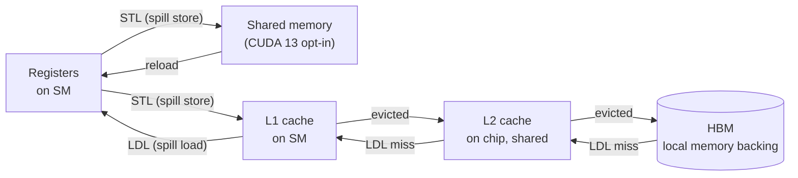
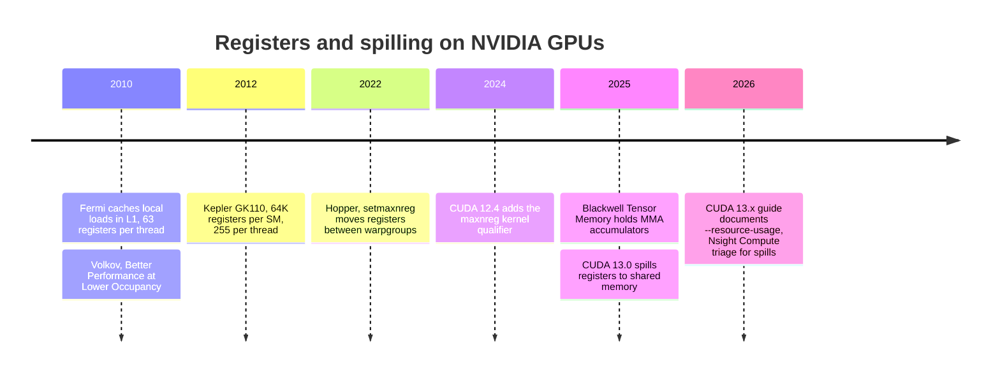
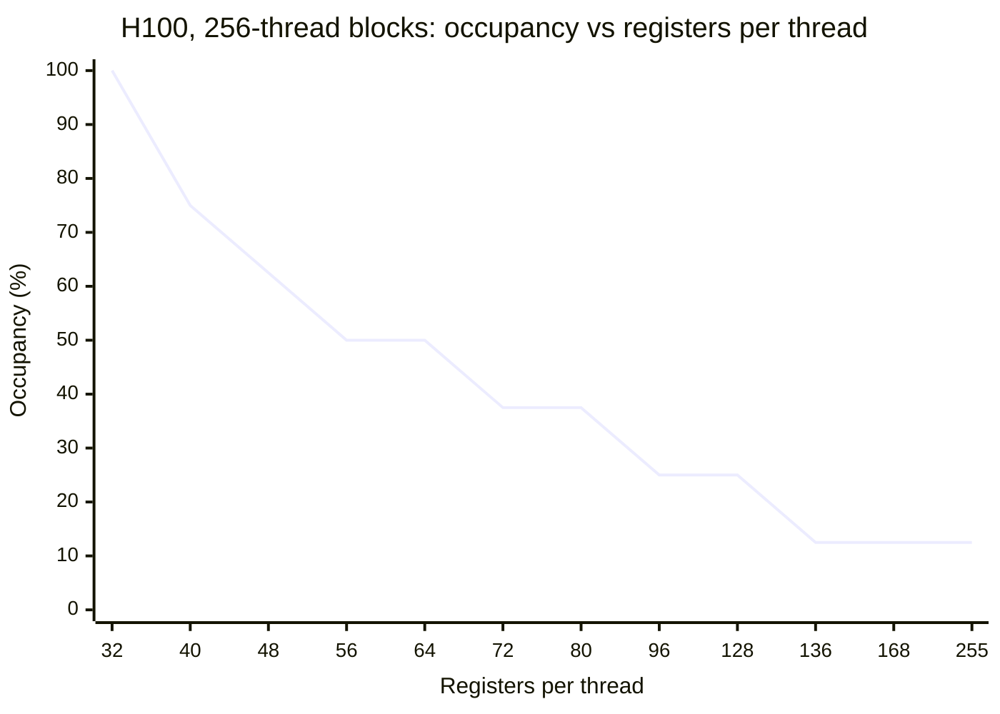

---
tags:
  - gpu-programming
  - kernels-optimization
  - registers
  - register-spilling
  - local-memory
  - occupancy
  - compilers
status: complete
sources:
  - https://docs.nvidia.com/nsight-compute/OccupancyCalculatorPythonInterface/index.html
  - https://leimao.github.io/blog/CUDA-Occupancy-Calculation
  - https://docs.nvidia.com/cuda/cuda-programming-guide/05-appendices/compute-capabilities.html
  - https://docs.nvidia.com/cuda/cuda-programming-guide/05-appendices/cpp-language-extensions.html
  - https://docs.nvidia.com/cuda/cuda-programming-guide/02-basics/writing-cuda-kernels.html
  - https://docs.nvidia.com/cuda/cuda-c-best-practices-guide/index.html
  - https://docs.nvidia.com/cuda/archive/12.8.0/cuda-features-archive/index.html
  - https://docs.nvidia.com/cuda/archive/13.0.0/cuda-toolkit-release-notes/index.html
  - https://developer.nvidia.com/blog/how-to-improve-cuda-kernel-performance-with-shared-memory-register-spilling/
  - https://docs.nvidia.com/nsight-compute/ComputeTriage/
  - https://docs.nvidia.com/nsight-compute/ProfilingGuide/index.html
  - https://forums.developer.nvidia.com/t/setmaxnreg-ignored-unable-to-determine-register-count-at-entry/361145
  - https://forums.developer.nvidia.com/t/instruction-cache-misses-local-stack-and-spills/319611
  - https://leimao.github.io/blog/CUDA-Local-Memory
  - https://bilbo.iut-bm.univ-fcomte.fr/and/gitweb/these_gilles.git/blob_plain/HEAD:/DOCS/volkov10-GTC.pdf
  - https://nvidia.github.io/cccl/unstable/libcudacxx/ptx/instructions/setmaxnreg.html
  - https://pytorch.org/blog/cutlass-ping-pong-gemm-kernel/
  - https://docs.nvidia.com/cutlass/latest/media/docs/cpp/efficient_gemm.html
  - https://lists.llvm.org/pipermail/llvm-commits/Week-of-Mon-20240108/1272461.html
  - https://docs.nvidia.com/cuda/archive/8.0/kepler-tuning-guide/index.html
  - https://mlc.ai/modern-gpu-programming-for-mlsys/chapter_tmem/index.html
  - https://arxiv.org/html/2512.02189v3
  - https://rocm.blogs.amd.com/software-tools-optimization/occupancy-math-mi355x/README.html
  - https://arxiv.org/html/2511.08083v1
  - https://forums.developer.nvidia.com/t/nvcc-13-2-spilling-many-registers-for-cc-120/364169
created: 2026-11-26
updated: 2026-11-26
---

## Table Of Contents

---

- [[#TL;DR|TL;DR]]
- [[#The Problem|The Problem]]
- [[#Foundations|Foundations]]
    - [[#The Register File|The Register File]]
    - [[#How Registers Are Handed Out|How Registers Are Handed Out]]
    - [[#Local Memory and the Spill Path|Local Memory and the Spill Path]]
- [[#How We Got Here|How We Got Here]]
- [[#How It Works|How It Works]]
    - [[#Where Pressure Comes From|Where Pressure Comes From]]
    - [[#Seeing It - ptxas, SASS and Nsight Compute|Seeing It: ptxas, SASS and Nsight Compute]]
    - [[#Dynamic Indexing - A Spill You Wrote Yourself|Dynamic Indexing: A Spill You Wrote Yourself]]
    - [[#The Controls|The Controls]]
    - [[#Worked Example - Registers vs Blocks on H100|Worked Example: Registers vs Blocks on H100]]
    - [[#Fewer Threads, More Registers|Fewer Threads, More Registers]]
    - [[#Moving Registers Between Warps - setmaxnreg|Moving Registers Between Warps: setmaxnreg]]
- [[#Where It Is Now|Where It Is Now]]
- [[#Trade-offs & Open Problems|Trade-offs & Open Problems]]
- [[#Resources|Resources]]
- [[#Related Notes|Related Notes]]

## ***TL;DR***
---
*Registers are the fastest storage on a GPU and the scarcest per thread. When a kernel needs more live values than the compiler can give it, the extra values "spill" to local memory, which lives off chip, and a kernel that looked compute-bound turns memory-bound.*

- **The budget:** every NVIDIA SM from compute capability 7.5 to 12.x has **65,536 32-bit registers** (256 KB) and a thread can use at most **255** ([Compute Capabilities](https://docs.nvidia.com/cuda/cuda-programming-guide/05-appendices/compute-capabilities.html)). Registers are allocated per warp, so registers per thread directly caps how many warps fit on an SM ([[Occupancy and Latency Hiding]]).
- **Register pressure** is the number of values a thread needs alive at the same time. It grows with unrolled loops, big per-thread tiles (GEMM accumulators), long-lived addresses and inlined helper functions.
- **Spilling:** when pressure exceeds the limit, `ptxas` (the PTX-to-SASS assembler, see [[PTX and SASS]]) stores values to **local memory** with `STL` and reloads them with `LDL`. "Local" means private to a thread; physically it is in device memory, cached in L1 and L2.
- **Two causes, one symptom:** real spills (too many live values) and per-thread arrays indexed with values only known at run time (registers cannot be indexed), which go to local memory whatever their size.
- **How to see it:** `nvcc --resource-usage` or `-Xptxas -v` prints registers, stack frame and spill bytes per kernel; Nsight Compute shows local-memory sectors and `LDL`/`STL` lines in the Source view.
- **How to steer it:** `__launch_bounds__`, `__maxnreg__` (CUDA 12.4), `-maxrregcount`, restructuring code to shorten live ranges, and on Hopper/Blackwell `setmaxnreg` to move registers between warp roles ([[Warp Specialization]]).
- **Where it is now (Nov 2026):** CUDA 13.0 lets ptxas spill to **shared memory** first, about 10x lower latency than spilling to L2, opt-in per kernel. Blackwell moves [[Tensor Cores|tensor-core]] accumulators out of registers into 256 KB of Tensor Memory per SM, removing the biggest single source of register pressure in GEMM and attention.

## ***The Problem***
---
*A GPU keeps every resident thread's registers on chip so it can switch warps for free. That makes the register file huge in total but small per thread, and the compiler, not the programmer, decides what fits.*

A CPU core has a few dozen architectural registers and a deep cache hierarchy behind them. An SM is built the other way round. Its register file (256 KB) is larger than its shared memory (up to 228 KB on Hopper, see [[Shared Memory and Bank Conflicts]]), because it holds the full state of up to 2,048 threads at once ([[GPU Architecture Basics]]). That is what makes switching between warps cost nothing ([[Occupancy and Latency Hiding]]).

Divide that file by the number of threads and the per-thread share is small: $65{,}536 / 2{,}048 = 32$ registers per thread at full occupancy. A modest kernel easily wants more. Three things then pull against each other:

1. **More registers per thread** means more values kept at register speed, more independent instructions in flight (ILP), and bigger per-thread tiles in matrix code.
2. **More threads per SM** means more warps for the scheduler to switch between while others wait on memory.
3. **A cap on registers** (to get more threads) forces the compiler to spill, which adds memory instructions and traffic.

The catch is that none of this shows in the source. CUDA C++ has no `register` keyword that matters; `ptxas` maps an unlimited number of virtual PTX registers onto the physical file ([[PTX and SASS]]). A one-line change, such as indexing a small array with a loop variable the compiler cannot unroll, can silently move that array to off-chip memory. The Nsight Compute triage guide warns that spill traffic "often look[s] like a generic memory-bound symptom even when the algorithm fits in registers" ([Nsight Compute Triage](https://docs.nvidia.com/nsight-compute/ComputeTriage/)).

## ***Foundations***
---
*Know three things: how big the register file is, how it is carved up per warp, and where a value goes when it does not fit.*

### The Register File

From the CUDA 13 Programming Guide's tables ([Compute Capabilities](https://docs.nvidia.com/cuda/cuda-programming-guide/05-appendices/compute-capabilities.html)):

| Limit | Value (CC 7.5 through 12.x) |
|---|---|
| 32-bit registers per SM | 64K (65,536) |
| Maximum 32-bit registers per thread block | 64K |
| Maximum 32-bit registers per thread | 255 |
| Maximum local memory per thread | 512 KB |

The same numbers apply to Turing (7.5), Ampere (8.x), Ada (8.9), Hopper (9.0), data-center Blackwell (10.x), Thor (11.0) and consumer Blackwell (12.x). The register file has not grown since Kepler; what changed is how many threads compete for it and what else on the SM can hold data (shared memory, Tensor Memory).

Registers are 32 bits wide. A `double`, a 64-bit pointer or a `long long` takes two; a `float4` takes four. A thread's register count is set at compile time, once for the whole kernel, at the maximum it needs at any point. A kernel that needs 200 registers in one hot loop holds 200 for its whole life.

### How Registers Are Handed Out

The SM allocates registers per **warp**, in fixed-size units. NVIDIA's own docs name the parameter without giving its value: Nsight Compute's occupancy calculator exposes a "register allocation unit size" and "warp register allocation granularities" ([Occupancy Calculator Python Interface](https://docs.nvidia.com/nsight-compute/OccupancyCalculatorPythonInterface/index.html)). The value usually quoted is **256 registers per warp**, from the deprecated Excel occupancy calculator's table for compute capability 7.0 ([Lei Mao](https://leimao.github.io/blog/CUDA-Occupancy-Calculation)). That is the per-thread count rounded up to a multiple of 8 (since $256 / 32 = 8$), then multiplied by 32. No NVIDIA page read for this note confirms 256 for Hopper or Blackwell, so treat it as unconfirmed there. [[Occupancy and Latency Hiding]] covers the full occupancy formula.

$$
\text{regs per warp} = 32 \times 8\left\lceil \frac{r}{8} \right\rceil
\qquad
\text{blocks per SM (register limit)} = \left\lfloor \frac{65{,}536}{\text{regs per warp} \times \text{warps per block}} \right\rfloor
$$

In plain words: round the per-thread count up to the next multiple of 8, multiply by 32 to get one warp's share, multiply by the warps in a block, and see how many whole blocks fit in 65,536. Because blocks are all-or-nothing, the result moves in steps: one extra register can cost a whole block. The worked example [[#Worked Example - Registers vs Blocks on H100|below]] shows such a cliff.

### Local Memory and the Spill Path

The Programming Guide describes local memory as "thread local storage similar to registers and managed by NVCC, but the physical location of local memory is in the global memory space". It is used for three things ([CUDA Programming Guide §2.3](https://docs.nvidia.com/cuda/cuda-programming-guide/02-basics/writing-cuda-kernels.html)):

- "Arrays for which it cannot determine that they are indexed with constant quantities"
- "Large structures or arrays that would consume too much register space"
- "Any variable if the kernel uses more registers than available, that is register spilling"

Two properties make it less terrible than plain global memory:

- **It is interleaved.** "Consecutive 32-bit words are accessed by consecutive thread IDs", so a warp that spills the same variable touches one contiguous span, and accesses "are therefore fully coalesced as long as all threads in a warp access the same relative address" ([Programming Guide §2.3](https://docs.nvidia.com/cuda/cuda-programming-guide/02-basics/writing-cuda-kernels.html); [[Memory Coalescing]]).
- **It is cached.** Local memory is "cached in L1 and L2 by default except on devices of compute capability 5.x" ([Best Practices Guide](https://docs.nvidia.com/cuda/cuda-c-best-practices-guide/index.html)).

So a spill that stays in L1 costs an extra instruction and an L1 round trip; one that is evicted to L2 or HBM costs much more, and competes with the kernel's real loads for the same caches ([[GPU Memory Hierarchy]]).



The diagram reads left to right as a value is pushed out and right to left as it is reloaded. Each hop outward costs more latency and uses bandwidth the kernel's own loads need. The CUDA 13 shared-memory path short-circuits the whole chain ([[#Where It Is Now|Where It Is Now]]).

## ***How We Got Here***
---
*The register file grew until Kepler and then stopped; the tools for controlling it moved from a global compiler flag to per-kernel attributes to runtime reallocation between warps, and finally to hardware that takes the biggest register consumers off the register file.*



- **Fermi and Kepler.** Fermi (CC 2.x) cached both global and local loads in L1. Kepler doubled the register file per multiprocessor over Fermi, and "GK110 increases the maximum number of registers addressable per thread from 63 to 255", the per-thread limit still in force. On Kepler, "L1 caching ... is reserved only for local memory accesses, such as register spills and stack data", and NVIDIA's tuning guide pointed Fermi kernels with heavy spilling at GK110's bigger register budget while warning that more registers per thread reduce occupancy ([Kepler Tuning Guide](https://docs.nvidia.com/cuda/archive/8.0/kepler-tuning-guide/index.html)). Maxwell (5.x) was the exception that did not cache local memory in L1 ([Best Practices Guide](https://docs.nvidia.com/cuda/cuda-c-best-practices-guide/index.html)).
- **2010, Volkov.** Vasily Volkov's GTC 2010 talk "Better Performance at Lower Occupancy" argued for spending registers on per-thread work instead of on more threads ([[#Fewer Threads, More Registers|below]]).
- **Compiler controls.** `-maxrregcount` caps every kernel in a file; `__launch_bounds__` lets each kernel state its block size and desired blocks per SM so the compiler derives its own cap. CUDA 12.4 added `__maxnreg__` to set a per-kernel cap directly: "Added the `__maxnreg__` kernel function qualifier" ([CUDA Features Archive, 12.4](https://docs.nvidia.com/cuda/archive/12.8.0/cuda-features-archive/index.html)).
- **2022, Hopper.** PTX `setmaxnreg` lets a warpgroup give registers back or claim more at run time, so producer warps can hand their share to math warps ([CCCL PTX docs](https://nvidia.github.io/cccl/unstable/libcudacxx/ptx/instructions/setmaxnreg.html); [[Warp Specialization]]).
- **2025, Blackwell and CUDA 13.0.** `tcgen05.mma` writes accumulators to Tensor Memory rather than registers ([[Tensor Cores]]), and CUDA 13.0 added shared-memory register spilling ([CUDA 13.0 release notes](https://docs.nvidia.com/cuda/archive/13.0.0/cuda-toolkit-release-notes/index.html)).

## ***How It Works***
---
*Register pressure is a compile-time fact you can read off the compiler's report. The work is finding which code creates it and deciding whether to spend registers, threads or extra instructions.*

### Where Pressure Comes From

| Source | Why it costs registers | Typical fix |
|---|---|---|
| Accumulator tiles in GEMM / attention | A thread computing an $8 \times 8$ output tile holds 64 FP32 accumulators for the whole K loop ([[Tiled Matrix Multiplication (GEMM)]]) | Smaller tile, more threads; on Blackwell, accumulators in TMEM |
| Loop unrolling | `#pragma unroll` turns one loop body into N copies whose loads are hoisted and live at once | Partial unroll (`#pragma unroll 4`) |
| Software pipelining / prefetch | Registers hold the next iteration's data while the current one computes | Use `cp.async` / [[TMA and Asynchronous Copies|TMA]] to stage in shared memory instead |
| Long-lived addresses and indices | Each 64-bit pointer is 2 registers; precomputed offsets stay live across loops | Recompute cheap values instead of keeping them |
| Inlining | Device functions are inlined by default, merging their live values into the caller | Usually fine; `__noinline__` trades pressure for call overhead and a stack frame |
| Per-thread arrays | Fine in registers if fully unrolled with constant indices; forced to local memory otherwise | See [[#Dynamic Indexing - A Spill You Wrote Yourself|Dynamic Indexing]] |

CUTLASS puts the GEMM case plainly: "the accumulator elements typically occupy at least half a thread's total register budget", so GEMM kernels run at "relatively low" occupancy ([CUTLASS efficient GEMM](https://docs.nvidia.com/cutlass/latest/media/docs/cpp/efficient_gemm.html); [[CUTLASS and CuTe]]).

### Seeing It - ptxas, SASS and Nsight Compute

**At compile time.** The Programming Guide recommends "the `--resource-usage` option to `nvcc`, which will show the number of registers" ([Programming Guide §2.3](https://docs.nvidia.com/cuda/cuda-programming-guide/02-basics/writing-cuda-kernels.html)). The older route, `-Xptxas -v` (short for `--ptxas-options=-v`), makes ptxas report per-kernel usage, including "total local memory usage per kernel (lmem)" ([Best Practices Guide](https://docs.nvidia.com/cuda/cuda-c-best-practices-guide/index.html)). NVIDIA's CUDA 13 spilling post shows the lines to read, for a kernel compiled with `nvcc -arch=sm_90 -Xptxas -v` ([NVIDIA blog, Aug 2025](https://developer.nvidia.com/blog/how-to-improve-cuda-kernel-performance-with-shared-memory-register-spilling/)):

```text
176 bytes stack frame, 176 bytes spill stores, 176 bytes spill loads
Used 255 registers, used 0 barriers, 176 bytes cumulative stack size
```

- **stack frame:** bytes of local memory reserved per thread (spills plus any local arrays).
- **spill stores / spill loads:** bytes written to and read back from local memory because registers ran out. Non-zero means real spilling.
- **Used 255 registers:** the kernel hit the per-thread maximum, so ptxas had nowhere left to put values.

A non-zero stack frame with zero spill bytes usually means a local array, not a spill. Nsight Compute's triage guide reads it the same way: "A non-zero stack frame means the compiler allocated local memory" ([Nsight Compute Triage](https://docs.nvidia.com/nsight-compute/ComputeTriage/)).

**In the binary.** In PTX, local variables appear in the `.local` state space and are accessed with `ld.local` / `st.local` ([Best Practices Guide](https://docs.nvidia.com/cuda/cuda-c-best-practices-guide/index.html)). In SASS (`cuobjdump -sass`, see [[PTX and SASS]]) the instructions are `STL` (store local) and `LDL` (load local).

**At run time.** In [[Profiling with Nsight Compute and Nsight Systems|Nsight Compute]] ([Triage guide §3.7.3](https://docs.nvidia.com/nsight-compute/ComputeTriage/); [Profiling Guide](https://docs.nvidia.com/nsight-compute/ProfilingGuide/index.html)):

| What | Where | Meaning |
|---|---|---|
| `launch__registers_per_thread` | Launch Statistics | Registers allocated per thread |
| `launch__occupancy_limit_registers` | Occupancy | Blocks per SM allowed by registers |
| `l1tex__t_sectors_pipe_lsu_mem_local_op_ld.sum` / `..._st.sum` | Memory Workload Analysis | Local-memory load/store sectors (spills and local arrays) |
| `LDL` / `STL` lines, "L2 Theoretical Sectors Local" | Source view | Which source lines spill |

The triage guide's advice, in order: find the `LDL`/`STL` lines, "reduce live-range overlap (split kernels, recompute cheap values, restructure inner loops) before forcing a register cap", then cap registers and re-measure, because "if spills *increase*, the cap is too aggressive and is trading occupancy for spill traffic".

### Dynamic Indexing - A Spill You Wrote Yourself

Registers have no addresses, so `a[i]` with a run-time `i` cannot be compiled to a register read. The compiler either resolves every index at compile time (after unrolling) or puts the array in local memory. Lei Mao's experiment shows the difference: a running-mean kernel whose window index is `(j + n) % WindowSize`, with `n` a run-time value, gets a `.local .align 16 .b8 __local_depot1[128]` declaration in PTX, 32 floats of local memory, while the same kernel with plain loop indices has no `.local` at all ([Lei Mao, 2025](https://leimao.github.io/blog/CUDA-Local-Memory)).

A per-thread histogram shows the pattern and the fix:

```cpp
// A: dynamic index -> bins[] lives in local memory
__global__ void __launch_bounds__(256, 2)
hist16_local(const int* keys, int* out, int n) {
  int bins[16] = {0};
  for (int i = blockIdx.x * blockDim.x + threadIdx.x; i < n; i += gridDim.x * blockDim.x)
    bins[keys[i] & 15]++;                         // index known only at run time
  #pragma unroll
  for (int b = 0; b < 16; ++b) atomicAdd(&out[b], bins[b]);
}

// B: every index is a compile-time constant -> bins[] lives in 16 registers
__global__ void __launch_bounds__(256, 2)
hist16_regs(const int* keys, int* out, int n) {
  int bins[16] = {0};
  for (int i = blockIdx.x * blockDim.x + threadIdx.x; i < n; i += gridDim.x * blockDim.x) {
    int k = keys[i] & 15;
    #pragma unroll
    for (int b = 0; b < 16; ++b) bins[b] += (k == b);   // 16 compares, no indexing
  }
  #pragma unroll
  for (int b = 0; b < 16; ++b) atomicAdd(&out[b], bins[b]);
}
```

Line by line:

- `__launch_bounds__(256, 2)`: the kernel is never launched with more than 256 threads per block, and we want at least 2 blocks resident per SM. The compiler derives a register cap from this: 2 × 256 threads = 512 threads, so at most $65{,}536 / 512 = 128$ registers per thread. Both kernels need far fewer, so the cap does not bite here; it guards against future edits that would.
- `int bins[16] = {0};` declares a per-thread array. Where it lives depends entirely on how it is indexed later.
- In **A**, `bins[keys[i] & 15]++` uses an index read from memory. No amount of unrolling makes it constant, so `bins` goes to local memory. Each increment becomes `LDL`, add, `STL`, and ptxas reports a non-zero stack frame for the kernel.
- In **B**, the inner `#pragma unroll` loop expands into 16 statements `bins[0] += (k == 0); ... bins[15] += (k == 15);`. Each index is now a constant, so each `bins[b]` becomes its own register. The cost is 16 compare-and-adds per key instead of one load-add-store.
- The final `#pragma unroll` loop is constant-indexed in both versions; the `atomicAdd` merges per-thread counts into the global result.

Which is faster depends on the GPU and the data: B does more arithmetic but never leaves the register file; A does less arithmetic but each increment is a dependent round trip through L1. The general lesson stands: check the stack frame after any change that indexes a local array with a variable. A practitioner on NVIDIA's forums found that dynamic indexing into small `constexpr` arrays (`eye[3*dir + 0]`) was what produced `STL` instructions in a large kernel; replacing it with `dir == 0`-style conditionals took the stack to zero and, with other changes, made the kernel about 25% faster than baseline ([NVIDIA forums, Jan 2025](https://forums.developer.nvidia.com/t/instruction-cache-misses-local-stack-and-spills/319611)).

### The Controls

| Control | Scope | What it does | Source |
|---|---|---|---|
| `__launch_bounds__(maxThreadsPerBlock, minBlocksPerMultiprocessor, maxBlocksPerCluster)` | One kernel | Compiler derives a register limit L from the bounds; "if the initial register usage exceeds L, the compiler reduces it until it is less than or equal to L", which "usually results in increased local memory usage and/or a higher number of instructions". Compiles to `.maxntid`, `.minnctapersm`, `.maxclusterrank` | [Programming Guide §5.4.3.2](https://docs.nvidia.com/cuda/cuda-programming-guide/05-appendices/cpp-language-extensions.html) |
| `__maxnreg__(N)` | One kernel | "the maximum number of registers that can be allocated to a single thread"; cannot be combined with `__launch_bounds__` on the same kernel. CUDA 12.4+ | [§5.4.3.3](https://docs.nvidia.com/cuda/cuda-programming-guide/05-appendices/cpp-language-extensions.html); [Features Archive](https://docs.nvidia.com/cuda/archive/12.8.0/cuda-features-archive/index.html) |
| `-maxrregcount N` (`--maxrregcount`) | Every `__global__` function in a file | Global cap; "ignored for kernel functions with the `__maxnreg__` qualifier" | [§5.4.3](https://docs.nvidia.com/cuda/cuda-programming-guide/05-appendices/cpp-language-extensions.html) |
| `setmaxnreg.inc` / `.dec` | One warpgroup, at run time | Raise or lower a warpgroup's register count, "in the range 24 to 256 (both inclusive)" and "a multiple of 8"; PTX ISA 8.0, `sm_90a` and later arch- or family-specific targets (`sm_100a/f`, `sm_120a/f`, ...) | [CCCL PTX docs](https://nvidia.github.io/cccl/unstable/libcudacxx/ptx/instructions/setmaxnreg.html); [PTX ISA via LLVM review](https://lists.llvm.org/pipermail/llvm-commits/Week-of-Mon-20240108/1272461.html) |
| `.pragma "enable_smem_spilling"` | One kernel | Spill to shared memory before local memory (CUDA 13.0+) | [NVIDIA blog](https://developer.nvidia.com/blog/how-to-improve-cuda-kernel-performance-with-shared-memory-register-spilling/) |

Two details from the Programming Guide matter in practice. First, with only `maxThreadsPerBlock` given, the compiler uses it to place register thresholds at "the transitions between n and n + 1 resident blocks", that is, it avoids being one register over a cliff. Second, with both arguments given, "the compiler may increase register usage up to L in order to reduce the number of instructions", so launch bounds can raise register use as well as lower it. A kernel launched with more threads than its `maxThreadsPerBlock` fails to launch.

### Worked Example - Registers vs Blocks on H100

An H100 (compute capability 9.0) SM has 65,536 registers, 64 warp slots and 32 block slots ([Compute Capabilities](https://docs.nvidia.com/cuda/cuda-programming-guide/05-appendices/compute-capabilities.html)). Take a kernel with **256 threads per block** (8 warps) and **128 registers per thread**:

$$
\text{regs per warp} = 32 \times 128 = 4{,}096, \quad
\text{regs per block} = 8 \times 4{,}096 = 32{,}768, \quad
\left\lfloor \frac{65{,}536}{32{,}768} \right\rfloor = 2 \text{ blocks}
$$

Two blocks are 16 warps of 64, **25% occupancy**. Now let one more live value push the kernel to **129 registers**. Rounded up to the (assumed) 256-register unit that is 136, so a warp needs $32 \times 136 = 4{,}352$ registers and a block $34{,}816$; $\lfloor 65{,}536 / 34{,}816 \rfloor = 1$ block, **12.5% occupancy**. The result does not depend on the unit: even unrounded, two blocks would need $2 \times 256 \times 129 = 66{,}048$ registers, more than the SM has. One register halved the warps on the SM. Going the other way, `__launch_bounds__(256, 2)` tells ptxas to stay at 128 or below, spilling the 129th value if it must. Whether that spill is cheaper than losing a block is exactly the question to measure.

The same arithmetic over the whole range, for 256-thread blocks on H100 (warp-slot limit: 8 blocks):



The flat stretches are free registers: going from 56 to 64, or from 96 to 128, costs no occupancy at all. The drops are where a tighter cap might pay off. [[Occupancy and Latency Hiding]] has the general formula with shared memory and block-size limits.

### Fewer Threads, More Registers

Lower occupancy is not automatically worse. Volkov's "Better Performance at Lower Occupancy" (GTC 2010) made the case that "only registers are fast enough to get the peak", and that faster codes "do more work per thread" and so "need fewer threads" ([Volkov, 2010](https://bilbo.iut-bm.univ-fcomte.fr/and/gitweb/these_gilles.git/blob_plain/HEAD:/DOCS/volkov10-GTC.pdf)). His GTX480 matrix multiply went from 242 Gflop/s at 21 registers per thread and 67% occupancy to 485 Gflop/s at 63 registers and 33% occupancy, by computing 8 outputs per thread instead of 1. Independent instructions within a thread (ILP) hide latency just as more warps do; [[Occupancy and Latency Hiding]] has the full table.

The modern form of the argument is every register-tiled kernel: [[Tiled Matrix Multiplication (GEMM)|GEMM]], [[FlashAttention]] and [[CUTLASS and CuTe|CUTLASS]] all spend most of their registers on accumulators and run few warps per SM. The skill is spending registers right up to a cliff in the chart above and not one past it, and never so far that ptxas spills inside the inner loop.

### Moving Registers Between Warps - setmaxnreg

A kernel's register count is normally one number for every thread. In a [[Warp Specialization|warp-specialized]] Hopper or Blackwell kernel that is wasteful: producer warps that only issue TMA copies need a few dozen registers, while math warps holding accumulators want as many as possible. PTX `setmaxnreg` (`sm_90a` and later arch-specific targets) lets each warpgroup change its own allocation at run time ([CCCL PTX docs](https://nvidia.github.io/cccl/unstable/libcudacxx/ptx/instructions/setmaxnreg.html)). CUTLASS's ping-pong GEMM gives producers "only 40 registers, while consumers will get 232" ([PyTorch, 2024](https://pytorch.org/blog/cutlass-ping-pong-gemm-kernel/)); the arithmetic is in [[Warp Specialization#Splitting the Register File|Warp Specialization]].

`setmaxnreg` needs ptxas to know the starting count. Without full launch bounds it gives up: ptxas warns "'setmaxnreg' ignored; unable to determine register count at entry" (C7508). In a February 2026 forum thread the kernel had `__launch_bounds__(32)`; Robert Crovella noted that this "doesn't appear to be giving the compiler enough information", and a complete specification such as `__launch_bounds__(512, 4)`, or `-maxrregcount`, fixed it ([NVIDIA forums, Feb 2026](https://forums.developer.nvidia.com/t/setmaxnreg-ignored-unable-to-determine-register-count-at-entry/361145)).

## ***Where It Is Now***
---
*As of November 2026, the register file itself is unchanged, but the two biggest levers around it are new: spills can land in shared memory instead of off-chip, and on Blackwell the largest register consumer, the MMA accumulator, no longer lives in registers at all.*

- **Shared-memory spilling (CUDA 13.0, 2025).** "Registers can now additionally spill to shared memory, which is approximately 10x lower latency than spilling to L2 cache. This feature is opt-in and controllable via the pragma `enable_smem_spilling`" ([CUDA 13.0 release notes](https://docs.nvidia.com/cuda/archive/13.0.0/cuda-toolkit-release-notes/index.html)). It is switched on inside the kernel body with `asm volatile (".pragma \"enable_smem_spilling\";");`. ptxas then spills to shared memory first and falls back to local memory only if shared memory runs out ([NVIDIA blog, Aug 2025](https://developer.nvidia.com/blog/how-to-improve-cuda-kernel-performance-with-shared-memory-register-spilling/)).
    - **Effect, from NVIDIA's example:** the `-Xptxas -v` report went from "176 bytes stack frame, 176 bytes spill stores, 176 bytes spill loads" to "0 bytes stack frame, 0 bytes spill stores, 0 bytes spill loads ... 46080 bytes smem", and kernel duration fell from 8.35 to 7.71 µs, about 8%. NVIDIA reports typical 5–10% gains on QUDA lattice-QCD kernels.
    - **Restrictions:** whole-program mode only (not `-rdc=true`, `-G`, or other per-function compilation), not for kernels that use dynamically allocated shared memory or that reallocate registers across warps (`setmaxnreg`), and launch bounds should be explicit, because without them ptxas assumes the maximum block size when budgeting shared memory and can lower occupancy.
    - The spill space is reserved per thread, for every thread the launch bounds allow, so it competes with the kernel's own shared memory and with other blocks on the SM ([[Shared Memory and Bank Conflicts]]).
- **Blackwell Tensor Memory.** Data-center Blackwell keeps the 64K-register file but adds **Tensor Memory (TMEM)**, 256 KB per SM organised as 128 lanes × 512 columns of 32-bit cells, which `tcgen05.mma` writes accumulators into. `tcgen05.alloc` reserves whole columns (32, 64, 128, 256 or 512), and each warp of a warpgroup reaches only its own 32 of the 128 lanes ([MLC, Tensor Memory chapter](https://mlc.ai/modern-gpu-programming-for-mlsys/chapter_tmem/index.html); [Jarmusch & Chandrasekaran](https://arxiv.org/html/2512.02189v3); [[Tensor Cores]]; [[Blackwell Architecture]]). On Hopper a 128×256 FP32 accumulator tile is 128 KB of registers spread over two warpgroups; on Blackwell the same tile sits in TMEM and the epilogue warps copy slices into registers with `tcgen05.ld` only when they need them. This is the biggest change to register pressure in GEMM-like kernels since the register file reached 64K.
- **Tooling.** The CUDA 13.x Programming Guide now points beginners to `--resource-usage`, and Nsight Compute's triage guide has a dedicated "local-memory traffic or register spilling is high" symptom with the metrics above ([Programming Guide §2.3](https://docs.nvidia.com/cuda/cuda-programming-guide/02-basics/writing-cuda-kernels.html); [Nsight Compute Triage](https://docs.nvidia.com/nsight-compute/ComputeTriage/)).
- **Compilers that hide it.** [[Triton]], [[CUTLASS and CuTe|CuTe DSL]] and [[ThunderKittens and Tile DSLs|tile DSLs]] choose tile shapes and register splits per target, and autotuning over `num_warps` and tile sizes is in large part a search over register pressure. Tile languages such as [[CUDA Tile and cuTile|cuTile]] take per-thread register layout out of the programmer's hands altogether.
- **AMD comparison.** AMD CDNA GPUs have two kinds of vector registers: ordinary VGPRs and accumulation VGPRs (AGPRs or AccVGPRs) that matrix-core instructions can write. MI100/MI200 had a separate physical accumulator file; CDNA3 unified them and CDNA4 (MI355X) keeps a single 512-entry-per-lane file per SIMD, with "up to 512 total VGPRs, 256 of each type" per wave. VGPRs round up to groups of 8, and waves per SIMD is $\lfloor 512 / \text{VGPRs per lane} \rfloor$: 100 VGPRs rounds to 104 and drops a kernel from 5 to 4 waves per SIMD, the same cliff as on NVIDIA. AMD's advice is the same too: "Grow the register-resident tile until just before it spills" ([AMD ROCm blog, Jul 2026](https://rocm.blogs.amd.com/software-tools-optimization/occupancy-math-mi355x/README.html)). HipKittens found that AMD "statically divides registers across all waves", which is why producer/consumer wave specialization underperforms there ([HipKittens](https://arxiv.org/html/2511.08083v1); [[ROCm and HIP]]; [[Warp Specialization]]).

## ***Trade-offs & Open Problems***
---
*Every register decision trades one of three things: occupancy, extra instructions, or memory traffic. The compiler makes the call with heuristics, and the only reliable check is to measure.*

| Choice | Gain | Cost |
|---|---|---|
| More registers per thread | Bigger tiles, more ILP, no spills | Fewer warps per SM; occupancy cliffs at allocation boundaries |
| Cap registers (`__launch_bounds__`, `__maxnreg__`) | More resident warps | Spills or extra recomputation instructions |
| Unroll loops | Constant indices, fewer branches, more ILP | More live values; larger code (instruction-cache misses) |
| Rewrite dynamic indexing as conditionals | Array stays in registers | More compare/select instructions |
| Shared-memory spilling | ~10x lower spill latency than L2 | Uses shared memory other blocks or stages could use; not with dynamic smem or `setmaxnreg` |
| `setmaxnreg` role split | Accumulator warps get up to 232+ registers | Arch-specific (`sm_90a`+), needs full launch bounds, complex code |
| Accumulators in TMEM (Blackwell) | Registers freed for epilogue and softmax | Explicit allocation and copies; Blackwell data-center only |

Open problems:

- **ptxas is a black box.** Register allocation, rematerialisation and spill placement happen in a closed-source assembler, and its heuristics change between releases and targets. In March 2026 a user reported that nvcc 13.2 compiled the same `__launch_bounds__(1024, 1)` kernel to 64 registers and no spills for `sm_90` but to "480 bytes stack frame, 1368 bytes spill stores, 1488 bytes spill loads" for `sm_120`, about 8x slower on an RTX 5090 than on an RTX 3090; compiling to PTX and letting the newer driver JIT it was the workaround ([NVIDIA forums, Mar 2026](https://forums.developer.nvidia.com/t/nvcc-13-2-spilling-many-registers-for-cc-120/364169)). The only defence is checking `--resource-usage` output per target in CI ([[PTX and SASS]]; [[Register Allocation]]).
- **No good cost model.** Whether a spill to L1 is cheaper than losing a block depends on the access pattern, cache hit rate and what else is in flight. The triage guide's advice is to cap, re-measure, and back off if spills grow.
- **Granularity is under-documented.** Nsight Compute names a register allocation unit but its docs give no value; the 256-register figure comes from the deprecated Excel calculator (compute capability 7.0) and is unconfirmed for newer GPUs ([[Occupancy and Latency Hiding]]).
- **Portability.** A kernel tuned to 128 registers on H100 may spill on a different compiler version or architecture, and `setmaxnreg` and TMEM code does not run on consumer GPUs or AMD.
- **Register file size has not grown.** 64K registers per SM has been fixed for over a decade while tensor throughput has grown many times. Hardware answers so far are offload (TMEM) rather than a bigger file.

## ***Resources***
---
*Start with the Programming Guide's local-memory section and the CUDA 13 spilling blog post; use the Nsight Compute triage guide when a kernel already exists. Volkov's slides are still the clearest argument for spending registers.*

**Primary docs**
- [CUDA Programming Guide §2.3, Writing SIMT Kernels](https://docs.nvidia.com/cuda/cuda-programming-guide/02-basics/writing-cuda-kernels.html): NVIDIA, CUDA 13.x. Registers, local memory, `--resource-usage`.
- [CUDA Programming Guide §5.4.3, Launch bounds and `__maxnreg__`](https://docs.nvidia.com/cuda/cuda-programming-guide/05-appendices/cpp-language-extensions.html) and [Compute Capabilities tables](https://docs.nvidia.com/cuda/cuda-programming-guide/05-appendices/compute-capabilities.html): NVIDIA.
- [CUDA C++ Best Practices Guide](https://docs.nvidia.com/cuda/cuda-c-best-practices-guide/index.html): NVIDIA. Local memory, `ld.local`/`st.local`, lmem reporting.
- [CUDA Features Archive (12.4: `__maxnreg__`)](https://docs.nvidia.com/cuda/archive/12.8.0/cuda-features-archive/index.html) and [CUDA 13.0 release notes](https://docs.nvidia.com/cuda/archive/13.0.0/cuda-toolkit-release-notes/index.html): NVIDIA.
- [setmaxnreg](https://nvidia.github.io/cccl/unstable/libcudacxx/ptx/instructions/setmaxnreg.html): CCCL PTX docs, NVIDIA.
- [Tuning CUDA Applications for Kepler](https://docs.nvidia.com/cuda/archive/8.0/kepler-tuning-guide/index.html): NVIDIA, CUDA 8.0 docs. The 63 to 255 register change and L1 for spills.
- [Nsight Compute Triage Guide](https://docs.nvidia.com/nsight-compute/ComputeTriage/) and [Profiling Guide](https://docs.nvidia.com/nsight-compute/ProfilingGuide/index.html): NVIDIA.

**Practitioner**
- [How to Improve CUDA Kernel Performance with Shared Memory Register Spilling](https://developer.nvidia.com/blog/how-to-improve-cuda-kernel-performance-with-shared-memory-register-spilling/): Divya Shanmughan, NVIDIA, Aug 27 2025.
- [CUDA Local Memory](https://leimao.github.io/blog/CUDA-Local-Memory): Lei Mao, Mar 2025.
- [Instruction cache misses + local stack and spills](https://forums.developer.nvidia.com/t/instruction-cache-misses-local-stack-and-spills/319611): NVIDIA forums, Jan 2025.
- ['setmaxnreg' ignored; unable to determine register count at entry](https://forums.developer.nvidia.com/t/setmaxnreg-ignored-unable-to-determine-register-count-at-entry/361145): NVIDIA forums, Robert Crovella, Feb 2026.
- [Deep Dive on CUTLASS Ping-Pong GEMM Kernel](https://pytorch.org/blog/cutlass-ping-pong-gemm-kernel/): PyTorch, 2024.
- [CUTLASS: Efficient GEMM in CUDA](https://docs.nvidia.com/cutlass/latest/media/docs/cpp/efficient_gemm.html): NVIDIA.
- [Nvcc 13.2 spilling many registers for cc 120](https://forums.developer.nvidia.com/t/nvcc-13-2-spilling-many-registers-for-cc-120/364169): NVIDIA forums, Mar 2026.
- [Occupancy Math on the AMD MI355X GPU (CDNA4)](https://rocm.blogs.amd.com/software-tools-optimization/occupancy-math-mi355x/README.html): Pandey, Li, Luo, AMD ROCm blog, Jul 7 2026.
- [Tensor Memory (TMEM)](https://mlc.ai/modern-gpu-programming-for-mlsys/chapter_tmem/index.html): MLC, Modern GPU Programming for MLSys.

**Research**
- [Better Performance at Lower Occupancy](https://bilbo.iut-bm.univ-fcomte.fr/and/gitweb/these_gilles.git/blob_plain/HEAD:/DOCS/volkov10-GTC.pdf): Vasily Volkov, UC Berkeley, GTC 2010.
- [Microbenchmarking NVIDIA's Blackwell Architecture: An in-depth Architectural Analysis](https://arxiv.org/html/2512.02189v3): Jarmusch & Chandrasekaran, Univ. of Delaware, Dec 2025.
- [HipKittens: Fast and Furious AMD Kernels](https://arxiv.org/html/2511.08083v1): Hazy Research, Nov 2025.

## Related Notes

- [[Occupancy and Latency Hiding]] — The full occupancy formula; registers are usually the binding limit.
- [[GPU Memory Hierarchy]] — Where registers, local memory, L1, L2 and HBM sit, and their latencies.
- [[PTX and SASS]] — Virtual PTX registers, ptxas allocation, and reading `STL`/`LDL` in SASS.
- [[Register Allocation]] — The compiler theory (graph colouring, live ranges, spilling) behind ptxas.
- [[Tiled Matrix Multiplication (GEMM)]] — Register tiles and accumulators, the main source of pressure.
- [[Warp Specialization]] — `setmaxnreg` and splitting the register file between roles.
- [[Tensor Cores]] — `wgmma` accumulators in registers vs `tcgen05` accumulators in TMEM.
- [[Blackwell Architecture]] — Tensor Memory and what it frees in the register file.
- [[Shared Memory and Bank Conflicts]] — The CUDA 13 spill target, and the budget it competes for.
- [[Profiling with Nsight Compute and Nsight Systems]] — Local-memory metrics and the Source view.
- [[Memory Coalescing]] — Why interleaved local memory coalesces.
- [[CUTLASS and CuTe]] — Kernel templates tuned around register budgets.
- [[Triton]] — Autotuning `num_warps` and tile sizes is a search over register pressure.
- [[ROCm and HIP]] — AMD's VGPR/AGPR split and the same occupancy trade.
- [[FlashAttention]] — An attention kernel shaped by register limits on Hopper and TMEM on Blackwell.
