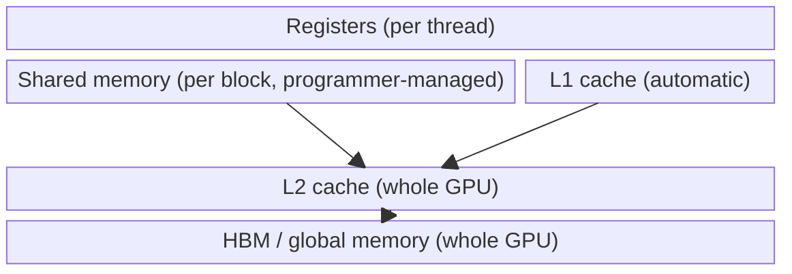
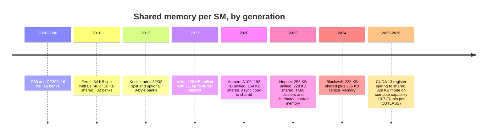

---
tags:
  - gpu-programming
  - kernels-and-optimization
  - cuda
  - shared-memory
  - bank-conflicts
  - swizzling
status: complete
sources:
  - https://docs.nvidia.com/cuda/archive/13.3.0/cuda-programming-guide/02-basics/writing-cuda-kernels.html
  - https://docs.nvidia.com/cuda/cuda-programming-guide/05-appendices/compute-capabilities.html
  - https://docs.nvidia.com/cuda/archive/13.3.0/cuda-programming-guide/03-advanced/advanced-kernel-programming.html
  - https://docs.nvidia.com/cuda/archive/13.4.1/cuda-programming-guide/04-special-topics/async-copies.html
  - https://docs.nvidia.com/cuda/cuda-c-best-practices-guide/index.html
  - https://docs.nvidia.com/cuda/volta-tuning-guide
  - https://docs.nvidia.com/cuda/ampere-tuning-guide
  - https://docs.nvidia.com/cuda/hopper-tuning-guide/index.html
  - https://docs.nvidia.com/cuda/blackwell-tuning-guide
  - https://docs.nvidia.com/cuda/archive/13.0.0/cuda-toolkit-release-notes/index.html
  - https://docs.nvidia.com/cuda/developer-preview/13.4/cuda-driver-api/cuda_driver_api/group__CUDA__TENSOR__MEMORY.html
  - https://docs.nvidia.com/cuda/cuda-runtime-api/cuda_runtime_api/group__CUDART__EXECUTION__DEPRECATED.html
  - https://docs.nvidia.com/nsight-compute/ProfilingGuide
  - https://developer.nvidia.com/blog/using-shared-memory-cuda-cc
  - https://developer.nvidia.com/blog/efficient-matrix-transpose-cuda-cc
  - https://developer.nvidia.com/blog/nvidia-hopper-architecture-in-depth/
  - https://www.ece.lsu.edu/koppel/gp/refs/NVIDIA_Fermi_Compute_Architecture_Whitepaper.pdf
  - https://staff.cs.manchester.ac.uk/~fumie/internal/KeplerArchitecture.pdf
  - https://arxiv.org/pdf/1804.06826
  - https://arxiv.org/pdf/1903.07486
  - https://arxiv.org/html/2501.12084v2
  - https://forums.developer.nvidia.com/t/128-bit-access-bank-conflict/287039
  - https://forums.developer.nvidia.com/t/clarification-bank-conflicts-metric-vs-wavefronts-for-shared-memory-lds-128/359822
  - https://forums.developer.nvidia.com/t/shared-memory-bank-conflicts-and-nsight-metric/115731
  - https://leimao.github.io/blog/CuTe-Swizzle
  - https://nvidia.github.io/cccl/unstable/libcudacxx/ptx/instructions/ldmatrix.html
  - https://research.colfax-intl.com/cutlass-tutorial-writing-gemm-kernels-using-tensor-memory-for-nvidia-blackwell-gpus/
  - https://docs.nvidia.com/cutlass/latest/overview.html
  - https://cese.ewi.tudelft.nl/computer-engineering/docs/CUDA_Cpp_Programming_Guide-Subset2-printout.pdf
  - https://www.ece.lsu.edu/gp/refs/volta-architecture-whitepaper.pdf
created: 2026-11-26
updated: 2026-11-26
---

## Table Of Contents

- [[#TL;DR|TL;DR]]
- [[#The Problem|The Problem]]
- [[#Foundations|Foundations]]
    - [[#What Shared Memory Is|What Shared Memory Is]]
    - [[#Banks|Banks]]
    - [[#Why It Pays Off|Why It Pays Off]]
- [[#How We Got Here|How We Got Here]]
- [[#How It Works|How It Works]]
    - [[#Declaring and Sizing It|Declaring and Sizing It]]
    - [[#Finding the Bank of an Access|Finding the Bank of an Access]]
    - [[#The Transpose, Line by Line|The Transpose, Line by Line]]
    - [[#Fix 1: Padding|Fix 1: Padding]]
    - [[#Fix 2: Swizzling|Fix 2: Swizzling]]
    - [[#Wide Loads, Phases and Wavefronts|Wide Loads, Phases and Wavefronts]]
    - [[#Measuring Conflicts|Measuring Conflicts]]
- [[#Where It Is Now|Where It Is Now]]
    - [[#Capacity by Generation|Capacity by Generation]]
    - [[#Hardware Copies Do the Swizzle|Hardware Copies Do the Swizzle]]
    - [[#Beyond One Block's Shared Memory|Beyond One Block's Shared Memory]]
- [[#Trade-offs & Open Problems|Trade-offs & Open Problems]]
- [[#Resources|Resources]]
- [[#Related Notes|Related Notes]]

## ***TL;DR***
---
*Shared memory is a small, fast, on-chip scratchpad that the threads of one block share and that you manage by hand. It is split into 32 banks, and when several threads of a warp hit different addresses in the same bank, their accesses are serialized. Arranging data so that a warp touches 32 different banks is most of what "using shared memory well" means.*

- **What it is.** Per-SM on-chip memory, carved out of the same physical storage as the L1 cache, visible to all threads of a block and gone when the block ends ([CUDA Programming Guide](https://docs.nvidia.com/cuda/archive/13.3.0/cuda-programming-guide/02-basics/writing-cuda-kernels.html)). Latency is about 19 to 30 cycles, versus hundreds for HBM ([Jia et al. 2018](https://arxiv.org/pdf/1804.06826); [Luo et al. 2025](https://arxiv.org/html/2501.12084v2)).
- **What it's for.** Load a tile from global memory once, with [[Memory Coalescing|coalesced]] reads, then let many threads reuse it, or reshuffle data so that both the reads and the writes to global memory are coalesced.
- **Banks.** "Shared memory has 32 banks that are organized such that successive 32-bit words map to successive banks. Each bank has a bandwidth of 32 bits per clock cycle." That gives about 128 bytes per clock per SM, which microbenchmarks confirm on A100 and H800 ([Guide](https://docs.nvidia.com/cuda/archive/13.3.0/cuda-programming-guide/02-basics/writing-cuda-kernels.html); [Luo et al.](https://arxiv.org/html/2501.12084v2)).
- **Bank conflicts.** If lanes of a warp access *different* words in the same bank, the hardware splits the request and serves them one after another; an *n*-way conflict costs about *n* times as long. Lanes reading the *same* word get it broadcast, at no extra cost.
- **The two fixes.** *Padding* (declare `tile[32][33]` instead of `[32][32]`) shifts each row by one bank. *Swizzling* XORs the column index with the row index, which avoids conflicts without wasting space and is what [[CUTLASS and CuTe|CuTe]] and the Hopper [[TMA and Asynchronous Copies|TMA]] use.
- **Where it is now (Nov 2026):** 228 KB per SM on Hopper and data-center Blackwell (227 KB usable per block), 100 KB on consumer Blackwell, and 328 KB under an opt-in mode on compute capability 10.7, which CUTLASS calls Rubin (SM107). Blocks in a cluster can read each other's shared memory, Blackwell moved matrix accumulators into a separate 256 KB *Tensor Memory*, and CUDA 13.0 lets registers spill to shared memory.

## ***The Problem***
---
*Global memory (HBM) is far away: hundreds of cycles per access and limited bandwidth shared by every SM. Many kernels need the same data many times, or need to read it in one order and write it in another. Without an on-chip place to stage data, each reuse or reordering costs another trip to HBM.*

Two situations come up constantly:

- **Reuse.** In a [[Tiled Matrix Multiplication (GEMM)|matrix multiply]] each element of A is used by every output in its row. If every thread fetched its own operands from global memory, A would be read once per column of the output. The CUDA guide's tiled example cuts that to once per tile: "A is only read (B.width / block_size) times from global memory" ([CUDA C++ Programming Guide 12.5, §6.2.4, university-hosted printout](https://cese.ewi.tudelft.nl/computer-engineering/docs/CUDA_Cpp_Programming_Guide-Subset2-printout.pdf)).
- **Reordering.** A matrix transpose reads rows and writes columns. If threads read a row coalesced, they write a column strided, and vice versa. Staging a tile in shared memory lets both sides be coalesced. In Mark Harris's measurements, a naive transpose ran at 18.8 GB/s on a Tesla M2050 while a copy ran at 105.2 GB/s ([NVIDIA blog](https://developer.nvidia.com/blog/efficient-matrix-transpose-cuda-cc)).

Shared memory solves both, but it brings its own rule: data laid out in the obvious way often makes a warp's 32 lanes hit the same bank, and the fast memory turns slow.

## ***Foundations***
---
*Shared memory is a per-block scratchpad built from 32 independent banks. Its speed comes from serving all 32 lanes of a warp in one cycle, which only works when the lanes spread across the banks.*

### What Shared Memory Is



- **Where it lives.** Inside each SM, in a pool shared with L1. You choose the split: on Hopper the 256 KB pool can give 0 to 228 KB to shared memory ([Hopper Tuning Guide](https://docs.nvidia.com/cuda/hopper-tuning-guide/index.html)). See [[GPU Memory Hierarchy]].
- **Who sees it.** All threads of one thread block, and nobody else (except, since Hopper, other blocks in the same cluster; see [[#Beyond One Block's Shared Memory|below]]). It lives as long as the block.
- **Who manages it.** You do. Unlike a cache, nothing is loaded or evicted automatically; you copy data in, call `__syncthreads()` so other threads can see it, use it, and copy results out. `__syncthreads()` "blocks all threads in the thread block until all threads have reached the call" ([Guide](https://docs.nvidia.com/cuda/archive/13.3.0/cuda-programming-guide/02-basics/writing-cuda-kernels.html)).
- **What it costs.** Shared memory per block is one of the limits on how many blocks fit on an SM, so using more can lower [[Occupancy and Latency Hiding|occupancy]].

### Banks

Memory with one port can serve one address per cycle. To serve 32 lanes at once, shared memory is split into 32 *banks*, each serving one 32-bit word per clock. Consecutive 4-byte words go to consecutive banks, wrapping every 128 bytes:

$$\text{bank}(\text{byte address}) = \left\lfloor \frac{\text{address}}{4} \right\rfloor \bmod 32$$

The rules for one warp-wide request ([Guide](https://docs.nvidia.com/cuda/archive/13.3.0/cuda-programming-guide/02-basics/writing-cuda-kernels.html); [Nsight Compute Profiling Guide](https://docs.nvidia.com/nsight-compute/ProfilingGuide)):

| Pattern | Result |
|---|---|
| 32 lanes, 32 different banks | One pass, full speed |
| Several lanes, same bank, **same 32-bit word** | Broadcast (reads); no conflict. "A shared memory request for a warp does not generate a bank conflict between two threads that access any address within the same 32-bit word" |
| Several lanes, same bank, **different words** | Bank conflict: the request is split and "serialized". *n* distinct words in the worst bank means *n* passes |
| Writes to one address by several lanes | Only one lane's write lands |

Divide the cost by the worst bank, not the total: a request where 31 banks get one word each and one bank gets four takes four passes.

### Why It Pays Off

With 32 banks × 4 bytes, an SM can deliver **128 bytes per clock** from shared memory. Luo et al. measured 127.4 to 127.9 B/clk/SM on H800 and about 126 to 128 on A100, with latency around 29 cycles on both ([Luo et al.](https://arxiv.org/html/2501.12084v2)).

**Worked example (V100).** Jia et al. measured V100 shared memory at 12,080 GiB/s across the chip (13,800 GiB/s theoretical), with 19-cycle latency without conflicts ([Jia et al. 2018](https://arxiv.org/pdf/1804.06826)). V100's HBM2 is rated at 900 GB/s ([Volta whitepaper](https://www.ece.lsu.edu/gp/refs/volta-architecture-whitepaper.pdf)), so shared memory delivers roughly **14 times** the bandwidth of global memory, at a small fraction of its latency. Harris put the latency gap at "roughly 100x lower than uncached global memory latency" ([NVIDIA blog](https://developer.nvidia.com/blog/using-shared-memory-cuda-cc)).

That ratio is the whole reason for tiling: a value read once from HBM and then reused 14 or more times from shared memory moves the bottleneck from HBM to the SM. See [[Roofline Model and Arithmetic Intensity]].

A conflict eats directly into it: Jia et al. found latency "monotonically increases with the number of conflicts in a warp" on every GPU they tested except Kepler.

## ***How We Got Here***
---
*Shared memory has been in every CUDA GPU since the first one. It grew from 16 KB to 228 KB per SM, merged with the L1 cache, gained hardware copy engines that lay data out for you, and became reachable across blocks.*



- **First CUDA GPUs.** Compute capability 1.x had 16 banks and 16 KB per SM ([Harris](https://developer.nvidia.com/blog/using-shared-memory-cuda-cc); [Fermi whitepaper](https://www.ece.lsu.edu/koppel/gp/refs/NVIDIA_Fermi_Compute_Architecture_Whitepaper.pdf)). Bank conflicts were then counted per half-warp.
- **Fermi (2010)** moved to 32 banks and a 64 KB array split between shared memory and a new L1 cache, 48/16 or 16/48 KB ([Fermi whitepaper](https://www.ece.lsu.edu/koppel/gp/refs/NVIDIA_Fermi_Compute_Architecture_Whitepaper.pdf)).
- **Kepler (2012)** added a 32/32 split, doubled bandwidth for 64-bit loads, and an optional 8-byte bank width set with `cudaDeviceSetSharedMemConfig`, which helped double precision ([Kepler GK110 whitepaper](https://staff.cs.manchester.ac.uk/~fumie/internal/KeplerArchitecture.pdf); [Harris](https://developer.nvidia.com/blog/using-shared-memory-cuda-cc)). Those calls are now deprecated and do nothing on GPUs with a fixed 4-byte bank ([CUDA Runtime API](https://docs.nvidia.com/cuda/cuda-runtime-api/cuda_runtime_api/group__CUDART__EXECUTION__DEPRECATED.html)).
- **Volta (2017)** unified L1, texture and shared memory into one 128 KB array per SM with up to 96 KB of shared memory; "static shared memory allocations remain limited to 48 KB" and larger sizes need opt-in ([Volta Tuning Guide](https://docs.nvidia.com/cuda/volta-tuning-guide)).
- **Ampere (2020)** grew A100 to 164 KB of shared memory ("a 71% increase compared to V100") and added hardware-accelerated asynchronous copies from global to shared memory and split arrive/wait barriers ([Ampere Tuning Guide](https://docs.nvidia.com/cuda/ampere-tuning-guide)).
- **Hopper (2022)** reached 228 KB ("a 39% increase compared to A100") and added the [[TMA and Asynchronous Copies|Tensor Memory Accelerator]] and thread block clusters with distributed shared memory ([Hopper Tuning Guide](https://docs.nvidia.com/cuda/hopper-tuning-guide/index.html)).
- **Blackwell (2024)** kept 228 KB but added Tensor Memory for [[Tensor Cores|tensor-core]] accumulators ([Colfax](https://research.colfax-intl.com/cutlass-tutorial-writing-gemm-kernels-using-tensor-memory-for-nvidia-blackwell-gpus/)).

## ***How It Works***
---
*The practical skill is predicting which bank each lane hits. Once you can do that, the transpose example shows the conflict, and padding or swizzling removes it.*

### Declaring and Sizing It

```cuda
__shared__ float tile[32][33];          // static: size fixed at compile time

extern __shared__ float buf[];          // dynamic: size given at launch
kernel<<<grid, block, bytes>>>(...);    // third launch parameter = bytes of dynamic shared memory
```

- **Static** arrays are sized at compile time and capped at 48 KB per block.
- **Dynamic** shared memory is sized at launch. "A kernel can have only one dynamically allocated shared array", so several arrays are carved out of one buffer by hand ([Guide](https://docs.nvidia.com/cuda/archive/13.3.0/cuda-programming-guide/02-basics/writing-cuda-kernels.html)).
- **Above 48 KB** you must opt in per kernel: `cudaFuncSetAttribute(kernel, cudaFuncAttributeMaxDynamicSharedMemorySize, bytes)`. "Kernels relying on shared memory allocations over 48 KB per block are architecture-specific" ([Guide §3.2.6](https://docs.nvidia.com/cuda/archive/13.3.0/cuda-programming-guide/03-advanced/advanced-kernel-programming.html)).
- **The L1/shared split** is a hint: `cudaFuncAttributePreferredSharedMemoryCarveout` takes a percentage, and the driver rounds up to a supported size. On compute capability 12.0, asking for 50% gives 64 KB, not 50 KB.
- **Overhead.** "CUDA reserves 1 KB of shared memory per thread block", which is why per-block maximums are 1 KB below per-SM ones ([Ampere Tuning Guide](https://docs.nvidia.com/cuda/ampere-tuning-guide)).

### Finding the Bank of an Access

Take `__shared__ float tile[32][32]` and a warp whose lane `i` accesses `tile[r][c]`. The word index is $32r + c$, so the bank is $(32r + c) \bmod 32 = c$.

| Access by lane `i` | Banks hit | Conflict |
|---|---|---|
| `tile[row][i]` (a row) | $i$ → 32 different banks | None |
| `tile[i][col]` (a column) | $col$ for every lane → 1 bank | 32-way: 32 passes |
| `tile[i][col]` with `tile[32][33]` | $(33i + col) \bmod 32 = (i + col) \bmod 32$ → 32 different banks | None |
| `tile[0][0]` for every lane | 1 bank, same word | None (broadcast) |
| `double d[64]`, lane reads `d[i]` | Each 8-byte value spans 2 banks | Served in two halves; see [[#Wide Loads, Phases and Wavefronts|below]] |
| `float a[...]`, lane reads `a[2*i]` (stride 2) | Banks $2i \bmod 32$: 16 banks, 2 words each | 2-way |

The general rule for a 4-byte stride of $s$ words: the conflict degree is $\gcd(s, 32)$. Odd strides are conflict-free, which is exactly why padding a row of 32 to 33 works.

### The Transpose, Line by Line

Harris's transpose reads a 32×32 tile with coalesced row reads, stages it in shared memory, and writes it out with coalesced row writes ([NVIDIA blog](https://developer.nvidia.com/blog/efficient-matrix-transpose-cuda-cc)):

```cuda
const int TILE_DIM = 32, BLOCK_ROWS = 8;

__global__ void transposeNoBankConflicts(float *odata, const float *idata) {
  __shared__ float tile[TILE_DIM][TILE_DIM + 1];       // +1 column of padding

  int x = blockIdx.x * TILE_DIM + threadIdx.x;
  int y = blockIdx.y * TILE_DIM + threadIdx.y;
  int width = gridDim.x * TILE_DIM;

  for (int j = 0; j < TILE_DIM; j += BLOCK_ROWS)
    tile[threadIdx.y + j][threadIdx.x] = idata[(y + j) * width + x];   // read rows

  __syncthreads();

  x = blockIdx.y * TILE_DIM + threadIdx.x;              // swap block coordinates
  y = blockIdx.x * TILE_DIM + threadIdx.y;

  for (int j = 0; j < TILE_DIM; j += BLOCK_ROWS)
    odata[(y + j) * width + x] = tile[threadIdx.x][threadIdx.y + j];   // read columns
}
```

- **The block is 32×8 threads**, and each thread handles 4 elements of the 32×32 tile (`j` steps by 8). Fewer threads per element hides the loop overhead.
- **First loop:** consecutive `threadIdx.x` read consecutive global addresses (coalesced) and write a *row* of `tile`: 32 different banks, no conflict.
- **`__syncthreads()`:** every element of the tile must be written before any thread reads a column of it.
- **Swapping `blockIdx.x` and `blockIdx.y`** sends this tile to its transposed position in the output.
- **Second loop:** consecutive `threadIdx.x` now read a *column* of `tile` (`tile[threadIdx.x][...]`). With a 32-wide row this is a 32-way conflict; the `+ 1` makes it conflict-free. The global write is again coalesced.

Harris's numbers in GB/s ([NVIDIA blog](https://developer.nvidia.com/blog/efficient-matrix-transpose-cuda-cc)):

| Kernel | Tesla M2050 | Tesla K20c |
|---|---|---|
| Copy (the ceiling) | 105.2 | 136.0 |
| Naive transpose (strided writes) | 18.8 | 55.3 |
| Shared-memory transpose, `[32][32]` | 51.3 | 97.6 |
| Shared-memory transpose, `[32][33]` | 99.5 | 144.3 |

On a V100 the Best Practices Guide's $C = AA^T$ example shows the same effect: 140.2 GB/s before padding, 199.4 GB/s with `transposedTile[TILE_DIM][TILE_DIM+1]` ([Best Practices Guide §10.2.3](https://docs.nvidia.com/cuda/cuda-c-best-practices-guide/index.html)).

### Fix 1: Padding

Add one unused word per row. The row stride becomes 33 words, an odd number, so a column walks across all 32 banks. The guide's own fix: "pad the shared memory by adding one to the column dimension", e.g. `__shared__ float smemArray[32][32+1];` ([Guide](https://docs.nvidia.com/cuda/archive/13.3.0/cuda-programming-guide/02-basics/writing-cuda-kernels.html)).

Its costs: about 3% wasted space for a 32-wide tile, and rows no longer start on 16-byte boundaries, which breaks 128-bit vector loads and the alignment that hardware copies require.

### Fix 2: Swizzling

Instead of shifting rows, permute where each element lands within its row. The simplest form for a 32×32 float tile: store element $(r, c)$ at column $c \oplus r$ (bitwise XOR).

- **A row** $r$: lanes $c = 0..31$ go to columns $c \oplus r$, still a permutation of 0..31, so 32 banks.
- **A column** $c$: lanes $r = 0..31$ go to columns $c \oplus r$, again all different, so 32 banks.

No space is wasted, and blocks of consecutive elements can stay together if the XOR acts on chunk indices rather than single elements. Production code swizzles 16-byte chunks so 128-bit loads still work.

CuTe writes this as `Swizzle<B, M, S>`: keep the lowest `M` bits of the offset fixed (the chunk), take a `B`-bit mask, and XOR it with the bits `S` places higher, i.e. `offset ^ ((offset & mask) >> S)`. For an 8×64 FP16 tile read with 128-bit vectors, `Swizzle<3,3,3>` makes access conflict-free ([Lei Mao](https://leimao.github.io/blog/CuTe-Swizzle)). The `ldmatrix` instruction (SM 7.5+), which loads 8×8 matrix fragments from shared memory for [[Tensor Cores]], is normally paired with such layouts ([CCCL PTX docs](https://nvidia.github.io/cccl/unstable/libcudacxx/ptx/instructions/ldmatrix.html)).

| | Padding | Swizzling |
|---|---|---|
| Idea | Make the row stride odd | Permute positions with XOR |
| Wasted memory | One element per row | None |
| Keeps 16-byte alignment | No | Yes (when swizzling 16-byte chunks) |
| Works with TMA | No | Yes, TMA swizzles in hardware |
| Ease | One-character change | Index math, or a library ([[CUTLASS and CuTe]]) |

### Wide Loads, Phases and Wavefronts

A warp reading one `float4` per lane asks for 512 bytes, but the banks deliver 128 bytes per clock. So the hardware splits the request into *phases*: for 128-bit loads (`LDS.128`) it serves a quarter of the warp at a time, and checks for conflicts only within each phase. Four passes is then full speed, not a conflict. NVIDIA's forum moderator Robert Crovella: the request is "split up by the GPU into 4 phases", and in the newer profiler "the correct term is wavefront" ([NVIDIA forums](https://forums.developer.nvidia.com/t/128-bit-access-bank-conflict/287039)). A 2026 Blackwell thread shows a bad `LDS.128` layout at 32 wavefronts per instruction and a fixed one at the minimum of 4 ([NVIDIA forums](https://forums.developer.nvidia.com/t/clarification-bank-conflicts-metric-vs-wavefronts-for-shared-memory-lds-128/359822)).

By the same logic, 64-bit loads are served half a warp per pass, two wavefronts minimum. Community posts describe this; NVIDIA's current guide doesn't spell it out. The practical rule: aim for the minimum number of wavefronts for the access width, which is $\lceil 32 \times \text{bytes per lane} / 128 \rceil$.

### Measuring Conflicts

[[Profiling with Nsight Compute and Nsight Systems|Nsight Compute]] reports shared-memory traffic in wavefronts: "the maximum unit that can pass through that pipeline stage per cycle", where "work items of different wavefronts are serialized" ([Profiling Guide](https://docs.nvidia.com/nsight-compute/ProfilingGuide)).

- **Totals:** `l1tex__data_pipe_lsu_wavefronts_mem_shared_op_ld.sum` (wavefronts) and `l1tex__data_bank_conflicts_pipe_lsu_mem_shared_op_ld.sum` (conflicts); `_op_st` for stores.
- **Per source line:** the Source page's "L1 Wavefronts Shared Excessive" column, which compares actual against ideal wavefronts. An NVIDIA engineer recommends this over the raw conflict counter, which also counts other arbitration stalls and can't be tied to source lines ([NVIDIA forums](https://forums.developer.nvidia.com/t/shared-memory-bank-conflicts-and-nsight-metric/115731)).

## ***Where It Is Now***
---
*As of November 2026: shared memory keeps growing slowly, hardware copy engines now lay data out in conflict-free swizzled patterns themselves, and the newest GPUs add memory around it (cluster-wide shared memory, Tensor Memory) rather than just making it bigger.*

### Capacity by Generation

From the CUDA Programming Guide's compute capability tables (v13.4.2, Sep 2026) and the tuning guides; every listed GPU has 32 banks ([Compute Capabilities](https://docs.nvidia.com/cuda/cuda-programming-guide/05-appendices/compute-capabilities.html)):

| Compute capability (example) | Unified L1 + shared | Max shared per SM | Max shared per block |
|---|---|---|---|
| 7.5 (Turing, T4) | 96 KB | 64 KB | 64 KB |
| 8.0 (A100) | 192 KB | 164 KB | 163 KB |
| 8.6 / 8.9 (RTX 30, RTX 40, L4) | 128 KB | 100 KB | 99 KB |
| 9.0 (H100, H200) | 256 KB | 228 KB | 227 KB |
| 10.0 / 10.3 (B200, B300) | 256 KB | 228 KB | 227 KB |
| 10.7 (Rubin, per CUTLASS's SM107 naming) | 336 KB | 328 KB with opt-in | 327 KB |
| 12.x (RTX 50, RTX PRO Blackwell) | 128 KB | 100 KB | 99 KB |

- The 328 KB mode on 10.7 must be enabled per kernel with `cudaSharedMemoryModeAllowOversizedSharedMemory` through `cudaFuncAttributeSharedMemoryMode`. CUTLASS 4.8 (Sep 2026) lists initial Rubin support as SM107, needing the R615 driver with CUDA 13.4 ([CUTLASS overview](https://docs.nvidia.com/cutlass/latest/overview.html)). The guide itself doesn't name a product for 10.7.
- The Blackwell tuning guide gives compute capability 12.0 as "128KB" of shared memory per SM, which matches the guide's *unified* size; the guide's tables give 100 KB of shared memory ([Blackwell Tuning Guide](https://docs.nvidia.com/cuda/blackwell-tuning-guide)).
- CUDA 13.0 dropped Maxwell, Pascal and Volta, so current toolkits start at 7.5 ([CUDA 13.0 release notes](https://docs.nvidia.com/cuda/archive/13.0.0/cuda-toolkit-release-notes/index.html)).
- **New use: register spills.** CUDA 13.0: "Registers can now additionally spill to shared memory, which is approximately 10x lower latency than spilling to L2 cache", opt-in with the `enable_smem_spilling` pragma ([CUDA 13.0 release notes](https://docs.nvidia.com/cuda/archive/13.0.0/cuda-toolkit-release-notes/index.html)).

### Hardware Copies Do the Swizzle

On Ampere, `cp.async` copies global memory to shared memory without passing through registers; the Best Practices Guide notes best results with 8- or 16-byte elements ([Best Practices](https://docs.nvidia.com/cuda/cuda-c-best-practices-guide/index.html)). On Hopper and later, the [[TMA and Asynchronous Copies|TMA]] copies whole tiles and can write them swizzled. The CUDA guide's example: transposing an 8×8 matrix of `int4` without swizzle puts each column in one bank, "an eight-way bank conflict per stored column"; with `CU_TENSOR_MAP_SWIZZLE_128B`, "each matrix element is from a different bank for both the rows and columns". The destination must be 1,024-byte aligned for that mode ([Guide §4.12](https://docs.nvidia.com/cuda/archive/13.4.1/cuda-programming-guide/04-special-topics/async-copies.html)).

The driver API offers `SWIZZLE_NONE`, `_32B`, `_64B` and `_128B` ("Swizzle 16B chunks within 32B / 64B / 128B span"), and CUDA 13.4 adds finer variants `_128B_ATOM_32B`, `_128B_ATOM_32B_FLIP_8B` and `_128B_ATOM_64B` ([Driver API](https://docs.nvidia.com/cuda/developer-preview/13.4/cuda-driver-api/cuda_driver_api/group__CUDA__TENSOR__MEMORY.html)). In practice this means modern [[Tiled Matrix Multiplication (GEMM)|GEMM]] and [[FlashAttention]] kernels rarely compute swizzles by hand: the TMA writes the pattern and [[CUTLASS and CuTe|CuTe]] layouts read it back.

### Beyond One Block's Shared Memory

- **Distributed shared memory (Hopper+).** "A thread block can read from, write to, and perform atomics in shared memory of other thread blocks within its cluster." The portable cluster size is 8; H100 and B200 allow 16 with an opt-in ([Hopper Tuning Guide](https://docs.nvidia.com/cuda/hopper-tuning-guide/index.html); [Blackwell Tuning Guide](https://docs.nvidia.com/cuda/blackwell-tuning-guide)). NVIDIA says it speeds up data exchange between blocks "by about 7x" versus global memory ([Hopper in depth](https://developer.nvidia.com/blog/nvidia-hopper-architecture-in-depth/)). Luo et al. measured about 181 to 213 cycles SM-to-SM latency versus 1,110 cycles through global memory, and about 3.3 TB/s of cluster-wide throughput at cluster size 2 on H800 ([Luo et al.](https://arxiv.org/html/2501.12084v2)). See [[CUDA Programming Model]].
- **Tensor Memory (Blackwell+).** A separate 256 KB per SM, 128 lanes × 512 columns of 32-bit cells, that holds tensor-core accumulators; operand B still comes from shared memory, and A from shared or Tensor Memory ([Colfax](https://research.colfax-intl.com/cutlass-tutorial-writing-gemm-kernels-using-tensor-memory-for-nvidia-blackwell-gpus/)). CUTLASS sets SM107 (Rubin) Tensor Memory at 576 columns ([CUTLASS overview](https://docs.nvidia.com/cutlass/latest/overview.html)). This frees shared memory to hold more input tiles for deeper pipelines.

## ***Trade-offs & Open Problems***
---
*More shared memory per block means fewer blocks per SM, and conflict-free layouts trade simplicity for index math. The newest kernels lean on hardware copies and libraries to hide that complexity, which ties them to specific GPU generations.*

| Decision | Upside | Downside |
|---|---|---|
| Large tiles in shared memory | More reuse per HBM byte | Fewer blocks per SM; see [[Occupancy and Latency Hiding]] |
| More L1 carveout instead | Automatic caching for irregular access | Less room for explicit tiles |
| Padding | Trivial to apply | Wastes space, breaks 16-byte alignment and TMA |
| Swizzling | No waste, works with vector loads and TMA | Harder to read and debug; layouts must match between writer and reader |
| > 48 KB per block | Bigger tiles | Kernel needs opt-in and becomes architecture-specific |
| Distributed shared memory | Blocks share data without HBM | Cluster sync rules; blocks must not exit while others read their memory ([Guide](https://docs.nvidia.com/cuda/archive/13.3.0/cuda-programming-guide/02-basics/writing-cuda-kernels.html)) |

Open problems and caveats:

- **Portability of capacity.** A kernel tuned for 227 KB per block on H100 will not launch on an RTX 50-series GPU (99 KB) without retuning tile sizes.
- **Conflict accounting is opaque.** How 64-bit loads are split, and what exactly the conflict counter counts, is documented mainly in forum answers, not the guide.
- **Swizzle formats multiply.** Each new copy engine adds layout modes (the CUDA 13.4 "atom" variants); hand-written kernels must match them exactly, which pushes people toward [[CUTLASS and CuTe]], [[Triton]] or CUDA Tile.
- **`__syncthreads()` correctness.** Calling it in divergent code is undefined and can deadlock ([Harris](https://developer.nvidia.com/blog/using-shared-memory-cuda-cc)); see [[Warp Divergence and Warp-Level Primitives]].

## ***Resources***
---
*Start with Harris's two 2013 posts and the CUDA guide's bank section, then the transpose and padding examples in the Best Practices Guide. For modern kernels, read the guide's TMA swizzle section and Lei Mao's CuTe swizzle post. The microbenchmark papers give the latency and bandwidth numbers.*

**NVIDIA documentation**
- [CUDA Programming Guide: Writing CUDA Kernels](https://docs.nvidia.com/cuda/archive/13.3.0/cuda-programming-guide/02-basics/writing-cuda-kernels.html): shared memory, banks, padding, distributed shared memory.
- [CUDA Programming Guide: Compute Capabilities](https://docs.nvidia.com/cuda/cuda-programming-guide/05-appendices/compute-capabilities.html): capacity and carveout tables.
- [CUDA Programming Guide: Configuring L1/Shared Memory Balance](https://docs.nvidia.com/cuda/archive/13.3.0/cuda-programming-guide/03-advanced/advanced-kernel-programming.html).
- [CUDA Programming Guide: Asynchronous Copies and TMA swizzling](https://docs.nvidia.com/cuda/archive/13.4.1/cuda-programming-guide/04-special-topics/async-copies.html).
- [CUDA C++ Best Practices Guide](https://docs.nvidia.com/cuda/cuda-c-best-practices-guide/index.html): §10.2.3 shared memory.
- [Volta](https://docs.nvidia.com/cuda/volta-tuning-guide), [Ampere](https://docs.nvidia.com/cuda/ampere-tuning-guide), [Hopper](https://docs.nvidia.com/cuda/hopper-tuning-guide/index.html) and [Blackwell](https://docs.nvidia.com/cuda/blackwell-tuning-guide) tuning guides.
- [CUDA Driver API: Tensor Map Object Management](https://docs.nvidia.com/cuda/developer-preview/13.4/cuda-driver-api/cuda_driver_api/group__CUDA__TENSOR__MEMORY.html): TMA swizzle modes.
- [Nsight Compute Profiling Guide](https://docs.nvidia.com/nsight-compute/ProfilingGuide).
- [CUDA 13.0 release notes](https://docs.nvidia.com/cuda/archive/13.0.0/cuda-toolkit-release-notes/index.html).

**NVIDIA blog and whitepapers**
- [Using Shared Memory in CUDA C/C++](https://developer.nvidia.com/blog/using-shared-memory-cuda-cc): Mark Harris, 2013.
- [An Efficient Matrix Transpose in CUDA C/C++](https://developer.nvidia.com/blog/efficient-matrix-transpose-cuda-cc): Mark Harris, 2013.
- [NVIDIA Hopper Architecture In-Depth](https://developer.nvidia.com/blog/nvidia-hopper-architecture-in-depth/): 2022.
- [Fermi](https://www.ece.lsu.edu/koppel/gp/refs/NVIDIA_Fermi_Compute_Architecture_Whitepaper.pdf) and [Kepler GK110](https://staff.cs.manchester.ac.uk/~fumie/internal/KeplerArchitecture.pdf) whitepapers.

**Microbenchmarks**
- [Dissecting the NVIDIA Volta GPU Architecture via Microbenchmarking](https://arxiv.org/pdf/1804.06826): Jia et al., 2018.
- [Dissecting the NVIDIA Turing T4 GPU via Microbenchmarking](https://arxiv.org/pdf/1903.07486): Jia et al., 2019.
- [Dissecting the NVIDIA Hopper Architecture through Microbenchmarking](https://arxiv.org/html/2501.12084v2): Luo et al., 2025.

**Practitioners and libraries**
- [CuTe Swizzle](https://leimao.github.io/blog/CuTe-Swizzle): Lei Mao.
- [CUTLASS Tutorial: Writing GEMM Kernels Using Tensor Memory for Blackwell](https://research.colfax-intl.com/cutlass-tutorial-writing-gemm-kernels-using-tensor-memory-for-nvidia-blackwell-gpus/): Colfax Research, 2025.
- [CUTLASS overview](https://docs.nvidia.com/cutlass/latest/overview.html): version notes including SM107.
- NVIDIA forum threads on [128-bit phases](https://forums.developer.nvidia.com/t/128-bit-access-bank-conflict/287039), [LDS.128 wavefronts on Blackwell](https://forums.developer.nvidia.com/t/clarification-bank-conflicts-metric-vs-wavefronts-for-shared-memory-lds-128/359822) and [the Nsight conflict counter](https://forums.developer.nvidia.com/t/shared-memory-bank-conflicts-and-nsight-metric/115731).

## ***Related Notes***
---
*Where shared memory sits in the memory system, the kernels built on it, and the hardware that now fills it for you.*

- [[GPU Memory Hierarchy]] — Registers, shared memory, L1, L2 and HBM side by side.
- [[GPU Architecture Basics]] — SMs and warps, the units shared memory serves.
- [[Memory Coalescing]] — The global-memory side of the same reshuffling problem.
- [[Roofline Model and Arithmetic Intensity]] — Why reuse through shared memory moves a kernel off the memory roof.
- [[Occupancy and Latency Hiding]] — How shared memory per block limits blocks per SM.
- [[Tiled Matrix Multiplication (GEMM)]] — The main reason shared memory exists.
- [[Parallel Reduction and Scan]] — Sequential vs strided addressing and conflict-free scan.
- [[Warp Divergence and Warp-Level Primitives]] — Shuffles that bypass shared memory, and `__syncthreads()` in divergent code.
- [[TMA and Asynchronous Copies]] — Hardware copies that write swizzled tiles.
- [[Tensor Cores]] — `ldmatrix` and the fragment layouts shared memory feeds.
- [[CUTLASS and CuTe]] — Swizzle layouts as a library.
- [[CUDA Programming Model]] — Blocks, clusters and distributed shared memory.
- [[FlashAttention]] — Attention tiles kept in shared memory.
- [[Profiling with Nsight Compute and Nsight Systems]] — Wavefront and conflict metrics.
- [[Blackwell Architecture]] — Tensor Memory and the 2-SM MMA.
- [[Thread Block Clusters and Distributed Shared Memory]] — Distributed shared memory: reading other blocks' shared memory in a cluster.
