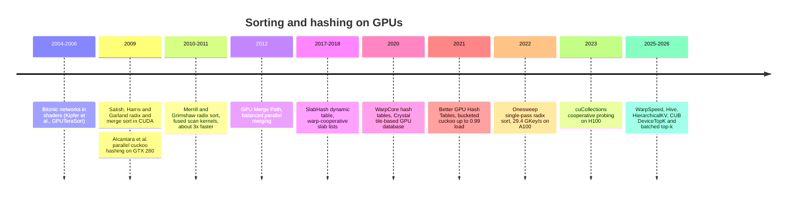
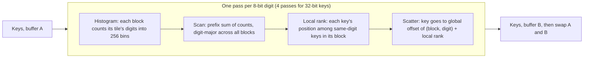

---
tags:
  - gpu-programming
  - kernels-and-optimization
  - cuda
  - sorting
  - radix-sort
  - hashing
  - hash-tables
  - cub
  - cucollections
status: complete
sources:
  - https://arxiv.org/abs/2206.01784
  - https://nvidia.github.io/cccl/cub/api/structcub_1_1DeviceRadixSort.html
  - https://nvidia.github.io/cccl/unstable/cub/api/structcub_1_1DeviceSegmentedSort.html
  - https://nvidia.github.io/cccl/unstable/cub/device_topk_requirements.html
  - https://github.com/NVIDIA/cccl/releases
  - https://mvdirona.com/jrh/TalksAndPapers/RadixSortTRv2.pdf
  - https://www.worldscientific.com/doi/abs/10.1142/S0129626411000187
  - https://research.nvidia.com/publication/2009-05_designing-efficient-sorting-algorithms-manycore-gpus
  - https://arxiv.org/pdf/1709.02520
  - https://www.cs.ucdavis.edu/~amenta/f15/GPUmp.pdf
  - https://gpuopen.com/learn/boosting_gpu_radix_sort/
  - https://developer.nvidia.com/blog/topping-the-gpu-mode-kernel-leaderboard-with-nvidia-cuda-compute
  - https://www.cs.ucdavis.edu/~amenta/pubs/ParallelHash.pdf
  - https://developer.nvidia.com/blog/maximizing-performance-with-massively-parallel-hash-maps-on-gpus/
  - https://github.com/nviDIA/cuCollections
  - https://arxiv.org/abs/2009.07914v1
  - https://arxiv.org/abs/1710.11246v1
  - https://arxiv.org/pdf/2108.07232
  - https://arxiv.org/pdf/2509.16407
  - https://arxiv.org/abs/2510.15095
  - https://arxiv.org/abs/2603.17168
  - https://arxiv.org/pdf/2003.01178
  - https://arxiv.org/abs/2312.00720v2
  - https://developer.nvidia.com/blog/supercharging-deduplication-in-pandas-using-rapids-cudf/
  - https://jazracherif.github.io/database/gpu/nvidia/rapids/libcudf/2026/05/13/libcudf-technical-deep-dive.html
  - https://docs.nvidia.com/megatron-core/developer-guide/latest/apidocs/core/core.inference.moe.permute.html
  - https://raphlinus.github.io/gpu/2021/11/17/prefix-sum-portable.html
  - https://www.nvidia.com/en-us/data-center/h100/
  - https://www.nvidia.com/en-us/data-center/a100/
  - https://www.cs.umd.edu/class/spring2021/cmsc714/readings/Satish-sorting.pdf
  - https://en.wikipedia.org/wiki/Linear_probing
  - https://chalmersgu-data-structure-courses.github.io/dsabook/html/8.8-analysis-of-open-addressing.html
  - https://www.github.com/b0nes164/GPUSorting
  - https://arxiv.org/html/2501.14336v1
  - https://arxiv.org/pdf/2609.00843
  - https://nvidia.github.io/cccl/unstable/thrust/api_docs/algorithms/sorting.html
  - https://nvidia.github.io/cccl/unstable/thrust/api/group__sorting_1ga289fae2c9edaceba94c025beeb615ca2.html
  - https://github.com/nvidia/cccl
  - https://insidehpc.com/2022/03/omnisci-rebrands-as-heavy-ai/
created: 2026-11-26
updated: 2026-11-28
---

## Table Of Contents

---

- [[#TL;DR|TL;DR]]
- [[#The Problem|The Problem]]
- [[#Foundations|Foundations]]
    - [[#Why Comparison Sorts Map Poorly|Why Comparison Sorts Map Poorly]]
    - [[#Radix Sort in One Page|Radix Sort in One Page]]
    - [[#Hash Tables in One Page|Hash Tables in One Page]]
- [[#How We Got Here|How We Got Here]]
- [[#How It Works|How It Works]]
    - [[#Sorting Networks and Bitonic Sort|Sorting Networks and Bitonic Sort]]
    - [[#LSD Radix Sort: Histogram, Scan, Scatter|LSD Radix Sort: Histogram, Scan, Scatter]]
    - [[#Onesweep|Onesweep]]
    - [[#Merge Sort and Merge Path|Merge Sort and Merge Path]]
    - [[#Segmented Sort and Top-K|Segmented Sort and Top-K]]
    - [[#Calling It: CUB and Thrust|Calling It: CUB and Thrust]]
    - [[#Open Addressing and Atomics|Open Addressing and Atomics]]
    - [[#Cuckoo, Bucketed and Warp-Cooperative Probing|Cuckoo, Bucketed and Warp-Cooperative Probing]]
    - [[#Dynamic Tables: SlabHash and After|Dynamic Tables: SlabHash and After]]
    - [[#Where Sorting and Hashing Get Used|Where Sorting and Hashing Get Used]]
- [[#Where It Is Now|Where It Is Now]]
- [[#Trade-offs & Open Problems|Trade-offs & Open Problems]]
- [[#Resources|Resources]]
- [[#Related Notes|Related Notes]]

## ***TL;DR***
---
*On a GPU, sorting means radix sort and hashing means open addressing with atomics. Both are memory-bound, so the whole game is touching each byte of DRAM as few times as possible and making those touches line up with 128-byte cache lines.*

- **Sorting.** For fixed-width keys (integers, floats, half types) the fastest GPU sort is a **least-significant-digit (LSD) radix sort**: split the key into 8-bit digits and, for each digit, count (histogram), prefix-sum the counts, and scatter every key to its bucket. It is built directly on [[Parallel Reduction and Scan|scan]]. **Onesweep** (Adinets and Merrill, 2022) fuses the scan into the scatter with decoupled look-back, so each digit costs about one read and one write of the data, and sorts 256M random 32-bit keys at **29.4 billion keys/s on an A100**, about 1.5× the CUB sort before it ([arXiv 2206.01784](https://arxiv.org/abs/2206.01784)).
- **Comparison sorts** (merge sort with Merge Path partitioning, bitonic networks) still matter for arbitrary comparators, small on-chip sorts and many short segments, but they do $O(n \log n)$ or more work where radix does $O(n \cdot \text{digits})$.
- **Hashing.** GPU hash tables are mostly **open addressing** (linear probing, double hashing or bucketed cuckoo) with **atomic compare-and-swap** to claim slots. The big wins are having a group of threads probe a cache-line-sized bucket together, and keeping the load factor where probe chains stay short. NVIDIA's `cuco::static_map` inserts at 87.5 GB/s and finds at 134.6 GB/s on one H100 at 50% load ([NVIDIA, Mar 2023](https://developer.nvidia.com/blog/maximizing-performance-with-massively-parallel-hash-maps-on-gpus/)).
- **Uses.** Hash joins, group-by and deduplication in [[GPU Databases and Dataframes|GPU databases]] (RAPIDS cuDF, Crystal, HeavyDB), MoE token routing (a one-digit counting sort by expert id), top-k selection, spatial hashing, genomics.
- **Where it is now (Nov 2026).** Sort, segmented sort and top-k ship in CUB inside CCCL 3.5.0 (Oct 2026), which added a batched top-k and Programmatic Dependent Launch for radix sort ([CCCL releases](https://github.com/NVIDIA/cccl/releases)). cuCollections finished retiring its legacy containers in early 2026 ([cuCollections](https://github.com/nviDIA/cuCollections)). Research has moved to concurrent, resizable and cache-semantics hash tables (WarpSpeed 2025, Hive 2025, HierarchicalKV 2026).

## ***The Problem***
---
*Sorting and hashing are the two ways to bring equal or nearby keys together, and almost every data-processing pipeline needs one of them. On a CPU they are cache and branch puzzles; on a GPU they become bandwidth, divergence and contention puzzles.*

Group-by, join, deduplication, histogramming, building a spatial grid, routing tokens to experts: each needs "put items with the same key next to each other" (sort) or "find the slot for this key" (hash). Both are dominated by data movement, not arithmetic, so they sit far left on the [[Roofline Model and Arithmetic Intensity|roofline]].

What makes them awkward on a GPU:

| Obstacle | Why it hurts | Where it bites |
|---|---|---|
| Data-dependent control flow | Comparisons send lanes of a warp down different branches ([[Warp Divergence and Warp-Level Primitives]]) | Quicksort partitioning, probe loops of different lengths |
| Scattered writes and reads | A scatter or a hash probe touches a random cache line per item, far from [[Memory Coalescing|coalesced]] | Radix scatter, every hash probe |
| No global barrier | Blocks can't wait for each other inside a kernel ([[CUDA Programming Model]]) | Turning per-block counts into global offsets |
| Concurrent updates | Many threads may claim the same slot or counter at once | Hash inserts, histograms, group-by aggregates ([[CUDA Memory Model and Atomics]]) |
| Small, fixed fast memory | Per-block buckets and tables must fit in [[Shared Memory and Bank Conflicts|shared memory]] | Digit width in radix sort, block-local hash sets |

NVIDIA's hash-map post puts the scale of the random-access problem in numbers: random 64-bit reads (GUPS) reach 141 GB/s on an A100 and 256 GB/s on an H100, about 10× below theoretical peak bandwidth, against 15 GB/s on a Xeon Platinum 8360Y ([NVIDIA, Mar 2023](https://developer.nvidia.com/blog/maximizing-performance-with-massively-parallel-hash-maps-on-gpus/)). The same post argues the GPU's hash throughput exceeds PCIe Gen5, so a table can be built as fast as data arrives.

## ***Foundations***
---
*Three ideas carry the rest of the note: comparison sorts fight the GPU's lockstep execution, radix sort turns sorting into counting plus scan, and a hash table is a probe sequence plus an atomic claim.*

### Why Comparison Sorts Map Poorly

A comparison sort needs at least $\Omega(n \log n)$ comparisons, and the fast CPU ones (quicksort, introsort) are full of unpredictable branches and recursive, uneven partitions. On a GPU that means divergent warps, load imbalance between blocks, and $\log n$ passes over memory.

Two comparison approaches do work on GPUs:

- **Sorting networks** (Batcher's bitonic and odd-even merge sorts): a fixed wiring of compare-exchange steps, the same for every input, so no lane ever diverges. The cost is $O(n \log^2 n)$ work and data access, fine on-chip and poor for large inputs ([Arkhipov et al. survey](https://arxiv.org/pdf/1709.02520)).
- **Merge sort**: sort small tiles in shared memory, then merge pairs of runs, splitting each merge evenly across threads (Merge Path). This is what libraries use when the comparator is arbitrary.

**Radix sort** sidesteps the comparison bound: it never compares two keys, it reads their bits. For $b$-bit keys and $d$-bit digits it does $\lceil b/d \rceil$ passes of linear work. The survey above calls a radix sort "the fastest GPU sort algorithm for 32-bit integer keys" ([Arkhipov et al.](https://arxiv.org/pdf/1709.02520)).

### Radix Sort in One Page

LSD radix sort processes digits from least to most significant. Each pass must be **stable** (equal digits keep their order), so after the last pass the keys are fully sorted. One pass over digit $j$ is a counting sort:

1. **Histogram:** count how many keys have each digit value (256 bins for 8-bit digits).
2. **Exclusive scan** of the counts: bin $v$ starts at the total count of all smaller bins.
3. **Scatter:** each key goes to `start[digit] + (rank among earlier keys with the same digit)`.

On a GPU, each block histograms its own tile, and the global start of "block $t$'s keys with digit $v$" is a prefix sum over all blocks' counts in digit-major order. That is exactly a device-wide [[Parallel Reduction and Scan|scan]], which is why scan and sort were developed together.

Floats and signed integers are sorted by first transforming the bits so that unsigned order matches numeric order. CUB flips the sign bit of signed integers and positive floats and inverts all bits of negative floats, then undoes this on output; it treats −0.0 and +0.0 as equal and sorts NaNs by their bit pattern ([CUB DeviceRadixSort](https://nvidia.github.io/cccl/cub/api/structcub_1_1DeviceRadixSort.html)).

### Hash Tables in One Page

A hash table maps a key to a slot with a hash function $h(k)$. When two keys collide, there are two families of fixes:

- **Chaining:** each slot heads a linked list. Simple, but pointer chasing is the worst access pattern on a GPU. SlabHash (below) makes it workable by making each list node a 128-byte "slab" handled by a whole warp.
- **Open addressing:** everything lives in one flat array of slots; on collision, try the next slot in a **probe sequence**. Linear probing tries $h(k), h(k)+1, h(k)+2, \ldots$; double hashing steps by a second hash; **cuckoo hashing** gives each key a few candidate slots (one per hash function) and evicts an occupant to its alternative when all are full.

The **load factor** $\alpha = n / \text{capacity}$ governs everything: higher $\alpha$ saves memory but lengthens probe sequences. On a GPU, a slot is claimed with an atomic **compare-and-swap (CAS)**: "if this slot still holds the empty sentinel, write my key". If the CAS fails, another thread got there first, so move to the next slot.

## ***How We Got Here***
---
*GPU sorting went from bitonic networks in graphics shaders to scan-based radix sort in CUDA, then to single-pass radix sort. GPU hashing went from a two-level cuckoo scheme to warp-cooperative, bucketed open addressing in production libraries.*



- **Graphics era.** Before CUDA, GPU sorts were bitonic networks written as fragment programs: Kipfer et al. sorted particle textures this way, and GPUTeraSort mapped a bitonic network onto texture addressing for an external sort ([Arkhipov et al.](https://arxiv.org/pdf/1709.02520)).
- **CUDA radix sort (2009).** Satish, Harris and Garland's IPDPS 2009 paper ([NVIDIA Research](https://research.nvidia.com/publication/2009-05_designing-efficient-sorting-algorithms-manycore-gpus)) became the reference design: sort each block's tile locally on a 4-bit digit first, which "converts scattered writes to external memory into scattered writes to on-chip memory", then write out mostly contiguous runs. It averaged about 187 million keys/s on a GTX 280, and the authors claimed both the fastest GPU sort and the fastest comparison-based (merge) sort in the literature at the time ([Satish et al.](https://www.cs.umd.edu/class/spring2021/cmsc714/readings/Satish-sorting.pdf)). It also found Batcher networks fastest for on-chip sorting ([Arkhipov et al.](https://arxiv.org/pdf/1709.02520)).
- **Merrill and Grimshaw (2010-2011).** They generalized scan with "visiting logic" and "multi-scan" so the radix histogram, scan and scatter ran as three fused kernels (reduce, top-level scan, downsweep scan) with few intermediate values in DRAM. On a GTX 285 they sorted 550 million 32-bit keys/s (482 million key-value pairs/s), 2.8× (keys) and 3.6× (pairs) faster than Satish et al.'s CUDPP sort, moving $3n$ words per pass for keys and $5n$ with values ([Merrill and Grimshaw TR](https://mvdirona.com/jrh/TalksAndPapers/RadixSortTRv2.pdf); journal version in [Parallel Processing Letters, 2011](https://www.worldscientific.com/doi/abs/10.1142/S0129626411000187)). This design became CUB's radix sort.
- **Hashing (2009).** Alcantara et al. built cuckoo tables in two levels: hash keys into buckets of at most 512, then build a 3-way cuckoo table per bucket in shared memory, one block per bucket. On a GTX 280, 5M pairs built in 35.7 ms and all were retrieved in 15.3 ms, against 36.6 ms for a radix sort and 79.5 ms for binary searches ([Alcantara et al.](https://www.cs.ucdavis.edu/~amenta/pubs/ParallelHash.pdf)).
- **Onesweep (2022)** replaced the multi-kernel scan with decoupled look-back, cutting per-digit traffic from about $3n$ to $2n$ ([Adinets and Merrill](https://arxiv.org/abs/2206.01784)).

## ***How It Works***
---
*Each subsection takes one algorithm, shows what it reads and writes, and says when to reach for it. Sorts first, then hash tables, then the applications that use them.*

### Sorting Networks and Bitonic Sort

A bitonic sequence rises then falls (or the reverse). Batcher's observation: compare-exchange element $i$ with element $i + n/2$ for all $i$, and you get two bitonic halves where every element of the first is ≤ every element of the second. Recurse, and a bitonic sequence becomes sorted in $\log_2 n$ steps. Building bitonic sequences from scratch adds another $\log_2 n$ levels, so the total is $\tfrac{1}{2}\log_2 n(\log_2 n + 1)$ compare-exchange stages of $n/2$ comparisons each.

For $n = 1024$ (one block's tile in shared memory): $\log_2 n = 10$, so $10 \cdot 11 / 2 = 55$ stages of 512 compare-exchanges, 28,160 in all, against roughly $n \log_2 n \approx 10{,}240$ for an ideal comparison sort. The extra work is cheap because every thread does the same thing at every stage and there is a `__syncthreads()` between stages, with no divergence. That is why bitonic networks survive as the **in-register or in-shared-memory building block** (sorting a warp's or block's tile, or the final small-k stage of top-k), and why they lose for large arrays, where $O(n \log^2 n)$ memory traffic dominates ([Arkhipov et al.](https://arxiv.org/pdf/1709.02520)).

### LSD Radix Sort: Histogram, Scan, Scatter



The details that make it fast:

- **Digit width.** More bits per pass means fewer passes but more bins per block (shared memory, registers) and more scan work. Merrill and Grimshaw found 4-bit digits best on GT200, because 5-bit digits dropped occupancy from 640 to 256 threads per core ([TR](https://mvdirona.com/jrh/TalksAndPapers/RadixSortTRv2.pdf)). CUB 1.10 used 7-bit digits (five passes for 32-bit keys) and Onesweep uses 8-bit digits (four passes) ([Adinets and Merrill](https://arxiv.org/abs/2206.01784)). Crystal's measurements found GPU stable partitioning held up to 7 bits per pass ([Shanbhag et al.](https://arxiv.org/pdf/2003.01178)).
- **Local ranking.** Within a block, each thread needs its key's rank among same-digit keys before it. This is a per-digit scan done with warp ballots and shared-memory counters ([[Warp Divergence and Warp-Level Primitives]]).
- **Scatter locality.** After local ranking, keys with the same digit are adjacent within the block, so the scatter writes up to 256 contiguous runs per tile instead of fully random addresses. That is the trick from Satish et al. that keeps the scatter reasonably coalesced.
- **Ping-pong buffers.** Each pass reads from one buffer and writes to the other. This is why CUB's radix sort is not in place and why its `DoubleBuffer` interface exists.
- **Bit ranges.** If only the low 20 bits of a key vary, sorting bits `[0, 20)` takes three 8-bit passes instead of four. CUB exposes this as `begin_bit`/`end_bit` ([CUB](https://nvidia.github.io/cccl/cub/api/structcub_1_1DeviceRadixSort.html)).

**Memory traffic, as a formula.** For $n$ keys of $s$ bytes, $b$-bit keys and $d$-bit digits, the number of passes is $p = \lceil b/d \rceil$. A reduce-then-scan pass reads the keys twice (once to count, once to scatter) and writes once, about $3ns$ bytes; a single-pass design reads once and writes once, about $2ns$, plus one up-front read to build every digit's histogram:

$$
\text{Bytes}_{\text{reduce-then-scan}} \approx 3\,n s\,p, \qquad \text{Bytes}_{\text{Onesweep}} \approx n s\,(2p + 1)
$$

In words: each pass costs two or three trips through the data, and the number of passes is the key width divided by the digit width.

**Worked example (H100 SXM, 3.35 TB/s HBM3, [NVIDIA](https://www.nvidia.com/en-us/data-center/h100/)).** Sort $n = 2^{28} \approx 268$M 32-bit keys, so $ns = 1.07$ GB.

| Design | Passes $p$ | Traffic | Time at peak bandwidth | Keys/s ceiling |
|---|---|---|---|---|
| 7-bit digits, reduce-then-scan | 5 | $15 \times 1.07 = 16.1$ GB | 4.8 ms | about 56 G |
| 8-bit digits, single pass (Onesweep) | 4 | $9 \times 1.07 = 9.7$ GB | 2.9 ms | about 93 G |

These are bandwidth ceilings, not measurements: scatters never reach full peak bandwidth. For calibration, Onesweep's measured 29.4 GKey/s for $2^{28}$ keys on an A100-80GB-SXM (clocks locked at 1410 MHz) ([Adinets and Merrill](https://arxiv.org/pdf/2206.01784.pdf)) is about 9.1 ms. With the same traffic model that is roughly 1.06 TB/s of effective bandwidth, about 52% of that GPU's 2,039 GB/s ([NVIDIA A100](https://www.nvidia.com/en-us/data-center/a100/)); the percentage is this note's arithmetic, and the gap is the cost of scattered writes, look-back and ranking.

### Onesweep

Onesweep is "an LSD radix sort" that uses "a single-pass prefix sum, based on chained scan", so each digit-binning iteration needs about $2n$ global reads and writes instead of the conventional $3n$ ([Adinets and Merrill](https://arxiv.org/abs/2206.01784)). It has two kinds of kernel ([AMD GPUOpen, May 2025](https://gpuopen.com/learn/boosting_gpu_radix_sort/)):

1. **One counting kernel, up front.** "We can compute the histograms for all binning iterations in a single upfront pass": read all keys once, build the histograms for every digit position at the same time (4 × 256 bins for 32-bit keys), then scan them into per-digit global bin offsets ([Adinets and Merrill](https://arxiv.org/pdf/2206.01784.pdf)).
2. **One binning kernel per digit.** Each block grabs a tile index from an atomic counter in global memory, so tiles are processed in order (tiles of 256 or 384 threads with 21 to 46 keys per thread, depending on GPU and key type), ranks its keys locally, publishes its per-bin counts to a status buffer with an "aggregate available" flag, then **looks back** over earlier tiles' status words to compute its global offset for each of the 256 bins, publishes an "inclusive prefix available" flag, and scatters. This is the same decoupled look-back protocol as single-pass scan, run on 256 counters per tile at once (see [[Parallel Reduction and Scan#Decoupled Look-Back|Decoupled Look-Back]]).

Results reported in the paper: 256M random 32-bit keys at 29.4 GKey/s on an A100, about 1.5× CUB's previous LSD sort, and more consistent across key distributions than HRS, an MSD radix sort, beating it in almost all 32-bit cases tested ([arXiv 2206.01784](https://arxiv.org/abs/2206.01784)).

Two caveats, both from look-back:

- **Forward progress.** A tile spins until its predecessors publish. That is safe on NVIDIA GPUs, but some Apple and ARM GPUs and the Metal and WebGPU APIs don't guarantee it, which is why portable single-pass algorithms needed fallbacks ([Levien, 2021](https://raphlinus.github.io/gpu/2021/11/17/prefix-sum-portable.html)).
- **Status-buffer size.** The look-back buffer grows with the number of tiles. AMD's 2025 extension replaces it with a fixed circular buffer of about 2 MB by capping how far back a tile may look, with each 64-bit entry tagged with its block index so stale entries are recognized ([AMD GPUOpen](https://gpuopen.com/learn/boosting_gpu_radix_sort/)).

### Merge Sort and Merge Path

When keys aren't fixed-width integers or floats, or the order is a custom comparator (strings, tuples compared field by field, a user lambda), radix sort doesn't apply and libraries fall back to merge sort: sort tiles in shared memory (often with a bitonic or odd-even network), then merge runs in $\log_2(n / \text{tile})$ rounds.

The hard part is splitting one merge of two sorted arrays $A$ and $B$ evenly across thousands of threads. **Merge Path** (Green, McColl and Bader, ICS 2012) views the merge as a staircase path through an $|A| \times |B|$ grid. The $k$-th output element lies on cross-diagonal $k$, and where the path crosses that diagonal can be found by binary search. So to give each of $p$ workers exactly $n/p$ outputs, binary-search the diagonals $k = n/p, 2n/p, \ldots$; each worker then merges its own slice independently, with no atomics or synchronization ([GPU Merge Path](https://www.cs.ucdavis.edu/~amenta/f15/GPUmp.pdf)).

Worked example: $A = [1, 4, 6, 9]$, $B = [2, 3, 7, 8]$, two workers. Worker 1 needs the first 4 outputs. On diagonal 4, binary search finds the split where taking $i$ from $A$ and $4 - i$ from $B$ satisfies $A[i-1] \le B[4-i]$ and $B[3-i] < A[i]$: $i = 2$ works ($A[1] = 4 \le B[2] = 7$ and $B[1] = 3 < A[2] = 6$). Worker 1 merges $[1, 4]$ with $[2, 3]$ → `1 2 3 4`; worker 2 merges $[6, 9]$ with $[7, 8]$ → `6 7 8 9`.

On Fermi the paper reported about 10× the speed of Thrust's merge at the time ([GPU Merge Path](https://www.cs.ucdavis.edu/~amenta/f15/GPUmp.pdf)). The diagonal-search idea applies to any work split that is shaped like a merge, which is why it reappears in load balancing for sparse kernels ([[Sparse Linear Algebra on GPUs]]).

### Segmented Sort and Top-K

Many workloads sort many independent lists at once: each row of a sparse matrix, each query's candidates, each group in a group-by. CUB offers two tools ([CUB DeviceSegmentedSort](https://nvidia.github.io/cccl/unstable/cub/api/structcub_1_1DeviceSegmentedSort.html)):

| API | Best for | How |
|---|---|---|
| `cub::DeviceSegmentedRadixSort` | Few, very large segments ("tens of thousands of items and more") | A radix sort per segment |
| `cub::DeviceSegmentedSort` | Many segments, uneven or moderate sizes (up to thousands) | Partitions segments into size groups (small, medium, large) and uses a specialized algorithm for each, at the cost of more kernels, longer compiles and bigger binaries |

`DeviceSegmentedSort` deliberately leaves the algorithm unspecified ("might be radix sort, merge sort, or something else"), and its plain `SortKeys` is not guaranteed stable.

**Top-k** (the $k$ largest of $n$; full note: [[Top-k and Sampling Kernels]]) doesn't need a full sort. Radix **select** runs the histogram step on the most significant digit, finds the bin that contains the $k$-th element with a scan, discards everything below it, and repeats on the next digit only within that bin, so most data is read once or twice. CUB's `cub::DeviceTopK` currently implements only the fully relaxed contract: non-deterministic, unspecified tie-breaking among equal keys, and **unsorted** output; it recommends writing that requirement out explicitly because CCCL 4.0 will enforce the pairing ([CUB Top-K requirements](https://nvidia.github.io/cccl/unstable/cub/device_topk_requirements.html)). CCCL 3.5.0 added `cub::DeviceBatchedTopK`, which runs each segment in one thread block within a 48 KiB shared-memory limit, again with non-deterministic, unordered output ([CCCL releases](https://github.com/NVIDIA/cccl/releases)).

### Calling It: CUB and Thrust

You almost never write a device-wide sort yourself. The CUB form gives full control over memory:

```cpp
#include <cub/cub.cuh>

// d_keys_a/b, d_vals_a/b: device arrays of length n (two buffers each)
cub::DoubleBuffer<uint32_t> keys(d_keys_a, d_keys_b);
cub::DoubleBuffer<int>      vals(d_vals_a, d_vals_b);

void*  d_temp = nullptr;
size_t temp_bytes = 0;
cub::DeviceRadixSort::SortPairs(d_temp, temp_bytes, keys, vals, n,
                                /*begin_bit=*/0, /*end_bit=*/20);   // 1) size query
cudaMalloc(&d_temp, temp_bytes);                                     // 2) allocate
cub::DeviceRadixSort::SortPairs(d_temp, temp_bytes, keys, vals, n,
                                0, 20, stream);                      // 3) sort
uint32_t* sorted_keys = keys.Current();   // which buffer holds the result
int*      sorted_vals = vals.Current();
```

Line by line:

- **`cub::DoubleBuffer<...>`** wraps the two ping-pong buffers. CUB swaps between them each pass and records which one holds the answer, so it needs only $O(P)$ extra temp storage ($P$ = number of SMs) instead of $O(N + P)$ for the pointer-based overload ([CUB](https://nvidia.github.io/cccl/cub/api/structcub_1_1DeviceRadixSort.html)).
- **First call with `d_temp = nullptr`** does no work; it writes the needed temp size into `temp_bytes`. This two-call pattern is standard across CUB device algorithms.
- **`begin_bit = 0, end_bit = 20`** tells CUB only the low 20 bits vary (for example, cell ids of a $2^{20}$-cell grid), which saves a pass. Note that the float and signed-int bit transforms happen *before* this truncation.
- **`stream`** makes the sort asynchronous on a CUDA stream ([[Streams, Events and Async Execution]]).
- **`keys.Current()`** returns whichever buffer ended up holding the sorted data, which depends on the number of passes. CUB's radix sort is **stable**, and in-place sorting (overlapping input and output) is not supported ([CUB](https://nvidia.github.io/cccl/cub/api/structcub_1_1DeviceRadixSort.html)).

Types: all built-in numeric types plus `__half` and `__nv_bfloat16`; user-defined structs work if you pass a *decomposer* that returns a tuple of references to the struct's arithmetic fields, most significant first. Descending order uses `SortPairsDescending` / `SortKeysDescending`.

The Thrust form is one line and manages temporary memory for you:

```cpp
thrust::sort_by_key(thrust::cuda::par.on(stream),
                    d_keys.begin(), d_keys.end(), d_vals.begin());
```

`thrust::sort`, `stable_sort`, `sort_by_key` and `stable_sort_by_key` are the four Thrust sorts ([Thrust sorting](https://nvidia.github.io/cccl/unstable/thrust/api_docs/algorithms/sorting.html)). Use the `stable_` versions when ties must keep their input order: the docs state that `stable_sort_by_key` "preserves the relative ordering of equivalent elements", and that custom comparators must be a strict weak ordering ([stable_sort_by_key](https://nvidia.github.io/cccl/unstable/thrust/api/group__sorting_1ga289fae2c9edaceba94c025beeb615ca2.html)). Thrust and CUB ship together in CCCL; Thrust is the high-level, multi-backend (CUDA, TBB, OpenMP) layer and CUB the CUDA-specific one ([CCCL](https://github.com/nvidia/cccl)).

### Open Addressing and Atomics

A minimal GPU hash insert with linear probing, in the style of NVIDIA's simplified `cuco` example (one thread per key, keys and values packed into one 64-bit word, no deletes) ([NVIDIA, Mar 2023](https://developer.nvidia.com/blog/maximizing-performance-with-massively-parallel-hash-maps-on-gpus/)):

```cpp
constexpr uint64_t EMPTY = ~0ull;                   // sentinel: no real key/value pair equals this

__device__ bool insert(uint64_t* slots, uint32_t capacity,
                       uint32_t key, uint32_t value) {
    uint64_t pair = (uint64_t(key) << 32) | value;  // pack so one CAS claims key and value together
    uint32_t i = hash(key) % capacity;              // home slot
    for (uint32_t probes = 0; probes < capacity; ++probes) {
        uint64_t old = atomicCAS((unsigned long long*)&slots[i], EMPTY, pair);
        if (old == EMPTY) return true;              // we claimed an empty slot
        if ((old >> 32) == key) return false;       // key already present (someone else won)
        i = (i + 1) % capacity;                     // linear probing: try the next slot
    }
    return false;                                   // table full
}
```

What each piece does:

- **`EMPTY` sentinel.** The table is filled with a reserved value before use; one key (or key/value pattern) is sacrificed to mean "free".
- **Packing into 64 bits.** A 4-byte key plus 4-byte value fits in one 64-bit `atomicCAS`, so both are claimed in one instruction. Wider pairs need a two-step protocol (claim the key, then write the value) and readers that tolerate a half-written slot. NVIDIA's simplified example assumes key plus value fit in 8 bytes, and notes that cuCollections removes that limit.
- **`atomicCAS(addr, expected, desired)`** returns the old value; the write only happens if the old value equaled `expected`. Two threads racing for one slot: exactly one sees `EMPTY` returned. The rules for what other threads may see and when are in [[CUDA Memory Model and Atomics]].
- **Duplicate check.** If the slot holds the same key, another thread inserted it first; for a set or a "first wins" map, stop.
- **`(i + 1) % capacity`.** Consecutive slots share a cache line, so a probe sequence usually stays inside the line it started in. That is linear probing's GPU advantage over double hashing, and its weakness is clustering at high load.

**How load factor sets probe length.** The classic analysis of linear probing (first done by Knuth in 1963, [Wikipedia](https://en.wikipedia.org/wiki/Linear_probing)) gives the expected number of slots examined, at load factor $\alpha$, as ([formulas](https://chalmersgu-data-structure-courses.github.io/dsabook/html/8.8-analysis-of-open-addressing.html))

$$
E[\text{probes}]_{\text{hit}} \approx \tfrac{1}{2}\left(1 + \tfrac{1}{1-\alpha}\right), \qquad E[\text{probes}]_{\text{miss}} \approx \tfrac{1}{2}\left(1 + \tfrac{1}{(1-\alpha)^2}\right)
$$

In words: a successful lookup stays short until the table is nearly full, but an unsuccessful one (and an insert, which is a miss until it finds a gap) blows up as $\alpha \to 1$.

| $\alpha$ | Hit | Miss / insert | Memory per 8-byte pair |
|---|---|---|---|
| 0.5 | 1.5 | 2.5 | 16 B |
| 0.8 | 3.0 | 13 | 10 B |
| 0.9 | 5.5 | 50.5 | 8.9 B |

That is why GPU benchmarks and libcudf's group-by default to $\alpha = 0.5$ ([NVIDIA](https://developer.nvidia.com/blog/maximizing-performance-with-massively-parallel-hash-maps-on-gpus/); [libcudf deep dive](https://jazracherif.github.io/database/gpu/nvidia/rapids/libcudf/2026/05/13/libcudf-technical-deep-dive.html)). Since 16 eight-byte slots fit in one 128-byte line, a probe sequence of a few slots usually costs one memory transaction, so the probe counts in the table overstate the real cost until the miss column passes ~16.

**Worked example (H100).** `cuco::static_map` inserting then finding 1 GB of 4-byte key / 4-byte value pairs at 50% load ran at 87.5 GB/s for insert and 134.6 GB/s for find on one H100-80GB-SXM ([NVIDIA](https://developer.nvidia.com/blog/maximizing-performance-with-massively-parallel-hash-maps-on-gpus/)). At 8 bytes per pair that is about 10.9 billion inserts/s and 16.8 billion finds/s (this note's arithmetic), and the table itself occupies 2 GB.

### Cuckoo, Bucketed and Warp-Cooperative Probing

Three refinements dominate modern GPU tables:

**1. Cooperative probing (a group of lanes per key).** Instead of one thread walking slot by slot, a tile of $g$ consecutive lanes loads $g$ adjacent slots in one coalesced load, uses `ballot` to find which lanes saw an empty slot or a match, and `shfl` to agree on one, then that lane does the CAS ([[Cooperative Groups]], [[Warp Divergence and Warp-Level Primitives]]). On an A100 80 GB, a group size of 4 gave up to 13% more insert and 40% more find throughput than one thread per key at high load factors ([NVIDIA](https://developer.nvidia.com/blog/maximizing-performance-with-massively-parallel-hash-maps-on-gpus/)).

**2. Buckets the size of a cache line.** Group slots into buckets and treat a bucket as the unit of probing. Awad et al.'s *Better GPU Hash Tables* found a bucket of 16 four-byte key/value pairs, exactly a 128-byte line, best: reading a whole bucket costs about the same as reading one slot. Their **bucketed cuckoo** table (BCHT, three hash functions) reached load factors up to 0.98 to 0.99, averaged about 1.43 probes per insert even at 0.99 load, and at 0.8 load did roughly 1.4 billion inserts/s and up to 4.0 billion queries/s on a TITAN V. They called it "the best all-around choice" ([Awad et al.](https://arxiv.org/pdf/2108.07232)). cuCollections adopted the same idea as "bucket" storage (renamed from "window" in November 2024) ([cuCollections](https://github.com/nviDIA/cuCollections)).

**3. Cuckoo hashing.** Each key has a few candidate buckets; lookups check at most that many, which bounds query cost even at high load. The catch is inserts: a full bucket means evicting a resident key to its alternative bucket, possibly in a chain, and in a concurrent setting the moved key is briefly in neither place. Alcantara et al. avoided this by building cuckoo tables in shared memory in bulk; modern concurrent designs lock the primary bucket or add a stash.

WarpCore (Jünger et al., 2020) packaged warp-cooperative probing into a library and reported up to 1.6 billion inserts/s and 4.3 billion retrievals/s on one GV100, with its lead over cuDPP, SlabHash and cuDF growing above 90% load ([arXiv 2009.07914](https://arxiv.org/abs/2009.07914v1)).

### Dynamic Tables: SlabHash and After

Static tables are built once with a known size. When keys arrive and leave over time (graph updates, caches, streaming), you need deletes and growth.

- **SlabHash (Ashkiani, Farach-Colton and Owens, IPDPS 2018)** is chaining done the GPU way: each bucket is a linked list of 128-byte **slabs**, and a whole warp processes one slab at a time, comparing 32 entries in parallel with one ballot. A warp-synchronous allocator (SlabAlloc, about 600M allocations/s) supplies new slabs. On a K40c it reached 512M updates/s and 937M queries/s ([arXiv 1710.11246](https://arxiv.org/abs/1710.11246v1)).
- **WarpSpeed (McCoy and Pandey, Sep 2025)** reimplemented eight concurrent designs in one library on an A40. Power-of-two-choice hashing inserted fastest up to about 35% load (peak 2.04 B/s), double hashing led above that and for queries above 25% load (3.96 B/s), and bucketed cuckoo was fastest for queries at low load (4.25 B/s) but fell to 804M inserts/s at 90% load. Two lessons: atomics alone were not enough for correct concurrent insert-and-delete (they observed duplicate keys in SlabHash), and **stable** designs, where a key never moves after insertion, permit lock-free reads ([arXiv 2509.16407](https://arxiv.org/pdf/2509.16407)).
- **Hive (Oct 2025)** is a warp-cooperative cuckoo table with 64-bit packed buckets and an overflow stash that resizes in place with linear hashing, growing above 0.9 load and shrinking below 0.25. On an RTX 4090 it reported about 3.5 billion updates/s and nearly 4 billion lookups/s and sustains loads up to 95% ([arXiv 2510.15095](https://arxiv.org/abs/2510.15095)).
- **HierarchicalKV (Mar 2026)** treats the table as a cache: when a cache-line-aligned bucket is full, an upsert evicts the lowest-score entry or rejects the new key instead of rehashing. On an H100 NVL its finds run at about 3.9 billion KV/s, varying under 5% from load 0.5 to 1.0, about 1.4× WarpCore at 0.5. It has been open source since 2022 for recommender embedding tables ([arXiv 2603.17168](https://arxiv.org/abs/2603.17168)).

### Where Sorting and Hashing Get Used

| Use | Sort or hash | What happens |
|---|---|---|
| **Hash join** (GPU databases) | Hash | Build a table on the smaller relation, probe with the larger. Crystal's probe used linear probing at 50% fill; runtime steps up when the table outgrows the ~6 MB L2 of a V100 ([Shanbhag et al.](https://arxiv.org/pdf/2003.01178)). cuDF builds joins on cuCollections multimaps ([NVIDIA](https://developer.nvidia.com/blog/maximizing-performance-with-massively-parallel-hash-maps-on-gpus/)). |
| **Group-by** | Hash, or sort | libcudf's hash fast path inserts row indices into a `cuco::static_set` (linear probing, 2N slots) with CAS to elect one representative per key, aggregates in a 128-slot shared-memory set per block, and falls back to a global-memory kernel when a block sees more than 128 distinct keys ([libcudf deep dive, May 2026](https://jazracherif.github.io/database/gpu/nvidia/rapids/libcudf/2026/05/13/libcudf-technical-deep-dive.html)). Sort-based group-by sorts by key, then does a segmented reduction. |
| **Deduplication** | Hash | `cudf::distinct` keeps keys and row indices in a `static_set`; on an H100 it runs at 10 to 15 billion items/s for high-cardinality data and up to about 40 billion items/s when the table fits in L2; `keep="first"` slows below 32 distinct keys from atomic contention ([NVIDIA, Nov 2024](https://developer.nvidia.com/blog/supercharging-deduplication-in-pandas-using-rapids-cudf/)). |
| **MoE token routing** | One-digit counting sort | Megatron-Core's inference permute counts tokens per expert, takes an (optionally aligned) prefix sum of the counts to get each expert's start offset, scatters each (token, top-k slot) pair into its expert's region, and later un-permutes with fp32 atomic adds; offsets are padded to 128 for MXFP8 grouped GEMMs ([Megatron-Core](https://docs.nvidia.com/megatron-core/developer-guide/latest/apidocs/core/core.inference.moe.permute.html)). This is exactly one radix pass whose "digit" is the expert id. See [[Mixture of Experts]]. |
| **Top-k / sampling** | Radix select | Top-k logits for LLM sampling, nearest-neighbor candidates ([[Approximate Nearest Neighbor Search on GPUs]]); `cub::DeviceTopK` and the batched variant. See [[Top-k and Sampling Kernels]]. |
| **Spatial structures** | Sort | Sort particles or primitives by cell id or Morton code, then find cell boundaries with a scan; the base step of grid neighbor search and BVH builds. |

For databases more broadly, Wu, Koutsoukos and Alonso (PACMMOD, Feb 2025) found random accesses take up to 75% of GPU join and group-by runtime and reported 19.4× and 1.7× speedups from optimizing existing hash-based and sort-based group-by, plus a partition-based group-by for high cardinalities ([arXiv 2312.00720](https://arxiv.org/abs/2312.00720v2)). Crystal's tile-based GPU implementation ran the Star Schema Benchmark about 25× faster than its CPU counterpart and about 16× faster than OmniSci (renamed HEAVY.AI in March 2022, its engine now HeavyDB; [insideHPC](https://insidehpc.com/2022/03/omnisci-rebrands-as-heavy-ai/)), and sorted $2^{28}$ entries in 27.08 ms against 464 ms on an 8-core CPU, a 17.1× gain close to the 16.2× bandwidth ratio ([Shanbhag et al.](https://arxiv.org/pdf/2003.01178)).

## ***Where It Is Now***
---
*As of November 2026: radix sort and static hash tables are mature library calls (CUB and cuCollections in the CCCL family). The active fronts are API guarantees (determinism, ordering), top-k for LLM sampling, and concurrent hash tables that resize, evict and stay correct under mixed workloads.*

**Libraries**

- **CCCL 3.5.0** (October 7, 2026) is the latest CCCL release, after 3.4.0 (July 2026) and the 3.4.3 bug-fix release (September 30). For this topic, 3.5.0 adds `cub::DeviceBatchedTopK`, [[Programmatic Dependent Launch]] support in `DeviceRadixSort` (so a dependent kernel can start its prologue while the sort finishes), a fix for a race condition in `DeviceTopK` (backported to 3.4.3), and run-to-run reproducible floating-point scans via `cuda::execution::determinism::run_to_run` ([CCCL releases](https://github.com/NVIDIA/cccl/releases)). The Python `cuda-cccl` libraries reached 1.3.0 on October 28 and expose sort and merge sort through `cuda.compute`.
- **Contracts, not just speed.** CUB's top-k docs now spell out three axes (determinism, tie-breaking, output ordering) and say CCCL 4.0 will enforce how they pair; today only the fastest combination exists ([CUB Top-K](https://nvidia.github.io/cccl/unstable/cub/device_topk_requirements.html)). Radix sort is stable and its output deterministic by construction; hash-table contents and iteration order are generally not.
- **cuCollections** finished a cleanup in early 2026: the experimental `static_multimap` (January 30) and `dynamic_map` (February 3) replaced their legacy versions, and the legacy `static_map` was removed on February 19. It needs NVCC 12.0+ and C++17 and targets Volta or newer; CUDA 11 support was dropped in June 2025. The repository lists no tagged releases; development happens on the `dev` branch ([cuCollections](https://github.com/nviDIA/cuCollections)).
- **Competitive results.** NVIDIA reported in February 2026 that on the GPU MODE leaderboard (B200, H100, A100, L4) the CUB sort was "two-to-four times faster than the next best submission" ([NVIDIA blog](https://developer.nvidia.com/blog/topping-the-gpu-mode-kernel-leaderboard-with-nvidia-cuda-compute)). No official NVIDIA keys/s figure for CUB on H100 or B200 turned up; the Onesweep A100 number (29.4 GKey/s) is still the most-cited published figure.

**Research, 2024 to 2026**

- **Hash tables:** WarpSpeed (Sep 2025, concurrent designs compared on one footing), Hive (Oct 2025, in-place resizing), HierarchicalKV (Mar 2026, cache semantics for embeddings), all above.
- **Portable single-pass sort:** AMD's circular-buffer Onesweep (May 2025) bounds look-back memory to about 2 MB ([AMD GPUOpen](https://gpuopen.com/learn/boosting_gpu_radix_sort/)). The open-source GPUSorting project ports both CUB-style reduce-then-scan and Onesweep to D3D12 and Unity, and recommends the reduce-then-scan version wherever portability matters, since Onesweep is expected to fail on mobile, software-rasterizer and Apple GPUs without forward-progress guarantees ([GPUSorting](https://www.github.com/b0nes164/GPUSorting)).
- **Top-k:** RadiK (Alibaba, Jan 2025) is an MSD radix-select top-k whose on-chip memory does not grow with $k$, unlike Warp/Block/Bitonic Select, which top out around $k$ = 512 to 2048; it reports up to 2.5× over prior art for single queries and 4.8× for batches ([arXiv 2501.14336](https://arxiv.org/html/2501.14336v1)).
- **Small key ranges:** RT-CDF (arXiv, Sep 2026) is an unstable counting sort that tiles the key range through shared memory; on an RTX 4090 with $10^8$ keys it beat CUB's radix sort for ranges from $2^7$ to $2^{17}$ (e.g. 0.956 ms vs 1.446 ms at $2^7$) and lost at $2^{18}$ ([arXiv 2609.00843](https://arxiv.org/pdf/2609.00843)). It is a reminder that when keys span few bits, a one-pass counting sort beats any general sort.
- **GPU databases:** the 2025 PACMMOD study of joins and group-by ([Wu et al.](https://arxiv.org/abs/2312.00720v2)); libcudf's group-by fast path dissected on a GB10 in May 2026, where initializing and scanning an oversized 2N-slot table dominated the runtime for low-cardinality keys ([deep dive](https://jazracherif.github.io/database/gpu/nvidia/rapids/libcudf/2026/05/13/libcudf-technical-deep-dive.html)).
- **AI workloads:** Megatron-Core's inference path implements MoE permutation as Triton count, prefix-sum and scatter kernels, including a fused permute + MXFP8 quantize + swizzle kernel (`permute_and_quantize_mxfp8`), rather than calling a general sort ([Megatron-Core](https://docs.nvidia.com/megatron-core/developer-guide/latest/apidocs/core/core.inference.moe.permute.html)).

## ***Trade-offs & Open Problems***
---
*Choose radix for fixed-width keys, merge for custom comparators, and hash when you only need grouping, not order. Then decide what you are willing to pay for stability, determinism and memory headroom.*

| Choice | Gains | Costs |
|---|---|---|
| LSD radix sort | Linear work, near-bandwidth speed, stable, deterministic | Needs fixed-width keys; cost grows with key width (64-bit keys take 8 passes at 8 bits); not in place, so 2× memory |
| Restricting `begin_bit`/`end_bit` | Fewer passes | You must know the real key range |
| Merge sort (Merge Path) | Any comparator, stable | $O(n \log n)$ work and $\log$ rounds of traffic; slower than radix on numeric keys |
| Bitonic network | No divergence, simple, great on-chip | $O(n \log^2 n)$; poor beyond shared memory |
| Segmented sort | Many lists in one launch | Algorithm unspecified; `SortKeys` not stable; many kernels and long compiles |
| Hash grouping instead of sort | Expected $O(n)$, one pass, no order needed | Non-deterministic output order; contention on hot keys; table memory $n/\alpha$ |
| Linear probing | Cache-friendly, simple | Clustering; insert cost explodes as $\alpha \to 1$ |
| Bucketed cuckoo | Bounded lookups, 0.9+ load | Inserts move keys, which complicates concurrency |
| Stable designs (power-of-two, iceberg) | Lock-free reads, in-place updates | Lower max load than cuckoo (about 0.82 to 0.91 in BGHT's tests) |
| Chaining (SlabHash) | Deletes and growth | Allocator, pointer chasing, correctness under mixed concurrent ops |
| Atomics for aggregation | One pass | Contention when few distinct keys (cuDF's `keep="first"` below 32 keys); float sums non-deterministic |

Open problems:

- **Wide keys.** Radix cost scales with key width: 64-bit keys need twice the passes of 32-bit, and strings need MSD radix or comparison sorts with variable-length handling. Packing (sorting only the bits that vary) is the main practical lever.
- **Concurrency correctness.** WarpSpeed showed that a popular dynamic table produced duplicate keys under concurrent inserts and deletes, and that correct designs need some locking of the primary bucket ([WarpSpeed](https://arxiv.org/pdf/2509.16407)). Pairs wider than a single CAS word need multi-step protocols (claim the key, then publish the value), which is where subtle bugs live.
- **Hot keys.** Skewed data (a few very common join or group keys) turns every CAS into contention on one cache line; the usual fixes are block-local pre-aggregation in shared memory (as in libcudf) or splitting hot keys.
- **Determinism.** Sorting is reproducible; hashing and atomic aggregation are not, unless you add a sort or a fixed-order reduction after. CCCL's determinism vocabulary covers reductions, scans and top-k, not hash containers.
- **Portability.** Single-pass sorts rely on forward-progress guarantees that not every GPU or API provides ([Levien](https://raphlinus.github.io/gpu/2021/11/17/prefix-sum-portable.html)); on AMD the same algorithms ship in rocPRIM/hipCUB through [[ROCm and HIP]], with 64-wide wavefronts changing warp-cooperative tile sizes.
- **Memory overhead vs speed.** A 0.5 load factor doubles table memory, and radix sort's double buffer doubles data memory; on memory-tight GPUs (or with [[Unified Memory]] oversubscription) that headroom is the first thing to go.

## ***Resources***
---
*Read the Onesweep paper and the CUB radix sort docs for sorting, NVIDIA's cuCollections post and Awad et al. for hash tables, and Crystal or the cuDF posts for how both show up in real query engines.*

**Sorting papers**
- [Revisiting Sorting for GPGPU Stream Architectures](https://mvdirona.com/jrh/TalksAndPapers/RadixSortTRv2.pdf): Merrill and Grimshaw, 2010. Fused-scan radix sort, traffic analysis, GT200 numbers. Journal version: [Parallel Processing Letters, 2011](https://www.worldscientific.com/doi/abs/10.1142/S0129626411000187).
- [Designing Efficient Sorting Algorithms for Manycore GPUs](https://research.nvidia.com/publication/2009-05_designing-efficient-sorting-algorithms-manycore-gpus): Satish, Harris and Garland, IPDPS 2009. The first widely used CUDA radix and merge sorts.
- [Onesweep: A Faster Least Significant Digit Radix Sort for GPUs](https://arxiv.org/abs/2206.01784): Adinets and Merrill, 2022. Single-pass radix sort; 29.4 GKey/s on A100.
- [GPU Merge Path](https://www.cs.ucdavis.edu/~amenta/f15/GPUmp.pdf): Green, McColl and Bader, ICS 2012. Balanced parallel merging by diagonal binary search.
- [Sorting with GPUs: A Survey](https://arxiv.org/pdf/1709.02520): Arkhipov et al. History from bitonic networks to radix sort.
- [Boosting GPU Radix Sort Performance](https://gpuopen.com/learn/boosting_gpu_radix_sort/): Kao and Yoshimura, AMD GPUOpen, May 2025. Onesweep with a bounded circular look-back buffer.

**Hashing papers**
- [Real-time Parallel Hashing on the GPU](https://www.cs.ucdavis.edu/~amenta/pubs/ParallelHash.pdf): Alcantara et al., ACM TOG 2009. Two-level cuckoo hashing in shared memory.
- [A Dynamic Hash Table for the GPU](https://arxiv.org/abs/1710.11246v1): Ashkiani, Farach-Colton and Owens, IPDPS 2018. SlabHash.
- [WarpCore: A Library for Fast Hash Tables on GPUs](https://arxiv.org/abs/2009.07914v1): Jünger et al., 2020.
- [Better GPU Hash Tables](https://arxiv.org/pdf/2108.07232): Awad et al., 2021. Bucketed cuckoo, power-of-two and iceberg tables compared; why 128-byte buckets win.
- [WarpSpeed](https://arxiv.org/pdf/2509.16407): McCoy and Pandey, 2025. Eight concurrent designs, one library, load-factor crossovers.
- [Hive Hash Table](https://arxiv.org/abs/2510.15095): 2025. Warp-cooperative, resizable cuckoo table.
- [HierarchicalKV](https://arxiv.org/abs/2603.17168): Rong et al., 2026. GPU hash table with cache semantics.

**Library documentation**
- [cub::DeviceRadixSort](https://nvidia.github.io/cccl/cub/api/structcub_1_1DeviceRadixSort.html): types, bit transforms, stability, temp storage, example.
- [cub::DeviceSegmentedSort](https://nvidia.github.io/cccl/unstable/cub/api/structcub_1_1DeviceSegmentedSort.html) and [Top-K requirements](https://nvidia.github.io/cccl/unstable/cub/device_topk_requirements.html).
- [Thrust sorting](https://nvidia.github.io/cccl/unstable/thrust/api_docs/algorithms/sorting.html) and [CCCL releases](https://github.com/NVIDIA/cccl/releases).
- [cuCollections](https://github.com/nviDIA/cuCollections): static_set, static_map, static_multimap, dynamic_map; requirements and change log.

**Applied and practitioner**
- [Maximizing Performance with Massively Parallel Hash Maps on GPUs](https://developer.nvidia.com/blog/maximizing-performance-with-massively-parallel-hash-maps-on-gpus/): NVIDIA, Mar 2023. Linear probing, cooperative groups, H100 numbers, cuDF joins.
- [Supercharging Deduplication in pandas Using RAPIDS cuDF](https://developer.nvidia.com/blog/supercharging-deduplication-in-pandas-using-rapids-cudf/): NVIDIA, Nov 2024. Hash-based distinct on H100.
- [Inside RAPIDS libcudf: a deep dive into a simple GroupBy](https://jazracherif.github.io/database/gpu/nvidia/rapids/libcudf/2026/05/13/libcudf-technical-deep-dive.html): May 2026. The group-by fast path kernel by kernel.
- [A Study of the Fundamental Performance Characteristics of GPUs and CPUs for Database Analytics](https://arxiv.org/pdf/2003.01178): Shanbhag, Madden and Yu (Crystal), 2020.
- [Efficiently Processing Joins and Grouped Aggregations on GPUs](https://arxiv.org/abs/2312.00720v2): Wu, Koutsoukos and Alonso, PACMMOD 2025.
- [Megatron-Core MoE permute](https://docs.nvidia.com/megatron-core/developer-guide/latest/apidocs/core/core.inference.moe.permute.html): token permutation as count, scan, scatter.

## Related Notes

- [[Parallel Reduction and Scan]] — Radix sort is histogram + scan + scatter; Onesweep reuses decoupled look-back.
- [[CUDA Memory Model and Atomics]] — CAS, memory ordering, and why concurrent hash tables are hard to get right.
- [[Grouped GEMM and Ragged Batches]] — Where the MoE permutation's counting sort feeds the expert GEMMs.
- [[Warp Divergence and Warp-Level Primitives]] — Ballot and shuffle drive local ranking and cooperative probing.
- [[Cooperative Groups]] — Thread-block tiles are how cuCollections sizes its probing groups.
- [[Memory Coalescing]] — Why radix scatter and hash probes are the hard access patterns.
- [[Shared Memory and Bank Conflicts]] — Per-block histograms, local sorts and block-local hash sets live there.
- [[Roofline Model and Arithmetic Intensity]] — Both workloads are bandwidth-bound; traffic counts predict speed.
- [[Sparse Linear Algebra on GPUs]] — Merge-path load balancing and segmented sorts.
- [[Mixture of Experts]] — Token routing is a counting sort by expert id.
- [[ROCm and HIP]] — rocPRIM/hipCUB versions of the same primitives on AMD.
- [[Kernel Fusion]] — Fused permute-and-quantize kernels for MoE.
- [[GPU Memory Hierarchy]] — L2 size decides when a hash join falls off a cliff.
- [[Top-k and Sampling Kernels]] — Radix select, AIR Top-K and LLM sampling in depth.
- [[GPU Databases and Dataframes]] — The engines (cuDF, Polars GPU, Spark, Presto, Sirius) built on these joins and group-bys.
- [[Forward Progress and Inter-Block Synchronization]] — The progress assumption under Onesweep's chained look-back.
