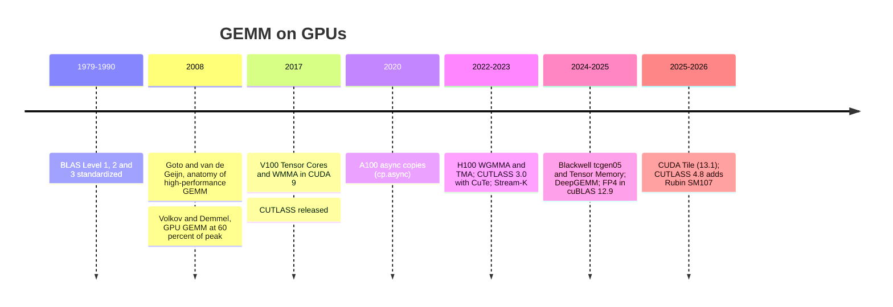
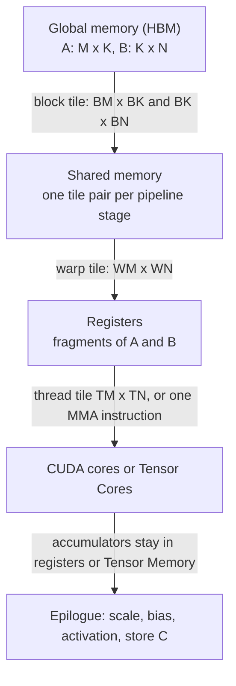
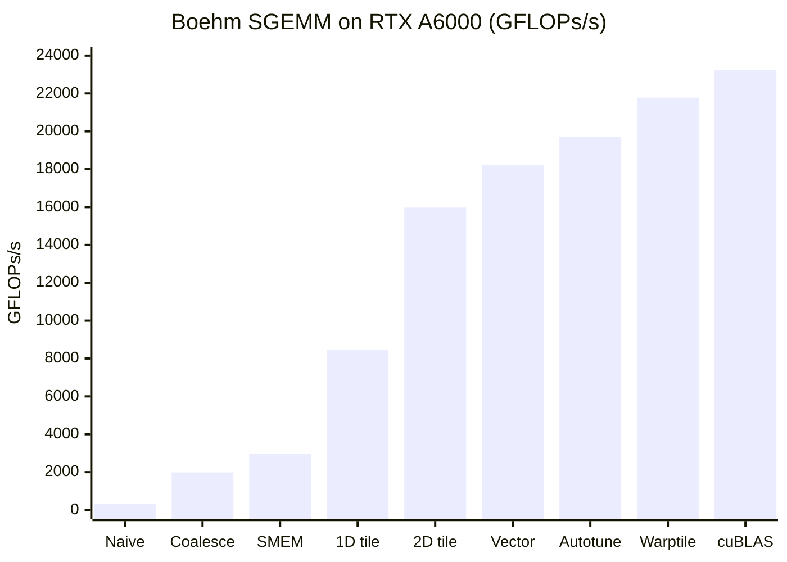

---
tags:
  - gpu-programming
  - kernels-and-optimization
  - cuda
  - gemm
  - matrix-multiplication
  - tiling
  - tensor-cores
status: complete
sources:
  - https://siboehm.com/articles/22/CUDA-MMM
  - https://docs.nvidia.com/deeplearning/performance/dl-performance-matrix-multiplication/index.html
  - https://developer.nvidia.com/blog/cutlass-linear-algebra-cuda
  - https://docs.nvidia.com/cutlass/4.5.1/media/docs/cpp/efficient_gemm.html
  - https://cese.ewi.tudelft.nl/computer-engineering/docs/CUDA_Cpp_Programming_Guide-Subset2-printout.pdf
  - https://developer.nvidia.com/blog/nvidia-hopper-architecture-in-depth/
  - https://www.nvidia.com/en-us/data-center/hgx/
  - https://www.nvidia.com/en-gb/data-center/dgx-b200.md
  - https://www.netlib.org/scalapack/tutorial/tsld061.htm
  - https://cs.utexas.edu/~flame/pubs/GotoTOMS_final.pdf
  - https://bebop.cs.berkeley.edu/pubs/volkov2008-benchmarking.pdf
  - https://icl.utk.edu/research/magma
  - https://developer.nvidia.com/blog/programming-tensor-cores-in-cuda-9
  - https://ar5iv.labs.arxiv.org/html/2301.03598
  - https://cudaforfun.substack.com/p/outperforming-cublas-on-h100-a-worklog
  - https://github.com/deepseek-ai/DeepGEMM
  - https://arxiv.org/abs/2410.20399v1
  - https://docs.nvidia.com/cutlass/latest/overview.html
  - https://research.colfax-intl.com/cutlass-tutorial-writing-gemm-kernels-using-tensor-memory-for-nvidia-blackwell-gpus/
  - https://docs.nvidia.com/cutlass/4.7.0/media/docs/pythonDSL/guides/mma/tcgen05_programming.html
  - https://developer.nvidia.com/blog/boosting-matrix-multiplication-speed-and-flexibility-with-nvidia-cublas-12-9
  - https://developer.nvidia.com/blog/nvidia-cuda-13-1-powers-next-gen-gpu-programming-with-nvidia-cuda-tile-and-performance-gains/
  - https://developer.nvidia.com/blog/inside-nvidia-blackwell-ultra-the-chip-powering-the-ai-factory-era
  - https://triton-lang.org/main/getting-started/tutorials/03-matrix-multiplication.html
created: 2026-11-26
updated: 2026-11-26
---

## Table Of Contents

- [[#TL;DR|TL;DR]]
- [[#The Problem|The Problem]]
- [[#Foundations|Foundations]]
    - [[#Counting FLOPs and Bytes|Counting FLOPs and Bytes]]
    - [[#Why Tiling Works|Why Tiling Works]]
- [[#How We Got Here|How We Got Here]]
- [[#How It Works|How It Works]]
    - [[#Level 1: Shared-Memory Tiles|Level 1: Shared-Memory Tiles]]
    - [[#Level 2: Register Tiles|Level 2: Register Tiles]]
    - [[#Level 3: Warp Tiles and Tensor Cores|Level 3: Warp Tiles and Tensor Cores]]
    - [[#The Optimization Ladder|The Optimization Ladder]]
    - [[#Pipelining: Hiding the Loads|Pipelining: Hiding the Loads]]
    - [[#Tile Order and L2 Reuse|Tile Order and L2 Reuse]]
    - [[#Quantization: Tiles and Waves|Quantization: Tiles and Waves]]
    - [[#Shapes That Don't Fit: Split-K and Stream-K|Shapes That Don't Fit: Split-K and Stream-K]]
- [[#Where It Is Now|Where It Is Now]]
    - [[#Hardware Targets|Hardware Targets]]
    - [[#Libraries, DSLs and Hand-Written Kernels|Libraries, DSLs and Hand-Written Kernels]]
- [[#Trade-offs & Open Problems|Trade-offs & Open Problems]]
- [[#Resources|Resources]]
- [[#Related Notes|Related Notes]]

## ***TL;DR***
---
*Matrix multiplication does far more arithmetic than it moves data, but only if each loaded value is reused many times. Tiled GEMM gets that reuse by copying blocks of the inputs into fast on-chip memory (shared memory, then registers) and computing a whole block of the output from them. Every fast GEMM on a GPU, from a 20-line teaching kernel to cuBLAS, is a deeper version of this idea.*

- **The math.** $C = AB$ with $A$ of size $M \times K$ and $B$ of size $K \times N$ takes $2MNK$ FLOPs but only touches $MK + KN + MN$ elements, so large GEMMs are compute-bound *in principle*. A naive kernel re-reads each input from DRAM $N$ or $M$ times and runs at about 1% of peak.
- **The hierarchy.** Blocks compute a *block tile* of $C$ from tiles of $A$ and $B$ in shared memory; each warp takes a *warp tile*; each thread or [[Tensor Cores|Tensor Core]] instruction computes a *register tile*. "Within a few percent" of cuBLAS is reachable this way ([CUTLASS, 2017](https://developer.nvidia.com/blog/cutlass-linear-algebra-cuda)).
- **How far hand-tuning goes.** Simon Boehm's FP32 worklog on an RTX A6000 climbs from 309 GFLOPs/s (1.3% of cuBLAS) to 21,779 GFLOPs/s (93.7%) in ten kernels ([Boehm](https://siboehm.com/articles/22/CUDA-MMM)). An H100 worklog using Tensor Cores reaches 764 TFLOPS, 107% of cuBLAS on that shape ([Shankhdhar](https://cudaforfun.substack.com/p/outperforming-cublas-on-h100-a-worklog)).
- **The extra tricks.** Double buffering and [[TMA and Asynchronous Copies|async copies]] hide load latency; tile ordering ("swizzling") keeps inputs in L2; split-K and Stream-K handle shapes that don't divide into the machine evenly.
- **Where it is now (Nov 2026):** Blackwell's `tcgen05` MMA, issued by one thread into Tensor Memory, is the core of state-of-the-art kernels; CUTLASS 4.8 (Sept 2026) adds initial Rubin (SM107) support and a Python CuTe DSL; CUDA Tile, DeepGEMM, ThunderKittens and [[Triton]] all generate or hand-write GEMMs in FP8, FP6 and FP4.

## ***The Problem***
---
*GEMM is most of the FLOPs in deep learning and scientific computing, and a GPU's peak FLOPs are only reachable when data comes from registers, not DRAM. The gap between "naive" and "peak" is two orders of magnitude.*

- **It's everywhere.** Fully connected layers, attention projections, convolutions lowered to GEMM and most of HPC's linear algebra (BLAS Level 3) are matrix multiplies.
- **Memory is the wall.** An H100 SXM does about 989 TFLOPS of dense BF16 math but reads HBM at 3.35 TB/s, a [[Roofline Model and Arithmetic Intensity|ridge point]] of about 295 FLOPs per byte. A kernel must do 295 FLOPs for every byte it brings from DRAM to be compute-bound.
- **Naive code doesn't get there.** One thread per output element computing a dot product does 2 FLOPs per pair of 4-byte loads, 0.25 FLOP/B, and every thread re-reads the same rows and columns.

## ***Foundations***
---
*Count the work and the traffic, then see how tiling raises the ratio between them.*

### Counting FLOPs and Bytes

From NVIDIA's [Matrix Multiplication Background](https://docs.nvidia.com/deeplearning/performance/dl-performance-matrix-multiplication/index.html):

$$\text{FLOPs} = 2MNK \qquad \text{AI}_{\text{FP16}} = \frac{2MNK}{2(MK + NK + MN)} = \frac{MNK}{MK + NK + MN}\ \text{FLOP/B}$$

Each output needs $K$ multiply-adds (2 FLOPs each); the minimum traffic is reading $A$ and $B$ once and writing $C$ once, at 2 bytes per element.

**Worked example, square.** For $M = N = K = n$: $\text{AI} = n^3 / 3n^2 = n/3$. At $n = 4096$, AI $\approx 1365$ FLOP/B, far above H100's ridge of about 295, so it can be compute-bound. Setting $n/3 = 295$ gives $n \approx 885$: below roughly that size, a square BF16 GEMM on H100 is memory-bound even with perfect reuse.

**Worked example, skinny.** NVIDIA's guide: $8192 \times 128 \times 8192$ has AI 124.1 FLOP/B, below V100's ridge of 138.9, so it is memory-limited however well it's written. Small batch sizes in inference look like this.

These are *best-case* numbers. They assume each element is read from DRAM exactly once, which only happens if the kernel reuses data on-chip.

### Why Tiling Works

Split $C$ into $BM \times BN$ tiles, one per thread block. To compute its tile, a block walks along $K$ in steps of $BK$, loading a $BM \times BK$ slice of $A$ and a $BK \times BN$ slice of $B$ into [[Shared Memory and Bank Conflicts|shared memory]], then does all $BM \cdot BN \cdot BK$ multiply-adds from there.

$$\text{AI}_{\text{tile}} = \frac{2 \cdot BM \cdot BN \cdot BK}{2 \cdot (BM + BN) \cdot BK} = \frac{BM \cdot BN}{BM + BN}\ \text{FLOP/B (BF16)}$$

| Block tile | AI from global memory (BF16) |
|---|---|
| 32 × 32 | 16 FLOP/B |
| 128 × 128 | 64 FLOP/B |
| 128 × 256 | 85.3 FLOP/B |

Bigger tiles mean more reuse, but even 128 × 256 (85 FLOP/B) sits below H100's ridge of 295. The rest comes from **L2**: neighboring blocks read the same panels of $A$ and $B$, and if they run at the same time, most reads hit the 50 MB L2 instead of HBM.

**Worked example.** $4096^3$ BF16 with $128 \times 256$ tiles: $32 \times 16 = 512$ tiles, each reading $(128 + 256) \times 4096 \times 2$ B $\approx 3.15$ MB, so about 1.61 GB of loads in total. At 3.35 TB/s that's 0.48 ms if every load went to HBM, against $2 \cdot 4096^3 / 989 \times 10^{12} \approx 0.139$ ms of math. The kernel only reaches peak if L2 absorbs about three quarters of those loads, which is why [[#Tile Order and L2 Reuse|tile order]] matters.

## ***How We Got Here***
---
*Blocked matrix multiply was worked out on CPUs in the 1990s and 2000s. GPUs reused the idea with shared memory, then Tensor Cores (2017) turned the inner loop into a hardware instruction, and each generation since has made that instruction larger and more asynchronous.*



- **BLAS.** Level 1 (vector) 1979, Level 2 (matrix-vector) 1988, Level 3 (matrix-matrix) 1990. Level 3 was added because only matrix-matrix operations do enough work per element to hide memory ([netlib](https://www.netlib.org/scalapack/tutorial/tsld061.htm)).
- **CPU blocking.** Goto and van de Geijn laid out the layered approach still used: pack panels to fit each cache level, and compute with a register "micro-kernel" ([Goto and van de Geijn](https://cs.utexas.edu/~flame/pubs/GotoTOMS_final.pdf)).
- **First fast GPU GEMMs.** Volkov and Demmel (SC08) treated the GPU as a vector machine with registers as the fastest storage: their GTX 280 SGEMM reached 375 Gflop/s, about 60% of peak and "60% faster" than the vendor library of the time ([Volkov and Demmel](https://bebop.cs.berkeley.edu/pubs/volkov2008-benchmarking.pdf)). The same lesson, more work per thread in registers, shows up in [[Occupancy and Latency Hiding]]. MAGMA carried this into a full GPU linear-algebra library ([ICL](https://icl.utk.edu/research/magma)).
- **Tensor Cores (2017).** V100's 640 Tensor Cores each do a 4 × 4 × 4 matrix multiply-add per clock, for 125 TFLOPS, exposed through WMMA in CUDA 9 ([NVIDIA blog](https://developer.nvidia.com/blog/programming-tensor-cores-in-cuda-9)).
- **CUTLASS (Dec 2017)** packaged the tile hierarchy as C++ templates ([CUTLASS blog](https://developer.nvidia.com/blog/cutlass-linear-algebra-cuda)); CUTLASS 3.0 (Jan 2023) rebuilt it on CuTe layouts for Hopper. See [[CUTLASS and CuTe]].
- **Stream-K (PPoPP 2023)** split work by K iterations instead of output tiles to fix load imbalance ([Osama et al.](https://ar5iv.labs.arxiv.org/html/2301.03598)).

## ***How It Works***
---
*Three levels of tiling, each moving data one step closer to the arithmetic units, plus tricks to overlap loading with computing and to keep the whole GPU busy.*



### Level 1: Shared-Memory Tiles

The classic kernel from the CUDA Programming Guide ([CUDA 12.5 guide, shared memory section](https://cese.ewi.tudelft.nl/computer-engineering/docs/CUDA_Cpp_Programming_Guide-Subset2-printout.pdf)), simplified to square matrices whose size is a multiple of the tile:

```cuda
#define TILE 16
__global__ void matmulTiled(const float* A, const float* B, float* C, int N) {
  __shared__ float As[TILE][TILE];
  __shared__ float Bs[TILE][TILE];
  int row = blockIdx.y * TILE + threadIdx.y;
  int col = blockIdx.x * TILE + threadIdx.x;
  float acc = 0.0f;
  for (int t = 0; t < N / TILE; ++t) {
    As[threadIdx.y][threadIdx.x] = A[row * N + t * TILE + threadIdx.x];
    Bs[threadIdx.y][threadIdx.x] = B[(t * TILE + threadIdx.y) * N + col];
    __syncthreads();
    for (int k = 0; k < TILE; ++k)
      acc += As[threadIdx.y][k] * Bs[k][threadIdx.x];
    __syncthreads();
  }
  C[row * N + col] = acc;
}
```

- **`As`, `Bs`**: one 16 × 16 tile of each input, shared by the block's 256 threads.
- **`row`, `col`**: each thread owns one element of the block's 16 × 16 output tile.
- **The `t` loop** walks along $K$ one tile at a time.
- **The two loads**: each thread copies one element of each tile. Consecutive `threadIdx.x` read consecutive addresses, so loads are [[Memory Coalescing|coalesced]].
- **First `__syncthreads()`**: no thread reads the tile until all have written it.
- **Inner `k` loop**: 16 multiply-adds from shared memory. `As[threadIdx.y][k]` is the same address for all lanes in a row of the warp (a broadcast), and `Bs[k][threadIdx.x]` hits 16 different banks, so neither causes [[Shared Memory and Bank Conflicts|bank conflicts]].
- **Second `__syncthreads()`**: no thread overwrites the tile while others still read it.

Each element of $A$ and $B$ is now read from global memory $N/16$ times instead of $N$ times, a 16× cut in traffic. It's still slow, though: every multiply-add needs two shared-memory loads, so shared-memory bandwidth becomes the limit.

### Level 2: Register Tiles

The fix is to give each thread a small $TM \times TN$ block of outputs held in registers. Per step along $k$, a thread loads $TM$ values of $A$ and $TN$ of $B$ from shared memory into registers and does $TM \cdot TN$ multiply-adds:

$$\text{FMAs per shared-memory load} = \frac{TM \cdot TN}{TM + TN}$$

At $TM = TN = 1$ that's 0.5. At $TM = TN = 8$ it's $64/16 = 4$, an 8× improvement. Boehm's best FP32 configuration used $BM = BN = 128$, $BK = 16$, $TM = TN = 8$, so each of 256 threads holds 64 accumulators ([Boehm](https://siboehm.com/articles/22/CUDA-MMM)). The cost is registers, which lowers [[Occupancy and Latency Hiding|occupancy]], a trade GEMM kernels make on purpose.

### Level 3: Warp Tiles and Tensor Cores

CUTLASS adds a level between the block and the thread: each warp computes a *warp tile*, so the warp's loads from shared memory can be arranged to avoid conflicts and match the instruction's operand layout ([CUTLASS efficient GEMM](https://docs.nvidia.com/cutlass/4.5.1/media/docs/cpp/efficient_gemm.html)). With [[Tensor Cores]], the register tile is replaced by an MMA instruction:

| Generation | Instruction | Issued by | Accumulator in |
|---|---|---|---|
| Volta, Turing, Ampere | `mma.sync` / WMMA | One warp | Registers |
| Hopper | `wgmma` (async) | A warpgroup of 4 warps | Registers; B (and optionally A) read from shared memory |
| Blackwell | `tcgen05.mma` (async) | One thread | Tensor Memory (TMEM) |

On Blackwell, a pair of thread blocks on two SMs can cooperate on one MMA, for example a $256 \times 256 \times 64$ tile, with each SM holding half ([CUTLASS tcgen05 guide](https://docs.nvidia.com/cutlass/4.7.0/media/docs/pythonDSL/guides/mma/tcgen05_programming.html); [Colfax](https://research.colfax-intl.com/cutlass-tutorial-writing-gemm-kernels-using-tensor-memory-for-nvidia-blackwell-gpus/)). See [[Warp Divergence and Warp-Level Primitives]] for how instruction issue moved from warps to warpgroups to single threads.

### The Optimization Ladder

Boehm's FP32 worklog on an RTX A6000 (rated about 30 TFLOPS FP32, 768 GB/s), 4092 × 4092 matrices ([Boehm, Dec 2022](https://siboehm.com/articles/22/CUDA-MMM)):

| # | Kernel | GFLOPs/s | % of cuBLAS |
|---|---|---|---|
| 1 | Naive | 309.0 | 1.3% |
| 2 | Global memory coalescing | 1,986.5 | 8.5% |
| 3 | Shared-memory caching | 2,980.3 | 12.8% |
| 4 | 1D block tiling | 8,474.7 | 36.5% |
| 5 | 2D block tiling | 15,971.7 | 68.7% |
| 6 | Vectorized memory access | 18,237.3 | 78.4% |
| 7 | Autotuning | 19,721.0 | 84.8% |
| 8 | Warptiling | 21,779.3 | 93.7% |
| — | cuBLAS | 23,249.6 | 100% |



The steps that mattered most were register tiling (kernels 4 and 5, about 5×). Boehm's own summary: about two weekends to reach 80% of cuBLAS, and four more to reach 94%.

With Tensor Cores the ladder is steeper. Shankhdhar's H100 BF16 worklog started at 32 TFLOPS, reached 317 with WGMMA, and after TMA, larger tiles, warp specialization, clusters and tuning reached 764 TFLOPS on a shape where cuBLAS ran at 716 ([Shankhdhar, Nov 2024](https://cudaforfun.substack.com/p/outperforming-cublas-on-h100-a-worklog)). That kind of win is shape-specific; cuBLAS has to be good on all shapes.

### Pipelining: Hiding the Loads

While the math units work on tile $t$, the next tiles should already be on their way. **Double buffering** keeps two shared-memory buffers and alternates, so one is loaded while the other is used ([CUTLASS blog](https://developer.nvidia.com/blog/cutlass-linear-algebra-cuda)). Modern kernels use 3–7 stages:

- **Ampere**: `cp.async` copies global to shared memory without going through registers.
- **Hopper and later**: [[TMA and Asynchronous Copies|TMA]] copies a whole multi-dimensional tile with one instruction, and **warp specialization** dedicates producer warps to issuing copies while consumer warpgroups do math ([CUTLASS efficient GEMM](https://docs.nvidia.com/cutlass/4.5.1/media/docs/cpp/efficient_gemm.html)).
- **Persistent kernels** launch one block per SM that loops over many tiles, overlapping one tile's epilogue (writing $C$) with the next tile's main loop. CUTLASS's "Cooperative" kernels split one tile across two consumer warpgroups; "Ping-Pong" kernels give each warpgroup its own tile and alternate math and epilogue.

### Tile Order and L2 Reuse

If blocks run in row-major order, the blocks active at one time share a row panel of $A$ but each needs a different column panel of $B$, so $B$ streams from DRAM. Grouping blocks into small squares (CUTLASS's *threadblock swizzle*, Triton's *grouped ordering*) makes concurrent blocks share both.

The [Triton matmul tutorial](https://triton-lang.org/main/getting-started/tutorials/03-matrix-multiplication.html) shows it with nine output blocks: row-major order loads 90 input blocks, grouped order loads 54. On A100 that took their kernel from about 220 to about 245 TFLOPS.

```python
pid_m, pid_n = ...                            # tile coordinates from program id
group_id = pid // (GROUP_M * num_pid_n)       # which band of GROUP_M rows
first_pid_m = group_id * GROUP_M              # first tile row in that band
pid_m = first_pid_m + (pid % GROUP_M)         # walk down the band first
pid_n = (pid % (GROUP_M * num_pid_n)) // GROUP_M  # then across
```

(Abbreviated from the tutorial; the full version handles a short last group.) Consecutive program ids now move down `GROUP_M` rows before moving right, so a group of blocks covers a square of $C$.

### Quantization: Tiles and Waves

Two kinds of waste come from shapes not dividing evenly ([NVIDIA guide](https://docs.nvidia.com/deeplearning/performance/dl-performance-matrix-multiplication/index.html)):

- **Tile quantization.** If $N = 257$ with 128-wide tiles, three tiles cover 384 columns and only 257 are real: $257/384 = 67\%$ useful work.
- **Wave quantization.** Tiles run in "waves" of one per SM (or a few, depending on occupancy). On an H100 with 132 SMs, 133 tiles need two waves, and the second wave has one tile and 131 idle SMs: $133 / 264 \approx 50\%$ utilization. The guide shows the same effect on A100's 108 SMs, where adding a few columns can drop throughput sharply.

Also from the guide: Tensor Cores are used most efficiently when $M$, $N$ and $K$ are multiples of 8 FP16 elements (16 bytes), and padding to larger multiples can help further.

### Shapes That Don't Fit: Split-K and Stream-K

- **Split-K.** When $M$ and $N$ are small but $K$ is large, there are too few output tiles to fill the GPU. Split $K$ across several blocks, each producing a partial tile, then reduce them. *Sliced-K* does the same across warps inside a block ([CUTLASS efficient GEMM](https://docs.nvidia.com/cutlass/4.5.1/media/docs/cpp/efficient_gemm.html)).
- **Stream-K.** Instead of assigning whole tiles, divide the total number of K-loop iterations evenly among SMs; tiles that straddle two SMs get fixed up at the end. Across 32,824 problem shapes on A100, Stream-K was up to 14× faster than CUTLASS's data-parallel kernel and up to 6.7× faster than cuBLAS on the worst-balanced shapes, while needing far fewer kernel variants ([Osama et al., PPoPP 2023](https://ar5iv.labs.arxiv.org/html/2301.03598)).

## ***Where It Is Now***
---
*As of November 2026: GEMM on new NVIDIA GPUs is built around asynchronous single-thread MMA into Tensor Memory, fed by TMA and organized by warp-specialized persistent kernels, mostly in FP8 and FP4. Most people get it from cuBLAS, CUTLASS or a DSL rather than writing it.*

### Hardware Targets

| GPU | Dense BF16 | Memory bandwidth | Ridge (FLOP/B) |
|---|---|---|---|
| H100 SXM | ~989 TFLOPS | 3.35 TB/s | ~295 |
| B200 (HGX) | ~2.25 PFLOPS | ~8 TB/s | ~281 |
| Rubin (HGX) | ~4 PFLOPS | ~22 TB/s (288 GB HBM4) | ~182 |

Figures from NVIDIA's [Hopper](https://developer.nvidia.com/blog/nvidia-hopper-architecture-in-depth/), [HGX](https://www.nvidia.com/en-us/data-center/hgx/) and [DGX B200](https://www.nvidia.com/en-gb/data-center/dgx-b200.md) pages; B200 numbers vary a little by SKU and power setting, and NVIDIA often quotes sparse figures twice as high. Rubin's large bandwidth increase lowers the ridge, so mid-sized GEMMs become compute-bound more easily. Lower precisions raise it again: Blackwell Ultra quotes 15 PFLOPS dense NVFP4 ([NVIDIA blog, Aug 2025](https://developer.nvidia.com/blog/inside-nvidia-blackwell-ultra-the-chip-powering-the-ai-factory-era)).

### Libraries, DSLs and Hand-Written Kernels

- **cuBLAS / cuBLASLt** remains the default. cuBLAS 12.9 (May 2025) added block-scaled FP4 and FP8 and reported up to 6,787 TFLOPS FP4 on GB200 ([NVIDIA blog](https://developer.nvidia.com/blog/boosting-matrix-multiplication-speed-and-flexibility-with-nvidia-cublas-12-9)).
- **[[CUTLASS and CuTe]].** CUTLASS 4.x adds the Python CuTe DSL alongside C++ templates; 4.8 (Sept 2026) adds initial Rubin (SM107) support, which needs CUDA 13.4 and the R615 driver ([CUTLASS overview](https://docs.nvidia.com/cutlass/latest/overview.html)).
- **CUDA Tile.** CUDA 13.1 (Dec 2025) introduced tile-based programming in Python, where you write the tile algorithm and the compiler maps it to Tensor Cores and TMA, along with grouped GEMM improvements in cuBLAS ([NVIDIA blog](https://developer.nvidia.com/blog/nvidia-cuda-13-1-powers-next-gen-gpu-programming-with-nvidia-cuda-tile-and-performance-gains/)). C++ support followed in 13.3. See [[CUDA Programming Model]].
- **[[Triton]]** expresses the block-tiled algorithm directly and is how most PyTorch custom GEMMs and [[Kernel Fusion|fused]] epilogues are written.
- **DeepGEMM** (DeepSeek) is a small, JIT-compiled FP8 GEMM library: over 1,350 FP8 TFLOPS on Hopper at launch (Feb 2025), up to 1,550 on H800 by April 2025, SM100 (Blackwell) support from July 2025, and FP8 × FP4 in April 2026 ([DeepGEMM](https://github.com/deepseek-ai/DeepGEMM)).
- **ThunderKittens** (Hazy Research) offers a small set of tile primitives in C++ that match CUTLASS-level GEMM and attention on H100 with far less code ([Spector et al.](https://arxiv.org/abs/2410.20399v1)).

## ***Trade-offs & Open Problems***
---
*Every knob in a GEMM trades one resource for another, and the best setting depends on the shape, the precision and the GPU. That's why libraries ship hundreds of kernels and heuristics to pick among them.*

| Choice | Gains | Costs |
|---|---|---|
| Larger block tiles | More reuse, higher AI | More shared memory and registers; more tile and wave quantization on small problems |
| Larger register tiles | Fewer shared-memory loads per FMA | Register pressure, lower occupancy, possible spills |
| More pipeline stages | Better latency hiding | More shared memory per block |
| Persistent, warp-specialized kernels | Overlap of load, math and epilogue | Much more complex code; harder to debug |
| Split-K / Stream-K | Fills the GPU for awkward shapes | Extra reduction pass or fix-up; nondeterministic sums if done with atomics |
| Lower precision (FP8, FP4) | 2–4× more FLOPs | Needs block scaling and careful accuracy checks |

Open problems:

- **Small and skinny shapes.** Inference with small batches produces GEMMs below the ridge point, where the problem is memory bandwidth and launch overhead, not tiling. Grouped GEMM and fusion help, but there's no single answer.
- **Portability across generations.** Each NVIDIA generation changed the MMA instruction (`mma.sync`, `wgmma`, `tcgen05`), so hand-tuned kernels are rewritten every two years. DSLs like CuTe DSL, CUDA Tile and Triton aim to absorb this.
- **Heuristic kernel selection.** Picking among hundreds of variants per shape is still mostly heuristics and autotuning.
- **Numerics.** Block-scaled FP4 and FP8 GEMMs depend on scaling choices that are still being worked out per model, and reductions across split K are not bit-reproducible unless done in a fixed order (see [[Parallel Reduction and Scan]]).

## ***Resources***
---
*For learning, start with Boehm's worklog, then NVIDIA's background guide for the performance model. For modern kernels, read CUTLASS's efficient GEMM page, the Colfax Blackwell tutorial and the H100 worklog.*

**Worklogs and tutorials**
- [How to Optimize a CUDA Matmul Kernel for cuBLAS-like Performance](https://siboehm.com/articles/22/CUDA-MMM): Simon Boehm, 2022.
- [Outperforming cuBLAS on H100: a Worklog](https://cudaforfun.substack.com/p/outperforming-cublas-on-h100-a-worklog): Pranjal Shankhdhar, 2024.
- [Triton matrix multiplication tutorial](https://triton-lang.org/main/getting-started/tutorials/03-matrix-multiplication.html).
- [Writing GEMM kernels using Tensor Memory for Blackwell](https://research.colfax-intl.com/cutlass-tutorial-writing-gemm-kernels-using-tensor-memory-for-nvidia-blackwell-gpus/): Colfax Research.

**NVIDIA documentation and blog**
- [Matrix Multiplication Background User's Guide](https://docs.nvidia.com/deeplearning/performance/dl-performance-matrix-multiplication/index.html).
- [CUTLASS: Efficient GEMM in CUDA](https://docs.nvidia.com/cutlass/4.5.1/media/docs/cpp/efficient_gemm.html) and [CUTLASS overview](https://docs.nvidia.com/cutlass/latest/overview.html).
- [CUTLASS: Fast Linear Algebra in CUDA C++](https://developer.nvidia.com/blog/cutlass-linear-algebra-cuda): 2017.
- [Programming Tensor Cores in CUDA 9](https://developer.nvidia.com/blog/programming-tensor-cores-in-cuda-9): 2017.
- [cuBLAS 12.9](https://developer.nvidia.com/blog/boosting-matrix-multiplication-speed-and-flexibility-with-nvidia-cublas-12-9): 2025.

**Papers**
- [Anatomy of High-Performance Matrix Multiplication](https://cs.utexas.edu/~flame/pubs/GotoTOMS_final.pdf): Goto and van de Geijn, 2008.
- [Benchmarking GPUs to Tune Dense Linear Algebra](https://bebop.cs.berkeley.edu/pubs/volkov2008-benchmarking.pdf): Volkov and Demmel, SC08.
- [Stream-K: Work-centric Parallel Decomposition for Dense Matrix-Matrix Multiplication](https://ar5iv.labs.arxiv.org/html/2301.03598): Osama et al., PPoPP 2023.
- [ThunderKittens: Simple, Fast, and Adorable AI Kernels](https://arxiv.org/abs/2410.20399v1): Spector et al., 2024.

**Code**
- [DeepGEMM](https://github.com/deepseek-ai/DeepGEMM), [CUTLASS](https://docs.nvidia.com/cutlass/latest/overview.html), [MAGMA](https://icl.utk.edu/research/magma).

## ***Related Notes***
---
*The memory, hardware and tools that every level of a GEMM depends on.*

- [[Roofline Model and Arithmetic Intensity]] — Why GEMM can be compute-bound and when it isn't.
- [[GPU Memory Hierarchy]] — HBM, L2, shared memory and registers, the levels tiling moves through.
- [[Shared Memory and Bank Conflicts]] — Where block tiles live, and swizzled layouts for MMA operands.
- [[Memory Coalescing]] — Loading tiles from global memory efficiently.
- [[Occupancy and Latency Hiding]] — Why GEMM kernels run at low occupancy on purpose.
- [[Warp Divergence and Warp-Level Primitives]] — Warps, warpgroups and single-thread MMA issue.
- [[Parallel Reduction and Scan]] — The reduction behind split-K and its determinism issues.
- [[Tensor Cores]] — The MMA units at the bottom of the hierarchy.
- [[TMA and Asynchronous Copies]] — How tiles get into shared memory on Hopper and Blackwell.
- [[CUTLASS and CuTe]] — NVIDIA's templates for the whole hierarchy.
- [[Triton]] — Block-tiled GEMM as a Python program.
- [[Kernel Fusion]] — Fusing bias, activation and quantization into the GEMM epilogue.
- [[Warp Specialization]] — Producer and consumer warps in persistent kernels.
- [[Profiling with Nsight Compute and Nsight Systems]] — Checking whether a GEMM is compute- or memory-bound.
- [[FlashAttention]] — Attention written as fused, tiled GEMMs.
