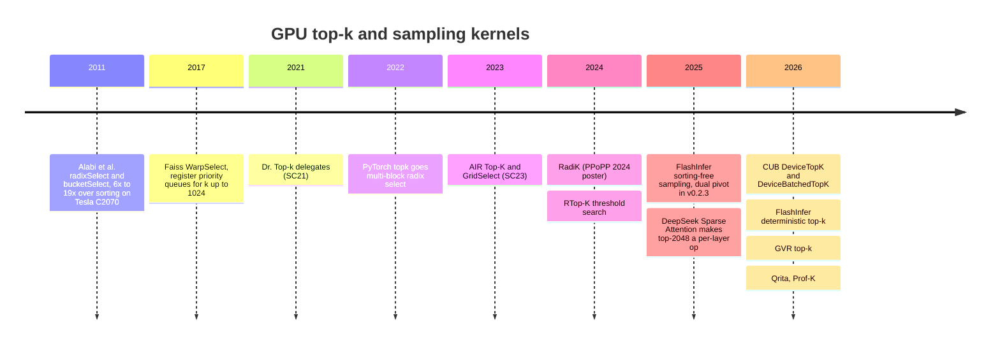
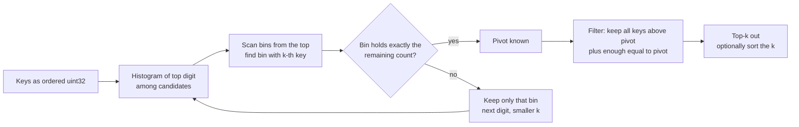
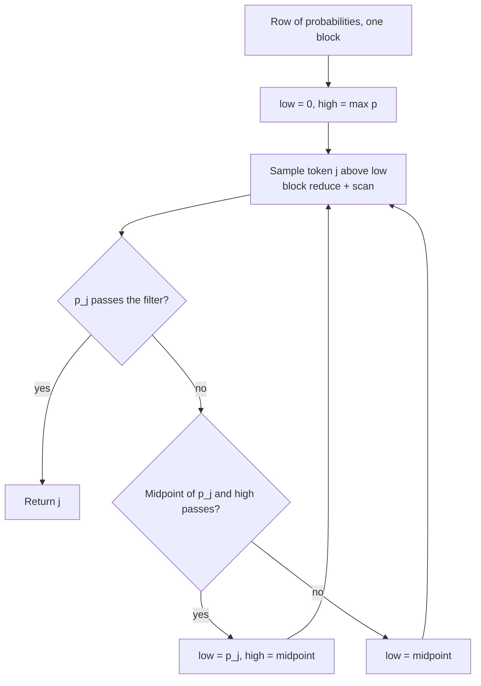

---
tags:
  - gpu-programming
  - kernels-and-optimization
  - cuda
  - top-k
  - radix-select
  - llm-sampling
  - cub
  - flashinfer
status: draft
sources:
  - https://hgpu.org/?p=6781
  - https://arxiv.org/pdf/1702.08734
  - https://sc21.supercomputing.org/proceedings/tech_paper/tech_paper_pages/pap131.html
  - https://ar5iv.arxiv.org/html/2109.08219
  - https://sc23.supercomputing.org/proceedings/tech_paper/tech_paper_pages/pap294.html
  - https://github.com/NVIDIA/cccl/pull/5677
  - https://nvidia.github.io/cccl/unstable/cub/api/structcub_1_1DeviceTopK.html
  - https://nvidia.github.io/cccl/unstable/cub/api/structcub_1_1DeviceBatchedTopK.html
  - https://nvidia.github.io/cccl/unstable/cub/device_topk_requirements.html
  - https://github.com/NVIDIA/cccl/releases
  - https://arxiv.org/html/2501.14336v1
  - https://ppopp24.sigplan.org/details/PPoPP-2024-papers/35/POSTER-RadiK-Scalable-Radix-Top-K-Selection-on-GPUs
  - https://arxiv.org/pdf/2409.00822
  - https://app.semanticdiff.com/gh/strisunshinewentingwang/pytorch/commit/8560fa730d310f824da9ebf2e07f487e62fb0f8b
  - https://flashinfer.ai/2025/03/10/sampling.html
  - https://github-users.yhajoa.workers.dev/flashinfer-ai/flashinfer/pull/2661
  - https://docs.vllm.ai/en/latest/api/vllm/v1/sample/ops/topk_topp_sampler/
  - https://github.com/vllm-project/vllm/blob/main/vllm/v1/sample/ops/topk_topp_sampler.py
  - https://docs.vllm.ai/en/latest/api/vllm/model_executor/layers/indexer_topk/
  - https://nvidia.github.io/TensorRT-LLM/blogs/tech_blog/blog15_Optimizing_DeepSeek_V32_on_NVIDIA_Blackwell_GPUs.html
  - https://arxiv.org/html/2604.22312v1
  - https://nvidia.github.io/TensorRT-LLM/blogs/tech_blog/blog21_Temporal_Correlation_Meets_Sparse_Attention.html
  - https://arxiv.org/html/2602.01518v1
  - https://neurips.cc/virtual/2026/poster/155567
  - https://arxiv.org/pdf/2608.12573
  - https://rocm.blogs.amd.com/software-tools-optimization/adaptive-topk/README.html
  - https://rocm.docs.amd.com/projects/rocPRIM/en/latest/device_ops/topk.html
  - https://docs.nvidia.com/cuvs/user-guide/api-guides/other-ap-is/k-selection
  - https://www.nvidia.com/en-us/data-center/h100/
created: 2026-11-26
updated: 2026-11-26
---

## Table Of Contents

---

- [[#TL;DR|TL;DR]]
- [[#The Problem|The Problem]]
- [[#Foundations|Foundations]]
    - [[#Selection Is Not Sorting|Selection Is Not Sorting]]
    - [[#Making Floats Radix-Friendly|Making Floats Radix-Friendly]]
    - [[#Top-k, Top-p and Min-p Sampling|Top-k, Top-p and Min-p Sampling]]
    - [[#Drawing One Token: Inverse Transform and the Exponential Race|Drawing One Token: Inverse Transform and the Exponential Race]]
- [[#How We Got Here|How We Got Here]]
- [[#How It Works|How It Works]]
    - [[#Three Families of Top-k|Three Families of Top-k]]
    - [[#Radix Select Step by Step|Radix Select Step by Step]]
    - [[#AIR Top-K and CUB DeviceTopK|AIR Top-K and CUB DeviceTopK]]
    - [[#Register Queues: WarpSelect|Register Queues: WarpSelect]]
    - [[#Threshold Search: Delegates, Pivots and Guesses|Threshold Search: Delegates, Pivots and Guesses]]
    - [[#Batched Top-k: Many Short Rows|Batched Top-k: Many Short Rows]]
    - [[#Sampling Kernels: From Sort-Then-Sample to Rejection Sampling|Sampling Kernels: From Sort-Then-Sample to Rejection Sampling]]
    - [[#Worked Example: Sort vs Select on an H100|Worked Example: Sort vs Select on an H100]]
    - [[#Where Top-k Gets Used|Where Top-k Gets Used]]
- [[#Where It Is Now|Where It Is Now]]
- [[#Trade-offs & Open Problems|Trade-offs & Open Problems]]
- [[#Resources|Resources]]
- [[#Related Notes|Related Notes]]

## ***TL;DR***
---
*Top-k asks for the k largest of n values without sorting the rest; sampling asks for one random token from a filtered distribution. Both are memory-bound, so the fastest GPU kernels read each value once or twice and never sort the whole array.*

- **Selection, not sorting.** Sorting $n$ keys to keep $k$ of them wastes most of the traffic. GPU top-k comes in three families: **priority queues in registers** (Faiss WarpSelect, good for $k \le 1024$), **radix select** (histogram the top digit, keep only the bin holding the $k$-th value, repeat; on-chip memory does not grow with $k$), and **threshold search** (guess a cutoff, count what passes, refine).
- **The library default is AIR Top-K.** NVIDIA's adaptive, iteration-fused radix top-k (Zhang et al., SC23) fuses each pass's filter with the next pass's histogram and adapts its buffering to the data; it is the algorithm behind `cub::DeviceTopK` in CCCL ([CUB DeviceTopK](https://nvidia.github.io/cccl/unstable/cub/api/structcub_1_1DeviceTopK.html)). Today it returns **unsorted, non-deterministic** results when keys tie at the $k$-th position.
- **LLM sampling** keeps the top-k tokens, or the smallest set whose probability reaches $p$ (top-p), or every token above a fraction of the maximum (min-p), then draws one. The textbook version sorts the 100K+ vocabulary every step. FlashInfer replaced that with **sorting-free rejection sampling** in one fused kernel per row, and its dual-pivot version bounds the rounds at $O(\log(1/\epsilon))$ ([FlashInfer, Mar 2025](https://flashinfer.ai/2025/03/10/sampling.html)). vLLM uses it with `deterministic=True`.
- **Sparse attention made top-k a hot loop.** DeepSeek Sparse Attention picks the top 2048 of tens of thousands of cached tokens for every query and layer. TensorRT-LLM's radix kernel is 7.4x faster than `torch.topk` on B200 there, and NVIDIA's Guess-Verify-Refine kernel (Apr 2026) uses last step's top-k as a guess for another 1.88x on real data ([TRT-LLM blog 15](https://nvidia.github.io/TensorRT-LLM/blogs/tech_blog/blog15_Optimizing_DeepSeek_V32_on_NVIDIA_Blackwell_GPUs.html), [GVR](https://arxiv.org/html/2604.22312v1)).
- **Where it is now (Nov 2026).** CUB has `DeviceTopK` (CCCL 3.3+) and `DeviceBatchedTopK` (CCCL 3.5, Oct 2026); FlashInfer added opt-in deterministic top-k in April 2026; AMD ships `rocprim::topk` and an adaptive top-k in AITER. The open questions are determinism, tie-breaking, sorted output, and adversarial (peaked) distributions.

## ***The Problem***
---
*Top-k shows up wherever a model or search engine has to keep "the best few" of a huge list: the next token, the keys a query should attend to, the nearest vectors. Sorting the list first is correct but does far more work and memory traffic than the answer needs.*

Typical shapes, all from 2025 to 2026 workloads:

| Workload | n (per row) | k | Rows per call | Who calls it |
|---|---|---|---|---|
| LLM sampling | vocabulary, about 128K to 262K | top-k usually small (20 to 100), top-p set size varies | one per running request | vLLM, SGLang, TensorRT-LLM, every decode step |
| Sparse attention selection (DSA) | cached tokens, 8K to 128K+ | 2048 | one per query per layer | indexer top-k in DeepSeek-V3.2-style models |
| Nearest-neighbor search | candidate distances, 10K to millions | 10 to 1000 | one per query | Faiss, cuVS `select_k` |
| MoE routing | number of experts, 64 to 512 | 1 to 8 | one per token | router kernels ([[Mixture of Experts]]) |
| Gradient sparsification, BatchTopK SAEs | millions to billions | 0.1% to a few % of n | one or a few | training loops ([Prof-K](https://arxiv.org/pdf/2608.12573)) |

Why the naive answer hurts:

| Obstacle | Why it hurts on a GPU |
|---|---|
| Sorting does $O(n \log n)$ comparisons or several full radix passes | A full radix sort of (value, index) pairs reads and writes every element once per digit; selection needs about one read |
| $k$ varies by orders of magnitude | Priority-queue methods keep $O(k)$ state in registers or [[Shared Memory and Bank Conflicts|shared memory]], so they hit a wall around $k$ = 1024 to 2048 ([RadiK](https://arxiv.org/html/2501.14336v1)) |
| Data-dependent survivors | Radix select's work depends on how the values spread; peaked distributions (common in LLM logits) keep many candidates alive ([RadiK](https://arxiv.org/html/2501.14336v1)) |
| Many small rows | One row of 128K is too little work for a whole GPU; a batch of 1024 rows wants one block (or cluster) per row instead of one grid per row |
| Host round trips | A multi-pass algorithm that asks the CPU "how many survived?" between passes stalls the stream; vLLM avoids `torch.multinomial` precisely because it forces a CPU-GPU sync ([vLLM source](https://github.com/vllm-project/vllm/blob/main/vllm/v1/sample/ops/topk_topp_sampler.py)) |
| Ties | When several values equal the $k$-th, which ones come back is a choice; parallel kernels make it non-deterministic unless they pay to fix it |

## ***Foundations***
---
*Four ideas carry the rest of the note: selection is cheaper than sorting, floats can be turned into unsigned integers that sort the same way, the sampling filters are simple threshold rules, and one random token can be drawn without a sort or a multinomial call.*

### Selection Is Not Sorting

Sorting puts all $n$ items in order. **Selection** finds the $k$-th largest value (the *pivot*); top-k then keeps everything above the pivot plus enough items equal to it to make exactly $k$. The pivot is all the information you need, which is why the fastest top-k kernels are really "find the pivot, then filter" kernels.

The contract has three independent knobs, which CUB now names explicitly ([CUB Top-K requirements](https://nvidia.github.io/cccl/unstable/cub/device_topk_requirements.html)):

| Knob | Options | Cost of the strict option |
|---|---|---|
| Output ordering | unsorted, sorted, stable-sorted | an extra sort of the $k$ survivors |
| Tie-breaking at the $k$-th value | unspecified, prefer smaller index, prefer larger index | per-block counts of "greater" and "equal" items and fixed output slots |
| Determinism | not guaranteed, run-to-run, GPU-to-GPU | fixed reduction and write orders |

### Making Floats Radix-Friendly

Radix methods work on unsigned integers. IEEE floats sort correctly as integers after one bit trick: for a positive float set the sign bit; for a negative float flip every bit. The same trick is how CUB's radix sort handles floats (see [[Sorting and Hashing on GPUs]]).

```cuda
__device__ uint32_t to_ordered(float f) {
  uint32_t b = __float_as_uint(f);                     // raw bits of the float
  return (b & 0x80000000u) ? ~b : (b | 0x80000000u);   // negative: flip all; positive: set sign bit
}
```

- Line 2 reinterprets the float's 32 bits as an unsigned integer, without converting the value.
- Line 3: negative floats have the sign bit set and get *larger* in magnitude as their bit pattern grows, so flipping all bits reverses them into ascending order below every positive number. Positive floats just get the top bit set so they land above all negatives. After this, unsigned comparison matches float comparison.

### Top-k, Top-p and Min-p Sampling

Given logits $z_i$ and temperature $T$, the model's distribution is $p_i = e^{z_i/T} / \sum_j e^{z_j/T}$. The filters then keep a subset $S$ and renormalize:

| Filter | Keeps | Rule |
|---|---|---|
| Top-k | the $k$ most likely tokens | $S = $ top-$k(p)$ |
| Top-p (nucleus) | the smallest set whose mass reaches $p$ | sort $p$ descending, keep the shortest prefix with $\sum_{i \in S} p_i \ge p$ |
| Min-p | every token at least a fraction of the best one | $S = \{ i : p_i \ge p_{\text{base}} \cdot p_{\max} \}$ ([FlashInfer](https://flashinfer.ai/2025/03/10/sampling.html)) |

Then sample token $i \in S$ with probability $p_i / \sum_{j \in S} p_j$.

Worked example with five tokens, $p = (0.50, 0.20, 0.15, 0.10, 0.05)$:

- **Top-k, k = 2:** keep $\{0.50, 0.20\}$, mass 0.70, renormalized to $(0.714, 0.286)$.
- **Top-p, p = 0.8:** 0.50 < 0.8, 0.70 < 0.8, 0.85 ≥ 0.8, so keep three tokens, renormalized to $(0.588, 0.235, 0.176)$.
- **Min-p, $p_{\text{base}} = 0.1$:** cutoff $0.1 \times 0.50 = 0.05$, so all five survive.

Every one of these is "find a threshold, keep what passes". Top-p is the awkward one: its threshold depends on a running sum over sorted values, which is why the obvious implementation sorts.

### Drawing One Token: Inverse Transform and the Exponential Race

**Inverse transform sampling:** draw $u \sim U(0,1)$, build the prefix sum (CDF) of $p$, and return the first index where the CDF exceeds $u$. On a GPU the prefix sum is a [[Parallel Reduction and Scan|block scan]]. FlashInfer warns that a parallel floating-point scan is not guaranteed to be monotone, which can return invalid tokens if handled carelessly ([FlashInfer](https://flashinfer.ai/2025/03/10/sampling.html)).

**The exponential race** needs no scan at all. Draw $E_i \sim \text{Exp}(1)$ independently and return $\arg\max_i \; p_i / E_i$. Since $E_i / p_i$ is exponential with rate $p_i$, the smallest of them is index $j$ with probability $p_j / \sum_i p_i$, which is exactly the categorical distribution. (Taking logs gives the Gumbel-max trick.) vLLM's `random_sample` draws exponential noise (`q.exponential_()`) instead of calling `torch.multinomial`, because multinomial forces a CPU-GPU sync ([vLLM source](https://github.com/vllm-project/vllm/blob/main/vllm/v1/sample/ops/topk_topp_sampler.py)). A minimal version:

```python
probs = torch.softmax(logits / temperature, dim=-1)  # [batch, vocab]
q = torch.empty_like(probs).exponential_()           # E_i ~ Exp(1), one per token
next_ids = (probs / q).argmax(dim=-1)                # one sampled token per row, no sync
```

- Line 1 turns logits into probabilities per request.
- Line 2 fills a same-shaped tensor with independent exponential noise on the GPU.
- Line 3 divides and takes the row-wise argmax, which is a [[Parallel Reduction and Scan|reduction]]; the result is a true sample, and nothing waits on the host.

## ***How We Got Here***
---
*GPU top-k started as "sort and take the front", moved to radix and bucket select around 2011, to register priority queues for nearest-neighbor search in 2017, and to fused, adaptive radix kernels in 2023. LLM serving then made sampling and sparse-attention top-k latency-critical.*



| Era | What changed | Source |
|---|---|---|
| Sort and slice | Thrust sort, then take the first $k$; simple, many full passes | Dr. Top-k calls sort-and-choose "much slower" than dedicated top-k ([Dr. Top-k](https://ar5iv.arxiv.org/html/2109.08219)) |
| 2011: distribution-based select | Alabi, Blanchard, Gordon and Steinbach's radixSelect and bucketSelect find the $k$-th value about 6x faster than sorting for floats above $2^{24}$ elements, up to 19.1x for $2^{28}$ doubles, on a Tesla C2070 | [hgpu](https://hgpu.org/?p=6781) |
| 2017: register queues | Faiss WarpSelect keeps the running top-k in registers, merges with bitonic networks, runs at 55% of peak at $k$ = 100 on a Titan X, limited to $k \le 1024$ | [Johnson et al.](https://arxiv.org/pdf/1702.08734) |
| 2021: delegates | Dr. Top-k summarizes each subrange by its maximum (or top $\beta$), discards subranges that cannot contribute, and cuts the work "up to more than 99%" (SC21, V100S) | [SC21](https://sc21.supercomputing.org/proceedings/tech_paper/tech_paper_pages/pap131.html) |
| 2022: PyTorch multi-block | `torch.topk` computes per-block counts during each radix pass and uses a CUB scan-by-key to place outputs, retiring its sort fallback | [PyTorch #74267](https://app.semanticdiff.com/gh/strisunshinewentingwang/pytorch/commit/8560fa730d310f824da9ebf2e07f487e62fb0f8b) |
| 2023: fused adaptive radix | AIR Top-K: 1.98x to 21.48x over earlier radix top-k at batch 1 and 8.01x to 574.78x at batch 100; GridSelect for on-the-fly selection | [SC23](https://sc23.supercomputing.org/proceedings/tech_paper/tech_paper_pages/pap294.html) |
| 2024 to 2025: k-independent radix | RadiK keeps a constant-size histogram on chip and adds input scaling for peaked data; up to 2.5x (single) and 4.8x (batched) over priority-queue and bitonic baselines on a T4 | [RadiK](https://arxiv.org/html/2501.14336v1) |
| 2025: sampling without sorting | FlashInfer fuses top-k / top-p / min-p filtering and sampling into one rejection-sampling kernel; more than 50% less sampling time in vLLM on one H100 | [FlashInfer](https://flashinfer.ai/2025/03/10/sampling.html) |
| 2025 to 2026: sparse-attention top-k | DSA's indexer picks 2048 tokens per query; TensorRT-LLM writes a dedicated radix kernel, then GVR exploits step-to-step overlap | [TRT-LLM](https://nvidia.github.io/TensorRT-LLM/blogs/tech_blog/blog15_Optimizing_DeepSeek_V32_on_NVIDIA_Blackwell_GPUs.html), [GVR](https://arxiv.org/html/2604.22312v1) |

## ***How It Works***
---
*Pick the family by $k$ and batch shape: register queues for small $k$, radix select for large $k$ or huge rows, threshold search when you can guess the cutoff. Sampling kernels then avoid computing the filtered set at all, and sample from it directly.*

### Three Families of Top-k

| Family | Idea | On-chip state | Passes over data | Best when | Examples |
|---|---|---|---|---|---|
| Priority queue / merge | Keep a sorted top-k list in registers; merge in new candidates | $O(k)$ per warp or block | 1 | small $k$ (up to about 1024), many rows | Faiss WarpSelect / BlockSelect, bitonic top-k, AITER BlockTopK |
| Radix / bucket select | Histogram one digit, keep the bin with the $k$-th value, recurse | $2^d$ bins, independent of $k$ | 1 per digit on a shrinking set | large $k$, long rows, library default | Alabi radixSelect, PyTorch, AIR Top-K (CUB), RadiK, TRT-LLM DSA kernel |
| Threshold search | Guess a cutoff, count survivors, refine; then gather | a few counters | 1 to a few | rows where the cutoff is predictable | RTop-K, Dr. Top-k, Qrita, Prof-K, GVR |

### Radix Select Step by Step



Each pass has three steps: **count** (a histogram of the current digit among surviving candidates), **choose** (scan the bins from the largest down until the running count reaches $k$; that bin holds the $k$-th value, everything in higher bins is definitely in the answer), and **shrink** (only the chosen bin's keys stay candidates, and $k$ drops by the number already taken). With 8-bit digits a 32-bit key needs at most 4 passes; with 11-bit digits, 3 ([TRT-LLM blog 15](https://nvidia.github.io/TensorRT-LLM/blogs/tech_blog/blog15_Optimizing_DeepSeek_V32_on_NVIDIA_Blackwell_GPUs.html)).

Tiny worked example: find the top $k = 3$ of the 4-bit values $(13, 7, 12, 3, 14, 9, 12, 5)$ with 2-bit digits.

1. **Top digit** (bits 3 to 2): 13, 12, 14 and 12 are `11`; 9 is `10`; 7 and 5 are `01`; 3 is `00`. Scanning from the top, bin `11` alone holds 4 ≥ 3 items, so the pivot is in it; no items are taken yet and the candidates shrink to $\{13, 12, 14, 12\}$.
2. **Next digit** (bits 1 to 0): 14 is `10`, 13 is `01`, both 12s are `00`. Running count from the top: 1, then 2, then bin `00` holds the third. The pivot is **12**.
3. **Filter:** take 14 and 13 (above the pivot) plus **one** of the two 12s. Which 12 comes back is the tie-break question from [[#Selection Is Not Sorting|above]].

The histogram step is a standard shared-memory histogram (see [[Shared Memory and Bank Conflicts]] and [[CUDA Memory Model and Atomics]]):

```cuda
__global__ void digit_histogram(const uint32_t* keys, int n,
                                uint32_t prefix, uint32_t prefix_mask,
                                int shift, unsigned int* g_hist) {
  __shared__ unsigned int s_hist[256];
  for (int i = threadIdx.x; i < 256; i += blockDim.x) s_hist[i] = 0;
  __syncthreads();
  for (int i = blockIdx.x * blockDim.x + threadIdx.x; i < n;
       i += gridDim.x * blockDim.x) {
    uint32_t key = keys[i];
    if ((key & prefix_mask) == prefix)              // still a candidate?
      atomicAdd(&s_hist[(key >> shift) & 0xFF], 1u);
  }
  __syncthreads();
  for (int i = threadIdx.x; i < 256; i += blockDim.x)
    if (s_hist[i]) atomicAdd(&g_hist[i], s_hist[i]);
}
```

- `prefix` and `prefix_mask` hold the digits already chosen in earlier passes; a key is still a candidate only if its high bits match them.
- The first loop zeroes a 256-bin histogram in shared memory, then all threads wait.
- The grid-stride loop reads keys [[Memory Coalescing|coalesced]], skips non-candidates, and bumps the bin for the current 8-bit digit (`shift` is 24, 16, 8, 0 across passes) with a cheap shared-memory atomic.
- The last loop merges each block's histogram into the global one with at most 256 global atomics per block. This "hierarchical atomics" pattern is the same one RadiK describes ([RadiK](https://arxiv.org/html/2501.14336v1)).

A naive implementation launches separate kernels per pass for histogram, prefix sum, bin search and filtering, 4 launches times 4 passes for 32-bit keys ([TRT-LLM blog 15](https://nvidia.github.io/TensorRT-LLM/blogs/tech_blog/blog15_Optimizing_DeepSeek_V32_on_NVIDIA_Blackwell_GPUs.html)). Fusing them is where the real algorithms differ.

### AIR Top-K and CUB DeviceTopK

**AIR Top-K** (Adaptive and Iteration-fused Radix Top-K; Zhang, Naruse, Li and Wang, NVIDIA, SC23) is the radix select above with two changes ([CCCL PR #5677](https://github.com/NVIDIA/cccl/pull/5677), [SC23](https://sc23.supercomputing.org/proceedings/tech_paper/tech_paper_pages/pap294.html)):

- **Iteration fusion:** the filter step of pass $i$ and the histogram step of pass $i+1$ run in the same kernel, so survivors are counted for the next digit as they are filtered. The stated design goal is to "minimize CPU-GPU communication and device data access."
- **Adaptive buffering:** whether surviving candidates are copied into a compact buffer or re-read from the original input depends on the data distribution, so a pass that removes few items doesn't pay to rewrite almost everything.

The same paper introduced **GridSelect**, a priority-queue method with a shared queue and two-step parallel insertion, reported at up to 882.29x over its baseline ([SC23](https://sc23.supercomputing.org/proceedings/tech_paper/tech_paper_pages/pap294.html)). For row-wise selection over a matrix (nearest-neighbor search), RAPIDS cuVS offers `select_k`, whose recommended `kAuto` setting chooses among several selection algorithms for you ([cuVS](https://docs.nvidia.com/cuvs/user-guide/api-guides/other-ap-is/k-selection)).

**`cub::DeviceTopK`** packages AIR Top-K as a device-wide primitive: key-only and key-value (`MaxPairs`/`MinPairs`) variants over unordered input, with the two-phase temp-storage call style of the rest of CUB (added in CCCL 3.3.0), a decomposer overload for user-defined key types (3.4.0), and environment-based overloads that allocate their own temporary storage (3.5.0, CUDA 13.5). Keys can be built-in numeric types, `__half` or `__nv_bfloat16` ([CUB DeviceTopK](https://nvidia.github.io/cccl/unstable/cub/api/structcub_1_1DeviceTopK.html)). It finds the top 50 logits and their token ids like this:

```cpp
#include <cub/device/device_topk.cuh>

auto env = cuda::std::execution::env{
  cuda::execution::require(cuda::execution::determinism::not_guaranteed,
                           cuda::execution::tie_break::unspecified,
                           cuda::execution::output_ordering::unsorted),
  cuda::stream_ref{stream}};

size_t temp_bytes = 0;
cub::DeviceTopK::MaxPairs(nullptr, temp_bytes, d_logits, d_top_vals,
                          d_ids, d_top_ids, vocab, 50, env);   // size query only
cudaMallocAsync(&d_temp, temp_bytes, stream);
cub::DeviceTopK::MaxPairs(d_temp, temp_bytes, d_logits, d_top_vals,
                          d_ids, d_top_ids, vocab, 50, env);   // run
```

- The `env` states the contract. This combination (no determinism guarantee, unspecified ties, unsorted output) is the only one `DeviceTopK` implements today; the documented default is the strictest mode, and other combinations are rejected at compile time. The docs recommend spelling out the tie-break now, because CCCL 4.0 will require `determinism` and `tie_break` to be given together ([CUB Top-K requirements](https://nvidia.github.io/cccl/unstable/cub/device_topk_requirements.html)).
- The first call, with a null temp pointer, only writes the needed size and launches nothing.
- `d_ids` holds token ids $0 \ldots n-1$ (a counting iterator also works); `d_top_vals` and `d_top_ids` receive the 50 winners in no particular order.
- If you need them ordered, sort the 50 afterwards; it costs nothing next to the selection.

### Register Queues: WarpSelect

For small $k$ the fastest approach keeps the whole running answer in registers, the fastest memory on the chip ([[GPU Memory Hierarchy]]). Faiss's **WarpSelect** (Johnson, Douze and Jégou, 2017) gives each of a warp's 32 lanes a short sorted *thread queue* ($t$ = 2 for $k \le 32$, up to $t$ = 8 for $k \le 1024$) and the warp a shared *warp queue* holding the best $k$ seen so far ([Johnson et al.](https://arxiv.org/pdf/1702.08734)):

1. Each lane reads its next value. If it is not better than the worst entry in its thread queue, it is dropped: it cannot be in the final answer.
2. Otherwise it goes into the thread queue. A warp ballot ([[Warp Divergence and Warp-Level Primitives]]) checks whether any lane now holds something better than the warp queue's $k$-th value.
3. If so, the thread queues are sorted and merged into the warp queue with odd-size bitonic merging networks built from warp shuffles.

It reads the input once and never touches shared or global memory for state. At $k$ = 100 it runs at 55% of peak, but only 16% at $k$ = 1000, and the register file caps it at $k \le 1024$. The cost of the merge network grows with $k$, which is exactly the cliff radix methods avoid.

### Threshold Search: Delegates, Pivots and Guesses

If you can guess the pivot, one counting pass verifies the guess and one gather pass produces the answer.

| Method | How it guesses | Result |
|---|---|---|
| **Dr. Top-k** (SC21) | Split the input into subranges, take each one's maximum (or top $\beta$) as a *delegate*, run top-k on the delegates; subranges whose delegates don't make it are skipped | Second top-k at $k = 2^{24}$, $n = 2^{30}$ dropped from 28.7 ms to 6.1 ms on a V100S ([Dr. Top-k](https://ar5iv.arxiv.org/html/2109.08219)) |
| **RTop-K** (2024) | One warp per row binary-searches a threshold between the row's min and max until exactly $k$ values pass; can stop early after a few iterations | 7.29x average over PyTorch top-k (11.49x with early stopping) for rows of 256 to 768 and $k$ = 16 to 128 on an A6000 ([RTop-K](https://arxiv.org/pdf/2409.00822)) |
| **Qrita** (UC Berkeley, 2026) | Estimate mean and standard deviation from a sample, set $t = \mu + \delta\sigma$ so only outliers pass, then a quaternary pivot search on the few survivors; falls back to the full row on a miss | Exact top-k and top-p sets, reproducible ties, up to 2x throughput over vLLM, SGLang and FlashInfer on H100 and RTX 4090; written in [[Triton]] ([Qrita](https://arxiv.org/html/2602.01518v1)) |
| **Prof-K** (Aug 2026) | Random sample estimates a threshold; one pass keeps everything above it in a small buffer; verify the count, redraw on failure, exact top-k on the buffer | Up to 16x over `torch.topk` and 3.1x over RadiK on an H100 at large $n$, with megabytes of scratch where RadiK needs gigabytes ([Prof-K](https://arxiv.org/pdf/2608.12573)) |
| **GVR** (NVIDIA, Apr 2026) | In decode, reuse the previous step's top-k as the guess, secant-search the threshold, collect candidates into shared memory, refine with a 2048-bin histogram | 1.88x average over the production radix kernel on real DeepSeek-V3.2 data ($n \approx$ 70,690) on B200; slower below about 16K ([GVR](https://arxiv.org/html/2604.22312v1)) |

GVR's guess works because consecutive decode steps select similar tokens: middle and deep layers of DeepSeek-V3.2 showed 35 to 50% average overlap between steps, the first two layers only 1 to 2% ([GVR](https://arxiv.org/html/2604.22312v1)).

### Batched Top-k: Many Short Rows

Sampling and sparse attention call top-k on thousands of rows of 10K to 200K values each. One grid per row wastes the GPU; the usual answer is **one thread block per row**, keeping the row's histogram and candidates on chip.

- **`cub::DeviceBatchedTopK`** (CCCL 3.5.0) does this for segmented input: `MaxKeys`, `MinKeys` and pair variants, with `k` and segment sizes passed as compile-time constants, host values, or per-segment device arrays. Before Hopper each segment must fit one block's shared memory; the current docs describe a [[Thread Block Clusters and Distributed Shared Memory|thread-block-cluster]] backend on compute capability 9.0+ for larger segments, a hard cap of $2^{21}$ items per segment, sorted or unsorted output, and run-to-run and GPU-to-GPU deterministic modes on Hopper and newer ([CUB DeviceBatchedTopK](https://nvidia.github.io/cccl/unstable/cub/api/structcub_1_1DeviceBatchedTopK.html)).
- **TensorRT-LLM's DSA kernel** runs radix passes per row and stops as soon as fewer than 2048 candidates remain, then finishes with CUB's sort, or an $O(N^2)$ comparison ranking for tiny sets; a first pass on the leading 11 bits roughly halves the candidates. On B200 with real indexer data ([64, 9295]) it averaged 14.3 µs against 106.1 µs for `torch.topk` (7.41x), for 25 to 40% end-to-end speedup in low-latency serving ([TRT-LLM blog 15](https://nvidia.github.io/TensorRT-LLM/blogs/tech_blog/blog15_Optimizing_DeepSeek_V32_on_NVIDIA_Blackwell_GPUs.html)).
- **vLLM's indexer top-k** picks among `cooperative`, `persistent` and `per_row` backends by batch size, with FlashInfer, FlashInfer GVR, AITER, DeepSelect and torch as opt-in alternatives ([vLLM indexer_topk](https://docs.vllm.ai/en/latest/api/vllm/model_executor/layers/indexer_topk/)). Large batches going to a [[Persistent Kernels and Stream-K|persistent]] kernel is the same wave-quantization argument as for GEMM.
- **Multi-CTA rows need forward progress.** FlashInfer 0.7+ splits one row across several blocks with a software barrier, and refuses to on GPUs with 16 or fewer SMs because the barrier cannot guarantee forward progress there ([vLLM source](https://github.com/vllm-project/vllm/blob/main/vllm/v1/sample/ops/topk_topp_sampler.py); see [[Cooperative Groups]]).

### Sampling Kernels: From Sort-Then-Sample to Rejection Sampling

**The sort-based baseline** (PyTorch reference code, vLLM's fallback) sorts each row's logits, takes a cumulative sum, masks everything past $k$ or past mass $p$, scatters back and samples. vLLM's own docstring warns that with top-p "this function will sort the logits tensor, which can be slow for large batches"; for top-k alone it uses `logits.topk` instead, but only where a GPU-to-CPU sync is acceptable ([vLLM docs](https://docs.vllm.ai/en/latest/api/vllm/v1/sample/ops/topk_topp_sampler/)).

**FlashInfer's rejection sampling** never builds the filtered set ([FlashInfer](https://flashinfer.ai/2025/03/10/sampling.html)):

1. Start with a pivot of 0, so every token is a candidate.
2. Sample a token $j$ from the tokens above the pivot by inverse transform sampling (block sums with `BlockReduce`, then a `BlockScan` inside the block that contains $u$).
3. Check the filter using only quantities above the new pivot $p_j$: for top-p, is the remaining mass still at least $p$? For top-k, are there still at least $k$ tokens above it? For min-p, compare with $p_{\text{base}} \cdot p_{\max}$.
4. If $j$ passes, return it. Otherwise raise the pivot to $p_j$ and go back to step 2.

The blog proves (for top-k) that this returns each surviving token with probability $p_j / Z$, the same as filter-then-sample. Plain rejection sampling has no bound on rounds, which made per-token latency uneven, so **dual-pivot rejection sampling** (v0.2.3) keeps a `low` and `high` bound and tests a second pivot halfway to `high` each round, halving the range on every rejection: at worst $O(\log(1/\epsilon))$ rounds. The whole loop is one fused kernel, one block per row, using CUB block primitives. It cut overall sampling time by more than 50% in vLLM on one H100.



Two production details from vLLM: FlashInfer's sampler is called with `deterministic=True` in every branch, and it is skipped when a request needs post-filter logprobs (FlashInfer doesn't expose them) or has its own random generator ([vLLM source](https://github.com/vllm-project/vllm/blob/main/vllm/v1/sample/ops/topk_topp_sampler.py)).

### Worked Example: Sort vs Select on an H100

Batch of 1024 requests, Llama-3-sized vocabulary of 128,256, fp32 logits: $n = 1024 \times 128{,}256 = 131{,}334{,}144$ values, 525.3 MB. H100 SXM HBM3 bandwidth is 3.35 TB/s ([NVIDIA H100](https://www.nvidia.com/en-us/data-center/h100/)). Both kernels are bandwidth-bound ([[Roofline Model and Arithmetic Intensity]]), so time is roughly bytes moved divided by bandwidth:

$$
t \approx \frac{\text{bytes moved}}{\text{bandwidth}}
$$

| Approach | Bytes per value | Total | Idealized time |
|---|---|---|---|
| Segmented radix sort of (logit, id) pairs, 8-bit digits | 4 passes × (8 B read + 8 B write) = 64 B | 8.41 GB | 2.51 ms |
| Radix select with fused passes (read for histogram, read again to filter; survivors negligible) | about 8 B | 1.05 GB | 0.31 ms |
| One read (the floor for any exact method) | 4 B | 0.53 GB | 0.16 ms |

In plain words: sorting moves about 8x more data than selecting, before counting the extra histogram passes the sort also needs. These are lower bounds that ignore launch overhead and assume survivors shrink quickly; a peaked distribution that keeps many candidates alive pushes radix select toward the sort's cost, which is the case RadiK's scaling and the threshold methods target.

### Where Top-k Gets Used

| Use | Shape | Kernel of choice |
|---|---|---|
| LLM sampling ([[LLM Serving]]) | 1 row per request, vocab 128K to 262K | FlashInfer rejection sampling; sort-based fallback; exponential-race draw |
| Sparse attention selection ([[Sparse Attention]]) | 1 row per query per layer, k = 2048 | per-row radix (TRT-LLM, vLLM), GVR in decode |
| Nearest-neighbor search | 1 row per query, k up to 1000 | WarpSelect / BlockSelect, cuVS `select_k` |
| MoE routing ([[Mixture of Experts]]) | 1 row per token, 64 to 512 experts, k ≤ 8 | rows small enough for a per-warp register selection inside the router kernel |
| Speculative decoding verification ([[Speculative Decoding]]) | accept or resample per drafted token | FlashInfer `chain_speculative_sampling` |
| Training-time sparsity | one huge row or a few | Prof-K; device-wide radix top-k |

## ***Where It Is Now***
---
*As of November 2026: radix top-k is a library call on NVIDIA (CUB) and AMD (rocPRIM), sorting-free sampling is the default in the major LLM servers, and the active work is on determinism, sorted and tie-broken contracts, and data-aware kernels for sparse attention.*

**Libraries**

- **CUB / CCCL.** `DeviceTopK` has shipped since CCCL 3.3.0 and gained decomposers in 3.4.0 and environment overloads in 3.5.0; `DeviceBatchedTopK` arrived in 3.5.0 (October 2026), and 3.5.0 also fixed a `DeviceTopK` race condition (backported to 3.4.3) ([CUB DeviceTopK](https://nvidia.github.io/cccl/unstable/cub/api/structcub_1_1DeviceTopK.html), [CCCL releases](https://github.com/NVIDIA/cccl/releases)). `DeviceTopK` still implements only the unsorted, non-deterministic contract; the batched API already offers sorted output and deterministic tie-breaking on Hopper and newer.
- **AMD.** `rocprim::topk` and `rocprim::topk_pairs` return $k$ elements in any order; their `Ordered`, `Deterministic` and `Stable` parameters exist but are "not supported yet" ([rocPRIM](https://rocm.docs.amd.com/projects/rocPRIM/en/latest/device_ops/topk.html)). AITER's AdaptiveTopK (Feb 2026, MI300X) switches between register bitonic kernels for small $k$ and an 11-bit radix kernel for large $k$ using a fitted cost model, matching or beating `torch.topk` and Triton for $k$ from 1 to 2048 ([AMD ROCm blog](https://rocm.blogs.amd.com/software-tools-optimization/adaptive-topk/README.html)). See [[ROCm and HIP]].
- **FlashInfer.** Beyond sampling, it now has standalone `top_k`, `top_k_varlen` and page-table / ragged transforms used by sparse attention. Opt-in deterministic top-k (merged April 1, 2026) assigns each block a fixed output range and writes "greater" before "equal" items in a fixed order; on an A100 it costs 7 to 10% over the non-deterministic path and is 1.31x to 1.77x faster than `torch.topk`'s deterministic mode ([FlashInfer PR #2661](https://github-users.yhajoa.workers.dev/flashinfer-ai/flashinfer/pull/2661)).
- **Serving engines.** vLLM uses FlashInfer's sampler on CUDA when available (with a sort-based or Triton fallback) and a menu of indexer top-k backends for DSA models ([vLLM](https://docs.vllm.ai/en/latest/api/vllm/v1/sample/ops/topk_topp_sampler/)). TensorRT-LLM ships its own per-row radix kernel and, since spring 2026, GVR for decode ([GVR blog](https://nvidia.github.io/TensorRT-LLM/blogs/tech_blog/blog21_Temporal_Correlation_Meets_Sparse_Attention.html)).

**Research, 2025 to 2026**

- **GVR** (arXiv Apr 2026): data-aware top-k from temporal correlation; 5.5 to 7.5% lower time per output token at 64K to 100K context on 8x B200 with unchanged accuracy ([GVR](https://arxiv.org/html/2604.22312v1)).
- **Qrita** (NeurIPS 2026 poster): pivot-based exact top-k and top-p in Triton, reproducible output ([NeurIPS](https://neurips.cc/virtual/2026/poster/155567)).
- **Prof-K** (arXiv Aug 2026): sampling-based one-pass filter with tiny scratch memory ([Prof-K](https://arxiv.org/pdf/2608.12573)).
- **Accuracy of non-determinism.** TensorRT-LLM measured deterministic vs non-deterministic indexer top-k on GPQA-Diamond: 79.8 vs 79.9 (FP8) and 80.3 vs 79.4 (NVFP4) ([TRT-LLM blog 15](https://nvidia.github.io/TensorRT-LLM/blogs/tech_blog/blog15_Optimizing_DeepSeek_V32_on_NVIDIA_Blackwell_GPUs.html)). The cost of reproducibility is now measured, not guessed.

## ***Trade-offs & Open Problems***
---
*Choose by $k$, row length and batch, then decide how much you will pay for sorted output, fixed tie-breaking and reproducibility. The hard cases are peaked distributions, tiny rows, and exactness under floating-point sums.*

| Choice | Gains | Costs |
|---|---|---|
| Register priority queue (WarpSelect) | One pass, state in registers, great for small $k$ | Cliff as $k$ grows; $k \le 1024$ in Faiss; slows on very long rows |
| Radix select (AIR, RadiK) | Work independent of $k$, near-bandwidth on spread-out data | Several passes; global scratch; degrades on peaked or skewed values |
| Threshold search (Qrita, Prof-K, GVR) | Often a single pass plus a tiny gather | Needs a good guess; fallback path when the guess misses; GVR loses below about 16K |
| Sort then slice | Simple, sorted, deterministic | About 8x the traffic of selection in the worked example |
| Rejection sampling (FlashInfer) | No sort, one fused kernel, exact distribution | Returns one token, not the filtered set or its logprobs; per-request generators unsupported |
| Exponential-race draw | No scan, no host sync | Needs a full noise tensor; must still apply the filter first |
| Deterministic tie-breaking | Reproducible runs, testable outputs | 7 to 10% in FlashInfer's A100 measurements; CUB `DeviceTopK` doesn't offer it yet |
| Multi-block rows | Uses the whole GPU for one long row | Inter-block barrier needs forward progress; disabled on small GPUs |

Open problems:

- **Peaked distributions.** LLM logits often put most mass on a few tokens with a long, flat tail, so many values share the pivot's high bits and radix passes shrink slowly. RadiK subtracts a sampled element to spread them out ([RadiK](https://arxiv.org/html/2501.14336v1)); threshold methods sidestep the issue but need fallbacks.
- **Top-p is order-dependent.** Its cutoff depends on a sum over sorted values, and a softmax computed on unsorted logits can differ slightly from one on sorted logits because floating-point addition is not associative ([Qrita](https://arxiv.org/html/2602.01518v1)). Exact top-p sets and bit-identical results across hardware are still in tension.
- **Contracts are uneven.** CUB's batched top-k offers sorted, tie-broken, GPU-to-GPU deterministic output on Hopper+, its device-wide top-k doesn't yet, rocPRIM supports none of these, and CCCL 4.0 will change how the requirements must be spelled ([CUB Top-K requirements](https://nvidia.github.io/cccl/unstable/cub/device_topk_requirements.html)).
- **Small rows, small batches.** FlashInfer's deterministic path is still slower than PyTorch on short sequences ([PR #2661](https://github-users.yhajoa.workers.dev/flashinfer-ai/flashinfer/pull/2661)), and GVR lists intra-row multi-block parallelism as future work for small batches ([GVR](https://arxiv.org/html/2604.22312v1)).
- **Fusion.** The best place for top-k is often inside the kernel that produced the scores (the LM head or the indexer), so the full row never round-trips through HBM. That pushes top-k toward block-level building blocks usable inside [[Kernel Fusion|fused kernels]] and [[Megakernels]].

## ***Resources***
---
*Read the AIR Top-K paper and the CUB DeviceTopK docs for the library algorithm, the FlashInfer blog for sampling, and the TensorRT-LLM DSA and GVR write-ups for what top-k looks like inside a 2026 serving stack.*

**Algorithms and papers**
- [Fast K-selection Algorithms for Graphics Processing Units](https://hgpu.org/?p=6781): Alabi, Blanchard, Gordon and Steinbach, 2011. radixSelect and bucketSelect.
- [Billion-scale similarity search with GPUs](https://arxiv.org/pdf/1702.08734): Johnson, Douze and Jégou, 2017. WarpSelect.
- [Dr. Top-k: Delegate-Centric Top-k on GPUs](https://ar5iv.arxiv.org/html/2109.08219): Gaihre et al., SC21 ([proceedings](https://sc21.supercomputing.org/proceedings/tech_paper/tech_paper_pages/pap131.html)).
- [Parallel Top-K Algorithms on GPU: A Comprehensive Study and New Methods](https://sc23.supercomputing.org/proceedings/tech_paper/tech_paper_pages/pap294.html): Zhang, Naruse, Li and Wang (NVIDIA), SC23. AIR Top-K and GridSelect.
- [RadiK: Scalable and Optimized GPU-Parallel Radix Top-K Selection](https://arxiv.org/html/2501.14336v1): Li et al. (Alibaba), 2024 ([PPoPP 2024 poster](https://ppopp24.sigplan.org/details/PPoPP-2024-papers/35/POSTER-RadiK-Scalable-Radix-Top-K-Selection-on-GPUs)).
- [RTop-K](https://arxiv.org/pdf/2409.00822): Xie, Luo, Peng and Ding. Row-wise threshold search for GNNs.
- [Qrita](https://arxiv.org/html/2602.01518v1): Park, Kim, Cheung and Stoica, 2026. Pivot-based top-k and top-p.
- [Prof-K](https://arxiv.org/pdf/2608.12573): Dziarmaga et al., 2026. Probabilistic one-pass filtering.
- [Guess-Verify-Refine](https://arxiv.org/html/2604.22312v1): Cheng et al. (NVIDIA), 2026. Temporal-correlation top-k for sparse-attention decode.

**Library documentation**
- [cub::DeviceTopK](https://nvidia.github.io/cccl/unstable/cub/api/structcub_1_1DeviceTopK.html), [cub::DeviceBatchedTopK](https://nvidia.github.io/cccl/unstable/cub/api/structcub_1_1DeviceBatchedTopK.html), [Top-K requirements](https://nvidia.github.io/cccl/unstable/cub/device_topk_requirements.html), [CCCL PR #5677](https://github.com/NVIDIA/cccl/pull/5677) (the AIR port) and [CCCL releases](https://github.com/NVIDIA/cccl/releases).
- [rocPRIM topk](https://rocm.docs.amd.com/projects/rocPRIM/en/latest/device_ops/topk.html) and [cuVS k-selection](https://docs.nvidia.com/cuvs/user-guide/api-guides/other-ap-is/k-selection).

**Sampling and serving**
- [Sorting-Free GPU Kernels for LLM Sampling](https://flashinfer.ai/2025/03/10/sampling.html): FlashInfer, Mar 2025. Rejection and dual-pivot sampling, with a correctness proof.
- [FlashInfer deterministic top-k, PR #2661](https://github-users.yhajoa.workers.dev/flashinfer-ai/flashinfer/pull/2661): Apr 2026.
- [vLLM topk_topp_sampler](https://docs.vllm.ai/en/latest/api/vllm/v1/sample/ops/topk_topp_sampler/) ([source](https://github.com/vllm-project/vllm/blob/main/vllm/v1/sample/ops/topk_topp_sampler.py)) and [indexer_topk](https://docs.vllm.ai/en/latest/api/vllm/model_executor/layers/indexer_topk/).
- [Optimizing DeepSeek-V3.2 on NVIDIA Blackwell GPUs](https://nvidia.github.io/TensorRT-LLM/blogs/tech_blog/blog15_Optimizing_DeepSeek_V32_on_NVIDIA_Blackwell_GPUs.html) and [Guess-Verify-Refine Top-K for Blackwell](https://nvidia.github.io/TensorRT-LLM/blogs/tech_blog/blog21_Temporal_Correlation_Meets_Sparse_Attention.html): TensorRT-LLM tech blogs.
- [Adaptive Top-K Selection on AMD GPUs](https://rocm.blogs.amd.com/software-tools-optimization/adaptive-topk/README.html): AMD ROCm blog, Feb 2026.

## Related Notes

- [[Sorting and Hashing on GPUs]] — Radix sort's histogram-scan-scatter is the machinery radix select reuses; full sorts are the baseline top-k beats.
- [[Parallel Reduction and Scan]] — Block reductions and scans drive the histogram, bin search and inverse-transform sampling.
- [[Warp Divergence and Warp-Level Primitives]] — Ballots and shuffles power WarpSelect and per-row threshold search.
- [[Shared Memory and Bank Conflicts]] — Per-block histograms and candidate buffers live there.
- [[CUDA Memory Model and Atomics]] — Hierarchical atomics for histograms; why tie order is non-deterministic.
- [[Thread Block Clusters and Distributed Shared Memory]] — The Hopper+ backend for batched top-k on long segments.
- [[Cooperative Groups]] — Forward progress and inter-block barriers for multi-block rows.
- [[Persistent Kernels and Stream-K]] — Persistent backends for large batches of rows.
- [[Kernel Fusion]] — Fusing filter, histogram and sampling into one kernel.
- [[Roofline Model and Arithmetic Intensity]] — Top-k is bandwidth-bound; count bytes to predict speed.
- [[Triton]] — Qrita and vLLM's Triton top-k/top-p kernels.
- [[ROCm and HIP]] — rocPRIM topk and AITER AdaptiveTopK on AMD.
- [[LLM Serving]] — Sampling runs on every decode step for every request.
- [[Sparse Attention]] — DeepSeek Sparse Attention's indexer selects the top 2048 tokens per query.
- [[Speculative Decoding]] — Verification is rejection sampling too.
- [[Mixture of Experts]] — Router top-k over experts.
