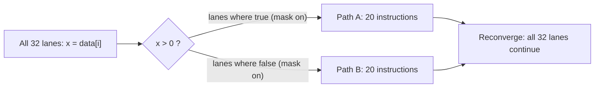
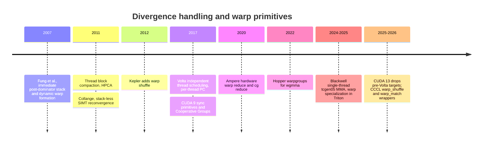

---
tags:
  - gpu-programming
  - kernels-and-optimization
  - cuda
  - simt
  - warp-divergence
  - warp-primitives
  - cooperative-groups
status: complete
sources:
  - https://docs.nvidia.com/cuda/cuda-programming-guide/03-advanced/advanced-kernel-programming.html
  - https://docs.nvidia.com/cuda/cuda-programming-guide/05-appendices/cpp-language-extensions.html
  - https://docs.nvidia.com/cuda/volta-tuning-guide
  - https://developer.nvidia.com/blog/using-cuda-warp-level-primitives/
  - https://developer.nvidia.com/blog/parallelforall/faster-parallel-reductions-kepler
  - https://developer.nvidia.com/blog/cooperative-groups/
  - https://developer.nvidia.com/blog/parallelforall/cuda-11-features-revealed
  - https://docs.nvidia.com/cuda/archive/13.4.1/cuda-programming-guide/04-special-topics/cooperative-groups.html
  - https://www.ece.lsu.edu/gp/refs/volta-architecture-whitepaper.pdf
  - https://people.ece.ubc.ca/aamodt/papers/wwlfung.micro2007.pdf
  - https://people.ece.ubc.ca/aamodt/papers/wwlfung.hpca2011.pdf
  - https://core.ac.uk/download/52317863.pdf
  - https://arxiv.org/pdf/2407.02944
  - https://docs.nvidia.com/cuda/archive/12.6.3/cuda-binary-utilities/index.html
  - https://forums.developer.nvidia.com/t/inst-executed-and-thread-inst-executed/154021
  - https://developer.nvidia.com/blog/cuda-pro-tip-optimized-filtering-warp-aggregated-atomics/
  - https://nvidia.github.io/cccl/cub/api/classcub_1_1WarpReduce.html
  - https://nvidia.github.io/cccl/cccl/3.0_migration_guide.html
  - https://nvidia.github.io/cccl/unstable/libcudacxx/extended_api/warp.html
  - https://docs.nvidia.com/cuda/archive/13.0.2/cuda-toolkit-release-notes/index.html.md
  - https://developer.nvidia.com/blog/nvidia-cuda-13-3-enhances-gpu-development-with-tile-programming-in-c-compiler-autotuning-and-python-updates/
  - https://docs.nvidia.com/cutlass/latest/media/docs/pythonDSL/guides/mma/wgmma_programming.html
  - https://docs.nvidia.com/cutlass/latest/media/docs/pythonDSL/guides/mma/tcgen05_programming.html
  - https://arxiv.org/html/2407.08608v2
  - https://pytorch.org/blog/warp-specialization/
  - https://triton-lang.org/main/getting-started/tutorials/gluon/warp-specialization.html
  - https://www.eecs.harvard.edu/~htk/publication/2019-mapl-tillet-kung-cox.pdf
  - https://rocmdocs.amd.com/projects/HIP/en/develop/reference/kernel_language.html
  - https://rocm.docs.amd.com/projects/HIP/en/docs-7.1.0/understand/hardware_implementation.html
  - https://docs.nvidia.com/nsight-compute/2023.3/pdf/NsightComputeCli.pdf
  - https://docs.nvidia.com/nsight-compute/ProfilingGuide
  - https://forums.developer.nvidia.com/t/nsight-compute-profiling-divergent-branch-measurement-standards/308258
created: 2026-11-26
updated: 2026-11-26
---

## Table Of Contents

- [[#TL;DR|TL;DR]]
- [[#The Problem|The Problem]]
- [[#Foundations|Foundations]]
    - [[#SIMT: One Instruction, 32 Threads|SIMT: One Instruction, 32 Threads]]
    - [[#What Divergence Costs|What Divergence Costs]]
    - [[#Warps Talking to Each Other|Warps Talking to Each Other]]
- [[#How We Got Here|How We Got Here]]
- [[#How It Works|How It Works]]
    - [[#Before Volta: The Reconvergence Stack|Before Volta: The Reconvergence Stack]]
    - [[#Volta and After: Independent Thread Scheduling|Volta and After: Independent Thread Scheduling]]
    - [[#The Primitives|The Primitives]]
    - [[#Masks, the Part People Get Wrong|Masks, the Part People Get Wrong]]
    - [[#Pattern: Warp Compaction with Ballot|Pattern: Warp Compaction with Ballot]]
    - [[#Pattern: Warp-Aggregated Atomics|Pattern: Warp-Aggregated Atomics]]
    - [[#Avoiding Divergence|Avoiding Divergence]]
    - [[#Measuring It|Measuring It]]
- [[#Where It Is Now|Where It Is Now]]
    - [[#Warps Are Being Grouped and Specialized|Warps Are Being Grouped and Specialized]]
    - [[#Libraries and Languages|Libraries and Languages]]
    - [[#AMD: 64-Lane Wavefronts|AMD: 64-Lane Wavefronts]]
- [[#Trade-offs & Open Problems|Trade-offs & Open Problems]]
- [[#Resources|Resources]]
- [[#Related Notes|Related Notes]]

## ***TL;DR***
---
*A GPU runs threads in groups of 32 called warps that share one instruction stream. When threads in a warp take different sides of a branch, the warp runs both sides one after the other with some lanes switched off, which is divergence. The same lockstep grouping also lets the 32 lanes swap data directly through registers, which is what warp-level primitives like `__shfl_sync` do.*

- **Divergence.** "If threads of a warp diverge via a data-dependent conditional branch, the warp executes each branch path taken" ([CUDA Programming Guide](https://docs.nvidia.com/cuda/cuda-programming-guide/03-advanced/advanced-kernel-programming.html)). A 50/50 split inside a warp roughly halves throughput for that code. Branches that split *between* warps cost nothing.
- **Volta changed the rules.** Before compute capability 7.0, a warp had one program counter and reconverged at fixed points. Since Volta each thread has its own program counter and call stack, so "threads can now diverge and reconverge at sub-warp granularity", and code that assumed lockstep execution can break.
- **Warp primitives** let lanes cooperate without shared memory: **shuffle** (`__shfl_sync`, `_up`, `_down`, `_xor`) reads another lane's register; **vote** (`__ballot_sync`, `__any_sync`, `__all_sync`) combines a true/false across lanes; **match** (`__match_any_sync`, CC 7.0+) groups lanes with equal values; **reduce** (`__reduce_add_sync` etc., CC 8.0+, integers only) sums a warp in one instruction.
- **The mask is a promise.** Every `_sync` primitive takes a 32-bit mask of the lanes that will call it, and "all non-exited threads named in mask must execute the same intrinsic with the same mask, or the result is undefined". Hardcoding `0xffffffff` where not all lanes arrive can hang the kernel ([Lin and Grover](https://developer.nvidia.com/blog/using-cuda-warp-level-primitives/)).
- **Where it is now (Nov 2026):** CUDA 13 dropped every pre-Volta target, so independent thread scheduling is universal. Hopper groups four warps into a *warpgroup* for tensor-core instructions, Blackwell's `tcgen05` MMA is issued by a single thread, and top kernels split warps into producer and consumer roles ([[Warp Specialization]]). CCCL 3.x adds `cuda::device::warp_shuffle_*` and `warp_match_*` wrappers, and AMD's HIP moved to 64-bit masks for its 64-lane wavefronts.

## ***The Problem***
---
*GPUs get their efficiency by sharing one instruction fetch and decode among 32 threads. That only works when the 32 threads want the same instruction, so any data-dependent branch is a potential slowdown, and any cooperation between threads needs a way to move data that doesn't go through slow memory.*

Two related problems:

- **Branches.** Real code branches on data: boundary checks, early exits, sparse data, tree traversal, ray tracing. If lanes of a warp disagree, the hardware can only issue one path at a time. Worst case, a warp where each lane takes a different path runs 32 times slower than one where all agree.
- **Cooperation.** Sums, prefix sums, voting and compaction need lanes to see each other's values. Going through [[Shared Memory and Bank Conflicts|shared memory]] costs a store, a barrier and a load. Since lanes of a warp sit in the same register file, there's a faster path, but it needs careful rules about which lanes are present.

And one historical trap: programmers learned to rely on warps running in lockstep ("warp-synchronous" code that skipped barriers inside a warp). NVIDIA now says "such implicit warp-synchronous programming is unsafe and may not work correctly" ([Lin and Grover](https://developer.nvidia.com/blog/using-cuda-warp-level-primitives/)).

## ***Foundations***
---
*A warp is 32 threads with one instruction stream. Divergence turns one pass into several, and the cost is measured as the fraction of lanes doing useful work per instruction.*

### SIMT: One Instruction, 32 Threads

"Each SM creates, manages, schedules, and executes threads in groups of 32 parallel threads called warps," and "each warp contains threads of consecutive, increasing thread IDs with the first warp containing thread 0" ([CUDA Programming Guide](https://docs.nvidia.com/cuda/cuda-programming-guide/03-advanced/advanced-kernel-programming.html)). NVIDIA calls this SIMT (single instruction, multiple threads). Unlike SIMD, where software sees the vector width, SIMT lets you write ordinary scalar code per thread; the hardware handles grouping. See [[GPU Architecture Basics]].

So the warp a thread belongs to is `threadIdx.x / 32` (for 1-D blocks), and its *lane* is `threadIdx.x % 32`.

### What Divergence Costs



If 16 lanes take path A and 16 take path B, the warp issues path A with 16 lanes active, then path B with the other 16: 40 instruction issues where 20 would do if all agreed. The useful work is the same, but issue slots are doubled.

The standard measure is **warp execution efficiency**, the average number of active lanes per instruction issued:

$$\text{efficiency} = \frac{\text{thread instructions executed}}{32 \times \text{warp instructions executed}}$$

In the example, efficiency in the branch is $\frac{16 \times 20 + 16 \times 20}{32 \times 40} = 50\%$. In Nsight Compute this is `smsp__thread_inst_executed_per_inst_executed.ratio` (out of 32) ([Nsight Compute CLI](https://docs.nvidia.com/nsight-compute/2023.3/pdf/NsightComputeCli.pdf)).

**Divergence only exists inside a warp.** A branch like `if (threadIdx.x / 32 < 4)` splits the block, but every lane of each warp agrees, so there's no penalty. Arranging work so branches fall on warp boundaries is the main way to avoid divergence.

**Short branches are often free.** "The compiler will often use thread predication for short sequences of divergent code": both sides are issued to all lanes, and each lane just doesn't commit the result of the side it didn't take ([NVIDIA forums](https://forums.developer.nvidia.com/t/inst-executed-and-thread-inst-executed/154021)).

### Warps Talking to Each Other

The 32 lanes of a warp hold their registers in the same SM sub-partition, so hardware can move a value from one lane's register to another's in one instruction. "The __shfl_sync() intrinsics permit exchanging of a variable between threads within a warp without use of shared memory." "The warp vote functions enable the threads of a given warp to perform a reduction-and-broadcast operation" ([CUDA Programming Guide](https://docs.nvidia.com/cuda/cuda-programming-guide/05-appendices/cpp-language-extensions.html)). This is the basis of fast [[Parallel Reduction and Scan|reductions and scans]], compaction and warp-aggregated atomics.

## ***How We Got Here***
---
*Early GPUs ran a warp as one unit with a hardware stack to handle branches. Researchers spent a decade trying to recover lost lanes, and NVIDIA's answer with Volta in 2017 was to give every thread its own program counter, which forced the move to explicit `_sync` primitives.*



- **Stack-based reconvergence.** The classic hardware model, described by Fung et al. (MICRO 2007), keeps a per-warp stack: on a divergent branch it pushes entries for each path and uses "the immediate post-dominator… of the diverging branch instruction as the reconvergence point", the first instruction both paths must reach ([Fung et al.](https://people.ece.ubc.ca/aamodt/papers/wwlfung.micro2007.pdf)).
- **Research on recovering lanes.** *Dynamic warp formation* regroups threads from different warps that are at the same PC: "an average of 20.7% for an estimated area increase of 4.7%" ([Fung et al. 2007](https://people.ece.ubc.ca/aamodt/papers/wwlfung.micro2007.pdf)). *Thread block compaction* (HPCA 2011) did it block-wide: "average speedup of 22% over a baseline per-warp stack… and 17% versus dynamic warp formation" ([Fung and Aamodt](https://people.ece.ubc.ca/aamodt/papers/wwlfung.hpca2011.pdf)). Collange proposed stack-less reconvergence with a per-thread PC that "handles indirect jumps and recursion" ([Collange 2011](https://core.ac.uk/download/52317863.pdf)). None shipped as described, but per-thread PCs foreshadowed Volta.
- **Shuffle (Kepler).** Warp shuffle arrived with compute capability 3.0. Luitjens' 2014 post wrote reductions with `__shfl_down` and said "synchronization is within a warp and is implicit in the instruction", a claim Volta later made unsafe ([NVIDIA blog](https://developer.nvidia.com/blog/parallelforall/faster-parallel-reductions-kepler)).
- **Volta (2017).** "The Pascal warp uses a single program counter shared amongst all 32 threads"; Volta maintains "execution state per thread, including a program counter and call stack", with a "schedule optimizer which determines how to group active threads from the same warp", and "statements from the if and else branches in the program can now be interleaved in time" ([Volta whitepaper](https://www.ece.lsu.edu/gp/refs/volta-architecture-whitepaper.pdf)). The win: "starvation-free algorithms", such as a lock taken by one lane and waited on by another in the same warp.
- **CUDA 9 (2017)** added the `_sync` variants and Cooperative Groups, and deprecated the old ones: "the legacy warp-level primitives are deprecated starting in CUDA 9.0" ([Lin and Grover](https://developer.nvidia.com/blog/using-cuda-warp-level-primitives/); [Cooperative Groups](https://developer.nvidia.com/blog/cooperative-groups/)).
- **Ampere (2020)** added "a new reduce instruction that operates on the data provided by each thread", exposed as `__reduce_*_sync` and `cg::reduce` ([CUDA 11 Features Revealed](https://developer.nvidia.com/blog/parallelforall/cuda-11-features-revealed)).

## ***How It Works***
---
*Two machines hide behind the same CUDA code: the pre-Volta stack and the post-Volta per-thread scheduler. The primitives work on both if you use the `_sync` forms with correct masks.*

### Before Volta: The Reconvergence Stack

On Maxwell and Pascal, the compiler inserted SASS instructions `SSY` ("Set Synchronization Point") before a branch and `SYNC` ("Converge threads after conditional branch") at its end ([CUDA Binary Utilities](https://docs.nvidia.com/cuda/archive/12.6.3/cuda-binary-utilities/index.html)). The warp ran one path to the sync point, then the other, then continued together. Because the warp was always in one place, code inside a warp could assume all 32 lanes had finished one instruction before the next began.

The downside: a lane spinning on a lock held by another lane of the same warp could deadlock, since the warp might never switch to the holder's path.

### Volta and After: Independent Thread Scheduling

"In GPUs of compute capability 7.0 and later, independent thread scheduling allows full concurrency between threads", while "on GPUs with compute capability lower than 7.0, warps used a single program counter shared amongst all 32 threads" ([CUDA Programming Guide](https://docs.nvidia.com/cuda/cuda-programming-guide/03-advanced/advanced-kernel-programming.html)).

- **Still SIMT.** The convergence optimizer "will still group together threads which are executing the same code" ([Volta whitepaper](https://www.ece.lsu.edu/gp/refs/volta-architecture-whitepaper.pdf)), so non-divergent code runs exactly as before.
- **But no guaranteed reconvergence.** After a branch, the two halves of a warp may run interleaved and may not rejoin where you expect. "Thread convergence is guaranteed only within explicitly synchronous warp-level primitives" ([Lin and Grover](https://developer.nvidia.com/blog/using-cuda-warp-level-primitives/)).
- **New SASS.** Volta and later use `BSSY` ("Barrier Set Convergence Synchronization Point"), `BSYNC` ("Synchronize Threads on a Convergence Barrier"), `WARPSYNC` and `BMOV` ([CUDA Binary Utilities](https://docs.nvidia.com/cuda/archive/12.6.3/cuda-binary-utilities/index.html)). A 2024 reverse-engineering of Turing found that the compiler skips placing `BSYNC` at the post-dominator when that could deadlock, inserting `YIELD` instead ([Shoushtary et al.](https://arxiv.org/pdf/2407.02944)).
- **The fix for old code.** "Any warp-synchronous code developed for GPUs prior to CC 7.0 (such as synchronization-free intra-warp reductions)… should explicitly synchronize such code using `__syncwarp()`" ([CUDA Programming Guide](https://docs.nvidia.com/cuda/cuda-programming-guide/03-advanced/advanced-kernel-programming.html)). The Volta Tuning Guide adds that "assumptions that code is executed in lockstep" are invalid, and that `compute-sanitizer` racecheck and synccheck "can help with locating violations" ([Volta Tuning Guide](https://docs.nvidia.com/cuda/volta-tuning-guide)). To check whether a regression comes from the scheduling change, compile with `-arch=compute_60 -code=sm_70` to get Pascal-style behavior ([Lin and Grover](https://developer.nvidia.com/blog/using-cuda-warp-level-primitives/)).

### The Primitives

From the CUDA Programming Guide's warp functions ([§5.4.6](https://docs.nvidia.com/cuda/cuda-programming-guide/05-appendices/cpp-language-extensions.html)) and the Cooperative Groups docs:

| Primitive | What each lane gets | Min. compute capability |
|---|---|---|
| `__shfl_sync(m, v, src)` | `v` from lane `src` (broadcast or arbitrary gather) | 3.0 |
| `__shfl_up_sync(m, v, d)` / `__shfl_down_sync(m, v, d)` | `v` from lane `lane - d` / `lane + d` | 3.0 |
| `__shfl_xor_sync(m, v, x)` | `v` from lane `lane ^ x` (butterfly patterns) | 3.0 |
| `__all_sync(m, p)` / `__any_sync(m, p)` | Whether all / any lanes in `m` had `p` true | 7.0 form; legacy earlier |
| `__ballot_sync(m, p)` | 32-bit mask: bit *i* set if lane *i* had `p` true | 7.0 form; legacy earlier |
| `__activemask()` | Mask of lanes currently converged here | 7.0 |
| `__match_any_sync(m, v)` | Mask of lanes holding the same `v` as me | 7.0 |
| `__match_all_sync(m, v, &pred)` | `m` if all lanes hold the same `v`, else 0 | 7.0 |
| `__reduce_add_sync(m, v)` (also min, max, and, or, xor) | The warp's reduction of `v` | 8.0; integers only |
| `__syncwarp(m)` | Barrier plus memory ordering for lanes in `m` | 7.0 |

Notes:
- Shuffles take an optional `width` (a power of 2) to act on sub-warps of 2 to 32 lanes, and work on `int`, `unsigned`, `long`, `long long`, `float`, `double` and, with `cuda_fp16.h`, `__half` and `__half2`.
- Vote functions "do not provide any memory ordering"; use `__syncwarp` when lanes exchange data through memory.
- **Cooperative Groups** wraps the same operations in objects: `tiled_partition<N>(block)` returns a `thread_block_tile` with `shfl`, `shfl_down`, `ballot`, `match_any` and so on; `coalesced_threads()` returns the lanes active at that point, ranked densely ([Cooperative Groups](https://developer.nvidia.com/blog/cooperative-groups/)). `cg::reduce(tile, v, cg::plus<int>())` uses hardware "when available (requires Compute Capability 8.0 or greater)… Only 4B types are accelerated by hardware" ([CG docs](https://docs.nvidia.com/cuda/archive/13.4.1/cuda-programming-guide/04-special-topics/cooperative-groups.html)).

### Masks, the Part People Get Wrong

The mask is "the set of threads in the warp that should participate in the collective operation", and all of them must reach the same call ([Lin and Grover](https://developer.nvidia.com/blog/using-cuda-warp-level-primitives/)).

- **Compute the mask from program logic, before the branch.** For a loop where lanes drop out at different times, `unsigned m = __ballot_sync(0xffffffff, i < n);` taken while all lanes are present gives the exact set that will enter.
- **Don't build a mask from `__activemask()`** for a collective. It "tells you what threads happen to be convergent when the function is called", and "cannot be used to determine which warp lanes execute a given branch"; threads convergent there "are not guaranteed to remain convergent at subsequent instructions" ([CUDA Programming Guide](https://docs.nvidia.com/cuda/cuda-programming-guide/05-appendices/cpp-language-extensions.html)). It's for opportunistic code and debugging.
- **`0xffffffff` is only right when all 32 lanes are guaranteed to arrive**, e.g. at the top of a kernel launched with a multiple of 32 threads and no early return before the call.
- **Separate reads and writes through memory with `__syncwarp()`**: "Make sure that __syncwarp() separates shared memory reads and writes to avoid race conditions."

### Pattern: Warp Compaction with Ballot

Each lane has an item and a flag `keep`. Write the kept items contiguously without shared memory or atomics inside the warp:

```cuda
int lane = threadIdx.x % 32;
unsigned kept = __ballot_sync(0xffffffff, keep);            // bit i = lane i keeps
int myPos  = __popc(kept & ((1u << lane) - 1));             // kept lanes below me
int total  = __popc(kept);                                  // kept lanes in the warp
if (keep) out[warpBase + myPos] = item;
```

- **`__ballot_sync`** turns 32 booleans into one 32-bit word, delivered to every lane.
- **`(1u << lane) - 1`** is a mask of the lanes below this one; AND-ing it with `kept` and counting bits (`__popc`) gives this lane's output slot, an exclusive [[Parallel Reduction and Scan|scan]] of the flags in two instructions.
- **`total`** tells the warp how many slots to reserve; combine it with the next pattern to get `warpBase`.

### Pattern: Warp-Aggregated Atomics

Many lanes incrementing one counter serialize at the memory system. Let one lane do a single atomic for the whole group, then hand out slots ([NVIDIA blog](https://developer.nvidia.com/blog/cuda-pro-tip-optimized-filtering-warp-aggregated-atomics/)):

```cuda
namespace cg = cooperative_groups;

__device__ int atomicAggInc(int* counter) {
  cg::coalesced_group g = cg::coalesced_threads();   // the lanes that reached this line
  int base;
  if (g.thread_rank() == 0)
    base = atomicAdd(counter, g.size());             // one atomic for the whole group
  base = g.shfl(base, 0);                            // leader broadcasts the old value
  return base + g.thread_rank();                     // each lane gets its own slot
}
```

- **`coalesced_threads()`** builds a group of exactly the lanes that are active here, which is safe inside divergent code because the group is defined by who arrived, not a hardcoded mask.
- **`g.thread_rank()`** numbers those lanes 0, 1, 2… densely, so lane 0 of the group is the leader.
- **One `atomicAdd` of `g.size()`** replaces up to 32 atomics.
- **`g.shfl(base, 0)`** sends the leader's result to every member.

Adinets measured a filter kernel on a K80: plain global atomics fell from about 55 GiB/s at 5% selectivity to about 8 GiB/s at 50%, while the warp-aggregated version stayed above 80 GiB/s, up to 21× faster. He also notes that "the NVCC compiler now performs warp aggregation for atomics automatically in many cases", so on P100 and V100 with CUDA 9 a plain `atomicAdd` performed about the same ([NVIDIA blog](https://developer.nvidia.com/blog/cuda-pro-tip-optimized-filtering-warp-aggregated-atomics/)). Profile before hand-writing it.

### Avoiding Divergence

| Technique | How | Example |
|---|---|---|
| Branch on warp index, not thread index | Make whole warps take the same path | Harris's [[Parallel Reduction and Scan|reduction]]: `if (tid % (2*s) == 0)` (divergent) became `if (tid < s)` (only the last warps split), a 2.33× step |
| [[Sorting and Hashing on GPUs\|Sort]] or bin work first | Put similar items in the same warp | Group particles, rays or [[Sparse Linear Algebra on GPUs\|sparse rows]] by type or length |
| Keep branches short | Let the compiler predicate | Clamp or select (`x = cond ? a : b`) instead of branching around a big block |
| Hoist uniform conditions | Branch on values every lane shares | Loop bounds from kernel arguments, not per-thread data |
| Pad to full warps | Avoid a partial last warp | Round sizes up to multiples of 32 and mask the tail |

### Measuring It

In [[Profiling with Nsight Compute and Nsight Systems|Nsight Compute]] ([Nsight Compute CLI](https://docs.nvidia.com/nsight-compute/2023.3/pdf/NsightComputeCli.pdf); [Profiling Guide](https://docs.nvidia.com/nsight-compute/ProfilingGuide)):

- **Average active threads per instruction:** `smsp__thread_inst_executed_per_inst_executed.ratio`. 32 is perfect; 16 means half the lanes idle on average.
- **Branch efficiency:** `smsp__sass_average_branch_targets_threads_uniform.pct`, the share of branches where the whole warp went the same way.
- **Divergent branches:** `smsp__sass_branch_targets_threads_divergent` ([NVIDIA forums](https://forums.developer.nvidia.com/t/nsight-compute-profiling-divergent-branch-measurement-standards/308258)), and per-line counts on the Source page.

## ***Where It Is Now***
---
*As of November 2026: independent thread scheduling is on every supported GPU, and the newest hardware moves the other way from single threads: warps are grouped into warpgroups, specialized into producer and consumer roles, or replaced by one thread issuing a large matrix operation.*

### Warps Are Being Grouped and Specialized

- **Pre-Volta is gone.** CUDA 13.0 removed "offline compilation and library support" for Maxwell, Pascal and Volta, so every CUDA 13 target has independent thread scheduling. It also removed multi-grid Cooperative Groups ([CUDA 13.0 release notes](https://docs.nvidia.com/cuda/archive/13.0.2/cuda-toolkit-release-notes/index.html.md)).
- **Warpgroups (Hopper).** A warpgroup is "128 threads / 4 warps" that issue a `wgmma` [[Tensor Cores|tensor-core]] instruction together, ordered with fence, commit-group and wait-group operations ([CUTLASS WGMMA guide](https://docs.nvidia.com/cutlass/latest/media/docs/pythonDSL/guides/mma/wgmma_programming.html)).
- **One thread issues the MMA (Blackwell).** For `tcgen05`, "only one thread issues the MMA instruction", the accumulator lives in Tensor Memory, and a pair of blocks on two SMs can share one MMA; CUTLASS cites "2x–4x the throughput of Hopper's WGMMA" ([CUTLASS tcgen05 guide](https://docs.nvidia.com/cutlass/latest/media/docs/pythonDSL/guides/mma/tcgen05_programming.html)). The SASS `ELECT` instruction ("Elect a Leader Thread") exists to pick that one thread ([CUDA Binary Utilities](https://docs.nvidia.com/cuda/archive/12.6.3/cuda-binary-utilities/index.html)).
- **Warp specialization.** "The warps of a CTA are divided into producer or consumer roles": producers issue [[TMA and Asynchronous Copies|TMA]] copies, consumers run tensor-core math ([FlashAttention-3](https://arxiv.org/html/2407.08608v2)). This is deliberate divergence *between* warps, which is free, used to overlap memory and compute. Triton shipped automatic warp specialization in Triton 3.2 / PyTorch 2.6 ([PyTorch](https://pytorch.org/blog/warp-specialization/)), and its lower-level Gluon dialect exposes `gl.warp_specialize` with per-partition warp and register counts ([Triton Gluon tutorial](https://triton-lang.org/main/getting-started/tutorials/gluon/warp-specialization.html)). See [[Warp Specialization]].

### Libraries and Languages

- **CUB** `WarpReduce` and `WarpScan` give tuned warp collectives, support "'logical' warps smaller than the physical warp size", and use shuffle instructions where they apply ([CUB WarpReduce](https://nvidia.github.io/cccl/cub/api/classcub_1_1WarpReduce.html)).
- **CCCL 3.x** removed CUB's old wrappers (`cub::SHFL_IDX_SYNC`, `cub::WARP_BALLOT`, `cub::WARP_SYNC`, `cub::LaneId()`) in favor of the intrinsics or `cuda::ptx` ([CCCL 3.0 migration](https://nvidia.github.io/cccl/cccl/3.0_migration_guide.html)), and added typed libcu++ wrappers: `cuda::device::warp_shuffle_{idx,up,down,xor}` (CCCL 3.0 / CUDA 13.0), `warp_match_all` and `lane_mask` (3.1 / 13.1) and `warp_match_any` (3.5 / 13.5) ([libcu++ warp API](https://nvidia.github.io/cccl/unstable/libcudacxx/extended_api/warp.html)).
- **Python.** CUDA 13.3's `cuda.coop` exposes CCCL warp- and block-wide primitives inside Numba kernels (experimental) ([NVIDIA blog](https://developer.nvidia.com/blog/nvidia-cuda-13-3-enhances-gpu-development-with-tile-programming-in-c-compiler-autotuning-and-python-updates/)).
- **Higher-level languages hide warps.** In [[Triton]], "each kernel is single-threaded – though automatically parallelized", with "CUDA-like concurrency primitives… inexistent"; the compiler maps work to warps ([Tillet et al. 2019](https://www.eecs.harvard.edu/~htk/publication/2019-mapl-tillet-kung-cox.pdf)). CUDA Tile, in C++ since 13.3, likewise "automates parallelism, memory movement, asynchrony". For tile-level code, divergence becomes the compiler's problem.

No change to the semantics of the core `__*_sync` intrinsics was found in 2025 or 2026; the changes are in wrappers and in dropping old targets.

### AMD: 64-Lane Wavefronts

AMD calls warps *wavefronts*. HIP's `warpSize` is "64 for gfx9 and 32 for gfx10 and above", and "warpSize should not be assumed to be a specific value". All HIP lane masks are 64-bit, so `__ballot` and `__activemask` return 64 bits, "unlike the 32-bit value returned by the CUDA built-ins". The `_sync` variants are available in ROCm 7.0, enabled by default. One key contrast: "AMD GPUs guarantee, that all warp lanes are executed in lockstep", so there's no independent thread scheduling ([HIP kernel language](https://rocmdocs.amd.com/projects/HIP/en/develop/reference/kernel_language.html)). RDNA uses 32-wide waves and can also run "wave64 mode, in which it issues a warp of size 64 in two cycles" ([HIP hardware implementation](https://rocm.docs.amd.com/projects/HIP/en/docs-7.1.0/understand/hardware_implementation.html)). Portable code reads `warpSize` and uses 64-bit masks. See [[ROCm and HIP]].

## ***Trade-offs & Open Problems***
---
*Independent thread scheduling bought safety for locks and irregular code at the cost of guarantees that hand-tuned code used to rely on. Warp primitives are fast but low-level, and the mask rules are easy to get wrong in ways that only show up on some GPUs.*

| Choice | Gains | Costs |
|---|---|---|
| Independent thread scheduling | Starvation-free locks and irregular algorithms inside a warp | No guaranteed reconvergence; old warp-synchronous code breaks |
| Shuffle instead of shared memory | No shared memory, no block barrier | Only within a warp; must get masks right |
| Hardware reduce (`__reduce_*_sync`) | One instruction | Integers only; CC 8.0+ |
| Warp-aggregated atomics by hand | Up to 21× in older measurements | Compiler often does it already |
| Predication | No branch, no divergence | Executes both sides; only good for short code |
| Hiding warps (Triton, CUDA Tile) | No divergence or mask bugs to write | Less control over exactly which lanes do what |

Open problems:

- **Undefined behavior is silent.** A wrong mask may work on one GPU and hang or give wrong answers on another; [[Debugging with compute-sanitizer and cuda-gdb|`compute-sanitizer` synccheck]] catches some cases but not all.
- **Divergent workloads remain slow.** Ray tracing, graph traversal and sparse operations still lose lanes; the research ideas (dynamic warp formation, compaction) mostly live on as software sorting and binning.
- **Portability.** 32-lane CUDA code with 32-bit masks must be rewritten for AMD's 64-lane wavefronts and 64-bit masks, and lockstep assumptions that are now wrong on NVIDIA are still true on AMD.
- **Documentation gaps.** Some Nsight metric names for warp efficiency are confusingly labeled (predicated vs non-predicated variants), and the exact reconvergence rules after Volta are known mainly from reverse-engineering ([Shoushtary et al.](https://arxiv.org/pdf/2407.02944)).

## ***Resources***
---
*Start with Lin and Grover's 2018 post on warp-level primitives and the CUDA guide's SIMT section. For history, read Fung et al. and the Volta whitepaper; for modern practice, the Cooperative Groups docs, CCCL's warp APIs and the FlashAttention-3 paper.*

**NVIDIA documentation**
- [CUDA Programming Guide: SIMT and Independent Thread Scheduling](https://docs.nvidia.com/cuda/cuda-programming-guide/03-advanced/advanced-kernel-programming.html).
- [CUDA Programming Guide: Warp functions (§5.4.6)](https://docs.nvidia.com/cuda/cuda-programming-guide/05-appendices/cpp-language-extensions.html).
- [Cooperative Groups (CUDA 13.4)](https://docs.nvidia.com/cuda/archive/13.4.1/cuda-programming-guide/04-special-topics/cooperative-groups.html).
- [Volta Tuning Guide](https://docs.nvidia.com/cuda/volta-tuning-guide).
- [CUDA Binary Utilities: SASS instruction sets](https://docs.nvidia.com/cuda/archive/12.6.3/cuda-binary-utilities/index.html).
- [Volta architecture whitepaper](https://www.ece.lsu.edu/gp/refs/volta-architecture-whitepaper.pdf).

**NVIDIA blog**
- [Using CUDA Warp-Level Primitives](https://developer.nvidia.com/blog/using-cuda-warp-level-primitives/): Lin and Grover, 2018.
- [Cooperative Groups: Flexible CUDA Thread Programming](https://developer.nvidia.com/blog/cooperative-groups/): Harris and Perelygin, 2017.
- [Faster Parallel Reductions on Kepler](https://developer.nvidia.com/blog/parallelforall/faster-parallel-reductions-kepler): Luitjens, 2014.
- [Optimized Filtering with Warp-Aggregated Atomics](https://developer.nvidia.com/blog/cuda-pro-tip-optimized-filtering-warp-aggregated-atomics/): Adinets, 2014, updated 2017.
- [CUDA 11 Features Revealed](https://developer.nvidia.com/blog/parallelforall/cuda-11-features-revealed): 2020.

**Papers**
- [Dynamic Warp Formation and Scheduling for Efficient GPU Control Flow](https://people.ece.ubc.ca/aamodt/papers/wwlfung.micro2007.pdf): Fung et al., MICRO 2007.
- [Thread Block Compaction for Efficient SIMT Control Flow](https://people.ece.ubc.ca/aamodt/papers/wwlfung.hpca2011.pdf): Fung and Aamodt, HPCA 2011.
- [Stack-less SIMT reconvergence at low cost](https://core.ac.uk/download/52317863.pdf): Collange, 2011.
- [Control Flow Management in Modern GPUs](https://arxiv.org/pdf/2407.02944): Shoushtary et al., 2024.
- [FlashAttention-3](https://arxiv.org/html/2407.08608v2): Shah et al., 2024.

**Libraries and other vendors**
- [CUB WarpReduce](https://nvidia.github.io/cccl/cub/api/classcub_1_1WarpReduce.html), [CCCL 3.0 migration guide](https://nvidia.github.io/cccl/cccl/3.0_migration_guide.html), [libcu++ warp API](https://nvidia.github.io/cccl/unstable/libcudacxx/extended_api/warp.html).
- [Warp specialization in Triton](https://pytorch.org/blog/warp-specialization/): PyTorch, Feb 2025; [Gluon warp specialization tutorial](https://triton-lang.org/main/getting-started/tutorials/gluon/warp-specialization.html).
- [HIP kernel language](https://rocmdocs.amd.com/projects/HIP/en/develop/reference/kernel_language.html): wavefront size and 64-bit masks.

## ***Related Notes***
---
*The hardware that runs warps, the algorithms built on warp primitives, and the newer ways of organizing warps.*

- [[GPU Architecture Basics]] — SMs, warps, schedulers and SIMT.
- [[CUDA Programming Model]] — How threads map to warps inside a block.
- [[Parallel Reduction and Scan]] — Shuffle reductions and scans, and the broken last-warp trick.
- [[Shared Memory and Bank Conflicts]] — The alternative to shuffles, and `__syncthreads()` in divergent code.
- [[Occupancy and Latency Hiding]] — Resident warps vs active lanes.
- [[Memory Coalescing]] — Lanes of a warp combining their memory accesses.
- [[Warp Specialization]] — Producer and consumer warps as deliberate divergence between warps.
- [[Tensor Cores]] — Warp-level `mma`, warpgroup `wgmma` and single-thread `tcgen05`.
- [[TMA and Asynchronous Copies]] — The copies producer warps issue.
- [[PTX and SASS]] — `SSY`/`SYNC`, `BSSY`/`BSYNC` and `redux.sync` at the instruction level.
- [[Triton]] — A language that hides warps from the programmer.
- [[CUTLASS and CuTe]] — Warpgroup and warp-specialized kernels.
- [[ROCm and HIP]] — 64-lane wavefronts and lockstep execution.
- [[Profiling with Nsight Compute and Nsight Systems]] — Branch efficiency and active threads per instruction.
- [[FlashAttention]] — Warp-specialized attention in practice.
- [[Cooperative Groups]] — Typed handles for warps, tiles and coalesced groups.
- [[Forward Progress and Inter-Block Synchronization]] — Intra-warp locks before and after independent thread scheduling, and the block-level picture.
- [[GPU Memory Model Testing and Verification]] — WarpDRF, the precise race-free contract for warp primitives, and the ITS races iGUARD finds.
