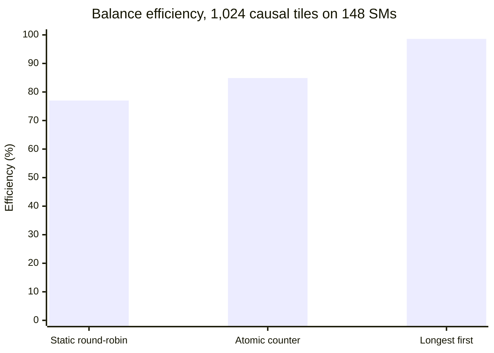
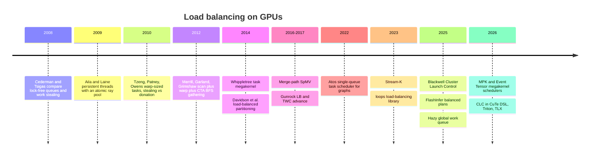
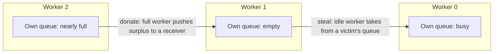

---
tags:
  - gpu-programming
  - kernels-optimization
  - load-balancing
  - work-stealing
  - scheduling
  - irregular-workloads
  - cluster-launch-control
status: complete
sources:
  - https://diglib.eg.org/handle/10.2312/EGGH.EGGH08.057-064
  - https://www.cse.chalmers.se/research/group/dcs/gpuloadbal.html
  - https://research.chalmers.se/en/publication/154386
  - https://escholarship.org/uc/item/9r15d4zk
  - https://hgpu.org/?p=6430
  - https://research.nvidia.com/sites/default/files/pubs/2012-02_Scalable-GPU-Graph/ppo213s-merrill.pdf
  - https://arbook.icg.tugraz.at/schmalstieg/Schmalstieg_286.pdf
  - https://escholarship.org/uc/item/8qr166v2
  - https://arxiv.org/pdf/1701.01170
  - https://www.doc.ic.ac.uk/~afd/papers/2018/CONCUR.pdf
  - https://arxiv.org/abs/2112.00132
  - https://par.nsf.gov/biblio/10397862-atos-task-parallel-gpu-scheduler-graph-analytics
  - https://arxiv.org/abs/2301.04792
  - https://arxiv.org/abs/2212.08964
  - https://arxiv.org/html/2501.01005v2
  - https://docs.nvidia.com/cuda/cuda-programming-guide/04-special-topics/cluster-launch-control.html
  - https://research.colfax-intl.com/dynamic-persistent-tile-scheduling-with-cluster-launch-control-clc-on-nvidia-blackwell-gpus/
  - https://pytorch.org/blog/enabling-cluster-launch-control-with-tlx/
  - https://triton-lang.org/main/getting-started/tutorials/gluon/cluster-launch-control.html
  - https://hazyresearch.stanford.edu/blog/2025-09-28-tp-llama-main
  - https://arxiv.org/html/2512.22219v1
  - https://arxiv.org/html/2604.13327v1
  - https://cursor.com/blog/mixture-of-kittens
  - https://cohere.com/blog/megakernels
  - https://dblp1.uni-trier.de/rec/journals/jacm/BlumofeL99.html
  - https://www.wikipedia.org/wiki/LPT_algorithm
created: 2026-11-26
updated: 2026-11-26
---

## Table Of Contents

---

- [[#TL;DR|TL;DR]]
- [[#The Problem|The Problem]]
- [[#Foundations|Foundations]]
    - [[#Four Levels of Imbalance|Four Levels of Imbalance]]
    - [[#Measuring Balance|Measuring Balance]]
    - [[#Static, Dynamic and Plan-Then-Run|Static, Dynamic and Plan-Then-Run]]
    - [[#Work Stealing on CPUs|Work Stealing on CPUs]]
    - [[#Why GPUs Are Different|Why GPUs Are Different]]
- [[#How We Got Here|How We Got Here]]
- [[#How It Works|How It Works]]
    - [[#Inside a Block - Bin, Scan and Search|Inside a Block - Bin, Scan and Search]]
    - [[#Across SMs - The Atomic Counter|Across SMs - The Atomic Counter]]
    - [[#Queues That Grow - Push, Pop and Termination|Queues That Grow - Push, Pop and Termination]]
    - [[#Distributed Queues, Stealing and Donation|Distributed Queues, Stealing and Donation]]
    - [[#Hardware Work Stealing - Cluster Launch Control|Hardware Work Stealing - Cluster Launch Control]]
    - [[#Plan-Then-Run Schedulers|Plan-Then-Run Schedulers]]
    - [[#Megakernel Task Schedulers|Megakernel Task Schedulers]]
    - [[#Choosing a Strategy|Choosing a Strategy]]
- [[#Where It Is Now|Where It Is Now]]
- [[#Trade-offs & Open Problems|Trade-offs & Open Problems]]
- [[#Resources|Resources]]
- [[#Related Notes|Related Notes]]

## ***TL;DR***
---
*When work items cost different amounts, the GPU finishes only when its most loaded lane, warp or SM finishes. Load balancing is the art of evening that out, either by splitting work evenly before the launch or by letting idle workers grab more work while the kernel runs.*

- **The problem:** irregular workloads (power-law graphs, sparse rows, ray tracing, causal attention, variable-length sequences, MoE experts) give some workers far more to do than others. Runtime is set by the maximum load, not the average.
- **Two families.** **Static** balancing measures the work up front (a prefix sum of costs) and gives every worker an equal share, as in merge-path SpMV and Gunrock's LB advance. **Dynamic** balancing hands out work at runtime: a global **atomic counter**, a shared **task queue**, per-worker queues with **work stealing** or **work donation**, or since Blackwell, **Cluster Launch Control (CLC)**, hardware that lets a running block steal a block that has not launched yet. A third, increasingly common pattern is **plan-then-run**: compute a balanced, deterministic schedule on the host from known sizes (FlashInfer), then run it in a persistent kernel.
- **GPU twists:** tens of thousands of workers contend on the same atomics, SIMT lanes want work in batches, queue memory must be preallocated, and CUDA gives no general guarantee that a block waiting on another block will ever see it run, so blocking queues and termination protocols can hang.
- **Worked example:** 1,024 causal-attention tiles on 148 SMs. Static round-robin reaches 77% efficiency, an atomic counter in launch order 85%, and longest-first order 98.6%.
- **History:** Cederman and Tsigas compared lock-free queues and work stealing on GPUs in 2008, Aila and Laine made persistent threads with an atomic pool standard in 2009, Tzeng, Patney and Owens introduced warp-granular task donation in 2010, and graph and sparse libraries (Merrill 2012, Davidson 2014, Gunrock, merge-path SpMV) made static balancing by prefix sum the default for data-parallel irregularity.
- **Where it is now (Nov 2026):** CLC is the default dynamic scheduler in CUTLASS SM100 kernels and is exposed in Triton/Gluon and Meta's TLX; megakernel runtimes (Hazy Research, MPK at OSDI 2026, Event Tensor at MLSys 2026, Cohere) mix static schedules with dynamic queues and report that dynamic queues win for jittery or data-dependent work and lose for regular dense work. See [[Persistent Kernels and Stream-K]] for the GEMM-specific schedulers and [[Megakernels]] for whole-model scheduling.

## ***The Problem***
---
*A GPU kernel is done when its last worker is done. If one warp, block or SM gets a heavy item, everything else waits, and the hardware you paid for sits idle.*

Most of the vault's kernels assume every thread does the same work: a GEMM tile, a reduction element, a coalesced copy. Many real workloads break that assumption:

| Workload | What varies | Where it bites |
|---|---|---|
| Graph traversal ([[Graph Analytics on GPUs]]) | Vertex degree, from 1 to millions | Threads in a warp, warps in a block |
| Sparse matrix-vector ([[Sparse Linear Algebra on GPUs]]) | Nonzeros per row | Same as graphs |
| Ray tracing | Rays that bounce longer | Warps and blocks ([[Persistent Kernels and Stream-K]] covers Aila-Laine) |
| Causal or local attention ([[FlashAttention]]) | Later query tiles see more keys | Blocks across SMs |
| LLM decode batches ([[LLM Serving]]) | KV length per request | Blocks across SMs |
| [[Mixture of Experts]] | Tokens routed to each expert | Grouped GEMM tiles, SMs, GPUs |
| Recursive or generated work (subdivision, octrees, search) | Work created at runtime | Everything; total work is unknown up front |
| "Uniform" work on real hardware | L2 hits and misses, clock and contention jitter | SMs, at large scale |

The last row matters more than it looks. Hazy Research's tensor-parallel Llama-70B megakernel ran nearly identical schedules on its GPUs and still saw runtime spread, which they blamed on jitter, and a dynamic queue recovered 14.2% at batch 8192 ([Hazy Research, Sep 2025](https://hazyresearch.stanford.edu/blog/2025-09-28-tp-llama-main)). Colfax saw the same effect inside one B200 GEMM: with a hardware dynamic scheduler, SMs completed between 54 and 59 tiles of a nominally uniform problem ([Colfax, May 2026](https://research.colfax-intl.com/dynamic-persistent-tile-scheduling-with-cluster-launch-control-clc-on-nvidia-blackwell-gpus/)).

## ***Foundations***
---
*Imbalance happens at four levels at once, each with its own fix. One number, the ratio of average to maximum load, tells you how much you are losing, and two classic scheduling results tell you how close greedy strategies get.*

### Four Levels of Imbalance

| Level | Workers | Symptom | Typical fix |
|---|---|---|---|
| Lanes in a warp | 32 threads in lockstep | One long lane keeps 31 idle ([[Warp Divergence and Warp-Level Primitives]]) | Give items to whole warps, or split items into equal pieces by prefix sum |
| Warps in a block | Up to 32 warps sharing an SM's slots | One warp holds the block's shared memory while others finish | Block-cooperative processing of large items |
| Blocks across SMs | Hundreds of SMs | Tail effect: a few SMs run the last heavy tiles ([[Occupancy and Latency Hiding]]) | Persistent kernels with dynamic tile claiming, CLC, splitting heavy tiles |
| Kernels and GPUs | Streams, MPS clients, ranks | One GPU or stream is the straggler | Partitioning, communication-aware schedules ([[Multi-GPU Communication - NVLink and NCCL]]) |

A quick lane-level example: a warp expands 32 frontier vertices, one with degree 1,000 and 31 with degree 1. One thread per vertex runs 1,000 loop iterations while the other lanes finish after one, so the warp does $1{,}031$ useful edge visits in $32 \times 1{,}000 = 32{,}000$ lane-slots, about **3.2%** SIMD efficiency. That is why Merrill, Garland and Grimshaw's BFS hands large adjacency lists to whole warps or blocks ([PPoPP 2012](https://research.nvidia.com/sites/default/files/pubs/2012-02_Scalable-GPU-Graph/ppo213s-merrill.pdf)).

### Measuring Balance

With $P$ workers and work items of cost $w_i$, each worker $p$ ends with load $L_p$. The **makespan** is $\max_p L_p$, and the balance efficiency is

$$E = \frac{\frac{1}{P}\sum_i w_i}{\max_p L_p}$$

In plain words: the average load divided by the worst load. $E = 1$ means every worker finishes together; $E = 0.5$ means half the machine's time is wasted waiting.

Two classic results bound simple greedy schedulers on identical machines ([LPT scheduling](https://www.wikipedia.org/wiki/LPT_algorithm)):

- **List scheduling** (whoever is free takes the next item in whatever order they arrive): makespan at most $\left(2 - \frac{1}{P}\right)$ times optimal (Graham, 1966). An atomic counter over a fixed list is exactly this.
- **Longest processing time first (LPT)** (sort items by cost, largest first, then list-schedule): at most $\left(\frac{4}{3} - \frac{1}{3P}\right)$ times optimal (Graham, 1969).

The reason LPT helps is the tail: if the last item claimed is a big one, some worker finishes late while everyone else idles. Doing big items first leaves small ones to fill the gaps.

**Worked example (causal attention on a B200).** Take one sequence of 8,192 tokens and 16 heads, with 128-row query tiles: 64 tiles per head, 1,024 tiles in all. In causal attention tile $i$ (counting from 0) touches $i+1$ KV blocks, so costs range from 1 to 64 units and total $16 \times \frac{64 \times 65}{2} = 33{,}280$ units. On 148 SMs the ideal is $33{,}280 / 148 \approx 224.9$ units per SM. Simulating three schedules (equal-speed SMs, one tile at a time):

| Schedule | How tiles are assigned | Makespan (units) | $E$ |
|---|---|---|---|
| Static round-robin | Tile $k$ to SM $k \bmod 148$, head-major order | 292 | 77.0% |
| Dynamic, launch order | Next free SM takes the next tile (atomic counter) | 265 | 84.9% |
| Dynamic, longest first | Same, after sorting tiles by cost, descending | 228 | 98.6% |



The same arithmetic is why FlashAttention-3's dynamic scheduler hands out the longest remaining tile first and why FlashInfer sorts KV chunks by length before assigning them ([[Persistent Kernels and Stream-K]]; [FlashInfer](https://arxiv.org/html/2501.01005v2)).

### Static, Dynamic and Plan-Then-Run

| | Static | Dynamic | Plan-then-run |
|---|---|---|---|
| When the split is decided | Before or at kernel start, from known sizes | While running, by whoever is idle | On the host (or a small kernel) before launch, from known sizes |
| Typical tool | Prefix sum + binary search (merge path), grid-stride loop | Atomic counter, shared queue, stealing, CLC | Greedy or LPT assignment into a work list |
| Handles runtime jitter and other kernels | No | Yes | No |
| Handles work created at runtime | No | Yes (queues) | No |
| Deterministic | Yes | No: who does what changes per run | Yes |
| Per-item overhead | None at runtime, one scan up front | An atomic or queue operation per claim | A table lookup |
| CUDA Graph friendly | Yes | Yes, if counters are reset in the graph | Yes if the plan lives at fixed addresses |

Static balancing is the right default whenever sizes are known before the launch; Osama, Porumbescu and Owens built a library, `loops`, around making these schedules swappable components ([PPoPP 2023](https://arxiv.org/abs/2301.04792)). Dynamic balancing earns its overhead when sizes are unknown, when work is generated on the fly, or when the hardware itself is uneven.

### Work Stealing on CPUs

On CPUs, "work stealing" names a specific design: each worker owns a double-ended queue, pushes and pops its own tasks at one end, and when it runs dry, steals from the other end of a random victim's queue. Blumofe and Leiserson proved that for fully strict multithreaded computations a randomized work stealer runs in expected time $T_P \le T_1/P + O(T_\infty)$, where $T_1$ is total work and $T_\infty$ the critical path ([JACM 1999](https://dblp1.uni-trier.de/rec/journals/jacm/BlumofeL99.html)). In words: as long as there is far more work than critical path, you get near-linear speedup, and steals are rare because workers mostly use their own queues.

On GPUs the term is used more loosely. It covers per-block queues with stealing (Cederman and Tsigas, Tzeng et al.), a single shared queue that every worker pulls from (Atos), and NVIDIA's CLC, where the "victim" is the hardware's list of unlaunched blocks.

### Why GPUs Are Different

- **Contention.** A CPU has tens of workers; a B200 has 148 SMs and tens of thousands of resident threads. One global counter hit by every thread serializes. Cederman and Tsigas's first conclusion in 2008 was that "synchronization can be very expensive" on GPUs ([Chalmers](https://www.cse.chalmers.se/research/group/dcs/gpuloadbal.html)). Fixes: claim from one lane per warp or block, claim batches, or use hardware support.
- **SIMT granularity.** A task worth scheduling must feed a whole warp or block. Tzeng et al. made the warp the unit of work, treating it as one MIMD processor ([HPG 2010](https://escholarship.org/uc/item/9r15d4zk)); Whippletree let each task type pick thread, warp or block granularity ([Steinberger et al. 2014](https://arbook.icg.tugraz.at/schmalstieg/Schmalstieg_286.pdf)).
- **No dynamic allocation worth the name.** Queues are fixed-size buffers allocated before launch. Tzeng et al. found that task stealing could stall when an owner's full bin could not overflow, and chose donation partly because it needs less memory.
- **No preemption or fairness guarantee for persistent workers.** A block that spins waiting for another block assumes that block is running. Sorensen, Donaldson and colleagues formalized what GPUs actually provide as "occupancy-bound execution": only threads already running are guaranteed to be scheduled again, so barriers and producer-consumer waits are safe only among co-resident blocks ([CONCUR 2018](https://www.doc.ic.ac.uk/~afd/papers/2018/CONCUR.pdf); [[Cooperative Groups]]; [[Forward Progress and Inter-Block Synchronization]]).
- **Memory ordering.** A task pushed by one SM is only visible to another after release/acquire ordering on the queue index and data ([[CUDA Memory Model and Atomics]]).

## ***How We Got Here***
---
*GPU load balancing grew up in graphics (ray tracing, rendering, subdivision), was industrialized by graph and sparse libraries, moved into GEMM and attention schedulers, and got hardware support in Blackwell.*



- **2008, the first comparison.** Cederman and Tsigas (Chalmers) compared four dynamic load-balancing methods on a GPU, three lock-free and one lock-based, on octree partitioning and a four-in-a-row game solver. The lock-free methods won and scaled with processor count ([Graphics Hardware 2008](https://diglib.eg.org/handle/10.2312/EGGH.EGGH08.057-064); [project page](https://www.cse.chalmers.se/research/group/dcs/gpuloadbal.html)). Their work-stealing design later became a chapter of *GPU Computing Gems* ([Chalmers](https://research.chalmers.se/en/publication/154386)).
- **2009, persistent threads.** Aila and Laine's ray tracer launched just enough threads to fill the GPU and pulled rays from a global pool with an atomic counter ([[Persistent Kernels and Stream-K]] has the numbers).
- **2010, task management for irregular work.** Tzeng, Patney and Owens (UC Davis) compared four schemes for warp-sized tasks in one persistent "uberkernel": a single block queue with a lock, distributed per-processor queues, task stealing and task donation. Block and distributed queues showed over 100 times the idle time of stealing and donation; stealing and donation performed about the same, and the authors preferred donation for its smaller memory footprint. Their Reyes renderer produced 100 to 256 million micropolygons per second ([HPG 2010](https://escholarship.org/uc/item/9r15d4zk)).
- **2011, a work-stealing runtime.** Chatterjee, Grossman, Sbirlea and Sarkar (Rice) built a GPU work-stealing runtime with a finish-async API on CUDA, aimed at irregular work across SMs ([LCPC 2011](https://hgpu.org/?p=6430)).
- **2012, balancing by scan.** Merrill, Garland and Grimshaw's BFS used a hybrid: whole-CTA gathering for huge adjacency lists, warp gathering for medium ones, and a prefix-sum "scan-based" gather for the rest, reaching 3.3 billion traversed edges per second on one Tesla C2050 and 8.3 billion on four ([PPoPP 2012](https://research.nvidia.com/sites/default/files/pubs/2012-02_Scalable-GPU-Graph/ppo213s-merrill.pdf)).
- **2014, two directions.** Davidson, Baxter, Garland and Owens's SSSP chose "load-balanced partitioning": split the frontier's edges into equal-sized groups and use a sorted search to find each group's owner vertices, which "ensures perfect load-balance between blocks" ([IPDPS 2014](https://escholarship.org/uc/item/8qr166v2)). Steinberger et al.'s **Whippletree** went the dynamic way: a persistent megakernel with per-procedure queues, shared-memory queues on top of global ring buffers, and tasks at thread, warp or block level; it won all 12 of its recursive benchmarks, up to 4x faster than one-kernel-per-stage launches and up to 40x faster than the earlier Softshell ([ACM TOG / SIGGRAPH Asia 2014](https://arbook.icg.tugraz.at/schmalstieg/Schmalstieg_286.pdf)).
- **2016-2017, libraries.** Merge-path SpMV (Merrill and Garland, SC16) and Gunrock's advance operator made static, edge-balanced schedules the default for sparse and graph work. Gunrock picks merge-based LB when average degree is 5 or more, and thread/warp/CTA binning (TWC) otherwise ([Gunrock TOPC](https://arxiv.org/pdf/1701.01170); [[Graph Analytics on GPUs]]).
- **2018, the progress question.** Sorensen et al. showed that GPU vendors' fairness promises are too vague to say which blocking idioms are safe, and proposed precise "semi-fair" models ([CONCUR 2018](https://www.doc.ic.ac.uk/~afd/papers/2018/CONCUR.pdf)).
- **2022, task parallelism for graphs.** Atos (Chen, Brock, Porumbescu, Buluç, Yelick, Owens) let BFS, PageRank and graph coloring run as relaxed-dependency tasks from a single shared queue, reaching geomean speedups of 3.44x, 2.1x and 2.77x over BSP implementations on a V100 ([ICPP 2022](https://par.nsf.gov/biblio/10397862-atos-task-parallel-gpu-scheduler-graph-analytics); [arXiv](https://arxiv.org/abs/2112.00132)).
- **2023, balancing as a component.** Osama, Porumbescu and Owens's `loops` abstraction separated "load balancing from work processing": merge-path SpMV in 36 lines instead of CUB's 503, within 2.5% of CUB's speed ([PPoPP 2023](https://arxiv.org/abs/2301.04792)). The same group's Stream-K applied work-centric splitting to dense GEMM ([Osama dissertation](https://arxiv.org/abs/2212.08964); [[Persistent Kernels and Stream-K]]).
- **2025, hardware stealing.** Blackwell (compute capability 10.0) added Cluster Launch Control ([CUDA Programming Guide](https://docs.nvidia.com/cuda/cuda-programming-guide/04-special-topics/cluster-launch-control.html)).

## ***How It Works***
---
*Each technique answers one question: who decides which worker gets which item, and when. Start inside the block with scans, move out to counters and queues across SMs, then to hardware and host-planned schedules.*

### Inside a Block - Bin, Scan and Search

For data-parallel irregularity (sizes known at kernel start) the fix is static and lives inside one launch:

1. **Bin by size.** Items above a block's worth of work get the whole block, medium ones a warp, small ones a thread (Merrill's hybrid, Gunrock's TWC).
2. **Scan and search.** Take an exclusive prefix sum of item sizes, give each thread the same number of *atoms* (edges, nonzeros), and have each thread binary-search the scan to find which item its atom belongs to. That is merge path, Gunrock's LB, and Davidson's partitioning. The code is in [[Graph Analytics on GPUs]], and the scan itself in [[Parallel Reduction and Scan]].

The cost is a scan per round and a binary search per thread; the benefit is perfect balance with no atomics. It cannot help with jitter or with work generated mid-kernel.

### Across SMs - The Atomic Counter

The simplest dynamic scheduler is a global index into a fixed list. To keep contention down, one lane per warp claims a *chunk* and shares it:

```cuda
constexpr int CHUNK = 64;                         // items per claim

__global__ void process(const Item* items, int n, int* next) {
  const int lane = threadIdx.x % 32;
  while (true) {
    int base;
    if (lane == 0) base = atomicAdd(next, CHUNK); // one atomic per warp per chunk
    base = __shfl_sync(0xffffffff, base, 0);      // broadcast lane 0's result
    if (base >= n) break;                         // list drained: whole warp exits
    int end = min(base + CHUNK, n);
    for (int i = base + lane; i < end; i += 32)   // lanes stride through the chunk
      work(items[i]);
  }
}
// Host: cudaMemsetAsync(next, 0, sizeof(int), s); then launch about SMs x blocks-per-SM blocks.
```

Line by line:

- **`CHUNK`:** the granularity knob. Bigger chunks mean fewer atomics; smaller chunks mean a shorter tail when items are uneven.
- **`atomicAdd(next, CHUNK)`:** lane 0 reserves `CHUNK` consecutive items and gets the old counter value as its start. Every item is claimed exactly once because `atomicAdd` returns distinct ranges.
- **`__shfl_sync`:** the other 31 lanes get the same `base` without touching memory ([[Warp Divergence and Warp-Level Primitives]]).
- **`if (base >= n) break`:** every lane sees the same `base`, so the whole warp leaves together and no lane is left waiting on a shuffle.
- **Inner loop:** lanes split the chunk so global loads stay coalesced ([[Memory Coalescing]]).
- **Host reset:** the counter must be zeroed before every launch, a cost the Triton CLC tutorial notes "may cancel the benefit for reasonably balanced workloads" ([Triton](https://triton-lang.org/main/getting-started/tutorials/gluon/cluster-launch-control.html)).

Sorting the list by cost first turns this into LPT. FlashAttention-3's dynamic persistent scheduler is this pattern at tile granularity, with a producer thread claiming the next tile ([[Persistent Kernels and Stream-K]]).

### Queues That Grow - Push, Pop and Termination

When tasks create tasks (BFS frontiers in Atos, subdivision in Reyes, octree splits), a counter over a fixed list is not enough; workers must also **push**. Atos uses "a single shared task queue, which balances load more quickly than a distributed queue", with atomics ensuring exclusive pops, and offers thread-, warp- and CTA-sized workers; its persistent variant was up to about 4.3x faster than relaunching a kernel per iteration on some inputs ([Atos](https://arxiv.org/abs/2112.00132)). Three problems appear that a fixed list never has:

| Problem | Why | Usual answer |
|---|---|---|
| Pop overtakes push | A slot index can be reserved before its data is written | Separate *reserve* and *publish* steps, or a per-slot ready flag written with release semantics and read with acquire ([[CUDA Memory Model and Atomics]]) |
| Termination | An empty queue does not mean done; a running task may still push | Count outstanding tasks: increment on push, decrement when a task finishes; stop when it reaches zero |
| Overflow | Fixed-size buffers | Ring buffers sized for the worst case, or donation to emptier queues (Tzeng et al.) |

Termination and pop-waits are where forward progress matters. A worker that spins on "queue empty but work outstanding" only terminates if the worker holding that work keeps running. With a persistent grid sized to co-resident capacity on an otherwise idle GPU this holds in practice, but CUDA only guarantees co-residency for cooperative launches ([[Cooperative Groups]]).

### Distributed Queues, Stealing and Donation

A single queue's head and tail counters become hot spots. Splitting the queue per worker removes contention but brings back imbalance, so the two classic fixes move work between queues:



- **Stealing** is driven by the idle worker. It costs nothing while everyone is busy, but a thief must synchronize with the owner (a lock or atomic on the victim's queue), and an owner whose queue is full has no outlet.
- **Donation** is driven by the overloaded worker. Tzeng et al. sent surplus tasks round-robin to receiver bins when a bin neared overflow; it matched stealing's speed with less memory ([HPG 2010](https://escholarship.org/uc/item/9r15d4zk)).
- **Hierarchical queues.** Whippletree put small shared-memory queues per SM on top of global ring buffers, so most traffic stays on-chip and only overflow and stealing touch global memory ([Whippletree](https://arbook.icg.tugraz.at/schmalstieg/Schmalstieg_286.pdf)).

Tzeng et al. also noted that cheaper atomics on newer hardware could favour simple shared queues again; Atos's choice of a single shared queue on a V100, a decade later, fits that prediction.

### Hardware Work Stealing - Cluster Launch Control

Blackwell's CLC removes the software queue entirely. The kernel launches its full grid, one block per work item, as if it were not persistent. A running block asks the hardware to cancel a block that has not started yet and takes its index instead. NVIDIA's guide, in its section titled "Work Stealing with Cluster Launch Control", shows it on a trivially uniform kernel, `v *= alpha`; the code below is that example, lightly renamed ([CUDA Programming Guide](https://docs.nvidia.com/cuda/cuda-programming-guide/04-special-topics/cluster-launch-control.html)):

```cuda
__global__ void scale_clc(float* data, int n) {
  __shared__ uint4 result;                       // 16-byte encoded reply
  __shared__ uint64_t bar;                       // mbarrier tracking the reply
  int phase = 0;
  if (cg::thread_block::thread_rank() == 0) ptx::mbarrier_init(&bar, 1);
  float alpha = compute_scalar();                // prologue paid once per block
  int bx = blockIdx.x;
  while (true) {
    __syncthreads();                             // result free to overwrite
    if (cg::thread_block::thread_rank() == 0) {
      ptx::fence_proxy_async_generic_sync_restrict(ptx::sem_acquire, ptx::space_cluster, ptx::scope_cluster);
      cg::invoke_one(cg::coalesced_threads(), [&]{ ptx::clusterlaunchcontrol_try_cancel(&result, &bar); });
      ptx::mbarrier_arrive_expect_tx(ptx::sem_relaxed, ptx::scope_cta, ptx::space_shared, &bar, sizeof(uint4));
    }
    int i = bx * blockDim.x + threadIdx.x;       // do this block's work meanwhile
    if (i < n) data[i] *= alpha;
    while (!ptx::mbarrier_try_wait_parity(ptx::sem_acquire, ptx::scope_cta, &bar, phase)) {}
    phase ^= 1;                                  // wait for the reply
    if (!ptx::clusterlaunchcontrol_query_cancel_is_canceled(result)) break;
    bx = ptx::clusterlaunchcontrol_query_cancel_get_first_ctaid_x<int>(result);
    ptx::fence_proxy_async_generic_sync_restrict(ptx::sem_release, ptx::space_shared, ptx::scope_cluster);
  }
}
// Launch exactly like a non-persistent kernel: <<<(n + 1023) / 1024, 1024>>>
```

Read it as an atomic counter whose counter lives in the hardware's launch queue:

- **`result`, `bar`:** the steal is asynchronous. The hardware writes a 16-byte answer into shared memory and completes a transaction on an mbarrier, the same mechanism as TMA copies ([[TMA and Asynchronous Copies]]).
- **`compute_scalar()` before the loop:** the shared prologue runs once per *resident* block, not once per work item. That is the persistent-kernel saving.
- **`try_cancel` from one thread:** each request cancels at most one pending block. The guide recommends one request at a time from a single thread; Colfax warns that several threads issuing it cancel several clusters ([Colfax](https://research.colfax-intl.com/dynamic-persistent-tile-scheduling-with-cluster-launch-control-clc-on-nvidia-blackwell-gpus/)).
- **Work between request and wait:** the block computes its current item while the steal is in flight, hiding its latency.
- **`is_canceled` false:** no block was left to steal, or a higher-priority kernel is waiting. Either way the block exits. Issuing another request after a failure, or reading the index of a failed one, is undefined behavior.
- **`get_first_ctaid_x`:** the stolen block's index becomes this block's next item, so every index is processed exactly once, by a normal launch or by a thief.
- **Fences:** the reply is written by the async proxy, so generic-proxy reads and the next overwrite need explicit acquire and release fences.

What this buys over a software counter: no counter to reset, no global-memory atomics, a grid sized to the problem rather than the machine, and **preemption**: when a block fails to steal because a higher-priority kernel arrived, it exits, the other kernel runs, and the rest of the grid launches later. Cluster variants (`try_cancel_multicast`) steal a whole cluster and multicast the reply to every block in it ([[Thread Block Clusters and Distributed Shared Memory]]). How CUTLASS pipelines CLC with a scheduler warp is covered in [[Persistent Kernels and Stream-K]].

### Plan-Then-Run Schedulers

When sizes are known on the host before the launch, a scheduler can balance perfectly without any runtime atomics. FlashInfer's attention does this every decode step ([MLSys 2025](https://arxiv.org/html/2501.01005v2)):

1. Estimate each query tile's cost as a linear function of its query and KV lengths.
2. Set a maximum KV chunk size from total work divided by the number of CTAs, and split long KV ranges into chunks no larger than that.
3. Sort chunks longest first and assign each to the CTA with the least accumulated cost (a priority queue): LPT.
4. Copy the plan to a GPU workspace; one persistent kernel runs attention and then merges split chunks' partial outputs.

The authors deliberately skipped Stream-K-style atomic aggregation "to avoid non-deterministic behavior", so the same lengths always produce the same summation order. The plan is reused across layers and has fixed addresses, so the run step can sit inside a CUDA Graph ([[CUDA Graphs]]). The trade-off: a host step per batch, and no reaction to runtime jitter.

### Megakernel Task Schedulers

Megakernels turn a whole model step into tasks on a persistent grid ([[Megakernels]]), and each runtime picks a point on the static/dynamic line:

| Runtime | Scheduling | Reported result |
|---|---|---|
| Hazy Research TP Llama-70B (Sep 2025) | One global list of instructions; an SM fetches its next one with an atomic increment; plans built on the CPU while the previous batch runs | Global queue vs round-robin: -1.9% at batch 1,024, +14.2% at batch 8,192 ([Hazy](https://hazyresearch.stanford.edu/blog/2025-09-28-tp-llama-main)) |
| MPK (OSDI 2026) | Four SMs host scheduler warps that track events; worker SMs have their own queues; data-dependent tasks such as attention are dispatched just in time, the rest pre-enqueued round-robin; queues use only `atomicAdd` | Up to 1.7x lower latency than kernel-per-operator serving ([MPK](https://arxiv.org/html/2512.22219v1)) |
| Event Tensor (MLSys 2026) | Compiler chooses static per-SM queues or a dynamic centralized global queue that idle SMs pop | Dynamic wins for MoE (up to 1.23x) and GEMM plus reduce-scatter (up to 1.40x); on dense Qwen3-32B with TP=4 dynamic ran at 0.82-0.89x of the unfused baseline, so static is used for regular work ([Event Tensor](https://arxiv.org/html/2604.13327v1)) |
| Cohere decode megakernel (Sep 2026) | Mostly static (task $k$ to SM $k \bmod 132$, tuned order); attention and MoE pull from shared queues through "claimer" tasks | Schedule order alone was worth up to 19% at batch 1 ([Cohere](https://cohere.com/blog/megakernels)) |

The pattern across all four: dynamic queues pay off when task times are data-dependent or jittery and tasks are long enough (Hazy's instructions often take over 100 µs) to hide the claim; for short, regular tasks the claim's latency is pure overhead.

### Choosing a Strategy

| Situation | Reach for | Why |
|---|---|---|
| Sizes known at kernel start, data-parallel (SpMV, graph advance) | Prefix sum + binary search (merge path, LB) | Perfect balance, no atomics, deterministic |
| Sizes known on host, few big tasks (attention, grouped GEMM) | Plan-then-run with LPT | Near-optimal, deterministic, graph-capturable |
| Uniform-looking tiles, shared GPU, jitter | CLC on Blackwell; atomic counter elsewhere | Absorbs jitter, other kernels and priority streams |
| Uneven tiles, sizes unknown on host | Atomic counter or CLC, longest first if you can sort | List scheduling within 2x, LPT within 4/3 |
| Work generated at runtime | Shared queue (Atos) or per-SM queues with stealing or donation | Only queues can accept new work |
| Many task types in one kernel | Per-type queues (Whippletree) or a megakernel scheduler | Avoids divergence between task types |

## ***Where It Is Now***
---
*As of late November 2026, hardware work stealing is the standard dynamic scheduler for Blackwell GEMM-like kernels, while the frontier has moved to whole-model task schedulers and to the question of when dynamic is worth giving up determinism.*

- **CLC is mainstream on Blackwell.** CUTLASS's SM100 persistent schedulers use CLC with a dedicated scheduler warp; Colfax published a CuTe DSL walkthrough in May 2026 ([Colfax](https://research.colfax-intl.com/dynamic-persistent-tile-scheduling-with-cluster-launch-control-clc-on-nvidia-blackwell-gpus/)); Triton exposes it through Gluon and `clc=True` on persistent matmul ([Triton](https://triton-lang.org/main/getting-started/tutorials/gluon/cluster-launch-control.html)); Meta's TLX added `clc_producer`/`clc_consumer` primitives with multi-stage CLC pipelines in December 2025 ([PyTorch blog](https://pytorch.org/blog/enabling-cluster-launch-control-with-tlx/)). Measured gains are modest on balanced work (about 4% on an 8192³ GB200 matmul in the Gluon tutorial) and large on imbalanced grouped GEMMs, where Colfax reports the dynamic scheduler "significantly outperforms" static.
- **CLC's sharp edges are now documented.** Colfax found that deeper CLC pipelines queue work per SM ahead of time and drift back toward static behaviour, advised delaying `try_cancel` until the mainloop ends for few-wave imbalanced problems, and measured a lower L2 hit rate with CLC than static persistent at 32768² (35% vs 52%), which it could not explain. Work assignment is nondeterministic.
- **Preemption is a real use, not just balance.** Cursor's Mixture-of-Kittens MoE training megakernel on GB300 NVL72 (Aug 2026) uses CLC so the kernel can yield SMs to higher-priority streams, keeping FSDP all-gather traffic from waiting behind it ([Cursor](https://cursor.com/blog/mixture-of-kittens)); see [[Streams, Events and Async Execution]] for stream priorities.
- **Megakernel schedulers have converged on hybrids.** MPK, Event Tensor and Cohere all schedule regular work statically and send data-dependent work (attention, MoE) through dynamic queues; Event Tensor's numbers show the dynamic queue costing 11-18% on dense tensor-parallel decode, which is why nobody uses it everywhere.
- **Plan-then-run dominates inference attention.** FlashInfer's balanced, deterministic plans are the model for serving engines that need both load balance under skewed lengths and CUDA-graph capture ([[LLM Serving]]).
- **Static balancing is settled for sparse and graph work.** Merge path and LB schedules are library defaults; research has moved to making them reusable (`loops`) rather than inventing new ones ([[Graph Analytics on GPUs]]).

## ***Trade-offs & Open Problems***
---
*Every scheme trades balance against overhead, determinism and locality. The open questions are about forward progress, reproducibility and how to schedule many kinds of work at once.*

| Approach | Gains | Costs |
|---|---|---|
| Static round-robin or grid-stride | Zero overhead, deterministic, best locality control | Blind to item cost, jitter and other kernels |
| Prefix sum + search (merge path) | Perfect balance for known sizes | A scan per round, binary search per thread; no runtime adaptivity |
| Plan-then-run (LPT) | Near-optimal, deterministic | Host or extra-kernel planning step per batch; no jitter tolerance |
| Global atomic counter | Simple, adapts to jitter | Counter reset per launch; contention; nondeterministic assignment |
| Shared task queue | Handles generated work | Push/pop ordering, termination detection, fixed capacity |
| Per-worker queues + stealing/donation | Low contention | Complex; idle discovery costs; memory per queue |
| Cluster Launch Control | No counter, preemptible, grid sized to problem | Blackwell (CC 10.0+) only; nondeterministic; can hurt L2 locality |

- **Determinism.** Dynamic assignment changes which SM computes which tile. That is harmless when each item's output is written by one worker, but becomes run-to-run variation as soon as partial results are combined in arrival order (Stream-K's nondeterministic mode, atomic accumulation). Plan-then-run and turnstile reductions are the current answers ([[Deterministic and Batch-Invariant Kernels]]; [[Parallel Reduction and Scan]]).
- **Forward progress.** Queues with waits, termination counters and inter-block flags rely on co-residency that CUDA only promises for cooperative launches. Sharing a GPU through MPS, green contexts or priority streams can break assumptions that held on an idle device ([[MIG and MPS - Sharing a GPU]]; [[Green Contexts and SM Partitioning]]). CLC sidesteps this for stealing, because a failed steal simply exits.
- **Locality vs balance.** Static orders can be swizzled for L2 reuse; dynamic orders scatter it. Colfax's L2 hit-rate drop with CLC is one measurement of the cost, and FlashAttention-3 groups heads into L2-sized sections to keep some locality under a dynamic scheduler ([[Persistent Kernels and Stream-K]]).
- **Granularity.** Small items balance better and cost more claims; large items amortize claims and leave a longer tail. Splitting big items (Stream-K, FlashInfer's KV chunks) adds a merge step.
- **Cost models.** LPT needs a cost estimate; linear models of sequence length work for attention, but MoE experts, sparse tiles and communication tasks are harder to predict ([[Grouped GEMM and Ragged Batches]]).
- **Portability.** CLC is NVIDIA-only; TLX's authors note that low-level primitives like it widen the gap between hardware platforms ([PyTorch blog](https://pytorch.org/blog/enabling-cluster-launch-control-with-tlx/)). Software counters and queues still port to AMD ([[ROCm and HIP]]).

## ***Resources***
---
*Start with Tzeng et al. for the classic queue trade-offs and the CUDA guide's CLC section for the modern hardware path; FlashInfer and the megakernel papers show how the ideas are used in 2025-2026 inference systems.*

**Foundational papers**
- [On Dynamic Load Balancing on Graphics Processors](https://diglib.eg.org/handle/10.2312/EGGH.EGGH08.057-064): Cederman and Tsigas, Graphics Hardware 2008. First GPU comparison of lock-free queues and work stealing ([project page](https://www.cse.chalmers.se/research/group/dcs/gpuloadbal.html)).
- [Task Management for Irregular-Parallel Workloads on the GPU](https://escholarship.org/uc/item/9r15d4zk): Tzeng, Patney and Owens, HPG 2010. Block queues, distributed queues, stealing and donation, measured.
- [Dynamic Task Parallelism with a GPU Work-Stealing Runtime System](https://hgpu.org/?p=6430): Chatterjee, Grossman, Sbirlea and Sarkar, LCPC 2011.
- [Scalable GPU Graph Traversal](https://research.nvidia.com/sites/default/files/pubs/2012-02_Scalable-GPU-Graph/ppo213s-merrill.pdf): Merrill, Garland and Grimshaw, PPoPP 2012. Scan, warp and CTA gathering.
- [Whippletree: Task-Based Scheduling of Dynamic Workloads on the GPU](https://arbook.icg.tugraz.at/schmalstieg/Schmalstieg_286.pdf): Steinberger et al., ACM TOG (SIGGRAPH Asia) 2014.
- [Work-Efficient Parallel GPU Methods for Single-Source Shortest Paths](https://escholarship.org/uc/item/8qr166v2): Davidson, Baxter, Garland and Owens, IPDPS 2014.
- [GPU Schedulers: How Fair Is Fair Enough?](https://www.doc.ic.ac.uk/~afd/papers/2018/CONCUR.pdf): Sorensen, Evrard and Donaldson, CONCUR 2018. Occupancy-bound execution and blocking idioms.
- [Scheduling Multithreaded Computations by Work Stealing](https://dblp1.uni-trier.de/rec/journals/jacm/BlumofeL99.html): Blumofe and Leiserson, JACM 1999. The CPU theory.

**Libraries and modern systems**
- [Gunrock: GPU Graph Analytics](https://arxiv.org/pdf/1701.01170): Wang et al., ACM TOPC. LB, TWC and the selection heuristic.
- [Atos: A Task-Parallel GPU Scheduler for Graph Analytics](https://arxiv.org/abs/2112.00132): Chen et al., ICPP 2022.
- [A Programming Model for GPU Load Balancing](https://arxiv.org/abs/2301.04792): Osama, Porumbescu and Owens, PPoPP 2023; and Osama's dissertation [GPU Load Balancing](https://arxiv.org/abs/2212.08964).
- [FlashInfer](https://arxiv.org/html/2501.01005v2): Ye et al., MLSys 2025. Load-balanced, deterministic attention plans.
- [MPK](https://arxiv.org/html/2512.22219v1) (OSDI 2026) and [Event Tensor](https://arxiv.org/html/2604.13327v1) (MLSys 2026): megakernel task schedulers, static vs dynamic.
- [We Bought the Whole GPU](https://hazyresearch.stanford.edu/blog/2025-09-28-tp-llama-main): Hazy Research, Sep 2025. Global work queue vs round-robin.

**Cluster Launch Control**
- [Work Stealing with Cluster Launch Control](https://docs.nvidia.com/cuda/cuda-programming-guide/04-special-topics/cluster-launch-control.html): CUDA Programming Guide, NVIDIA.
- [Dynamic persistent tile scheduling with CLC](https://research.colfax-intl.com/dynamic-persistent-tile-scheduling-with-cluster-launch-control-clc-on-nvidia-blackwell-gpus/): Colfax Research, May 2026.
- [Enabling Cluster Launch Control with TLX](https://pytorch.org/blog/enabling-cluster-launch-control-with-tlx/): Shi, Yu and Ren, PyTorch blog, Dec 2025.
- [Gluon Cluster Launch Control tutorial](https://triton-lang.org/main/getting-started/tutorials/gluon/cluster-launch-control.html): Triton docs.
- [Mixture-of-Kittens](https://cursor.com/blog/mixture-of-kittens): Cursor, Aug 2026. CLC for yielding to priority streams in an MoE megakernel.

## Related Notes

- [[Persistent Kernels and Stream-K]] — Tile schedulers for GEMM and attention, CUTLASS's CLC pipeline, Aila-Laine persistent threads.
- [[Megakernels]] — Whole-model task schedulers that use the queues described here.
- [[Graph Analytics on GPUs]] — TWC and LB schedules for the advance step, with code.
- [[Sparse Linear Algebra on GPUs]] — Merge-path SpMV and row-length imbalance.
- [[Parallel Reduction and Scan]] — The prefix sum behind static balancing; deterministic combines.
- [[Sorting and Hashing on GPUs]] — Merge path's origin in GPU merging.
- [[Warp Divergence and Warp-Level Primitives]] — Lane-level imbalance and warp-wide claims with shuffles.
- [[Occupancy and Latency Hiding]] — Waves and the tail effect.
- [[CUDA Memory Model and Atomics]] — Atomic counters and release/acquire queue publication.
- [[Cooperative Groups]] — Co-residency guarantees and `invoke_one`.
- [[Blackwell Architecture]] — Where Cluster Launch Control comes from.
- [[Thread Block Clusters and Distributed Shared Memory]] — Cluster-granular stealing with multicast replies.
- [[TMA and Asynchronous Copies]] — The mbarrier transactions that CLC replies use.
- [[CUTLASS and CuTe]] — `PersistentTileSchedulerSm100` and grouped schedulers.
- [[Triton]] — Persistent matmul with `clc=True` and Gluon schedulers.
- [[Streams, Events and Async Execution]] — Stream priorities that CLC lets a kernel yield to.
- [[MIG and MPS - Sharing a GPU]] — Why a kernel cannot assume it owns every SM.
- [[CUDA Graphs]] — Capturing plan-then-run kernels and counter resets.
- [[Memory Coalescing]] — Keeping chunked claims coalesced.
- [[ROCm and HIP]] — Where software queues remain the portable option.
- [[Forward Progress and Inter-Block Synchronization]] — Why spin-waiting queues can deadlock (planned).
- [[Grouped GEMM and Ragged Batches]] — Balancing MoE expert GEMMs.
- [[Deterministic and Batch-Invariant Kernels]] — Reproducibility under dynamic schedules (planned).
- [[Green Contexts and SM Partitioning]] — Reserving SMs, the opposite of stealing them (planned).
- [[FlashAttention]] — Longest-first dynamic scheduling for causal attention.
- [[LLM Serving]] — Variable-length batches that plan-then-run schedulers balance.
- [[Mixture of Experts]] — Data-dependent expert loads.
