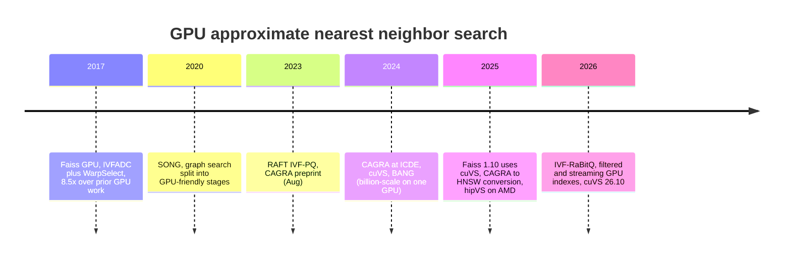
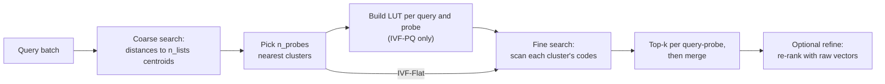
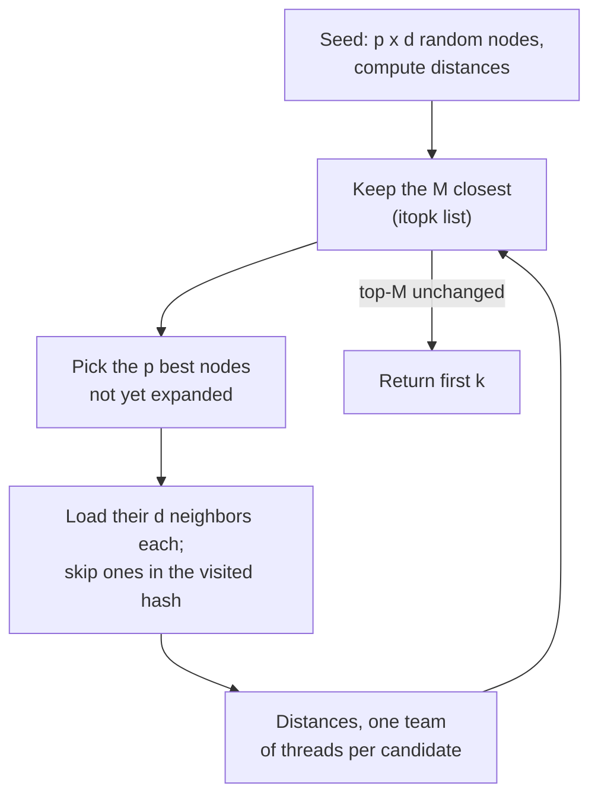

---
tags:
  - gpu-programming
  - libraries
  - cuda
  - vector-search
  - ann
  - cuvs
  - faiss
  - cagra
  - product-quantization
status: complete
sources:
  - https://arxiv.org/pdf/1702.08734
  - https://ar5iv.labs.arxiv.org/html/1702.08734
  - https://www.cs.rit.edu/~wjz/papers/conference/2020-icde-song.pdf
  - https://arxiv.org/html/2308.15136v2
  - https://dblp1.uni-trier.de/rec/conf/icde/OotomoNNWFW24.html
  - https://arxiv.org/html/2401.11324v4
  - https://developer.nvidia.com/blog/accelerating-vector-search-nvidia-cuvs-ivf-pq-deep-dive-part-1/
  - https://developer.nvidia.com/blog/accelerating-vector-search-rapids-cuvs-ivf-pq-performance-tuning-part-2
  - https://developer.nvidia.com/blog/optimizing-vector-search-for-indexing-and-real-time-retrieval-with-nvidia-cuvs/
  - https://developer.nvidia.com/blog/enhancing-gpu-accelerated-vector-search-in-faiss-with-nvidia-cuvs
  - https://engineering.fb.com/2025/05/08/data-infrastructure/accelerating-gpu-indexes-in-faiss-with-nvidia-cuvs/
  - https://docs.nvidia.com/cuvs/api-reference/python-api-neighbors-cagra
  - https://www.github.com/rapidsai/cuvs/releases
  - https://github.com/facebookresearch/faiss/releases
  - https://arxiv.org/abs/2602.23999
  - https://arxiv.org/html/2506.00812v1
  - https://arxiv.org/pdf/2608.21163
  - https://arxiv.org/pdf/2605.10135
  - https://arxiv.org/pdf/2608.16491
  - https://arxiv.org/pdf/2609.16175
  - https://aws.amazon.com/blogs/big-data/how-gpu-acceleration-builds-billion-scale-vector-indexes-on-amazon-opensearch-service/
  - https://rocm.blogs.amd.com/software-tools-optimization/hipvs/README.html
  - https://rocm.docs.amd.com/projects/hipVS/en/latest
  - https://www.nvidia.com/en-us/data-center/h100/
created: 2026-11-28
updated: 2026-11-28
---

## Table Of Contents

---

- [[#TL;DR|TL;DR]]
- [[#The Problem|The Problem]]
- [[#Foundations|Foundations]]
    - [[#Distances and Recall|Distances and Recall]]
    - [[#Three Families of Index|Three Families of Index]]
    - [[#Compressing Vectors: SQ, BQ, PQ and RaBitQ|Compressing Vectors: SQ, BQ, PQ and RaBitQ]]
- [[#How We Got Here|How We Got Here]]
- [[#How It Works|How It Works]]
    - [[#Brute Force Is a GEMM Plus a Top-k|Brute Force Is a GEMM Plus a Top-k]]
    - [[#Worked Example: When Brute Force Is Bandwidth-Bound|Worked Example: When Brute Force Is Bandwidth-Bound]]
    - [[#IVF-Flat and IVF-PQ on the GPU|IVF-Flat and IVF-PQ on the GPU]]
    - [[#Worked Example: Does the PQ Lookup Table Fit?|Worked Example: Does the PQ Lookup Table Fit?]]
    - [[#Why HNSW Does Not Map to a GPU|Why HNSW Does Not Map to a GPU]]
    - [[#CAGRA: Building a GPU-Friendly Graph|CAGRA: Building a GPU-Friendly Graph]]
    - [[#CAGRA: Searching It|CAGRA: Searching It]]
    - [[#Getting Past HBM Capacity|Getting Past HBM Capacity]]
    - [[#Filters and Updates|Filters and Updates]]
    - [[#Choosing an Index|Choosing an Index]]
- [[#Where It Is Now|Where It Is Now]]
- [[#Trade-offs & Open Problems|Trade-offs & Open Problems]]
- [[#Resources|Resources]]
- [[#Related Notes|Related Notes]]

## ***TL;DR***
---
*Approximate nearest neighbor (ANN) search finds the vectors closest to a query without comparing against all of them. On GPUs it splits into three designs: brute force as a matrix multiply, inverted-file indexes with compressed codes, and fixed-degree graphs built for thousands of threads.*

- **The job.** Given $n$ vectors of dimension $d$ (embeddings from a model) and a query, return the $k$ closest. Exact search costs $O(nd)$ per query; ANN trades a little **recall** (the fraction of the true top-$k$ you return) for orders of magnitude less work. It is the retrieval step behind RAG, recommendation and semantic search.
- **Brute force is a GEMM plus a top-k.** Squared L2 expands to $\|x\|^2 + \|y\|^2 - 2\langle x, y\rangle$, so a batch of queries against a dataset is one [[Tiled Matrix Multiplication (GEMM)|matrix multiply]] followed by a row-wise [[Top-k and Sampling Kernels|top-k]]. Faiss built its 2017 GPU engine on exactly this ([Johnson, Douze & Jégou](https://arxiv.org/pdf/1702.08734)).
- **IVF-PQ compresses and prunes.** k-means splits the data into lists; a query scans only the nearest few lists, and product quantization stores each vector as a few bytes whose distances come from a small lookup table kept in [[Shared Memory and Bank Conflicts|shared memory]]. A 1B x 96 fp32 dataset (360 GiB) fits in a typical 54 GiB IVF-PQ index ([NVIDIA, Jul 2024](https://developer.nvidia.com/blog/accelerating-vector-search-nvidia-cuvs-ivf-pq-deep-dive-part-1/)).
- **CAGRA is the graph index designed for GPUs.** CPU graph indexes like HNSW are sequential and hierarchical. CAGRA (NVIDIA, ICDE 2024) uses one flat, fixed-degree graph, expands many nodes per step, and splits a warp into small teams that each compute one distance. On an A100 it built graphs 2.2 to 27x faster than CPU HNSW and searched large batches 33 to 77x faster at 90 to 95% recall ([CAGRA](https://arxiv.org/html/2308.15136v2)).
- **Where it is now (Nov 2026).** NVIDIA's **cuVS** (v26.10, Oct 2026) is the reference library and the GPU backend of Faiss (since 1.10), Milvus, OpenSearch, Lucene and others; AMD ships a HIP port, **hipVS**. The common production pattern is **build on GPU, serve wherever**: CAGRA graphs are converted to HNSW for CPU search. Active work: RaBitQ codes (IVF-RaBitQ in cuVS 26.08), filtered search, streaming inserts and deletes, and billion-scale builds that stream from host memory.

## ***The Problem***
---
*Vector search is a memory problem first and a compute problem second. Datasets are large, queries arrive one at a time or in huge batches, and the exact answer needs a full scan, so every GPU design is a way to touch fewer bytes per query.*

Typical shapes in 2025 to 2026 workloads:

| Workload | n | d | Batch | What matters |
|---|---|---|---|---|
| RAG retrieval over documents | 1M to 1B chunks | 768 to 4096 (text embeddings) | 1 to tens of queries | latency per query, recall@10 |
| Offline deduplication, clustering, kNN graphs | 10M to billions | 96 to 1024 | the whole dataset | throughput, total build time |
| Recommendation candidate generation | 10M to 1B items | 64 to 256 | thousands per second | throughput at fixed recall |
| Vector database index builds | billions | 128 to 1536 | n/a | build hours, cost |

Why it is hard:

| Obstacle | Why it hurts |
|---|---|
| Size | 1B vectors x 1024 dims x 4 bytes is 4 TB. An H100 has 80 GB of HBM ([NVIDIA](https://www.nvidia.com/en-us/data-center/h100/)). Something must be compressed, sharded or left in host memory. |
| Exact search reads everything | One query against $n \cdot d$ values is pure bandwidth with almost no reuse (see the worked example below). |
| The best CPU indexes are sequential | HNSW's greedy walk visits one node, then picks the next from what it just saw. Each step depends on the last, which leaves most GPU threads idle ([SONG](https://www.cs.rit.edu/~wjz/papers/conference/2020-icde-song.pdf)). |
| Small batches | One query is far too little work for 132 SMs; real-time serving wants low latency at batch 1 to 10. |
| Data-dependent control flow | Graph search follows pointers into random rows, so loads are irregular and [[Memory Coalescing|uncoalesced]] unless each row is read by a group of threads together. |
| Filters and updates | Real queries say "nearest, *but only* from this tenant or date range", and data changes; most fast indexes assume a static, unfiltered set. |

## ***Foundations***
---
*Three ideas carry the rest of the note: how closeness and recall are measured, the three kinds of index (flat, inverted file, graph), and how vectors are compressed so more of them fit in GPU memory.*

### Distances and Recall

The common metrics:

| Metric | Formula | Notes |
|---|---|---|
| Squared L2 | $\|x - y\|^2 = \|x\|^2 + \|y\|^2 - 2\langle x, y\rangle$ | cuVS CAGRA's default metric is `sqeuclidean` ([cuVS docs](https://docs.nvidia.com/cuvs/api-reference/python-api-neighbors-cagra)) |
| Inner product | $\langle x, y\rangle$ | Larger is closer; used by many embedding models |
| Cosine | $\langle x, y\rangle / (\|x\|\|y\|)$ | Equal to inner product after normalizing every vector once |

The expansion in the first row matters. $\|y\|^2$ is computed once per database vector, $\|x\|^2$ once per query, so the only per-pair work is the dot product: a matrix multiply ([Faiss paper](https://ar5iv.labs.arxiv.org/html/1702.08734)).

**Recall@k** compares the returned set $R$ with the exact top-$k$ set $G$:

$$\text{recall@}k = \frac{|R \cap G|}{k}$$

*In plain English: of the 10 true nearest neighbors, how many did you find?* Returning 9 of 10 is recall 0.9. Benchmarks report **QPS at a fixed recall** (often 0.9 or 0.95), because any index can be fast at low recall.

### Three Families of Index

| Family | Idea | Search cost | GPU fit |
|---|---|---|---|
| **Flat (brute force)** | Compare against every vector | $O(nd)$ | A GEMM plus top-k; perfect recall; best for small $n$ or huge batches |
| **Inverted file (IVF)** | k-means into `n_lists` clusters; scan only the `n_probes` nearest clusters | about $O(\frac{n_\text{probes}}{n_\text{lists}} nd)$ | Regular, dense scans of contiguous lists; easy to parallelize |
| **Graph** | Each vector links to near neighbors; walk the graph toward the query | roughly logarithmic in $n$ in practice | Fewest distance computations, but irregular memory access and sequential steps |

IVF's cost knob is the probe fraction. With 50,000 lists and 100 probes a query reads 0.2% of the data, plus the cost of finding the nearest centroids.

### Compressing Vectors: SQ, BQ, PQ and RaBitQ

Compression lets more vectors live in HBM and cuts bytes read per distance, at some cost in accuracy that is usually won back by **refinement** (re-ranking a few extra candidates with full-precision vectors).

| Scheme | Bytes per 96-dim fp32 vector (384 B raw) | How distances are computed |
|---|---|---|
| Scalar (int8 / fp16) | 96 / 192 | Dequantize or compute directly in low precision ([[Low-Precision Formats - FP8, FP4 and MX]]) |
| Binary (1 bit per dim) | 12 | Hamming distance with popcount: XOR then count bits |
| Product quantization (PQ) | `pq_dim` bytes at 8 bits per sub-code | Lookup-table sums (below) |
| RaBitQ | about 1 bit per dim plus small corrections | Bitwise estimator with a known error bound |

**Product quantization** splits a vector into `pq_dim` subvectors and replaces each with the index of its nearest centroid in a small codebook of $2^{\text{pq\_bits}}$ entries. For a query $q$, the distance to a coded vector is approximated by **asymmetric distance computation** (ADC):

$$\|q - \hat{x}\|^2 \approx \sum_{s=1}^{\text{pq\_dim}} \text{LUT}[s][c_s], \qquad \text{LUT}[s][j] = \|q_s - \mu_{s,j}\|^2$$

*In plain English: before scanning, precompute the distance from each piece of the query to every centroid of that piece; then a vector's distance is just `pq_dim` table lookups added together.* The query stays exact (asymmetric), only the database side is compressed ([Faiss paper](https://ar5iv.labs.arxiv.org/html/1702.08734), [cuVS IVF-PQ](https://developer.nvidia.com/blog/accelerating-vector-search-nvidia-cuvs-ivf-pq-deep-dive-part-1/)).

**RaBitQ** quantizes a normalized vector to roughly one bit per dimension and gives an unbiased distance estimate with an error bound, which lets a search decide which candidates need re-checking. Its GPU version (IVF-RaBitQ) is the newest index in cuVS ([Shi et al., 2026](https://arxiv.org/abs/2602.23999)).

## ***How We Got Here***
---
*GPU vector search began as fast brute force and IVF-PQ in Faiss (2017), learned to run graph search on GPUs (2020 to 2022), got a graph designed for GPUs in CAGRA (2023), and by 2025 to 2026 became a shared library that CPU databases call to build their indexes.*



| Step | What changed | Source |
|---|---|---|
| 2017: Faiss GPU | Exact and IVFADC (IVF + PQ) search on GPUs; distances as GEMM; **WarpSelect** k-selection in registers at up to 55% of peak; 8.5x faster than the prior GPU state of the art; a kNN graph over 95M YFCC100M images in 35 minutes, and a graph over 1B vectors in under 12 hours on 4 Maxwell Titan X GPUs | [Johnson, Douze & Jégou](https://arxiv.org/pdf/1702.08734) |
| 2020: SONG | First practical GPU graph search (Baidu Research): split each graph step into candidate locating, bulk distance computation by a warp, and single-thread bookkeeping; bounded priority queues and Bloom or Cuckoo filters for the visited set; 50 to 180x over single-thread HNSW and 4.8 to 20.2x over Faiss GPU at equal top-10 recall | [Zhao, Tan & Li](https://www.cs.rit.edu/~wjz/papers/conference/2020-icde-song.pdf) |
| 2020 to 2022: GGNN, GANNS | GPU graph builders and searchers; GGNN shards the data across GPUs and swaps shards over PCIe | [CAGRA related work](https://arxiv.org/html/2308.15136v2), [BANG](https://arxiv.org/html/2401.11324v4) |
| 2023 to 2024: CAGRA | NVIDIA's graph designed for GPUs: fixed degree, rank-based pruning, many parents per step, team-split warps; ICDE 2024 | [Ootomo et al.](https://arxiv.org/html/2308.15136v2), [dblp](https://dblp1.uni-trier.de/rec/conf/icde/OotomoNNWFW24.html) |
| 2024: IVF-PQ in RAFT/cuVS; BANG | cuVS splits vector search out of RAFT; its IVF-PQ ships in Milvus 2.3+ and Faiss 1.8. BANG keeps a DiskANN (Vamana) graph in host memory and only PQ codes on one A100, for 50 to 400x higher throughput than competing methods at recall 0.9 on billion-scale sets | [NVIDIA](https://developer.nvidia.com/blog/accelerating-vector-search-nvidia-cuvs-ivf-pq-deep-dive-part-1/), [BANG](https://arxiv.org/html/2401.11324v4) |
| 2025: libraries converge | Faiss 1.10 adopts cuVS IVF-Flat, IVF-PQ and CAGRA; CAGRA graphs convert to HNSW for CPU serving; AMD releases hipVS, a HIP port of cuVS | [Meta](https://engineering.fb.com/2025/05/08/data-infrastructure/accelerating-gpu-indexes-in-faiss-with-nvidia-cuvs/), [NVIDIA](https://developer.nvidia.com/blog/enhancing-gpu-accelerated-vector-search-in-faiss-with-nvidia-cuvs), [AMD](https://rocm.blogs.amd.com/software-tools-optimization/hipvs/README.html) |
| 2026: quantization, filters, streaming | IVF-RaBitQ (Feb 2026, in cuVS 26.08); VecFlow filtered search (SIGMOD '26); GrAND streaming inserts and deletes; cuVS 26.10 with fast CAGRA merge and Roaring Bitmap filters | [IVF-RaBitQ](https://arxiv.org/abs/2602.23999), [VecFlow](https://arxiv.org/html/2506.00812v1), [GrAND](https://arxiv.org/pdf/2608.21163), [cuVS releases](https://www.github.com/rapidsai/cuvs/releases) |

## ***How It Works***
---
*Every GPU index is built from the same few kernels: a distance computation (GEMM, table lookups or team-split dot products), a k-selection, and a way to keep candidates and visited sets on chip. What differs is how many vectors each query touches and how regular those touches are.*

### Brute Force Is a GEMM Plus a Top-k

For queries $Q$ ($m \times d$) and data $X$ ($n \times d$):

$$D = \|Q\|^2 \mathbf{1}^\top + \mathbf{1}\|X\|^{2\top} - 2\,Q X^\top$$

*In plain English: one matrix multiply gives every query-to-vector dot product; adding two precomputed norm vectors turns them into squared distances.* The GEMM runs on [[Tensor Cores]] through [[cuBLAS and cuDNN|cuBLAS]] or a [[CUTLASS and CuTe|CUTLASS]] kernel. Each row of $D$ then goes through a top-k ([[Top-k and Sampling Kernels]] covers WarpSelect, radix select and cuVS `select_k`).

The catch is the size of $D$: $m \times n$ distances. For 10,000 queries against 10M vectors that is $10^{11}$ floats, 400 GB, far more than HBM. Practical implementations **tile**: compute a block of $D$, select the top-k from it while it is still on chip or in a small buffer, merge with the running result, and move on. That is [[Kernel Fusion]] of the GEMM epilogue with selection, the same move FlashAttention makes with softmax.

### Worked Example: When Brute Force Is Bandwidth-Bound

Data: $n = 10^7$ vectors, $d = 96$, stored in BF16 (2 bytes). GPU: H100 SXM, 989 TFLOP/s dense BF16, 3.35 TB/s HBM ([NVIDIA](https://www.nvidia.com/en-us/data-center/h100/)).

- **Bytes read** (the dataset, once per batch): $10^7 \times 96 \times 2 = 1.92$ GB.
- **FLOPs** for $m$ queries: $2 \cdot m \cdot n \cdot d = 1.92 \times 10^9 \cdot m$.
- **Arithmetic intensity:** $\dfrac{2mnd}{2nd} = m$ FLOPs per byte.

*In plain English: each query adds one FLOP per byte of data read.* The [[Roofline Model and Arithmetic Intensity|ridge point]] of an H100 in BF16 is about 295 FLOPs/byte, so:

| Batch $m$ | Bound by | Time (ideal) | Per query |
|---|---|---|---|
| 1 | bandwidth: 1.92 GB / 3.35 TB/s | 0.57 ms | 0.57 ms |
| 100 | bandwidth | 0.57 ms | 5.7 µs |
| 295 | both (ridge) | 0.57 ms | 1.9 µs |
| 10,000 | compute: $1.92 \times 10^{13}$ / 989 TFLOP/s | 19.4 ms | 1.9 µs |

At batch 1 the GPU spends almost all its time streaming 1.92 GB to do 1.9 GFLOPs: brute force on one query is a memory scan, and its cost grows linearly with $n$. That is why indexes exist. At large batches brute force becomes a GEMM and is hard to beat for $n$ in the low millions, with perfect recall.

### IVF-Flat and IVF-PQ on the GPU



**Build.** cuVS clusters the data with balanced hierarchical k-means into `n_lists` lists. IVF-Flat stores raw vectors per list; IVF-PQ stores the *residual* (vector minus its cluster center) as PQ codes, with codebooks trained per subspace by default. IVF-PQ's build takes roughly 2 to 5x longer than IVF-Flat on the same data ([NVIDIA](https://developer.nvidia.com/blog/accelerating-vector-search-nvidia-cuvs-ivf-pq-deep-dive-part-1/)).

**Search, step by step** (cuVS IVF-PQ):

1. **Coarse search**: distances from each query to all centroids, then top-`n_probes` per query.
2. **LUT construction**: for each (query, probe) pair, the table of $\|q_s - \mu_{s,j}\|^2$; its size is `sizeof(lut_dtype) x pq_dim x 2^pq_bits`.
3. **Cluster scan**: threads read a list's codes (packed in 16-byte chunks so loads are coalesced) and sum table entries. Depending on parameters, LUT building and scanning split the time anywhere from 10/90 to 50/50.
4. **Top-k**: fused into the scan kernel for $k \le 128$; larger $k$ falls back to a separate `select_k`.
5. **Refine** (optional): re-rank, say, $2k$ candidates with the original vectors, on the GPU or on the CPU with the raw data in host memory.

([cuVS IVF-PQ deep dive](https://developer.nvidia.com/blog/accelerating-vector-search-nvidia-cuvs-ivf-pq-deep-dive-part-1/))

The scan's inner loop is small:

```cuda
// lut lives in shared memory: lut[s * 256 + j] = ||q_s - centroid(s, j)||^2
float dist = 0.f;
for (int s = 0; s < PQ_DIM; ++s)
    dist += lut[s * 256 + code[s]];   // one byte of the code picks one table entry
```

- Line 1 (comment): the table was filled once for this query and cluster, so it is reused by every vector in the list.
- Line 2 starts the approximate distance at zero.
- Line 3 walks over the `PQ_DIM` sub-codes of one vector (8-bit codes, so 256 entries per subspace).
- Line 4 reads one byte from HBM and one table entry from shared memory and adds. No multiplications happen in the scan; it is gathers and adds, which is why the table's location and precision dominate speed. Random indices into shared memory can collide on the same bank, a cost [[Shared Memory and Bank Conflicts]] explains.

On the 100M DEEP subset at a large batch (10K queries), IVF-PQ reached 3 to 4x the QPS of IVF-Flat; at batch 10 the two were close, and refinement was needed for competitive recall ([NVIDIA](https://developer.nvidia.com/blog/accelerating-vector-search-nvidia-cuvs-ivf-pq-deep-dive-part-1/)).

### Worked Example: Does the PQ Lookup Table Fit?

Take DEEP vectors ($d = 96$) with `pq_dim = 96`, `pq_bits = 8`:

$$\text{LUT size} = \text{sizeof(lut\_dtype)} \times 96 \times 2^8$$

| `lut_dtype` | Size | Fits in 228 KB of H100 shared memory per SM? |
|---|---|---|
| fp32 | 96 KiB | yes, but only two blocks' worth, so low occupancy |
| fp16 | 48 KiB | yes, room for several blocks per SM |
| 8-bit custom float | 24 KiB | yes, more room for precomputed query-to-center distances |

*In plain English: halving the table's precision doubles how many blocks can share an SM, which is how IVF-PQ hides memory latency ([[Occupancy and Latency Hiding]]).* If the table does not fit, cuVS puts it in global memory and every lookup becomes an L1/L2 access instead. The lower-precision table costs a little accuracy, which refinement recovers ([NVIDIA](https://developer.nvidia.com/blog/accelerating-vector-search-nvidia-cuvs-ivf-pq-deep-dive-part-1/)).

The memory payoff, with 1B DEEP vectors: raw fp32 data is 360 GiB; a typical IVF-PQ index is 54 GiB "with no significant search slowdown", and a 24 GiB configuration searches about 1.5x slower ([NVIDIA](https://developer.nvidia.com/blog/accelerating-vector-search-nvidia-cuvs-ivf-pq-deep-dive-part-1/)). For scale: 48-byte codes plus 8-byte IDs for $10^9$ vectors is 56 GB, about 52 GiB, which is the size class the 54 GiB figure describes. That fits on one 80 GB H100.

### Why HNSW Does Not Map to a GPU

HNSW, the standard CPU graph index, keeps a hierarchy of graphs and walks greedily: pop the closest unexpanded node from a priority queue, compute distances to its neighbors, push the good ones, repeat. On a GPU that loop has three problems ([SONG](https://www.cs.rit.edu/~wjz/papers/conference/2020-icde-song.pdf), [CAGRA](https://arxiv.org/html/2308.15136v2)):

- **Sequential steps.** Each expansion depends on the previous one, so only one node's neighbors (a few dozen distances) are available to work on.
- **Variable degree.** Different nodes have different neighbor counts, so threads get uneven work ([[Warp Divergence and Warp-Level Primitives|divergence]]).
- **Big per-query state.** A priority queue and a visited set per query do not fit in registers or shared memory if they grow freely.

SONG's answer was to batch the work of one step across a warp and bound the state. CAGRA went further and changed the graph itself.

### CAGRA: Building a GPU-Friendly Graph

CAGRA's graph is **flat** (no hierarchy) and every node has the same out-degree $d$ (`graph_degree`, default 64 in cuVS). Fixed degree means fixed work per expansion and a plain $n \times d$ array of neighbor IDs.

Construction has two stages ([CAGRA](https://arxiv.org/html/2308.15136v2), [cuVS docs](https://docs.nvidia.com/cuvs/api-reference/python-api-neighbors-cagra)):

1. **Initial kNN graph** with degree $d_\text{init}$ (`intermediate_graph_degree`, default 128; the paper uses $2d$ to $3d$), built on the GPU with IVF-PQ (cuVS's default), NN-Descent, or iterative CAGRA search. Each list is sorted by distance.
2. **Optimization**, without touching the vectors again:
    - **Rank-based reordering.** For each edge $X \to Y$, count *detourable* two-hop routes $X \to Z \to Y$ where both hops rank closer than the direct edge. Edges with few detours are the ones the graph cannot do without; keep the $d$ edges with the lowest counts. Using list rank instead of true distance makes this up to 1.9x faster and lets DEEP-100M finish where the distance-based version ran out of memory.
    - **Reverse edges.** Build the reversed graph (capped at $d$), then interleave $d/2$ forward and $d/2$ reverse neighbors per node. Reordering raises how many nodes are reachable in two hops; reverse edges cut the number of disconnected components.

Graph memory is simple to estimate: 100M nodes x 64 neighbors x 4 bytes is 25.6 GB, beside 38.4 GB of fp32 vectors for DEEP-100M ($d$ = 96). Together they fit on an 80 GB GPU, which is why CAGRA's paper kept both in device memory.

### CAGRA: Searching It

Each query keeps two small arrays: an **internal top-M list** (`itopk_size`, default 64, at least $k$) and a **candidate buffer** of $p \times d$ entries, where $p$ (`search_width`, default 1) is how many parents expand per iteration.



The GPU-specific pieces ([CAGRA](https://arxiv.org/html/2308.15136v2)):

- **Team-split warps.** A warp is divided into teams of 4, 8, 16 or 32 threads (`team_size`), each computing one distance. For 96-dim fp32 vectors (3,072 bits), a team of 8 threads issuing 128-bit loads moves 1,024 bits per instruction, so a vector takes three loads; a full warp would move 4,096 bits per load and waste a quarter.
- **On-chip top-M.** Buffers of up to 512 entries are sorted with a single-warp bitonic sort in registers; larger ones use a block radix sort ([[Sorting and Hashing on GPUs]]).
- **Visited set.** An open-addressing hash table (after SONG) avoids recomputing distances. In single-CTA mode it lives in shared memory as a **forgettable hash** of $2^8$ to $2^{13}$ entries, reset every 1 to 4 iterations and refilled with the current top-M; that can cost extra distance computations but keeps each query under about 4 kB of shared memory.
- **Parent flag in the ID.** The top bit of each stored node ID marks "already expanded", so no second lookup is needed; that caps an index at $2^{31} - 1$ vectors with 32-bit IDs.

Two launch shapes, picked by batch size:

| Mode | Mapping | Hash table | Best for |
|---|---|---|---|
| Single-CTA | one query per thread block, whole search in one kernel | shared memory, forgettable | batches of about 100 or more |
| Multi-CTA | several blocks per query, each with $p = 1$, sharing one table | global memory | batches of 1 to 100, or very high recall |

A third, multi-kernel design (one kernel per step) lost to launch overhead in the paper. For online serving cuVS also offers **persistent search**, a [[Persistent Kernels and Stream-K|persistent kernel]] that stays resident and pulls queries, and a **dynamic batching** API that groups concurrent requests; NVIDIA reports up to 10x lower latency for dynamic batching and 8x or more throughput for persistent search, without naming hardware ([NVIDIA, Jul 2025](https://developer.nvidia.com/blog/optimizing-vector-search-for-indexing-and-real-time-retrieval-with-nvidia-cuvs/)).

A simplified team distance kernel shows the idea:

```cuda
template <int TEAM>   // 4, 8, 16 or 32 threads per candidate
__device__ float team_l2(const float* __restrict__ q_smem,  // query in shared memory
                         const float* __restrict__ x,       // candidate row in HBM
                         int dim) {
  int lane = threadIdx.x % TEAM;
  float acc = 0.f;
  for (int i = lane * 4; i < dim; i += TEAM * 4) {
    float4 a = *reinterpret_cast<const float4*>(q_smem + i);
    float4 b = *reinterpret_cast<const float4*>(x + i);
    float dx = a.x - b.x, dy = a.y - b.y, dz = a.z - b.z, dw = a.w - b.w;
    acc += dx * dx + dy * dy + dz * dz + dw * dw;
  }
  for (int off = TEAM / 2; off > 0; off /= 2)
    acc += __shfl_xor_sync(0xffffffff, acc, off, TEAM);
  return acc;
}
```

- The template fixes the team size at compile time, so loops unroll.
- `lane` is this thread's position inside its team; four teams of 8 share one warp and work on four different candidates at once.
- The first loop gives each thread 4 floats per step (one 16-byte load from each vector), and the team covers `TEAM * 4` floats per step: for $d$ = 96 and a team of 8, three steps, matching the paper's example. Neighboring lanes read neighboring 16-byte pieces of the same row, so the team's loads are [[Memory Coalescing|coalesced]].
- The query sits in shared memory because every candidate reuses it.
- The last loop is a butterfly reduction; the `width` argument (`TEAM`) keeps the shuffles inside each team ([[Warp Divergence and Warp-Level Primitives]]). Afterwards every lane of the team holds the full distance. (The code assumes `dim` is a multiple of 4 and 16-byte-aligned rows.)

**Results** on a DGX A100 (A100 80 GB, data and graph in device memory): graph build 2.2 to 27x faster than CPU HNSW; large-batch QPS 33 to 77x over HNSW and 3.8 to 8.8x over earlier GPU graph methods at 90 to 95% recall; single-query QPS 3.4 to 53x over HNSW at 95% recall ([CAGRA](https://arxiv.org/html/2308.15136v2)). The graph degree used per dataset ranged from 32 (SIFT, DEEP) to 80 (GloVe-200): higher degree raises recall and lowers throughput.

### Getting Past HBM Capacity

When the data does not fit, there are four strategies, often combined:

| Strategy | How | Example |
|---|---|---|
| Compress in HBM | Keep PQ, binary, int8 or RaBitQ codes on the GPU; refine from host | IVF-PQ (above); CAGRA-Q (CAGRA over PQ-compressed data); IVF-RaBitQ |
| Stream the build | Batch vectors from host memory through the GPU | Out-of-core IVF-PQ and NN-Descent graph builds; cuVS ACE (partitioned CAGRA builds with disk workspaces) |
| Graph in host memory | GPU holds only compressed vectors; CPU feeds neighbor lists | BANG: Vamana graph (260 GB at 1B) in RAM, PQ codes on one A100, CPU and GPU pipelined |
| Build on GPU, serve on CPU | Convert the graph for a CPU engine | CAGRA becomes the HNSW base layer in Faiss (`IndexHNSWCagra`) and Amazon OpenSearch |

Two data points on the last row. Faiss on an H100 vs a Xeon 8480CL, 95% recall@10: CAGRA built the Deep 100M x 96 index in 518.5 s vs 3322.1 s for CPU HNSW (6.4x), and the 5M x 1536 text set in 89.7 s vs 1106.1 s (12.3x); single-query latency was 0.23 vs 0.56 ms and 0.15 vs 0.71 ms ([Meta](https://engineering.fb.com/2025/05/08/data-infrastructure/accelerating-gpu-indexes-in-faiss-with-nvidia-cuvs/)). Amazon OpenSearch's managed GPU build service built a 1B x 1024 index in 274 minutes, 7.7x the 35.5 minutes of a 1B x 128 build for 8x the dimensions, then served it on CPU nodes at recall 0.93 ([AWS, Aug 2026](https://aws.amazon.com/blogs/big-data/how-gpu-acceleration-builds-billion-scale-vector-indexes-on-amazon-opensearch-service/)).

Compression changes the numbers sharply. Binary codes are 32x smaller than fp32 (1 bit vs 32) and int8 codes 4x. On billion-scale, high-dimension data, these are what make a single GPU viable. The large-memory superchips (Grace Hopper, Grace Blackwell) add another path: GPU access to hundreds of GB of CPU memory over NVLink-C2C ([[Coherent CPU-GPU Superchips]]). VecFlow measured 1.6 to 2x higher filtered-search throughput on a GH200 than on an A100 ([VecFlow](https://arxiv.org/html/2506.00812v1)).

### Filters and Updates

**Filtered search** ("nearest among vectors with label X") breaks graph search: if only 1% of nodes are allowed, the walk wastes time on forbidden nodes or gets stranded. Approaches on GPUs:

- **Bitset filters during search** (cuVS `filter=` on CAGRA and IVF; Roaring Bitmap and Bloom filters added in 2026), with better prefiltering in CAGRA to keep recall when about 99% of vectors are excluded, and an exact brute-force fallback for very selective filters ([NVIDIA](https://developer.nvidia.com/blog/optimizing-vector-search-for-indexing-and-real-time-retrieval-with-nvidia-cuvs/), [cuVS releases](https://www.github.com/rapidsai/cuvs/releases)).
- **Label-centric indexes.** VecFlow (SIGMOD '26) groups vectors by label: frequent labels get a CAGRA graph each over one shared copy of the vectors, rare labels are brute-forced with a fused top-k scan. On an A100 it reached about 2.6M QPS at 90% recall on YFCC-10M (200K labels), where post-filtered and inline-filtered CAGRA stayed below 80% recall ([VecFlow](https://arxiv.org/html/2506.00812v1)).
- **Range filters** (numeric attributes) are a separate 2026 line of work, e.g. FROG ([arXiv 2608.16491](https://arxiv.org/pdf/2608.16491)) and BOA ([arXiv 2609.16175](https://arxiv.org/pdf/2609.16175)).

**Updates.** CAGRA is built for a static set. cuVS added `extend`, index `merge` (fast merge in 26.10) and `update_dataset` ([cuVS releases](https://www.github.com/rapidsai/cuvs/releases)). GrAND (to appear in PVLDB vol. 20) does true streaming inserts and deletes on the GPU for Vamana and CAGRA graphs: batched repair, lock-free adjacency updates, and a per-batch reverse graph to find edges into deleted nodes; GrAND-CAGRA averaged 8.76x the overall throughput of the CPU-GPU hybrid SVFusion ([GrAND](https://arxiv.org/pdf/2608.21163)). IVF indexes take inserts easily (append to a list) but drift as the data distribution changes.

### Choosing an Index

| Situation | Reach for | Why |
|---|---|---|
| Up to a few million vectors, or need exact answers | Brute force | GEMM speed, recall 1.0, no build |
| Huge offline batches (dedup, kNN graph) | IVF-PQ or brute force | Throughput-bound; IVF-PQ's dense scans saturate the GPU |
| Low-latency online search, data fits in HBM | CAGRA (single or multi-CTA, persistent) | Fewest distances per query |
| Data larger than HBM | IVF-PQ / IVF-RaBitQ with refinement, CAGRA-Q, or GPU build plus CPU HNSW serving | Compression or offload |
| CPU-only serving fleet | Build CAGRA on GPU, convert to HNSW | GPU speeds the build, the slowest step |
| Heavy filtering | Bitset filters; label-centric designs for skewed labels | Graph walks degrade when most nodes are excluded |

## ***Where It Is Now***
---
*As of November 2026: cuVS is the de facto GPU vector-search engine, used directly and inside Faiss and most vector databases; AMD runs a port of it; and research has moved to compression, filtered and streaming search, and cheap billion-scale builds.*

**Libraries**

- **cuVS v26.10 (Oct 8, 2026)**: fast CAGRA index merge, Roaring Bitmap filters, `update_dataset` for CAGRA, BBQ-compressed data in NN-Descent and CAGRA, iterative CAGRA-Q, fp16 and faster builds for Vamana/DiskANN, layered HNSW support, transactional disk workspaces for CAGRA-ACE. **v26.08 (Aug 2026)** added IVF-RaBitQ, CAGRA Bloom filters, JIT-LTO filter functions and multi-partition search; **v26.06 (Jun 2026)** JIT-LTO CAGRA search; **v26.04 (Apr 2026)** made the GPU-built HNSW hierarchy the default ([cuVS releases](https://www.github.com/rapidsai/cuvs/releases)).
- **Faiss v1.15 (Aug 2026, 1.15.1 Sep 2026)**: a cuVS IVF-SQ backend, multi-GPU CAGRA-to-HNSW builds and `faiss-gpu-cuvs` pip wheels; 1.14.2 added filtered search for cuVS indexes and moved CI to CUDA 13.2 ([Faiss releases](https://github.com/facebookresearch/faiss/releases)). Faiss has used cuVS for IVF-Flat, IVF-PQ and CAGRA since 1.10 ([Meta](https://engineering.fb.com/2025/05/08/data-infrastructure/accelerating-gpu-indexes-in-faiss-with-nvidia-cuvs/)).
- **Integrations.** NVIDIA lists GPU index builds in Milvus, OpenSearch 3.0, Lucene, Solr, Weaviate, Oracle 23ai and AlloyDB, with reported build speedups from 5x to 40x (vendor figures, mostly without hardware stated) ([NVIDIA, Jul 2025](https://developer.nvidia.com/blog/optimizing-vector-search-for-indexing-and-real-time-retrieval-with-nvidia-cuvs/)). Amazon OpenSearch runs managed GPU index builds and serves on CPU ([AWS, Aug 2026](https://aws.amazon.com/blogs/big-data/how-gpu-acceleration-builds-billion-scale-vector-indexes-on-amazon-opensearch-service/)).
- **AMD.** hipVS (with hipRAFT) is a HIP port of cuVS with a compatible API: brute force, IVF-Flat, IVF-PQ and CAGRA on Instinct GPUs; the first release (Nov 2025, ROCm 7.0.2) targeted functional bring-up, with performance work to follow ([AMD](https://rocm.blogs.amd.com/software-tools-optimization/hipvs/README.html), [hipVS docs](https://rocm.docs.amd.com/projects/hipVS/en/latest)). See [[ROCm and HIP]].

**Research, 2026**

- **IVF-RaBitQ (GPU)** (Shi, Gao, Xia, Fehér & Long; v2 Aug 2026): at about 0.95 recall, 3.0x the QPS of CAGRA with 14.7x faster builds on average, and over 4.5x the throughput of IVF-PQ without re-ranking from raw vectors ([arXiv 2602.23999](https://arxiv.org/abs/2602.23999)). It challenges the common view that graph indexes win at high recall on GPUs.
- **ScaleGANN**: partition-and-merge builds on spot cloud GPUs with CAGRA per shard; up to 5.5x faster than DiskANN overall at about a sixth of the estimated cost ([arXiv 2605.10135](https://arxiv.org/pdf/2605.10135)).
- **GrAND** (PVLDB vol. 20): GPU-native streaming updates for CAGRA and Vamana ([arXiv 2608.21163](https://arxiv.org/pdf/2608.21163)).
- **Filtered search**: VecFlow (SIGMOD '26), and range-filter work such as FROG and BOA (Aug to Sep 2026 preprints).

## ***Trade-offs & Open Problems***
---
*Every choice trades recall, throughput, latency, memory and build time against each other. The open problems are the ones production systems hit: data that outgrows HBM, filters, constant updates, and small-batch latency.*

| Choice | Gains | Costs |
|---|---|---|
| Brute force | Exact; no build; tensor-core GEMM at large batch | Linear in $n$; bandwidth-bound for small batches |
| IVF-Flat | Simple, regular scans; easy inserts | Full-size vectors; recall depends on probes; lists drift as data changes |
| IVF-PQ | 4 to 5x smaller than IVF-Flat in cuVS's configs; best large-batch throughput | Longer build; needs refinement (and often raw vectors) for high recall |
| CAGRA | Fewest distances; best latency and high-recall QPS | Graph plus vectors must fit in HBM; static by design; degrades under heavy filters |
| IVF-RaBitQ | Fast build, small codes, error-bounded estimates | New (2026); less production mileage |
| GPU build, CPU serve | Cheap serving fleet; GPU only during builds | Loses GPU search speed; conversion step; the CAGRA hierarchy differs from native HNSW |
| Persistent search / dynamic batching | Low latency at small batch | Ties up SMs; a scheduling layer to tune |

Open problems:

- **Capacity.** Embedding dimensions keep growing (1536 to 4096), and raw data at 1B scale runs to terabytes. Everything rests on compression quality, refinement cost, and host-to-GPU bandwidth ([[GPUDirect RDMA and Storage]], [[Unified Memory]]).
- **Filtered search.** Recall can collapse when filters are selective or labels are long-tailed, which forces label-specific structures or brute-force fallbacks ([VecFlow](https://arxiv.org/html/2506.00812v1)).
- **Streaming data.** Fresh vectors must be searchable within seconds, and deletes must not leave holes in the graph. GPU-native updates (GrAND) are new, and their 100M-scale comparisons disabled the baselines' consolidation, so they are not like-for-like ([GrAND](https://arxiv.org/pdf/2608.21163)).
- **Parameter tuning.** `itopk_size`, `search_width`, `team_size`, `n_probes`, `pq_dim` and graph degree all move the recall/QPS curve, and the best setting changes with batch size and hardware. That is the same problem [[GEMM Autotuning and Kernel Selection]] faces for matmuls.
- **Benchmark honesty.** Vendor speedup figures often omit the GPU, dataset or recall target. Compare at a fixed recall, on the same dataset, with build time and memory reported, as cuVS-bench and the CAGRA paper do ([[Benchmarking GPU Kernels Correctly]]).
- **Portability.** hipVS brings the cuVS API to AMD but started functional-first; tuned AMD kernels and published cross-vendor numbers are still to come ([AMD](https://rocm.blogs.amd.com/software-tools-optimization/hipvs/README.html)).

## ***Resources***
---
*Start with the Faiss paper for brute force and IVF-PQ, the CAGRA paper for graph search, and the cuVS IVF-PQ deep dive for how tables and scans map to shared memory. The cuVS and Faiss release notes track the current state.*

**Papers**
- [Billion-scale similarity search with GPUs](https://arxiv.org/pdf/1702.08734): Johnson, Douze and Jégou, 2017. GEMM distances, GPU IVFADC, WarpSelect.
- [SONG: Approximate Nearest Neighbor Search on GPU](https://www.cs.rit.edu/~wjz/papers/conference/2020-icde-song.pdf): Zhao, Tan and Li (Baidu Research), ICDE 2020.
- [CAGRA: Highly Parallel Graph Construction and Approximate Nearest Neighbor Search for GPUs](https://arxiv.org/html/2308.15136v2): Ootomo et al. (NVIDIA), ICDE 2024 ([dblp](https://dblp1.uni-trier.de/rec/conf/icde/OotomoNNWFW24.html)).
- [BANG: Billion-Scale Approximate Nearest Neighbour Search using a Single GPU](https://arxiv.org/html/2401.11324v4): graph in host memory, PQ on the GPU.
- [GPU-Native ANN Search with IVF-RaBitQ](https://arxiv.org/abs/2602.23999): Shi, Gao, Xia, Fehér and Long, 2026.
- [VecFlow: Filtered Search on GPUs](https://arxiv.org/html/2506.00812v1): SIGMOD '26.
- [GrAND: GPU-based Dynamic Graph Indexes for ANN Search](https://arxiv.org/pdf/2608.21163): Venkatasubba et al. (IIT Hyderabad), PVLDB vol. 20.
- [ScaleGANN](https://arxiv.org/pdf/2605.10135): Lu et al., cost-effective billion-scale builds on cloud GPUs.

**Library documentation and engineering posts**
- [Accelerating Vector Search: NVIDIA cuVS IVF-PQ Part 1, Deep Dive](https://developer.nvidia.com/blog/accelerating-vector-search-nvidia-cuvs-ivf-pq-deep-dive-part-1/) and [Part 2, Performance Tuning](https://developer.nvidia.com/blog/accelerating-vector-search-rapids-cuvs-ivf-pq-performance-tuning-part-2): Chirkin et al., NVIDIA, 2024.
- [cuVS CAGRA Python API](https://docs.nvidia.com/cuvs/api-reference/python-api-neighbors-cagra): every build and search parameter with its default.
- [cuVS releases](https://www.github.com/rapidsai/cuvs/releases) and [Faiss releases](https://github.com/facebookresearch/faiss/releases).
- [Accelerating GPU indexes in Faiss with NVIDIA cuVS](https://engineering.fb.com/2025/05/08/data-infrastructure/accelerating-gpu-indexes-in-faiss-with-nvidia-cuvs/): Meta, May 2025, with build and latency tables.
- [Enhancing GPU-Accelerated Vector Search in Faiss with NVIDIA cuVS](https://developer.nvidia.com/blog/enhancing-gpu-accelerated-vector-search-in-faiss-with-nvidia-cuvs): NVIDIA, Nov 2025. CAGRA to HNSW conversion.
- [Optimizing Vector Search for Indexing and Real-Time Retrieval with NVIDIA cuVS](https://developer.nvidia.com/blog/optimizing-vector-search-for-indexing-and-real-time-retrieval-with-nvidia-cuvs/): NVIDIA, Jul 2025. Dynamic batching, persistent search, ecosystem.
- [How GPU acceleration builds billion-scale vector indexes on Amazon OpenSearch Service](https://aws.amazon.com/blogs/big-data/how-gpu-acceleration-builds-billion-scale-vector-indexes-on-amazon-opensearch-service/): AWS, Aug 2026.
- [Accelerating Vector Search: hipVS and hipRAFT on AMD](https://rocm.blogs.amd.com/software-tools-optimization/hipvs/README.html) and [hipVS docs](https://rocm.docs.amd.com/projects/hipVS/en/latest).

## Related Notes

- [[Top-k and Sampling Kernels]] — WarpSelect, radix select and cuVS `select_k`: the k-selection every ANN index ends with.
- [[Tiled Matrix Multiplication (GEMM)]] — Brute-force distances are a GEMM; tiling is how the distance matrix stays on chip.
- [[cuBLAS and cuDNN]] — Library GEMMs behind brute force and k-means.
- [[Kernel Fusion]] — Fusing distance tiles with top-k, and PQ scans with selection.
- [[Shared Memory and Bank Conflicts]] — PQ lookup tables, CAGRA's forgettable hash and candidate buffers live there.
- [[Memory Coalescing]] — Team-split warps and 16-byte code chunks keep irregular reads coalesced.
- [[Warp Divergence and Warp-Level Primitives]] — Team shuffles and warp-level bitonic sorts.
- [[Sorting and Hashing on GPUs]] — Bitonic and radix sorts for top-M lists; open-addressing visited tables.
- [[Persistent Kernels and Stream-K]] — CAGRA persistent search for online serving.
- [[Occupancy and Latency Hiding]] — Why smaller LUTs make IVF-PQ faster.
- [[Roofline Model and Arithmetic Intensity]] — Brute force's arithmetic intensity equals the batch size.
- [[Low-Precision Formats - FP8, FP4 and MX]] — fp16 and 8-bit tables, scalar quantization.
- [[GPU Data Compression]] — Lossless compression; PQ and RaBitQ are its lossy, search-time cousins.
- [[Graph Analytics on GPUs]] — Irregular neighbor traversal on GPUs, the same access problem as graph ANN.
- [[GPU Databases and Dataframes]] — Vector search is increasingly a database operator next to filters and joins.
- [[Coherent CPU-GPU Superchips]] — Large CPU memory over NVLink-C2C for indexes bigger than HBM.
- [[Multi-GPU Communication - NVLink and NCCL]] — Sharding indexes and multi-GPU builds.
- [[ROCm and HIP]] — hipVS on AMD Instinct.
- [[Benchmarking GPU Kernels Correctly]] — Compare at fixed recall, with build time and memory.
