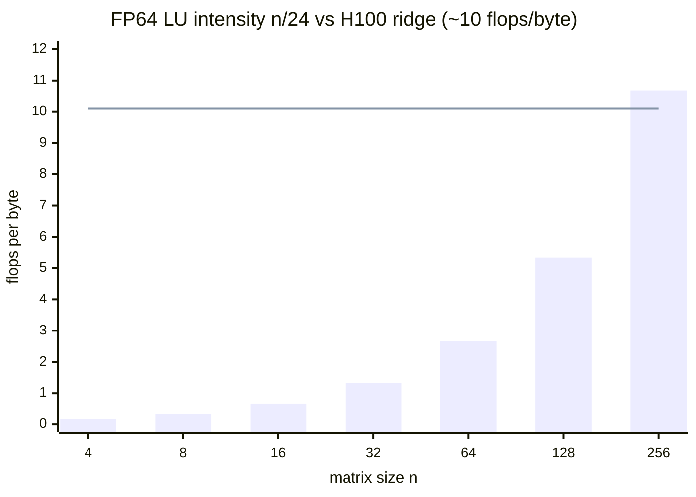
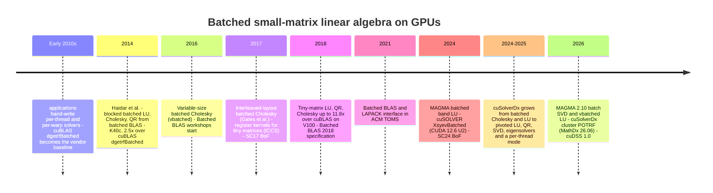
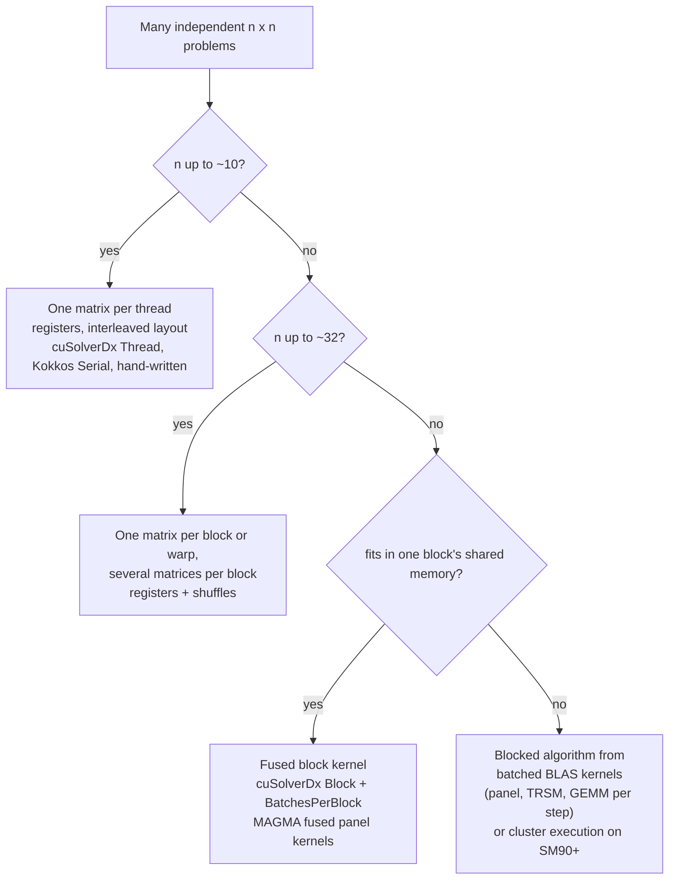

---
tags:
  - gpu-programming
  - libraries
  - linear-algebra
  - batched
  - magma
  - cusolver
  - cusolverdx
  - cublas
  - lapack
aliases:
  - Batched Linear Algebra
  - Batched LAPACK
  - Batched BLAS
  - Batched Factorizations
  - vbatched
status: complete
sources:
  - https://par.nsf.gov/servlets/purl/10289431
  - https://www.osti.gov/pages/servlets/purl/1361289
  - https://icl.utk.edu/node/1209
  - https://icl.utk.edu/files/publications/2018/icl-utk-1057-2018.pdf
  - https://netlib.org/utk/people/JackDongarra/PAPERS/on-the-development.pdf
  - https://icl.utk.edu/node/1169
  - https://netlib.org/utk/people/JackDongarra/PAPERS/autotuning-batch-cholesky-ipdps-2017.pdf
  - https://arxiv.org/pdf/1909.04539
  - https://icl.utk.edu/magma/
  - https://arxiv.org/pdf/2601.17979
  - https://docs.nvidia.com/cuda/cusolver/contents.html
  - https://icl.utk.edu/bblas/sc24/files/2-sc24-batch-linear-algebra-bof-nvidia.pdf
  - https://icl.utk.edu/bblas
  - https://docs.nvidia.com/cuda/cusolverdx
  - https://docs.nvidia.com/cuda/cusolverdx/api/execution_ops.html
  - https://docs.nvidia.com/cuda/cusolverdx/0.5.0/get_started/performance.html
  - https://docs.nvidia.com/cuda/cusolverdx/release_notes.html
  - https://docs.nvidia.com/cuda/mathdx/release_notes.html
  - https://docs.nvidia.com/cuda/cudss/latest/release_notes.html
  - https://rocm.docs.amd.com/projects/rocSOLVER/en/latest/reference/tuning.html
  - https://kokkos.org/kokkos-kernels/docs/API/batched/dense-index.html
  - https://app.semanticdiff.com/gh/strisunshinewentingwang/pytorch/commit/bcdcf347cb0b2998dca866c1409bf0f0ca371550
  - https://forums.developer.nvidia.com/t/cublas-or-cusolve-strategy-to-invert-many-tiny-matrices-1-million-9x9-matrices/128810
  - https://forums.developer.nvidia.com/t/inverse-of-a-3x3-matrix/49963?page=2
  - https://arxiv.org/pdf/2509.03015v3
  - https://arxiv.org/pdf/2610.28917
  - https://www.nvidia.com/en-us/data-center/h100/
created: 2026-11-28
updated: 2026-11-28
---

## Table Of Contents

---

- [[#TL;DR|TL;DR]]
- [[#The Problem|The Problem]]
- [[#Foundations|Foundations]]
    - [[#Why Small Matrices Are Bandwidth-Bound|Why Small Matrices Are Bandwidth-Bound]]
    - [[#Worked Example - A Million 16x16 LUs on H100|Worked Example - A Million 16x16 LUs on H100]]
    - [[#Uniform, Strided and Variable-Size Batches|Uniform, Strided and Variable-Size Batches]]
- [[#How We Got Here|How We Got Here]]
- [[#How It Works|How It Works]]
    - [[#Choosing a Granularity|Choosing a Granularity]]
    - [[#One Matrix per Thread and the Interleaved Layout|One Matrix per Thread and the Interleaved Layout]]
    - [[#One Matrix per Thread Block, Held in Registers|One Matrix per Thread Block, Held in Registers]]
    - [[#Medium Sizes - Blocked Algorithms Built from Batched BLAS|Medium Sizes - Blocked Algorithms Built from Batched BLAS]]
    - [[#Variable-Size Batches|Variable-Size Batches]]
    - [[#Calling a Library Batch|Calling a Library Batch]]
    - [[#Fusing the Solve into Your Kernel with cuSolverDx|Fusing the Solve into Your Kernel with cuSolverDx]]
- [[#Where It Is Now|Where It Is Now]]
- [[#Trade-offs & Open Problems|Trade-offs & Open Problems]]
- [[#Resources|Resources]]
- [[#Related Notes|Related Notes]]

## ***TL;DR***
---
*Batched linear algebra runs thousands to millions of independent small factorizations or solves in one call, because a single small matrix cannot fill a GPU and launching one kernel per matrix drowns in overhead. The art is matching the work granularity (thread, warp, block, several kernels) to the matrix size.*

- **The workload.** Many independent problems of size roughly 2 to a few hundred: Newton matrices in chemistry and combustion codes, block-Jacobi preconditioner blocks, frontal matrices in sparse direct solvers, per-pixel or per-element solves, Kalman-filter covariance updates, and small SVDs or eigenproblems. The 2021 Batched BLAS paper frames it as "many independent BLAS operations on small matrices that are grouped together" ([Abdelfattah et al., TOMS 2021](https://par.nsf.gov/servlets/purl/10289431)).
- **Why it is hard.** A small factorization has little data reuse, so it is bandwidth-bound unless it lives entirely in registers or [[Shared Memory and Bank Conflicts|shared memory]]. An $n \times n$ FP64 LU does about $\tfrac{2}{3}n^3$ flops on $16n^2$ bytes of traffic, an intensity of only $n/24$ flops per byte.
- **The granularity ladder.** Tiny matrices (under about 10) go one per thread, ideally in an *interleaved* layout so neighbouring threads read neighbouring addresses ([Gates et al. 2017](https://netlib.org/utk/people/JackDongarra/PAPERS/autotuning-batch-cholesky-ipdps-2017.pdf)). Matrices up to 32 go one per thread block, held in registers, with several matrices packed into a block ([Abdelfattah et al. 2018](https://icl.utk.edu/files/publications/2018/icl-utk-1057-2018.pdf)). Larger ones use blocked algorithms built from batched BLAS kernels ([Haidar et al. 2014](https://www.osti.gov/pages/servlets/purl/1361289)).
- **Libraries.** MAGMA has the widest set (fixed and variable-size batched LU, Cholesky, QR, SVD). cuBLAS has batched GETRF/GETRS/GETRI/GEQRF/GELS; cuSOLVER has batched POTRF/POTRS and Jacobi eigen/SVD solvers. cuSolverDx lets you put a batched factorization *inside your own kernel*. rocSOLVER offers batched and strided-batched forms of most routines.
- **Where it is now (Nov 2026).** MAGMA 2.10.0 (Feb 2026) added a batch SVD, variable-size LU without pivoting and Blackwell support ([MAGMA](https://icl.utk.edu/magma/)). Its batch SVD is 2.2 to 33.4x faster than cuSOLVER on very small FP64 matrices on GH200, and up to 142.5x faster than rocSOLVER on MI300A ([Abdelfattah and Fasi 2026](https://arxiv.org/pdf/2601.17979)). cuDSS 1.0.0 extends batching to sparse direct solves.

## ***The Problem***
---
*A GPU needs tens of thousands of threads busy to run well. One 16x16 factorization has a few thousand flops and fits in a single warp's registers, so the only way to use the chip is to run many of them at once, and to do that without one kernel launch per matrix.*

The library routines in [[cuBLAS and cuDNN]] and cuSOLVER were built for big matrices: blocked algorithms that turn most of the work into [[Tiled Matrix Multiplication (GEMM)|GEMM]] and hide everything else behind it. Point them at one $16 \times 16$ matrix and almost every step is a tiny kernel with a handful of threads. The launch cost (a few microseconds) dwarfs the arithmetic (nanoseconds).

The obvious fixes fall short:

| Approach | What goes wrong |
|---|---|
| Loop over matrices, one library call each | Launch-bound: millions of calls, each microseconds long |
| One call per matrix on many [[Streams, Events and Async Execution\|streams]] | The cuBLAS docs note that "in practice it is not possible to have more than 32 concurrent kernels executing at the same time" ([cuBLAS docs, 2.1.7](https://docs.nvidia.com/cuda/cublas/index.html)); each kernel is still tiny |
| Run the batch on the CPU | Fine for a few hundred matrices, but the data may already live on the GPU and copying it back costs more than solving it |
| Pad every matrix to the largest and use one big kernel | Wastes flops and memory when sizes vary a lot |

So a batched routine has three jobs: launch once for the whole batch, keep each matrix in fast on-chip memory for the whole factorization, and map the right amount of hardware (a thread, a warp, a block or more) to each matrix.

## ***Foundations***
---
*Small factorizations reuse each element only about $n$ times, so they are memory-bound until $n$ reaches the hundreds. That one number explains why tiny-matrix kernels obsess over registers and coalesced loads, and why the right design changes with size.*

### Why Small Matrices Are Bandwidth-Bound

For an $n \times n$ matrix, the standard flop counts are:

| Operation | Flops |
|---|---|
| Cholesky ($A = LL^T$) | $\tfrac{1}{3}n^3$ |
| LU ($PA = LU$) | $\tfrac{2}{3}n^3$ |
| QR (Householder) | $\tfrac{4}{3}n^3$ |
| Two triangular solves, one right-hand side | $2n^2$ |

If the kernel reads the matrix once and writes the factors once, an FP64 LU moves $2 \times 8n^2 = 16n^2$ bytes, so its [[Roofline Model and Arithmetic Intensity|arithmetic intensity]] is

$$I_{\text{LU}} = \frac{\tfrac{2}{3}n^3}{16n^2} = \frac{n}{24} \ \text{flops/byte}.$$

Plain reading: the intensity grows only linearly with $n$. To be compute-bound the kernel needs $I$ above the GPU's ridge point, peak flops divided by bandwidth. On an H100 SXM that is $34 \text{ TFLOPS} / 3.35 \text{ TB/s} \approx 10$ flops/byte for FP64 on the CUDA cores ([NVIDIA](https://www.nvidia.com/en-us/data-center/h100/)), so an LU would need $n \approx 240$ even with *perfect* reuse. Cholesky halves the flops on half the data (one triangle), giving $I = n/24$ too if only the triangle moves, or $n/48$ if the full matrix is read and written.



The bars are the best possible intensity; real kernels that spill to global memory or reload panels do worse. So for nearly every "small" size, the speed limit is how fast you can stream matrices through the chip, and the design goal is to touch DRAM exactly once per matrix.

### Worked Example - A Million 16x16 LUs on H100

- **Data.** $2^{20} = 1{,}048{,}576$ FP64 matrices of $16 \times 16$ is $2^{20} \times 2048 \text{ B} = 2.15$ GB. Reading it and writing the factors back moves 4.3 GB.
- **Bandwidth floor.** At 3.35 TB/s that takes at least $4.3 / 3350 \approx 1.28$ ms.
- **Work.** Each LU is $\tfrac{2}{3} \times 16^3 \approx 2731$ flops, so 2.86 GFLOP in total.
- **What that means.** Even a kernel that runs at full memory bandwidth reaches only $2.86 \text{ GFLOP} / 1.28 \text{ ms} \approx 2.2$ TFLOPS, about 6.6% of the H100's 34 TFLOPS FP64 vector peak. That is not a bad kernel; it is the roofline. A kernel that re-reads the trailing matrix from DRAM at every one of the 16 elimination steps would be several times slower still.

### Uniform, Strided and Variable-Size Batches

Libraries describe a batch in one of three ways:

| Form | How matrices are passed | Example API |
|---|---|---|
| Pointer array ("batched") | A device array of $b$ pointers, one per matrix; all the same size | `cublasDgetrfBatched`, `rocsolver_dgetrf_batched` |
| Strided ("strided batched") | One base pointer plus a fixed stride between matrices | `cusolverDnDgesvdaStridedBatched`, `rocsolver_dgetrf_strided_batched` |
| Variable size ("vbatched", "grouped", "non-uniform") | Per-matrix size and leading-dimension arrays | MAGMA `magma_dpotrf_vbatched`, cuDSS non-uniform batch |

Per-matrix status comes back in an `info` array: following LAPACK, a negative value flags a bad argument and a positive value a numerical failure, "for example the column number with zero pivot" ([Abdelfattah et al., TOMS 2021](https://par.nsf.gov/servlets/purl/10289431)). Checking that array is the only way to know which of a million matrices was singular or not positive definite.

## ***How We Got Here***
---
*Batched linear algebra grew out of GPU applications in the early 2010s that had millions of tiny systems. The Tennessee MAGMA group did most of the research, vendors shipped subsets, and a standard interface was proposed but never fully adopted.*



- **Early 2010s, one thread or one warp per system.** Before vendor support, applications wrote their own solvers, using "a single CUDA thread, or a single thread block ... to solve one system at a time" (Villa et al.) or one warp per factorization (Wainwright). Haidar and colleagues found these approaches topped out around 20 Gflop/s in double precision ([Haidar et al. 2014](https://www.osti.gov/pages/servlets/purl/1361289)). NVIDIA's njuffa, recalling that period, still recommends a "self-contained solver for that exact size" with fully unrolled loops and one matrix per thread for matrices of 9x9 or smaller ([NVIDIA forums, 2020](https://forums.developer.nvidia.com/t/cublas-or-cusolve-strategy-to-invert-many-tiny-matrices-1-million-9x9-matrices/128810)).
- **2014, blocked batched factorizations.** Haidar, Dong, Luszczek, Tomov and Dongarra built LU, Cholesky and QR from batched BLAS kernels with recursive panels and parallel row swaps. On a K40c with 2,000 matrices they reached about 180 Gflop/s for LU (2.5x cuBLAS `dgetrfBatched`'s ~70 Gflop/s at 512x512), about 200 for Cholesky and 167 for QR, and used about 3x less energy than an optimized CPU run ([Haidar et al. 2014](https://www.osti.gov/pages/servlets/purl/1361289)).
- **2016, variable sizes.** Abdelfattah, Haidar, Tomov and Dongarra added variable-size batched Cholesky, with every kernel sized for the largest matrix and early termination for idle blocks; it was "up to 3x faster" than padding everything to one size ([IPDPSW 2016](https://netlib.org/utk/people/JackDongarra/PAPERS/on-the-development.pdf)).
- **2017, layouts and tiny matrices.** Gates, Kurzak, Luszczek, Pei and Dongarra showed an interleaved layout reaching about 600 GFLOPS (800 with fast math) for single-precision Cholesky of tiny matrices on a P100, "substantially" beating MAGMA's canonical layout until sizes grew ([IPDPSW 2017](https://netlib.org/utk/people/JackDongarra/PAPERS/autotuning-batch-cholesky-ipdps-2017.pdf)). The same year, the SC17 BoF pushed a standard Batched BLAS ([ICL](https://icl.utk.edu/bblas)).
- **2018, register kernels.** Abdelfattah et al.'s tiny-matrix (32 and under) LU, QR and Cholesky reached up to 11.8x over vendor routines on a V100 ([J. Comput. Sci. 2018](https://icl.utk.edu/node/1209)).
- **2021, the standard on paper.** The Batched BLAS and LAPACK proposal was published in ACM TOMS with MAGMA as the model implementation; it notes NVIDIA, Intel and AMD had "started providing optimized batched BLAS" ([TOMS 2021](https://par.nsf.gov/servlets/purl/10289431)). Vendors adopted the idea but kept their own interfaces.
- **Mid-2020s, inside the kernel.** NVIDIA's cuSolverDx (first released as 0.1.0 early access) moved batched Cholesky and LU into device code, then grew to pivoted LU and QR (0.2.0), SVD and eigensolvers (0.3.0), a per-thread mode (0.4.0) and cluster execution (0.5.0) ([cuSolverDx notes](https://docs.nvidia.com/cuda/cusolverdx/release_notes.html)).

## ***How It Works***
---
*Every batched design answers two questions: how much hardware works on one matrix, and where the matrix lives while it is factored. Smaller matrices get less hardware and faster storage; larger ones get blocked algorithms and the full machinery of large-matrix linear algebra.*

### Choosing a Granularity



The thresholds are rough. cuSolverDx recommends its `Thread` mode "only for dense problems with M x N <= 100" (about 10x10), or N up to 50 for tridiagonal and bidiagonal problems ([cuSolverDx execution operators](https://docs.nvidia.com/cuda/cusolverdx/api/execution_ops.html)). The 2018 MAGMA work covers 32 and under with register kernels ([Abdelfattah et al. 2018](https://icl.utk.edu/files/publications/2018/icl-utk-1057-2018.pdf)). Beyond that, the blocked approach of the 2014 paper takes over.

| Granularity | Matrix lives in | Parallelism inside one matrix | Best for |
|---|---|---|---|
| One thread | Registers | None (sequential, fully unrolled) | $n \lesssim 10$, huge batches |
| Several matrices per block, one warp-ish each | Registers, shuffles for pivots | One thread per row or column | $n \le 32$ |
| One block | Shared memory (plus registers) | A whole block | $32 < n \lesssim$ a few hundred, depending on precision |
| Several kernels per step | Global memory, cached tiles | Batched BLAS per step | Larger $n$, moderate batches |
| One cluster (SM90+) | Distributed shared memory | Several blocks | Matrices "too large for a single thread block's shared memory" |

### One Matrix per Thread and the Interleaved Layout

For tiny matrices, giving each thread its own matrix removes all synchronization: the thread runs plain sequential LAPACK, fully unrolled at compile time so every element stays in a register (see [[Register Pressure and Spilling]]). The catch is memory access. In the usual layout, matrix $b$ occupies one contiguous chunk, so when 32 threads each load element $(0,0)$ of their own matrix, the addresses are $n^2$ elements apart and the load is not [[Memory Coalescing|coalesced]].

The fix is to *interleave* the batch so the matrix index varies fastest. For element $(i, j)$ of matrix $b$ in a batch of $B$ column-major $n \times n$ matrices:

$$\text{offset}_{\text{interleaved}} = (j\,n + i)\,B + b$$

Now 32 consecutive threads reading the same $(i, j)$ touch 32 consecutive words. Gates et al. note a warp reads elements "with the same row and column index in 32 consecutive matrices", perfectly coalesced "as long as the whole dataset is 128-byte aligned, and the number of matrices is divisible by 32"; they also use a chunked variant (chunks of 32 or more matrices) to keep each matrix's data closer together ([Gates et al. 2017](https://netlib.org/utk/people/JackDongarra/PAPERS/autotuning-batch-cholesky-ipdps-2017.pdf)). The same layout appears in cuSPARSE's interleaved batched tridiagonal solver and in Gloster et al.'s pentadiagonal solvers, where "each thread handles a particular system solution" ([Gloster et al. 2019](https://arxiv.org/pdf/1909.04539)).

A minimal per-thread Cholesky in that layout:

```cuda
template <int N>
__global__ void potrf_interleaved(double* A, int batch) {
  int b = blockIdx.x * blockDim.x + threadIdx.x;      // this thread's matrix
  if (b >= batch) return;
  double a[N][N];                                     // register-resident copy
  #pragma unroll
  for (int j = 0; j < N; ++j)
    #pragma unroll
    for (int i = j; i < N; ++i)
      a[i][j] = A[(j * N + i) * batch + b];           // coalesced across the warp
  #pragma unroll
  for (int k = 0; k < N; ++k) {
    a[k][k] = sqrt(a[k][k]);                          // pivot (no check here)
    double r = 1.0 / a[k][k];
    #pragma unroll
    for (int i = k + 1; i < N; ++i) a[i][k] *= r;     // scale column k
    #pragma unroll
    for (int j = k + 1; j < N; ++j)
      #pragma unroll
      for (int i = j; i < N; ++i)
        a[i][j] -= a[i][k] * a[j][k];                 // update trailing triangle
  }
  #pragma unroll
  for (int j = 0; j < N; ++j)
    #pragma unroll
    for (int i = j; i < N; ++i)
      A[(j * N + i) * batch + b] = a[i][j];           // write L back, coalesced
}
```

Line by line:

- **`template <int N>`** makes the size a compile-time constant. That is what lets `#pragma unroll` flatten every loop, so each `a[i][j]` has a fixed register instead of becoming a local-memory array.
- **`b = blockIdx.x * blockDim.x + threadIdx.x`** gives each thread one matrix. There is no `__syncthreads()` anywhere, because threads never share data.
- **The load loop** reads only the lower triangle, using the interleaved offset. Adjacent threads have adjacent `b`, so each warp-wide load is one contiguous 256-byte transaction for doubles.
- **`sqrt(a[k][k])`** takes the pivot. A real routine would test for a non-positive value and record it in an `info` array; here a non-SPD matrix just produces NaNs.
- **The two inner loops** are the right-looking Cholesky: scale the column below the pivot, then subtract its outer product from the remaining lower triangle. This is $\tfrac{1}{3}n^3$ flops, all register to register.
- **The store loop** writes $L$ back in the same coalesced pattern.

Register budget sets the ceiling. The lower triangle holds $n(n+1)/2$ values; in FP64 each takes two 32-bit registers, and a thread can have at most 255. So $n = 12$ needs 156 registers for the matrix alone, $n = 14$ needs 210, and somewhere around there the compiler starts spilling and the design stops paying. In FP32 the limit roughly doubles in matrix elements. Occupancy also falls as registers per thread rise (see [[Occupancy and Latency Hiding]]), which is fine only because the work is so regular.

Gates et al. found full unrolling paid off up to about $n = 20$ in single precision, that past about 40 their unblocked code became memory-bound, and that MAGMA's traditional layout eventually won "for larger sizes" because the interleaved code reuses data only within one thread's registers ([Gates et al. 2017](https://netlib.org/utk/people/JackDongarra/PAPERS/autotuning-batch-cholesky-ipdps-2017.pdf)).

### One Matrix per Thread Block, Held in Registers

From roughly 10 to 32, one thread per matrix runs out of registers, and the work per matrix is enough to split. MAGMA's tiny-matrix kernels ([Abdelfattah et al. 2018](https://icl.utk.edu/files/publications/2018/icl-utk-1057-2018.pdf)) make these choices:

- **"Each matrix is factorized using exactly one CUDA thread block."** Threads are laid out in 1D, one thread per row, not an $n \times n$ grid, because "a 1D design can be free of synchronization points" and the 2D layout limited occupancy.
- **Several matrices per block.** A tunable number of matrices share one block, so that 8x8 problems still fill whole warps.
- **Registers beat shared memory** for LU and Cholesky; QR did best keeping the matrix in registers but communicating through shared memory.
- **Pivoting with shuffles.** For LU, each step's pivot search is a butterfly reduction with [[Warp Divergence and Warp-Level Primitives|warp shuffles]], and "the register version must start by a shuffle operation to broadcast A[i,i] to all threads."
- **Lazy swaps.** Instead of moving rows in registers, "each thread keeps track of the final position of its row" and the permutation is applied when results are written back.
- **Unblocked, fully unrolled templates**, since the whole matrix fits in fast memory.

Results on a million matrices: Cholesky up to 8.2x (FP64) over cuBLAS on P100 and 4.1x on V100 (cuBLAS had no batched Cholesky, so the baseline was its batched LU); LU up to 5.2x (FP64) on P100 and 2.9x on V100; QR up to 10.8x (FP64) on V100 ([Abdelfattah et al. 2018](https://icl.utk.edu/files/publications/2018/icl-utk-1057-2018.pdf)).

### Medium Sizes - Blocked Algorithms Built from Batched BLAS

Above a few dozen, a matrix no longer fits comfortably in one block's registers, and the large-matrix playbook returns: factor a narrow panel, triangular-solve, update the trailing matrix with GEMM. The batched version runs each of those steps as one kernel across all matrices. Haidar et al.'s design points ([2014](https://www.osti.gov/pages/servlets/purl/1361289)):

- **Panel width 32**, with thread blocks in multiples of 32 threads and under 10 KB of shared memory per kernel so several blocks share an SM.
- **Recursive panels.** Splitting the panel two or three levels deep gave "more than 30% boost in performance" for LU.
- **Parallel row swaps** cut the swap kernel's share of runtime from about 60% to about 10%, roughly 1.8x for LU.
- **No look-ahead.** MAGMA's large-matrix trick of overlapping the next panel with the current update does not pay, because the trailing matrices are too small to hide the extra traffic.
- **Extra flops for regularity.** SYRK is computed as a full GEMM, and the QR block reflector as three GEMMs, because batched GEMM is the best-tuned kernel available. When batched GEMM plateaued (about 300 Gflop/s on K40c), they switched to streamed GEMMs, which were about 20% faster.

### Variable-Size Batches

Real batches are often ragged: frontal matrices in a sparse factorization, blocks of a block-Jacobi preconditioner, or elements of different order. MAGMA's vbatched routines pass sizes and leading dimensions as device arrays and size each kernel launch for the maximum; "any vbatched kernel takes as input the maximum size across all matrices." Blocks whose matrix is already finished exit early (ETM-classic), and a more aggressive mode also retires idle threads inside live blocks ([Abdelfattah et al. 2016](https://netlib.org/utk/people/JackDongarra/PAPERS/on-the-development.pdf)). This is the same load-balancing problem as [[Grouped GEMM and Ragged Batches]], and the same fix often applies: sort or bin matrices by size so each launch sees similar sizes (see also [[Work Stealing and Dynamic Load Balancing]]).

A per-matrix design avoids the problem entirely when the matrices differ in *difficulty* rather than size. KROME-X, an astrophysical chemistry library, compared a batched SUNDIALS-plus-MAGMA integration, where "every cell follows the steps of the stiffest one", with one thread per cell running its own Newton solves; the batched version was faster on nearly identical cells but 2.5x slower on $10^4$ differing ones ([Lupi et al. 2026](https://arxiv.org/pdf/2610.28917)).

### Calling a Library Batch

The cuBLAS batched LU takes an array of device pointers:

```cuda
// A_dev: device array of `batch` pointers, each to an n x n column-major matrix
cublasDgetrfBatched(handle, n, A_dev, lda, pivots, infos, batch);
// solve one right-hand side per matrix with the factors
cublasDgetrsBatched(handle, CUBLAS_OP_N, n, 1, A_dev, lda, pivots,
                    B_dev, ldb, &hostInfo, batch);
```

- **`A_dev`** is not the matrices but a device-side array of pointers to them, which lets matrices live anywhere. Building that pointer array is a small kernel or copy of its own.
- **`pivots`** holds $n$ integers per matrix and **`infos`** one status per matrix; check `infos` afterwards, since a singular matrix does not stop the batch.
- **`getrsBatched`** reuses the factors and pivots; `hostInfo` reports argument errors only.

Which routine lives where is a historical accident worth knowing:

| Library | Batched dense routines (Nov 2026 docs) | Notes |
|---|---|---|
| cuBLAS | GETRF, GETRS, GETRI, MATINV, GEQRF, GELS, plus batched, strided and grouped GEMM, TRSM | The SC24 NVIDIA BoF lists these ([NVIDIA, SC24](https://icl.utk.edu/bblas/sc24/files/2-sc24-batch-linear-algebra-bof-nvidia.pdf)). The MATINV shortcut "doesn't work if n is greater than 32" ([NVIDIA forums](https://forums.developer.nvidia.com/t/inverse-of-a-3x3-matrix/49963?page=2)) |
| cuSOLVER | `potrfBatched`, `potrsBatched`, `gesvdjBatched`, `gesvdaStridedBatched`, `syevjBatched`, `XsyevBatched` | `potrsBatched` "only supports `nrhs == 1`" ([PyTorch PR](https://app.semanticdiff.com/gh/strisunshinewentingwang/pytorch/commit/bcdcf347cb0b2998dca866c1409bf0f0ca371550)); SVDJ batched is for $m, n \le 32$; SYEV batched arrived in CUDA 12.6 U2 ([NVIDIA, SC24](https://icl.utk.edu/bblas/sc24/files/2-sc24-batch-linear-algebra-bof-nvidia.pdf)); sparse `csrqrBatched` and the `cusolverRfBatch*` refactorization routines are deprecated ([cuSOLVER 13.5](https://docs.nvidia.com/cuda/cusolver/contents.html)) |
| MAGMA | Fixed-size and vbatched LU, Cholesky, QR, triangular solves, band LU, Jacobi SVD, plus batched BLAS | The broadest set; runs on CUDA and ROCm ([MAGMA](https://icl.utk.edu/magma/)) |
| rocSOLVER / hipSOLVER | `_batched` and `_strided_batched` forms of most LAPACK routines | Tuning constants such as panel switch sizes "also appl[y] to the corresponding batched and strided-batched routines"; small SYEVJ runs as a single kernel up to size 64 ([rocSOLVER 3.38](https://rocm.docs.amd.com/projects/rocSOLVER/en/latest/reference/tuning.html)); see [[ROCm and HIP]] |
| Kokkos Kernels | KokkosBatched Serial, Team and TeamVector functors | Called *inside* a `parallel_for`; GETRF and GETRS are Serial only ([Kokkos Kernels](https://kokkos.org/kokkos-kernels/docs/API/batched/dense-index.html)) |

Frameworks hide the choice. PyTorch's batched `cholesky_solve`, for example, uses MAGMA when it is installed and falls back to `cusolverDn<T>potrsBatched` for single-right-hand-side batches when it is not ([PyTorch PR](https://app.semanticdiff.com/gh/strisunshinewentingwang/pytorch/commit/bcdcf347cb0b2998dca866c1409bf0f0ca371550)).

### Fusing the Solve into Your Kernel with cuSolverDx

A library batch still costs a global-memory round trip: some kernel builds the matrices, writes them out, the solver reads them, writes the factors, and another kernel reads those. For small matrices that traffic *is* the runtime (see the worked example). cuSolverDx, part of [[Device-Side Math Libraries (MathDx)]], removes it by being a header library you call from your own kernel, with the goal to "fuse cuSolverDx functions with other operations in order to save global memory trips" ([cuSolverDx](https://docs.nvidia.com/cuda/cusolverdx)). A solver is described at compile time by combining operators (size, precision, type, function, fill mode, target SM) with one execution operator:

| Execution operator | What it does | Guidance from the docs |
|---|---|---|
| `Thread` | "Each thread independently runs a Solver operation" | Dense problems with $M \times N \le 100$; tridiagonal or bidiagonal $N \le 50$ |
| `Block` | One block cooperates on the operation | Copy data to shared memory first; query `get_shared_memory_size` |
| `BatchesPerBlock` | Several matrices per block (with `Block`) | Default 1; use `suggested_bpb` "for small matrix A size" |
| `Cluster` (experimental, SM90+) | Spreads one solve over a [[Thread Block Clusters and Distributed Shared Memory\|cluster]]'s DSMEM | For matrices "too large for a single thread block's shared memory"; launch with `cudaLaunchKernelExC` |

(Execution operators from [cuSolverDx execution operators](https://docs.nvidia.com/cuda/cusolverdx/api/execution_ops.html); `BatchesPerBlock` advice from [Achieving High Performance](https://docs.nvidia.com/cuda/cusolverdx/0.5.0/get_started/performance.html).)

The performance page is a compact checklist for any batched kernel: launch enough batches "to fill the GPU", keep the same row- or column-major layout in global and shared memory, make global-to-shared copies coalesced, and "merge adjacent memory bound kernels (pre- and post-processing) with a Solver kernel" ([cuSolverDx performance guide](https://docs.nvidia.com/cuda/cusolverdx/0.5.0/get_started/performance.html)). That last point is the case for [[Kernel Fusion]] in one line.

## ***Where It Is Now***
---
*As of late November 2026: MAGMA leads on breadth and on small SVDs, NVIDIA spreads batched routines across cuBLAS, cuSOLVER, cuSolverDx and cuDSS, and applications increasingly either fuse the solve into their own kernels or skip libraries for per-thread solvers.*

**Libraries**

- **MAGMA 2.10.0 (Feb 26, 2026)** added a Jacobi batch SVD (`magma_?gesvj_batched`, plus a QR-first variant for tall-skinny matrices), batched UNMQR/ORMQR, variable-size LU without pivoting (`magma_?getrf_nopiv_vbatched`, contributed from LBNL), faster batched Cholesky and TRSV, and Blackwell (sm_100, sm_120) support; it also removed MAGMA-sparse and the V1 interface ([MAGMA](https://icl.utk.edu/magma/)). MAGMA 2.8.0 (Mar 2024) had added batched and strided-batched band LU (`gbtrf`, `gbsv`).
- **The new batch SVD**, described by Abdelfattah and Fasi, uses blocked one-sided Jacobi with a fused vector update and a single-kernel path for very small matrices. On GH200 it is 2.2 to 33.4x faster than cuSOLVER on very small FP64 matrices (batch of 10,000), where cuSOLVER "is limited to small matrices of dimensions up to 32"; on MI300A it is up to 142.5x faster than rocSOLVER in single precision and at least 4.1x in double at the largest sizes; and 1.4 to 5.9x faster than KBLAS ([arXiv 2601.17979](https://arxiv.org/pdf/2601.17979)).
- **cuSOLVER 13.5** (docs updated Nov 2, 2026) still keeps its batched dense routines in the legacy and 64-bit APIs listed in the table above, and marks its sparse batched QR and batched refactorization as deprecated ([cuSOLVER](https://docs.nvidia.com/cuda/cusolver/contents.html)). NVIDIA's SC24 talk framed the plan as a unified stack where batched APIs are "throughput optimized" and non-batched ones "latency optimized", sharing panel kernels such as batched QR ([NVIDIA, SC24](https://icl.utk.edu/bblas/sc24/files/2-sc24-batch-linear-algebra-bof-nvidia.pdf)).
- **cuSolverDx**: the current docs are labelled 0.6.0 and cover Cholesky, LU (with and without pivoting), tridiagonal solves, QR, LQ, least squares, symmetric and generalized eigensolvers and SVD, almost all in batched and non-batched forms ([cuSolverDx](https://docs.nvidia.com/cuda/cusolverdx), [execution operators](https://docs.nvidia.com/cuda/cusolverdx/api/execution_ops.html)). The release-notes pages fetched on Nov 28, 2026 still ended at 0.5.0 (MathDx 26.06.x), whose headline was "experimental cluster execution for POTRF" ([cuSolverDx notes](https://docs.nvidia.com/cuda/cusolverdx/release_notes.html), [MathDx notes](https://docs.nvidia.com/cuda/mathdx/release_notes.html)); see [[Device-Side Math Libraries (MathDx)]] for the package history.
- **cuDSS 1.0.0** brings batching to sparse direct solves: non-uniform batches (different matrices) since 0.4.0, uniform batches (same sparsity pattern) since 0.6.0, a per-matrix mask in 0.8.0, and in 1.0.0 faster solves for large uniform batches with up to 16 right-hand sides ([cuDSS notes](https://docs.nvidia.com/cuda/cudss/latest/release_notes.html)). See [[Sparse Linear Algebra on GPUs]].
- **The Batched BLAS standard** remains a proposal: ICL's page lists BoFs through SC24 and an SC25 handout ([ICL](https://icl.utk.edu/bblas)), and vendors still each use their own names and argument conventions.

**Applications**

- **Block-tridiagonal solvers built from batched kernels.** BlockDSS (MIT and Argonne, Dec 2025) eliminates independent blocks with batched POTRF, TRSM and GEMM on H200 and MI300X. It beats cuDSS (83 ms vs 180 ms) for large blocks ($n \ge 512$) but loses for $n \le 128$, because "it requires sufficiently large block sizes to amortize kernel launch overheads" ([Jin, Montoison, Shin](https://arxiv.org/pdf/2509.03015v3)).
- **Per-thread solvers for heterogeneous batches.** KROME-X (Oct 2026) chose one thread per cell over MAGMA batched integration, as above, and found that for very large chemical networks "the GPU memory, not the arithmetic, sets the limit" ([Lupi et al.](https://arxiv.org/pdf/2610.28917)).

## ***Trade-offs & Open Problems***
---
*There is no single best batched kernel: the winner changes with matrix size, precision, how uniform the batch is, and whether the surrounding computation can be fused. Most of the open problems are about crossing those boundaries automatically.*

- **Size crossovers are machine-specific.** The per-thread, per-block and blocked designs each win over a range, and the boundaries move with precision, register file size and the GPU generation. Libraries pick with built-in heuristics (cuSolverDx's suggested block dimension and batches per block, rocSOLVER's compile-time switch sizes); none of them is guaranteed right for a fused kernel, which both cuSolverDx docs and rocSOLVER (rebuild to retune) leave to the user.
- **Library gaps force mixing.** Batched Cholesky is in cuSOLVER, batched LU in cuBLAS, batched SVD limited to 32 in cuSOLVER, and variable-size batches only in MAGMA among the dense libraries. Many codes end up linking MAGMA for one routine.
- **Layout mismatch.** Interleaved layouts are fastest for tiny matrices, but every library expects the canonical layout. Converting costs a full pass over the data, which for bandwidth-bound work can erase the gain; the choice has to be made where the matrices are produced.
- **Pivoting and numerical failure.** Partial pivoting adds a reduction and data movement at every step, which is why several fast paths (MAGMA `getrf_nopiv_vbatched`, early cuSolverDx LU) skip it. That is safe only for diagonally dominant or otherwise well-behaved matrices; the `info` array and an expert threshold for small pivots are the safety net, and checking them adds a host round trip.
- **Uniform steps vs uniform work.** A batched iterative method (Newton, Jacobi SVD) runs every matrix for as many steps as the hardest one needs, unless the library masks finished ones (MAGMA's masked batch operations in its SVD; cuDSS's `UBATCH_MASK`). KROME-X's 2.5x slowdown is this effect.
- **Tensor Cores barely help.** Small factorizations are dominated by rank-1 updates, pivot searches and square roots, not GEMM, and they are bandwidth-bound anyway. Low precision helps mostly by halving bytes. Using [[Tensor Cores]] needs blocked algorithms whose trailing update is a real GEMM, which only starts to matter at medium sizes, and FP64 Tensor Core throughput is shrinking on recent GPUs (see [[Floating-Point Emulation on Tensor Cores]]).
- **Launch overhead never fully goes away.** Blocked batched algorithms launch several kernels per panel step; for medium sizes and moderate batch counts that overhead dominates, as BlockDSS found. [[CUDA Graphs]], [[Programmatic Dependent Launch]] and fusing whole factorizations into one kernel (cuSolverDx, cluster execution) are the current answers.
- **Standardization.** The 2021 Batched BLAS and LAPACK interface (groups of uniform sizes, four error-reporting modes) is well designed but unadopted, so portable code still needs per-vendor wrappers or a layer such as MAGMA or Kokkos Kernels.

## ***Resources***
---
*Start with the TOMS standard paper for vocabulary, the 2014 and 2018 MAGMA papers for the two main kernel designs, and the cuSolverDx execution-operator page for today's in-kernel option.*

**Design papers**
- [A Set of Batched Basic Linear Algebra Subprograms and LAPACK Routines](https://par.nsf.gov/servlets/purl/10289431), Abdelfattah et al., ACM TOMS 47(3), 2021: the proposed standard interface.
- [Batched Matrix Computations on Hardware Accelerators Based on GPUs](https://www.osti.gov/pages/servlets/purl/1361289), Haidar, Dong, Luszczek, Tomov, Dongarra, 2014: blocked batched LU, Cholesky and QR.
- [Batched One-Sided Factorizations of Tiny Matrices Using GPUs: Challenges and Countermeasures](https://icl.utk.edu/files/publications/2018/icl-utk-1057-2018.pdf), Abdelfattah, Haidar, Tomov, Dongarra, J. Comput. Sci. 26, 2018 ([abstract](https://icl.utk.edu/node/1209)): register kernels for sizes up to 32.
- [On the Development of Variable Size Batched Computation for Heterogeneous Parallel Architectures](https://netlib.org/utk/people/JackDongarra/PAPERS/on-the-development.pdf), Abdelfattah et al., IPDPSW 2016: vbatched Cholesky.
- [Autotuning Batch Cholesky Factorization in CUDA with Interleaved Layout of Matrices](https://netlib.org/utk/people/JackDongarra/PAPERS/autotuning-batch-cholesky-ipdps-2017.pdf), Gates et al., IPDPSW 2017 ([abstract](https://icl.utk.edu/node/1169)).
- [Efficient Interleaved Batch Matrix Solvers for CUDA](https://arxiv.org/pdf/1909.04539), Gloster et al., 2019: per-thread tridiagonal and pentadiagonal solvers.
- [An Efficient Batch Solver for the Singular Value Decomposition on GPUs](https://arxiv.org/pdf/2601.17979), Abdelfattah and Fasi, 2026.

**Libraries and docs**
- [MAGMA](https://icl.utk.edu/magma/): release news and batched routine list.
- [cuSOLVER 13.5 contents](https://docs.nvidia.com/cuda/cusolver/contents.html) and [cuBLAS docs](https://docs.nvidia.com/cuda/cublas/index.html).
- [cuSolverDx](https://docs.nvidia.com/cuda/cusolverdx), its [execution operators](https://docs.nvidia.com/cuda/cusolverdx/api/execution_ops.html), [performance guide](https://docs.nvidia.com/cuda/cusolverdx/0.5.0/get_started/performance.html) and [release notes](https://docs.nvidia.com/cuda/cusolverdx/release_notes.html).
- [cuDSS release notes](https://docs.nvidia.com/cuda/cudss/latest/release_notes.html): uniform and non-uniform sparse batches.
- [rocSOLVER tuning constants](https://rocm.docs.amd.com/projects/rocSOLVER/en/latest/reference/tuning.html).
- [Kokkos Kernels batched dense API](https://kokkos.org/kokkos-kernels/docs/API/batched/dense-index.html).
- [NVIDIA at the SC24 Batch Linear Algebra BoF](https://icl.utk.edu/bblas/sc24/files/2-sc24-batch-linear-algebra-bof-nvidia.pdf) and the [ICL Batched BLAS page](https://icl.utk.edu/bblas).

**Practice**
- [Inverting a million 9x9 matrices](https://forums.developer.nvidia.com/t/cublas-or-cusolve-strategy-to-invert-many-tiny-matrices-1-million-9x9-matrices/128810), NVIDIA forums, 2020: the case for size-specialized per-thread solvers.
- [Harnessing Batched BLAS/LAPACK Kernels on GPUs for Parallel Solutions of Block Tridiagonal Systems](https://arxiv.org/pdf/2509.03015v3), Jin, Montoison, Shin, 2025.
- [KROME-X](https://arxiv.org/pdf/2610.28917), Lupi, Grassi, Bovino, 2026: per-thread vs batched solves for chemistry networks.

## ***Related Notes***
---
*Batched linear algebra borrows its kernels from GEMM and register-level tuning, and feeds sparse solvers, preconditioners and fused application kernels.*

- [[Device-Side Math Libraries (MathDx)]] — cuSolverDx and cuBLASDx, for batched solves inside your own kernel.
- [[cuBLAS and cuDNN]] — Batched, strided and grouped GEMM, and cuBLAS's batched LU and QR.
- [[Grouped GEMM and Ragged Batches]] — The same variable-size scheduling problem for matrix multiplies.
- [[Mixed-Precision Iterative Refinement and HPL-MxP]] — The large-matrix counterpart: one big factorization instead of many small ones.
- [[Sparse Linear Algebra on GPUs]] — Sparse direct solvers, whose frontal matrices are a classic variable-size batch.
- [[Register Pressure and Spilling]] — Why per-thread solvers top out around $n \approx 12$ in FP64.
- [[Memory Coalescing]] — Why the interleaved layout matters.
- [[Warp Divergence and Warp-Level Primitives]] — Shuffles for pivot search and broadcasts.
- [[Shared Memory and Bank Conflicts]] — Where block-level solvers keep their matrices.
- [[Occupancy and Latency Hiding]] — The register and shared-memory budget per matrix.
- [[Roofline Model and Arithmetic Intensity]] — The $n/24$ intensity and why small solves are bandwidth-bound.
- [[Kernel Fusion]] — Folding matrix assembly and the solve into one kernel.
- [[Thread Block Clusters and Distributed Shared Memory]] — cuSolverDx cluster execution for larger matrices.
- [[Work Stealing and Dynamic Load Balancing]] — Balancing batches of uneven size or difficulty.
- [[Tiled Matrix Multiplication (GEMM)]] — The trailing update that blocked batched algorithms reduce to.
- [[CUDA Graphs]] — Cutting launch overhead in multi-kernel batched factorizations.
- [[ROCm and HIP]] — rocSOLVER and hipSOLVER batched routines.
- [[Dense LU and Cholesky Factorization on GPUs]] — Single large factorizations with cuSOLVER and MAGMA.
- [[Krylov Solvers on GPUs]] — Iterative solvers that use batched blocks as preconditioners (planned).
