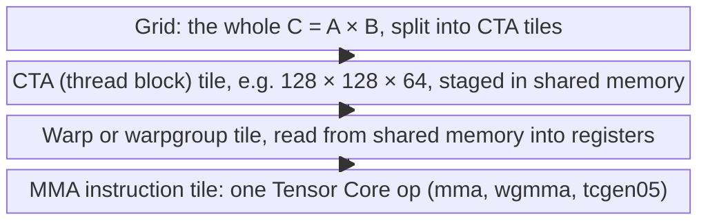
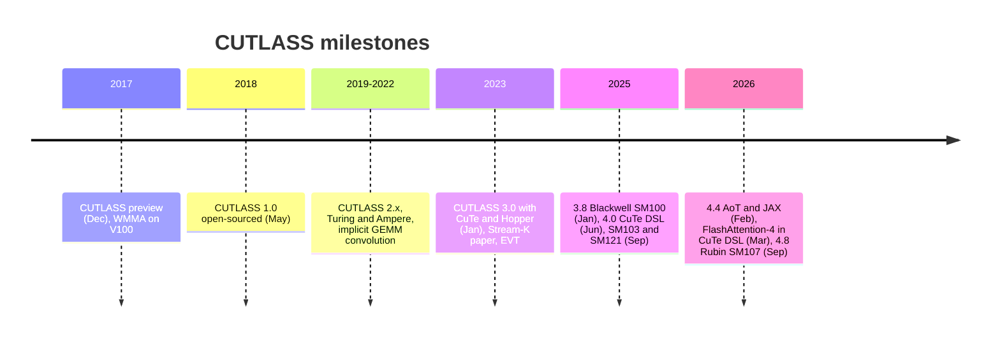
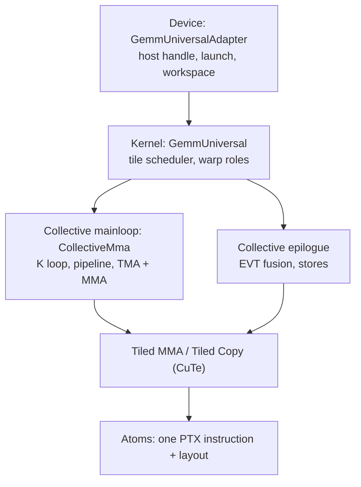
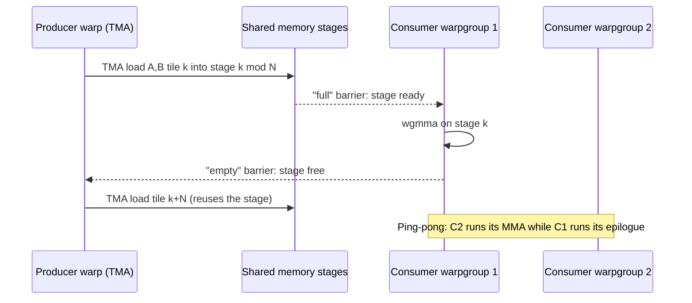

---
tags:
  - gpu-programming
  - libraries
  - cutlass
  - cute
  - gemm
status: complete
sources:
  - https://github.com/NVIDIA/cutlass
  - https://developer.nvidia.com/blog/cutlass-linear-algebra-cuda
  - https://docs.nvidia.com/cutlass/latest/media/docs/cpp/efficient_gemm.html
  - https://docs.nvidia.com/cutlass/latest/media/docs/cpp/gemm_api_3x.html
  - https://docs.nvidia.com/cutlass/latest/media/docs/cpp/cute/01_layout.html
  - https://docs.nvidia.com/cutlass/latest/media/docs/cpp/cute/02_layout_algebra.html
  - https://docs.nvidia.com/cutlass/latest/media/docs/cpp/cute/03_tensor.html
  - https://docs.nvidia.com/cutlass/latest/media/docs/cpp/cute/0x_gemm_tutorial.html
  - https://docs.nvidia.com/cutlass/latest/media/docs/cpp/blackwell_functionality.html
  - https://docs.nvidia.com/cutlass/4.8.0/CHANGELOG.html
  - https://newreleases.io/project/github/NVIDIA/cutlass/release/v3.0.0
  - https://developer.nvidia.com/blog/cutlass-3-x-orthogonal-reusable-and-composable-abstractions-for-gemm-kernel-design/
  - https://developer.nvidia.com/blog/cutlass-principled-abstractions-for-handling-multidimensional-data-through-tensors-and-spatial-microkernels
  - https://developer.nvidia.com/blog/achieve-cutlass-c-performance-with-python-apis-using-cute-dsl/
  - https://docs.nvidia.com/cutlass/latest/media/docs/pythonDSL/overview.html
  - https://research.colfax-intl.com/tutorial-hopper-tma/
  - https://research.colfax-intl.com/cutlass-tutorial-wgmma-hopper/
  - https://research.colfax-intl.com/cutlass-tutorial-writing-gemm-kernels-using-tensor-memory-for-nvidia-blackwell-gpus/
  - https://research.colfax-intl.com/a-note-on-the-algebra-of-cute-layouts
  - https://arxiv.org/abs/2603.02298
  - https://arxiv.org/pdf/2301.03598
  - https://arxiv.org/abs/2603.05451
  - https://pytorch.org/blog/gemms-torchinductor-cutedsl-backend/
  - https://pytorch.org/blog/flexattention-flashattention-4-fast-and-flexible/
  - https://github.com/deepseek-ai/DeepGEMM
  - https://nvidia.github.io/TensorRT-LLM/blogs/tech_blog/blog24_MoE_as_Dense_GEMM.html
created: 2026-11-26
updated: 2026-11-26
---

## Table Of Contents

---

- [[#TL;DR|TL;DR]]
- [[#The Problem|The Problem]]
- [[#Foundations|Foundations]]
    - [[#The GEMM Hierarchy|The GEMM Hierarchy]]
    - [[#Mainloop and Epilogue|Mainloop and Epilogue]]
- [[#How We Got Here|How We Got Here]]
- [[#How It Works|How It Works]]
    - [[#CuTe Layouts|CuTe Layouts]]
    - [[#Layout Algebra|Layout Algebra]]
    - [[#Tensors, TiledCopy and TiledMMA|Tensors, TiledCopy and TiledMMA]]
    - [[#The CUTLASS 3.x Layers|The CUTLASS 3.x Layers]]
    - [[#Warp-Specialized Schedules|Warp-Specialized Schedules]]
    - [[#Blackwell in CuTe|Blackwell in CuTe]]
    - [[#The CuTe DSL|The CuTe DSL]]
- [[#Where It Is Now|Where It Is Now]]
- [[#Trade-offs & Open Problems|Trade-offs & Open Problems]]
- [[#Resources|Resources]]
- [[#Related Notes|Related Notes]]

## ***TL;DR***
---
*CUTLASS is NVIDIA's open-source library of building blocks for fast matrix multiplies and related kernels, and CuTe is the layout algebra at its core that describes how data is arranged in memory and across threads. Together they are how most hand-tuned Hopper and Blackwell kernels (including FlashAttention-3 and -4) get written.*

- **CUTLASS** ("CUDA Templates for Linear Algebra Subroutines") is a header-only, BSD-3 C++ template library for GEMM and related operations (convolution via implicit GEMM, grouped GEMM, fused epilogues), from Volta through Blackwell and now Rubin ([NVIDIA/cutlass](https://github.com/NVIDIA/cutlass)). It is not a black-box library like [[cuBLAS and cuDNN|cuBLAS]]: you assemble your own kernel from its pieces.
- **CuTe** (introduced in CUTLASS 3.0, Jan 2023) represents every arrangement of data, in memory or across threads, as a **layout**: a pair (Shape, Stride) that maps coordinates to an index. A small algebra (composition, complement, divide, product) lets you tile and partition data without writing index arithmetic ([CuTe docs](https://docs.nvidia.com/cutlass/latest/media/docs/cpp/cute/01_layout.html)).
- **Why it matters:** the newest [[Tensor Cores]] (`wgmma`, `tcgen05`) and [[TMA and Asynchronous Copies|TMA]] need exact data layouts and pipelined, [[Warp Specialization|warp-specialized]] kernels. CUTLASS packages those as reusable "atoms" and "schedules", so kernels like [[FlashAttention]] don't start from raw [[PTX and SASS|PTX]].
- **CUTLASS 4 and the CuTe DSL (2025-2026):** the same abstractions as a Python DSL, with compile times NVIDIA reports as up to about 100x faster than C++ templates for Blackwell GEMMs at similar speed ([NVIDIA, Nov 2025](https://developer.nvidia.com/blog/achieve-cutlass-c-performance-with-python-apis-using-cute-dsl/)). FlashAttention-4 is written entirely in it.
- **Where it is now (Nov 2026):** CUTLASS 4.8 (Sep 2026) adds Rubin (SM107) dense GEMMs; 4.8.1 is the latest release. PyTorch's TorchInductor and FlexAttention both gained CuTe DSL backends in 2026 ([changelog](https://docs.nvidia.com/cutlass/4.8.0/CHANGELOG.html), [PyTorch, Apr 2026](https://pytorch.org/blog/gemms-torchinductor-cutedsl-backend/)).

## ***The Problem***
---
*cuBLAS gives you fast GEMMs, but only the ones it ships. As soon as you need a GEMM fused with something else, an odd data type, or a new kernel like attention, you need to write the kernel yourself, and a fast GEMM-shaped kernel is weeks of expert work per GPU generation.*

A matrix multiply is the most important GPU kernel ([[Tiled Matrix Multiplication (GEMM)]]), and the fast version is intricate: tiles at three levels, double-buffered copies, swizzled [[Shared Memory and Bank Conflicts|shared memory]], exact [[Tensor Cores|Tensor Core]] fragment layouts, and an epilogue that writes back with [[Memory Coalescing|coalesced]] stores. Libraries like cuBLAS hide all that, but they only offer fixed operations.

Real workloads need variations:

| Need | Why cuBLAS alone isn't enough |
|---|---|
| GEMM + bias + activation + quantize in one pass | Each extra op is another kernel and HBM round trip ([[Kernel Fusion]]) |
| New number formats (FP8, MXFP4, NVFP4) | Need new block-scaled kernels, often before libraries support them |
| GEMM-like kernels that aren't GEMMs | Attention, convolution, MoE grouped GEMMs |
| Each new GPU generation | Every generation changes the Tensor Core instruction, copy engine and pipelining style |

CUTLASS's original pitch (2017): decompose GEMM into reusable C++ templates at each level of the thread hierarchy, so that a custom kernel reaches cuBLAS-class speed. The 2017 post reported scalar CUTLASS GEMMs within "a few percent" of cuBLAS on V100 ([NVIDIA, Dec 2017](https://developer.nvidia.com/blog/cutlass-linear-algebra-cuda)).

The problem CuTe added in 2023 was index math. With Hopper's warpgroup MMA and TMA, layouts of data in registers, shared memory and global memory all have to agree exactly. Writing those mappings by hand in each kernel was the main source of bugs and complexity; CuTe makes them first-class objects.

## ***Foundations***
---
*A CUTLASS GEMM is a hierarchy of tiles plus two phases: a mainloop that accumulates partial products and an epilogue that writes them out. Every CUTLASS concept is a way to describe one level of tiles or one of those phases.*

### The GEMM Hierarchy



Data flows global memory → shared memory → registers (or Blackwell Tensor Memory) → Tensor Cores, and each level reuses data from the level above ([Efficient GEMM docs](https://docs.nvidia.com/cutlass/latest/media/docs/cpp/efficient_gemm.html), see [[GPU Memory Hierarchy]]):

| Level | Unit of work | Where operands live | Reuse it buys |
|---|---|---|---|
| CTA tile | One thread block (or a cluster) | Shared memory | Each A and B element loaded from HBM once per tile, used by the whole CTA |
| Warp tile | One warp or 4-warp warpgroup | Registers / shared memory | Each element read from shared memory once per warp |
| MMA tile | One Tensor Core instruction | Registers, shared memory or TMEM | Hardware does many multiply-adds per operand fetched |

The CTA tile sets arithmetic intensity: a $128 \times 128$ output tile with $K$-slice $k$ loads $(128 + 128)k$ elements and does $128 \cdot 128 \cdot k$ multiply-adds, i.e. 64 MACs per element loaded. That ratio is why big tiles beat the [[Roofline Model and Arithmetic Intensity|memory roof]].

### Mainloop and Epilogue

- **Mainloop:** loop over $K$ in slices. Each step copies the next A and B tiles toward the Tensor Cores and accumulates into the output tile. Copies are double- or multi-buffered so loading slice $k+1$ overlaps computing slice $k$.
- **Epilogue:** once the accumulators are final, apply the output operation (scale by $\alpha$, add $\beta C$, bias, activation, clamp, type conversion) and store. Threads reshuffle accumulators through shared memory so global stores coalesce ([Efficient GEMM docs](https://docs.nvidia.com/cutlass/latest/media/docs/cpp/efficient_gemm.html)).

The epilogue is where [[Kernel Fusion]] happens for free: the 2017 post already fused bias plus ReLU there, and CUTLASS 3.x makes epilogues composable trees of operations, the **Epilogue Visitor Tree** (EVT), so `D = activation(alpha*AB + beta*C)` and much more run without a second kernel ([NVIDIA, CUTLASS 3.x blog](https://developer.nvidia.com/blog/cutlass-3-x-orthogonal-reusable-and-composable-abstractions-for-gemm-kernel-design/)).

## ***How We Got Here***
---
*CUTLASS has been rebuilt once per big hardware shift: templates for Volta's Tensor Cores, CuTe for Hopper's asynchronous machinery, and a Python DSL for Blackwell-era compile times.*



- **2017-2018.** "CUTLASS: Fast Linear Algebra in CUDA C++" (Kerr, Merrill, Demouth, Tran) introduced the hierarchical decomposition as a preview; 1.0 was open-sourced in May 2018 ([NVIDIA](https://developer.nvidia.com/blog/cutlass-linear-algebra-cuda)).
- **2.x.** Turing and Ampere Tensor Cores, `cp.async` multistage pipelines, and convolution expressed as implicit GEMM.
- **January 2023, CUTLASS 3.0.** A new design built on CuTe, with Hopper TMA, warpgroup MMA (`wgmma`), thread-block clusters, warp-specialized kernels and the `CollectiveBuilder` ([3.0.0 release](https://newreleases.io/project/github/NVIDIA/cutlass/release/v3.0.0)). The same year, the **Stream-K** paper (NVIDIA and UC Davis) showed splitting the K loop across SMs to fix load imbalance, with peak speedups "up to 14× and 6.7×" over CUTLASS and cuBLAS on some of 32,824 shapes ([Osama et al., 2023](https://arxiv.org/pdf/2301.03598)).
- **2024.** FlashAttention-3 was built on CUTLASS abstractions for Hopper (see [[FlashAttention]]); Colfax Research's tutorials on [[TMA and Asynchronous Copies|TMA]] and WGMMA in CuTe became the de facto learning path.
- **2025.** CUTLASS 3.8 added Blackwell SM100 (`tcgen05`, Tensor Memory, FP4/FP6/FP8, block-scaled types). **CUTLASS 4.0 (Jun 3, 2025)** introduced the **CuTe DSL**, a Python DSL over the same abstractions ([changelog](https://docs.nvidia.com/cutlass/4.8.0/CHANGELOG.html)).
- **2026.** FlashAttention-4 shipped "entirely in CuTe-DSL" (Mar). CUTLASS 4.4 through 4.8 added CUDA 13.1, ahead-of-time compilation, JAX integration, a Primitives API and Rubin. Two formal treatments of the layout algebra appeared ([Cecka, Mar 2026](https://arxiv.org/abs/2603.02298) and others).

## ***How It Works***
---
*CuTe gives you layouts and an algebra on them; TiledCopy and TiledMMA use layouts to hand each thread its piece of a tile; CUTLASS's collectives and kernels wire those into pipelined GEMMs. Reading a CUTLASS kernel means reading layouts.*

### CuTe Layouts

"A `Layout` is a tuple of (`Shape`, `Stride`)", and it "maps from coordinate space(s) to an index space" ([CuTe docs](https://docs.nvidia.com/cutlass/latest/media/docs/cpp/cute/01_layout.html)). Written `Shape:Stride`. The index of a coordinate is the dot product of the coordinate with the stride:

$$
\text{index}(c_0, c_1, \dots) = \sum_i c_i \cdot s_i
$$

**Worked example.** A $4 \times 8$ column-major matrix is the layout `(4,8):(1,4)`: moving one row adds 1 to the index, moving one column adds 4.

- Coordinate $(2, 3)$ → $2 \cdot 1 + 3 \cdot 4 = 14$.
- The same matrix row-major is `(4,8):(8,1)`, and $(2,3)$ → $2 \cdot 8 + 3 \cdot 1 = 19$.

Same shape, different stride, different memory order. CuTe's default when you omit the stride is a generalized column-major ("LayoutLeft"): `make_layout(make_shape(Int<2>{},4))` prints `(_2,4):(_1,_2)`. The underscore marks a value known at compile time.

The power comes from **nesting**: a mode of the shape can itself be a tuple. The docs' example `(3,(2,3)):(3,(12,1))` has a natural coordinate $(i,(j,k))$ with index $3i + 12j + k$. The flat index 16 corresponds to coordinate $(1,(1,2))$, which maps to $3 + 12 + 2 = 17$. Another doc example, `(2,(2,2)):(4,(2,1))`, prints as a 2 × 4 grid:

```
      0   1   2   3
 0  | 0 | 2 | 1 | 3 |
 1  | 4 | 6 | 5 | 7 |
```

The column mode `(2,2):(2,1)` walks 0, 2, 1, 3: a single "column" coordinate hides an interleaved order. This is exactly what a [[Shared Memory and Bank Conflicts|swizzle]], a Tensor Core fragment or a thread arrangement looks like, and CuTe expresses all of them the same way.

### Layout Algebra

Layouts are functions, so they can be combined ([Layout algebra docs](https://docs.nvidia.com/cutlass/latest/media/docs/cpp/cute/02_layout_algebra.html)):

| Operation | Meaning | Use |
|---|---|---|
| `coalesce(A)` | Simplest equivalent layout: `(_2,(_1,_6)):(_1,(_6,_2))` → `_12:_1` | Turn nested layouts into vectorizable runs |
| `composition(A, B)` | $A \circ B$: first apply B, then A | Reshape or reindex data ("view this tile as...") |
| `complement(A, M)` | The layout covering what A leaves out, up to size M: `complement(4:2, 24) = (2,3):(1,8)` | Build the "rest" mode when tiling |
| `logical_divide(A, B)` | Split A into tiles of shape B and the grid of tiles: $A \oslash B = A \circ (B, B^*)$ | Tile a matrix for CTAs, warps or threads |
| `logical_product(A, B)` | Repeat tile A in the pattern B: $A \otimes B = (A, A^* \circ B)$ | Build thread or value arrangements |

In plain words, **divide** is "cut this into tiles and give me (inside-tile, which-tile) coordinates", and **product** is "lay this tile out many times". The math has subtle corners (when a composition is well-defined), which is why Colfax's Jay Shah wrote a note on it in 2023 and two 2026 papers formalized it ([Shah](https://research.colfax-intl.com/a-note-on-the-algebra-of-cute-layouts), [Cecka, 2026](https://arxiv.org/abs/2603.02298)).

### Tensors, TiledCopy and TiledMMA

A CuTe **Tensor** is an engine (a pointer into global, shared or register memory) plus a layout ([Tensor docs](https://docs.nvidia.com/cutlass/latest/media/docs/cpp/cute/03_tensor.html)). Partitioning a tile among threads is then a layout operation, done by two objects:

- **Atoms** wrap one hardware instruction plus the layout of who holds what. An MMA atom such as `SM90_64x64x16_F16F16F16_SS` names a Hopper `wgmma` with operands from shared memory; a copy atom names a load (`cp.async`, TMA, vectorized 128-bit) ([Colfax WGMMA tutorial](https://research.colfax-intl.com/cutlass-tutorial-wgmma-hopper/)).
- **TiledCopy / TiledMMA** tile an atom across the threads of a CTA, using **thread-value (TV) layouts** that map (thread, value) to tile coordinates, so "each thread gets its own values without hand-written index math" ([NVIDIA, Jul 2025](https://developer.nvidia.com/blog/cutlass-principled-abstractions-for-handling-multidimensional-data-through-tensors-and-spatial-microkernels)).

From the official CuTe GEMM tutorial ([sgemm_2](https://docs.nvidia.com/cutlass/latest/media/docs/cpp/cute/0x_gemm_tutorial.html)):

```cpp
TiledCopy copyA = make_tiled_copy(Copy_Atom<UniversalCopy<uint128_t>, TA>{},
                                  Layout<Shape<_32,_8>>{},   // Thr layout 32x8 m-major
                                  Layout<Shape< _4,_1>>{});  // Val layout  4x1 m-major
TiledMMA mmaC = make_tiled_mma(UniversalFMA<TC,TA,TB>{},
                               Layout<Shape<_16,_16,_1>>{});  // 16x16x1 UniversalFMA
Tensor gA = local_tile(mA, cta_tiler, cta_coord, Step<_1, X,_1>{});  // (BLK_M,BLK_K,k)
ThrCopy thr_copy_a = copyA.get_slice(threadIdx.x);
Tensor tAgA = thr_copy_a.partition_S(gA);            // (CPY,CPY_M,CPY_K,k)
Tensor tAsA = thr_copy_a.partition_D(sA);            // (CPY,CPY_M,CPY_K)
```

- `make_tiled_copy(...)`: each copy moves a 128-bit chunk (`uint128_t`, four floats). 256 threads are arranged 32 × 8, and each thread copies 4 × 1 values, so one copy step covers a 128 × 8 tile of A.
- `make_tiled_mma(...)`: a 16 × 16 grid of threads each doing scalar FMAs (`UniversalFMA`); on a Tensor Core GPU you would swap in an MMA atom and keep the rest.
- `local_tile(mA, cta_tiler, cta_coord, ...)`: cut the full matrix A into CTA tiles and take this CTA's tile, keeping the K-tiles as the last mode `k`.
- `get_slice(threadIdx.x)`: this thread's view of the tiled copy.
- `partition_S(gA)` / `partition_D(sA)`: this thread's source elements in global memory and destination elements in shared memory. A later `copy(copyA, tAgA(_,_,_,k), tAsA)` moves exactly this thread's part of K-tile `k`.

No line computes an address. Change the atom or the thread layout and the partitions follow.

### The CUTLASS 3.x Layers



([GEMM API 3.x docs](https://docs.nvidia.com/cutlass/latest/media/docs/cpp/gemm_api_3x.html))

1. **Atom:** a single instruction (`mma`, `wgmma`, `tcgen05.mma`, TMA load) with its layouts.
2. **Tiled MMA / Copy:** atoms spread over a warp, warpgroup or CTA.
3. **Collective:** the cooperative work of a CTA. The **mainloop** (`CollectiveMma`) runs the K loop with its software pipeline; the **epilogue** collective applies the output op and stores.
4. **Kernel** (`GemmUniversal`): combines mainloop and epilogue, assigns warp roles, and schedules output tiles across the grid (persistent, Stream-K, or on Blackwell Cluster Launch Control).
5. **Device** (`GemmUniversalAdapter`): the host-side object you construct and launch.

The `CollectiveBuilder` picks a mainloop from high-level choices (architecture, data types, tile shape, cluster shape), and stage count and schedule can be left as `Auto` ([NVIDIA, CUTLASS 3.x blog](https://developer.nvidia.com/blog/cutlass-3-x-orthogonal-reusable-and-composable-abstractions-for-gemm-kernel-design/)).

### Warp-Specialized Schedules

On Hopper, CUTLASS's fastest kernels give warps different jobs ([[Warp Specialization]]):



| Schedule tag | What it does |
|---|---|
| `KernelTmaWarpSpecialized` | One producer warp loads with TMA; consumers run `wgmma`; they hand off stages through "full" and "empty" barriers |
| `...Cooperative` | Two consumer warpgroups split one output tile along M |
| `...Pingpong` | Each consumer warpgroup owns a different tile, so one's epilogue overlaps the other's math |
| `KernelCpAsync*`, `KernelMultistage` | Pre-Hopper style: all warps issue `cp.async` loads and MMAs |

([GEMM API 3.x docs](https://docs.nvidia.com/cutlass/latest/media/docs/cpp/gemm_api_3x.html), [Efficient GEMM docs](https://docs.nvidia.com/cutlass/latest/media/docs/cpp/efficient_gemm.html).) The loads themselves are [[TMA and Asynchronous Copies|TMA]] copies issued by a single thread; CuTe's `make_tma_copy(SM90_TMA_LOAD{}, gmem_tensor, smem_layout)` builds the TMA descriptor from two layouts ([Colfax TMA tutorial](https://research.colfax-intl.com/tutorial-hopper-tma/)).

### Blackwell in CuTe

Data-center Blackwell (SM100) changes the MMA again ([Colfax, Apr 2025](https://research.colfax-intl.com/cutlass-tutorial-writing-gemm-kernels-using-tensor-memory-for-nvidia-blackwell-gpus/), [Blackwell docs](https://docs.nvidia.com/cutlass/latest/media/docs/cpp/blackwell_functionality.html)):

- `tcgen05.mma` ("UMMA") is launched by **one thread**, not a warpgroup. Its accumulator lives in **Tensor Memory (TMEM)**, 256 KB per SM arranged as 128 lanes × 512 columns of 32-bit cells; A comes from TMEM or shared memory, B from shared memory.
- MMA shapes are $64 \times N \times 16$ or $128 \times N \times 16$ with $N \le 256$, and a **2-CTA** mode spreads one MMA over a pair of SMs.
- CUTLASS states `tcgen05.mma` is "2x to 4x faster" than Hopper's WGMMA: about 2x for older types and FP8/6/4, about 4x for the block-scaled `mxf4` and `nvf4` formats.
- CuTe names these as new atoms (`SM100_MMA_F16BF16_SS`), a TMEM allocator, and TMEM-to-register copy atoms. Kernels compiled for `sm_100a` do not run on consumer Blackwell (SM120), which has no TMEM ([[PTX and SASS]] explains `a` targets).

### The CuTe DSL

CUTLASS 4 exposes CuTe in Python: `@cute.jit` for host code, `@cute.kernel` for device code, compiled through MLIR to PTX at run time ([DSL overview](https://docs.nvidia.com/cutlass/latest/media/docs/pythonDSL/overview.html)). The Blackwell TMEM-to-register copy from NVIDIA's DSL post ([NVIDIA, Nov 2025](https://developer.nvidia.com/blog/achieve-cutlass-c-performance-with-python-apis-using-cute-dsl/)):

```python
copy_atom = cute.make_copy_atom(
  tcgen05.Ld32x32bOp(tcgen05.Repetition.x128, tcgen05.Pack.NONE), cutlass.Float32)
tiled_copy_t2r = tcgen05.make_tmem_copy(copy_atom, tCtACC)
thr_copy_t2r = tiled_copy_t2r.get_slice(tidx)
tT2R_tAcc = thr_copy_t2r.partition_S(tCtACC)
tT2R_gC = thr_copy_t2r.partition_D(tCgC)
tT2R_rAcc = cute.make_fragment(tT2R_gC[None, None, None, None, 0, 0, 0].shape, cutlass.Float32)
cute.copy(tiled_copy_t2r, tT2R_tAcc, tT2R_rAcc)
```

- Line 1-2: the atom is a `tcgen05.ld` instruction (32 lanes × 32 bits, repeated 128 times) that reads FP32 accumulators out of Tensor Memory.
- Line 3: tile that atom over the accumulator tensor `tCtACC`.
- Lines 4-6: as in C++, take this thread's slice and its source (TMEM) and destination (global output) partitions.
- Line 7: allocate a register fragment shaped like one output piece.
- Line 8: do the copy. The epilogue then converts and stores the registers.

It is the same vocabulary as the C++ version, without template instantiation. NVIDIA reports compile times "up to two orders of magnitude" faster (about 100x for Blackwell GEMM, 30–50x for fused attention) with speed on par with C++ on B200 for GEMM, grouped GEMM and attention, but still slightly behind at small K and on A100.

## ***Where It Is Now***
---
*As of November 2026, CUTLASS is the base layer for hand-written NVIDIA kernels, and the CuTe DSL is fast becoming the default way to write new ones. It now reaches into PyTorch's compiler, TensorRT-LLM and the attention libraries.*

- **Releases.** CUTLASS 4.8.0 (Sep 17, 2026) adds initial Rubin (SM107) dense GEMMs in CuTe DSL and C++; 4.8.1 (Oct 2026) is the latest. 4.6 added `cute.compile_to` and an Operator API; 4.7 a Primitives API and task scheduling ([changelog](https://docs.nvidia.com/cutlass/4.8.0/CHANGELOG.html)). The README lists support from Volta through B200 (SM100), B300 (SM103), RTX 50 (SM120), DGX Spark (SM121) and Rubin, with FP64 down to 1-bit, FP8, MXFP4/6/8 and NVFP4 ([NVIDIA/cutlass](https://github.com/NVIDIA/cutlass)).
- **FlashAttention-4** (Mar 2026) is written entirely in CuTe DSL: up to 1613 TFLOPs/s BF16 on B200 (71% utilization), 1.3x over cuDNN 9.13 and 2.7x over Triton, with 20–30x faster compiles than C++ templates ([Zadouri et al., 2026](https://arxiv.org/abs/2603.05451)).
- **PyTorch.** FlexAttention gained a FlashAttention-4/CuTe DSL backend (Mar 2026), 1.2–3.2x faster than its [[Triton]] path on compute-bound workloads ([PyTorch, Mar 2026](https://pytorch.org/blog/flexattention-flashattention-4-fast-and-flexible/)). TorchInductor gained a CuTe DSL GEMM backend ("NVGEMM", Apr 2026), up to 1.73x on BF16 decode shapes, without epilogue fusion yet ([PyTorch, Apr 2026](https://pytorch.org/blog/gemms-torchinductor-cutedsl-backend/)).
- **Inference engines.** TensorRT-LLM's "MoE as dense GEMM" path is two CuTe DSL kernels on Blackwell, 2.1–2.3x over a CUTLASS reference ([TensorRT-LLM blog](https://nvidia.github.io/TensorRT-LLM/blogs/tech_blog/blog24_MoE_as_Dense_GEMM.html)). DeepSeek's DeepGEMM "leverages some concepts from CUTLASS and CuTe, but avoids heavy reliance on their templates" ([DeepGEMM](https://github.com/deepseek-ai/DeepGEMM)).
- **The field.** Alternatives sit at different points of the control-versus-effort curve: [[Triton]] and its low-level Gluon dialect, Stanford's ThunderKittens, TileLang, and NVIDIA's own cuTile/CUDA Tile IR (Dec 2025), which targets tile programs through a new virtual ISA instead of CuTe's PTX-level atoms (see [[PTX and SASS]]).

## ***Trade-offs & Open Problems***
---
*CUTLASS gives near-peak speed and full control at the cost of steep complexity and NVIDIA lock-in. The DSL removes the worst of the C++ pain, but the hard part, thinking in layouts and pipelines, remains.*

| Strength | Cost |
|---|---|
| Near-peak Tensor Core use on every NVIDIA generation | Deep C++ templates; long error messages; steep learning curve |
| Fusion through epilogue visitor trees | Building all kernels yields "tens of thousands" of kernels with "long build times" (README) |
| Exact control of layouts, copies, warp roles | You must understand the hardware to choose them well |
| CuTe DSL: Python, fast JIT, same speed | Still marked experimental in places; APIs change between minors |
| One codebase from Volta to Rubin | NVIDIA only; `a`-target kernels don't move between GPUs |

- **Complexity is the point and the problem.** CuTe makes layouts explicit because the hardware demands it. The DSL exists to "express compile-time configuration with Python instead of deeply nested C++ templates" ([DSL overview](https://docs.nvidia.com/cutlass/latest/media/docs/pythonDSL/overview.html)), but the concepts carry over unchanged.
- **Compile time limits autotuning.** C++ CUTLASS needs a full `nvcc` run per configuration, which kept it out of TorchInductor's autotuner until the DSL backend ([PyTorch, Apr 2026](https://pytorch.org/blog/gemms-torchinductor-cutedsl-backend/)).
- **Formal foundations are new.** The layout algebra was formalized only in 2026, which says something about how much of it was folklore.
- **Portability.** Each generation needs new atoms and schedules; SM100 kernels don't run on SM120. AMD and others have no CUTLASS; the closest portable option is Triton.
- **Competition from NVIDIA itself.** CUDA Tile IR and cuTile aim at the same users with a higher-level model; how they and CuTe divide the work is not settled.

## ***Resources***
---
*Start with the CuTe layout and algebra docs and print a few layouts yourself, then do the CuTe GEMM tutorial. For Hopper and Blackwell, Colfax Research's tutorials are the best hands-on path; for current practice, read the FlashAttention-4 paper.*

**Primary documentation**
- [NVIDIA/cutlass](https://github.com/NVIDIA/cutlass): README, examples, supported architectures and types.
- [CuTe Layouts](https://docs.nvidia.com/cutlass/latest/media/docs/cpp/cute/01_layout.html) and [Layout Algebra](https://docs.nvidia.com/cutlass/latest/media/docs/cpp/cute/02_layout_algebra.html): the canonical definitions with worked examples.
- [CuTe GEMM tutorial](https://docs.nvidia.com/cutlass/latest/media/docs/cpp/cute/0x_gemm_tutorial.html): from a naive kernel to TiledCopy and TiledMMA.
- [Efficient GEMM in CUDA](https://docs.nvidia.com/cutlass/latest/media/docs/cpp/efficient_gemm.html): the hierarchy, pipelining, warp specialization.
- [CuTe DSL overview](https://docs.nvidia.com/cutlass/latest/media/docs/pythonDSL/overview.html) and [CHANGELOG](https://docs.nvidia.com/cutlass/4.8.0/CHANGELOG.html).

**NVIDIA posts**
- [CUTLASS: Fast Linear Algebra in CUDA C++](https://developer.nvidia.com/blog/cutlass-linear-algebra-cuda): Kerr et al., Dec 2017.
- [CUTLASS 3.x: Orthogonal, Reusable, and Composable Abstractions](https://developer.nvidia.com/blog/cutlass-3-x-orthogonal-reusable-and-composable-abstractions-for-gemm-kernel-design/): 3.x layers, CollectiveBuilder, EVT.
- [Achieve CUTLASS C++ Performance with Python APIs Using CuTe DSL](https://developer.nvidia.com/blog/achieve-cutlass-c-performance-with-python-apis-using-cute-dsl/): Nov 2025, compile-time and speed numbers.

**Tutorials and papers**
- Colfax Research: [TMA](https://research.colfax-intl.com/tutorial-hopper-tma/), [WGMMA](https://research.colfax-intl.com/cutlass-tutorial-wgmma-hopper/), [Blackwell Tensor Memory GEMM](https://research.colfax-intl.com/cutlass-tutorial-writing-gemm-kernels-using-tensor-memory-for-nvidia-blackwell-gpus/).
- [A Note on the Algebra of CuTe Layouts](https://research.colfax-intl.com/a-note-on-the-algebra-of-cute-layouts): Jay Shah, 2023.
- [CuTe Layout Representation and Algebra](https://arxiv.org/abs/2603.02298): Cris Cecka, 2026. The formal reference.
- [Stream-K](https://arxiv.org/pdf/2301.03598): Osama et al., 2023. Work-centric GEMM decomposition.
- [FlashAttention-4](https://arxiv.org/abs/2603.05451): Zadouri et al., 2026. A flagship CuTe DSL kernel.

## Related Notes

- [[Tiled Matrix Multiplication (GEMM)]] — The algorithm CUTLASS implements at every level.
- [[Tensor Cores]] — What CuTe's MMA atoms drive.
- [[TMA and Asynchronous Copies]] — What CuTe's copy atoms drive on Hopper and Blackwell.
- [[Warp Specialization]] — The producer/consumer schedules described above.
- [[Shared Memory and Bank Conflicts]] — Why CuTe layouts include swizzles.
- [[Kernel Fusion]] — Epilogue visitor trees fuse work into the GEMM.
- [[PTX and SASS]] — The instructions atoms wrap, and `sm_90a`/`sm_100a` targets.
- [[Triton]] — The productivity-side alternative.
- [[Blackwell Architecture]] — `tcgen05`, Tensor Memory, 2-CTA MMA.
- [[Roofline Model and Arithmetic Intensity]] — Why tile sizes matter.
- [[FlashAttention]] — FA3 built on CUTLASS, FA4 on the CuTe DSL.
- [[GPU Memory Hierarchy]] — The levels the GEMM hierarchy maps onto.
- [[CUDA Tile and cuTile]] — NVIDIA's compiler-scheduled tile layer beside CuTe DSL.
- [[ThunderKittens and Tile DSLs]] — Other tile-level kernel DSLs.
- [[Low-Precision Formats - FP8, FP4 and MX|Low-Precision Formats: FP8, FP4 and MX]] — Block-scaled formats in CUTLASS GEMMs.
