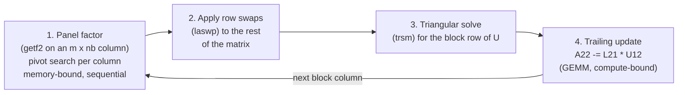
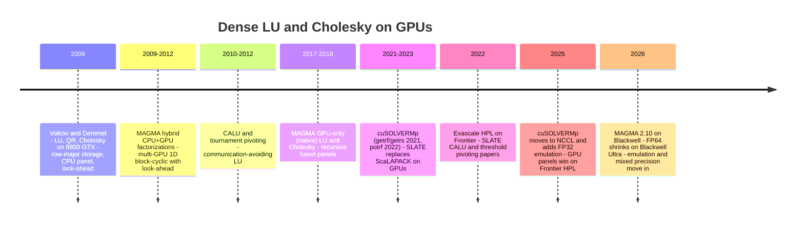
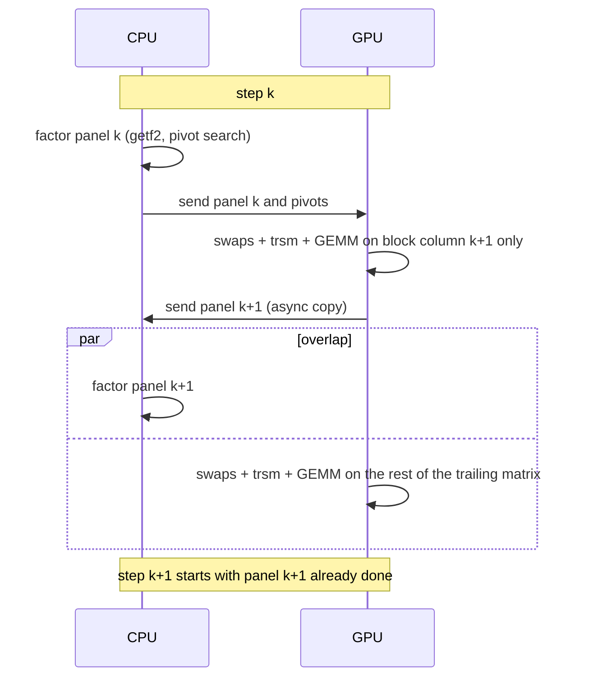

---
tags:
  - gpu-programming
  - libraries
  - linear-algebra
  - lu
  - cholesky
  - cusolver
  - magma
  - cusolvermp
  - slate
  - hpl
aliases:
  - Dense LU on GPUs
  - Cholesky on GPUs
  - getrf
  - potrf
  - GPU Dense Factorization
status: complete
sources:
  - https://parlab.eecs.berkeley.edu/sites/all/parlab/files/LU,%20QR%20and%20Cholesky%20factorizations%20using%20vector%20capabilities%20of%20GPUs.pdf
  - https://www.netlib.org/utk/people/JD/JackDongarra/PAPERS/lu_fermi.pdf
  - https://www.netlib.org/utk/people/JackDongarra-20130-07-11/PAPERS/one-side-gpu-iccs-2012.pdf
  - https://icl.utk.edu/files/publications/2018/icl-utk-1342-2018.pdf
  - https://icl.utk.edu/files/publications/2022/icl-utk-1533-2022.pdf
  - https://par.nsf.gov/servlets/purl/10511363
  - https://icl.utk.edu/projectsfiles/magma/doxygen/group__magma__gerbt.html
  - https://icl.utk.edu/magma/
  - https://docs.nvidia.com/cuda/cusolver/index.html
  - https://docs.nvidia.com/cuda/archive/13.4.2/cusolver/index.html
  - https://docs.nvidia.com/cuda/archive/12.1.0/cusolver/index.html
  - https://docs.nvidia.com/cuda/developer-preview/13.4/cusolver/contents.html
  - https://docs.nvidia.com/cuda/pdf/CUSOLVER_Library.pdf
  - https://docs.rs/singe-cusolver/latest/singe_cusolver/dense/fn.xgetrf.html
  - https://docs.nvidia.com/cuda/cusolvermp/release_notes/index.html
  - https://performance.netlib.org/files/print/2023/slate-sc23.pdf
  - https://arxiv.org/pdf/2604.09517
  - https://impact.ornl.gov/en/publications/insights-from-optimizing-hpl-performance-on-exascale-systems-a-co/
  - https://www.hpcwire.com/2026/11/16/no-change-at-the-top-of-top500-lineshine-still-no-1/
  - https://arxiv.org/pdf/2611.13332
  - https://glennklockwood.com/garden/processors/b200
  - https://arxiv.org/pdf/2601.08082
  - https://arxiv.org/abs/1208.2451
  - https://pytorch.org/docs/stable/_modules/torch/backends/cuda
created: 2026-11-28
updated: 2026-11-28
---

## Table Of Contents

---

- [[#TL;DR|TL;DR]]
- [[#The Problem|The Problem]]
- [[#Foundations|Foundations]]
    - [[#LU with Partial Pivoting and Cholesky|LU with Partial Pivoting and Cholesky]]
    - [[#Blocked Right-Looking Factorization|Blocked Right-Looking Factorization]]
    - [[#Worked Example - How Much of the Work Is the Panel|Worked Example - How Much of the Work Is the Panel]]
    - [[#Worked Example - What Row Swaps Cost|Worked Example - What Row Swaps Cost]]
- [[#How We Got Here|How We Got Here]]
- [[#How It Works|How It Works]]
    - [[#Hybrid CPU-GPU Factorization with Look-Ahead|Hybrid CPU-GPU Factorization with Look-Ahead]]
    - [[#GPU-Only Panels|GPU-Only Panels]]
    - [[#Row Swaps and Memory Layout|Row Swaps and Memory Layout]]
    - [[#Cholesky - No Pivoting, Half the Work|Cholesky - No Pivoting, Half the Work]]
    - [[#Pivoting Less - CALU, Threshold Pivoting and Butterflies|Pivoting Less - CALU, Threshold Pivoting and Butterflies]]
    - [[#Calling cuSOLVER|Calling cuSOLVER]]
    - [[#Many GPUs and Many Nodes|Many GPUs and Many Nodes]]
- [[#Where It Is Now|Where It Is Now]]
- [[#Trade-offs & Open Problems|Trade-offs & Open Problems]]
- [[#Resources|Resources]]
- [[#Related Notes|Related Notes]]

## ***TL;DR***
---
*A large dense LU or Cholesky factorization on a GPU is almost all matrix multiplication, so it runs near GEMM speed, except for a thin, sequential "panel" step and, for LU, the row swaps that pivoting demands. Every design in this space is a way to hide, shrink or avoid those two.*

- **What it is.** LU with partial pivoting ($PA = LU$, LAPACK `getrf`) solves general $Ax = b$; Cholesky ($A = LL^T$, `potrf`) solves symmetric positive definite systems with half the flops and no pivoting. Both are blocked: factor a narrow column **panel**, then update the big **trailing matrix** with a GEMM.
- **The bottleneck.** The trailing update is compute-bound and fast on [[Tensor Cores]]. The panel is skinny, memory-bound and full of dependent steps (one pivot search per column), so it runs one to two orders of magnitude slower per flop. Kurzak et al. measured a CPU panel at about 12 GFLOP/s next to about 1,200 GFLOP/s for GPU GEMM ([Kurzak et al.](https://www.netlib.org/utk/people/JD/JackDongarra/PAPERS/lu_fermi.pdf)).
- **Three fixes.** *Look-ahead*: factor the next panel while the GPU updates the rest (MAGMA's hybrid design, HPL). *GPU-only panels*: recursive, fused panel kernels that keep the whole job on the GPU ([Abdelfattah et al. 2018](https://icl.utk.edu/files/publications/2018/icl-utk-1342-2018.pdf)). *Pivot less*: tournament pivoting (CALU), threshold pivoting or random butterfly transforms.
- **Row swaps.** Swapping rows of a column-major matrix touches memory with a stride of the whole column, which GPUs hate. Volkov and Demmel found pivoting "can take up to 56% of total time" with column-major storage on 2008 GPUs ([Volkov and Demmel](https://parlab.eecs.berkeley.edu/sites/all/parlab/files/LU,%20QR%20and%20Cholesky%20factorizations%20using%20vector%20capabilities%20of%20GPUs.pdf)); the cure is a row-major or transposed layout.
- **Libraries.** cuSOLVER (`cusolverDnXgetrf`, `cusolverDnXpotrf`) for one GPU; MAGMA for hybrid and GPU-only variants on NVIDIA and AMD; cuSOLVERMp and SLATE for many nodes; rocSOLVER on AMD.
- **Where it is now (Nov 2026).** cuSOLVERMg is deprecated in favour of cuSOLVERMp, which moved to NCCL and gained FP32 emulation in 2025 ([cuSOLVERMp release notes](https://docs.nvidia.com/cuda/cusolvermp/release_notes/index.html)). MAGMA 2.10.0 (Feb 2026) added Blackwell and ROCm 7 ([MAGMA](https://icl.utk.edu/magma/)). FP64 is shrinking on some new GPUs (an AMD study measured about 1.1 TFLOP/s native FP64 on GB300), which pushes dense FP64 factorization toward [[Floating-Point Emulation on Tensor Cores|emulation]] and [[Mixed-Precision Iterative Refinement and HPL-MxP|mixed-precision refinement]].

## ***The Problem***
---
*A dense solve costs $\tfrac{2}{3}n^3$ flops for LU, and GPUs can do those flops fast only when they come as large matrix multiplies. Gaussian elimination is naturally a long chain of small dependent steps, so the whole game is restructuring it into big GEMMs without breaking its numerical stability.*

Dense factorizations sit under boundary-element and electromagnetics codes, Gaussian-process regression and Kalman filters (Cholesky of a covariance matrix), quantum chemistry, the inner solves of many optimizers, and every TOP500 HPL run. They are also what `torch.linalg.lu_factor`, `torch.linalg.cholesky` and `torch.linalg.solve` call on a GPU: PyTorch picks between cuSOLVER and MAGMA with an internal heuristic, overridable with `torch.backends.cuda.preferred_linalg_library` ([PyTorch](https://pytorch.org/docs/stable/_modules/torch/backends/cuda)).

Textbook elimination does not fit a GPU:

| Property of naive Gaussian elimination | Why it hurts on a GPU |
|---|---|
| Step $k$ updates the whole trailing matrix with a rank-1 outer product | Rank-1 updates are matrix-vector work: about 2 flops per 8-byte element, far below the [[Roofline Model and Arithmetic Intensity\|ridge point]] |
| Step $k+1$ cannot start until step $k$ has chosen its pivot | $n$ dependent steps, each needing a global reduction and a sync |
| Partial pivoting swaps whole rows | In column-major storage a row is strided by the column length, so swaps are uncoalesced |
| Work shrinks as $(n-k)^2$ | Late steps leave most of the GPU idle |

Blocking fixes the first row of that table: it turns most of the work into [[Tiled Matrix Multiplication (GEMM)|GEMM]]. The other three rows are what the rest of this note is about.

## ***Foundations***
---
*LU with partial pivoting, Cholesky, and the blocked right-looking schedule that both use. Two worked examples show why the panel, not the GEMM, decides performance, and why row swaps are a latency and layout problem more than a bandwidth one.*

### LU with Partial Pivoting and Cholesky

| | LU (`getrf`) | Cholesky (`potrf`) |
|---|---|---|
| Factorization | $PA = LU$; $L$ unit lower, $U$ upper, $P$ a row permutation | $A = LL^T$ (or $U^TU$); $A$ symmetric positive definite |
| Flops | $\tfrac{2}{3}n^3$ | $\tfrac{1}{3}n^3$ |
| Pivoting | Partial: at column $k$, swap in the row with the largest $\lvert a_{ik}\rvert$ | None needed; SPD guarantees positive pivots |
| Failure report | `info = i > 0`: $U_{ii} = 0$, matrix singular | `info = i > 0`: "the leading minor of order i is not positive definite" ([cuSOLVER](https://docs.nvidia.com/cuda/archive/12.1.0/cusolver/index.html)) |
| Solve afterwards | `getrs`: permute $b$, then two triangular solves | `potrs`: two triangular solves |

Plain reading: partial pivoting keeps every multiplier in $L$ at most 1 in magnitude, which is what makes LU stable in practice. Cholesky never needs it, which is why SPD systems are the easy case on GPUs.

LAPACK stores the permutation as a pivot vector `ipiv`: at step $i$, row $i$ was swapped with row `ipiv[i]` (1-based in LAPACK and cuSOLVER). Applying the swaps in order reproduces $P$.

### Blocked Right-Looking Factorization

Pick a block size $n_b$ (typically 128 to 1024 on GPUs). For each block column $k$:



1. **Panel.** Factor the $m \times n_b$ column block with unblocked LU, choosing $n_b$ pivots. This is the latency-bound part.
2. **Swaps.** Apply those $n_b$ row interchanges to the columns left and right of the panel.
3. **TRSM.** Solve $L_{11} U_{12} = A_{12}$ for the next block row of $U$.
4. **GEMM.** $A_{22} \leftarrow A_{22} - L_{21}U_{12}$, a rank-$n_b$ update of the whole trailing matrix. This is where nearly all the flops are.

"Right-looking" means each step immediately updates everything to its right; "left-looking" variants instead update each block column just before factoring it, using all the columns to its left. Cholesky uses the same skeleton with a symmetric update (SYRK on diagonal tiles, GEMM below) and no swaps.

### Worked Example - How Much of the Work Is the Panel

Panel $k$ has height $m_k = n - k\,n_b$ and costs about $m_k n_b^2$ flops. Summing over the $n/n_b$ panels:

$$W_{\text{panel}} \approx n_b^2 \sum_k m_k \approx n_b^2 \cdot \frac{n^2}{2n_b} = \frac{n^2 n_b}{2}, \qquad \frac{W_{\text{panel}}}{W_{\text{LU}}} = \frac{n^2 n_b/2}{\tfrac{2}{3}n^3} = \frac{3n_b}{4n}.$$

Plain reading: the panel's *share of the flops* is tiny and shrinks as the matrix grows. Its share of the *time* is another matter.

Take $n = 32{,}768$ FP64 on an HGX B200, whose peak is 37 TFLOP/s for both FP64 vector and FP64 Tensor Core work ([Klockwood](https://glennklockwood.com/garden/processors/b200)):

- **Matrix:** $8n^2 = 8.6$ GB, which fits easily in the B200's 186 GB of HBM3e.
- **Total work:** $\tfrac{2}{3}n^3 = 2.35 \times 10^{13}$ flops, so at least $0.63$ s at peak.
- **Panel work** with $n_b = 512$: $3 \cdot 512 / (4 \cdot 32{,}768) = 1.17\%$ of the flops, about $2.75 \times 10^{11}$.
- **Panel time.** Suppose (an illustrative figure, not a measurement) the panel runs at 1 TFLOP/s because it is bandwidth- and sync-bound. That is $0.27$ s, adding about 43% on top of the GEMM time if nothing overlaps.

So 1% of the flops can cost 30% of the run. That is the whole case for look-ahead and for faster panels. It also explains the tail: the trailing GEMM at step $k$ shrinks as $(n - k n_b)^2$ but the panel only as $(n - k n_b)$, so near the end the panel can no longer hide behind the update. The Aurora HPL paper shows exactly this: GEMM dominates early, then row swapping dominates "once the trailing matrix shrinks", which is where sustained performance drops ([Goto et al. 2026](https://arxiv.org/pdf/2604.09517)).

### Worked Example - What Row Swaps Cost

Partial pivoting does up to $n$ swaps, each exchanging two full rows of $n$ FP64 values (read and write both): $2 \times 2 \times 8n = 32n$ bytes per swap, $32n^2$ bytes in total.

- For $n = 32{,}768$: $32 \times 1.07 \times 10^9 = 34$ GB.
- **Coalesced** (rows contiguous) at 8 TB/s: about 4.3 ms, under 1% of the 0.63 s GEMM time.
- **Column-major** (rows strided by $8n$ bytes): each 8-byte element pulls in its own 32-byte sector, so traffic is 4 times larger, about 17 ms, before counting the poor latency of scattered access.

Plain reading: on today's single GPU, swap *bandwidth* is a few percent at most. What hurts is that swaps are many small dependent operations on the critical path, and, across nodes, that every swap that crosses a process boundary is a message. That is why the 2008-era cost (over half the time, see below) has shrunk on one GPU but the problem reappears at scale.

## ***How We Got Here***
---
*Dense GPU factorization went from CPU-panel hybrids, to GPU-only panels as GPUs outgrew their hosts, to distributed libraries and communication-avoiding pivoting for exascale, and now to low-precision and emulated arithmetic as FP64 stops growing.*



- **2008, the template.** Volkov and Demmel ran LU, QR and Cholesky on GeForce 8800-series GPUs at 179, 192 and 183 GFLOP/s against 206 for SGEMM. Their recipe still holds: panel on the CPU overlapped by look-ahead, row-major storage on the GPU so swaps are contiguous ("If not used, we lose about half of the Gflop/s rate"), and triangular solves replaced by multiplication with explicitly inverted diagonal blocks ([Volkov and Demmel](https://parlab.eecs.berkeley.edu/sites/all/parlab/files/LU,%20QR%20and%20Cholesky%20factorizations%20using%20vector%20capabilities%20of%20GPUs.pdf)).
- **2010-2012, MAGMA hybrids and multi-GPU.** MAGMA turned the recipe into a LAPACK-style library. On one node with three Tesla M2070s, its multi-GPU DGETRF scaled "up to 2.9×", using a 1D block-cyclic column layout for LU and a row layout for Cholesky, while noting that "the panel factorization often becomes the bottleneck" as GPUs are added ([Yamazaki et al., ICCS 2012](https://www.netlib.org/utk/people/JackDongarra-20130-07-11/PAPERS/one-side-gpu-iccs-2012.pdf)). Kurzak et al. pushed past 1 TFLOP/s (about 1,160 GFLOP/s at $N \approx 34{,}560$) on four Fermi GPUs plus 48 Opteron cores with a multithreaded recursive panel and deep look-ahead ([Kurzak et al.](https://www.netlib.org/utk/people/JD/JackDongarra/PAPERS/lu_fermi.pdf)).
- **2017-2018, GPU-only.** As GPUs outran their hosts, MAGMA's `_native` routines moved the panel onto the GPU. They reached "90+% of the performance of optimized hybrid solutions, while improving the energy efficiency by 50%", and beat cuSOLVER LU by "15-50% in double precision" on P100 ([Abdelfattah et al., TPDS 2018](https://icl.utk.edu/files/publications/2018/icl-utk-1342-2018.pdf)).
- **2021-2023, distributed.** NVIDIA's cuSOLVERMp shipped getrf/getrs in its first release (HPC SDK 21.11) and potrf/potrs in 0.2.0 ([release notes](https://docs.nvidia.com/cuda/cusolvermp/release_notes/index.html)). ICL's SLATE, built to replace ScaLAPACK on GPU machines, uses a 2D block-cyclic distribution with dynamic scheduling ([SLATE SC23](https://performance.netlib.org/files/print/2023/slate-sc23.pdf)).
- **2022, pivoting less.** SLATE gained CALU with tournament pivoting ([Alomairy et al. 2022](https://icl.utk.edu/files/publications/2022/icl-utk-1533-2022.pdf)) and threshold pivoting ([Lindquist et al. 2022](https://par.nsf.gov/servlets/purl/10511363)), both aimed at the cost of pivoting across nodes.
- **2025-2026.** On Frontier, a GPU panel factorization written with HIP cooperative groups "outperforms conventional CPU-based PDFACT" in HPL ([Lu et al., SC25](https://impact.ornl.gov/en/publications/insights-from-optimizing-hpl-performance-on-exascale-systems-a-co/)). Libraries added FP32 and FP64 emulation modes, and research moved to mixed precision inside the factorization itself.

## ***How It Works***
---
*The libraries differ mainly in where the panel runs, how row swaps are laid out, how much pivoting they do, and how the matrix is split across GPUs. The trailing GEMM is the same everywhere: cuBLAS or rocBLAS on Tensor Cores.*

### Hybrid CPU-GPU Factorization with Look-Ahead

The classic MAGMA design splits the work by what each processor is good at: the CPU factors the skinny panel (latency-bound, branchy, small), and the GPU does the trailing update (big GEMM). Look-ahead keeps both busy: the GPU first updates *only the next panel's columns*, ships them to the CPU, and updates the rest while the CPU factors that panel ([Yamazaki et al.](https://www.netlib.org/utk/people/JackDongarra-20130-07-11/PAPERS/one-side-gpu-iccs-2012.pdf)).



This uses [[Streams, Events and Async Execution|streams]] and pinned buffers so the copies overlap the GEMM. It works as long as one panel on the CPU takes less time than one trailing update on the GPU. Kurzak et al. found the first panel took about 0.35 s on the CPU while applying its update took about 0.15 s on the GPUs, a "performance imbalance" that forced them to write a much faster multithreaded recursive panel ([Kurzak et al.](https://www.netlib.org/utk/people/JD/JackDongarra/PAPERS/lu_fermi.pdf)). Each GPU generation makes the imbalance worse.

HPL on GPU supercomputers uses the same idea at node scale. Aurora's record run still factored panels and handled row swaps and MPI on the CPUs, with look-ahead depth 1, block size 384 and $N = 28{,}773{,}888$, reaching 1.012 EF/s, 51.1% of peak ([Goto et al. 2026](https://arxiv.org/pdf/2604.09517)).

### GPU-Only Panels

Moving the panel onto the GPU removes the CPU and the PCIe round trip from the critical path. MAGMA's `_native` routines do it with three ideas ([Abdelfattah et al. 2018](https://icl.utk.edu/files/publications/2018/icl-utk-1342-2018.pdf)):

| Technique | What it does |
|---|---|
| Recursive panel | Split the panel in half recursively so most panel work becomes GEMM and TRSM; only a 16 to 32 column base case is unblocked |
| Fused short-panel kernel | When the panel is short enough, one kernel factors it with the columns held in registers, synchronizing across thread blocks (see [[Forward Progress and Inter-Block Synchronization]] for why that needs care) |
| Parallel row permutation | Build an auxiliary pivot vector so each row moves once, in parallel, instead of $n_b$ serial pairwise swaps |

The pivot search itself is an argmax reduction down a column, the pattern in [[Parallel Reduction and Scan]]. The paper also found the trailing GEMM needs $n_b \geq 256$ in FP64 (1024 in FP32) to approach peak, which sets a floor on how thin panels can be.

### Row Swaps and Memory Layout

LAPACK stores matrices column-major, so a row is strided by the leading dimension. A straightforward swap kernel shows the problem:

```cuda
// Apply pivots ipiv[k0..k1) (0-based) to a column-major matrix A with n columns.
__global__ void laswp_colmajor(double* A, int lda, int n,
                               const int* ipiv, int k0, int k1) {
    int j = blockIdx.x * blockDim.x + threadIdx.x;   // one thread per column
    if (j >= n) return;
    double* col = A + (size_t)j * lda;                // start of column j
    for (int k = k0; k < k1; ++k) {                   // swaps must stay in order
        int p = ipiv[k];
        if (p != k) { double t = col[k]; col[k] = col[p]; col[p] = t; }
    }
}
```

- **Line 4:** each thread owns one column, so the swaps inside a column happen in the right order without synchronization.
- **Line 6:** thread $j$'s column starts `lda * 8` bytes after thread $j-1$'s. When a warp reads `col[k]`, its 32 threads touch 32 addresses that far apart, so each 8-byte value costs a separate 32-byte memory sector ([[Memory Coalescing]]).
- **Lines 7-10:** the loop is sequential because swap $k+1$ may move a row that swap $k$ just placed.

The fixes, all in the literature since 2008:

- **Row-major or transposed storage on the GPU** makes a row contiguous, so the same warp reads 256 consecutive bytes. Volkov and Demmel called it their most important optimization; with column-major layout pivoting "can take up to 56% of total time" ([Volkov and Demmel](https://parlab.eecs.berkeley.edu/sites/all/parlab/files/LU,%20QR%20and%20Cholesky%20factorizations%20using%20vector%20capabilities%20of%20GPUs.pdf)). Kurzak et al. stored elements row-major inside column-major tiles and reported the column-major alternative "about two orders of magnitude slower" for the swap kernel ([Kurzak et al.](https://www.netlib.org/utk/people/JD/JackDongarra/PAPERS/lu_fermi.pdf)). MAGMA native LU likewise works on an internally transposed matrix ([Abdelfattah et al. 2018](https://icl.utk.edu/files/publications/2018/icl-utk-1342-2018.pdf)).
- **Compose the swaps into one permutation** first, then move each affected row once.

### Cholesky - No Pivoting, Half the Work

Cholesky is the friendly case. No pivoting means no swaps and no argmax in the panel, the panel's diagonal block is tiny ($n_b \times n_b$ `potf2`), and the column below it is a TRSM that runs well on the GPU. The trailing update is SYRK on diagonal tiles plus GEMM elsewhere, touching only one triangle.

- MAGMA's multi-GPU Cholesky uses a row-wise 1D block-cyclic layout "since each step updates only one block column", and scaled up to 2.6× on three GPUs ([Yamazaki et al.](https://www.netlib.org/utk/people/JackDongarra-20130-07-11/PAPERS/one-side-gpu-iccs-2012.pdf)).
- The GPU-only MAGMA Cholesky beat cuSOLVER by 5 to 10%, while the hybrid version kept an edge "of up to 20% in the midrange" at higher energy cost ([Abdelfattah et al. 2018](https://icl.utk.edu/files/publications/2018/icl-utk-1342-2018.pdf)).
- Because it needs no pivoting, Cholesky is the natural target for mixed precision inside the factorization: a 2026 recursive Cholesky that runs large off-diagonal blocks in FP16 and diagonal blocks in higher precision reports "up to a 5.07× speedup relative to the diagonal-precision vendor baseline" on H200, with "100× better accuracy than pure half precision" ([Carrica et al. 2026](https://arxiv.org/pdf/2601.08082)).

Failure is cheap to detect: `potrf` returns `info = i` when the leading minor of order $i$ is not positive definite, which is also the standard numerical test for positive definiteness.

### Pivoting Less - CALU, Threshold Pivoting and Butterflies

Partial pivoting needs a global argmax per column, so with $P$ process rows a panel of width $n_b$ costs $n_b$ reductions across them. Three ways to cut that:

| Method | Idea | Measured effect |
|---|---|---|
| CALU, tournament pivoting | Each process picks $n_b$ candidate pivot rows with a local LU; a binary tree of small LUs picks the winners. One reduction per block column instead of per column ([Khabou, Demmel, Grigori, Gu](https://arxiv.org/abs/1208.2451)) | In SLATE on 8 Summit nodes, "1.15x speedup" over partial pivoting on random matrices; slower on diagonally dominant ones where the tree is overhead ([Alomairy et al. 2022](https://icl.utk.edu/files/publications/2022/icl-utk-1533-2022.pdf)) |
| Threshold pivoting | Keep the diagonal row unless another is bigger by a factor $1/\tau$; $\tau = 1$ is partial pivoting, $\tau = 0$ is none | "improved performance by up to 32%" on 8 Summit nodes with no significant accuracy loss; $\tau = 2^{-1}$ or $10^{-1}$ recommended ([Lindquist et al. 2022](https://par.nsf.gov/servlets/purl/10511363)) |
| Random butterfly transform (RBT) + no pivoting | Multiply $A$ on both sides by random butterfly matrices, then factor with no pivoting at all | MAGMA ships it as `magma_*gerbt_gpu` ("RBT + no pivoting LU") ([MAGMA docs](https://icl.utk.edu/projectsfiles/magma/doxygen/group__magma__gerbt.html)) |
| No pivoting | Only for matrices known to be safe (diagonally dominant, SPD) | cuSOLVER skips pivoting when `ipiv` is NULL, and warns the result "is not numerically stable" ([cuSOLVER Xgetrf, as mirrored](https://docs.rs/singe-cusolver/latest/singe_cusolver/dense/fn.xgetrf.html)) |

HPL-MxP's generator deliberately builds matrices that factor stably without pivoting, which is one reason its LU runs so close to GEMM speed (see [[Mixed-Precision Iterative Refinement and HPL-MxP]]).

### Calling cuSOLVER

The 64-bit generic API takes the data type as an argument and separates device and host workspace:

```c
cusolverDnHandle_t h;  cusolverDnCreate(&h);
cusolverDnParams_t p;  cusolverDnCreateParams(&p);           // algorithm and options
size_t dBytes, hBytes;
cusolverDnXgetrf_bufferSize(h, p, n, n, CUDA_R_64F, dA, lda,
                            CUDA_R_64F, &dBytes, &hBytes);   // ask, don't guess
cudaMalloc(&dWork, dBytes);  hWork = malloc(hBytes);
cusolverDnXgetrf(h, p, n, n, CUDA_R_64F, dA, lda, dIpiv,     // A overwritten by L and U
                 CUDA_R_64F, dWork, dBytes, hWork, hBytes, dInfo);
cusolverDnXgetrs(h, p, CUBLAS_OP_N, n, nrhs, CUDA_R_64F, dA, lda,
                 dIpiv, CUDA_R_64F, dB, ldb, dInfo);         // B overwritten by X
```

- **Lines 1-2:** a handle (bound to a stream) and a params object, where `cusolverDnSetAdvOptions` can pick the algorithm. The default `CUSOLVER_ALG_0` is the fast one, needing "a large workspace of m*n elements"; the alternative is the legacy, smaller-workspace implementation ([cuSOLVER docs](https://docs.nvidia.com/cuda/archive/12.1.0/cusolver/index.html), [Xgetrf mirror](https://docs.rs/singe-cusolver/latest/singe_cusolver/dense/fn.xgetrf.html)).
- **Lines 3-6:** "There is no cudaMalloc inside cuSolver library, the user must allocate the device workspace explicitly" ([cuSOLVER 13.4](https://docs.nvidia.com/cuda/archive/13.4.2/cusolver/index.html)), so query sizes first. Sizes can change with the math mode.
- **Lines 7-8:** factor in place; `dIpiv` holds 64-bit pivot indices; `dInfo` reports a zero pivot. Passing NULL for `dIpiv` means no pivoting.
- **Lines 9-10:** solve with the factors.

Cholesky is the same shape with `cusolverDnXpotrf(h, p, CUBLAS_FILL_MODE_LOWER, n, ...)` and `cusolverDnXpotrs`. In the CUDA 13.x documentation, `cusolverDnSetMathMode` can opt into `CUSOLVER_FP32_EMULATED_BF16X9_MATH` or `CUSOLVER_FP64_EMULATED_FIXEDPOINT_MATH`, which use the [[cuBLAS and cuDNN|cuBLAS]] emulation techniques for the internal GEMMs; the documentation's example is an emulated `cusolverDnXgetrf` ([cuSOLVER 13.4](https://docs.nvidia.com/cuda/archive/13.4.2/cusolver/index.html)).

### Many GPUs and Many Nodes

| Library | Scope | Layout and notes |
|---|---|---|
| MAGMA `_mgpu` | One node, several GPUs | 1D block-cyclic; CPU panel with look-ahead |
| cuSOLVERMg | One node, several GPUs | Deprecated: "Users are encouraged to use cuSOLVERMp for multi-GPU functionality, both single- and multi-node" ([cuSOLVER docs](https://docs.nvidia.com/cuda/pdf/CUSOLVER_Library.pdf)) |
| cuSOLVERMp | Many nodes | ScaLAPACK-style 2D block-cyclic process grid; getrf/getrs, potrf/potrs, QR, eigensolvers; NCCL for communication since 0.7.0 ([release notes](https://docs.nvidia.com/cuda/cusolvermp/release_notes/index.html)) |
| SLATE | Many nodes, CUDA and HIP | 2D block-cyclic tiles, dynamic scheduling; partial, tournament (CALU), threshold and RBT pivoting |
| HPL (vendor builds) | Benchmark only | 2D grid, look-ahead; tuned panels and swap communication |

In a 2D block-cyclic layout each process owns scattered tiles, so the panel spans a whole process column and every pivot can force a row exchange between process rows. That is where CALU and threshold pivoting pay off, and where swaps come back as the late-run bottleneck at exascale. The traffic is mostly broadcasts: each factored panel along its process row, each block row of $U$ down its process column. cuSOLVERMp carries it on [[Multi-GPU Communication - NVLink and NCCL|NCCL]]; HPL builds such as Aurora's use host-buffer MPI.

## ***Where It Is Now***
---
*As of late November 2026: single-GPU LU and Cholesky are a solved library call, the distributed libraries are maturing quickly, and the live question is FP64 itself, which is flat or shrinking on the newest NVIDIA parts.*

- **cuSOLVER.** The 13.4 documentation (Oct 2026) covers emulated FP32 (BF16x9) and FP64 (fixed-point) math modes for cuSolverDN, with Xgetrf as the worked example. cuSolverDN "computes deterministic results" by default, and getrf and potrf are not among the routines that can opt into non-determinism ([cuSOLVER 13.4](https://docs.nvidia.com/cuda/archive/13.4.2/cusolver/index.html)), which matters for [[Deterministic and Batch-Invariant Kernels|reproducible]] pipelines.
- **cuSOLVERMp.** 0.7.0 (Aug 2025) switched from its own CAL library to NCCL and added FP32 emulation (CUDA 13, compute capability 10+); 0.7.2 fixed a getrf/getrs race; 0.8.0 (Apr 2026) fixed potrf/potrs hangs on non-square grids; 0.9.0 (Jul 2026) fixed workspace queries that under-reported device memory for getrf and potrf, among others; 0.9.1 (Aug 2026) is current ([release notes](https://docs.nvidia.com/cuda/cusolvermp/release_notes/index.html)). The run of correctness fixes is a reminder to pin versions and always re-query workspace sizes.
- **MAGMA.** 2.10.0 (Feb 26, 2026) supports Blackwell (sm_100, sm_120), CUDA 13 and ROCm 7, and keeps both hybrid and GPU-only (`_native`) LU ([MAGMA](https://icl.utk.edu/magma/)).
- **HPL at exascale.** The November 2026 TOP500 top five are unchanged from June: LineShine 2.2 EF, El Capitan 1.8, Frontier 1.4, Aurora 1.0, JUPITER Booster 1.0 ([HPCwire, Nov 16 2026](https://www.hpcwire.com/2026/11/16/no-change-at-the-top-of-top500-lineshine-still-no-1/)). Two engineering lessons from the record runs: on Frontier, GPU panel factorization beat CPU panels ([Lu et al., SC25](https://impact.ornl.gov/en/publications/insights-from-optimizing-hpl-performance-on-exascale-systems-a-co/)); on Aurora, panels stayed on the CPUs and row swaps dominated the tail ([Goto et al. 2026](https://arxiv.org/pdf/2604.09517)).
- **FP64 hardware is diverging.** HGX B200 offers 37 TFLOP/s FP64 ([Klockwood](https://glennklockwood.com/garden/processors/b200)). An AMD-authored 2026 study measured native FP64 GEMM at about 36 TFLOP/s on B200 but about 1.10 TFLOP/s on GB300, and cites vendor figures of 33 TFLOP/s native FP64 for Rubin and 78.6 TFLOP/s FP64 matrix peak for MI355X ([Świrydowicz et al. 2026](https://arxiv.org/pdf/2611.13332)). On a GPU like GB300, a native FP64 LU is no faster than a good CPU; the practical routes are [[Floating-Point Emulation on Tensor Cores|emulated FP64 GEMMs]] inside the factorization or a low-precision factorization plus [[Mixed-Precision Iterative Refinement and HPL-MxP|iterative refinement]]. The same study cautions that emulation helps only large, GEMM-shaped work, and notes that HPL "contains critical components beyond double-precision GEMM": the panel and swaps do not get faster.
- **Small and batched.** For thousands of small matrices the answer is different entirely; see [[Batched Small-Matrix Linear Algebra]] and cuSolverDx in [[Device-Side Math Libraries (MathDx)]].

## ***Trade-offs & Open Problems***
---
*The big choices are where the panel runs, how much pivoting to pay for, and what precision to factor in. Each trades speed against stability, portability or energy.*

| Choice | For | Against |
|---|---|---|
| CPU panel + look-ahead (hybrid) | Uses idle host cores; panel code is simple | Needs a strong CPU and PCIe or C2C bandwidth; the imbalance grows every GPU generation; worse energy per flop |
| GPU-only panel | No host dependency, better energy (about 50% in MAGMA's study) | Panel kernels are hard: inter-block sync, register pressure, tuning per architecture |
| Partial pivoting | The stability everyone trusts | $n$ global reductions; swaps and their messages dominate late in distributed runs |
| Tournament / threshold / RBT / none | Fewer syncs and messages; 15 to 44% faster in published runs | Weaker or probabilistic stability guarantees; matrix-dependent; needs a residual check |
| Low-precision or emulated factorization | Tensor Core speed on FP64-poor GPUs | Conditioning limits (refinement may not converge); emulation helps the GEMM, not the panel |

Open problems:

- **The tail.** As the trailing matrix shrinks, GEMM no longer hides the panel and swaps. Deeper look-ahead, dynamic (DAG) scheduling and recursive LU all attack it; none removes it.
- **Pivoting at scale** still costs a reduction per column or per block column across the process grid. Proving how far pivoting can be relaxed for a given application remains open.
- **Portability.** Fast panels are architecture-specific kernels (fused, register-resident, cooperative). MAGMA, rocSOLVER and cuSOLVER each re-tune them per GPU generation.
- **What FP64 means now.** With native FP64 flat or falling on some parts, libraries must decide when emulation is accurate enough, and users must decide whether a refined low-precision answer is acceptable.

## ***Resources***
---
*Primary sources first: the papers that defined each technique, the library documentation, and the exascale HPL reports for where it stands.*

**Foundational papers**
- [LU, QR and Cholesky Factorizations using Vector Capabilities of GPUs](https://parlab.eecs.berkeley.edu/sites/all/parlab/files/LU,%20QR%20and%20Cholesky%20factorizations%20using%20vector%20capabilities%20of%20GPUs.pdf), Volkov and Demmel, LAPACK Working Note 202, 2008.
- [LU Factorization with Partial Pivoting for a Multicore System with Accelerators](https://www.netlib.org/utk/people/JD/JackDongarra/PAPERS/lu_fermi.pdf), Kurzak, Luszczek, Faverge, Dongarra.
- [One-sided dense matrix factorizations on a multicore with multiple GPU accelerators in MAGMA](https://www.netlib.org/utk/people/JackDongarra-20130-07-11/PAPERS/one-side-gpu-iccs-2012.pdf), Yamazaki, Tomov, Dongarra, ICCS 2012.
- [Analysis and Design Techniques towards High-Performance and Energy-Efficient Dense Linear Solvers on GPUs](https://icl.utk.edu/files/publications/2018/icl-utk-1342-2018.pdf), Abdelfattah, Haidar, Tomov, Dongarra, IEEE TPDS 2018.

**Pivoting**
- [LU factorization with panel rank revealing pivoting and its communication avoiding version](https://arxiv.org/abs/1208.2451), Khabou, Demmel, Grigori, Gu, 2012.
- [Communication Avoiding LU with Tournament Pivoting in SLATE](https://icl.utk.edu/files/publications/2022/icl-utk-1533-2022.pdf), Alomairy et al., SLATE Working Note 18, 2022.
- [Threshold Pivoting for Dense LU Factorization](https://par.nsf.gov/servlets/purl/10511363), Lindquist, Gates, Luszczek, Dongarra, ScalAH 2022.
- [MAGMA RBT + no-pivoting LU](https://icl.utk.edu/projectsfiles/magma/doxygen/group__magma__gerbt.html).

**Libraries**
- [cuSOLVER documentation](https://docs.nvidia.com/cuda/cusolver/index.html) and [13.4 archive](https://docs.nvidia.com/cuda/archive/13.4.2/cusolver/index.html): getrf, potrf, workspace, math and emulation modes, determinism.
- [cuSOLVERMp release notes](https://docs.nvidia.com/cuda/cusolvermp/release_notes/index.html).
- [MAGMA](https://icl.utk.edu/magma/): releases, hybrid and native routines.
- [SLATE SC23 flyer](https://performance.netlib.org/files/print/2023/slate-sc23.pdf).
- [PyTorch `preferred_linalg_library`](https://pytorch.org/docs/stable/_modules/torch/backends/cuda): how a framework chooses cuSOLVER or MAGMA.

**Where it is now**
- [HPL and HPL-MxP at Exascale on Aurora](https://arxiv.org/pdf/2604.09517), Goto et al., 2026.
- [Insights from Optimizing HPL Performance on Exascale Systems](https://impact.ornl.gov/en/publications/insights-from-optimizing-hpl-performance-on-exascale-systems-a-co/), Lu et al., SC25.
- [FP64 Performance and the Limits of Ozaki Emulation on HPC Systems](https://arxiv.org/pdf/2611.13332), Świrydowicz et al. (AMD), 2026.
- [Hierarchical Recursive Precision for Accelerating Symmetric Linear Solves on MXUs](https://arxiv.org/pdf/2601.08082), Carrica, Alomairy, Ringoot, Edelman, 2026.
- [No Change at the Top of Top500](https://www.hpcwire.com/2026/11/16/no-change-at-the-top-of-top500-lineshine-still-no-1/), HPCwire, Nov 2026.
- [Glenn Klockwood, B200](https://glennklockwood.com/garden/processors/b200): FP64 and memory specs.

## ***Related Notes***
---
*Dense factorization sits between GEMM below it and the solvers, benchmarks and precision tricks built on top of it.*

- [[Tiled Matrix Multiplication (GEMM)]] — The trailing update that is nearly all of the work.
- [[cuBLAS and cuDNN]] — The GEMM, TRSM and SYRK kernels cuSOLVER calls, and the emulation modes it reuses.
- [[Batched Small-Matrix Linear Algebra]] — The opposite regime: millions of small factorizations at once.
- [[Device-Side Math Libraries (MathDx)]] — cuSolverDx for factorizations inside your own kernel.
- [[Mixed-Precision Iterative Refinement and HPL-MxP]] — Low-precision LU plus FP64 refinement, and the benchmark built on it.
- [[Floating-Point Emulation on Tensor Cores]] — FP64 GEMMs from INT8 or FP8 products for FP64-poor GPUs.
- [[Tensor Cores]] — Where the trailing GEMM runs.
- [[Roofline Model and Arithmetic Intensity]] — Why the GEMM is compute-bound and the panel is not.
- [[Memory Coalescing]] — Why column-major row swaps are slow.
- [[Parallel Reduction and Scan]] — The argmax at the heart of the pivot search.
- [[Forward Progress and Inter-Block Synchronization]] — Fused panel kernels that sync across blocks.
- [[Streams, Events and Async Execution]] — Overlapping panel copies with trailing updates.
- [[Multi-GPU Communication - NVLink and NCCL]] — The collectives under cuSOLVERMp and HPL.
- [[Sparse Linear Algebra on GPUs]] — Sparse direct solvers, which factor dense frontal matrices with these same kernels.
- [[Krylov Solvers on GPUs]] — The iterative alternative when a dense factorization is too big (planned).
- [[Deterministic and Batch-Invariant Kernels]] — Why deterministic getrf and potrf matter.
- [[Blackwell Architecture]] — The GPUs whose FP64 split shapes the emulation story.
- [[ROCm and HIP]] — rocSOLVER, hipSOLVER and MAGMA's HIP build on AMD.
