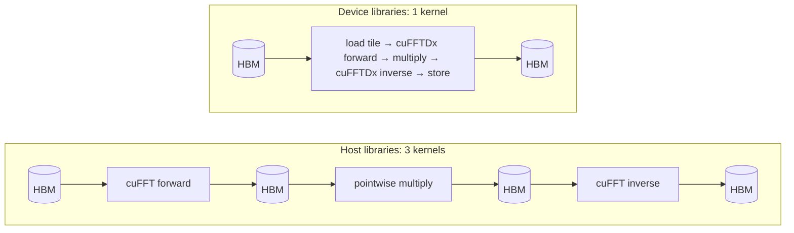
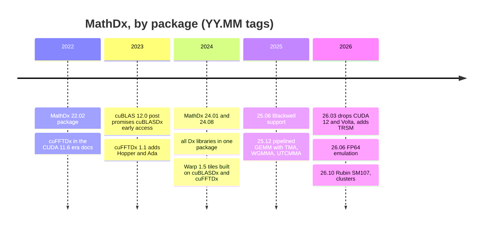
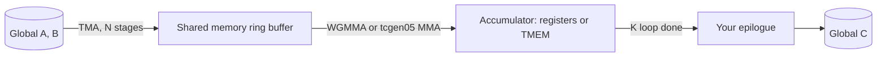

---
tags:
  - gpu-programming
  - libraries
  - mathdx
  - cublasdx
  - cufftdx
  - cusolverdx
  - kernel-fusion
  - cuda
aliases:
  - MathDx
  - Device-Side Math Libraries
  - Device Extensions
  - cuBLASDx
  - cuSolverDx
  - cuRANDDx
  - nvCOMPDx
status: complete
sources:
  - https://docs.nvidia.com/cuda/mathdx/index.html
  - https://docs.nvidia.com/cuda/mathdx/release_notes.html
  - https://developer.nvidia.com/cufftdx-downloads
  - https://docs.nvidia.com/cuda/cublasdx/index.html
  - https://docs.nvidia.com/cuda/cublasdx/using_cublasdx.html
  - https://docs.nvidia.com/cuda/cublasdx/requirements_func.html
  - https://docs.nvidia.com/cuda/cublasdx/release_notes.html
  - https://docs.nvidia.com/cuda/cublasdx/0.6.0/release_notes.html
  - https://docs.nvidia.com/cuda/cublasdx/blas_performance_guide.html
  - https://docs.nvidia.com/cuda/cublasdx/python_bindings.html
  - https://docs.nvidia.com/cuda/cufftdx/release_notes.html
  - https://docs.nvidia.com/cuda/cufftdx/1.7.3/release_notes.html
  - https://docs.nvidia.com/cuda/archive/12.2.1/cufftdx/index.html
  - https://docs.nvidia.com/cuda/cusolverdx
  - https://docs.nvidia.com/cuda/cusolverdx/release_notes.html
  - https://docs.nvidia.com/cuda/curanddx/
  - https://docs.nvidia.com/cuda/nvcompdx/index.html
  - https://docs.nvidia.com/cuda/libmathdx/release_notes.html
  - https://docs.nvidia.com/cuda/nvmath-python/1.0.0/device-apis/index.html
  - https://github.com/nvidia/nvmath-python
  - https://developer.nvidia.com/blog/new-cublas-12-0-features-and-matrix-multiplication-performance-on-nvidia-hopper-gpus/
  - https://developer.nvidia.com/blog/introducing-tile-based-programming-in-warp-1-5-0
  - https://developer.nvidia.com/blog/nvidia-cuda-13-5-brings-nvidia-vera-rubin-ga-support/
created: 2026-11-26
updated: 2026-11-27
---

## Table Of Contents

---

- [[#TL;DR|TL;DR]]
- [[#The Problem|The Problem]]
- [[#Foundations|Foundations]]
    - [[#Host Library vs Device Library|Host Library vs Device Library]]
    - [[#The Five Libraries|The Five Libraries]]
    - [[#What Fusion Saves, Worked|What Fusion Saves, Worked]]
    - [[#What Fits in One Block, Worked|What Fits in One Block, Worked]]
- [[#How We Got Here|How We Got Here]]
- [[#How It Works|How It Works]]
    - [[#Descriptors Built from Operators|Descriptors Built from Operators]]
    - [[#A Fused GEMM Kernel with cuBLASDx|A Fused GEMM Kernel with cuBLASDx]]
    - [[#Shared Memory vs Register Accumulators|Shared Memory vs Register Accumulators]]
    - [[#Pipelined GEMM - TMA, WGMMA and tcgen05|Pipelined GEMM: TMA, WGMMA and tcgen05]]
    - [[#cuFFTDx and cuSolverDx|cuFFTDx and cuSolverDx]]
    - [[#Header-Only vs LTO Builds|Header-Only vs LTO Builds]]
    - [[#Python and Runtime Code Generation|Python and Runtime Code Generation]]
- [[#Where It Is Now|Where It Is Now]]
- [[#Trade-offs & Open Problems|Trade-offs & Open Problems]]
- [[#Resources|Resources]]
- [[#Related Notes|Related Notes]]

## ***TL;DR***
---
*MathDx is NVIDIA's set of "device extension" libraries: cuBLAS-, cuFFT-, cuSOLVER-, cuRAND- and nvCOMP-style routines that you call **inside your own CUDA kernel** instead of launching a library kernel from the host. They exist so you can fuse math with the rest of your work and stop round-tripping through global memory.*

- **What it is.** "A comprehensive collection of NVIDIA device extension libraries": **cuBLASDx** (GEMM and TRSM), **cuFFTDx** (FFTs), **cuSolverDx** (Cholesky, LU, QR, eigen and SVD solvers), **cuRANDDx** (random numbers) and **nvCOMPDx** (LZ4 and ANS compression), "shipped in a single package" ([MathDx](https://docs.nvidia.com/cuda/mathdx/index.html)).
- **The idea.** A host library like [[cuBLAS and cuDNN|cuBLAS]] owns the whole kernel, so each call reads its inputs from HBM and writes its outputs back. A device library is a C++ function that one thread block (or one thread) runs on data already in [[Shared Memory and Bank Conflicts|shared memory]] or registers, so you can chain FFT, GEMM, solve and your own code in **one kernel** ([[Kernel Fusion]]).
- **The catch.** Each call works on one block-sized problem. For a non-pipelined cuBLASDx GEMM, A and B "must fit into shared memory": at most 196×196×196 in FP16 on Hopper and data-center Blackwell with C in shared memory ([cuBLASDx requirements](https://docs.nvidia.com/cuda/cublasdx/requirements_func.html)). These are building blocks for batched small problems and fused pipelines, not a replacement for cuBLAS on big matrices.
- **Where it is now (Nov 2026).** MathDx 26.10.0 ships cuFFTDx 1.8.0, cuBLASDx 0.8.0, cuSolverDx 0.6.0, cuRANDDx 0.2.5 and nvCOMPDx 0.2.0, adds Rubin (SM107) to all five, and lets pipelined GEMMs use [[Thread Block Clusters and Distributed Shared Memory|clusters]] ([MathDx notes](https://docs.nvidia.com/cuda/mathdx/release_notes.html)). cuBLASDx can now emulate FP64 on [[Tensor Cores]] by adding one operator. CUDA 13.5 (Nov 4, 2026) previews calling MathDx from [[CUDA Tile and cuTile|cuTile]] kernels ([CUDA 13.5 post](https://developer.nvidia.com/blog/nvidia-cuda-13-5-brings-nvidia-vera-rubin-ga-support/)).

## ***The Problem***
---
*Library calls are fast one at a time and slow in a chain, because every call is its own kernel and every kernel boundary is a trip through HBM. For small or batched problems, that trip and the launch cost are most of the runtime.*

Take an FFT-based convolution on many short signals. With host libraries it is three kernels:



Each arrow into or out of HBM is a full pass over the data. The arithmetic of a 256-point FFT is tiny (it is [[Roofline Model and Arithmetic Intensity|memory-bound]]), so the time is set by how many passes you make. Callbacks in cuFFT can fuse a load or store function, but not an FFT followed by a GEMM or a solver ([[FFT on GPUs]]).

The same shape shows up everywhere small dense math sits inside a bigger algorithm:

| Workload | Chain that wants one kernel |
|---|---|
| Fourier neural operators, FFT convolutions | FFT → GEMM or multiply → inverse FFT |
| Robotics and physics simulation | many tiny GEMMs and solves per body or per joint |
| Batched small solves (Kalman filters, finite elements, chemistry) | build matrix → Cholesky or LU → solve → use result |
| Monte Carlo | generate random numbers → transform → reduce, with no buffer of random numbers in HBM |
| Compressed data | decompress → compute, without writing the decompressed data out |

NVIDIA's Warp team measured the effect: for dense linear algebra such as robot forward dynamics, one fused kernel built on cuBLASDx tiles beat "traditional linear algebra or tensor frameworks" by up to 4×, replacing about a dozen PyTorch kernels ([Warp 1.5 post, Dec 2024](https://developer.nvidia.com/blog/introducing-tile-based-programming-in-warp-1-5-0)).

## ***Foundations***
---
*A device library hands you a tuned routine for one tile of work and leaves the grid, the data movement around it and the fusion to you. Two numbers decide whether it helps: how many HBM passes you remove, and whether your problem fits in one block.*

### Host Library vs Device Library

| | Host library (cuBLAS, cuFFT, cuSOLVER) | Device library (MathDx) |
|---|---|---|
| Called from | CPU, launches its own kernels | Inside your `__global__` kernel |
| Unit of work | Whole problem (any size, any batch) | One block-sized problem per block, or one per thread |
| Data lives in | Global memory, in and out | Your shared memory or registers |
| Who picks the kernel | The library ([[GEMM Autotuning and Kernel Selection|heuristics]]) | You, through compile-time operators |
| Fusion | Epilogues and callbacks only | Anything you can write around the call |
| Size limit | GPU memory | Shared memory and registers of one block (unless pipelined) |
| Distribution | In the CUDA Toolkit | Separate MathDx download |

### The Five Libraries

| Library | What it does inside a kernel | Notes |
|---|---|---|
| **cuBLASDx** | GEMM (`function::MM`) and triangular solve (TRSM) | Seven float types (FP16, BF16, TF32, FP32, FP64, FP8 e4m3/e5m2) and eight integer types; real or complex; A, B, C precisions can differ ([requirements](https://docs.nvidia.com/cuda/cublasdx/requirements_func.html)) |
| **cuFFTDx** | 1D FFTs, complex and real, forward and inverse | Block or thread execution; see [[FFT on GPUs]] |
| **cuSolverDx** | POTRF/POTRS/POSV, GETRF/GETRS/GESV, GEQRF, GELS, HEEV, HEGV, GESVD, BDSVD, GTSV, TRSM | "High performance batched Cholesky, LU, and QR factorizations" ([cuSolverDx](https://docs.nvidia.com/cuda/cusolverdx)) |
| **cuRANDDx** | XORWOW, MRG32k3a, Philox4_32, PCG, Sobol; uniform, normal, log-normal, Poisson | A "modern replacement" for cuRAND's device API, which the docs call "out-dated and no longer being updated" ([cuRANDDx](https://docs.nvidia.com/cuda/curanddx/)) |
| **nvCOMPDx** | LZ4 and ANS compression and decompression | Block and warp APIs; output is interchangeable with host nvCOMP ([nvCOMPDx](https://docs.nvidia.com/cuda/nvcompdx/index.html)) |

All need a Turing (SM75) or newer GPU, CUDA 13.0.3 or newer and a C++17 compiler ([MathDx](https://docs.nvidia.com/cuda/mathdx/index.html)).

### What Fusion Saves, Worked

When each step is memory-bound, time is roughly bytes moved divided by bandwidth:

$$T \approx \frac{\text{bytes read} + \text{bytes written}}{B_{\text{HBM}}}$$

*In words: if the math is cheap, the kernel takes as long as it takes to stream its data in and out.* A chain of $k$ memory-bound kernels moves the array $2k$ times; one fused kernel moves it twice. So fusion can save up to about $k\times$.

**Example (H100 SXM, 3.35 TB/s HBM3, [NVIDIA](https://www.nvidia.com/en-us/data-center/h100/)).** Convolve $2^{20}$ signals of 256 complex FP32 points (8 bytes each):

- Array size: $2^{20} \times 256 \times 8 = 2^{31}$ bytes $\approx 2.15$ GB.
- Three host kernels (FFT, multiply, inverse FFT), each reading and writing it: $6 \times 2.15 = 12.9$ GB, so $T \approx 12.9 / 3350 \approx 3.85$ ms.
- One fused kernel with cuFFTDx: $2 \times 2.15 = 4.3$ GB, so $T \approx 1.28$ ms.

The bound is 3×, plus two fewer launches. Real gains are lower if the fused kernel's occupancy drops, which is why the [[Register Pressure and Spilling|register]] and shared memory budget matters below.

### What Fits in One Block, Worked

A non-pipelined cuBLASDx call needs A and B (and C, if it lives in shared memory) in one block's shared memory. For square FP16 problems with all three in shared memory:

$$3 \cdot n^2 \cdot 2\ \text{bytes} \le S_{\text{block}}$$

*In words: three $n \times n$ half-precision matrices must fit in the shared memory one block may use.*

- **A100** (163 KB = 166,912 bytes per block): $n = 166$ needs $3 \times 166^2 \times 2 = 165{,}336$ bytes, which fits; $n = 167$ needs $167{,}334$, which does not.
- **H100 and B200** (227 KB = 232,448 bytes): $n = 196$ needs $230{,}496$ bytes, which fits; $n = 197$ needs $232{,}854$, which does not.

Those are exactly the limits in NVIDIA's table (166 on SM80, 196 on SM90/100/103/110). Keeping C in registers raises them to 203 and 240, where the register file also becomes a limit ([requirements](https://docs.nvidia.com/cuda/cublasdx/requirements_func.html), shared memory sizes from [[GPU Memory Hierarchy]]). Non-square shapes and aliasing A with B fit larger, and the pipelined API (below) lifts the limit by streaming K tiles from global memory.

## ***How We Got Here***
---
*MathDx grew out of cuFFTDx, the first in-kernel FFT, then added BLAS, solvers, RNG and compression. Since 2025 the work has been about reaching Hopper and Blackwell hardware (TMA, WGMMA, tcgen05) from inside a device call, and about Python frontends.*



- **2022: cuFFTDx first.** The download page's oldest package is MathDx 22.02, and cuFFTDx documentation already appears in the CUDA 11.6.2 docs archive ([downloads](https://developer.nvidia.com/cufftdx-downloads)). Version 0.3.1 was "the last early access (EA) release" and 1.0.0 "the first general availability (GA) release" ([cuFFTDx notes](https://docs.nvidia.com/cuda/cufftdx/1.7.3/release_notes.html)).
- **2023: cuBLASDx announced.** NVIDIA's cuBLAS 12.0 post listed "cuBLASDx (targeting 2023 EA)" for "Small (shared memory)" matrices, and said it "targets GEMMs and their fusion inside device functions" ([NVIDIA, Feb 2023](https://developer.nvidia.com/blog/new-cublas-12-0-features-and-matrix-multiplication-performance-on-nvidia-hopper-gpus/)). cuBLASDx's first early-access release, 0.1.0, supported FP16, FP64 and complex FP64 GEMM with Tensor Cores on SM70 to SM90.
- **2024: one package, tensors and Python.** cuBLASDx 0.2.0 added a CuTe tensor API, mixed precision, FP8 and TF32, and "all Dx libraries were bundled in one package"; 0.3.0 added register APIs "allowing for better performance" ([cuBLASDx 0.6 notes](https://docs.nvidia.com/cuda/cublasdx/0.6.0/release_notes.html)). Warp 1.5 (Dec 2024) built its `tile_matmul` and tile FFTs on cuBLASDx and cuFFTDx ([Warp post](https://developer.nvidia.com/blog/introducing-tile-based-programming-in-warp-1-5-0)).
- **2025: Blackwell and pipelining.** cuBLASDx 0.4.0 added "basic Blackwell support" (SM100, SM101, SM120); cuFFTDx 1.5 did the same in MathDx 25.06. cuBLASDx 0.5.0 (MathDx 25.12) added an "Experimental Pipelining API supporting fusable asynchronous execution starting from global memory" with TMA, WGMMA and 1-SM UTCMMA (the tcgen05 MMA) ([cuBLASDx 0.6 notes](https://docs.nvidia.com/cuda/cublasdx/0.6.0/release_notes.html)). cuSolverDx grew from Cholesky and LU (0.1) to QR, SVD and eigensolvers (0.3, 0.4) ([cuSolverDx notes](https://docs.nvidia.com/cuda/cusolverdx/release_notes.html)).
- **2026: cleanup, emulation, clusters.** MathDx 26.03 dropped CUDA 12 and Volta; cuBLASDx 0.6.0 added TRSM and "becomes an LTO library". 26.06 added "flexible-precision floating-point emulation GEMM" and cluster POTRF. 26.10 added Rubin to every library and clusters to pipelined GEMM ([MathDx notes](https://docs.nvidia.com/cuda/mathdx/release_notes.html)).

## ***How It Works***
---
*You describe the operation as a C++ type built from operators; the library picks instructions, thread layout and shared memory layout at compile time; you call `execute` from every thread of the block. Everything around that call (loading, epilogue, the grid) is your kernel.*

### Descriptors Built from Operators

A cuBLASDx GEMM is a type made by adding operators. From the official guide ([Using cuBLASDx](https://docs.nvidia.com/cuda/cublasdx/using_cublasdx.html)):

```cpp
using GEMM = decltype(Size<32, 32, 32>()
                    + Precision<double>()
                    + Type<type::real>()
                    + Function<function::MM>()
                    + Arrangement<cublasdx::row_major, cublasdx::col_major>()
                    + SM<890>()
                    + Block()
                    + BlockDim<256>());
```

- `Size<32, 32, 32>`: the problem is $m = n = k = 32$, fixed at compile time.
- `Precision<double>` and `Type<type::real>`: FP64, real numbers. A three-argument `Precision<__half, __half, float>` gives FP16 inputs with an FP32 accumulator.
- `Function<function::MM>`: matrix multiply ($C = \alpha AB + \beta C$).
- `Arrangement<row_major, col_major>`: how A and B are laid out.
- `SM<890>`: compile for compute capability 8.9 (Ada). The library picks instructions for that GPU.
- `Block()`: the whole thread block cooperates on one GEMM.
- `BlockDim<256>`: use 256 threads. It is optional; without it the library chooses and reports it as `GEMM::block_dim`, and the guide recommends leaving it out unless you need a specific size.

"Missing a required operator or providing an inconsistent combination results in a compile-time `static_assert`," and the object itself "has no computational cost and should be considered a handle" ([guide](https://docs.nvidia.com/cuda/cublasdx/using_cublasdx.html)). cuFFTDx and cuSolverDx use the same operator style (`Size`, `Precision`, `Direction` or `Function`, `SM`, `Block` or `Thread`).

### A Fused GEMM Kernel with cuBLASDx

A sketch condensed from the guide's register-API example, with a ReLU fused into the epilogue (check exact signatures in the guide for your version):

```cpp
using GEMM = decltype(cublasdx::Size<64, 64, 64>()
                    + cublasdx::Precision<__half, __half, float>()
                    + cublasdx::Type<cublasdx::type::real>()
                    + cublasdx::Function<cublasdx::function::MM>()
                    + cublasdx::Arrangement<cublasdx::row_major, cublasdx::col_major>()
                    + cublasdx::SM<900>() + cublasdx::Block());
using alignment = cublasdx::alignment_of<GEMM>;

__global__ void gemm_relu(const __half* a, const __half* b, float* c) {
  extern __shared__ __align__(16) char smem[];
  auto a_g = cublasdx::make_tensor(a, GEMM::get_layout_gmem_a());
  auto b_g = cublasdx::make_tensor(b, GEMM::get_layout_gmem_b());
  auto c_g = cublasdx::make_tensor(c, GEMM::get_layout_gmem_c());
  auto [a_s, b_s] = cublasdx::slice_shared_memory_ab<GEMM>(smem);
  cublasdx::copy<GEMM, alignment::a>(a_g, a_s);
  cublasdx::copy<GEMM, alignment::b>(b_g, b_s);
  cublasdx::copy_wait();
  auto acc  = GEMM().execute(a_s, b_s);
  auto frag = acc.get_results();
  for (int i = 0; i < cublasdx::size(frag); ++i) frag(i) = fmaxf(frag(i), 0.f);
  acc.partition_and_copy(frag, c_g);
}
```

Line by line:

- The descriptor is a 64×64×64 FP16 GEMM with FP32 accumulation for Hopper (`SM<900>`).
- `extern __shared__`: shared memory sized at launch with `cublasdx::get_shared_storage_size_ab<GEMM>()`, which covers only A and B because C will live in registers (`get_shared_storage_size<GEMM>()` covers all three).
- `make_tensor(ptr, GEMM::get_layout_gmem_*())`: wraps raw global pointers as CuTe tensors with the layout the descriptor expects ([[CUTLASS and CuTe]]).
- `slice_shared_memory_ab<GEMM>(smem)`: carves the shared buffer into A and B regions (`slice_shared_memory` returns A, B and C for the shared-memory API).
- `alignment_of<GEMM>` gives the alignment each copy may assume. `copy<GEMM, ...>` is "a cooperative copy among all threads in the block"; `copy_wait()` "blocks until all in-flight asynchronous copies issued by this block have completed", so nobody reads a half-loaded tile.
- `GEMM().execute(a_s, b_s)` runs the multiply and returns an **accumulator**: the C tile, spread across the block's registers.
- `get_results()` exposes this thread's fragment of C. The loop is the fusion: any per-element math (bias, activation, scaling, a dot product with another tile) runs on values that never left registers.
- `partition_and_copy` writes each thread's fragment to the right place in global C.

The accumulator rule to remember: "A register fragment can be used as an accumulator **ONLY** with the GEMM instance from which it was created" ([guide](https://docs.nvidia.com/cuda/cublasdx/using_cublasdx.html)). For a big problem you launch one block per output tile and loop over K, exactly as in [[Tiled Matrix Multiplication (GEMM)]].

### Shared Memory vs Register Accumulators

| API | Where C lives | Use it for |
|---|---|---|
| `execute(alpha, a_s, b_s, beta, c_s)` | Shared memory | Simple code; the guide warns it "can have significant overhead" |
| `execute(a_s, b_s, accumulator)` | Registers, accumulated across calls | Looping over K tiles |
| `auto acc = execute(a_s, b_s)` | Registers, returned | One-shot GEMM plus epilogue; `acc.axpby(alpha, beta, c_g)` finishes $C = \alpha AB + \beta C$ |

`get_shared_storage_size_ab<GEMM>()` sizes only A and B for the register APIs, which is why the register column of the size table is larger. The `suggest_layout_smem_*()` layouts are swizzled to avoid [[Shared Memory and Bank Conflicts|bank conflicts]] and "in many cases ... will lead to better performance"; the library also emits `ldmatrix`/`stmatrix` loads automatically ([cuBLASDx](https://docs.nvidia.com/cuda/cublasdx/index.html)).

### Pipelined GEMM - TMA, WGMMA and tcgen05

The shared-memory APIs above use the warp-level MMA path. Hopper and Blackwell's fastest Tensor Core instructions need asynchronous, warpgroup-wide machinery, and cuBLASDx exposes them only through its pipeline extension: the pipeline API is "the only path to `TMA`, `wgmma` and `tcgen05`" ([performance guide](https://docs.nvidia.com/cuda/cublasdx/blas_performance_guide.html)).



- "Automatic N-buffer staged pipelined GEMM execution" starts from global memory, overlaps load and compute stages, and runs one epilogue after the K loop ([cuBLASDx](https://docs.nvidia.com/cuda/cublasdx/index.html)). This removes the "A and B must fit" limit for K and is the same [[TMA and Asynchronous Copies|TMA]] pipeline CUTLASS uses.
- 0.7.0 added Blackwell "3-way warp specialization and TMEM multi-staging", supporting [[Persistent Kernels and Stream-K|persistent kernels]] with one epilogue per output tile ([cuBLASDx notes](https://docs.nvidia.com/cuda/cublasdx/release_notes.html)); see [[Warp Specialization]].
- Pipeline creation returns an `expected<host_pipeline, pipeline_error>` on the host, and kernels receive `pipeline->get_device_handle()`.
- 26.10 lets the pipelined GEMM use thread-block clusters ([MathDx notes](https://docs.nvidia.com/cuda/mathdx/release_notes.html)).

**FP64 emulation.** Adding `RequiredMantissaBits<>` to an existing FP64 descriptor turns on Tensor Core emulation of double precision "with no kernel code changes", with "speedups up to 2x on B200 and 16x on RTX Pro SE Blackwell"; it needs temporary device storage about the size of A and B combined ([cuBLASDx notes](https://docs.nvidia.com/cuda/cublasdx/release_notes.html)). This is the in-kernel version of the Ozaki schemes in [[Floating-Point Emulation on Tensor Cores]].

### cuFFTDx and cuSolverDx

- **cuFFTDx** follows the same model for FFTs: one block (or one thread) computes one or a few FFTs whose size is a template parameter, with data in registers and shared memory. The full walkthrough is in [[FFT on GPUs#cuFFTDx, FFTs Inside Your Kernel|FFT on GPUs]]. Since CUDA 13.1, cuFFT has an experimental device API that generates code for cuFFTDx, and cuFFTDx 1.6+ can extend itself with cuFFT's LTO kernels. cuFFTDx 1.8.0 added `Transposition`, `ThreadLayout` and `ThreadLinearization` operators and a Bluestein fallback, and asks users to retune after upgrading ([cuFFTDx notes](https://docs.nvidia.com/cuda/cufftdx/release_notes.html)).
- **cuSolverDx** factors and solves small dense matrices inside a kernel. Most routines run **batched**: a block can hold several matrices (`BatchesPerBlock`), and a `Thread` operator "runs the solver in a thread context so that each thread executes the operation independently" for very small systems. Cluster execution (experimental) spreads one POTRF (0.5) or GEQRF (0.6) over a cluster's shared memory on SM90+ ([cuSolverDx notes](https://docs.nvidia.com/cuda/cusolverdx/release_notes.html)). Its value is "fus[ing] cuSolverDx functions with other operations in order to save global memory trips" ([cuSolverDx](https://docs.nvidia.com/cuda/cusolverdx)), e.g. build a matrix, factor it and use the solution without leaving the block.

### Header-Only vs LTO Builds

MathDx started header-only and is moving to **link-time optimization (LTO)** libraries, so NVIDIA can ship tuned code as LTO IR that nvlink inlines into your kernel:

- cuBLASDx 0.6.0's default CMake target `mathdx::cublasdx` links a fatbin on CUDA 13.2+ "enabling both GEMM and TRSM", and needs **separable compilation and IPO**. GEMM-only users can keep the header-only `mathdx::cublasdx_no_lto` ([cuBLASDx 0.6 notes](https://docs.nvidia.com/cuda/cublasdx/0.6.0/release_notes.html)).
- nvCOMPDx is "distributed in LTO-IR format" ([nvCOMPDx](https://docs.nvidia.com/cuda/nvcompdx/index.html)); cuSolverDx and nvCOMPDx deprecated their static LTO libraries in 26.06 in favor of fatbins.
- Each package pins a CUTLASS version: 26.10 "ships with CUTLASS 4.8.0, which is both the minimum supported and the recommended version" ([MathDx](https://docs.nvidia.com/cuda/mathdx/index.html)).

### Python and Runtime Code Generation

- **libmathdx** is a C library that generates MathDx device code at runtime, used by JIT frontends. It handles NVRTC and returns LTO IR (`commondxGetCodeLTOIR*`); 0.5.0 "supports the MathDx Tile release", and a wheel `nvidia-libmathdx-cu13` exists ([libmathdx notes](https://docs.nvidia.com/cuda/libmathdx/release_notes.html)).
- **nvmath-python** "exposes NVIDIA's device-side (Dx) APIs" so "a numba jit function can call cuFFT in order to implement FFT-based convolution" ([nvmath-python](https://github.com/nvidia/nvmath-python)). Its `nvmath.device` module has `Matmul`, `FFT`, solver classes such as `LUSolver` and `QRFactorize`, and random-number functions ([device APIs](https://docs.nvidia.com/cuda/nvmath-python/1.0.0/device-apis/index.html)). See [[Numba and CuPy]].
- **NVIDIA Warp** "uses cuBLASDx for its matrix multiplication operations in `Tile` mode" ([cuBLASDx Python](https://docs.nvidia.com/cuda/cublasdx/python_bindings.html)). On an A100 its simple tiled FP32 GEMM reached about 70 to 80% of cuBLAS 12.4 on large matrices and was competitive on small ones ([Warp post](https://developer.nvidia.com/blog/introducing-tile-based-programming-in-warp-1-5-0)).

## ***Where It Is Now***
---
*As of November 2026, MathDx is on a quarterly-ish cadence (26.03, 26.06, 26.10), supports Turing through Rubin, and is being wired into NVIDIA's tile programming stack. The APIs are still pre-1.0 for everything except cuFFTDx and change between releases.*

- **Current package: MathDx 26.10.0** (the YY.MM tag points to October 2026; the page gives no date). Contents: cuFFTDx 1.8.0, cuBLASDx 0.8.0, cuSolverDx 0.6.0, cuRANDDx 0.2.5, nvCOMPDx 0.2.0. New: Rubin SM107 in all libraries, cluster support for pipelined GEMM, experimental cluster GEQRF, float8/float32 for nvCOMPDx, cuRANDDx on Windows, GCC 7 deprecated ([MathDx notes](https://docs.nvidia.com/cuda/mathdx/release_notes.html)). When checked on Nov 26, 2026, cuBLASDx's own release-notes page still ended at 0.7.1.
- **Requirements now:** Turing or newer, CUDA 13.0.3+ (CUDA 12 dropped in 26.03), C++17 ([MathDx](https://docs.nvidia.com/cuda/mathdx/index.html)).
- **Tile interop (preview).** CUDA 13.5 (Nov 4, 2026) lets Tile kernels "call device functions from SIMT libraries in the middle of their own code", naming MathDx ("cuFFTDx, cuBLASDx, cuSolverDx, and nvCOMPDx") among them, but says "this interop support will be enabled by each of these libraries soon"; it is turned on with `nvcc --tile-preview simt` or `cuda.tile_preview.foreign_call` ([CUDA 13.5 post](https://developer.nvidia.com/blog/nvidia-cuda-13-5-brings-nvidia-vera-rubin-ga-support/)). libmathdx 0.5.0's "MathDx Tile" support is the matching piece. See [[CUDA Tile and cuTile]].
- **Docs for agents.** cuBLASDx now has an "Agent BLAS Performance Guide" that "is written for AI coding agents": terse rules such as "Do not over-read occupancy: GEMMs hide latency with asynchronous instructions, not warp switching", never benchmark on zeroed buffers, and build with `--expt-relaxed-constexpr` or "the cuBLASDx calls are silently dropped" ([guide](https://docs.nvidia.com/cuda/cublasdx/blas_performance_guide.html)).
- **Users.** NVIDIA Warp tiles and nvmath-python are the visible frontends; cuFFTDx is the standard tool for fused FFT pipelines such as FNO layers ([[FFT on GPUs]]).

## ***Trade-offs & Open Problems***
---
*Device libraries trade convenience for control: you get fusion and no launch overhead, and you take on sizing, tuning, build complexity and API churn. They win on many small problems and chains; they lose to host libraries on one big GEMM.*

| Choice | Wins when | Costs |
|---|---|---|
| Host cuBLAS / cuFFT / cuSOLVER | Large problems, one call at a time | HBM pass per call, launch per call, limited fusion (epilogues, callbacks) |
| MathDx in your kernel | Batched small problems, chains of ops, fused epilogues | You own the grid, tile sizes, occupancy and tuning; separate download |
| [[CUTLASS and CuTe]] directly | Full control of large fused GEMMs | Much more code; you write the pipeline yourself |
| [[Triton]] or [[CUDA Tile and cuTile|cuTile]] | Fusion with less C++ | Less control of exact instructions; no built-in solvers or FFTs |

- **Size limits.** Non-pipelined calls must fit one block; a problem slightly over the limit needs a different design, not a different flag. Bigger tiles also cut occupancy ([[Occupancy and Latency Hiding]]).
- **You do the tuning.** The library picks instructions for a size, but block size, batches per block and layout choice are yours; frontends autotune by timing configurations ([cuBLASDx Python](https://docs.nvidia.com/cuda/cublasdx/python_bindings.html)). See [[GEMM Autotuning and Kernel Selection]].
- **Compile time and binary size.** A cuBLASDx pipeline translation unit takes "tens of seconds" to compile ([guide](https://docs.nvidia.com/cuda/cublasdx/blas_performance_guide.html)); every distinct size is a new template instantiation. `CUBLASDX_SKIP_IF_NOT_APPLICABLE_SM()` exists to skip unneeded architectures.
- **API churn.** Pre-1.0 libraries rename things often: 0.7.0 renamed `make_device_pipeline` to `make_pipeline` and the accumulator modes; 0.5.0 merged the Partitioner API into the Accumulator API ([cuBLASDx notes](https://docs.nvidia.com/cuda/cublasdx/release_notes.html)). Pin a MathDx version.
- **Build friction.** LTO builds need separable compilation and IPO, and some compiler versions miscompile high-register-pressure code (cuBLASDx 0.4 hard-failed on CUDA 12.8.0 to 12.9.0) ([cuBLASDx 0.6 notes](https://docs.nvidia.com/cuda/cublasdx/0.6.0/release_notes.html)).
- **NVIDIA only.** MathDx targets NVIDIA GPUs and ships under the NVIDIA Software License ([downloads](https://developer.nvidia.com/cufftdx-downloads)). Portable fused kernels on AMD go through [[ROCm and HIP]] libraries or tile DSLs instead.
- **Open question:** whether Tile-SIMT interop makes MathDx the standard way to get FFTs, solvers and RNG inside cuTile and other tile languages, which today have only GEMM-like primitives.

## ***Resources***
---
*Start with the MathDx package page and the "Using cuBLASDx GEMM" guide, then the cuFFTDx and cuSolverDx docs for your workload. Read the release notes before upgrading.*

- [NVIDIA MathDx Package](https://docs.nvidia.com/cuda/mathdx/index.html) and [MathDx release notes](https://docs.nvidia.com/cuda/mathdx/release_notes.html): what is in each package and the requirements.
- [cuBLASDx docs](https://docs.nvidia.com/cuda/cublasdx/index.html), [Using cuBLASDx GEMM](https://docs.nvidia.com/cuda/cublasdx/using_cublasdx.html), [Requirements and maximum sizes](https://docs.nvidia.com/cuda/cublasdx/requirements_func.html), [release notes](https://docs.nvidia.com/cuda/cublasdx/release_notes.html).
- [Agent BLAS Performance Guide](https://docs.nvidia.com/cuda/cublasdx/blas_performance_guide.html): short, practical performance rules.
- [cuFFTDx release notes](https://docs.nvidia.com/cuda/cufftdx/release_notes.html); for the API see [[FFT on GPUs]].
- [cuSolverDx docs](https://docs.nvidia.com/cuda/cusolverdx) and [release notes](https://docs.nvidia.com/cuda/cusolverdx/release_notes.html).
- [cuRANDDx](https://docs.nvidia.com/cuda/curanddx/) and [nvCOMPDx](https://docs.nvidia.com/cuda/nvcompdx/index.html).
- [libmathdx release notes](https://docs.nvidia.com/cuda/libmathdx/release_notes.html), [nvmath-python device APIs](https://docs.nvidia.com/cuda/nvmath-python/1.0.0/device-apis/index.html), [cuBLASDx Python frontends](https://docs.nvidia.com/cuda/cublasdx/python_bindings.html).
- [Introducing Tile-Based Programming in Warp 1.5.0](https://developer.nvidia.com/blog/introducing-tile-based-programming-in-warp-1-5-0) (Macklin, Cambier, Shi, Dec 2024): a real system built on cuBLASDx and cuFFTDx, with numbers.
- [CUDA 13.5 post](https://developer.nvidia.com/blog/nvidia-cuda-13-5-brings-nvidia-vera-rubin-ga-support/) (Nov 2026): Tile-SIMT interop preview.

## ***Related Notes***
---
*MathDx sits between the host libraries it mirrors and the kernel techniques it relies on.*

- [[cuBLAS and cuDNN]] — The host library cuBLASDx mirrors; cuBLASXt and cuBLASMp are the other non-default variants.
- [[FFT on GPUs]] — cuFFT, callbacks and the cuFFTDx walkthrough.
- [[Kernel Fusion]] — Why removing HBM passes matters, and the other ways to do it.
- [[CUTLASS and CuTe]] — The tensor and layout layer cuBLASDx builds on.
- [[Tiled Matrix Multiplication (GEMM)]] — The tiling a cuBLASDx block computes.
- [[Tensor Cores]] — The MMA instructions cuBLASDx selects.
- [[TMA and Asynchronous Copies]] — What the pipelined GEMM uses to load tiles.
- [[Warp Specialization]] — Blackwell's 3-way warp-specialized pipelines in cuBLASDx 0.7.
- [[Thread Block Clusters and Distributed Shared Memory]] — Cluster GEMM and cluster factorizations.
- [[Shared Memory and Bank Conflicts]] — The swizzled layouts cuBLASDx suggests.
- [[Register Pressure and Spilling]] — Why register accumulators and fused epilogues have limits.
- [[Occupancy and Latency Hiding]] — The cost of big tiles.
- [[Persistent Kernels and Stream-K]] — Persistent pipelined GEMMs.
- [[Floating-Point Emulation on Tensor Cores]] — The Ozaki emulation behind `RequiredMantissaBits`.
- [[GEMM Autotuning and Kernel Selection]] — What you take on when you choose the configuration.
- [[CUDA Tile and cuTile]] — Tile-SIMT interop with MathDx.
- [[Numba and CuPy]] — Python kernels that call MathDx through nvmath-python.
- [[Megakernels]] — The far end of fusion.
- [[GPU Memory Hierarchy]] — Shared memory sizes behind the size limits.
- [[Roofline Model and Arithmetic Intensity]] — When fusion pays.
- [[Random Number Generation on GPUs]] — cuRAND, cuRANDDx and counter-based RNG (planned).
- [[Batched Small-Matrix Linear Algebra]] — Batched solvers across MAGMA, cuSOLVER and cuSolverDx (planned).
- [[Mixed-Precision Iterative Refinement and HPL-MxP]] — The host-side cuSOLVER IRS solvers: low-precision LU with FP64 refinement for large systems.
