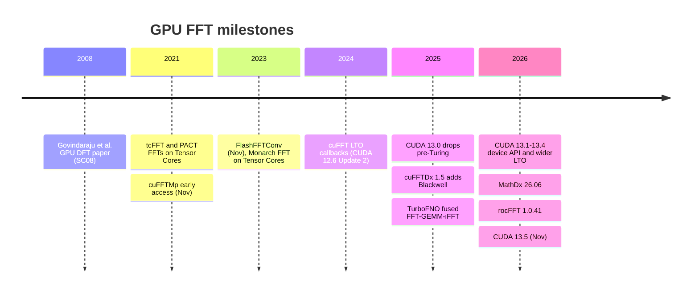
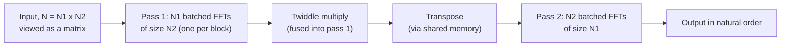

---
tags:
  - gpu-programming
  - libraries
  - fft
  - cufft
  - signal-processing
status: draft
sources:
  - https://docs.nvidia.com/cuda/cufft/index.html
  - https://docs.nvidia.com/cuda/archive/13.4.2/pdf/CUDA_Toolkit_Release_Notes.pdf
  - https://docs.nvidia.com/cuda/cuda-toolkit-release-notes/index.html
  - https://developer.nvidia.com/blog/nvidia-cuda-13-5-brings-nvidia-vera-rubin-ga-support/
  - https://docs.nvidia.com/cuda/cufftdx/release_notes.html
  - https://docs.nvidia.com/cuda/cufftdx/introduction1.html
  - https://docs.nvidia.com/cuda/mathdx/release_notes.html
  - https://docs.nvidia.com/cuda/cufftmp
  - https://developer.nvidia.com/blog/how-to-scale-fast-fourier-transforms-to-exascale-on-modern-nvidia-gpu-architectures/
  - https://fftw.org/speed/method.html
  - https://github.com/DTolm/VkFFT
  - https://ieeexplore.ieee.org/document/10036080
  - https://rocm.docs.amd.com/projects/rocFFT/en/latest/design/codegen.html
  - https://rocm.docs.amd.com/en/latest/release.html
  - https://rocm.docs.amd.com/en/docs-7.2.4/release/changelog.html
  - https://arxiv.org/pdf/2311.05908
  - https://hazyresearch.stanford.edu/blog/2023-11-13-flashfftconv
  - https://arxiv.org/pdf/2104.11471
  - https://merthidayetoglu.github.io/Accelerating_Fourier_and_Number_Theoretic_Transforms_using_Tensor_Cores_and_Warp_Shuffles.pdf
  - https://arxiv.org/html/2504.11681v1
  - https://arxiv.org/abs/2603.27569
  - https://www.emergentmind.com/papers/2606.23698
  - https://www.microsoft.com/en-us/research/?p=159516
  - https://www.nvidia.com/en-us/data-center/h100/
created: 2026-11-26
updated: 2026-11-26
---

## Table Of Contents

---

- [[#TL;DR|TL;DR]]
- [[#The Problem|The Problem]]
- [[#Foundations|Foundations]]
    - [[#The DFT and Its Cost|The DFT and Its Cost]]
    - [[#Cooley-Tukey and the Radix-2 Butterfly|Cooley-Tukey and the Radix-2 Butterfly]]
    - [[#In-Place vs Stockham|In-Place vs Stockham]]
    - [[#Why FFTs Are Bandwidth-Bound|Why FFTs Are Bandwidth-Bound]]
- [[#How We Got Here|How We Got Here]]
- [[#How It Works|How It Works]]
    - [[#Mapping an FFT onto a GPU|Mapping an FFT onto a GPU]]
    - [[#Large N, Multi-Pass and Transposes|Large N, Multi-Pass and Transposes]]
    - [[#cuFFT Plans, Batches and Real Transforms|cuFFT Plans, Batches and Real Transforms]]
    - [[#Callbacks and LTO|Callbacks and LTO]]
    - [[#cuFFTDx, FFTs Inside Your Kernel|cuFFTDx, FFTs Inside Your Kernel]]
    - [[#Multi-GPU with cuFFTXt and cuFFTMp|Multi-GPU with cuFFTXt and cuFFTMp]]
    - [[#Beyond NVIDIA, VkFFT and rocFFT|Beyond NVIDIA, VkFFT and rocFFT]]
    - [[#FFTs on Tensor Cores|FFTs on Tensor Cores]]
- [[#Where It Is Now|Where It Is Now]]
- [[#Trade-offs & Open Problems|Trade-offs & Open Problems]]
- [[#Resources|Resources]]
- [[#Related Notes|Related Notes]]

## ***TL;DR***
---
*The Fast Fourier Transform turns an $O(N^2)$ matrix-vector product into $O(N \log N)$ work, but on a GPU that work is so light per byte that FFTs are almost always limited by memory bandwidth, not arithmetic. Fast GPU FFTs are therefore about moving data as few times as possible: keeping whole sub-transforms in registers and shared memory, batching, and fusing the FFT with whatever comes before and after it.*

- **What it computes.** The discrete Fourier transform (DFT) of $N$ samples. Done directly that is $N^2$ complex multiply-adds; the Cooley-Tukey FFT splits it recursively into small "butterflies" for about $5N\log_2 N$ floating-point operations, the conventional count used by FFTW's benchmarks ([FFTW method](https://fftw.org/speed/method.html)).
- **Why it is memory-bound.** A single-precision complex FFT does only about $5\log_2 N / 16$ FLOPs per byte if it reads and writes the data once: about 6 FLOPs/byte at $N = 2^{20}$, well under an H100's roughly 20 FLOPs/byte ridge for non-Tensor-Core math (see [[Roofline Model and Arithmetic Intensity]]). Every extra pass over HBM costs time directly.
- **The libraries.** **cuFFT** (host API: plans, batched and strided transforms, real-to-complex, LTO callbacks), **cuFFTDx** (FFTs as a device function you call inside your own kernel), **cuFFTMp** (multi-node, NVSHMEM or NCCL), plus **VkFFT** (cross-vendor, runtime code generation) and AMD's **rocFFT** ([cuFFT docs](https://docs.nvidia.com/cuda/cufft/index.html), [VkFFT](https://github.com/DTolm/VkFFT)).
- **Tensor Cores.** An FFT can be rewritten as a sequence of small dense matrix multiplies, which lets it use [[Tensor Cores]]. tcFFT (2021) and **FlashFFTConv** (Hazy Research, 2023) did this; FlashFFTConv speeds exact FFT convolutions "by up to 7.93× over PyTorch" for long-convolution models ([Fu et al.](https://arxiv.org/pdf/2311.05908)).
- **Where it is now (Nov 2026).** CUDA 13.1 to 13.4 brought Blackwell tuning, a device API that generates code for cuFFTDx, and LTO callbacks for nearly all sizes; CUDA 13.5 is GA (Nov 4, 2026). MathDx 26.06.1 ships cuFFTDx 1.7.3. AMD's rocFFT 1.0.41 (Nov 18, 2026) added JIT callbacks on multi-GPU transforms ([CUDA release notes](https://docs.nvidia.com/cuda/archive/13.4.2/pdf/CUDA_Toolkit_Release_Notes.pdf), [MathDx notes](https://docs.nvidia.com/cuda/mathdx/release_notes.html), [ROCm notes](https://rocm.docs.amd.com/en/latest/release.html)).

## ***The Problem***
---
*Fourier transforms sit inside signal processing, imaging, physics simulation and some deep-learning models, often in a tight loop. On a GPU the arithmetic is cheap and the data movement is not, so a naive FFT wastes most of the chip and an FFT done as a separate library call wastes HBM round trips.*

FFTs show up wherever data is easier to handle in frequency space:

| Use | What the FFT does | Typical shape |
|---|---|---|
| Signal processing (radar, radio astronomy, audio, 5G) | Filters, spectra, channelization | Many short 1D transforms, batched |
| Imaging (MRI, cryo-EM, microscopy) | Reconstruction, correlation | 2D and 3D transforms |
| PDE solvers and molecular dynamics | Spectral methods, Poisson solves, particle-mesh Ewald (e.g. GROMACS) | Large 3D transforms, often distributed over many GPUs ([NVIDIA, Dec 2025](https://developer.nvidia.com/blog/how-to-scale-fast-fourier-transforms-to-exascale-on-modern-nvidia-gpu-architectures/)) |
| Convolution with a long filter | Convolution theorem: $x * k = \mathcal{F}^{-1}(\mathcal{F}x \cdot \mathcal{F}k)$ | Two FFTs plus an elementwise product |
| Fourier Neural Operators (FNO) | FFT → truncate modes → complex GEMM → inverse FFT | Batched 1D/2D transforms around a GEMM ([TurboFNO](https://arxiv.org/html/2504.11681v1)) |
| Long-convolution sequence models (Hyena, M2-BERT, HyenaDNA) | Convolutions as long as the sequence (up to millions of tokens) | FFT convolution of length $2L$ ([FlashFFTConv](https://arxiv.org/pdf/2311.05908)) |

Three things make GPU FFTs hard:

1. **Low arithmetic intensity.** An FFT does $O(\log N)$ work per element, so it cannot hide memory traffic the way a GEMM does ([[Tiled Matrix Multiplication (GEMM)]]).
2. **All-to-all data flow.** Each output depends on every input. Somewhere, data must be shuffled across the whole array: between threads, between thread blocks, or between GPUs.
3. **No Tensor Cores by default.** The butterflies run on the ordinary FP32/FP64 pipes. FlashFFTConv quotes an H100 at about 1.0 PFLOP/s for matrix multiplies versus 67 TFLOP/s for general arithmetic, a 15x gap an FFT normally cannot touch ([Fu et al.](https://arxiv.org/pdf/2311.05908)).

## ***Foundations***
---
*The FFT is the DFT factored into $\log_2 N$ stages of cheap butterflies. Counting the butterflies gives the standard $5N\log_2 N$ flop figure, and dividing that by the bytes moved shows why the FFT lives on the memory side of the roofline.*

### The DFT and Its Cost

$$
X_k = \sum_{n=0}^{N-1} x_n \, e^{-2\pi i \, kn/N}, \qquad k = 0, \dots, N-1
$$

*In plain English: output $k$ is the input multiplied by a complex sinusoid that turns $k$ times over the signal, summed up.* Written as a matrix, $X = F_N x$ where $F_N$ is the $N \times N$ DFT matrix, so the direct method costs $N^2$ complex multiply-adds.

**Worked number.** For $N = 2^{20} \approx 10^6$ samples:

- Direct DFT: $N^2 = 2^{40} \approx 1.1 \times 10^{12}$ complex multiply-adds.
- FFT: $\tfrac{N}{2}\log_2 N = 2^{19} \cdot 20 \approx 1.05 \times 10^{7}$ butterflies.
- Ratio: about $10^{5}$. On a GPU doing $10^{13}$ useful operations per second, that is the difference between a fraction of a second and microseconds.

### Cooley-Tukey and the Radix-2 Butterfly

Split the input into even and odd samples. Each half is a DFT of size $N/2$ ($E_k$ and $O_k$), and the full result is assembled with one **twiddle factor** $W_N^k = e^{-2\pi i k/N}$:

$$
X_k = E_k + W_N^k \, O_k, \qquad X_{k+N/2} = E_k - W_N^k \, O_k, \qquad k = 0,\dots,\tfrac{N}{2}-1
$$

*In plain English: two half-size transforms, then one multiply and one add/subtract per pair of outputs.* That pair of equations is the **butterfly**. Applied recursively it gives $T(N) = 2T(N/2) + O(N)$, so $O(N\log N)$.

Counting flops: a complex multiply is 6 real flops and a complex add 2, so one butterfly is $6 + 2 + 2 = 10$ flops. There are $N/2$ butterflies per stage and $\log_2 N$ stages:

$$
\text{FLOPs} \approx 10 \cdot \frac{N}{2} \cdot \log_2 N = 5N\log_2 N
$$

FFTW's benchmark pages use exactly this, "5 N log2(N)" for complex and "2.5 N log2(N)" for real transforms, and warn it "is not an actual flop count; it is simply a convenient scaling" ([FFTW method](https://fftw.org/speed/method.html)). Real libraries use **higher radices** (4, 8, 16) and mixed radices (3, 5, 7, ...) that do fewer flops and, more importantly, fewer passes over the data. cuFFT implements "radix-2, radix-3, radix-5, and radix-7" building blocks, has optimized kernels for sizes $2^a 3^b 5^c 7^d$, handles other primes up to 127 with radix-$m$ blocks, and falls back to **Bluestein's algorithm** (an FFT of a padded, chirp-multiplied sequence) for anything else ([cuFFT docs](https://docs.nvidia.com/cuda/cufft/index.html)).

### In-Place vs Stockham

The textbook iterative Cooley-Tukey is **in place**: it overwrites the input array stage by stage, but its natural output is in *bit-reversed* order (output $k$ lands at the index whose binary digits are $k$'s reversed), so it needs a separate scattered reordering pass.

The **Stockham** formulation instead works **out of place**, reading from one buffer and writing to another ("ping-pong") with the reordering folded into each stage's indexing. Output comes out in natural order and every stage's reads and writes are regular. On GPUs that trade (2x memory for regular access and no bit-reversal pass) is almost always worth it; AMD's rocFFT generates "tiled (row/column) + strided + batched Stockham kernels for arbitrary factorization" ([rocFFT codegen](https://rocm.docs.amd.com/projects/rocFFT/en/latest/design/codegen.html)), and recent GPU FFT papers build on radix-8 Stockham kernels ([Bergach, 2026](https://arxiv.org/abs/2603.27569)). Inside shared memory the distinction blurs: a block can do the passes in place in shared memory and only touch global memory out of place.

### Why FFTs Are Bandwidth-Bound

Let $b$ be bytes per complex element (8 for FP32 complex, 16 for FP64) and $P$ the number of times the data makes a round trip to HBM. Arithmetic intensity is:

$$
\text{AI} = \frac{5N\log_2 N}{2\,b\,N\,P} = \frac{5\log_2 N}{2\,b\,P}\ \text{FLOPs/byte}
$$

*In plain English: intensity grows only with $\log N$, and every extra pass divides it.*

**Worked example, H100 SXM, FP32 complex, $N = 2^{20}$, one pass ($P=1$):**

- FLOPs: $5 \cdot 2^{20} \cdot 20 \approx 1.05 \times 10^8$.
- Bytes: read + write $= 2 \cdot 8 \cdot 2^{20} \approx 16.8$ MB.
- AI $= 100/16 = 6.25$ FLOPs/byte.
- H100 ridge for non-Tensor-Core math: $67\ \text{TFLOP/s} / 3.35\ \text{TB/s} \approx 20$ FLOPs/byte ([Fu et al.](https://arxiv.org/pdf/2311.05908) for 67 TFLOP/s; [H100 page](https://www.nvidia.com/en-us/data-center/h100/) for 3.35 TB/s).
- Time at the memory roof: $16.8\ \text{MB} / 3.35\ \text{TB/s} \approx 5.0\ \mu s$. Time at the compute roof: $1.05 \times 10^8 / 67 \times 10^{12} \approx 1.6\ \mu s$.

So even a perfect one-pass FFT is about 3x memory-bound, and a two-pass version is about 6x. FP64 halves AI again. This is why the "flops" figures FFT libraries quote are really a bandwidth measurement in disguise, and why the important optimizations are about passes, not arithmetic.

## ***How We Got Here***
---
*GPU FFTs went from hand-written shared-memory kernels to a mature cuFFT, then grew in three directions: into user kernels (cuFFTDx and callbacks), across GPUs (cuFFTMp), and onto Tensor Cores (research). Since 2025 the action is fusion and LTO.*



- **Early GPU FFTs.** Microsoft Research's "High Performance Discrete Fourier Transforms on Graphics Processors" (Govindaraju, Lloyd, Dotsenko, Smith, Manferdelli; SC08) is the classic early study of mapping FFTs onto GPU memory levels ([MSR](https://www.microsoft.com/en-us/research/?p=159516)). Volkov's 2010 talk used CUFFT as an example of "faster codes run at lower occupancy": 45 to 93 Gflop/s while occupancy fell from 33% to 17% (see [[Occupancy and Latency Hiding]]).
- **cuFFT matures.** Batched and strided ("advanced layout") plans, half and bfloat16 transforms, multi-GPU through `cufftXt` (up to 16 GPUs on one node), and callbacks for fusing loads and stores. Legacy callbacks were deprecated in CUDA 11.4 ([cuFFT docs](https://docs.nvidia.com/cuda/cufft/index.html)).
- **2021: Tensor Cores and multi-node.** tcFFT (Shanghai Jiao Tong) and a PACT 2021 paper by Durrani et al. showed half-precision FFTs on Tensor Cores beating cuFFT by up to about 1.9x and 1.5x ([tcFFT](https://arxiv.org/pdf/2104.11471), [Durrani et al.](https://merthidayetoglu.github.io/Accelerating_Fourier_and_Number_Theoretic_Transforms_using_Tensor_Cores_and_Warp_Shuffles.pdf)). cuFFTMp's first early-access release came in November 2021 ([cuFFTMp](https://docs.nvidia.com/cuda/cufftmp)).
- **2023: FFTs for long-sequence ML.** FlashFFTConv put exact FFT convolutions on Tensor Cores for Hyena-style models ([Hazy Research](https://hazyresearch.stanford.edu/blog/2023-11-13-flashfftconv)); VkFFT's white paper made the cross-platform library citable ([IEEE Access](https://ieeexplore.ieee.org/document/10036080)).
- **2024-2026: LTO.** Link-time-optimized callbacks arrived in CUDA 12.6 Update 2 as "a replacement for the deprecated (legacy) callbacks" and spread to almost all sizes by CUDA 13.3; cuFFTDx 1.6 (MathDx 25.12) began extending cuFFTDx with cuFFT's LTO kernels ([cuFFT docs](https://docs.nvidia.com/cuda/cufft/index.html), [cuFFTDx notes](https://docs.nvidia.com/cuda/cufftdx/release_notes.html)).

## ***How It Works***
---
*A GPU FFT does as many radix stages as fit in registers and shared memory per kernel, and only goes back to HBM between those groups. The libraries differ in who controls that: cuFFT picks the plan for you, cuFFTDx lets you embed one block-level FFT in your own kernel, and cuFFTMp adds network all-to-alls.*

### Mapping an FFT onto a GPU

The memory levels ([[GPU Memory Hierarchy]]) map onto FFT sizes:

| Level | What fits | How the stages run |
|---|---|---|
| Registers (one thread) | 8 to 64 points | A thread does a whole radix-8/16 sub-FFT with no communication |
| Warp | Up to a few hundred points | Exchange with `__shfl_xor_sync` butterflies ([[Warp Divergence and Warp-Level Primitives]]) |
| Shared memory (one block) | Thousands of points | Threads do register sub-FFTs, write to shared memory, `__syncthreads()`, read back transposed, repeat |
| Global memory (whole grid) | Anything | Separate passes, each a batched set of smaller FFTs |

The heart of a shared-memory stage is a butterfly like this (a simplified radix-2 sketch, not library code):

```cpp
__device__ void butterfly(float2& a, float2& b, float2 w) {
    float2 t = make_float2(w.x*b.x - w.y*b.y,   // t = w * b (complex multiply)
                           w.x*b.y + w.y*b.x);
    b = make_float2(a.x - t.x, a.y - t.y);      // lower output: a - w*b
    a = make_float2(a.x + t.x, a.y + t.y);      // upper output: a + w*b
}
```

- `float2` holds one complex number (real in `.x`, imaginary in `.y`).
- Line 2-3: the twiddle multiply, 4 multiplies and 2 adds.
- Lines 4-5: the add and subtract that give $E_k \pm W^k O_k$. Ten flops in all, the number behind $5N\log_2 N$.

Practical details that matter:

- **Twiddle factors.** Computed on the fly with `sincosf` or read from a precomputed table; tables cost bandwidth and cache, on-the-fly computation costs accuracy and special-function throughput. VkFFT precomputes double and quad-precision twiddles on the CPU, and its README credits FP128-precomputed twiddles for beating cuFFT and rocFFT on double-precision accuracy ([VkFFT](https://github.com/DTolm/VkFFT)).
- **Bank conflicts.** Radix stages access shared memory at power-of-two strides, which is the worst case for the 32 banks: many lanes hit the same bank and the access serializes. FFT kernels pad rows or swizzle indices, exactly as in [[Shared Memory and Bank Conflicts]]; TurboFNO, for example, uses shared-memory swizzling to keep banks fully used ([TurboFNO](https://arxiv.org/html/2504.11681v1)).
- **Coalescing.** The first and last passes must read and write global memory in contiguous runs ([[Memory Coalescing]]). A stage whose natural access is strided is reorganized so a block loads a contiguous tile and transposes it in shared memory.
- **Registers vs occupancy.** Larger per-thread sub-FFTs save shared-memory round trips but raise register use ([[Occupancy and Latency Hiding]]); FFT kernels typically run at low occupancy on purpose.

### Large N, Multi-Pass and Transposes

When $N$ is too large for one block, write $N = N_1 N_2$ and treat the signal as an $N_1 \times N_2$ matrix. FlashFFTConv states the factorization compactly:

$$
F_N = P\,(I_{N_2} \otimes F_{N_1})\,D\,P^{-1}\,(I_{N_1} \otimes F_{N_2})\,P
$$

*In plain English: do $N_1$ independent FFTs of size $N_2$, multiply every element by a twiddle factor ($D$ is diagonal), transpose ($P$ is a permutation), then do $N_2$ FFTs of size $N_1$* ([Fu et al.](https://arxiv.org/pdf/2311.05908)). This is the classic "four-step" (or Bailey "six-step", with explicit transposes) algorithm.



Each pass is a batch of block-sized FFTs, so every pass reads and writes HBM once: a large FFT costs about $P = \lceil \log_{S} N \rceil$ round trips, where $S$ is the largest size one block handles. 2D and 3D transforms are the same idea, with an axis per pass. Keeping $P$ at 1 or 2 is the main design goal of every large-FFT plan, and the same structure scales out across GPUs, where the transpose becomes a network all-to-all.

### cuFFT Plans, Batches and Real Transforms

cuFFT follows the FFTW model: create a **plan** once (it picks radices, kernels and passes for a given size, layout, type and batch), execute it many times, destroy it. A batched real-to-complex transform of 1,024 signals of 4,096 samples:

```cpp
#include <cufft.h>
int n[1]       = {4096};             // transform length
int inembed[1] = {4096};             // input row length (reals)
int onembed[1] = {4096/2 + 1};       // output row length (complex): 2049
cufftHandle plan;
cufftPlanMany(&plan, 1, n,
              inembed, 1, 4096,      // istride = 1, idist = 4096 reals between signals
              onembed, 1, 2049,      // ostride = 1, odist = 2049 complex between signals
              CUFFT_R2C, 1024);      // real-to-complex, 1024 signals
cufftSetStream(plan, stream);        // run on a user stream
cufftExecR2C(plan, d_in, d_out);     // d_in: cufftReal*, d_out: cufftComplex*
cufftDestroy(plan);
```

- `cufftPlanMany(...)`: one plan for a whole batch. The signature is `cufftPlanMany(plan, rank, n, inembed, istride, idist, onembed, ostride, odist, type, batch)`; for 1D, element `x` of batch `b` is read from `input[b * idist + x * istride]` ([cuFFT docs](https://docs.nvidia.com/cuda/cufft/index.html)).
- `inembed`/`onembed`: the storage size of each dimension, which may be larger than `n` (padded rows). `idist`/`odist` are "the distance between the first element of two consecutive batches".
- `onembed = 2049`: a real input's spectrum "satisfies Hermitian symmetry", so cuFFT stores only the $\lfloor N/2 \rfloor + 1$ non-redundant outputs and does roughly half the work.
- `cufftSetStream`: makes the FFT one more operation in a stream, so it overlaps with copies and other kernels ([[Streams, Events and Async Execution]]) and can be captured in [[CUDA Graphs]].

**Roofline check on this example (H100):** $1024 \times 2.5 \cdot 4096 \cdot 12 \approx 1.26 \times 10^8$ flops; bytes $= 16.8$ MB in $+ 16.8$ MB out $\approx 33.6$ MB, so AI $\approx 3.7$ FLOPs/byte and the floor is about $33.6\ \text{MB}/3.35\ \text{TB/s} \approx 10\ \mu s$. Batching matters because a single 4,096-point FFT would not fill the GPU.

Other things the plan controls ([cuFFT docs](https://docs.nvidia.com/cuda/cufft/index.html)):

- **Workspace.** "By default cuFFT always allocates its own work area in GPU memory." To share memory between plans or with a caching allocator, turn off auto-allocation (`cufftSetAutoAllocation`), query the size (`cufftGetSize`, `cufftEstimate*`), and pass your own buffer with `cufftSetWorkArea`. CUDA 13.4 added alignment checks on user-provided work areas ([13.4 notes](https://docs.nvidia.com/cuda/archive/13.4.2/pdf/CUDA_Toolkit_Release_Notes.pdf)).
- **Precision.** Half (SM 7.5+) and bfloat16 (SM 8.0+) transforms are limited to power-of-two sizes, no multi-GPU, and under 4 billion elements; FP32 and FP64 support all sizes.
- **Accuracy.** Pure Cooley-Tukey has "relative error growing proportionally to log2(N)"; Bluestein does more work per point and is less accurate. In half precision the first output (the sum of all inputs) can overflow.

### Callbacks and LTO

A plain cuFFT call reads its input from global memory and writes its output back. If you need to, say, apply a window before the FFT and multiply by a filter after, that is two more kernels and two more HBM round trips, which for a bandwidth-bound op roughly triples the time. **Callbacks** are small device functions cuFFT calls on each element as it loads or stores, so the window and filter ride along with the FFT's own memory traffic ([[Kernel Fusion]]).

- **Legacy callbacks** (separately compiled device function pointers) are deprecated since CUDA 11.4 and only in the static library on 64-bit Linux.
- **LTO callbacks** (CUDA 12.6 Update 2 onward): you compile the callback to LTO-IR, and cuFFT links it into its kernel at plan time with **nvJitLink** and **NVRTC**, so the compiler can inline and optimize across the boundary ([cuFFT docs](https://docs.nvidia.com/cuda/cufft/index.html)).
- **CUDA 13.x evolution:** 13.2 made LTO kernels require NVRTC; 13.3 extended LTO to sizes divisible by primes above 127 and broadened callback support; 13.3 Update 1 shipped a known bug in real-side (R2C/C2R) LTO callbacks for some large even sizes, fixed in 13.4; 13.4 added a plan property to disable FMA contraction in LTO kernels and one to force Bluestein-only kernels ([13.4 notes](https://docs.nvidia.com/cuda/archive/13.4.2/pdf/CUDA_Toolkit_Release_Notes.pdf)).

### cuFFTDx, FFTs Inside Your Kernel

Callbacks fuse simple per-element work. For anything richer (a full convolution, an FFT followed by a GEMM, an FFT on data already in shared memory) you want the FFT to be a **function inside your kernel**. That is cuFFTDx, part of NVIDIA's MathDx "device extensions" with cuBLASDx and cuSolverDx ([MathDx](https://docs.nvidia.com/cuda/mathdx/release_notes.html)). From the official introduction ([cuFFTDx intro](https://docs.nvidia.com/cuda/cufftdx/introduction1.html)):

```cpp
using FFT = decltype(Size<128>() + Precision<float>() + Type<fft_type::c2c>()
                   + Direction<fft_direction::forward>()
                   + FFTsPerBlock<2>() + ElementsPerThread<8>()
                   + SM<750>() + Block());

complex_type thread_data[FFT::storage_size];          // this thread's 8 points
// ... load from global memory with stride FFT::stride ...
extern __shared__ __align__(alignof(float4)) complex_type shared_mem[];
FFT().execute(thread_data, shared_mem, workspace);     // block-wide FFT
// ... store results, or keep computing on them ...
```

- `decltype(Size<128>() + ...)`: the FFT is described at compile time by adding **operators**: size, precision, complex-to-complex, forward, two FFTs per block, eight elements per thread, compiled for SM 7.5, executed by a whole thread `Block()`. Building the type costs nothing at run time.
- `thread_data[FFT::storage_size]`: each thread holds its points in registers; thread `t` holds elements `i * stride + t`.
- `shared_mem`: `FFT::shared_memory_size` bytes the block uses to exchange data between radix stages.
- `FFT().execute(...)`: the block performs the transform; results come back in `thread_data`, ready for whatever your kernel does next, without touching HBM.

This is how fused FFT convolutions and FNO layers are written: load once, FFT, multiply or GEMM, inverse FFT, store once. cuFFTDx's limits are that each FFT must fit in one block, and that the supported size list is finite. Since 1.4 an LTO-enabled build adds "over 1000 additional sizes without a workspace requirement", and since CUDA 13.1 cuFFT exposes an experimental **device API** that generates device-function code for cuFFTDx, so cuFFTDx can reuse cuFFT's own tuned kernels ([cuFFTDx notes](https://docs.nvidia.com/cuda/cufftdx/release_notes.html), [13.4 notes](https://docs.nvidia.com/cuda/archive/13.4.2/pdf/CUDA_Toolkit_Release_Notes.pdf)).

### Multi-GPU with cuFFTXt and cuFFTMp

A distributed FFT splits the array across GPUs, does local FFTs along the axes each GPU fully owns, then performs a global **transpose** (an all-to-all exchange) so the remaining axis becomes local, and does the last FFTs. The decomposition decides how many all-to-alls and with how many peers:

| Decomposition | Split | Exchanges | Limit |
|---|---|---|---|
| Slab (1D) | Along one axis | One all-to-all among all GPUs | At most $N$ GPUs for an $N^3$ grid |
| Pencil (2D) | Along two axes | Two all-to-alls, each within a row or column of GPUs | Scales to $N^2$ GPUs |

- **cuFFTXt** handles up to 16 GPUs on one node: `cufftXtSetGPUs`, `cufftXtMalloc`, `cufftXtMemcpy`, then execute ([cuFFT docs](https://docs.nvidia.com/cuda/cufft/index.html)).
- **cuFFTMp** is the multi-process, multi-node library, with slab and pencil decompositions with arbitrary block sizes, a standalone reshape API, and NVSHMEM or NCCL communication backends; version 12.6.0 is current ([cuFFTMp docs](https://docs.nvidia.com/cuda/cufftmp)). See [[Multi-GPU Communication: NVLink and NCCL]] and [[GPUDirect RDMA and Storage]].

NVIDIA's December 2025 scaling study gives the numbers ([NVIDIA blog](https://developer.nvidia.com/blog/how-to-scale-fast-fourier-transforms-to-exascale-on-modern-nvidia-gpu-architectures/)):

- On 2,048 GPUs, a $12288^3$ FFT ran at 1.69 PFLOP/s on DGX H100 versus 851 TFLOP/s on DGX A100 (about 2x, tracking 1.5x faster NVLink and 2x faster InfiniBand).
- A $1024^3$ FFT took 0.41 ms on 64 GPUs of one GB200 NVL72 rack, versus 0.94 ms on 1,024 H100s and 1.42 ms on 512 A100s. Inside one NVLink domain it scaled linearly; beyond 64 GPUs it is limited by InfiniBand between racks.
- GROMACS particle-mesh Ewald with cuFFTMp reached about 190 to 200 ns/day on a 12.4M-atom benchmark.

The lesson is the same as on one GPU, one level up: the FFT is limited by the bandwidth of its all-to-all, so it scales with the interconnect, not the FLOPs.

### Beyond NVIDIA, VkFFT and rocFFT

- **VkFFT** (Dmitrii Tolmachev, MIT license) is a header-only C library that generates and compiles kernels at run time for Vulkan, CUDA, HIP, OpenCL, Level Zero and Metal. It supports radix 2/3/4/5/7/8/11/13 (radix 3 to 13 perform comparably to powers of two), Rader's algorithm for primes from 17 to about 10,000 and Bluestein for the rest, R2C/C2R and DCT types I to IV, built-in convolutions and zero padding, and half, single, double and double-double ("quad") precision. Half precision stores in FP16 but computes in FP32 ([VkFFT](https://github.com/DTolm/VkFFT), [white paper](https://ieeexplore.ieee.org/document/10036080)).
- **rocFFT** is AMD's library (with **hipFFT** as the cuFFT-compatible interface). Its Python code generator emits tiled, strided, batched Stockham kernels that do in-place FFTs inside LDS (AMD's shared memory) ([rocFFT codegen](https://rocm.docs.amd.com/projects/rocFFT/en/latest/design/codegen.html)). See [[ROCm and HIP]].

### FFTs on Tensor Cores

The factorization above turns each pass into $N_1$ or $N_2$ small DFTs, and a batch of small DFTs is a matrix multiply by a small $F_{N_1}$. That lets the FFT use [[Tensor Cores]], at the cost of doing more flops ($O(N\sqrt{N})$ for a two-factor split instead of $O(N\log N)$), which is fine when Tensor Cores are 15x faster and the op is memory-bound anyway.

| Work | Idea | Result |
|---|---|---|
| tcFFT (Li, Cheng, Lin, 2021) | Radix-16 DFT as a 16×16 FP16 matrix (one Tensor Core fragment); radix 2/4 on CUDA cores; twiddles applied directly on fragments | 1D: 1.90x average over cuFFT on V100, 1.24x on A100 when not bandwidth-bound; 2D: 1.29x to 3.24x on V100. Same error as cuFFT FP16 (about 1.8%) ([tcFFT](https://arxiv.org/pdf/2104.11471)) |
| Durrani et al. (PACT 2021) | Tensor Core DFTs plus warp-shuffle butterflies for small transforms; also NTT | Up to 1.5x over cuFFT on A100 in FP16 ([paper](https://merthidayetoglu.github.io/Accelerating_Fourier_and_Number_Theoretic_Transforms_using_Tensor_Cores_and_Warp_Shuffles.pdf)) |
| FlashFFTConv (Fu, Kumbong, Nguyen, Ré, 2023) | Order-$p$ Monarch decomposition: an FFT as $p$ matrix multiplies; $p$ chosen by a cost model to balance flops against I/O; whole convolution fused in one kernel | Up to 7.93x over PyTorch for exact FFT convolutions, up to 4.4x end to end (HyenaDNA), sequences from 256 to 4M ([paper](https://arxiv.org/pdf/2311.05908)) |
| TurboFNO (UC Riverside, 2025) | One fused kernel for FFT → truncated complex GEMM → inverse FFT in an FNO layer | Up to 150% faster than PyTorch/cuBLAS/cuFFT on A100 ([paper](https://arxiv.org/html/2504.11681v1)) |

FlashFFTConv also adds two sparse variants: **partial convolutions** (zero the tail of the kernel, like local attention) and **frequency-sparse convolutions** (skip blocks of the Monarch matmuls, up to 1.4x faster with up to 79% of entries zeroed) ([paper](https://arxiv.org/pdf/2311.05908)). Its target is the long-convolution family of [[State Space Models]] and other [[Long Context]] architectures, where a convolution as long as the sequence replaces [[Attention]].

## ***Where It Is Now***
---
*As of November 2026, cuFFT is a mature library whose recent changes are about Blackwell tuning, LTO everywhere, and plumbing its kernels into cuFFTDx. The research frontier is fusion (FFT inside larger kernels) and using low-precision Tensor Cores to emulate high-precision FFTs.*

- **cuFFT in CUDA 13.x** ([13.4 Update 1 notes, Sep 14 2026](https://docs.nvidia.com/cuda/archive/13.4.2/pdf/CUDA_Toolkit_Release_Notes.pdf)):
    - **13.0** removed Maxwell, Pascal and Volta support, removed `libcufft_static_nocallback.a`, added new error codes (`CUFFT_NVJITLINK_FAILURE`, `CUFFT_NVSHMEM_FAILURE`, ...) and improved single-precision multi-dimensional and large power-of-two FFTs.
    - **13.1** improved sizes that are powers of 2, 3, 5 and 7 on Blackwell (single and double), and added the experimental device API for cuFFTDx.
    - **13.2** deprecated `cufftDebug`; LTO kernels now require NVRTC.
    - **13.3** extended LTO to sizes with prime factors above 127.
    - **13.4** added the Bluestein-only and disable-FMA plan properties and work-area alignment checks.
    - **13.5** reached GA on Nov 4, 2026, with NVIDIA saying core math libraries "now have performance improvements on Vera Rubin"; the post lists no cuFFT-specific changes, and the online release notes still show 13.4 Update 2 as of this writing ([CUDA 13.5 post](https://developer.nvidia.com/blog/nvidia-cuda-13-5-brings-nvidia-vera-rubin-ga-support/), [release notes](https://docs.nvidia.com/cuda/cuda-toolkit-release-notes/index.html)).
- **cuFFTDx and MathDx.** The newest MathDx package is 26.06.1, with cuFFTDx 1.7.3 (a patch for R2C/C2R element-per-thread queries). cuFFTDx 1.7.x added a runtime query of supported sizes without a workspace and fuller `BlockDim` support with LTO databases (needing cuFFT 12.3.0 from CUDA 13.3); 1.7.0 dropped CUDA 12.0, Volta and the old Thor `sm_101` target. 1.5 (MathDx 25.06) added Blackwell SM100/101/120 ([cuFFTDx notes](https://docs.nvidia.com/cuda/cufftdx/release_notes.html), [MathDx notes](https://docs.nvidia.com/cuda/mathdx/release_notes.html)). The CUDA 13.5 post lists cuFFTDx among the MathDx libraries in its Tile-SIMT interop work (see [[CUDA Tile and cuTile]]).
- **Distributed.** cuFFTMp 12.6.0 is current, with NVSHMEM or NCCL backends; NVSHMEM ABI compatibility within a major version since 11.2.6, and nvmath-python exposes it from Python ([cuFFTMp](https://docs.nvidia.com/cuda/cufftmp), [NVIDIA blog](https://developer.nvidia.com/blog/how-to-scale-fast-fourier-transforms-to-exascale-on-modern-nvidia-gpu-architectures/)).
- **AMD.** rocFFT 1.0.34 to 1.0.36 shipped with ROCm 7.0 to 7.2. The ROCm Core SDK 10.2.0 release (Nov 18, 2026) brings rocFFT 1.0.41: just-in-time load/store callbacks now work on multi-GPU transforms, deprecated function-pointer callbacks no longer do, and 64-bit indexing is chosen automatically for transforms that overflow 32-bit addressing ([ROCm 10.2.0 notes](https://rocm.docs.amd.com/en/latest/release.html), [ROCm 7.2.4 changelog](https://rocm.docs.amd.com/en/docs-7.2.4/release/changelog.html)). Like NVIDIA, AMD is moving callbacks to JIT linking.
- **Research, 2025-2026.**
    - **FP64 FFTs from FP8 Tensor Cores.** Blackwell Ultra (B300) cut FP64 vector throughput to about 1.3 TFLOP/s. A May 2026 preprint by Satoshi Matsuoka proposes emulating FP64 3D FFTs with the Ozaki scheme (split numbers into low-precision slices, multiply on FP8 Tensor Cores, reconstruct exactly), Bailey's six-step FFT and an INT32 Kulisch accumulator. For a $1024^3$ FFT on B300 it *projects* about 18 ms against a 12.9 ms memory roof, with at most 2 ulps of error; the precision results come from a small Python prototype and the speed is not measured ([arXiv 2606.23698](https://www.emergentmind.com/papers/2606.23698)). See [[Low-Precision Formats: FP8, FP4 and MX]].
    - **Other platforms.** A March 2026 radix-8 Stockham FFT for Apple GPUs reports 138 GFLOP/s at $N = 4096$, 29% faster than Apple's vDSP, with a four-step decomposition beyond the 32 KiB threadgroup memory ([Bergach, 2026](https://arxiv.org/abs/2603.27569)).
    - **Fusion for ML.** FNO kernels like TurboFNO, and long-convolution models built on FlashFFTConv, keep pushing FFTs into larger fused kernels instead of library calls.

## ***Trade-offs & Open Problems***
---
*The FFT's low intensity means fusion beats tuning, while its all-to-all structure resists fusion. Precision, odd sizes and tiny transforms are where the libraries still leave performance or accuracy on the table.*

| Choice | Gain | Cost |
|---|---|---|
| cuFFT host call | Tuned plans for every size, batching, multi-GPU | Separate kernel: extra HBM round trips around it; plans are built once and reused, so shapes that change every call pay planning cost |
| LTO callbacks | Per-element pre/post work fused, no extra passes | Needs nvJitLink/NVRTC at plan time; only per-element logic; recent correctness bugs (13.3 U1) |
| cuFFTDx in your kernel | Full fusion (convolution, FNO, FFT + GEMM) | FFT must fit in one block; you own tuning, launch config and the rest of the kernel |
| Tensor Core FFT | Uses 15x more FLOPs | More total flops; FP16/BF16 accuracy; best for long batched convolutions |
| Stockham out-of-place | Regular access, natural order | 2x memory footprint |
| Bluestein for awkward sizes | Any $N$ works | More work per output point and lower accuracy than Cooley-Tukey (cuFFT docs) |

- **Precision.** Half-precision FFTs lose accuracy (tcFFT and cuFFT both show about 1.8% average relative error at FP16) and the sum in the first output can overflow. FP64 is the scientific default, and it is getting scarcer on AI-oriented GPUs, hence the Ozaki-style emulation work. Twiddle-factor accuracy alone separates libraries in double precision (VkFFT's FP128 tables).
- **Small sizes.** A single 64- or 256-point FFT cannot fill a GPU; launch overhead dominates. Batch, use [[CUDA Graphs]], or fuse with cuFFTDx.
- **Non-power-of-two sizes.** Sizes with large prime factors fall back to Rader or Bluestein, with more work and less accuracy. cuFFT's coverage of LTO and callbacks for these sizes only became complete in 13.3, and cuFFT 13.4 added a property to force Bluestein for testing.
- **Fusion across passes.** Fusing works within one block-sized FFT. A large FFT needs global synchronization between passes (the transpose), so fusing the whole thing with neighbouring ops needs persistent kernels, cooperative launches or clusters (see [[Persistent Kernels and Stream-K]], [[Thread Block Clusters and Distributed Shared Memory]]). How far distributed shared memory on Hopper and Blackwell can stretch the "one pass" size is an open engineering question; this note found no public cuFFT documentation of cluster use.
- **Reproducibility.** FMA contraction changes rounding in the low bits; cuFFT 13.4's disable-FMA property for LTO kernels gives users control over it.
- **Portability.** cuFFT, rocFFT and VkFFT differ in size coverage, callback models and accuracy; hipFFT and VkFFT smooth the API, not the performance.

## ***Resources***
---
*Start with the cuFFT documentation's sections on data layout and accuracy, then the cuFFTDx introduction for in-kernel FFTs. For the Tensor Core angle read FlashFFTConv; for scale-out read NVIDIA's December 2025 cuFFTMp post.*

**Primary documentation**
- [cuFFT documentation](https://docs.nvidia.com/cuda/cufft/index.html): algorithms, advanced layout, callbacks, multi-GPU, accuracy.
- [CUDA 13.4 Update 1 release notes (PDF)](https://docs.nvidia.com/cuda/archive/13.4.2/pdf/CUDA_Toolkit_Release_Notes.pdf): cuFFT changes for every CUDA 13.x release.
- [cuFFTDx: First FFT](https://docs.nvidia.com/cuda/cufftdx/introduction1.html) and [release notes](https://docs.nvidia.com/cuda/cufftdx/release_notes.html): operator-based device API and version history.
- [MathDx release notes](https://docs.nvidia.com/cuda/mathdx/release_notes.html): which cuFFTDx ships in which package.
- [cuFFTMp documentation](https://docs.nvidia.com/cuda/cufftmp): multi-node FFTs, decompositions, backends.
- [rocFFT code generator design](https://rocm.docs.amd.com/projects/rocFFT/en/latest/design/codegen.html) and [ROCm 10.2.0 release notes](https://rocm.docs.amd.com/en/latest/release.html): AMD's Stockham kernels and latest changes.
- [VkFFT](https://github.com/DTolm/VkFFT) and its [white paper](https://ieeexplore.ieee.org/document/10036080): cross-platform, open-source.

**Posts**
- [How to Scale FFTs to Exascale on Modern NVIDIA GPU Architectures](https://developer.nvidia.com/blog/how-to-scale-fast-fourier-transforms-to-exascale-on-modern-nvidia-gpu-architectures/): NVIDIA, Dec 2025. cuFFTMp from A100 to GB200 NVL72.
- [FlashFFTConv blog](https://hazyresearch.stanford.edu/blog/2023-11-13-flashfftconv): Hazy Research, Nov 2023.
- [CUDA 13.5 announcement](https://developer.nvidia.com/blog/nvidia-cuda-13-5-brings-nvidia-vera-rubin-ga-support/): NVIDIA, Nov 2026.
- [FFTW benchmark methodology](https://fftw.org/speed/method.html): where the $5N\log_2 N$ convention comes from.

**Papers**
- [High Performance Discrete Fourier Transforms on Graphics Processors](https://www.microsoft.com/en-us/research/?p=159516): Govindaraju et al., SC08.
- [tcFFT](https://arxiv.org/pdf/2104.11471): Li, Cheng, Lin, 2021. Half-precision FFT on Tensor Cores.
- [Accelerating Fourier and Number Theoretic Transforms using Tensor Cores and Warp Shuffles](https://merthidayetoglu.github.io/Accelerating_Fourier_and_Number_Theoretic_Transforms_using_Tensor_Cores_and_Warp_Shuffles.pdf): Durrani et al., PACT 2021.
- [FlashFFTConv](https://arxiv.org/pdf/2311.05908): Fu, Kumbong, Nguyen, Ré, ICLR 2024. Monarch FFT convolutions.
- [TurboFNO](https://arxiv.org/html/2504.11681v1): Wu et al., 2025. Fused FFT-GEMM-iFFT.
- [FP8 is All You Need (Part 2)](https://www.emergentmind.com/papers/2606.23698): Matsuoka, May 2026. FP64 FFT emulation on FP8 Tensor Cores (projected).
- [Beating vDSP: a radix-8 Stockham FFT on Apple Silicon](https://arxiv.org/abs/2603.27569): Bergach, Mar 2026.

## Related Notes

- [[Roofline Model and Arithmetic Intensity]] — Why the FFT sits on the memory side of the roof.
- [[Shared Memory and Bank Conflicts]] — Power-of-two radix strides and how padding or swizzling fixes them.
- [[Memory Coalescing]] — First and last FFT passes must read and write contiguous runs.
- [[GPU Memory Hierarchy]] — Registers, shared memory and HBM map onto FFT sizes.
- [[Kernel Fusion]] — Callbacks and cuFFTDx exist to fuse work into the FFT.
- [[Tensor Cores]] — Where tcFFT and FlashFFTConv run their DFT matrices.
- [[Tiled Matrix Multiplication (GEMM)]] — The high-intensity contrast, and what an FFT becomes on Tensor Cores.
- [[Warp Divergence and Warp-Level Primitives]] — Shuffle-based butterflies for small transforms.
- [[Occupancy and Latency Hiding]] — FFT kernels trade occupancy for registers; Volkov's CUFFT example.
- [[Streams, Events and Async Execution]] — `cufftSetStream` and overlap.
- [[CUDA Graphs]] — Cutting launch overhead for many small FFTs.
- [[Multi-GPU Communication: NVLink and NCCL]] — The all-to-all behind distributed FFTs.
- [[cuBLAS and cuDNN]] — The sibling NVIDIA math libraries.
- [[ROCm and HIP]] — rocFFT and hipFFT.
- [[Low-Precision Formats: FP8, FP4 and MX]] — FP8 Tensor Cores as an FP64 FFT engine.
- [[State Space Models]] — Long-convolution models that run on FFT convolutions.
- [[Long Context]] — FlashFFTConv's motivation: convolutions over very long sequences.
