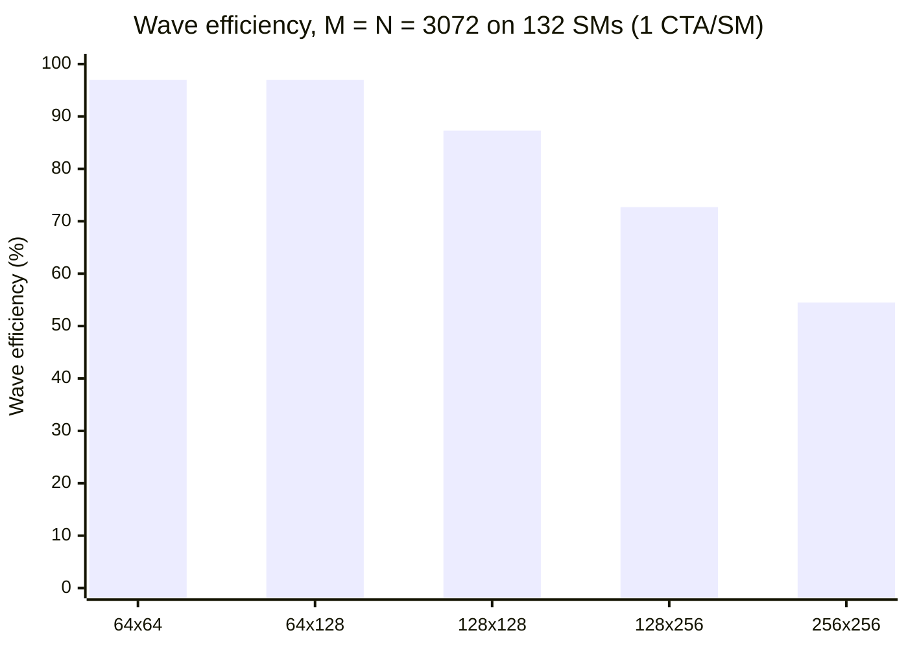
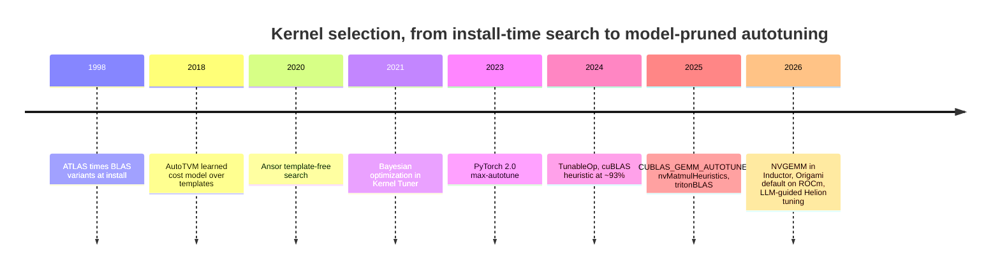
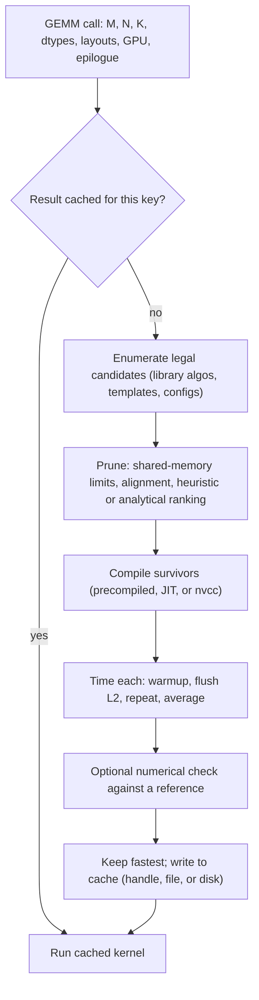

---
tags:
  - gpu-programming
  - libraries
  - gemm
  - autotuning
  - cublas
  - cutlass
  - triton
  - pytorch
aliases:
  - GEMM Autotuning
  - Kernel Selection
  - Autotuning
  - TunableOp
  - max-autotune
  - nvMatmulHeuristics
status: complete
sources:
  - https://www.netlib.org/utk/people/JackDongarra/pdf/atlas-sc98.pdf
  - https://arxiv.org/abs/1805.08166
  - https://arxiv.org/abs/2006.06762
  - https://www.usenix.org/conference/osdi20/presentation/zheng
  - https://arxiv.org/abs/2111.14991
  - https://arxiv.org/abs/2512.04226v1
  - https://docs.nvidia.com/cuda/cublas/index.html
  - https://developer.nvidia.com/blog/introducing-grouped-gemm-apis-in-cublas-and-more-performance-updates
  - https://decoder-genetics.wustl.edu/software/conda/lib/python3.1/site-packages/nvidia/cublas/include/cublasLt.h
  - https://docs.nvidia.com/cuda/nvidia-matmul-heuristics/
  - https://pypi.org/project/nvidia-matmul-heuristics/
  - https://developer.nvidia.com/blog/improving-gemm-kernel-auto-tuning-efficiency-on-nvidia-gpus-with-heuristics-and-cutlass-4-2
  - https://docs.nvidia.com/cutlass/latest/media/docs/operators/tutorials/007_heuristics.html
  - https://triton-lang.org/main/python-api/generated/triton.autotune.html
  - https://triton-lang.org/main/python-api/generated/triton.testing.do_bench.html
  - https://github.com/triton-lang/triton/blob/main/python/triton/testing.py
  - https://github.com/pytorch/pytorch/blob/v2.15.0/torch/cuda/tunable.py
  - https://github.com/pytorch/pytorch/blob/v2.4.0/torch/cuda/tunable.py
  - https://github.com/pytorch/pytorch/blob/v2.15.0/torch/_inductor/config.py
  - https://github.com/pytorch/pytorch/blob/v2.15.0/torch/__init__.py
  - https://pytorch.org/blog/pytorch-2.0-release/
  - https://pytorch.org/blog/gemms-torchinductor-cutedsl-backend/
  - https://pytorch.org/blog/pytorch-2-14-release-blog/
  - https://pytorch.org/blog/pytorch-2-15-release-blog/
  - https://pytorch.org/blog/from-minutes-to-seconds-llm-guided-autotuning-for-helion-kernels/
  - https://rocm.docs.amd.com/projects/hipBLASLt/en/latest/how-to/how-to-use-hipblaslt-offline-tuning.html
  - https://pypi.org/project/rocm-origami/
created: 2026-11-26
updated: 2026-11-28
---

## Table Of Contents

---

- [[#TL;DR|TL;DR]]
- [[#The Problem|The Problem]]
- [[#Foundations|Foundations]]
    - [[#Three Ways to Choose a Kernel|Three Ways to Choose a Kernel]]
    - [[#The Knobs Being Tuned|The Knobs Being Tuned]]
    - [[#Wave Quantization, Worked|Wave Quantization, Worked]]
    - [[#How Big the Search Is|How Big the Search Is]]
    - [[#Measuring Honestly|Measuring Honestly]]
- [[#How We Got Here|How We Got Here]]
- [[#How It Works|How It Works]]
    - [[#The Common Loop|The Common Loop]]
    - [[#cuBLAS and cuBLASLt|cuBLAS and cuBLASLt]]
    - [[#nvMatmulHeuristics and CUTLASS|nvMatmulHeuristics and CUTLASS]]
    - [[#Triton's Autotuner|Triton's Autotuner]]
    - [[#TorchInductor max-autotune|TorchInductor max-autotune]]
    - [[#PyTorch TunableOp|PyTorch TunableOp]]
    - [[#AMD - hipBLASLt Tuning, Origami and tritonBLAS|AMD: hipBLASLt Tuning, Origami and tritonBLAS]]
    - [[#Smarter Search - Bayesian, Learned and LLM-Guided|Smarter Search: Bayesian, Learned and LLM-Guided]]
- [[#Where It Is Now|Where It Is Now]]
- [[#Trade-offs & Open Problems|Trade-offs & Open Problems]]
- [[#Resources|Resources]]
- [[#Related Notes|Related Notes]]

## ***TL;DR***
---
*A GEMM library holds hundreds of kernel variants, and the fastest one depends on the matrix shape, the data type and the GPU. Kernel selection is how one gets picked for each call: by a rule, by a performance model, or by timing candidates and keeping the winner (autotuning).*

- **What gets chosen:** tile sizes, warps, pipeline stages, split-K, rasterization/swizzle, cluster shape and the work decomposition (data-parallel, split-K, [[Persistent Kernels and Stream-K|Stream-K]]). Each trades data reuse against parallelism and on-chip memory (see [[Tiled Matrix Multiplication (GEMM)]]).
- **Three strategies:**
  1. **Heuristics** are instant. cuBLAS's built-in recommender reaches about 93% (geomean) of the best kernel it has ([NVIDIA, Jun 2024](https://developer.nvidia.com/blog/introducing-grouped-gemm-apis-in-cublas-and-more-performance-updates)).
  2. **Analytical models** such as NVIDIA's nvMatmulHeuristics and AMD's Origami predict a short list of configurations.
  3. **Empirical autotuning** times candidates on the real GPU and caches the winner per shape. Examples: `@triton.autotune`, TorchInductor's `max-autotune`, PyTorch TunableOp, `CUBLAS_GEMM_AUTOTUNE`, `cutlass_profiler`.
- **Why it matters:** exhaustive search is slow. For Llama 3 405B shapes on H100 it took over 700 minutes, while 16 model-picked candidates reached 96% of peak in about 150 minutes ([NVIDIA, Sep 2025](https://developer.nvidia.com/blog/improving-gemm-kernel-auto-tuning-efficiency-on-nvidia-gpus-with-heuristics-and-cutlass-4-2)). The current pattern is to **prune with a model, then time a handful**.
- **Where it is now (Nov 2026):** PyTorch 2.14 (Sep 2026) added NVGEMM, a CuTeDSL GEMM backend ranked by nvMatmulHeuristics. It also gave TunableOp real cuBLASLt candidates on CUDA and made Origami the default tile picker for ROCm `max-autotune` ([2.14 blog](https://pytorch.org/blog/pytorch-2-14-release-blog/)). Helion's default autotuner is Bayesian (LFBO), and an LLM-guided mode cut tuning from 261 s to 39 s (geomean) on B200 ([PyTorch, Jun 2026](https://pytorch.org/blog/from-minutes-to-seconds-llm-guided-autotuning-for-helion-kernels/)). nvMatmulHeuristics 0.2.0.6 reached PyPI on Nov 25, 2026 ([PyPI](https://pypi.org/project/nvidia-matmul-heuristics/)).

## ***The Problem***
---
*One line of user code (`a @ b`) can map to hundreds of kernels, and no single one is best everywhere. Picking well per shape is worth up to tens of percent, and picking by brute force can cost hours.*

The same library, on the same GPU, wants different kernels for different calls:

| Call | Regime | What tends to win |
|---|---|---|
| 8192 × 8192 × 8192 BF16 (training) | Compute-bound | Big tiles (e.g. 128×256), deep pipelines, clusters |
| 16 × 4096 × 4096 BF16 (LLM decode) | Memory-bound, few output tiles | Small M tile, split-K or Stream-K to fill the SMs |
| 3072 × 3072 × K | Awkward tile count | A tile size that divides into full waves |
| Any shape + bias + GELU | Extra memory pass | A kernel whose epilogue fuses the op ([[Kernel Fusion]]) |

The numbers from the field show the gap:

- cuBLAS's own recommender reaches "about 93%" of the best available kernel on geomean, so some shapes do much worse ([NVIDIA, Jun 2024](https://developer.nvidia.com/blog/introducing-grouped-gemm-apis-in-cublas-and-more-performance-updates)).
- When PyTorch let TunableOp time several cuBLASLt candidates on H100, the mean was "roughly flat", but individual shapes ranged "from 0.66x to 1.57x" ([2.14 blog](https://pytorch.org/blog/pytorch-2-14-release-blog/)). The heuristic is usually right and sometimes badly wrong.
- Inductor's CuTeDSL backend beat the faster existing backend by up to 1.73× on BF16 decode shapes (M = 8 to 64), but was "at parity" on prefill-sized shapes ([PyTorch, Apr 2026](https://pytorch.org/blog/gemms-torchinductor-cutedsl-backend/)). The win depends on the shape.

Searching everything is the obvious fix, and it is slow. "The traditional approach for finding the optimal kernel involves generating thousands of potential kernel configurations," and "this entire workflow can take many hours" ([NVIDIA, Sep 2025](https://developer.nvidia.com/blog/improving-gemm-kernel-auto-tuning-efficiency-on-nvidia-gpus-with-heuristics-and-cutlass-4-2)). For JIT systems like TorchInductor and Triton the cost lands at compile time, every time a new shape appears.

## ***Foundations***
---
*Kernel selection is a search over a small number of discrete knobs whose effects interact. The knobs make sense once you see two forces: bigger tiles reuse more data, and smaller tiles fill the GPU more evenly.*

### Three Ways to Choose a Kernel

| Approach | How it decides | Cost per new shape | Typical accuracy | Examples |
|---|---|---|---|---|
| Fixed rules / heuristic tables | Hand-written or learned lookup from shape, type, GPU | Microseconds | Good on common shapes, poor on odd ones | cuBLAS default, cuDNN heuristic mode A |
| [[Analytical GPU Performance Models|Analytical performance model]] | Estimates runtime from tile math, bandwidth, caches, waves | Milliseconds | Near the best on the shapes it models | nvMatmulHeuristics, Origami, tritonBLAS |
| Empirical autotuning | Compile and time candidates on the real GPU | Seconds to hours | Best of what it tried, if measured honestly | `@triton.autotune`, `max-autotune`, TunableOp, `cutlass_profiler` |

Modern systems combine them: a model or heuristic proposes a shortlist, and timing picks from it.

### The Knobs Being Tuned

The knobs below are what nvMatmulHeuristics returns (`cta`, `warp`, `instr`, `splitK`, `swizz`, `ctaOrder`, `cluster`, `stages`) ([docs](https://docs.nvidia.com/cuda/nvidia-matmul-heuristics/)). cuBLASLt exposes almost the same list as algorithm attributes: `TILE_ID`, `STAGES_ID`, `SPLITK_NUM`, `REDUCTION_SCHEME`, `CTA_SWIZZLING`, `INNER_SHAPE_ID` and `CLUSTER_SHAPE_ID` ([cublasLt.h](https://decoder-genetics.wustl.edu/software/conda/lib/python3.1/site-packages/nvidia/cublas/include/cublasLt.h)).

| Knob | What it is | Bigger value buys | Bigger value costs |
|---|---|---|---|
| CTA tile ($B_M \times B_N \times B_K$) | Output block one thread block computes | More reuse per byte loaded | Registers and shared memory; fewer tiles to spread over SMs |
| Warp tile / instruction shape | How the CTA tile splits across warps and [[Tensor Cores]] ops | Fewer instructions | [[Register Pressure and Spilling|Register pressure]] |
| Pipeline stages | Tiles in flight in shared memory ([[TMA and Asynchronous Copies]]) | Hides memory latency | [[Shared Memory and Bank Conflicts|Shared memory]], lower [[Occupancy and Latency Hiding|occupancy]] |
| Split-K | Splits the K loop across CTAs, then reduces | Parallelism for small M×N | Extra reduction pass or atomics |
| Swizzle / raster order | Order tiles are launched in | L2 hit rate | Nothing much; wrong choice just loses reuse |
| Cluster shape | CTAs that share loads ([[Thread Block Clusters and Distributed Shared Memory]]) | Multicast loads, fewer HBM reads | Scheduling constraints |
| Decomposition | Data-parallel, split-K, Stream-K, persistent ([[Persistent Kernels and Stream-K]]) | Balanced tail waves | Fix-up traffic and scheduler logic |

### Wave Quantization, Worked

*A GPU runs output tiles in "waves" of one (or a few) per SM, so the last wave can be mostly empty. This one effect explains many surprising tile choices.*

$$\text{tiles} = \left\lceil \frac{M}{B_M} \right\rceil \cdot \left\lceil \frac{N}{B_N} \right\rceil, \qquad \text{waves} = \left\lceil \frac{\text{tiles}}{\text{SMs} \times \text{CTAs per SM}} \right\rceil, \qquad \text{wave efficiency} = \frac{\text{tiles} / (\text{SMs} \times \text{CTAs per SM})}{\text{waves}}$$

In plain words: count the output tiles, see how many rounds the SMs need to finish them, and ask how full those rounds are on average.

A tile's **arithmetic intensity** (see [[Roofline Model and Arithmetic Intensity]]) is the other side. Each K-step of a $B_M \times B_N$ tile does $2 B_M B_N B_K$ FLOPs and loads $(B_M + B_N) B_K$ elements. In FP16/BF16 (2 bytes each) that is

$$I_{\text{tile}} = \frac{2 B_M B_N B_K}{2 (B_M + B_N) B_K} = \frac{B_M B_N}{B_M + B_N} \ \text{FLOP/byte}$$

**Example: M = N = 3072 on an H100 SXM (132 SMs), one CTA per SM** (arithmetic from the formulas above):

| CTA tile | Tiles | Waves | Wave efficiency | Tile intensity (FLOP/byte) |
|---|---|---|---|---|
| 64 × 64 | 2,304 | 18 (17.45 full) | 97.0% | 32 |
| 64 × 128 | 1,152 | 9 (8.73) | 97.0% | 42.7 |
| 128 × 128 | 576 | 5 (4.36) | 87.3% | 64 |
| 128 × 256 | 288 | 3 (2.18) | 72.7% | 85.3 |
| 256 × 256 | 144 | 2 (1.09) | 54.5% | 128 |



The tile that reuses data best (256×256) leaves almost half the GPU idle in its second wave. The tile that fills waves best (64×64) has a quarter of the reuse. Which wins depends on whether this GEMM is limited by compute, by HBM bandwidth or by L2, and on how many CTAs fit per SM. No closed form settles it reliably, which is why libraries search. cuBLASLt even reports a `wavesCount` per candidate, where "1.0f suggests that when kernel is launched it will fully occupy the GPU" ([cublasLt.h](https://decoder-genetics.wustl.edu/software/conda/lib/python3.1/site-packages/nvidia/cublas/include/cublasLt.h)). Stream-K exists to remove this quantization entirely ([[Persistent Kernels and Stream-K]]).

### How Big the Search Is

An illustrative Triton matmul search space: $B_M \in \{32, 64, 128, 256\}$, $B_N$ the same, $B_K \in \{32, 64, 128\}$, warps $\in \{4, 8\}$, stages $\in \{2, 3, 4, 5\}$:

$$4 \times 4 \times 3 \times 2 \times 4 = 384 \ \text{configurations per shape}$$

If each takes half a second to compile and time (an assumption for the example), that is over three minutes per distinct shape, before counting layouts, dtypes and epilogues. A measured figure: Helion's default autotuner benchmarked about 546 configs per kernel in 261 s geomean ([PyTorch, Jun 2026](https://pytorch.org/blog/from-minutes-to-seconds-llm-guided-autotuning-for-helion-kernels/)). C++ CUTLASS is worse, because it "requires a full `nvcc` invocation for each kernel variant" ([PyTorch, Apr 2026](https://pytorch.org/blog/gemms-torchinductor-cutedsl-backend/)).

### Measuring Honestly

*An autotuner is only as good as its stopwatch. A kernel timed in a tight loop on warm caches can win the benchmark and lose in the real model.*

The full method (cold caches, clocks and power, launch gaps, noise) is in [[Benchmarking GPU Kernels Correctly]].

| Pitfall | Why it misleads | Fix used in practice |
|---|---|---|
| Warm L2 cache | Repeated runs find inputs already in L2 | Triton's `do_bench` clears a 256 MB buffer "before each kernel call to make sure that the L2 cache doesn't contain any input data" ([Triton source](https://github.com/triton-lang/triton/blob/main/python/triton/testing.py)) |
| Same inputs every run | Caches hit more often than in a real workload | TunableOp and hipBLASLt rotate through several copies of the inputs ("rotating buffer") ([TunableOp](https://github.com/pytorch/pytorch/blob/v2.15.0/torch/cuda/tunable.py); [hipBLASLt](https://rocm.docs.amd.com/projects/hipBLASLt/en/latest/how-to/how-to-use-hipblaslt-offline-tuning.html)) |
| Clocks and power state | Boost clocks drift with temperature | Warmup runs; NVIDIA's CUTLASS workflow recommends locked clocks ([NVIDIA, Sep 2025](https://developer.nvidia.com/blog/improving-gemm-kernel-auto-tuning-efficiency-on-nvidia-gpus-with-heuristics-and-cutlass-4-2)) |
| Launch overhead | Host dispatch time pollutes tiny kernels | Inductor's `autotune_cudagraph_benchmarking` times [[CUDA Graphs|CUDA Graph]] replay instead ([Inductor config](https://github.com/pytorch/pytorch/blob/v2.15.0/torch/_inductor/config.py)) |
| Wrong answers | A candidate can be fast because it is wrong | TunableOp drops a solution that "doesn't achieve the same accuracy as the default implementation" ([TunableOp](https://github.com/pytorch/pytorch/blob/v2.15.0/torch/cuda/tunable.py)) |
| Isolation | Alone, a kernel gets the whole GPU; in production it may share SMs or overlap communication | Benchmark fused variants in context; cap SMs (`cublasSetSmCountTarget`) ([cuBLAS docs](https://docs.nvidia.com/cuda/cublas/index.html)) |

## ***How We Got Here***
---
*Empirical autotuning began with CPU BLAS in the late 1990s, moved into ML compilers around 2018, and arrived at GPU libraries and PyTorch in the 2020s. The 2025–2026 shift is from "time everything" to "model first, time a few".*

- **Late 1990s, PHiPAC and ATLAS.** ATLAS (Whaley and Dongarra) paired "a code generator coupled with a timer routine": at install time it timed variants of an L1-cache-resident multiply, searching the blocking factor NB, loop unrolling and latency-hiding choices, and kept the fastest. It needed one timed kernel per platform, so installation took about 1–2 hours, against days for PHiPAC, which tuned each transpose case separately ([ATLAS, 1998](https://www.netlib.org/utk/people/JackDongarra/pdf/atlas-sc98.pdf)).
- **2018, AutoTVM.** "Learning to Optimize Tensor Programs" (Chen et al., NeurIPS 2018) learned "domain-specific statistical cost models" from measurements to guide the search "over billions of possible program variants", transferred them across workloads, and matched "state-of-the-art hand-tuned libraries" ([arXiv 1805.08166](https://arxiv.org/abs/1805.08166)); see [[ML Compilers]].
- **2020, Ansor.** Zheng et al. (OSDI 2020) widened the search space: it samples programs from a hierarchical search space, refines them "with evolutionary search and a learned cost model", and reported up to 1.7× over the state of the art on NVIDIA GPUs ([arXiv 2006.06762](https://arxiv.org/abs/2006.06762)).
- **2021, Bayesian optimization.** Willemsen, van Nieuwpoort and van Werkhoven brought Bayesian optimization to GPU kernel tuning in Kernel Tuner. They dealt with "rough, discrete, and constrained" search spaces with invalid configurations ([arXiv 2111.14991](https://arxiv.org/abs/2111.14991)).
- **2023, `max-autotune`.** PyTorch 2.0 (Mar 2023) shipped `torch.compile`, whose `max-autotune` mode "leverages Triton or template based matrix multiplications" and benchmarks them against ATen ([PyTorch 2.0](https://pytorch.org/blog/pytorch-2.0-release/); [torch.compile docstring](https://github.com/pytorch/pytorch/blob/v2.15.0/torch/__init__.py)).
- **2024, TunableOp and the 93% figure.** `torch.cuda.tunable` is documented from PyTorch 2.4. On CUDA it then had only the cuBLAS default to pick from; on ROCm it chose between rocBLAS and hipBLASLt solutions ([tunable.py, v2.4.0](https://github.com/pytorch/pytorch/blob/v2.4.0/torch/cuda/tunable.py)). NVIDIA published the ~93% geomean figure for cuBLAS's recommender with cuBLAS 12.5 ([NVIDIA, Jun 2024](https://developer.nvidia.com/blog/introducing-grouped-gemm-apis-in-cublas-and-more-performance-updates)).
- **2025, models over sweeps.** CUDA 13.0 added experimental `CUBLAS_GEMM_AUTOTUNE` (see [[cuBLAS and cuDNN]]). nvMatmulHeuristics went to early access with CUTLASS 4.2 in Sep 2025 ([NVIDIA](https://developer.nvidia.com/blog/improving-gemm-kernel-auto-tuning-efficiency-on-nvidia-gpus-with-heuristics-and-cutlass-4-2)). AMD's tritonBLAS (Dec 2025) picked Triton GEMM parameters analytically at over 95% of autotuned performance ([arXiv 2512.04226](https://arxiv.org/abs/2512.04226v1)).
- **2026, in the frameworks.** Inductor gained a CuTeDSL backend ranked by nvMatmulHeuristics (Apr), Helion added LLM-guided tuning (Jun), and PyTorch 2.14 (Sep) and 2.15 (Oct) shipped NVGEMM, cuBLASLt TunableOp and Origami (details in [[#Where It Is Now|Where It Is Now]]).



## ***How It Works***
---
*Every system here runs the same loop: key the problem, check a cache, propose candidates, prune, compile, time, keep the winner. They differ in where candidates come from and how much they prune.*

### The Common Loop



The **key** is what makes a result reusable. TunableOp keys on operator, data type, transposes and M, N, K. hipBLASLt's override file ignores leading dimensions and epilogues. Inductor keys on the problem configuration and the set of enabled backends. A key that is too fine re-tunes constantly; a key that is too coarse reuses a winner where it no longer wins.

### cuBLAS and cuBLASLt

cuBLAS gives three levels of control ([cuBLAS docs](https://docs.nvidia.com/cuda/cublas/index.html); [cublasLt.h](https://decoder-genetics.wustl.edu/software/conda/lib/python3.1/site-packages/nvidia/cublas/include/cublasLt.h)):

1. **Trust the heuristic.** `cublasGemmEx` with the default algorithm, or `cublasLtMatmul` with `algo = NULL`, lets the library's recommender pick.
2. **Let cuBLAS autotune.** `CUBLAS_GEMM_AUTOTUNE`: "The library will benchmark a number of available algorithms and choose the optimal one." The "solution is cached in cublas handle", and benchmarking "is not supported during stream capture", so it must run before [[CUDA Graphs|graph capture]].
3. **Search yourself with cuBLASLt.** `cublasLtMatmulAlgoGetHeuristic` returns a ranked list of candidate algorithms, each with a `wavesCount` utilization estimate. For a wider search, `cublasLtMatmulAlgoGetIds` lists "all algo IDs that can potentially run", `cublasLtMatmulAlgoConfigSetAttribute` sets tile, stages, split-K, swizzle and cluster on each, and `cublasLtMatmulAlgoCheck` confirms a hand-built config is valid "on current device".

A minimal search over the heuristic's top 8:

```cpp
cublasLtMatmulHeuristicResult_t cand[8]; int found = 0;
cublasLtMatmulAlgoGetHeuristic(lt, op, Ad, Bd, Cd, Dd, pref, 8, cand, &found); // 1
float best = 1e30f; int pick = 0;
for (int i = 0; i < found; ++i) {                                              // 2
  run(cand[i].algo);                                                           // 3
  cudaEventRecord(t0, s);
  for (int r = 0; r < 20; ++r) run(cand[i].algo);                              // 4
  cudaEventRecord(t1, s); cudaEventSynchronize(t1);
  float ms; cudaEventElapsedTime(&ms, t0, t1);                                 // 5
  if (ms < best) { best = ms; pick = i; }                                      // 6
}
algo_cache[{m, n, k, dtype, layout}] = cand[pick].algo;                         // 7
```

1. Ask cuBLASLt for up to 8 algorithms, best-predicted first. `pref` carries limits such as the maximum workspace and the operand alignments.
2. Try each one it returned. `found` may be fewer than 8.
3. One untimed warmup call. `run` stands for a `cublasLtMatmul` call with this `algo`, the same operands and workspace.
4. Time 20 back-to-back calls between two CUDA events on stream `s`.
5. Read the elapsed time on the GPU's clock.
6. Keep the fastest.
7. Cache the winning algorithm for this shape, type and layout, so the search runs once per key. This is what PyTorch TunableOp now does for CUDA.

### nvMatmulHeuristics and CUTLASS

**nvMatmulHeuristics** is NVIDIA's "fast, analytic heuristics for GPU tensor operations" module. Given the problem and the hardware, it recommends kernel configurations and can estimate their runtime, modelling bandwidth, throughput and L2 hit rate ([docs](https://docs.nvidia.com/cuda/nvidia-matmul-heuristics/)). Facts from the docs and NVIDIA's blog:

- It "powers some of the cuBLAS heuristics", and targets CUTLASS 2 and 3.
- It covers Ampere, Ada, Hopper and Blackwell GPUs, for FP16, BF16, FP32, TF32, FP64, FP8, INT8, INT4 and complex types.
- **Discovery** tunes the model to your kernels: "the heuristic will detect how the kernel perform through a few benchmarks run by the user". NVIDIA also ships internal discovery sets.
- It installs with `pip install nvidia-matmul-heuristics` and has C++ and Python APIs.

**Build-time use (CUTLASS 4.2).** List your GEMM problems in a JSON file and set `CUTLASS_LIBRARY_HEURISTICS_CONFIGS_PER_PROBLEM` (8 in the example). CUTLASS then generates only the predicted kernels, and `cutlass_profiler` times them. On H100 SXM for Llama 3 405B, exhaustive search took over 700 minutes, while 16 candidates per problem reached 96% of peak in about 150 minutes. On B200 for DeepSeek-R1, results reached 99% of exhaustive search "with a more than 5x speedup in build and auto-tuning time" ([NVIDIA, Sep 2025](https://developer.nvidia.com/blog/improving-gemm-kernel-auto-tuning-efficiency-on-nvidia-gpus-with-heuristics-and-cutlass-4-2)).

**Run-time ranking (CUTLASS Operators API, 4.8 docs).**

```python
heuristic = ops.get_heuristic("nvmatmul")(gpu="B200")              # 1
cands = ops.get_operators(args, target_sm="100a",
                          providers=[ops.CuTeDSLProvider],
                          heuristic=heuristic, limit=5)             # 2
```

1. Build an nvMatmulHeuristics ranker for a B200.
2. List the CuTe DSL operators that can run `args` on SM100, match them to the model's recommended configs, drop the unmatched ones, and keep the top 5.

In the tutorial's 4096³ FP16 example, 892 compatible operators were "sorted and pruned to 26". The fastest recommended ran in about 0.089 ms, against about 0.27 ms for an arbitrary unranked one. The docs warn that the ranking "is an estimate", and today it works only "for non-blockscaled GEMMs on SM100" ([CUTLASS tutorial](https://docs.nvidia.com/cutlass/latest/media/docs/operators/tutorials/007_heuristics.html)). See [[CUTLASS and CuTe]].

### Triton's Autotuner

`@triton.autotune` is "a decorator for auto-tuning a `triton.jit`'d function": it times a list of `triton.Config`s the first time it sees a new value of the `key` arguments, then reuses the winner ([Triton docs](https://triton-lang.org/main/python-api/generated/triton.autotune.html)).

```python
def drop_too_big(configs, named_args, **kwargs):                       # 1
    return [c for c in configs
            if (c.kwargs['BM'] + c.kwargs['BN']) * c.kwargs['BK'] * 2 * c.num_stages
               <= 160 * 1024]

@triton.autotune(
    configs=[triton.Config({'BM': bm, 'BN': bn, 'BK': 64},
                           num_warps=w, num_stages=s)
             for bm in (64, 128) for bn in (64, 128, 256)
             for w in (4, 8) for s in (3, 4)],                          # 2
    key=['M', 'N', 'K'],                                                # 3
    prune_configs_by={'early_config_prune': drop_too_big},              # 4
)
@triton.jit
def matmul_kernel(a_ptr, b_ptr, c_ptr, M, N, K, ...,
                  BM: tl.constexpr, BN: tl.constexpr, BK: tl.constexpr):
    ...
```

1. A pruning function. It estimates the shared memory for the pipelined A and B tiles: $(B_M + B_N) \times B_K$ elements × 2 bytes × stages. It drops configs over a 160 KiB budget we chose. For example, 128 × 256 at 4 stages needs 196,608 bytes and is dropped; at 3 stages it needs 147,456 and stays.
2. 2 × 3 × 2 × 2 = 24 configs: tile sizes, warps per block, and pipeline depth (see [[Triton]]).
3. Re-tune whenever M, N or K changes. Every distinct shape pays the tuning cost once per process.
4. Prune before timing. `prune_configs_by` also accepts a `perf_model` plus `top_k` to time only the k configs a model ranks best.

Triton times candidates with `triton.testing.do_bench` (25 ms warmup, 100 ms of repetitions by default), which clears L2 before each run. `TRITON_PRINT_AUTOTUNING=1` prints the tuning time and the winner, and `cache_results=True` saves timings to disk ([do_bench docs](https://triton-lang.org/main/python-api/generated/triton.testing.do_bench.html); [autotune docs](https://triton-lang.org/main/python-api/generated/triton.autotune.html)).

### TorchInductor max-autotune

`torch.compile(mode="max-autotune")` makes Inductor treat every GEMM as a contest ([PyTorch, Apr 2026](https://pytorch.org/blog/gemms-torchinductor-cutedsl-backend/)):

1. **Eligibility.** Inductor asks each enabled backend whether it supports the shape, layout and data type, and filters out the rest.
2. **Candidates.** Each backend proposes variants that differ "in tile size, warp configuration, and other backend-specific parameters", alongside the ATen (cuBLAS) call.
3. **Timing.** All are benchmarked on the GPU, and the fastest is selected.
4. **Fusion-aware choice.** "The top N GEMM candidates from lowering are carried forward, and possible fusions are benchmarked during scheduling." A slightly slower GEMM that can absorb the next op's epilogue can win overall.
5. **Caching.** The winner and its compiled code go to Inductor's cache, so a later compile of the same problem skips benchmarking.

The backend menu in PyTorch 2.15 is `ATen, Triton, CUTLASS, CUTEDSL, FLYDSL, NVGEMM, CK, CKTILE, CPP`, and the default is `ATEN,TRITON,CPP` ([config.py](https://github.com/pytorch/pytorch/blob/v2.15.0/torch/_inductor/config.py)):

```python
import torch._inductor.config as config
config.max_autotune_gemm_backends = "ATEN,TRITON,NVGEMM"   # 1
config.max_autotune_gemm_search_space = "EXHAUSTIVE"        # 2
config.nvgemm_max_profiling_configs = 10                    # 3
f = torch.compile(model, mode="max-autotune-no-cudagraphs") # 4
```

1. Let cuBLAS, Triton templates and NVIDIA's CuTeDSL GEMMs compete. NVGEMM needs `nvidia-cutlass-dsl` ([2.14 blog](https://pytorch.org/blog/pytorch-2-14-release-blog/)).
2. Widen the Triton search from `DEFAULT` ("balance between compile time overhead and performance") to `EXHAUSTIVE` ("maximize performance").
3. NVGEMM lists hundreds of compatible CUTLASS configurations, ranks them with nvMatmulHeuristics, and compiles and times only the top few. The April 2026 blog gave 5 as the default; the 2.15 config sets it to 10.
4. Compile with autotuning on. Plain `max-autotune` also enables CUDA Graphs on GPU ([torch.compile docstring](https://github.com/pytorch/pytorch/blob/v2.15.0/torch/__init__.py)).

Other 2.15 knobs worth knowing: `autotune_in_subproc` isolates crashing candidates in a subprocess. `incremental_autotune` spreads tuning over real calls instead of blocking the first one. `autotune_cudagraph_benchmarking` times graph replay. Local and remote autotune caches share results across machines ([config.py](https://github.com/pytorch/pytorch/blob/v2.15.0/torch/_inductor/config.py)).

### PyTorch TunableOp

TunableOp tunes **eager-mode** GEMMs, with no compiler. Once enabled, "any call to a TunableOp first checks whether it has already been tuned for the given operator inputs"; if not, and tuning is on, it times "every registered implementation" and keeps the fastest ([tunable.py, v2.15.0](https://github.com/pytorch/pytorch/blob/v2.15.0/torch/cuda/tunable.py)).

- **Candidates.** On ROCm it chooses across rocBLAS and hipBLASLt solutions. On CUDA, since PyTorch 2.14, it registers cuBLASLt heuristic candidates, 8 by default (`PYTORCH_TUNABLEOP_CUBLASLT_REQUESTED_ALGO_COUNT`). The release notes call it "a tool for rescuing shapes the stock heuristic handles badly rather than a general speedup" ([2.14 blog](https://pytorch.org/blog/pytorch-2-14-release-blog/)).
- **Timing.** Each solution runs for "100 iterations or as many iterations that can be run within 30ms, whichever is smaller". Options flush the instruction cache, rotate input buffers and set numerical-check tolerances.
- **Results file.** A CSV, `tunableop_results.csv` by default, with the device ordinal added per process. Its "Validator" lines record the PyTorch and library versions, and a mismatch rejects the file, because "the prior tunings are likely affected by other software changes". The docs' ROCm example:

```text
Validator,PT_VERSION,2.2.0
Validator,HIPBLASLT_VERSION,0.6.0-a9c5cc7
GemmTunableOp_float_NT,nt_25088_4096_64,Gemm_Hipblaslt_1219,1.262
GemmTunableOp_float_NT,nt_4096_4096_64,Gemm_Rocblas_1216,0.033
```

  Each row reads: operator and type with transposes (`float_NT`), the shape (`nt_M_N_K`), the winning solution, and its average time in ms. Replacing the solution with `Default` falls back to the untuned path.
- **Offline tuning.** Run once with `PYTORCH_TUNABLEOP_RECORD_UNTUNED=1` and tuning off to log the shapes (`tunableop_untuned0.csv`), then tune them later with `tune_gemm_in_file`. `mgpu_tune_gemm_in_file` deduplicates the shapes and spreads them over several GPUs.
- **Dynamic shapes (2.15).** `dynamic_dims_mask(M=True)` wildcards chosen dimensions, so a result tuned for one batch size can serve others that differ only there. `PYTORCH_TUNABLEOP_WILDCARD_FALLBACK=1` turns that lookup on at runtime ([tunable.py, v2.15.0](https://github.com/pytorch/pytorch/blob/v2.15.0/torch/cuda/tunable.py)).

### AMD - hipBLASLt Tuning, Origami and tritonBLAS

*On ROCm the same three strategies appear, with AMD's own tools* (see [[ROCm and HIP]]).

- **hipBLASLt offline tuning.** `HIPBLASLT_LOG_MASK=32` logs each GEMM as a ready-to-run `hipblaslt-bench` command. Tuning with `HIPBLASLT_TUNING_FILE` (1000 iterations and rotating buffers by default) records a "Winner" per shape. `HIPBLASLT_TUNING_OVERRIDE_FILE` then replaces the default selection. On load, an entry is used only if its index "still resolves to the same kernel"; otherwise that shape falls back to the heuristic. The indices "are not portable across library releases or device architectures" ([hipBLASLt docs](https://rocm.docs.amd.com/projects/hipBLASLt/en/latest/how-to/how-to-use-hipblaslt-offline-tuning.html)).
- **Origami** is "a fast, analytical, deterministic model for selecting optimal GEMM ... kernel configurations on AMD GPUs", estimating compute and memory latencies to choose tile size, occupancy and workgroup mapping ([PyPI](https://pypi.org/project/rocm-origami/)). Since PyTorch 2.14 it is "on by default for ROCm max-autotune, so Inductor can pick near-optimal GEMM configs from a latency model instead of paying for a full autotuning sweep" ([2.14 blog](https://pytorch.org/blog/pytorch-2-14-release-blog/)).
- **tritonBLAS** applies the same idea to Triton GEMMs: a "fast and deterministic analytical model" over cache hierarchy, shapes and blocking, reaching over 95% of autotuned performance with zero autotuning time ([arXiv 2512.04226](https://arxiv.org/abs/2512.04226v1)).

### Smarter Search - Bayesian, Learned and LLM-Guided

When the space is too big to time and no trusted model exists, the search itself gets smarter:

| Method | Idea | Where |
|---|---|---|
| Grid / exhaustive | Time every config | Small Triton config lists, `cutlass_profiler` |
| Pruned grid | Filter by resource limits or a model's top-k, time the rest | `prune_configs_by`, NVGEMM, CUTLASS 4.2 |
| Bayesian optimization | Fit a surrogate to measured points, choose the next point to try | Kernel Tuner ([arXiv 2111.14991](https://arxiv.org/abs/2111.14991)) |
| Likelihood-free BO (LFBO) | A random-forest classifier learns which configs look promising, and the search mutates the parameters that matter most | Helion's default on NVIDIA and AMD |
| Learned cost model + search | Train a cost model on measurements; Ansor adds evolutionary search over whole programs | AutoTVM, Ansor ([[ML Compilers]], [[ML-Guided Optimization]]) |
| LLM-guided | An LLM reads the kernel, shapes and GPU specs and proposes about 15 configs, refined over a few rounds | Helion ([[LLM-Written Kernels]]) |

The Helion numbers (11 kernels × 3 shapes on B200): LFBO benchmarked about 546 configs in 261 s (geomean); LLM-guided search, about 55 configs in 39 s, with kernel latency "roughly on par" (1.009× of LFBO). On the 8 cases where the LLM trailed by more than 5%, a hybrid (one LLM round, then up to 20 LFBO iterations) closed the gap in 6 ([PyTorch, Jun 2026](https://pytorch.org/blog/from-minutes-to-seconds-llm-guided-autotuning-for-helion-kernels/)).

## ***Where It Is Now***
---
*As of November 2026, kernel selection is model-pruned empirical tuning almost everywhere. Vendors ship the models (nvMatmulHeuristics, Origami), and PyTorch wires them into both the compiler and eager mode.*

- **PyTorch 2.14 (Sep 2, 2026).** Three changes ([2.14 blog](https://pytorch.org/blog/pytorch-2-14-release-blog/)):
  - **NVGEMM** brings CuTeDSL-generated CUTLASS kernels to Inductor. They are "autotuned alongside Triton and ATen", with epilogue fusion, scaled and NVFP4 GEMM.
  - **TunableOp on CUDA** gets cuBLASLt candidates. Per shape, results on H100 ranged from 0.66× to 1.57×.
  - **Origami** becomes the default tile picker for ROCm `max-autotune`.
- **PyTorch 2.15 (Oct 28, 2026).** NVGEMM adds "a bounded, shape-aware candidate policy" for Blackwell NVFP4 decode shapes "that nvMatmulHeuristics misses", and moves onto CUTLASS Operators. On AMD gfx950, Inductor autotunes FlyDSL GEMM templates "alongside Triton and ATen" ([2.15 blog](https://pytorch.org/blog/pytorch-2-15-release-blog/)). TunableOp gains wildcard dynamic-dimension keys ([tunable.py](https://github.com/pytorch/pytorch/blob/v2.15.0/torch/cuda/tunable.py)).
- **CUTLASS 4.8 (Sep 2026).** The Operators API ranks kernels with nvMatmulHeuristics on Blackwell SM100, for non-block-scaled GEMMs only ([CUTLASS tutorial](https://docs.nvidia.com/cutlass/latest/media/docs/operators/tutorials/007_heuristics.html); see [[Persistent Kernels and Stream-K]] for its schedulers).
- **nvMatmulHeuristics 0.2.0.6** was uploaded to PyPI on Nov 25, 2026. It is the first 0.2 release after the 0.1.0.x early-access builds of Aug 2025 ([PyPI](https://pypi.org/project/nvidia-matmul-heuristics/)).
- **Helion (Jun 2026).** LFBO is the default autotuner, and LLM-guided seeding cuts tuning time 6.7× on B200 ([PyTorch](https://pytorch.org/blog/from-minutes-to-seconds-llm-guided-autotuning-for-helion-kernels/)).
- **Beyond tile choice.** CUDA 13.3's CompileIQ (May 2026) autotunes *compiler* settings per kernel and reported up to 15% on already-tuned CUTLASS GEMMs (see [[CUDA Programming Model]]).

## ***Trade-offs & Open Problems***
---
*Autotuning buys speed with time, memory, reproducibility and complexity. The hard problems are dynamic shapes, measuring in realistic conditions, and keeping cached choices valid as software changes.*

| Approach | Gains | Costs |
|---|---|---|
| Library heuristic | Zero tuning time; robust | About 93% of best on geomean; some shapes much worse |
| Analytical model | Milliseconds; no GPU time; deterministic | Misses what it doesn't model (e.g. NVFP4 decode shapes in 2.15); hardware coverage lags (CUTLASS ranking is SM100-only) |
| Empirical autotuning | Finds what actually runs fastest here | Compile and bench time per shape; needs representative inputs; results tied to versions |
| Smart search (BO, LLM) | Far fewer configs timed | Stochastic; can trail full search on some kernels |

- **Dynamic shapes.** LLM serving sees many batch sizes. Tuning each one is too slow, and reusing one winner is often wrong. Current answers are bucketing, batch hints (`autotune_batch_hint` in vLLM's NVGEMM runs) and TunableOp's 2.15 wildcard keys. None is complete.
- **Benchmarking in isolation.** A kernel timed alone owns the GPU and its L2. In the model it may share SMs with communication or other streams, or be captured in a graph. L2 flushing, rotating buffers and graph-replay timing narrow this gap without closing it.
- **Reproducibility.** Different kernels round differently, so autotuning can change numerical results between runs or machines. Pinning the cache file, or disabling tuning, is the price of bit-stable runs (see [[cuBLAS and cuDNN]] on determinism).
- **Stale caches.** Library upgrades silently change what an algorithm index means. TunableOp rejects a file whose version validators don't match, and hipBLASLt drops entries that no longer resolve to the same kernel. A rebuild that changes only a kernel's default parameters "is not detected" ([hipBLASLt docs](https://rocm.docs.amd.com/projects/hipBLASLt/en/latest/how-to/how-to-use-hipblaslt-offline-tuning.html)).
- **Graph capture.** `CUBLAS_GEMM_AUTOTUNE` cannot benchmark during stream capture, so tuning must happen on warmup passes before [[CUDA Graphs]] are captured.
- **Compile time.** C++ template libraries need one `nvcc` run per variant, which kept CUTLASS out of practical JIT autotuning until the Python DSLs ([[CUTLASS and CuTe]]). Triton compile and autotune time is a known cost of `torch.compile` ([[Triton]]).
- **Joint choices.** Tile, epilogue fusion, [[Programmatic Dependent Launch]] and work decomposition interact. Inductor benchmarks fusions for the top candidates only (`max_template_fusion_benchmarked_choices` defaults to 1 in 2.15), and searching the joint space remains open.
- **Grouped and ragged GEMMs.** MoE layers issue many differently-shaped GEMMs at once, and the best kernel depends on the whole group's distribution ([[Grouped GEMM and Ragged Batches]]).

## ***Resources***
---
*Primary docs and source first, then the papers that shaped the field.*

**Docs and source**
- [cuBLAS documentation](https://docs.nvidia.com/cuda/cublas/index.html): `CUBLAS_GEMM_AUTOTUNE`, cuBLASLt algorithm search and heuristics cache.
- [cublasLt.h](https://decoder-genetics.wustl.edu/software/conda/lib/python3.1/site-packages/nvidia/cublas/include/cublasLt.h): header comments for algorithm attributes and `wavesCount` (a mirror of NVIDIA's header).
- [nvMatmulHeuristics docs](https://docs.nvidia.com/cuda/nvidia-matmul-heuristics/) and [PyPI](https://pypi.org/project/nvidia-matmul-heuristics/).
- [CUTLASS Operators heuristics tutorial](https://docs.nvidia.com/cutlass/latest/media/docs/operators/tutorials/007_heuristics.html).
- [triton.autotune](https://triton-lang.org/main/python-api/generated/triton.autotune.html), [do_bench](https://triton-lang.org/main/python-api/generated/triton.testing.do_bench.html), [testing.py source](https://github.com/triton-lang/triton/blob/main/python/triton/testing.py).
- [torch/cuda/tunable.py (2.15)](https://github.com/pytorch/pytorch/blob/v2.15.0/torch/cuda/tunable.py): TunableOp's full documentation lives in this docstring.
- [torch/_inductor/config.py (2.15)](https://github.com/pytorch/pytorch/blob/v2.15.0/torch/_inductor/config.py): every `max_autotune` knob, with comments.
- [hipBLASLt offline tuning](https://rocm.docs.amd.com/projects/hipBLASLt/en/latest/how-to/how-to-use-hipblaslt-offline-tuning.html) and [Origami](https://pypi.org/project/rocm-origami/).

**Blogs**
- [Improving GEMM kernel auto-tuning with heuristics and CUTLASS 4.2](https://developer.nvidia.com/blog/improving-gemm-kernel-auto-tuning-efficiency-on-nvidia-gpus-with-heuristics-and-cutlass-4-2): NVIDIA, Sep 2025.
- [Generating state-of-the-art GEMMs with TorchInductor's CuteDSL backend](https://pytorch.org/blog/gemms-torchinductor-cutedsl-backend/): Meta, Apr 2026.
- [From minutes to seconds: LLM-guided autotuning for Helion kernels](https://pytorch.org/blog/from-minutes-to-seconds-llm-guided-autotuning-for-helion-kernels/): Jun 2026.
- [PyTorch 2.14](https://pytorch.org/blog/pytorch-2-14-release-blog/) and [2.15](https://pytorch.org/blog/pytorch-2-15-release-blog/) release blogs.
- [Grouped GEMM APIs in cuBLAS](https://developer.nvidia.com/blog/introducing-grouped-gemm-apis-in-cublas-and-more-performance-updates): NVIDIA, Jun 2024, source of the ~93% figure.

**Papers**
- [ATLAS](https://www.netlib.org/utk/people/JackDongarra/pdf/atlas-sc98.pdf): Whaley and Dongarra, 1998.
- [Learning to Optimize Tensor Programs (AutoTVM)](https://arxiv.org/abs/1805.08166): Chen et al., NeurIPS 2018.
- [Ansor](https://arxiv.org/abs/2006.06762): Zheng et al., OSDI 2020 ([USENIX page](https://www.usenix.org/conference/osdi20/presentation/zheng)).
- [Bayesian Optimization for auto-tuning GPU kernels](https://arxiv.org/abs/2111.14991): Willemsen, van Nieuwpoort and van Werkhoven, 2021.
- [tritonBLAS](https://arxiv.org/abs/2512.04226v1): Swann et al. (AMD), Dec 2025.

## ***Related Notes***
---
*Selection sits on top of the kernels it chooses between and the libraries that ship them.*

- [[Tiled Matrix Multiplication (GEMM)]] — The tiling whose sizes are being tuned.
- [[cuBLAS and cuDNN]] — cuBLASLt's heuristic, `CUBLAS_GEMM_AUTOTUNE` and cuDNN's heuristic modes.
- [[CUTLASS and CuTe]] — The template library and DSL whose configurations nvMatmulHeuristics ranks.
- [[Triton]] — `@triton.autotune` and Inductor's Triton templates.
- [[Persistent Kernels and Stream-K]] — Wave quantization, decomposition modes and CUTLASS's heuristic scheduler.
- [[Occupancy and Latency Hiding]] — Why block size and register caps are tuned rather than predicted.
- [[Register Pressure and Spilling]] — Much of the search is a search over register use.
- [[Roofline Model and Arithmetic Intensity]] — Tile intensity and the compute- vs memory-bound split.
- [[Kernel Fusion]] — Fusion-aware candidate selection in Inductor.
- [[CUDA Graphs]] — Why tuning must finish before capture.
- [[ROCm and HIP]] — hipBLASLt, Origami and AMD's tuning tools.
- [[ThunderKittens and Tile DSLs]] — Helion and other DSLs with built-in autotuning.
- [[Profiling with Nsight Compute and Nsight Systems]] — Skipping warmup and autotuning launches when profiling.
- [[Grouped GEMM and Ragged Batches]] — Selection for many GEMMs at once.
- [[Programmatic Dependent Launch]] — Overlapping GEMMs with their consumers.
- [[ML Compilers]] — AutoTVM, Ansor and compiler-side tuning.
- [[ML-Guided Optimization]] — Learned cost models beyond GPUs.
- [[LLM-Written Kernels]] — LLMs writing kernels, not only tuning them.
- [[Benchmarking GPU Kernels Correctly]] — The full method behind an autotuner's stopwatch.
- [[Analytical GPU Performance Models]] — How the models that prune the search work, and where they miss.
- [[Deterministic and Batch-Invariant Kernels]] — How shape-dependent kernel selection breaks batch invariance, and pinning it.
