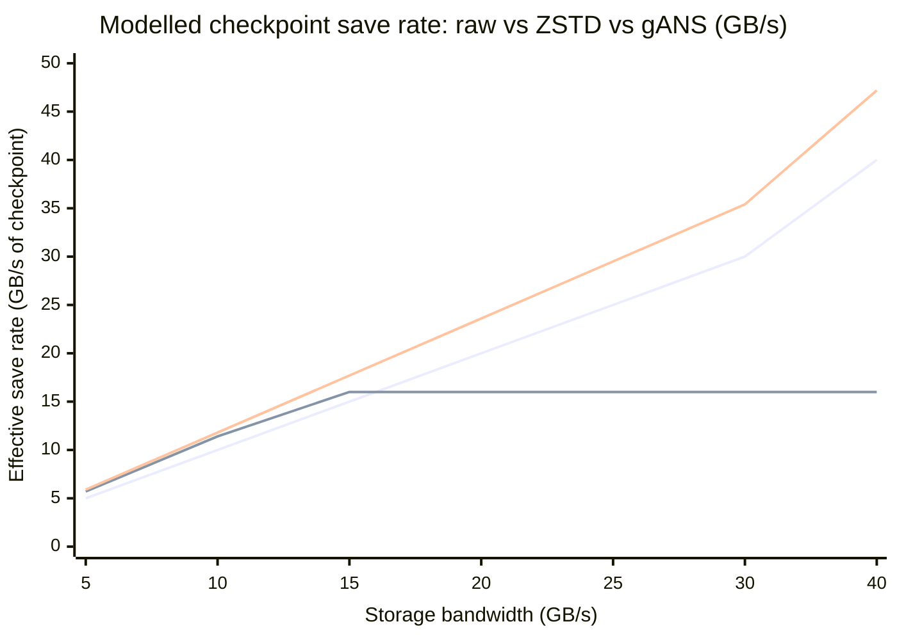
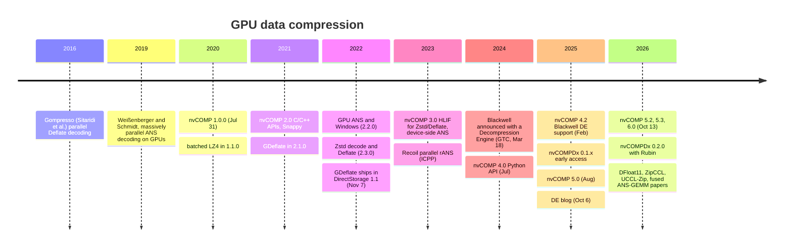
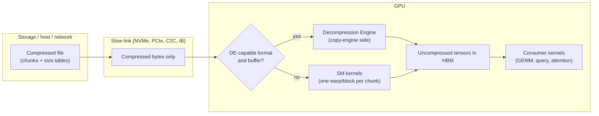

---
tags:
  - gpu-programming
  - libraries
  - compression
  - nvcomp
  - nvcompdx
  - lz4
  - ans
  - blackwell
  - cuda
aliases:
  - nvCOMP
  - nvCOMPDx
  - GPU Compression
  - GPU Decompression
  - Blackwell Decompression Engine
status: complete
sources:
  - https://docs.nvidia.com/cuda/nvcomp/index.html
  - https://docs.nvidia.com/cuda/nvcomp/release_notes.html
  - https://docs.nvidia.com/cuda/nvcomp/algorithm_selection.html
  - https://docs.nvidia.com/cuda/nvcomp/decompression_engine_faq.html
  - https://docs.nvidia.com/cuda/nvcomp/samples/nvcomp.html
  - https://pypi.org/project/nvidia-nvcomp-cu13/
  - https://pypi.org/project/nvidia-nvcomp-cu12/
  - https://developer.nvidia.com/blog/speeding-up-data-decompression-with-nvcomp-and-the-nvidia-blackwell-decompression-engine/
  - https://developer.nvidia.com/blog/cut-checkpoint-costs-with-about-30-lines-of-python-and-nvidia-nvcomp/
  - https://docs.nvidia.com/cuda/nvcompdx/index.html
  - https://docs.nvidia.com/cuda/nvcompdx/release_notes.html
  - https://developer.nvidia.com/blog/accelerating-load-times-for-directx-games-and-apps-with-gdeflate-for-directstorage
  - https://devblogs.microsoft.com/directx/directstorage-1-1-now-available/
  - https://arxiv.org/abs/1606.00519v1
  - https://researchr.org/publication/WeissenbergerS19/bibtex
  - https://arxiv.org/pdf/2306.12141
  - https://github.com/RPrenger/dietgpu
  - https://arxiv.org/html/2504.11651v3
  - https://arxiv.org/pdf/2606.15789
  - https://arxiv.org/pdf/2604.27844
  - https://arxiv.org/pdf/2604.17172
  - https://arxiv.org/pdf/2611.04382
  - https://docs.nvidia.com/cudf/26.10/cudf/io/io/
  - https://arxiv.org/pdf/2602.17335
  - https://www.nvidia.com/en-eu/data-center/technologies/rubin/
created: 2026-11-28
updated: 2026-11-28
---

## Table Of Contents

---

- [[#TL;DR|TL;DR]]
- [[#The Problem|The Problem]]
- [[#Foundations|Foundations]]
    - [[#Two Families - Dictionary Coders and Entropy Coders|Two Families: Dictionary Coders and Entropy Coders]]
    - [[#Why Serial Formats Fight the GPU|Why Serial Formats Fight the GPU]]
    - [[#When Compression Pays, Worked|When Compression Pays, Worked]]
- [[#How We Got Here|How We Got Here]]
- [[#How It Works|How It Works]]
    - [[#Chunked, Batched Decompression|Chunked, Batched Decompression]]
    - [[#Inside a GPU LZ4 Decoder|Inside a GPU LZ4 Decoder]]
    - [[#Inside a GPU ANS Decoder|Inside a GPU ANS Decoder]]
    - [[#Floats Are Different - Coding the Exponent|Floats Are Different: Coding the Exponent]]
    - [[#nvCOMP - Formats and APIs|nvCOMP: Formats and APIs]]
    - [[#The Blackwell Decompression Engine|The Blackwell Decompression Engine]]
    - [[#nvCOMPDx - Compression Inside Your Kernel|nvCOMPDx: Compression Inside Your Kernel]]
    - [[#Decompress-on-Load - Checkpoints, Weights, Columns and KV Cache|Decompress-on-Load: Checkpoints, Weights, Columns and KV Cache]]
- [[#Where It Is Now|Where It Is Now]]
- [[#Trade-offs & Open Problems|Trade-offs & Open Problems]]
- [[#Resources|Resources]]
- [[#Related Notes|Related Notes]]

---

## ***TL;DR***

---

*GPU compression trades a little GPU compute for fewer bytes on the slowest link: storage, PCIe, the network or HBM capacity. It only pays when the codec runs faster than the link it saves, which is why GPU codecs are built for throughput first and ratio second.*

- **What it is.** Lossless compression and decompression run on the GPU itself, so data can cross a slow link compressed and be expanded where it is used. NVIDIA's library is **nvCOMP** (host-launched, batched); **nvCOMPDx** puts LZ4 and ANS inside your own kernels; Blackwell B200/B300/GB200/GB300 add a fixed-function **Decompression Engine (DE)** for LZ4, Snappy and Deflate/Gzip ([DE FAQ](https://docs.nvidia.com/cuda/nvcomp/decompression_engine_faq.html)).
- **Why it is hard.** Classic formats (Deflate, LZ4, Zstd) were designed for one CPU thread reading a stream front to back. GPUs need thousands of independent pieces of work, so GPU formats cut data into **chunks** and, for entropy coders, **interleave** many coder states so a warp can decode 32 at once.
- **Which codec.** Byte data: Snappy or LZ4 (fast, moderate ratio); GDeflate or Zstd for more ratio. Integers and columns: Cascaded (RLE + delta + bitpacking). Floats: Bitcomp, or ANS run on the exponent bytes. Highest throughput: ANS ([algorithm selection](https://docs.nvidia.com/cuda/nvcomp/algorithm_selection.html)).
- **The rule.** In a pipelined transfer the effective rate is $\min(B_{\text{comp}},\ r\,B_{\text{link}},\ B_{\text{dec}})$: ratio $r$ multiplies the link, but a slow codec caps everything. NVIDIA's checkpoint study shows ZSTD (~16 GB/s) losing to raw writes on fast storage while its GPU ANS (~530 GB/s on BF16) keeps winning ([checkpoint blog](https://developer.nvidia.com/blog/cut-checkpoint-costs-with-about-30-lines-of-python-and-nvidia-nvcomp/)).
- **Where it is now (Nov 2026).** nvCOMP 6.0.0 (PyPI Oct 13, 2026) with faster ANS and a format break; nvCOMPDx 0.2.0 with Rubin (SM107) support; the Blackwell DE in production use through nvCOMP; and a wave of 2026 papers compressing BF16 weights, gradients and KV cache by coding exponents, fused into GEMMs and NCCL kernels.

---

## ***The Problem***

---

*A GPU computes far faster than data can reach it from disk, the host or another node. Compression shrinks the bytes on those links, but the classic algorithms are serial and would leave a GPU idle, so the formats themselves had to change.*

- **The links are the bottleneck.** A single NVMe SSD caps at about 6.4 GiB/s in one 2026 GPU-Parquet study, versus thousands of GB/s of HBM ([Luo, Chen, Binnig, DaMoN '26](https://arxiv.org/pdf/2602.17335)). Writing a 782 GB checkpoint of a 70B model to 5 GB/s shared storage takes about 156 s with the GPUs idle ([checkpoint blog](https://developer.nvidia.com/blog/cut-checkpoint-costs-with-about-30-lines-of-python-and-nvidia-nvcomp/)). See [[GPUDirect RDMA and Storage]] for the I/O paths themselves.
- **Capacity is a link too.** If model weights or [[KV Cache]] do not fit in HBM, they spill to host memory over PCIe or C2C. Storing weights compressed in HBM and expanding them on the fly is another way to buy capacity ([DFloat11](https://arxiv.org/html/2504.11651v3)).
- **The CPU cannot keep up.** If the host decompresses, the CPU becomes the I/O bottleneck; NVIDIA's GDeflate post makes this the core argument for GPU decompression in games ([NVIDIA, Nov 2022](https://developer.nvidia.com/blog/accelerating-load-times-for-directx-games-and-apps-with-gdeflate-for-directstorage)).
- **Serial formats waste the GPU.** "Traditional algorithms assume serial execution, so they can't easily scale to data-parallel architectures" (same post). LZ77 back-references and Huffman/ANS bit streams both carry a dependency from one symbol to the next.
- **The win is easy to lose.** Compression helps only if encode + decode costs less than the transfer time it saves. On 100 to 400 Gb/s networks that margin is thin, which is why a Nov 2026 KV-transfer paper argues "compression throughput is a first-class metric" ([Wu et al.](https://arxiv.org/pdf/2611.04382)).

---

## ***Foundations***

---

*Two ideas cover almost all lossless compression: find repeats (dictionary coding) and give common symbols short codes (entropy coding). Each has a serial dependency, and GPU formats exist to break it.*

### Two Families - Dictionary Coders and Entropy Coders

| Family | Idea | Formats | GPU character |
|---|---|---|---|
| **Dictionary (LZ77)** | Replace a repeated byte run with (offset, length) pointing back into already-decoded output | LZ4, Snappy | No bit-level coding, byte-aligned tokens: very fast to decode; moderate ratio |
| **Entropy** | Give frequent symbols fewer bits (Huffman), or fractional bits (arithmetic coding, ANS) | ANS, Huffman stage of Deflate | Bit-serial; needs interleaving to parallelize; great on skewed data like float exponents |
| **Both** | LZ77 first, then entropy-code the tokens | Deflate, Gzip, GDeflate, Zstd | Best general ratio, slowest |
| **Structural** | Exploit numeric layout: run-length, delta, frame-of-reference, bitpacking | Cascaded, Bitcomp | Embarrassingly parallel; excellent on sorted or repetitive integer columns |

Sources: [nvCOMP algorithm selection](https://docs.nvidia.com/cuda/nvcomp/algorithm_selection.html), [Gompresso paper](https://arxiv.org/abs/1606.00519v1).

**ANS in one paragraph.** Asymmetric numeral systems keep the whole message in one integer state $x$. With symbol frequencies $f_s$ that sum to $M$ (a power of two) and cumulative starts $c_s$, range-ANS (rANS) encodes a symbol by

$$x' = \left\lfloor \frac{x}{f_s} \right\rfloor M + c_s + (x \bmod f_s)$$

and decodes by reading the slot $x \bmod M$, finding the symbol whose range $[c_s, c_s + f_s)$ holds it, then $x = f_s \lfloor x/M \rfloor + (x \bmod M) - c_s$. When $x$ grows too large the encoder writes out its low bits ("renormalization"); the decoder reads them back. In plain words: frequent symbols make $x$ grow slowly, so they cost few bits. Decoding is a table lookup, a multiply and a shift, which is why ANS is the throughput king among entropy coders ([Recoil, ICPP 2023](https://arxiv.org/pdf/2306.12141)).

### Why Serial Formats Fight the GPU

- **LZ77's dependency.** A match copies bytes from earlier output, and that earlier output may itself have come from a match. You cannot know where token $k$ writes until tokens $0..k-1$ have been parsed. Sitaridi et al.'s Gompresso traded "some compression efficiency to eliminate data dependencies that limit parallelism during decompression" ([Gompresso, 2016](https://arxiv.org/abs/1606.00519v1)).
- **Entropy's dependency.** In Huffman or ANS, symbol $k$'s bit position depends on the lengths of all earlier codes. One stream means one thread.
- **The two fixes.** (1) **Chunking:** split input into independent chunks (typically tens to hundreds of KiB) and decode them in parallel. Cost: each chunk restarts its dictionary or coder, lowering ratio. (2) **Interleaving:** run many entropy coder states over one stream, each owning every $n$th symbol. Recoil shows the price of naive partitioning: 2,176 independent partitions (a GPU-sized split) grew files by up to about 23.5%, versus under 0.2% for 16 partitions ([Recoil](https://arxiv.org/pdf/2306.12141)).
- **32 is the magic number.** 32-way interleaved rANS "naturally fits into a GPU warp": lane $i$ decodes symbols $i, i+32, i+64, \dots$ and the 32 lanes read the shared bit stream in a fixed order ([Recoil](https://arxiv.org/pdf/2306.12141)). This is the same lane-per-element thinking as [[Warp Divergence and Warp-Level Primitives]].

### When Compression Pays, Worked

Let $B_{\text{link}}$ be the link bandwidth, $r$ the compression ratio (original / compressed), and $B_{\text{comp}}$, $B_{\text{dec}}$ codec throughputs measured on uncompressed bytes. If compression, transfer and decompression are **pipelined** (chunk $k+1$ compresses while chunk $k$ is on the wire), the effective rate in uncompressed bytes is

$$B_{\text{eff}} = \min\left(B_{\text{comp}},\ r\,B_{\text{link}},\ B_{\text{dec}}\right)$$

**Plain English:** compression multiplies the link by $r$, but you can never go faster than your slowest codec stage. It wins only when $B_{\text{eff}} > B_{\text{link}}$. If the stages run back to back instead of pipelined, the times add: $\frac{1}{B_{\text{eff}}} = \frac{1}{B_{\text{comp}}} + \frac{1}{r B_{\text{link}}} + \frac{1}{B_{\text{dec}}}$, which is much harder to win.

**Worked example (checkpoint save, numbers from NVIDIA's Apr 2026 study).** Full dense checkpoint ratios are about $r = 1.14$ for ZSTD and $1.18$ for GPU ANS (gANS); codec throughputs are about 16 GB/s for ZSTD and about 530 GB/s for gANS on BF16 tensors ([checkpoint blog](https://developer.nvidia.com/blog/cut-checkpoint-costs-with-about-30-lines-of-python-and-nvidia-nvcomp/)).

| Storage $B_{\text{link}}$ | Raw | ZSTD $\min(16,\,1.14B)$ | gANS $\min(530,\,1.18B)$ |
|---|---|---|---|
| 5 GB/s | 5.0 | 5.7 (+14%) | 5.9 (+18%) |
| 15 GB/s | 15.0 | 16.0 (+7%) | 17.7 (+18%) |
| 25 GB/s | 25.0 | 16.0 (−36%) | 29.5 (+18%) |
| 40 GB/s | 40.0 | 16.0 (−60%) | 47.2 (+18%) |

At 5 GB/s, gANS shrinks the 70B checkpoint from 782 GB to 663 GB and the stall from 156 s to 133 s, the post's own figures. Past ~16 GB/s storage, ZSTD becomes the bottleneck and loses to writing raw bytes; the post says ZSTD "becomes a bottleneck at about 25 GB/s storage, while gANS does not". The modest $r$ is the honest part: dense BF16/FP32 training state does not compress much, so codec speed decides the outcome.



*Lines, bottom to top at 40 GB/s: ZSTD flattens at 16; raw is the diagonal; gANS stays 18% above raw. Computed from the formula above with the blog's ratios and throughputs, not measured.*

**A second example (compressed columns on load).** Suppose a Parquet column compresses $r = 3$ and arrives over a 50 GB/s host link (illustrative numbers). The link now delivers 150 GB/s of logical data, so the decoder must sustain at least 150 GB/s or it becomes the cap. NVIDIA rates the Blackwell DE at "up to 600 GB/s" ([DE FAQ](https://docs.nvidia.com/cuda/nvcomp/decompression_engine_faq.html)), so it would not be the bottleneck; an SM decoder could be, and it also competes with the query kernels for SMs. This is the [[Roofline Model and Arithmetic Intensity]] argument applied to links: compression raises "useful bytes per transferred byte".

---

## ***How We Got Here***

---

*GPU compression started as research on parallelizing Deflate and Huffman, became a library (nvCOMP, 2020), got GPU-native formats (GDeflate, GPU ANS), and in 2024 got its own hardware block on Blackwell. Since 2025 the action has moved to AI data: checkpoints, weights, gradients and KV cache.*



- **Research roots (2016 to 2019).** Gompresso showed parallel Deflate decoding on GPUs at about 2× multi-core CPU libraries with "17% energy saving" ([arXiv 1606.00519](https://arxiv.org/abs/1606.00519v1)). Weißenberger and Schmidt's ICPP 2019 paper took ANS decoding massively parallel ([bibtex](https://researchr.org/publication/WeissenbergerS19/bibtex)).
- **nvCOMP (2020 onward).** 1.0.0 shipped Jul 31, 2020; 1.1.0 (Oct 2020) added batched LZ4; 2.0.0 (Apr 2021) new C/C++ APIs and Snappy; 2.1.0 (Oct 2021) GDeflate; 2.2.0 (Feb 2022) GPU ANS and Windows; 2.3.0 (Apr 2022) Zstd decompression and Deflate; 2.5.0 (Dec 2022) Hopper (SM90); 3.0.0 (Jul 2023) high-level interface (HLIF) for Zstd and Deflate and a device-side ANS API ([release notes](https://docs.nvidia.com/cuda/nvcomp/release_notes.html)).
- **GDeflate and games (2022).** NVIDIA's GDeflate keeps Deflate's RFC 1951 core but splits data into 64 KB tiles and formats each tile's bit stream "to expose finer-grained, SIMD-level parallelism" for a cooperative group of threads ([NVIDIA](https://developer.nvidia.com/blog/accelerating-load-times-for-directx-games-and-apps-with-gdeflate-for-directstorage)). Microsoft shipped it as DirectStorage 1.1's GPU decompression on Nov 7, 2022 ([Microsoft](https://devblogs.microsoft.com/directx/directstorage-1-1-now-available/)).
- **Communication compression.** Meta's DietGPU (Jeff Johnson) was billed as "the first publicly available GPU-based generalized" ANS codec, aimed at shrinking all-to-all and all-reduce traffic; it claims 250 to 410 GB/s for bytes and 250 to 600 GB/s for its float codec on A100 ([DietGPU](https://github.com/RPrenger/dietgpu)). 2026's ZipCCL and UCCL-Zip build directly on this idea.
- **Hardware (2024).** NVIDIA's Blackwell launch listed "a Decompression Engine for databases" among six headline technologies (see [[Blackwell Architecture]]). nvCOMP 4.2.0 (PyPI, Feb 2025) added DE support for Snappy, Gzip and Deflate ([release notes](https://docs.nvidia.com/cuda/nvcomp/release_notes.html)); NVIDIA's Oct 6, 2025 post explained how to use it ([NVIDIA](https://developer.nvidia.com/blog/speeding-up-data-decompression-with-nvcomp-and-the-nvidia-blackwell-decompression-engine/)).
- **Python and AI (2024 to 2026).** nvCOMP 4.0.0 introduced the Python API; the CUDA 12 PyPI wheels date 4.0.0 to Jul 18, 2024 and 4.2.0 to Feb 19, 2025 ([PyPI cu12](https://pypi.org/project/nvidia-nvcomp-cu12/)), and the CUDA 13 wheels date 5.0.0 to Aug 5, 2025, 5.1.0 to Dec 2, 2025, 5.2.0 to Apr 2026, 5.3.0 to Jul 14, 2026 and 6.0.0 to Oct 13, 2026 ([PyPI](https://pypi.org/project/nvidia-nvcomp-cu13/)). ANS gained float16 (4.0.0), float8 (5.3.0) and float32 (6.0.0) modes, the clearest sign of where demand comes from.

---

## ***How It Works***

---

*GPU codecs win by giving every warp or block its own chunk, keeping the serial parsing small and the copying wide, and coding floats field by field. nvCOMP wraps this in batched host APIs, nvCOMPDx exposes it inside kernels, and Blackwell moves some decoding into fixed-function hardware next to the copy engine.*

### Chunked, Batched Decompression



- **Batch layout.** nvCOMP's low-level API takes *arrays* of chunk pointers and sizes: `n` compressed chunks in, `n` decompressed chunks out, plus per-chunk actual-size and status arrays (required in 6.0). Each chunk is independent, so the kernel assigns one warp or block per chunk and thousands run at once ([release notes](https://docs.nvidia.com/cuda/nvcomp/release_notes.html)).
- **Chunk size is the main knob.** Small chunks give more parallelism but lower ratio and, on the DE, "excessive driver overhead"; large chunks cause "tail effects" where a few slow chunks hold the batch ([DE FAQ](https://docs.nvidia.com/cuda/nvcomp/decompression_engine_faq.html)). NVIDIA's DE benchmarks used 64 KiB and 512 KiB chunks ([NVIDIA](https://developer.nvidia.com/blog/speeding-up-data-decompression-with-nvcomp-and-the-nvidia-blackwell-decompression-engine/)).
- **One allocation, many offsets.** NVIDIA recommends placing all inputs, outputs and size arrays as offsets into the same allocation; buffers from many separate allocations "can add significant host driver launch overhead" (same post).
- **Async and stream-ordered.** nvCOMP calls are enqueued on a CUDA stream and may return before the work is done; host-side results need a stream sync ([NVIDIA](https://developer.nvidia.com/blog/speeding-up-data-decompression-with-nvcomp-and-the-nvidia-blackwell-decompression-engine/)). See [[Streams, Events and Async Execution]].

### Inside a GPU LZ4 Decoder

An LZ4 block is a sequence of *tokens*. Each token byte holds a 4-bit literal length and a 4-bit match length; then come the literal bytes, then a 2-byte back offset for the match. The decoder repeats: copy $L$ literals from input to output, then copy $M$ bytes from `out - offset` to `out`.

The usual GPU split, and the one Gompresso's analysis motivates ([arXiv 1606.00519](https://arxiv.org/abs/1606.00519v1)):

1. **Parse serially, copy widely.** Token parsing is cheap but sequential, so one lane (or a small prefix-sum pass over token lengths, see [[Parallel Reduction and Scan]]) finds each token's input and output position.
2. **Copy with the whole warp.** Literal runs and matches are copied by 32 lanes at once, byte- or word-wise, which turns the decoder into a memory-bound copy kernel (see [[Memory Coalescing]]).
3. **Handle overlap.** When `offset < length`, the match reads bytes it is itself producing (a run like "abcabcabc"). A naive wide copy reads stale data, so the decoder copies in steps of `offset` bytes or falls back to a narrower loop.
4. **Nested back-references.** A match may point into the output of another match being written in the same parallel step. Decoders either resolve these in extra passes or rely on an encoder that avoids creating them; Gompresso's second technique is the latter, giving up a little ratio to remove the dependencies.

Why LZ4 and Snappy decode so fast on GPUs: no bit-level decoding, byte-aligned tokens, and most time spent in wide copies. nvCOMP's own guide rates both "High" for decompression and calls Snappy "comparable to LZ4, better performance on GPU" ([algorithm selection](https://docs.nvidia.com/cuda/nvcomp/algorithm_selection.html)).

### Inside a GPU ANS Decoder

A sketch of 32-way interleaved rANS decoding, one warp per chunk. It is a simplified illustration of the technique Recoil and DietGPU describe, not nvCOMP's (closed) implementation.

```cuda
// One warp decodes one chunk; lane i owns symbols i, i+32, i+64, ...
__global__ void rans_decode_chunk(const uint16_t* in, uint8_t* out, int n,
                                  const uint32_t* final_states,
                                  const uint8_t* slot_to_sym,          // M entries
                                  const uint16_t* freq, const uint16_t* cum) {
  const int lane = threadIdx.x & 31;
  uint32_t x = final_states[lane];             // encoder's last state for this lane
  int pos = 0;                                 // read cursor shared by the warp
  for (int k = lane; k < n; k += 32) {
    uint32_t slot = x & (M - 1);               // x mod M, M a power of two
    uint8_t  s    = slot_to_sym[slot];         // table lookup: which symbol owns this slot
    out[k] = s;
    x = freq[s] * (x >> LOG2_M) + slot - cum[s];   // undo the encode step
    bool need = x < L_LOWER;                   // does this lane need more input bits?
    uint32_t mask = __ballot_sync(0xffffffff, need);
    int rank = __popc(mask & ((1u << lane) - 1));  // my place among lanes that need input
    if (need) x = (x << 16) | in[pos + rank];  // renormalize: pull 16 bits
    pos += __popc(mask);                       // all lanes advance the shared cursor
  }
}
```

(`M`, `LOG2_M` and the renormalization bound `L_LOWER` are compile-time constants; real decoders also handle the chunk tail and bounds checks.) Line by line, in plain words:
- **`lane`, `x`:** each of the 32 lanes is an independent rANS decoder starting from the state the encoder ended with (rANS decodes in reverse of encoding).
- **`slot`, `slot_to_sym`:** the low $\log_2 M$ bits of the state say which symbol comes next; a lookup table in shared memory turns that slot into a symbol (see [[Shared Memory and Bank Conflicts]]).
- **`x = freq[s] * ...`:** the decode formula from Foundations, one multiply, one shift, one subtract.
- **`__ballot_sync`, `__popc`:** lanes whose state got too small need 16 more bits. The ballot tells every lane who needs input; the popcount of lower-numbered requesters gives each lane its slot in the stream, so the 32 reads are packed and coalesced ([[Warp Divergence and Warp-Level Primitives]]).
- **`pos += __popc(mask)`:** every lane advances the shared read cursor by the number of words consumed, so the warp stays in lockstep.

This is why ANS runs at hundreds of GB/s: the per-symbol work is a few integer ops, the tables are tiny, and the warp shares one coalesced input stream. Recoil reports over 90 GB/s for 32-way rANS on an RTX 2080 Ti ([Recoil](https://arxiv.org/pdf/2306.12141)); NVIDIA reports about 530 GB/s compression and about 265 GB/s SM decompression for its gANS on BF16 tensors on newer GPUs ([checkpoint blog](https://developer.nvidia.com/blog/cut-checkpoint-costs-with-about-30-lines-of-python-and-nvidia-nvcomp/)).

### Floats Are Different - Coding the Exponent

Byte-oriented LZ coders see almost no repeats in neural-network tensors: NVIDIA measured LZ4 and Bitcomp at about 1.00× on dense checkpoints ([checkpoint blog](https://developer.nvidia.com/blog/cut-checkpoint-costs-with-about-30-lines-of-python-and-nvidia-nvcomp/)). The redundancy sits in one field.

| BF16 field | Bits stored | Information actually present | Treatment |
|---|---|---|---|
| Sign | 1 | ~1 bit | Store raw |
| Exponent | 8 | "only about 2.6 bits"; ~40 of 256 values appear in LLM weights | Entropy-code (Huffman, ANS or a small code table) |
| Mantissa | 7 | ~7 bits | Store raw |

Source: [DFloat11](https://arxiv.org/html/2504.11651v3). Coding only the exponent gets BF16 weights to about 10.8 to 11.1 bits per value, roughly 68 to 70% of the original. The rest of the bits are essentially random, so **lossless float compression tops out near 1.4 to 1.5× for BF16** and falls with narrower types: NVIDIA notes FP8 training lowers ratios and at NVFP4 "lossless compression adds negligible benefit" ([checkpoint blog](https://developer.nvidia.com/blog/cut-checkpoint-costs-with-about-30-lines-of-python-and-nvidia-nvcomp/); see [[Low-Precision Formats - FP8, FP4 and MX]]). UCCL-Zip's measured ratios (compressed/original) show the same shape: bf16 ~64%, fp16 ~83%, fp32 ~82%, fp8 e4m3fn ~77%, fp8 e5m2 ~70% ([UCCL-Zip](https://arxiv.org/pdf/2604.17172)).

nvCOMP exposes this as ANS's typed modes: pass a 2-byte float type and the codec splits fields before entropy coding. The checkpoint post shows the difference: BF16 weights compress 1.46 to 1.48× with gANS in `<f2` mode versus 1.27 to 1.28× with ZSTD; FP32 optimizer state, run in byte mode, manages only 1.06 to 1.10×.

### nvCOMP - Formats and APIs

| Format | Ratio | Compress | Decompress | Blackwell DE | Use it for |
|---|---|---|---|---|---|
| LZ4 | Moderate | Moderate | High | Yes | General bytes, CPU interop |
| Snappy | Moderate | Moderate | High | Yes | General bytes, best light codec on GPU |
| GDeflate | Low to high (tunable) | Moderate to low | Moderate | No | GPU-only pipelines wanting ratio |
| Deflate / Gzip | Low to high | Low | Low | Yes | Compatibility with existing files only |
| Zstandard | High | Low | Moderate | No | When the CPU must also read it |
| Cascaded | High with tuned options | High | High | No | Integer columns, analytics |
| Bitcomp | Low to high | High | High | No | Scientific floating-point data |
| ANS | Moderate | High | High | No | Maximum throughput; float tensors |

Source: [nvCOMP algorithm selection](https://docs.nvidia.com/cuda/nvcomp/algorithm_selection.html) (the guide's own qualitative ratings; it publishes no numbers on that page).

**Three API layers.**
- **Low-level C batched API** (`nvcompBatched<Format>CompressAsync` / `DecompressAsync`): you own chunking and the pointer/size arrays; the decompress options struct carries the DE `backend` choice ([DE FAQ](https://docs.nvidia.com/cuda/nvcomp/decompression_engine_faq.html)).
- **High-level interface (HLIF)** and **Python**: the library chunks a buffer and writes a header so a single call compresses or decompresses it. nvCOMP 6.0 changed that header's ABI, so "buffers from pre-6.0 releases cannot be decompressed by 6.0" ([release notes](https://docs.nvidia.com/cuda/nvcomp/release_notes.html)).
- **Device-side**: the old device API (3.0 to 4.2) is being superseded by nvCOMPDx ([nvCOMPDx](https://docs.nvidia.com/cuda/nvcompdx/index.html)).

**Python, minimal.** Adapted from NVIDIA's Python samples and the checkpoint post:

```python
import cupy as cp
from nvidia import nvcomp

w = cp.random.standard_normal(1 << 24, dtype=cp.float32).astype(cp.float16)
codec = nvcomp.Codec(algorithm="ANS", data_type="<f2")   # ANS in 2-byte float mode
enc = codec.encode(nvcomp.as_array(w))                    # compressed, still on the GPU
dec = codec.decode(enc, "<f2")                            # back to float16, on the GPU
```

- **`as_array`** wraps a CuPy (or host) buffer without copying; the [Python samples](https://docs.nvidia.com/cuda/nvcomp/samples/nvcomp.html) use it for both host and device data.
- **`Codec(algorithm="ANS", data_type="<f2")`** picks the entropy coder and tells it the elements are 2-byte floats; the checkpoint post sets `data_type: "<f2"` for 2-byte tensors, which is what unlocks the ~1.47× BF16 ratio.
- **`encode`** runs on the GPU and returns an nvCOMP array (HLIF format, header included).
- **`decode(enc, "<f2")`** expands it and reinterprets the bytes as float16, mirroring the samples' `decode(arr, "<u4")` call.

### The Blackwell Decompression Engine

*A fixed-function block "integrated as part of the copy engine" on B200, B300, GB200 and GB300* ([NVIDIA](https://developer.nvidia.com/blog/speeding-up-data-decompression-with-nvcomp-and-the-nvidia-blackwell-decompression-engine/)).

| Property | Value | Source |
|---|---|---|
| Formats | Snappy, LZ4, Deflate (and Gzip) | [DE FAQ](https://docs.nvidia.com/cuda/nvcomp/decompression_engine_faq.html) |
| Peak | "up to 600 GB/s" (FAQ); the checkpoint post cites "up to 280 GB/s" | FAQ; [checkpoint blog](https://developer.nvidia.com/blog/cut-checkpoint-costs-with-about-30-lines-of-python-and-nvidia-nvcomp/) |
| Max chunk | 4 MiB on B200; query `CU_DEVICE_ATTRIBUTE_MEM_DECOMPRESS_MAXIMUM_LENGTH` | FAQ |
| Units | "dozens of execution units", each much faster than an SM at decompression | NVIDIA blog |
| Placement | Copy-engine side, so data arriving over PCIe or C2C "can be decompressed in transit" | FAQ |
| Concurrency | Runs alongside SM kernels on other streams | FAQ |

**Using it.** You don't call the DE directly; nvCOMP's default backend prefers it and "automatically and safely falls back to the CUDA implementation" when a format, buffer or chunk is not eligible. Setting `NVCOMP_DECOMPRESS_BACKEND_HARDWARE` turns fallback into an error, which is how you check you are really on the DE; `sort_before_hw_decompress = 1` balances mixed chunk sizes ([DE FAQ](https://docs.nvidia.com/cuda/nvcomp/decompression_engine_faq.html)).

**The memory rule.** Device-to-device works with ordinary `cudaMalloc`. For decompressing *from host memory* (the zero-copy, decompress-in-transit case) the buffers must come from a pool or `cuMemCreate` allocation tagged for hardware decompression. NVIDIA's example:

```cpp
cudaMemPoolProps props = {};
props.location.type = cudaMemLocationTypeHostNuma;   // pinned host memory...
props.location.id   = 0;                             // ...on CPU NUMA node 0
props.allocType     = cudaMemAllocationTypePinned;
props.usage         = cudaMemPoolCreateUsageHwDecompress;  // DE may read/write it
// (pool created from props, then:)
CUDA_CHECK(cudaMallocFromPoolAsync(&mem_pool_ptr, 1024, mem_pool, stream));
```

- **`HostNuma`, `id = 0`, `Pinned`:** the compressed data sits in page-locked host memory on a specific NUMA node, so the copy engine can read it directly over PCIe or NVLink-C2C (see [[Coherent CPU-GPU Superchips]]).
- **`usage = cudaMemPoolCreateUsageHwDecompress`:** the flag that makes the pool DE-capable; the driver-API equivalent is `CU_MEM_CREATE_USAGE_HW_DECOMPRESS`.
- **`cudaMallocFromPoolAsync`:** allocate stream-ordered from that pool.

Allocations from `cudaHostAlloc`, `cudaMallocHost`, `cudaMallocAsync`, `cudaMallocManaged` or untagged pools silently fall back to the SMs; `cuPointerGetAttribute(..., CU_POINTER_ATTRIBUTE_IS_HW_DECOMPRESS_CAPABLE)` tells you which you have. The DE is "fault-intolerant": streams must follow the format standard exactly, and even a too-large compressed-size field counts as noncompliant ([DE FAQ](https://docs.nvidia.com/cuda/nvcomp/decompression_engine_faq.html)).

### nvCOMPDx - Compression Inside Your Kernel

Part of [[Device-Side Math Libraries (MathDx)]]: block- and warp-level LZ4 and ANS compression and decompression callable from your own CUDA code, distributed as LTO-IR, Turing and newer ([nvCOMPDx docs](https://docs.nvidia.com/cuda/nvcompdx/index.html)).

- **Why.** Fusing a decompress with what uses the data removes a full global-memory round trip and the temporary buffer (see [[Kernel Fusion]]). A kernel can read a compressed tile, expand it in shared memory and feed it straight to compute.
- **Interop.** "Chunks compressed by nvCOMPDx are decompressible by nvCOMP, and vice versa," so the host library can write data that device code reads.
- **Versions.** 0.1.0 (early access): LZ4 for uint8/16/32 and ANS for uint8 and (b)float16, warp and block APIs, NVRTC + nvJitLink. 0.1.4: LZ4 decompression 5 to 12% faster, static library deprecated. 0.2.0: "significantly improved" ANS, float8 and float32 types, Rubin SM107 ([release notes](https://docs.nvidia.com/cuda/nvcompdx/release_notes.html)). The vault's MathDx note records 0.2.0 shipping in MathDx 26.10.0.

### Decompress-on-Load - Checkpoints, Weights, Columns and KV Cache

| Data | What is compressed | Typical lossless ratio | Main constraint | Example |
|---|---|---|---|---|
| **Training checkpoints** | BF16 weights, gradients, FP32 optimizer state | ~1.14 to 1.18× full checkpoint; ~1.47× BF16 weights | Must beat storage bandwidth | NVIDIA gANS in ~30 lines of Python, H200 and Blackwell ([blog](https://developer.nvidia.com/blog/cut-checkpoint-costs-with-about-30-lines-of-python-and-nvidia-nvcomp/)) |
| **Model weights in HBM** | BF16 exponents | ~68 to 70% size | Decode per layer, every forward pass | DFloat11: Llama 3.1 405B losslessly on one 8×80 GB node ([DFloat11](https://arxiv.org/html/2504.11651v3)) |
| **Weights fused into GEMM** | Per-tile ANS substreams | ~10 to 12 bits per BF16 weight | Decode must hide under tensor-core math | Tan et al., Jun 2026: Mixtral-176B on 4 A100s 241 → 391 tokens/s via bigger batches ([arXiv 2606.15789](https://arxiv.org/pdf/2606.15789)) |
| **Columns** | Parquet/ORC pages: Snappy, Zstd, LZ4, Gzip | Data-dependent | Overlap I/O with decode | libcudf readers via nvCOMP ([cuDF I/O](https://docs.nvidia.com/cudf/26.10/cudf/io/io/)); planned [[GPU Parquet and File Decoding]] |
| **Collectives** | BF16 activations, gradients, params on the wire | ~1.33× (ZipCCL); bf16 ~64% size (UCCL-Zip) | Fusing into NCCL kernels | ZipCCL up to 1.18× end to end ([arXiv 2604.27844](https://arxiv.org/pdf/2604.27844)) |
| **KV cache transfer** | Quantized KV (lossy step) + lossless backend | nvCOMP ANS 8.85 to 9.17× after quantization | Codec time vs network time | [Wu et al., Nov 2026](https://arxiv.org/pdf/2611.04382); UCCL-Zip 30.1% lower vLLM KV transfer latency |

**Columns in cuDF.** libcudf uses nvCOMP for Snappy, ZSTD and LZ4 in Parquet and ORC (read and write "Stable"), DEFLATE in ORC, and GZIP Parquet writes (reads "Experimental"). `LIBCUDF_NVCOMP_POLICY` = `STABLE` (default), `ALWAYS` or `OFF` controls how far it trusts nvCOMP ([cuDF I/O docs](https://docs.nvidia.com/cudf/26.10/cudf/io/io/)). See [[GPU Databases and Dataframes]].

**Weights as a decoder, not a store.** DFloat11 decodes with hierarchical 256-entry lookup tables in shared memory and a two-phase kernel (count, [[Parallel Reduction and Scan|prefix sum]], decode-and-write). It reports decompression up to 20.97× faster than nvCOMP's ANS on its test matrices, and up to 46.24× lower latency than BF16 with CPU offloading when the model would not otherwise fit ([DFloat11](https://arxiv.org/html/2504.11651v3)). Tan et al. go further, decoding each GEMM tile straight into shared memory overlapped with the MMA, at about 1.0 to 1.2× the speed of a plain CUTLASS GEMM, so the bigger batch that freed memory allows is nearly free ([arXiv 2606.15789](https://arxiv.org/pdf/2606.15789); see [[CUTLASS and CuTe]]).

**Communication.** ZipCCL codes the 7 most frequent BF16 exponents in 3 bits, picked analytically from the weight standard deviation so no histogram is needed, for up to 1.35× faster collectives on 64 RTX A6000s ([arXiv 2604.27844](https://arxiv.org/pdf/2604.27844)). UCCL-Zip extends DietGPU's ANS with fp8 and AMD support and fuses compression into NCCL so output lands directly in NCCL's FIFO buffer ("three to one" global memory passes). It gains up to 52.9% on 1 GB P2P transfers over EFA, but loses on NVLink, which is too fast to beat ([UCCL-Zip](https://arxiv.org/pdf/2604.17172)). See [[Multi-GPU Communication - NVLink and NCCL]].

---

## ***Where It Is Now***

---

*As of late November 2026: nvCOMP 6.0 is current and broke its formats to get faster ANS; Blackwell's DE is used transparently through nvCOMP; and most new work is about AI tensors, where field-aware entropy coding fused into existing kernels beats general-purpose libraries.*

- **nvCOMP 6.0.0 (PyPI, Oct 13, 2026).** ANS up to 50% faster to compress and 30% faster to decompress, a float32 ANS mode, Orin support, a Python `BatchArray` API, and green-context stream support (needs CUDA 13.1+). Breaking: new HLIF header ABI, new low-level Cascaded and ANS chunk formats, ANS alignment raised to 16 bytes ([release notes](https://docs.nvidia.com/cuda/nvcomp/release_notes.html), [PyPI](https://pypi.org/project/nvidia-nvcomp-cu13/)). Green contexts are covered in the planned [[Green Contexts and SM Partitioning]].
- **nvCOMPDx 0.2.0** adds Rubin (SM107) and float8/float32 ANS ([release notes](https://docs.nvidia.com/cuda/nvcompdx/release_notes.html)).
- **Decompression Engine.** Still documented for B200, B300, GB200 and GB300 only, with a 4 MiB chunk cap on B200 that "may be subject to change in future generation GPUs" ([DE FAQ](https://docs.nvidia.com/cuda/nvcomp/decompression_engine_faq.html)). NVIDIA's Rubin page mentions only a Transformer Engine "with adaptive compression" for NVFP4, not a decompression engine ([NVIDIA Rubin](https://www.nvidia.com/en-eu/data-center/technologies/rubin/)), so DE plans for Rubin are not public there.
- **Checkpoints (Apr 2026).** NVIDIA's own guidance is now "use GPU ANS, not ZSTD, unless the CPU or other tools must read the file", with modelled savings from ~$1,900/month (Llama 3 70B, 8 GPUs) to ~$118,000/month (DeepSeek-V3, 256 GPUs) ([checkpoint blog](https://developer.nvidia.com/blog/cut-checkpoint-costs-with-about-30-lines-of-python-and-nvidia-nvcomp/)). Ties into [[GPU Fault Tolerance in Production]], where checkpoint cadence sets lost work.
- **Columnar scans (DaMoN '26).** A TU Darmstadt study reached up to 125 GB/s effective Parquet scan bandwidth on one A100 with GPUDirect Storage by tuning page and row-group sizes, and recommends skipping compression on chunks that shrink by less than 10% ([Luo et al.](https://arxiv.org/pdf/2602.17335)).
- **Research direction (2026).** Exponent-aware lossless codecs for weights (DFloat11, Jan 2026 v3; Tan et al., Jun 2026), for collectives (ZipCCL, Apr 2026; UCCL-Zip, 2026) and for KV transfer (Wu et al., Nov 2026). The common verdicts: fuse the codec into the kernel that moves or uses the data, and measure codec throughput against the link, not ratio alone. Two of these papers sidestep nvCOMP: ZipCCL says its decompression failed on data sent to other workers because of hidden metadata and that it lacked BF16 support, and Tan et al. describe it as closed source with "coarse, host-driven APIs" (their claims, against older releases than 6.0).

---

## ***Trade-offs & Open Problems***

---

*Every choice trades ratio against speed and portability. The hard open problems are formats that are both CPU-standard and GPU-parallel, keeping codecs fast enough for 400 Gb/s links and NVLink, and squeezing anything from data that is already low precision.*

| Trade-off | One side | Other side |
|---|---|---|
| Ratio vs throughput | Zstd, GDeflate high levels: more bytes saved | ANS, Snappy, LZ4: hundreds of GB/s, less saved |
| Chunk size | Small: parallel, DE-friendly, lower ratio, more overhead | Large: better ratio, tail effects, over the DE's 4 MiB cap |
| Standard vs GPU-native | LZ4/Snappy/Deflate/Zstd: CPU tools read them; Deflate/LZ4/Snappy can use the DE | GDeflate, ANS, Cascaded, Bitcomp: faster on GPU, nvCOMP-only or format-versioned |
| SM vs DE | SM: any format, competes with your kernels | DE: free SMs and in-transit decoding, only 3 format families, strict buffers |
| Library vs fused | nvCOMP: easy, batched, host-driven | nvCOMPDx or custom: no round trip, more engineering |

- **Format stability.** nvCOMP 6.0 cannot read pre-6.0 HLIF buffers or old low-level Cascaded data, and its ANS chunk format changed ([release notes](https://docs.nvidia.com/cuda/nvcomp/release_notes.html)). For checkpoints kept for months that is a real risk: pin versions, or prefer a standard format (ZSTD, LZ4) where long-term readability matters more than speed.
- **Fast links erase the gain.** UCCL-Zip lost on NVLink and its ring all-reduce got slower with compression ([UCCL-Zip](https://arxiv.org/pdf/2604.17172)); DietGPU slowed Qwen3-MoE training in ZipCCL's tests ([ZipCCL](https://arxiv.org/pdf/2604.27844)). The formula $\min(B_{\text{comp}}, rB_{\text{link}}, B_{\text{dec}})$ says why: at 900 GB/s-class links the codec, not the wire, is the bottleneck.
- **Compute and SM contention.** SM-based codecs steal SMs from training or query kernels; UCCL-Zip still gained up to 20.4% with only 50% of SMs, but the budget matters. The DE avoids this for its formats, and green-context partitioning (supported in nvCOMP 6.0) is one way to fence codec SMs.
- **Low precision leaves little to win.** FP8 lowers lossless ratios, and at NVFP4 there is "negligible benefit" ([checkpoint blog](https://developer.nvidia.com/blog/cut-checkpoint-costs-with-about-30-lines-of-python-and-nvidia-nvcomp/)). Gains now come from lossy steps first (quantization, KV transforms; see [[Quantization]]), then a lossless backend.
- **Lossless vs lossy.** This note covers lossless codecs. Lossy scientific compressors and KV quantization change values and need accuracy checks; lossless ones only need bit-exact round trips.
- **Open: one format for CPU and GPU.** Deflate's serial bit stream forced GDeflate's fork; Zstd decodes only moderately on GPU. No widely adopted format is both a CPU standard and natively warp-parallel.
- **Open: entropy decode at GEMM speed.** Fused ANS-in-GEMM reaches about 1.0 to 1.2× plain CUTLASS on A100/H200 (Tan et al.), but Blackwell's tensor cores raise the bar the decoder must hide under.

---

## ***Resources***

---

*Start with NVIDIA's algorithm-selection page and DE FAQ for what to use, the checkpoint post for a worked end-to-end case, then Recoil and DFloat11 for how fast GPU entropy decoding actually works.*

**Primary docs**
- [nvCOMP documentation](https://docs.nvidia.com/cuda/nvcomp/index.html), [release notes](https://docs.nvidia.com/cuda/nvcomp/release_notes.html), [algorithm selection](https://docs.nvidia.com/cuda/nvcomp/algorithm_selection.html), [Decompression Engine FAQ](https://docs.nvidia.com/cuda/nvcomp/decompression_engine_faq.html), [Python samples](https://docs.nvidia.com/cuda/nvcomp/samples/nvcomp.html).
- [nvCOMPDx documentation](https://docs.nvidia.com/cuda/nvcompdx/index.html) and [release notes](https://docs.nvidia.com/cuda/nvcompdx/release_notes.html).
- [nvidia-nvcomp-cu13](https://pypi.org/project/nvidia-nvcomp-cu13/) and [nvidia-nvcomp-cu12](https://pypi.org/project/nvidia-nvcomp-cu12/) on PyPI (release dates).
- [cuDF I/O and nvCOMP policy](https://docs.nvidia.com/cudf/26.10/cudf/io/io/).

**NVIDIA blogs**
- Schmidt & Taghavi, [Speeding Up Data Decompression with nvCOMP and the NVIDIA Blackwell Decompression Engine](https://developer.nvidia.com/blog/speeding-up-data-decompression-with-nvcomp-and-the-nvidia-blackwell-decompression-engine/) (Oct 6, 2025).
- Glantz, Zhidkov & Taghavi, [Cut Checkpoint Costs with About 30 Lines of Python and NVIDIA nvCOMP](https://developer.nvidia.com/blog/cut-checkpoint-costs-with-about-30-lines-of-python-and-nvidia-nvcomp/) (Apr 9, 2026).
- Uralsky, [Accelerating Load Times for DirectX Games and Apps with GDeflate for DirectStorage](https://developer.nvidia.com/blog/accelerating-load-times-for-directx-games-and-apps-with-gdeflate-for-directstorage) (Nov 7, 2022); Microsoft, [DirectStorage 1.1 Now Available](https://devblogs.microsoft.com/directx/directstorage-1-1-now-available/).

**Papers**
- Sitaridi, Mueller, Kaldewey, Lohman & Ross, [Massively-Parallel Lossless Data Decompression](https://arxiv.org/abs/1606.00519v1) (Gompresso, 2016).
- Weißenberger & Schmidt, Massively Parallel ANS Decoding on GPUs (ICPP 2019; [bibtex](https://researchr.org/publication/WeissenbergerS19/bibtex)).
- Lin et al., [Recoil: Parallel rANS Decoding with Decoder-Adaptive Scalability](https://arxiv.org/pdf/2306.12141) (ICPP 2023).
- Zhang et al., [70% Size, 100% Accuracy: DFloat11](https://arxiv.org/html/2504.11651v3).
- Tan, Chen, Alonso, Wong & He, [Approaching Shannon Bound with Lossless LLM Weight Compression](https://arxiv.org/pdf/2606.15789) (Jun 2026).
- Lin et al., [ZipCCL](https://arxiv.org/pdf/2604.27844) (Apr 2026); Ma et al., [UCCL-Zip](https://arxiv.org/pdf/2604.17172) (2026).
- Wu et al., [Beyond Compression Ratio: High-Throughput KV Compression for Disaggregated LLM Serving](https://arxiv.org/pdf/2611.04382) (Nov 2026).
- Luo, Chen & Binnig, [Do GPUs Really Need New Tabular File Formats?](https://arxiv.org/pdf/2602.17335) (DaMoN '26).

**Code**
- [DietGPU](https://github.com/RPrenger/dietgpu) (fork of facebookresearch/dietgpu): open GPU ANS and float codec.

---

## ***Related Notes***

---

*Compression sits between the I/O path, the memory hierarchy and the kernels that consume the data; these notes cover each side.*

- [[Device-Side Math Libraries (MathDx)]] — nvCOMPDx alongside cuBLASDx, cuFFTDx, cuSolverDx and cuRANDDx.
- [[GPUDirect RDMA and Storage]] — The storage and network paths compressed data travels on.
- [[GPU Databases and Dataframes]] — Compressed Parquet/ORC columns decoded by libcudf through nvCOMP.
- [[GPU Parquet and File Decoding]] — Planned: on-GPU page decoding and decompression in detail.
- [[Blackwell Architecture]] — The chip that added the Decompression Engine.
- [[Coherent CPU-GPU Superchips]] — NVLink-C2C, where the DE decompresses host data in transit.
- [[Multi-GPU Communication - NVLink and NCCL]] — The collectives ZipCCL and UCCL-Zip compress.
- [[Distributed GPU Shuffles]] — Planned: compressed exchanges in distributed query engines.
- [[Kernel Fusion]] — Why decode-inside-the-consumer beats a separate decompress kernel.
- [[Warp Divergence and Warp-Level Primitives]] — Ballot and popcount, the core of interleaved ANS decoding.
- [[Parallel Reduction and Scan]] — Prefix sums for token offsets and output positions.
- [[Shared Memory and Bank Conflicts]] — Where decode tables and decoded tiles live.
- [[Memory Coalescing]] — Why LZ copies and packed ANS reads must be warp-wide.
- [[Roofline Model and Arithmetic Intensity]] — Compression as a way to raise useful bytes per transferred byte.
- [[Streams, Events and Async Execution]] — Overlapping compression, transfer and compute.
- [[Low-Precision Formats - FP8, FP4 and MX]] — Why FP8 and FP4 leave little for lossless codecs.
- [[CUTLASS and CuTe]] — The GEMM framework fused ANS weight decoding builds on.
- [[GPU Fault Tolerance in Production]] — Checkpoint cadence, the reason checkpoint size matters.
- [[Instruction Cache and Code Size on GPUs]] — Fatbin compression, the same trade-off applied to binaries.
- [[Green Contexts and SM Partitioning]] — Planned: fencing off SMs, now supported by nvCOMP 6.0 streams.
- [[KV Cache]] — Offloaded and transferred KV, a growing compression target.
- [[LLM Serving]] — Disaggregated prefill/decode, where KV transfer compression applies.
- [[Distributed Training]] — Checkpointing and collective traffic.
- [[Quantization]] — The lossy step that usually comes before a lossless backend.
