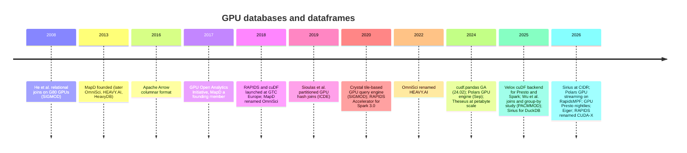
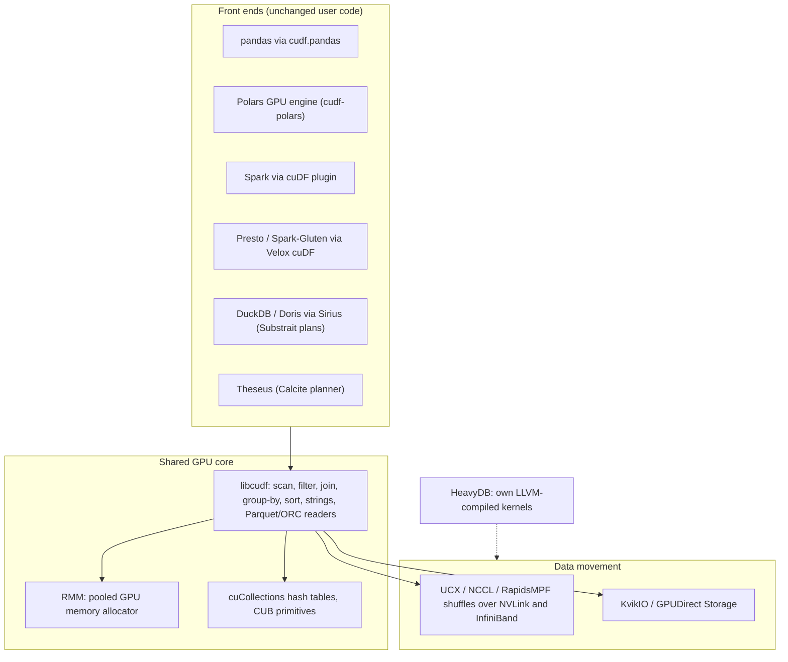

---
tags:
  - gpu-programming
  - libraries
  - cuda
  - databases
  - dataframes
  - cudf
  - rapids
  - sql
  - hash-join
  - group-by
status: complete
sources:
  - https://arxiv.org/pdf/2003.01178
  - https://par.nsf.gov/biblio/10173798-study-fundamental-performance-characteristics-gpus-cpus-database-analytics
  - https://www.comp.nus.edu.sg/~hebs/pub/bsrelational_sigmod08.pdf
  - https://infoscience.epfl.ch/record/262530
  - https://arxiv.org/html/2312.00720v2
  - https://arxiv.org/pdf/2607.04489
  - https://arxiv.org/html/2508.04701v3
  - https://developer.nvidia.com/blog/nvidia-gpu-accelerated-sirius-achieves-record-setting-clickbench-record/
  - https://arxiv.org/html/2508.05029v1
  - https://developer.nvidia.com/blog/accelerating-large-scale-data-analytics-with-gpu-native-velox-and-nvidia-cudf
  - https://prestodb.io/blog/2026/06/24/gpu-accelerated-presto-c/
  - https://pola.rs/posts/gpu-streaming-backend
  - https://developer.nvidia.com/blog/rapids-adds-gpu-polars-streaming-a-unified-gnn-api-and-zero-code-ml-speedups/
  - https://docs.nvidia.com/cudf/26.12/cudf_polars/
  - https://developer.nvidia.com/blog/rapids-cudf-accelerates-pandas-nearly-150x-with-zero-code-changes
  - https://docs.nvidia.com/datascience/notices/rsn0059/
  - https://pypi.org/project/cudf-cu12/
  - https://docs.nvidia.com/cudf/26.12/libcudf/api_docs/column_join/
  - https://nvidia.github.io/cudf-spark/docs/download.html
  - https://nvidianews.nvidia.com/news/nvidia-introduces-rapids-open-source-gpu-acceleration-platform-for-large-scale-data-analytics-and-machine-learning
  - https://en.wikipedia.org/wiki/HEAVY.AI
  - https://docs.nvidia.com/heavyai/release-notes
  - https://arrow.apache.org/docs/format/Columnar.html
  - https://jazracherif.github.io/database/gpu/nvidia/rapids/libcudf/2026/05/13/libcudf-technical-deep-dive.html
  - https://developer.nvidia.com/blog/maximizing-performance-with-massively-parallel-hash-maps-on-gpus/
  - https://developer.nvidia.com/blog/supercharging-deduplication-in-pandas-using-rapids-cudf/
  - https://nvidianews.nvidia.com/news/nvidia-accelerates-apache-spark-worlds-leading-data-analytics-platform
  - https://www.globenewswire.com/fr/news-release/2024/03/18/2848009/0/en/Voltron-Data-Advances-Theseus-Making-It-the-First-Petabyte-Scale-Query-Engine-for-Large-Scale-Data-Processing.html
created: 2026-11-26
updated: 2026-11-26
---

## Table Of Contents

---

- [[#TL;DR|TL;DR]]
- [[#The Problem|The Problem]]
- [[#Foundations|Foundations]]
    - [[#Columnar Data on a GPU|Columnar Data on a GPU]]
    - [[#Operator-at-a-Time vs Tile-Based Execution|Operator-at-a-Time vs Tile-Based Execution]]
    - [[#The Data-Movement Budget|The Data-Movement Budget]]
- [[#How We Got Here|How We Got Here]]
- [[#How It Works|How It Works]]
    - [[#The Stack: libcudf Under Many Front Ends|The Stack: libcudf Under Many Front Ends]]
    - [[#Selection and Projection|Selection and Projection]]
    - [[#Hash Join, Partitioned Join and Sort-Merge Join|Hash Join, Partitioned Join and Sort-Merge Join]]
    - [[#Materialization: GFUR vs GFTR|Materialization: GFUR vs GFTR]]
    - [[#Group-By and Aggregation|Group-By and Aggregation]]
    - [[#Strings, Nulls and Nested Types|Strings, Nulls and Nested Types]]
    - [[#Bigger Than VRAM: Streaming, Spilling and Multi-GPU|Bigger Than VRAM: Streaming, Spilling and Multi-GPU]]
    - [[#Using It From Python|Using It From Python]]
- [[#Where It Is Now|Where It Is Now]]
- [[#Trade-offs & Open Problems|Trade-offs & Open Problems]]
- [[#Resources|Resources]]
- [[#Related Notes|Related Notes]]

## ***TL;DR***
---
*Analytical SQL and dataframe work is scans, filters, joins and group-bys over columns, which is bandwidth-bound and embarrassingly parallel. GPUs win by 8× to 25× when the data is already in GPU memory, and lose much of that when it has to cross PCIe first.*

- **What it is.** GPU databases and dataframe libraries run relational operators (scan, filter, project, join, group-by, sort) as CUDA kernels over **columnar** data. In 2026 almost all of them share one engine: NVIDIA's **libcudf** (the C++ core of cuDF), which stores columns in the [Apache Arrow](https://arrow.apache.org/docs/format/Columnar.html) layout.
- **Front ends.** pandas code runs on it unchanged through **cudf.pandas**; Polars through its **GPU engine**; Spark through the **cuDF plugin for Apache Spark** (formerly the RAPIDS Accelerator); Presto and Spark/Gluten through **Velox's cuDF backend**; DuckDB and Doris through **Sirius**; and Voltron Data's **Theseus** for distributed SQL. **HeavyDB** (ex-MapD/OmniSci) is the main engine with its own kernels.
- **Why it's fast.** Columnar scans are perfectly [[Memory Coalescing|coalesced]] streams, and HBM is far faster than CPU DRAM (880 GB/s vs 53 GB/s on Crystal's V100 and 8-core CPU; about 3 TB/s on a GH200 today). Crystal (SIGMOD 2020) measured a V100 running the Star Schema Benchmark about **25× faster** than an equally optimized CPU, above the 16.2× bandwidth ratio, because the GPU hides random-access latency better ([Shanbhag et al.](https://arxiv.org/pdf/2003.01178)).
- **The hard parts.** Joins and group-bys are random-access ([[Sorting and Hashing on GPUs]]); random payload gathers can take up to 75% of a GPU join's runtime ([Wu et al.](https://arxiv.org/html/2312.00720v2)). And data that starts on the host is limited by the link: Crystal found every query PCIe-bound when the GPU was used as a coprocessor.
- **Where it is now (Nov 2026).** cuDF 26.10 shipped Oct 8, 2026 ([PyPI](https://pypi.org/project/cudf-cu12/)), and the RAPIDS brand is being renamed CUDA-X. Polars' GPU engine streams larger-than-VRAM queries across GPUs (23.2× over CPU Polars on PDS-H SF3K with 8 B200s, [Polars, Aug 2026](https://pola.rs/posts/gpu-streaming-backend)); GPU Presto ships nightly images; Sirius topped ClickBench on a GH200 in Dec 2025. Research engines (ETH's Eiger, Jul 2026) beat libcudf by about 1.8× on TPC-H by choosing join and group-by algorithms at runtime.

## ***The Problem***
---
*Analytics engines spend their time moving bytes, not doing math. The question for a GPU engine is whether its 10× to 20× bandwidth edge survives random access, strings, limited memory and the trip over PCIe.*

A typical analytical query (TPC-H Q1: "sum prices by return flag for shipped line items") reads a few columns of a huge table, throws most rows away, and adds up the rest. Per byte touched there are only one or two operations, so it sits far left on the [[Roofline Model and Arithmetic Intensity|roofline]]: runtime ≈ bytes moved ÷ bandwidth.

That makes GPUs attractive and also exposes their weak spots:

| Obstacle | Why it hurts | Where it bites |
|---|---|---|
| Random access | Hash probes and payload gathers touch one cache line per row, not a stream | Joins, group-by with many groups, late materialization |
| Small fast memory | Hash tables spill out of L2 (6 MB on V100, 50 MB on H100) and runtime steps up | Joins with big build sides ([Crystal](https://arxiv.org/pdf/2003.01178)) |
| Limited capacity | 40 to 192 GB of HBM per GPU vs terabytes of host DRAM | Anything bigger than VRAM must stream, spill or shard |
| The host link | PCIe moves data 20× to 50× slower than HBM | Cold data, results, any CPU fallback |
| Variable-width data | Strings and nested types break the "one thread, one fixed-size value" model | String predicates, string group keys, JSON |
| Contention | Few distinct keys means many threads hit the same counter | Group-by and deduplication with low cardinality ([[CUDA Memory Model and Atomics]]) |
| Engineering surface | SQL has hundreds of functions and types; any gap falls back to the CPU | Every engine's "unsupported operator" path |

## ***Foundations***
---
*Three ideas carry the rest of the note: data is stored column by column in the Arrow layout; operators either run one kernel each or are fused into tiles; and the link between host and GPU sets a budget that decides whether the GPU helps at all.*

### Columnar Data on a GPU

Row stores keep each record together; analytical engines keep each **column** together, so a query that reads 3 of 16 columns reads 3/16 of the bytes. cuDF, Sirius, Theseus and Velox's GPU path all use [Apache Arrow](https://arrow.apache.org/docs/format/Columnar.html)'s layout, which is why they can hand tables to each other without copies (Sirius maps its tables to a `cudf::table` zero-copy, [Yogatama et al.](https://arxiv.org/html/2508.04701v3)).

| Arrow piece | What it is | Why a GPU likes it |
|---|---|---|
| Fixed-width column | A contiguous array of values (int32, float64, date…) | Thread *i* reads value *i*: a perfectly coalesced stream |
| Validity bitmap | One bit per row, 1 = valid, 0 = null; omitted when there are no nulls | 32 rows' null flags fit in one 32-bit word, one per warp lane |
| Variable-size (string) column | An **offsets** buffer of $n+1$ integers plus one **data** buffer of bytes; row $j$ is `data[offsets[j] : offsets[j+1]]` | Strings sit back to back, but each row's length differs, so work per thread differs |
| Alignment | Buffers aligned and padded to 8 or preferably 64 bytes | Vector loads and 128-byte cache lines stay aligned |

Arrow's plain `Utf8` uses 32-bit offsets (at most about 2 GB of characters per column); `LargeUtf8` uses 64-bit offsets ([Arrow spec](https://arrow.apache.org/docs/format/Columnar.html)). libcudf similarly uses a 32-bit `size_type` for row counts, which ETH's Eiger lists as a limit it lifts with 64-bit sizes ([Wu et al., 2026](https://arxiv.org/pdf/2607.04489)).

### Operator-at-a-Time vs Tile-Based Execution

There are two ways to turn a query plan into kernels:

- **Operator-at-a-time (kernel per operator).** Each operator is a library call that reads whole input columns from global memory and writes whole output columns back. This is libcudf's model: a filter is one call, a join another, a group-by another. Simple and composable, but every intermediate result makes a round trip through HBM.
- **Tile-based (fused).** One kernel runs a whole pipeline. Each [[CUDA Programming Model|thread block]] loads a tile of rows into registers and [[Shared Memory and Bank Conflicts|shared memory]], applies the filter, probes the hash table and updates the aggregate, and only the final result goes back to global memory. This is Crystal's model ([Shanbhag et al.](https://arxiv.org/pdf/2003.01178)), and the database version of [[Kernel Fusion]].

Crystal showed the gap on a plain selection over $2^{29}$ values: the classic three-kernel approach (count matches, prefix-sum the counts, write) took **19 ms**, its single tile-based kernel **2.1 ms** ([Shanbhag et al.](https://arxiv.org/pdf/2003.01178)). The three-kernel version reads the input twice and writes scratch arrays; the tile version reads it once.

### The Data-Movement Budget

Before any kernel runs, the data must be in GPU memory. Compare the time to move a dataset of $S$ bytes onto the GPU with the time to scan it once there:

$$
T_{\text{move}} = \frac{S}{B_{\text{link}}}, \qquad T_{\text{scan}} = \frac{S}{B_{\text{HBM}}}, \qquad \frac{T_{\text{move}}}{T_{\text{scan}}} = \frac{B_{\text{HBM}}}{B_{\text{link}}}
$$

In plain words: if the data isn't already on the GPU, the transfer costs as many scans as the bandwidth ratio between HBM and the link. The GPU only pays off if the data is cached on the GPU and reused, or if the link is fast.

**Worked example ($S$ = 100 GB of columns):**

| Path | Bandwidth | Time for 100 GB | vs one HBM scan |
|---|---|---|---|
| GH200 HBM3 scan | ~3 TB/s ([Sirius](https://arxiv.org/html/2508.04701v3)) | 0.033 s | 1× |
| GH200 GPU reading Grace memory over NVLink-C2C | >400 GB/s ([Sirius](https://arxiv.org/html/2508.04701v3)) | <0.25 s | ~7.5× |
| PCIe Gen5 x16 (theoretical, one direction) | ~64 GB/s | 1.56 s | ~47× |
| PCIe 3 measured on Crystal's V100 box | 12.8 GB/s ([Crystal](https://arxiv.org/pdf/2003.01178)) | 7.8 s | ~240× (vs V100's 880 GB/s: 69×) |

So over PCIe, a query that scans data once spends ~98% of its time on the transfer. That is why Crystal concluded that "the right setting is having the working set stored directly on GPU(s)", why Sirius pre-allocates a GPU **caching region** and reports hot runs, and why Grace Hopper and Grace Blackwell superchips ([[Coherent CPU-GPU Superchips]]) and [[GPUDirect RDMA and Storage]] matter so much to this field.

## ***How We Got Here***
---
*GPU databases went from research curiosities (2008) to startups with their own engines (2013 to 2021) to one shared library under many front ends (2018 onward). The 2025 to 2026 wave plugs libcudf into existing engines instead of building new ones.*



- **First joins on GPUs (2008).** He et al. built nested-loop, indexed, sort-merge and radix hash joins on an 8800 GTX from data-parallel primitives (map, scatter, gather, [[Parallel Reduction and Scan|prefix scan]], split, sort), getting 2× to 7× over an optimized quad-core CPU across a 4 GB/s PCIe link ([He et al., SIGMOD 2008](https://www.comp.nus.edu.sg/~hebs/pub/bsrelational_sigmod08.pdf)). The primitive-based design still shapes libcudf.
- **Startups with their own engines (2013 to 2021).** MapD was founded in September 2013 by Todd Mostak and Thomas Graham, out of Mostak's frustration with slow geospatial queries at the Harvard Center for Geographic Analysis; it became OmniSci in 2018 and HEAVY.AI in March 2022 ([Wikipedia](https://en.wikipedia.org/wiki/HEAVY.AI)). Its engine, now HeavyDB, kept its own kernels; Crystal noted it "treats each GPU thread as an independent unit" rather than working in tiles ([Shanbhag et al.](https://arxiv.org/pdf/2003.01178)).
- **The shared-library turn (2018).** NVIDIA launched RAPIDS on October 10, 2018 at GTC Europe, Apache-licensed, with BlazingDB, Databricks, Anaconda and Wes McKinney (creator of pandas and Arrow) among the partners ([NVIDIA](https://nvidianews.nvidia.com/news/nvidia-introduces-rapids-open-source-gpu-acceleration-platform-for-large-scale-data-analytics-and-machine-learning)). cuDF adopted Arrow's layout, so engines could share data instead of each building a GPU stack.
- **Understanding the operators (2019 to 2025).** Sioulas et al. showed radix-partitioned GPU hash joins beat non-partitioned ones and process 1 billion tuples/s even when no data starts on the GPU ([ICDE 2019](https://infoscience.epfl.ch/record/262530)). Crystal set the tile-based baseline (SIGMOD 2020, [NSF PAR](https://par.nsf.gov/biblio/10173798-study-fundamental-performance-characteristics-gpus-cpus-database-analytics)). Wu, Koutsoukos and Alonso traced join and group-by time to random gathers ([PACMMOD 2025](https://arxiv.org/html/2312.00720v2)).
- **Accelerate the engine people already use (2020 onward).** NVIDIA announced the RAPIDS Accelerator for Spark alongside Spark 3.0's GPU-aware scheduling in May 2020 ([NVIDIA](https://nvidianews.nvidia.com/news/nvidia-accelerates-apache-spark-worlds-leading-data-analytics-platform)). Voltron Data pitched Theseus as a petabyte-scale engine in March 2024 ([Voltron Data](https://www.globenewswire.com/fr/news-release/2024/03/18/2848009/0/en/Voltron-Data-Advances-Theseus-Making-It-the-First-Petabyte-Scale-Query-Engine-for-Large-Scale-Data-Processing.html)). cudf.pandas (GA in 24.02) runs pandas code on the GPU with CPU fallback ([NVIDIA, Mar 2024](https://developer.nvidia.com/blog/rapids-cudf-accelerates-pandas-nearly-150x-with-zero-code-changes)); Polars' GPU engine launched with the Polars team in September 2024 ([NVIDIA, Jul 2025](https://developer.nvidia.com/blog/rapids-adds-gpu-polars-streaming-a-unified-gnn-api-and-zero-code-ml-speedups/)); IBM and NVIDIA put cuDF under Velox for Presto and Spark ([NVIDIA, Oct 2025](https://developer.nvidia.com/blog/accelerating-large-scale-data-analytics-with-gpu-native-velox-and-nvidia-cudf)); UW-Madison and NVIDIA built Sirius for DuckDB ([CIDR 2026](https://arxiv.org/html/2508.04701v3)).

## ***How It Works***
---
*Every engine reduces a SQL or dataframe plan to the same handful of GPU operators. Performance is decided by how joins and group-bys handle random access, how strings are processed, and what happens when data doesn't fit.*

### The Stack: libcudf Under Many Front Ends



How the front ends differ:

| Engine | Plugs into | What runs on GPU | Fallback |
|---|---|---|---|
| **cudf.pandas** | Python pandas API | Each pandas call it supports | Unsupported calls run in CPU pandas, data synced automatically ([NVIDIA](https://developer.nvidia.com/blog/rapids-cudf-accelerates-pandas-nearly-150x-with-zero-code-changes)) |
| **Polars GPU engine** | Polars lazy query plans | Whole plan when supported | Whole query falls back to CPU Polars ([docs](https://docs.nvidia.com/cudf/26.12/cudf_polars/)) |
| **cuDF plugin for Spark** | Spark SQL physical plans | Per-operator replacement | Per-operator to CPU Spark ([download page](https://nvidia.github.io/cudf-spark/docs/download.html)) |
| **Velox cuDF** | Presto C++ workers; Spark via Gluten | TableScan, HashJoin, HashAggregation and more | Presto: per-operator; Spark/Gluten: hybrid per stage ([NVIDIA](https://developer.nvidia.com/blog/accelerating-large-scale-data-analytics-with-gpu-native-velox-and-nvidia-cudf)) |
| **Sirius** | DuckDB extension, modified Doris | Pipelines from a Substrait plan, mostly libcudf plus custom kernels | CPU host engine ([Yogatama et al.](https://arxiv.org/html/2508.04701v3)) |
| **Theseus** | Standalone distributed engine | libcudf operators, plus async spill, prefetch and network executors | ROCm and CPU (Velox) back ends exist ([Aramburú et al.](https://arxiv.org/html/2508.05029v1)) |
| **HeavyDB** | Standalone SQL database with visualization | Own compiled kernels | CPU execution |

### Selection and Projection

A filter is a stream compaction: keep rows where the predicate holds, write them densely. Here is a Crystal-style tile-based version written with CUB's block-wide scan:

```cuda
template <int BLOCK, int ITEMS>
__global__ void select_gt(const int* col, int n, int cutoff,
                          int* out, int* out_count) {
  using BlockScan = cub::BlockScan<int, BLOCK>;
  __shared__ typename BlockScan::TempStorage scan_tmp;
  __shared__ int block_base;

  int tile = blockIdx.x * BLOCK * ITEMS;
  int vals[ITEMS], flags[ITEMS], pos[ITEMS], tile_total;
  for (int i = 0; i < ITEMS; ++i) {
    int idx = tile + i * BLOCK + threadIdx.x;
    vals[i]  = idx < n ? col[idx] : 0;
    flags[i] = (idx < n) && (vals[i] > cutoff);
  }
  BlockScan(scan_tmp).ExclusiveSum(flags, pos, tile_total);
  if (threadIdx.x == 0) block_base = atomicAdd(out_count, tile_total);
  __syncthreads();
  for (int i = 0; i < ITEMS; ++i)
    if (flags[i]) out[block_base + pos[i]] = vals[i];
}
```

Line by line:

- **Template and signature.** Each block handles one tile of `BLOCK × ITEMS` rows (Crystal's microbenchmarks found 128 threads × 4 items best; its full SSB runs used 256 × 8). `out_count` is a global counter of how many rows passed.
- **`BlockScan` and `scan_tmp`.** CUB's block-wide prefix sum, with its scratch space in shared memory.
- **Load loop.** Each thread loads `ITEMS` values with stride `BLOCK`, so on every iteration the 32 lanes of a warp read 32 consecutive ints: a [[Memory Coalescing|coalesced]] 128-byte line. `flags` is 1 where the predicate holds.
- **`ExclusiveSum`.** For each passing row, `pos` gives its rank among the tile's passing rows, and `tile_total` is how many passed in the whole tile.
- **One `atomicAdd` per tile.** Thread 0 reserves `tile_total` output slots. One atomic per tile (512 rows at 128 × 4) avoids the per-row contention that sank the naive version.
- **Scatter.** Passing rows are written densely. Output order across tiles depends on which block wins the atomic, which SQL allows (a table has no order without `ORDER BY`).

libcudf's `apply_boolean_mask` does the same job in operator-at-a-time style: the predicate is computed into a boolean column first, then compacted.

### Hash Join, Partitioned Join and Sort-Merge Join

An equi-join pairs rows from $R$ (smaller, "build") and $S$ (larger, "probe") with equal keys. Three algorithm families, all built from primitives in [[Sorting and Hashing on GPUs]]:

| Algorithm | How it works | Wins when | Loses when |
|---|---|---|---|
| **Non-partitioned hash join** | Insert $R$'s keys into one global open-addressing table (cuCollections); every $S$ row probes it | Build side fits in L2, few payload columns | Table spills out of L2: each probe becomes a random HBM access |
| **Radix-partitioned hash join** | Partition both sides by key bits into chunks that fit in shared memory or L2, then join each pair of partitions locally | Large build sides; partitioning passes are sequential and coalesced | Extra passes over the data; many payload columns to carry |
| **Sort-merge join** | Sort both sides by key (radix sort), then merge with Merge Path | Narrow joins; inputs already sorted; needs ordered output | Wide tables: payloads must be gathered after sorting |

The L2 cliff is measurable: Crystal's GPU hash-join runtime steps up once the table exceeds the V100's 6 MB L2, and the GPU's lead over the CPU is about 5.5× while both fit in cache but 10.5× to 14.5× outside it ([Shanbhag et al.](https://arxiv.org/pdf/2003.01178)). Sioulas et al. showed partitioned GPU joins "can substantially outperform non-partitioned hash joins" ([ICDE 2019](https://infoscience.epfl.ch/record/262530)). Eiger's 2026 measurements on GH200 agree: for 4-byte keys, partitioned and sort-merge joins beat the plain hash join for narrow joins at every size tested, and for wide joins the hash join stayed competitive only with small build sides ([Wu et al., 2026](https://arxiv.org/pdf/2607.04489)).

libcudf ships the non-partitioned hash join as its default (a `cudf::hash_join` object that builds once and can be probed many times), plus sort-merge, conditional joins on an AST predicate, `direct_inner_join` for dense UINT32 keys (a lookup table, no hashing), and mixed joins built as an equality join followed by `filter_join_indices` ([libcudf docs](https://docs.nvidia.com/cudf/26.12/libcudf/api_docs/column_join/)). Joins return **pairs of row indices**, not joined rows, which leads to the next problem.

### Materialization: GFUR vs GFTR

A join's index pairs then have to be turned into output columns, by gathering every payload column through those indices. Wu, Koutsoukos and Alonso named the two patterns ([PACMMOD 2025](https://arxiv.org/html/2312.00720v2)):

- **GFUR (gather from untransformed relations):** partition or sort only keys and row ids, then fetch payloads from the original table as `p[ptid[i]]`. Cheap to transform, but every payload read is random.
- **GFTR (gather from transformed relations):** partition or sort the payload columns along with the keys, so the final reads are sequential `tp[i]`.

On an A100, random materialization took **up to 75%** of the runtime of two hardware-conscious GPU joins; GFTR gave up to 2.3× in joins and 2.2× in group-by ([Wu et al.](https://arxiv.org/html/2312.00720v2)). Their gather microbenchmark shows why: gathering $2^{27}$ four-byte values with clustered indices was 8.52× faster than with random ones. Eiger found the crossover between the two depends on the match ratio: about 30% on GH200 and 20% on A100 ([Wu et al., 2026](https://arxiv.org/pdf/2607.04489)).

### Group-By and Aggregation

`GROUP BY key` with `SUM`, `COUNT`, `MEAN`, … also has three strategies:

| Strategy | How | Best for |
|---|---|---|
| **Hash** | Insert keys into a hash set, aggregate with atomics; pre-aggregate in a per-block [[Shared Memory and Bank Conflicts|shared-memory]] table | Low to moderate group counts; Eiger: up to about $2^{14}$ groups for 4-byte keys |
| **Sort** | Radix-sort by key, then a segmented [[Parallel Reduction and Scan|reduction]] over equal-key runs | Ordered output, string keys, deterministic float sums |
| **Partition** | Partition by key hash first, then hash-aggregate each partition locally | High cardinality; Eiger: above about $2^{20}$ groups |

libcudf's hash fast path elects one representative row per key with CAS in a `cuco::static_set` of 2N slots, aggregates in a 128-slot shared-memory set per block, and falls back to global memory when a block sees more than 128 distinct keys ([libcudf deep dive, May 2026](https://jazracherif.github.io/database/gpu/nvidia/rapids/libcudf/2026/05/13/libcudf-technical-deep-dive.html)). Two failure modes show up in practice:

- **Too few groups:** thousands of threads hammer a handful of slots. NVIDIA saw `cudf::distinct` with `keep="first"` slow down below 32 distinct keys from atomic contention ([NVIDIA, Nov 2024](https://developer.nvidia.com/blog/supercharging-deduplication-in-pandas-using-rapids-cudf/)); Sirius saw the same contention in TPC-H group-bys with few groups ([Yogatama et al.](https://arxiv.org/html/2508.04701v3)).
- **String keys:** libcudf defaults to sort-based group-by for string keys, which the Sirius authors measured as slower than hash-based grouping ([Yogatama et al.](https://arxiv.org/html/2508.04701v3)). Dictionary encoding (replacing keys with small integer codes) gave up to 2.63× in Wu et al.'s study.

Optimizing existing hash-based group-by gave **up to 19.4×**, and their new partition-based group-by up to 2.88× ([Wu et al.](https://arxiv.org/html/2312.00720v2)). Eiger goes further and picks among hash, sort and partition at runtime from a HyperLogLog++ estimate of the distinct-key count ([Wu et al., 2026](https://arxiv.org/pdf/2607.04489)).

### Strings, Nulls and Nested Types

- **Strings** are the hardest type ([[GPU String Processing]]). With one thread per row, a warp's lanes finish at different times ([[Warp Divergence and Warp-Level Primitives]]); with one warp per row, short strings waste lanes. libcudf picks strategies per kernel, and regex is the worst case. The Sirius team found cuDF's runtime-compiled (JIT) string transforms ran a ClickBench regex query **13× faster** than the precompiled API, with warp occupancy rising from 32% to 85% ([NVIDIA, Dec 2025](https://developer.nvidia.com/blog/nvidia-gpu-accelerated-sirius-achieves-record-setting-clickbench-record/)). String `contains`, top-N and very large aggregations remained Sirius's slowest ClickBench queries.
- **Nulls** cost one bitmap read per 32 rows and a little logic per operator (SQL's three-valued logic, null-equality options in joins).
- **Nested types** (LIST, STRUCT, Variant) are offsets-of-offsets. libcudf supports them; Sirius did not yet in its CIDR paper; the Spark plugin added GPU Variant extraction for Spark 4.x in v26.10.0 ([download page](https://nvidia.github.io/cudf-spark/docs/download.html)).

### Bigger Than VRAM: Streaming, Spilling and Multi-GPU

A GPU has tens to a couple hundred GB; tables are often terabytes. The engines differ most here:

- **Chunked streaming with spill.** Polars' streaming backend (cudf-polars 26.06, built on **RapidsMPF**) splits data into chunks that flow through the plan as actors linked by bounded channels; chunks not being processed spill to host memory under pressure, so one GPU handles datasets many times its VRAM ([Polars, Aug 2026](https://pola.rs/posts/gpu-streaming-backend)).
- **Asynchronous executors.** Theseus runs separate compute, memory (spill GPU → host → storage), pre-loading and networking executors so transfers overlap compute; network compression, page-locked host buffers and GPUDirect RDMA together halved a TPC-H SF30K run from 1024.8 s to 528.5 s on 24 A100s ([Aramburú et al.](https://arxiv.org/html/2508.05029v1)).
- **Managed memory as a safety net.** GPU Presto finished TPC-H-like Q21 at SF1K on a GH200 only by switching to CUDA managed memory ([[Unified Memory]]), bringing the full set to 148.9 s ([NVIDIA, Oct 2025](https://developer.nvidia.com/blog/accelerating-large-scale-data-analytics-with-gpu-native-velox-and-nvidia-cudf)).
- **Multi-GPU shuffles.** Joins and high-cardinality group-bys need an all-to-all shuffle so equal keys meet on one GPU. RapidsMPF runs it as a streaming collective over UCX or MPI ([Polars](https://pola.rs/posts/gpu-streaming-backend)); Velox's UCX exchange uses NVLink within a node and RoCE or InfiniBand across nodes, giving more than 6× over Presto's HTTP exchange on a DGX A100 ([NVIDIA](https://developer.nvidia.com/blog/accelerating-large-scale-data-analytics-with-gpu-native-velox-and-nvidia-cudf)); Sirius builds its exchange on NCCL ([[Multi-GPU Communication - NVLink and NCCL]]). In distributed Sirius TPC-H Q3, the shuffle was the bottleneck ([Yogatama et al.](https://arxiv.org/html/2508.04701v3)).

### Using It From Python

```python
import polars as pl

q = (pl.scan_parquet("lineitem/*.parquet")
       .filter(pl.col("l_shipdate") <= pl.date(1998, 9, 2))
       .group_by("l_returnflag", "l_linestatus")
       .agg(pl.col("l_quantity").sum(),
            pl.col("l_extendedprice").mean()))

df = q.collect(engine="gpu")
```

- **`scan_parquet` … `agg`** builds a lazy plan (this is TPC-H Q1's shape); nothing runs yet.
- **`collect(engine="gpu")`** hands the whole plan to cudf-polars, which translates it into libcudf calls. If any part is unsupported, the whole query transparently runs on CPU Polars instead ([docs](https://docs.nvidia.com/cudf/26.12/cudf_polars/)).
- For pandas, the equivalent is no code change at all: `python -m cudf.pandas script.py`, or `%load_ext cudf.pandas` in Jupyter ([NVIDIA](https://developer.nvidia.com/blog/rapids-cudf-accelerates-pandas-nearly-150x-with-zero-code-changes)).

Results come back as GPU-resident columns; other GPU libraries ([[Numba and CuPy]], PyTorch) can read them without copies through `__cuda_array_interface__` and DLPack.

## ***Where It Is Now***
---
*As of late November 2026: libcudf is the de facto GPU relational engine, and the action is in plugging it into existing engines (pandas, Polars, Spark, Presto, DuckDB) and scaling past one GPU's memory. Research engines show libcudf's one-algorithm-per-operator defaults leave about 2× on the table.*

**Libraries and integrations (dated):**

| Project | Status, Nov 2026 | Source |
|---|---|---|
| cuDF / libcudf | 26.10.0 released Oct 8, 2026, 26.10.2 on Oct 22; releases every two months; requires pandas 3.0+ since 26.08 (Aug 6, 2026) | [PyPI](https://pypi.org/project/cudf-cu12/), [RSN 59](https://docs.nvidia.com/datascience/notices/rsn0059/) |
| Branding | RAPIDS brand moved to CUDA-X as of Aug 11, 2026, with no functional change | [NVIDIA](https://developer.nvidia.com/blog/accelerating-large-scale-data-analytics-with-gpu-native-velox-and-nvidia-cudf) |
| Polars GPU engine | Streaming backend on RapidsMPF since 26.06 replaced the Dask-based executor from 25.06; multi-GPU via a Ray-based engine | [Polars, Aug 28 2026](https://pola.rs/posts/gpu-streaming-backend), [docs](https://docs.nvidia.com/cudf/26.12/cudf_polars/) |
| cuDF plugin for Apache Spark | v26.10.0, formerly the RAPIDS Accelerator; Spark 3.3 to 4.2, Iceberg v3 deletion vectors, Delta 4.3, faster broadcast hash joins | [download page](https://nvidia.github.io/cudf-spark/docs/download.html) |
| GPU Presto (Velox cuDF) | Nightly Docker images since June 2026, CUDA 13; "Do not run this in production" | [Presto blog](https://prestodb.io/blog/2026/06/24/gpu-accelerated-presto-c/) |
| Sirius (DuckDB, Doris) | Apache-2.0 prototype; CIDR 2026 paper; in-memory only, one GPU per node | [Yogatama et al.](https://arxiv.org/html/2508.04701v3) |
| HeavyDB / HEAVY.AI | 9.0.x; documentation now hosted on docs.nvidia.com; Wikipedia records an NVIDIA acquisition in 2025 (no NVIDIA announcement found) | [release notes](https://docs.nvidia.com/heavyai/release-notes), [Wikipedia](https://en.wikipedia.org/wiki/HEAVY.AI) |

**Published numbers worth knowing:**

- **Polars GPU vs CPU (Aug 2026):** PDS-H SF1K on one B200 vs a dual-socket Xeon, 271.9 s → 84.7 s (3.2×); SF3K on 8 B200s, 1,118.3 s → 48.2 s (23.2×); PDS-DS SF3K 11.0× ([Polars](https://pola.rs/posts/gpu-streaming-backend)).
- **GPU Presto (Oct 2025):** TPC-H-like SF1K, 21 of 22 queries: 1,246 s on an AMD 7965WX CPU, 133.8 s on an RTX PRO 6000 Blackwell, 99.9 s on a GH200 ([NVIDIA](https://developer.nvidia.com/blog/accelerating-large-scale-data-analytics-with-gpu-native-velox-and-nvidia-cudf)).
- **Sirius (CIDR 2026):** TPC-H SF100 on a GH200 is 8.3× faster than DuckDB on a CPU instance of the same $1.5/h price, and 38× faster than ClickHouse; on ClickBench it was 11% faster than Umbra, the top CPU system, with at least 7.4× better normalized cost ([Yogatama et al.](https://arxiv.org/html/2508.04701v3)). Hot runs only, data cached on the GPU.
- **Theseus vs Databricks Photon (Aug 2025):** faster at every TPC-H scale from SF1K to SF30K at similar hourly cost, up to about 4× ([Aramburú et al.](https://arxiv.org/html/2508.05029v1)).
- **Eiger vs libcudf (Jul 2026):** TPC-H SF10 to SF100 on a GH200, 1.7× to 1.8× faster in total, best 6.1× on Q16, from choosing join and group-by algorithms and table sizes at runtime ([Wu et al., 2026](https://arxiv.org/pdf/2607.04489)).

**Trends:** superchips with fast CPU-GPU links (GH200, GB200) are the default benchmark hardware because they shrink the transfer problem; engines adopt libcudf instead of writing kernels; JIT compilation is returning for strings and predicates; and adaptive operator choice is the main research direction.

## ***Trade-offs & Open Problems***
---
*A GPU engine is a bet that data will be hot, columnar and bandwidth-bound. It loses when data is cold, query plans hit unsupported operators, or a few keys dominate.*

- **Cold data and the link.** Most headline numbers are hot runs with data cached in HBM. Over PCIe, a single scan pays ~47× its compute time in transfer (see [[#The Data-Movement Budget|the budget]]). Fixes: cache hot tables, compress on the wire ([[GPU Data Compression]]), read storage straight to GPU memory ([[GPUDirect RDMA and Storage]]), or use C2C-linked superchips.
- **Capacity.** In-memory engines (Sirius, Crystal) simply fail past VRAM. Streaming and spilling engines (Polars streaming, Theseus) work but pay host-transfer time on every spill.
- **Fallback cliffs.** One unsupported function sends an operator, a stage or the whole query to the CPU, plus the transfers. Coverage of SQL's long tail (UDFs, ASOF joins, nested types, `avg` in distributed Sirius) is the real engineering cost.
- **One algorithm per operator.** libcudf runs joins and group-bys as non-partitioned hash operations by default ([Eiger](https://arxiv.org/pdf/2607.04489)); the 2× left on TPC-H shows adaptive selection, like cuBLAS's kernel heuristics ([[GEMM Autotuning and Kernel Selection]]), is still missing.
- **Operator-at-a-time vs fusion.** Library calls are composable but round-trip intermediates through HBM; Crystal's tile-based kernels avoid that but must be specialized per query (its block functions can be called from LLVM IR for that). libcudf is adding JIT paths for strings and join predicates. Which wins at scale is open ([[Kernel Fusion]], [[Megakernels]]).
- **Skew and hot keys.** A dominant join or group key serializes atomics on one cache line and overloads one GPU after a shuffle. Pre-aggregation helps; skew-aware partitioning is still mostly research ([[Hot Keys and Cache Stampedes]]).
- **Determinism.** Atomic float aggregation is non-deterministic across runs; sort-based aggregation fixes the order at a cost ([[CUDA Memory Model and Atomics]]).
- **Cost.** Crystal estimated GPUs about 4× more cost-effective given a 25× speedup at 6× the rental price ([Shanbhag et al.](https://arxiv.org/pdf/2003.01178)); Sirius and Theseus make cost-normalized claims too. All of these depend on GPU rental prices and utilization.
- **Vendor lock-in.** Nearly everything rests on CUDA libcudf; Theseus is the rare engine with a ROCm back end ([[ROCm and HIP]]).

## ***Resources***
---
*Start with Crystal for why GPUs win and where they don't, Wu et al. and Eiger for joins and group-by, and the Sirius and Polars posts for the 2026 state of practice.*

**Papers**
- [A Study of the Fundamental Performance Characteristics of GPUs and CPUs for Database Analytics](https://arxiv.org/pdf/2003.01178): Shanbhag, Madden and Yu (Crystal), SIGMOD 2020. Tile-based execution, bandwidth models, SSB, cost.
- [Relational Joins on Graphics Processors](https://www.comp.nus.edu.sg/~hebs/pub/bsrelational_sigmod08.pdf): He et al., SIGMOD 2008. The first GPU join study, built from primitives.
- [Hardware-conscious Hash-Joins on GPUs](https://infoscience.epfl.ch/record/262530): Sioulas et al., ICDE 2019. Radix-partitioned joins, out-of-GPU data.
- [Efficiently Processing Joins and Grouped Aggregations on GPUs](https://arxiv.org/html/2312.00720v2): Wu, Koutsoukos and Alonso, PACMMOD 2025. GFUR vs GFTR, group-by algorithms.
- [Eiger: An Efficient Library for GPU-based Data Analytics](https://arxiv.org/pdf/2607.04489): Wu et al. (ETH Zurich, NVIDIA), Jul 2026. Adaptive operator selection vs libcudf.
- [Rethinking Analytical Processing in the GPU Era](https://arxiv.org/html/2508.04701v3): Yogatama et al., CIDR 2026. Sirius design and benchmarks.
- [Theseus](https://arxiv.org/html/2508.05029v1): Aramburú et al. (Voltron Data), Aug 2025. Distributed GPU SQL and data-movement executors.

**Engineering posts and docs**
- [Accelerating Large-Scale Data Analytics with GPU-Native Velox and NVIDIA cuDF](https://developer.nvidia.com/blog/accelerating-large-scale-data-analytics-with-gpu-native-velox-and-nvidia-cudf): NVIDIA, Oct 2025.
- [GPU-Accelerated Presto C++ is Here](https://prestodb.io/blog/2026/06/24/gpu-accelerated-presto-c/): Presto, Jun 2026.
- [Polars GPU streaming backend](https://pola.rs/posts/gpu-streaming-backend): Polars, Aug 2026.
- [Sirius ClickBench post](https://developer.nvidia.com/blog/nvidia-gpu-accelerated-sirius-achieves-record-setting-clickbench-record/): NVIDIA, Dec 2025.
- [RAPIDS cuDF Accelerates pandas Nearly 150x with Zero Code Changes](https://developer.nvidia.com/blog/rapids-cudf-accelerates-pandas-nearly-150x-with-zero-code-changes): NVIDIA, Mar 2024.
- [Inside RAPIDS libcudf: a deep dive into a simple GroupBy](https://jazracherif.github.io/database/gpu/nvidia/rapids/libcudf/2026/05/13/libcudf-technical-deep-dive.html): May 2026.
- [libcudf join API](https://docs.nvidia.com/cudf/26.12/libcudf/api_docs/column_join/), [Polars GPU engine docs](https://docs.nvidia.com/cudf/26.12/cudf_polars/), [cuDF plugin for Spark downloads](https://nvidia.github.io/cudf-spark/docs/download.html), [Arrow columnar format](https://arrow.apache.org/docs/format/Columnar.html).

## ***Related Notes***
---
*The kernels underneath, the hardware that decides data movement, and the CPU-side database ideas this builds on.*

- [[Sorting and Hashing on GPUs]] — Radix sort, cuCollections hash tables and the primitives every join and group-by uses.
- [[Parallel Reduction and Scan]] — Stream compaction, segmented reductions and prefix sums behind filters and aggregates.
- [[Memory Coalescing]] — Why column scans are fast and gathers are slow.
- [[GPU Memory Hierarchy]] — L2 size sets the hash-join cliff.
- [[Shared Memory and Bank Conflicts]] — Tiles and per-block pre-aggregation live there.
- [[CUDA Memory Model and Atomics]] — CAS for hash inserts and atomic aggregation.
- [[Kernel Fusion]] — Tile-based query execution is fusion for relational operators.
- [[Roofline Model and Arithmetic Intensity]] — Analytics sits at the far left, bandwidth-bound.
- [[Unified Memory]] — Managed memory as an overflow path for big queries.
- [[GPUDirect RDMA and Storage]] — KvikIO and GDS for reading Parquet straight to the GPU.
- [[Multi-GPU Communication - NVLink and NCCL]] — The shuffles and exchanges in distributed engines.
- [[Numba and CuPy]] — Zero-copy interop with the Python GPU stack.
- [[Top-k and Sampling Kernels]] — ORDER BY … LIMIT is a top-k.
- [[GEMM Autotuning and Kernel Selection]] — The kernel-selection idea that adaptive query engines borrow.
- [[Coherent CPU-GPU Superchips]] — Why GH200 is the default database benchmark box.
- [[GPU Data Compression]] — nvCOMP for compressed columns and shuffles.
- [[Distributed SQL]] — The CPU-side design of distributed query engines.
- [[Hot Keys and Cache Stampedes]] — Skew, the same problem on a cluster.
- [[GPU String Processing]] — String layouts, thread vs warp per string, regex and JIT transforms, dictionary encoding.
