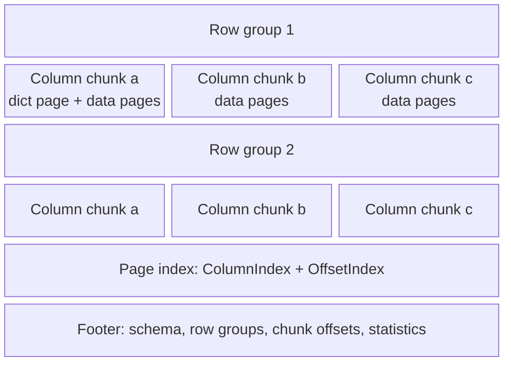
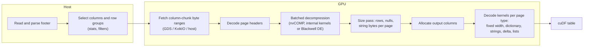
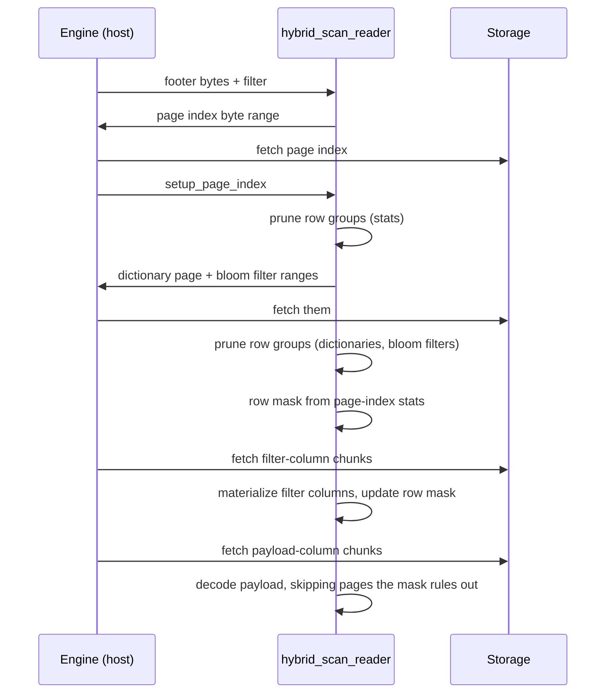

---
tags:
  - gpu-programming
  - libraries
  - parquet
  - orc
  - cudf
  - file-formats
  - io
  - databases
aliases:
  - GPU Parquet Reader
  - GPU Parquet Decoding
  - libcudf Parquet Reader
  - GPU File Decoding
  - GPU Parquet Scan
status: complete
sources:
  - https://parquet.apache.org/docs/file-format/data-pages/encodings
  - https://parquet.apache.org/docs/file-format/pageindex/
  - https://arxiv.org/html/2602.17335v3
  - https://www.vldb.org/2026/Workshops/VLDB-Workshops-2026/ADMS/ADMS26_1.pdf
  - https://developer.nvidia.com/blog/accelerating-apache-parquet-scans-on-apache-spark-with-gpus
  - https://developer.nvidia.com/blog/?p=98435
  - https://developer.nvidia.com/blog/high-performance-remote-io-with-nvidia-kvikio
  - https://developer.nvidia.com/blog/rapids-brings-zero-code-change-acceleration-io-performance-gains-and-out-of-core-xgboost
  - https://docs.nvidia.com/cudf/26.12/pylibcudf/api_docs/io/parquet/
  - https://docs.rapids.ai/api/libcudf/stable/classcudf_1_1io_1_1parquet_1_1experimental_1_1hybrid__scan__reader
  - https://docs.nvidia.com/cudf/26.10/cudf/io/io/
  - https://deepwiki.com/rapidsai/cudf/4.2-parquet-io
  - https://deepwiki.com/rapidsai/cudf/4-io-system
  - https://nvidia.github.io/spark-rapids/docs/additional-functionality/advanced_configs.html
  - https://docs.nvidia.com/cudf-spark/latest/additional-functionality/perfio-s3.html
  - https://ir.cwi.nl/pub/35205/35205.pdf
  - https://github.com/cwida/FastLanes
  - https://arxiv.org/pdf/2609.15034
  - https://arxiv.org/pdf/1905.13415
created: 2026-11-28
updated: 2026-11-28
---

## Table Of Contents

---

- [[#TL;DR|TL;DR]]
- [[#The Problem|The Problem]]
- [[#Foundations|Foundations]]
    - [[#How a Parquet File Is Laid Out|How a Parquet File Is Laid Out]]
    - [[#The Encodings a Decoder Must Undo|The Encodings a Decoder Must Undo]]
    - [[#Effective Bandwidth, Worked|Effective Bandwidth, Worked]]
- [[#How We Got Here|How We Got Here]]
- [[#How It Works|How It Works]]
    - [[#The libcudf Reader Pipeline|The libcudf Reader Pipeline]]
    - [[#Pages Are the Unit of Parallelism|Pages Are the Unit of Parallelism]]
    - [[#Decoding a Bit-Packed Run in a Kernel|Decoding a Bit-Packed Run in a Kernel]]
    - [[#From One Big Kernel to Microkernels|From One Big Kernel to Microkernels]]
    - [[#Chunked Reading and Memory Limits|Chunked Reading and Memory Limits]]
    - [[#Predicate Pushdown and the Hybrid Scan|Predicate Pushdown and the Hybrid Scan]]
    - [[#Getting Bytes to the GPU - GDS, KvikIO and Object Stores|Getting Bytes to the GPU: GDS, KvikIO and Object Stores]]
    - [[#Writing GPU-Friendly Parquet|Writing GPU-Friendly Parquet]]
    - [[#ORC, CSV and JSON|ORC, CSV and JSON]]
- [[#Where It Is Now|Where It Is Now]]
- [[#Trade-offs & Open Problems|Trade-offs & Open Problems]]
- [[#Resources|Resources]]
- [[#Related Notes|Related Notes]]

---

## ***TL;DR***

---

*A GPU query engine spends most of its time reading files, not joining them. Making that fast means keeping the GPU busy on page decoding while storage streams the next bytes, and writing files with enough pages and large enough row groups for the GPU to use.*

- **Parquet scans dominate.** The RAPIDS team reports that about 85% of TPC-H runtime goes to the Parquet scan ([Luo, Chen, Binnig, DaMoN '26](https://arxiv.org/html/2602.17335v3)). A faster join barely matters if the reader is slow.
- **The GPU reader (libcudf) works page by page.** It reads the footer, picks row groups, fetches column chunks, decompresses pages (nvCOMP or internal kernels), sizes the output, then decodes each page with type-specific kernels ([[GPU Databases and Dataframes]], [[GPU Data Compression]]).
- **Pages are the parallelism.** cuDF maps pages to the kernel grid, so a file with one page per column chunk leaves most SMs idle. Rewriting standard Parquet with about 100 pages per chunk, 10M-row row groups, the smallest valid encoding and no low-value compression reached up to **125 GB/s** effective scan bandwidth on one A100 with GPUDirect Storage.
- **Reader design matters as much as file layout.** A blocking reader idles the GPU during I/O; an overlapped reader that pipelines row groups is needed to see the gains.
- **Late 2026:** cuDF 26.12 ships a chunked reader (default in the Polars GPU engine since 24.12), an experimental two-pass **hybrid scan** that prunes with statistics, bloom filters, dictionaries and the page index before decoding, KvikIO for parallel S3 reads, and Blackwell hardware decompression. GPU-native encodings (FastLanes, G-ALP, FastPair) decode at hundreds to over 1,000 GB/s but are not Parquet.

## ***The Problem***

---

*GPUs process columns at hundreds of GB/s, but data at rest lives in Parquet files designed for CPUs and read over links that deliver tens of GB/s. The reader has to bridge both gaps at once.*

- **The link is slow.** One NVMe SSD gives single-digit GB/s; S3 gives a few GB/s per node. HBM gives thousands of GB/s. Most of the time, a scan is I/O-bound, and every byte not read is a win ([[GPUDirect RDMA and Storage]]).
- **The format is serial in places.** Parquet's encodings were tuned for CPU readers walking a page front to back: variable-length run headers, delta chains and length-prefixed strings. A GPU wants thousands of threads to know where their value is without reading everything before it.
- **Metadata is nested and fiddly.** File, row-group and page metadata must be parsed and interpreted throughout the read. An IBM and NVIDIA team found cuDF 25.04's Parquet reader about 10x slower than their storage could deliver and blamed interleaving that metadata work with decoding; cuDF 25.10 was faster, but they argue the structure stays hard to exploit ([Bauer et al., ADMS '26](https://www.vldb.org/2026/Workshops/VLDB-Workshops-2026/ADMS/ADMS26_1.pdf)).
- **Default files are GPU-hostile.** DuckDB's defaults write one page per column chunk and 122,880 rows per row group, giving column chunks of about 100 KB after compression ([DaMoN '26](https://arxiv.org/html/2602.17335v3)). That is too little parallel work for a GPU and too small an I/O request for GDS.
- **Memory is finite.** Decompressing a large file can need several times its on-disk size in GPU memory. Without chunking, readers run out of memory at modest scale factors ([NVIDIA, Polars reader](https://developer.nvidia.com/blog/?p=98435)).

## ***Foundations***

---

*Three ideas carry the rest of the note: how Parquet nests data, which encodings a decoder must undo, and how I/O and decode speeds combine into the bandwidth you actually see.*

### How a Parquet File Is Laid Out

A Parquet file is a stack of **row groups**. Each row group holds one **column chunk** per column, and each column chunk is a series of **pages**: an optional dictionary page, then data pages. The **footer** (Thrift `FileMetaData`) records the schema, every row group, every column chunk's byte offset, and min/max statistics. Optional extras sit near the footer: the **page index** (per-page min/max and row offsets) and **bloom filters** ([Parquet page index](https://parquet.apache.org/docs/file-format/pageindex/)).



What each level means for a GPU reader:

| Level | Typical size | What the reader does with it |
|---|---|---|
| File footer | KB to MB | Parse first (often on the CPU); decides everything else |
| Row group | 100K to 10M+ rows | Unit of I/O and of statistics-based skipping |
| Column chunk | KB to hundreds of MB | One contiguous byte range per column; read only the columns needed |
| Page | Writer-dependent; DuckDB writes one per column chunk by default | Unit of decompression and of GPU decode parallelism |

A reader that wants columns `a` and `c` from row group 2 fetches exactly two byte ranges. That is why columnar files suit remote storage and GDS: projection and row-group pruning turn into fewer, larger reads.

### The Encodings a Decoder Must Undo

Inside a page, values pass through an **encoding** and then, optionally, a general-purpose **compression codec** (Snappy, Zstd, LZ4, Gzip). The decoder undoes them in reverse. The encodings that matter, from the [Parquet spec](https://parquet.apache.org/docs/file-format/data-pages/encodings):

| Encoding | What it stores | Why it is hard or easy on a GPU |
|---|---|---|
| `PLAIN` | Values back to back; strings as 4-byte length + bytes | Fixed-width: trivial, thread *i* reads value *i*. Strings: offsets need a prefix sum over lengths |
| `RLE_DICTIONARY` | Dictionary page of distinct values; data page holds indices as an RLE/bit-packed hybrid | Indices need run boundaries found first; then a parallel gather from the dictionary |
| RLE / bit-packing hybrid | Runs: header `count << 1` (RLE, one repeated value) or `((count/8) << 1) \| 1` (bit-packed groups of 8) | Headers are variable-length (ULEB128), so run starts are found by a serial walk or a scan |
| `DELTA_BINARY_PACKED` | First value, then blocks (multiple of 128 values) of deltas minus a min delta, bit-packed per miniblock (multiple of 32) | Miniblocks decode in parallel; turning deltas back into values is a prefix sum |
| `DELTA_LENGTH_BYTE_ARRAY` | All string lengths (delta-packed), then all bytes concatenated | GPU-friendly: lengths → prefix sum → offsets, bytes already contiguous |
| `DELTA_BYTE_ARRAY` | Shared-prefix length with previous string + suffix | Each string depends on the one before it: a serial chain |
| `BYTE_STREAM_SPLIT` | Byte *k* of every value grouped into stream *k* | Does not shrink data, helps the codec; a parallel transpose to decode |

**Levels.** Nullable and nested columns also carry **definition levels** (how many optional ancestors are present, which marks nulls) and **repetition levels** (where a new list starts). Both are RLE/bit-packed streams that must be decoded before values can be placed, which is why nested and list columns are the slowest path.

**Why "V2" encodings matter on GPUs.** Parquet V1 writers generally use only plain and dictionary encoding. The delta encodings, added later and often called V2, decode with prefix sums, which GPUs do well ([[Parallel Reduction and Scan]]). The cuDF team told the DaMoN '26 authors that `DELTA_BINARY_PACKED` gives high decoding bandwidth for integers.

### Effective Bandwidth, Worked

The number to care about is **effective bandwidth**: logical (decoded, decompressed) bytes divided by scan time ([DaMoN '26](https://arxiv.org/html/2602.17335v3)).

Let $S$ be the on-disk size, $r$ the combined encoding and compression ratio (logical bytes per stored byte), $B_{io}$ the storage bandwidth and $B_{dec}$ the GPU's decode rate in logical bytes per second.

If the reader **overlaps** I/O with decoding, time is set by the slower stage:

$$T_{overlap} = \max\left(\frac{S}{B_{io}},\ \frac{rS}{B_{dec}}\right) \quad\Rightarrow\quad B_{eff} = \min(r\,B_{io},\ B_{dec})$$

If it **blocks** (read everything, then decode), the stages add:

$$B_{eff,\,block} = \frac{1}{\dfrac{1}{r\,B_{io}} + \dfrac{1}{B_{dec}}}$$

In plain English: storage delivers $r$ logical bytes for every stored byte, so compression multiplies the link; but the decoder has to keep up, and a blocking reader pays for both stages in sequence.

**Worked example (illustrative numbers).** Four NVMe SSDs at 6.4 GB/s each give $B_{io} \approx 25.6$ GB/s. Take $r = 5$ and a compressed decode rate $B_{dec} = 100$ GB/s.

| Case | Formula | Effective bandwidth |
|---|---|---|
| Overlapped, compressed | $\min(5 \times 25.6,\ 100)$ | **100 GB/s** (decode-bound) |
| Blocking, compressed | $1 / (1/128 + 1/100)$ | **56 GB/s** |
| Overlapped, compression dropped (file 10% bigger, $r = 4.5$, $B_{dec} = 300$) | $\min(4.5 \times 25.6,\ 300)$ | **115 GB/s** (I/O-bound) |
| One SSD, compressed, overlapped | $\min(5 \times 6.4,\ 100)$ | **32 GB/s** (I/O-bound) |
| One SSD, uncompressed, overlapped | $\min(4.5 \times 6.4,\ 300)$ | **28.8 GB/s** |

This reproduces the shape of the DaMoN '26 findings: with one SSD the scan is I/O-bound and compression helps; with four SSDs the GPU becomes the bottleneck, so compression that saves little should be dropped, and a blocking reader throws away almost half the bandwidth. The paper's actual threshold was to keep compression only if it saves more than 10%. See [[Roofline Model and Arithmetic Intensity]] for the same "which side is the ceiling" reasoning.

## ***How We Got Here***

---

*GPU file reading grew from "parse it on the CPU and copy it over" into page-parallel decoding on the GPU, then into storage-direct reads, chunking, and now a push to change how files are written rather than how they are read.*

| When | What changed | Source |
|---|---|---|
| Before 2025 | cuDF's GPU Parquet and ORC readers, used by Spark RAPIDS, decode pages with one large all-types kernel | [NVIDIA](https://developer.nvidia.com/blog/accelerating-apache-parquet-scans-on-apache-spark-with-gpus) |
| 2019 to 2020 | ParPaRaw parses CSV at up to 14.2 GB/s on a Pascal Titan X, showing delimiter parsing can be massively parallel | [Stehle and Jacobsen, PVLDB 13](https://arxiv.org/pdf/1905.13415) |
| 2021 onward | GPUDirect Storage and KvikIO let cuDF read files straight into GPU memory | [[GPUDirect RDMA and Storage]] |
| 2024 (cuDF-Polars 24.12) | Chunked reader plus unified memory become the Polars GPU default | [NVIDIA, Apr 2025](https://developer.nvidia.com/blog/?p=98435) |
| 2024 to 2025 | FastLanes on GPU, G-ALP: encodings designed for GPU decoding | [CWI](https://github.com/cwida/FastLanes) |
| 2025 (cuDF 25.02 to 25.04) | Blackwell decompression engine support; parallel footer reads and KvikIO make S3 reads over 3x faster | [NVIDIA, May 2025](https://developer.nvidia.com/blog/rapids-brings-zero-code-change-acceleration-io-performance-gains-and-out-of-core-xgboost) |
| Apr 2025 | Monolithic decode kernel replaced by per-type microkernels | [NVIDIA, Apr 2025](https://developer.nvidia.com/blog/accelerating-apache-parquet-scans-on-apache-spark-with-gpus) |
| 2026 | DaMoN '26: rewritten standard Parquet reaches 125 GB/s; hybrid scan reader in libcudf; GPU Presto and Velox read via cuDF | [DaMoN '26](https://arxiv.org/html/2602.17335v3), [ADMS '26](https://www.vldb.org/2026/Workshops/VLDB-Workshops-2026/ADMS/ADMS26_1.pdf) |

## ***How It Works***

---

*The reader is a pipeline of small GPU passes over many pages. Each pass exists because the next one needs a number (a size, an offset, a run start) that the format does not store up front.*

### The libcudf Reader Pipeline

libcudf's reader lives in `cpp/src/io/parquet/` (`reader_impl.cpp`, `reader_impl_preprocess.cu`, `page_data.cu`, `page_string_decode.cu`, `decode_fixed.cu`, `delta_binary.cuh`), per the [DeepWiki code map](https://deepwiki.com/rapidsai/cudf/4.2-parquet-io). In order:



1. **Footer and selection.** Parse `FileMetaData`, choose columns, and drop row groups whose statistics cannot match the filter. Filters arrive as a libcudf AST expression ([pylibcudf Parquet API](https://docs.nvidia.com/cudf/26.12/pylibcudf/api_docs/io/parquet/)).
2. **Fetch.** Read the selected column chunks as byte ranges, straight into device memory when GDS is active.
3. **Decompress.** Pages are decompressed as one batch. libcudf calls nvCOMP for Snappy, Zstd and LZ4 (and more), governed by `LIBCUDF_NVCOMP_POLICY` (`STABLE` default, `ALWAYS`, or `OFF` for internal kernels) ([cuDF I/O docs](https://docs.nvidia.com/cudf/26.10/cudf/io/io/); details in [[GPU Data Compression]]).
4. **Size.** A pass over every page computes how many rows and nulls it yields and, for strings, how many bytes. These come from the levels and the length streams, not from the header.
5. **Allocate.** With exact sizes, output buffers are allocated once and each page's write offset is a prefix sum of the page sizes.
6. **Decode.** Type-specific kernels write values, null masks and string offsets in place.

Steps 4 and 5 are the GPU price of variable-length data: without knowing every page's output size first, thousands of pages cannot write into one column in parallel.

### Pages Are the Unit of Parallelism

cuDF assigns roughly one thread block per page and maps the number of pages onto the kernel grid, parallelizing across row groups and pages ([DaMoN '26](https://arxiv.org/html/2602.17335v3)). The consequence is direct: a 10M-row row group with one page per column gives one block per column, while 100 pages per column gives 100 blocks. An H100 has 132 SMs; a scan of a few columns with one page each cannot fill it ([[Occupancy and Latency Hiding]]).

Within a page, the whole block cooperates on each stage; in the microkernel design a full 128-thread block copies strings, where one warp used to ([NVIDIA](https://developer.nvidia.com/blog/accelerating-apache-parquet-scans-on-apache-spark-with-gpus)), echoing the thread-vs-warp-per-string choices in [[GPU String Processing]].

### Decoding a Bit-Packed Run in a Kernel

The core inner loop of dictionary decoding: unpack a `bit_width`-bit index, then gather from the dictionary. A minimal sketch (not cuDF's code):

```cuda
__device__ uint32_t unpack(const uint8_t* buf, int bit_width, long i) {
  uint64_t bit = (uint64_t)i * bit_width;          // first bit of value i
  uint64_t word;
  memcpy(&word, buf + (bit >> 3), 8);              // 8 bytes covering it (buffer padded)
  return (uint32_t)((word >> (bit & 7)) & ((1ull << bit_width) - 1));
}

__global__ void dict_gather(const uint8_t* packed, int bit_width, long n,
                            const int32_t* dict, int32_t* out) {
  long i = blockIdx.x * (long)blockDim.x + threadIdx.x;
  if (i < n) out[i] = dict[unpack(packed, bit_width, i)];
}
```

Line by line:

- **`bit = i * bit_width`**: in a bit-packed run every value has the same width, so value *i*'s position is pure arithmetic. No thread waits for another.
- **`memcpy(&word, ...)`**: load the 8 bytes starting at that value's byte. A value of up to 32 bits starting at any bit offset fits in 8 bytes. The input must be padded so the last load stays in bounds.
- **`>> (bit & 7)` and the mask**: Parquet packs values from the least significant bit of each byte, so on a little-endian GPU a shift and mask extracts the value.
- **`dict[...]`**: the gather. Dictionary pages are small enough to cache well; output writes are coalesced because neighbors write neighbors ([[Memory Coalescing]]).

**The catch.** This works inside one bit-packed run. A real hybrid stream interleaves RLE and bit-packed runs with variable-length ULEB128 headers, so the starting index of each run is only known after reading every earlier header. Decoders first walk the headers (one warp, or a scan over run lengths) to build a run table, then expand runs in parallel. Definition levels add a second indirection: value *i* lands at the *i*-th non-null slot, which is another prefix sum.

### From One Big Kernel to Microkernels

Until 2025, libcudf decoded pages with a large kernel that handled every column type in one body, with warps specialized by role: one decoding levels, one decoding dictionary indices, others writing values ([DeepWiki](https://deepwiki.com/rapidsai/cudf/4-io-system)). NVIDIA's account of what went wrong ([Ahrens, Mattione, Baranec, Apr 2025](https://developer.nvidia.com/blog/accelerating-apache-parquet-scans-on-apache-spark-with-gpus)):

- **Register and shared memory use was set by the worst case**, so every page type ran at the occupancy of the most complex one ([[Register Pressure and Spilling]]).
- **Warps waited on earlier warps**, a serial dependency between the role-specialized warps ([[Warp Specialization]] trades the same risk).
- **Block-wide decoding** would have raised register pressure further.

The fix was **microkernels**: one small kernel per type and path (fixed-width vs string, flat vs nested vs list, dictionary vs plain), generated from shared templates with `if constexpr` so each instantiation compiles only its own code. Whole blocks now do each stage. On an RTX A5000 reading 512 MB of Snappy Parquet from device buffers in 500 KB chunks, throughput rose across flat numeric, boolean, nested, list and dictionary string columns, and chunked list reads improved 117%. The same pattern (template specialization instead of runtime branching) shows up in [[Kernel Fusion]] and [[Instruction Cache and Code Size on GPUs]].

### Chunked Reading and Memory Limits

Reading a whole file at once needs memory for compressed input, decompressed pages and output. The **chunked reader** bounds both:

| Limit | Meaning | Default (pylibcudf) |
|---|---|---|
| `pass_read_limit` | Max memory for reading and decompressing input per pass | 1,024,000,000 bytes |
| `chunk_read_limit` | Max bytes returned per output chunk | 0 (no limit) |

Source: [pylibcudf `ChunkedParquetReader`](https://docs.nvidia.com/cudf/26.12/pylibcudf/api_docs/io/parquet/). A **pass** loads a set of row groups that fits `pass_read_limit`; **subpasses** decode a subset of its pages; each `read_chunk()` returns a table no larger than `chunk_read_limit`.

```python
import pylibcudf as plc

opts = plc.io.parquet.ParquetReaderOptions.builder(
    plc.io.SourceInfo(["lineitem.parquet"])).build()
opts.set_column_names(["l_shipdate", "l_quantity", "l_extendedprice"])
reader = plc.io.parquet.ChunkedParquetReader(
    opts, chunk_read_limit=2_000_000_000, pass_read_limit=16_000_000_000)
while reader.has_next():
    t = reader.read_chunk()          # a TableWithMetadata, at most ~2 GB
    process(t.tbl)                   # aggregate, then drop it
```

- **`set_column_names`**: projection, so only three column chunks per row group are fetched.
- **`pass_read_limit=16e9`**: the 16 GB setting NVIDIA found completed every PDS-H query in its Polars tests, where 32 GB still ran out of memory on two queries ([Gali and Miller, Apr 2025](https://developer.nvidia.com/blog/?p=98435)).
- **The loop**: each chunk is processed and freed before the next decode, so peak memory follows the limits, not the file.

The Polars GPU engine made chunked reading plus [[Unified Memory]] its default in cuDF-Polars 24.12. Without UVM, chunked reads still ran out of memory before SF100 on some queries; with it, Query 13 stayed faster than CPU Polars up to SF400. Spark RAPIDS exposes the same idea as `spark.rapids.sql.reader.chunked`, which "allows reading highly compressed data that could not be read otherwise" ([Spark RAPIDS configs](https://nvidia.github.io/spark-rapids/docs/additional-functionality/advanced_configs.html)).

### Predicate Pushdown and the Hybrid Scan

The cheapest page is one never read. Parquet offers four levels of skipping, coarse to fine:

| Mechanism | Granularity | Can skip when |
|---|---|---|
| Column chunk statistics (footer) | Row group | Filter range misses the chunk's min/max |
| Dictionary page | Row group | Equality value not in the dictionary |
| Bloom filter | Row group | Value definitely absent |
| Page index (`ColumnIndex` + `OffsetIndex`) | Page | Filter misses a page's min/max; `OffsetIndex` maps the surviving rows to pages in other columns ([spec](https://parquet.apache.org/docs/file-format/pageindex/)) |

The standard `read_parquet` uses row-group statistics. libcudf's experimental `hybrid_scan_reader` uses all four and adds a **two-pass** read ([libcudf docs](https://docs.rapids.ai/api/libcudf/stable/classcudf_1_1io_1_1parquet_1_1experimental_1_1hybrid__scan__reader)):



- **The engine owns I/O.** The reader returns byte ranges; the caller fetches them however it likes (GDS, S3, a cache). This fits engines like Velox and Spark that manage their own storage layer.
- **Filter columns first.** Only the columns in the predicate are decoded in the first pass; their result becomes a row mask.
- **Payload columns second.** With the data-page mask enabled, pages whose rows are all filtered out are not decompressed or decoded.

The docs say it wins on **highly selective filters over partially sorted data** and otherwise performs like `read_parquet`. cuDF's Java bindings expose it as `ai.rapids.cudf.HybridScanReader`, the layer Spark RAPIDS builds on. Filter evaluation can also use JIT-compiled expressions (`use_jit_filter`), the theme of [[Query Compilation and JIT on GPUs]].

### Getting Bytes to the GPU - GDS, KvikIO and Object Stores

**Local NVMe.** cuDF reads through KvikIO, which can use cuFile (GDS) to DMA straight into GPU memory. `KVIKIO_COMPAT_MODE` is `ON` by default in cuDF (POSIX path), `OFF` forces cuFile, `AUTO` tries cuFile then falls back ([cuDF I/O docs](https://docs.nvidia.com/cudf/26.10/cudf/io/io/)). GDS wants MiB-scale requests, which is why small row groups hurt ([[GPUDirect RDMA and Storage]]).

**Object stores.** S3 latency is high and variable, so throughput comes from many concurrent range requests ([Augspurger, Feb 2025](https://developer.nvidia.com/blog/high-performance-remote-io-with-nvidia-kvikio)):

- KvikIO splits a read into `task_size` pieces served by a thread pool; more threads than cores helps because threads mostly wait.
- Throughput peaked at **64 to 128 threads with 16 MiB tasks**. Below about 4 MiB, HTTP overhead dominates; above about 128 MiB, concurrency drops.
- On 360 Parquet files (about 46 GB) with a 4-worker Dask-cuDF cluster, KvikIO reached about 20,000 Mbps vs about 5,000 Mbps for boto3.
- cuDF 25.04 reads footers in parallel by default; together with KvikIO, Dask-cuDF S3 reads became more than 3x faster ([NVIDIA, May 2025](https://developer.nvidia.com/blog/rapids-brings-zero-code-change-acceleration-io-performance-gains-and-out-of-core-xgboost)).

Spark RAPIDS has its own reader modes: `COALESCING` (local file systems, merging small files into one GPU read), `MULTITHREADED` (cloud blob stores, many files read in parallel on the CPU), and `PERFILE`, with `AUTO` choosing ([configs](https://nvidia.github.io/spark-rapids/docs/additional-functionality/advanced_configs.html)). Its optional **PerfIO** S3 reader bypasses Hadoop S3A with an async AWS SDK v2 client ([docs](https://docs.nvidia.com/cudf-spark/latest/additional-functionality/perfio-s3.html)). How much I/O still matters: GPU Presto on ten AWS RTX PRO workers took 190 s cold from S3 vs 108 s with a warm cache at SF3000 ([ADMS '26](https://www.vldb.org/2026/Workshops/VLDB-Workshops-2026/ADMS/ADMS26_1.pdf)).

### Writing GPU-Friendly Parquet

The DaMoN '26 recipe keeps files fully standard and only changes writer settings ([Luo, Chen, Binnig](https://arxiv.org/html/2602.17335v3)):

| Setting | DuckDB default | GPU-friendly | Why |
|---|---|---|---|
| Pages per column chunk | 1 | ~100 | Decode grid size; avoid small values |
| Rows per row group | 122,880 | ~10M (≥ 4M saturates one SSD) | MiB-scale GDS reads |
| Encoding | V1 (plain/dictionary) | Smallest valid per chunk, V1 or V2 (e.g. delta) | Fewer bytes, faster decode |
| Compression | On | Only if it saves > 10% | Avoid decode cost for nothing when GPU-bound |
| Reader | Blocking | Overlapped, per row group | Hide I/O behind decode, avoid OOM |

Their Rust rewriter (`DataManagementLab/ParquetRewriter`) tries every valid encoding per chunk (fewer than five candidates per type) and takes minutes for about 100 GB. The cuDF writer itself can emit the delta encodings and `BYTE_STREAM_SPLIT` ([DeepWiki](https://deepwiki.com/rapidsai/cudf/4.2-parquet-io)); NVIDIA's string-encoding guide in [[GPU String Processing]] covers string columns.

### ORC, CSV and JSON

- **ORC** splits files into **stripes** of typed **streams**. libcudf filters stripes by statistics, decompresses stripe data, builds null masks and string dictionaries, then decodes RLE row groups ([DeepWiki](https://deepwiki.com/rapidsai/cudf/4-io-system)). The structure is similar to Parquet with different names.
- **CSV and JSON** have no metadata, so the hard part is finding record and field boundaries in parallel when quotes and escapes change meaning. ParPaRaw splits input into small chunks; each thread runs the parser's DFA from every possible start state and records where each ends in a state-transition vector. Those vectors compose associatively, so a prefix scan gives every chunk its true start state without a sequential pre-pass ([Stehle and Jacobsen, PVLDB 13, 2020](https://arxiv.org/pdf/1905.13415)). This is the same trick as GPU regex matching ([[GPU String Processing]]).

## ***Where It Is Now***

---

*As of late November 2026: standard Parquet, written well and read with an overlapped GPU reader, gets close to storage limits; the frontier has moved to pruning before decode, object-store I/O, and GPU-native encodings that leave Parquet behind.*

| System | State (date) | Source |
|---|---|---|
| libcudf / pylibcudf 26.12 | Chunked reader, AST filters with optional JIT, field-ID and mismatched-schema reads, experimental hybrid scan with page-index and bloom-filter pruning | [pylibcudf docs](https://docs.nvidia.com/cudf/26.12/pylibcudf/api_docs/io/parquet/), [libcudf docs](https://docs.rapids.ai/api/libcudf/stable/classcudf_1_1io_1_1parquet_1_1experimental_1_1hybrid__scan__reader) |
| Polars GPU engine | Chunked reader + UVM default since 24.12 | [NVIDIA](https://developer.nvidia.com/blog/?p=98435) |
| Spark RAPIDS | Coalescing / multithreaded / per-file readers, chunked reads, native footer parsing, PerfIO S3 | [configs](https://nvidia.github.io/spark-rapids/docs/additional-functionality/advanced_configs.html) |
| GPU Presto (Velox cuDF) | GPU-aware Hive connector reads Parquet with cuDF and GDS | [ADMS '26](https://www.vldb.org/2026/Workshops/VLDB-Workshops-2026/ADMS/ADMS26_1.pdf) |
| Blackwell decompression engine | Supported since cuDF 25.02; 35% faster end-to-end on PDS SF100 on a B100 with Snappy files | [NVIDIA](https://developer.nvidia.com/blog/rapids-brings-zero-code-change-acceleration-io-performance-gains-and-out-of-core-xgboost) |

Numbers worth knowing:

- **125 GB/s** effective Parquet scan on one A100 with GDS from local SSDs, standard files rewritten for GPUs (DaMoN '26, May 2026).
- **95% of theoretical** read throughput with a simple Arrow-like one-file-per-column format in the IBM/NVIDIA GPU Presto work, reading SF1000 lineitem (about 400 GB) at 22 GB/s from GPFS, versus a cuDF 25.04 Parquet reader about 10x below the I/O limit ([ADMS '26](https://www.vldb.org/2026/Workshops/VLDB-Workshops-2026/ADMS/ADMS26_1.pdf)). The authors do not propose it as a Parquet replacement.
- **GPU-native encodings.** G-ALP decodes doubles at 324.7 GB/s on a V100 vs 209.9 GB/s for nvCOMP Bitcomp and 16.5 GB/s for nvCOMP Zstd, and reaches 856.8 GB/s when fused into a filter scan ([Hepkema et al., DaMoN '25](https://ir.cwi.nl/pub/35205/35205.pdf)). FastPair (Sep 2026) decodes FSST-family string columns at 814 to 1,620 GB/s on a B300, 2.4 to 4.2x faster than the decompression engine ([Isaacs et al.](https://arxiv.org/pdf/2609.15034)). DaMoN '26 cites in-GPU decoding up to 5,700 GB/s for such schemes, and notes this helps little when storage delivers tens of GB/s.
- **New formats** (FastLanes, Vortex, Lance) aim at data-parallel decoding; the FastLanes project lists its CUDA reader as "coming soon" ([FastLanes](https://github.com/cwida/FastLanes)).

## ***Trade-offs & Open Problems***

---

*The main tension is that the files are written once by many tools for many readers, while the GPU reader can only be as fast as the layout it is handed.*

- **Fix the files or fix the reader.** Rewriting files gave the biggest single gain in DaMoN '26, but it costs a write pass and the best settings (pages, row-group size, compression threshold) are workload- and hardware-specific. Microsoft's V-Order rewrite reportedly adds 10 to 20% to write time.
- **Parquet vs a new format.** GPU-native encodings decode an order of magnitude faster in memory, but most scans are I/O-bound, where compression ratio matters more than decode speed. Parquet's ecosystem is the real moat.
- **Metadata overhead.** Footers of wide tables and thousands of files cost real time; parallel footer reads and native footer parsing help, but nested Thrift metadata stays CPU-shaped ([[Coherent CPU-GPU Superchips]] make the CPU side cheaper).
- **Large row groups vs memory and skipping.** Bigger row groups mean bigger I/O and fewer statistics, so coarser pruning; the page index recovers fine-grained skipping only if writers emit it.
- **Compression.** Codecs multiply a slow link and waste a fast one. Hardware decompression (Blackwell) shifts the balance back toward compressing ([[GPU Data Compression]]).
- **Nested and string data** still decode far slower than flat numeric columns; `DELTA_BYTE_ARRAY`'s prefix chain is inherently serial.
- **Object stores** need deep concurrency and caching; cold S3 reads remain a large share of end-to-end time.
- **Open:** sampling-based encoding choice instead of exhaustive search; readers that adapt to the file they get; decoding fused directly into query kernels instead of materializing columns first ([[Kernel Fusion]]).

## ***Resources***

---

*Start with DaMoN '26 for what matters and why, then the cuDF docs for the APIs, then the NVIDIA posts for implementation detail.*

**Specs and docs**
- [Parquet encodings](https://parquet.apache.org/docs/file-format/data-pages/encodings): Apache Parquet. RLE/bit-packing hybrid, delta, byte-stream-split.
- [Parquet page index](https://parquet.apache.org/docs/file-format/pageindex/): Apache Parquet. ColumnIndex and OffsetIndex.
- [pylibcudf Parquet I/O](https://docs.nvidia.com/cudf/26.12/pylibcudf/api_docs/io/parquet/): NVIDIA, cuDF 26.12. Reader options and `ChunkedParquetReader`.
- [libcudf `hybrid_scan_reader`](https://docs.rapids.ai/api/libcudf/stable/classcudf_1_1io_1_1parquet_1_1experimental_1_1hybrid__scan__reader): NVIDIA. Two-pass pruned reads.
- [cuDF Input / Output](https://docs.nvidia.com/cudf/26.10/cudf/io/io/): NVIDIA, 26.10. nvCOMP policy, KvikIO compat mode, remote sources.
- [Spark RAPIDS advanced configs](https://nvidia.github.io/spark-rapids/docs/additional-functionality/advanced_configs.html) and [PerfIO S3 reader](https://docs.nvidia.com/cudf-spark/latest/additional-functionality/perfio-s3.html): NVIDIA.
- [cuDF Parquet I/O code map](https://deepwiki.com/rapidsai/cudf/4.2-parquet-io) and [I/O system](https://deepwiki.com/rapidsai/cudf/4-io-system): DeepWiki, generated from the cuDF repo. Useful for file names; check against the source.

**Papers**
- [Do GPUs Really Need New Tabular File Formats?](https://arxiv.org/html/2602.17335v3): Luo, Chen, Binnig, TU Darmstadt, DaMoN '26. Pages, row groups, encodings, compression threshold; 125 GB/s.
- [Accelerating Presto with GPUs (ADMS '26)](https://www.vldb.org/2026/Workshops/VLDB-Workshops-2026/ADMS/ADMS26_1.pdf): Bauer et al., IBM and NVIDIA, VLDB 2026 workshop. Parquet metadata overhead, S3 cold vs warm.
- [G-ALP: Rethinking Light-weight Encodings for GPUs](https://ir.cwi.nl/pub/35205/35205.pdf): Hepkema et al., CWI, DaMoN '25.
- [FastPair: GPU-Optimized String Decoding](https://arxiv.org/pdf/2609.15034): Isaacs et al., Spiral, Pisa and CWI, Sep 2026.
- [ParPaRaw: Massively Parallel Parsing of Delimiter-Separated Raw Data](https://arxiv.org/pdf/1905.13415): Stehle and Jacobsen, TU Munich, PVLDB 13, 2020.
- [FastLanes repository and papers](https://github.com/cwida/FastLanes): Afroozeh, Boncz et al., CWI (PVLDB 2025, DaMoN '24).

**Posts**
- [Accelerating Apache Parquet Scans on Apache Spark with GPUs](https://developer.nvidia.com/blog/accelerating-apache-parquet-scans-on-apache-spark-with-gpus): Ahrens, Mattione, Baranec, NVIDIA, Apr 2025. Microkernels.
- [Efficiently Scaling Polars GPU Parquet Reader](https://developer.nvidia.com/blog/?p=98435): Gali and Miller, NVIDIA, Apr 2025. Chunked reading and UVM.
- [High-Performance Remote IO With NVIDIA KvikIO](https://developer.nvidia.com/blog/high-performance-remote-io-with-nvidia-kvikio): Augspurger, NVIDIA, Feb 2025.
- [RAPIDS Brings Zero-Code-Change Acceleration, IO Performance Gains, and Out-of-Core XGBoost](https://developer.nvidia.com/blog/rapids-brings-zero-code-change-acceleration-io-performance-gains-and-out-of-core-xgboost): Becker, NVIDIA, May 2025. Parallel footers, Blackwell decompression.

## ***Related Notes***

---

*The engines that call this reader, the data-movement layers under it, and the kernels it is built from.*

- [[GPU Databases and Dataframes]] — The engines (cuDF, Polars GPU, Spark RAPIDS, Velox) whose scans this reader serves.
- [[GPU Data Compression]] — nvCOMP, the Blackwell decompression engine and when compression pays.
- [[GPUDirect RDMA and Storage]] — GDS and KvikIO, the path from NVMe to GPU memory.
- [[Distributed GPU Shuffles]] — What happens to the columns after the scan in a distributed query.
- [[GPU String Processing]] — String layouts, dictionary and delta string pages, FSST.
- [[Parallel Reduction and Scan]] — Prefix sums turn lengths into offsets and deltas into values.
- [[Occupancy and Latency Hiding]] — Why one page per column chunk leaves the GPU idle.
- [[Register Pressure and Spilling]] — What sank the monolithic decode kernel.
- [[Warp Specialization]] — Role-specialized warps, and the waiting they can cause.
- [[Memory Coalescing]] — Dictionary gathers and contiguous output writes.
- [[Unified Memory]] — The overflow path behind the Polars chunked reader.
- [[Kernel Fusion]] — Fusing decode into query kernels, the G-ALP approach.
- [[Roofline Model and Arithmetic Intensity]] — I/O-bound vs decode-bound, the same ceiling argument.
- [[Query Compilation and JIT on GPUs]] — JIT filters in the reader (planned).
- [[Blackwell Architecture]] — Home of the hardware decompression engine.
