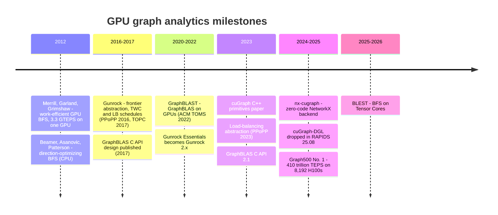
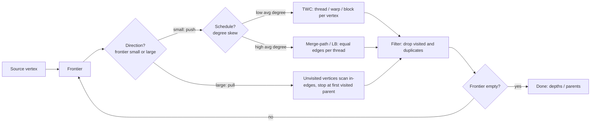

---
tags:
  - gpu-programming
  - libraries
  - cuda
  - graph-analytics
  - cugraph
  - gunrock
  - graphblas
  - bfs
  - load-balancing
status: complete
sources:
  - https://research.nvidia.com/publication/2012-02_scalable-gpu-graph-traversal
  - https://people.eecs.berkeley.edu/~krste/papers/beamer-sc2012.pdf
  - https://arxiv.org/pdf/1701.01170
  - https://github.com/gunrock/gunrock
  - https://github.com/gunrock/essentials/wiki/Overview
  - https://arxiv.org/abs/2301.04792
  - https://arxiv.org/pdf/1908.01407v4
  - https://researchr.org/publication/YangBO22
  - https://par.nsf.gov/biblio/10037669-design-graphblas-api
  - https://graphblas.org/docs/GraphBLAS_API_C_v2.1.0.pdf
  - https://en.wikipedia.org/wiki/GraphBLAS
  - https://graphblas.org/docs/GraphBLAS_Update_SC25.pdf
  - https://science.ecosyste.ms/projects/37659/releases
  - https://github.com/rapidsai/cugraph
  - https://docs.nvidia.com/cugraph/latest/
  - https://docs.nvidia.com/cugraph/26.10/nx_cugraph/
  - https://pypi.org/project/nx-cugraph-cu13/
  - https://pypistats.org/packages/cugraph-cu13
  - https://developer.nvidia.com/blog/accelerated-production-ready-graph-analytics-for-networkx-users/
  - https://docs.nvidia.com/datascience/notices/rsn0046/
  - https://docs.rapids.ai/notices/rsn0041/
  - https://researchr.org/publication/KangHER23
  - https://blogs.nvidia.com/blog/h100-coreweave-graph500
  - https://arxiv.org/abs/2512.21967v1
  - https://arxiv.org/abs/2606.05081
created: 2026-11-26
updated: 2026-11-28
---

## Table Of Contents

---

- [[#TL;DR|TL;DR]]
- [[#The Problem|The Problem]]
- [[#Foundations|Foundations]]
    - [[#Graphs as CSR|Graphs as CSR]]
    - [[#Frontiers and Bulk-Synchronous Rounds|Frontiers and Bulk-Synchronous Rounds]]
    - [[#Two Ways to Think: Vertex-Centric and Linear Algebra|Two Ways to Think: Vertex-Centric and Linear Algebra]]
    - [[#Measuring It: TEPS and the Bandwidth Ceiling|Measuring It: TEPS and the Bandwidth Ceiling]]
- [[#How We Got Here|How We Got Here]]
- [[#How It Works|How It Works]]
    - [[#The Frontier Loop|The Frontier Loop]]
    - [[#Load Balancing the Advance|Load Balancing the Advance]]
    - [[#Push, Pull and Direction Optimization|Push, Pull and Direction Optimization]]
    - [[#Avoiding Atomics: Idempotence and Filtering|Avoiding Atomics: Idempotence and Filtering]]
    - [[#GraphBLAS: Graphs as Sparse Matrices|GraphBLAS: Graphs as Sparse Matrices]]
    - [[#cuGraph: The Production Stack|cuGraph: The Production Stack]]
    - [[#Beyond One GPU|Beyond One GPU]]
- [[#Where It Is Now|Where It Is Now]]
- [[#Trade-offs & Open Problems|Trade-offs & Open Problems]]
- [[#Resources|Resources]]
- [[#Related Notes|Related Notes]]

## ***TL;DR***
---
*Graph analytics (BFS, PageRank, shortest paths, connected components) is the textbook irregular GPU workload: work per vertex varies by orders of magnitude, accesses are random, and the amount of parallel work changes every iteration. Every fast GPU graph library is mostly a load balancer wrapped around a frontier.*

- **What it is.** Running graph algorithms as CUDA kernels over a graph stored in compressed sparse form ([[Sparse Linear Algebra on GPUs|CSR]]). The core loop keeps a **frontier** (the vertices active this round), expands it to neighbors (**advance**), prunes the result (**filter**), and repeats until the frontier is empty.
- **The three libraries.** **cuGraph** (NVIDIA, in RAPIDS/CUDA-X) is the production stack, with a C++ primitives layer, Python APIs and a zero-code-change **NetworkX backend** (`nx-cugraph`). **Gunrock** (UC Davis) is the research reference for the frontier programming model and its load-balancing schedules. **GraphBLAS** is a standard that writes graph algorithms as sparse matrix–vector products over custom **semirings**; GraphBLAST is its GPU research implementation.
- **The hard part is load balance.** Power-law graphs put millions of edges on a few vertices and one edge on most. Assigning one thread per vertex lets the biggest vertex set the runtime. Libraries fix this by grouping vertices by degree (thread/warp/block, "TWC") or by splitting the *edges* evenly with a prefix sum and binary search (**merge-path / LB**). Gunrock switches to LB when average degree is 5 or more ([Wang et al.](https://arxiv.org/pdf/1701.01170)).
- **The big algorithmic trick is direction optimization.** When the frontier is large, it is cheaper for unvisited vertices to look for a visited parent (**pull**) than for frontier vertices to push to all neighbors. Beamer's switch rule ($m_f > m_u/14$) gave 2.4–7.8× on CPUs ([Beamer et al.](https://people.eecs.berkeley.edu/~krste/papers/beamer-sc2012.pdf)) and every GPU library adopted it.
- **Where it is now (Nov 2026).** cuGraph 26.10.0 is current on PyPI; `nx-cugraph` 26.8 (Aug 6, 2026) turns on with one environment variable. NVIDIA holds the No. 1 Graph500 BFS result: **410 trillion TEPS** on 8,192 H100s with GPU-initiated active messages (announced Nov 2025). Research is pushing BFS onto [[Tensor Cores]]: BLEST reports 7.7× over Gunrock (Jun 2026).

## ***The Problem***
---
*Graph kernels break every assumption that makes GPUs fast: regular work per thread, coalesced memory access and high arithmetic intensity. The question is not whether a GPU can run BFS, but how to keep 100,000+ threads equally busy when the graph refuses to cooperate.*

| GPU assumption | What graphs do instead | Consequence |
|---|---|---|
| Every thread does similar work | Degrees follow a power law: a web or social graph has vertices with millions of edges next to vertices with one | One thread per vertex leaves most of a warp idle while one lane walks a huge adjacency list ([[Warp Divergence and Warp-Level Primitives]]) |
| Neighboring threads touch neighboring addresses | Neighbor IDs are arbitrary, so reading their state is a gather | Each lookup can cost a whole 32-byte sector for 4 useful bytes ([[Memory Coalescing]]) |
| Parallel work is known at launch | The frontier grows from one vertex to most of the graph and shrinks back over a few rounds | Fixed launch shapes are wrong most of the time; small rounds are launch-overhead-bound |
| Many FLOPs per byte | BFS does a compare and maybe a write per edge | Deep in the bandwidth-bound corner of the [[Roofline Model and Arithmetic Intensity|roofline]] |
| Threads write disjoint outputs | Many frontier vertices discover the same neighbor at once | Races need atomics or tolerated duplicates ([[CUDA Memory Model and Atomics]]) |

Merrill, Garland and Grimshaw summed it up in 2012: BFS is "representative of a class of parallel computations whose memory accesses and work distribution are both irregular and data-dependent," and earlier GPU attempts used "asymptotically inefficient algorithms that perform poorly on graphs with non-trivial diameter" ([PPoPP 2012](https://research.nvidia.com/publication/2012-02_scalable-gpu-graph-traversal)). The lessons from fixing BFS carry over to every irregular workload: [[Sparse Linear Algebra on GPUs|SpMV]], [[GPU Databases and Dataframes|joins]], mixture-of-experts routing and [[Work Stealing and Dynamic Load Balancing|dynamic work queues]].

## ***Foundations***
---
*Four ideas carry the rest of the note: how the graph is stored, what a frontier is, the two equivalent ways to write graph algorithms, and the metric everyone reports.*

### Graphs as CSR

Nearly every GPU graph library stores the graph in **CSR** (compressed sparse row), the same format sparse linear algebra uses:

- `row_offsets[v]` to `row_offsets[v+1]` is the slice of `col_idx` holding $v$'s out-neighbors. The degree of $v$ is the difference.
- `col_idx` concatenates every adjacency list; an optional `values` array holds edge weights.
- **CSC** (the transpose) gives in-neighbors, which pull-style traversal needs; libraries often keep both.

For $n$ vertices and $m$ edges with 32-bit IDs, CSR costs $4(n+1) + 4m$ bytes. A graph with 100 million vertices and 1.6 billion edges is about 6.8 GB, which fits on one GPU; Graph500's 35-trillion-edge graph does not fit on anything short of a cluster.

### Frontiers and Bulk-Synchronous Rounds

A **frontier** is the set of vertices (or edges) active in a round. Gunrock built its whole model on it: a "bulk-synchronous, data-centric abstraction focused on operations on vertex or edge frontiers" ([Gunrock essentials](https://github.com/gunrock/essentials/wiki/Overview)). A frontier has two common representations:

| Representation | Layout | Good when | Cost |
|---|---|---|---|
| **Sparse (queue)** | Array of vertex IDs plus a count | Frontier is a small fraction of $n$ | Building it needs atomics or a scan for compaction ([[Parallel Reduction and Scan]]) |
| **Dense (bitmap)** | One bit (or byte) per vertex | Frontier is a large fraction of $n$ | Every round scans all $n$ entries, even the inactive ones |

Each round runs one or more kernels and ends at a global synchronization, which is either a kernel boundary or a grid-wide barrier in a [[Persistent Kernels and Stream-K|persistent kernel]] ([[Cooperative Groups]]).

### Two Ways to Think: Vertex-Centric and Linear Algebra

The same BFS round can be written two ways:

- **Vertex-centric (Gunrock, cuGraph primitives):** "for each vertex $v$ in the frontier, for each neighbor $u$, if $u$ is unvisited, mark it and add it to the next frontier." Operators are advance, filter and compute.
- **Linear algebra (GraphBLAS):** put the frontier in a sparse vector $f$ and the adjacency matrix in $A$. Then the next frontier is $f' = \neg v \odot (A^T f)$, where the product uses the Boolean **semiring** ($\oplus = \text{OR}$, $\otimes = \text{AND}$) and $\neg v$ is a **mask** that removes already-visited vertices.

In plain words: multiplying the adjacency matrix by "who is active" gives "who has an active neighbor," and the mask throws away vertices you have already seen. Swap the semiring and the same multiply computes other things: (min, +) gives one step of Bellman-Ford shortest paths, (+, ×) gives a PageRank step.

### Measuring It: TEPS and the Bandwidth Ceiling

Graph traversal speed is reported in **TEPS**, traversed edges per second:

$$\text{TEPS} = \frac{m_{\text{traversed}}}{t_{\text{BFS}}}$$

Read it as "how many edges of the reached component the search walked through, divided by wall time." Graph500's BFS list ranks machines by it.

A rough single-GPU ceiling comes from bytes per edge. A push-style BFS reads at least the 4-byte neighbor ID (streamed, coalesced) and then checks that neighbor's state (a random access). If the random check misses cache, it moves a whole 32-byte sector:

$$\text{TEPS}_{\max} \approx \frac{\text{HBM bandwidth}}{\text{bytes per edge}}$$

**Worked example (a model, not a measurement).** On an H100 SXM with about 3.35 TB/s of HBM3:

- Random state check misses L2 every time: $4 + 32 = 36$ B/edge, so $3.35 \times 10^{12} / 36 \approx 93$ billion TEPS (93 GTEPS).
- State array stays in the 50 MB L2 (a bitmap for up to about 400 million vertices): about 4 B/edge from HBM, a ceiling near 840 GTEPS that L2 bandwidth and atomics will cut well below.

Cross-check: NVIDIA's Graph500 run reached 410 trillion TEPS on 8,192 H100s ([NVIDIA, Dec 2025](https://blogs.nvidia.com/blog/h100-coreweave-graph500)), which is about 50 GTEPS per GPU *including* all inter-node communication. That sits inside the model's range, and it shows why a BFS does a fraction of a FLOP per byte: the arithmetic intensity is about $1/36 \approx 0.03$ operations per byte, hundreds of times left of the H100's ridge point.

## ***How We Got Here***
---
*GPU graph processing went from "possible but slow" (2007–2011), to "work-efficient and load-balanced" (2012), to general frameworks (2015–2017), to production libraries and standards (2018–2023), and now to cluster records and tensor-core BFS (2025–2026).*



- **Work-efficient BFS (2012).** Merrill, Garland and Grimshaw built BFS from "fine-grained task management constructed from efficient prefix sum," reaching the optimal $O(|V|+|E|)$ work and "traversal rates in excess of 3.3 billion and 8.3 billion traversed edges per second using single and quad-GPU configurations" ([PPoPP 2012](https://research.nvidia.com/publication/2012-02_scalable-gpu-graph-traversal)). Their thread/warp/CTA degree grouping became Gunrock's **TWC** schedule.
- **Direction optimization (2012).** Beamer, Asanović and Patterson showed that switching to bottom-up search when the frontier is big gives 3.3–7.8× on synthetic graphs and 2.4–4.6× on social networks on CPUs ([SC12](https://people.eecs.berkeley.edu/~krste/papers/beamer-sc2012.pdf)).
- **Gunrock (2016–2017).** Wang, Owens and colleagues at UC Davis turned these kernels into a programmable framework with four operators (advance, filter, segmented intersection, compute) and claimed "on average at least an order of magnitude speedup over Boost and PowerGraph" with performance comparable to hand-written GPU primitives and the CPU libraries Ligra and Galois ([TOPC 2017](https://arxiv.org/pdf/1701.01170)).
- **GraphBLAS (2017 onward).** A community standard to express graph algorithms as sparse linear algebra ([API design paper](https://par.nsf.gov/biblio/10037669-design-graphblas-api)). The C API reached version 2.1 on Dec 22, 2023 ([Wikipedia](https://en.wikipedia.org/wiki/GraphBLAS), [spec](https://graphblas.org/docs/GraphBLAS_API_C_v2.1.0.pdf)). GraphBLAST (Yang, Buluç, Owens; [ACM TOMS 2022](https://researchr.org/publication/YangBO22)) showed it can run fast on GPUs.
- **cuGraph (2018 onward).** NVIDIA's RAPIDS graph library grew a C++ "vertex/edge-centric building blocks" layer for single- and multi-GPU algorithms ([Kang, Hastings, Eaton, Rees, IPDPSW 2023](https://researchr.org/publication/KangHER23)), then a NetworkX backend.
- **Load balancing as a library (2023).** Osama, Porumbescu and Owens separated "load balancing from work processing," so a schedule is a reusable component ([PPoPP 2023](https://arxiv.org/abs/2301.04792)).

## ***How It Works***
---
*A GPU graph algorithm is a loop of advance and filter steps over a frontier. The engineering lives in three choices per round: how to split the frontier's edges across threads, whether to push or pull, and how to avoid paying for atomics.*

### The Frontier Loop



The simplest **advance** gives each frontier vertex one thread:

```cuda
__global__ void advance_thread_mapped(const int* row_offsets, const int* col_idx,
                                      const int* frontier, int frontier_size,
                                      int* depth, int level,
                                      int* next_frontier, int* next_size) {
  int i = blockIdx.x * blockDim.x + threadIdx.x;
  if (i >= frontier_size) return;
  int v = frontier[i];
  for (int e = row_offsets[v]; e < row_offsets[v + 1]; ++e) {
    int u = col_idx[e];
    if (atomicCAS(&depth[u], -1, level + 1) == -1) {
      int pos = atomicAdd(next_size, 1);
      next_frontier[pos] = u;
    }
  }
}
```

Line by line:

- `int i = ...` gives each thread one slot in the frontier array; threads past the end exit.
- `int v = frontier[i]` reads which vertex this thread owns. Consecutive threads read consecutive slots, so this load is coalesced.
- The `for` loop walks $v$'s adjacency list in CSR. **This is the problem line:** a vertex with 1 million edges keeps its thread busy for 1 million iterations while its 31 warp-mates finished long ago.
- `atomicCAS(&depth[u], -1, level + 1)` claims $u$ only if it is still unvisited (`-1`). Exactly one thread wins, so $u$ is added once. The read of `depth[u]` is a random gather.
- `atomicAdd(next_size, 1)` reserves a slot in the next frontier. All threads in the grid hit this one counter; real libraries first count within a warp or block, then do one atomic per group ([[Warp Divergence and Warp-Level Primitives]]).

The host then swaps `frontier` and `next_frontier`, increments `level`, and relaunches until `next_size` is zero. Each round is a kernel launch, so for high-diameter graphs (road networks with thousands of rounds), launch overhead matters, which is one motivation for [[CUDA Graphs]] and [[Persistent Kernels and Stream-K|persistent kernels]].

### Load Balancing the Advance

The thread-mapped kernel is fine when degrees are even (road meshes) and terrible on power-law graphs. Libraries offer several **schedules**:

| Schedule | How work is assigned | Good for | Source |
|---|---|---|---|
| **Thread-mapped** (Gunrock's ThreadExpand) | One thread per frontier vertex | Even degrees, large diameter; lowest overhead | [Gunrock TOPC](https://arxiv.org/pdf/1701.01170) |
| **TWC** (thread / warp / CTA) | Bin vertices by degree: lists over 256 edges go to a whole block, 33–256 to a warp, the rest to single threads | Moderate skew | Merrill et al. 2012, Gunrock |
| **Group-mapped** | Generalizes warp- and block-mapped to any [[Cooperative Groups]] tile size | Tuning the group to the degree distribution | [Osama et al. 2023](https://arxiv.org/abs/2301.04792) |
| **LB / merge-path** | Prefix-sum the frontier's degrees, give every thread the same number of *edges*, and binary-search which vertex each edge belongs to | Heavy skew, high average degree | Gunrock (LB, LB_LIGHT, LB_CULL), [Osama et al. 2023](https://arxiv.org/abs/2301.04792) |

Gunrock's default heuristic picks LB when the graph's average degree is 5 or more and TWC otherwise, and within LB it balances over the *input* frontier below 4,096 vertices and the *output* frontier above it ([Wang et al.](https://arxiv.org/pdf/1701.01170)). Gunrock 2.x exposes the choice directly: its BFS calls `operators::advance::execute<operators::load_balance_t::block_mapped>`, with a comment to "try others for perf. tuning," and the CLI takes `--advance_load_balance merge_path` ([Gunrock README](https://github.com/gunrock/gunrock)).

The core of the edge-balanced (LB) idea fits in a few lines:

```cuda
// scan[i] = sum of degrees of frontier[0..i-1]   (exclusive prefix sum)
// total   = scan[frontier_size]                   (edges to expand this round)
int k = blockIdx.x * blockDim.x + threadIdx.x;    // one thread per EDGE, not per vertex
if (k >= total) return;
int i = upper_bound(scan, scan + frontier_size + 1, k) - scan - 1;  // owner of edge k
int v = frontier[i];
int e = row_offsets[v] + (k - scan[i]);           // k's position inside v's list
int u = col_idx[e];                               // ...then visit u as before
```

- The prefix sum (`scan`) turns "vertex degrees" into "where each vertex's edges start in a flat list of all frontier edges" ([[Parallel Reduction and Scan]]).
- Each thread now owns exactly one edge, so a million-edge vertex is spread over a million threads, and no warp waits on one lane.
- `upper_bound` is a binary search over `scan` to find which frontier vertex edge $k$ came from. Real implementations do this once per block or tile (the "merge path" between the edge range and the scan array) instead of per thread, so the search costs $O(\log)$ per tile rather than per edge.
- The cost: an extra scan and search every round, which is why it loses to thread-mapped on graphs with small, even degrees.

**How much it buys.** Treating SpMV as the same problem (rows are vertices, nonzeros are edges), Osama et al.'s reusable merge-path schedule ran within 2.5% (geomean) of CUB's hand-written one across roughly the whole SuiteSparse collection on a V100, with a 2.7× geomean speedup over cuSPARSE, in 36 lines of kernel code against CUB's 503 ([PPoPP 2023](https://arxiv.org/abs/2301.04792)).

### Push, Pull and Direction Optimization

- **Push (top-down):** frontier vertices scan their out-edges and claim unvisited neighbors. Work is proportional to the frontier's edges, and it needs atomics.
- **Pull (bottom-up):** every *unvisited* vertex scans its in-edges and stops at the first neighbor that is in the frontier. No atomics are needed (each vertex writes only itself), and early exit skips most edges once the frontier is large.

Beamer's rule switches between them using edge counts ([SC12](https://people.eecs.berkeley.edu/~krste/papers/beamer-sc2012.pdf)):

$$\text{push} \rightarrow \text{pull when } m_f > \frac{m_u}{\alpha}, \qquad \text{pull} \rightarrow \text{push when } n_f < \frac{n}{\beta}, \qquad \alpha = 14,\ \beta = 24$$

Here $m_f$ is the number of edges out of the frontier, $m_u$ the number of edges out of unvisited vertices, $n_f$ the frontier's vertex count and $n$ all vertices.

**Worked example.** A social graph has $n = 10^8$ vertices and $m = 1.6 \times 10^9$ edges. In round 3 the frontier has $5 \times 10^6$ vertices touching $m_f = 3 \times 10^8$ edges, and the unvisited set still touches $m_u = 1.2 \times 10^9$. Since $3 \times 10^8 > 1.2 \times 10^9 / 14 \approx 8.6 \times 10^7$, switch to pull. Later, when the frontier drops below $10^8 / 24 \approx 4.2 \times 10^6$ vertices, switch back.

Gunrock adapts this for GPUs by *estimating* $m_f$ and $m_u$ from vertex counts rather than summing degrees each round, and keeps two frontier representations so it can switch ([Wang et al.](https://arxiv.org/pdf/1701.01170)). GraphBLAST generalizes it: push is sparse-matrix × sparse-vector (SpMSpV), pull is a masked sparse-matrix × dense-vector (SpMV), and `mxv` picks between them with a cost model driven by the input vector's sparsity, so the user never names a direction ([Yang, Buluç, Owens](https://arxiv.org/pdf/1908.01407v4)).

### Avoiding Atomics: Idempotence and Filtering

Some operations give the same answer if done twice. Marking a BFS vertex "visited at level $L$" is one. Gunrock exploits this: for idempotent operations the advance **skips the atomic**, lets several threads write the same vertex, and accepts duplicates in the output frontier. A **filter** step then removes most duplicates with a global bitmask plus small warp- and block-level hash tables of recently seen IDs ([Wang et al.](https://arxiv.org/pdf/1701.01170)). Duplicates that slip through cost extra work next round but never a wrong answer. This trades contention on hot vertices (many frontier vertices sharing a celebrity neighbor) for a little redundant work, the same trade [[CUDA Memory Model and Atomics]] describes for counters.

### GraphBLAS: Graphs as Sparse Matrices

GraphBLAS gives a small set of objects (matrices, vectors, semirings, masks, descriptors) and operations (`mxv`, `vxm`, `mxm`, `eWiseAdd`, `apply`, `reduce`). A level-synchronous BFS in the C API is roughly:

```c
// q: frontier (sparse bool vector); v: visited levels (int vector); A: adjacency
GrB_Vector_setElement(q, true, src);
for (int level = 1; nvals(q) > 0; ++level) {
    GrB_assign(v, q, NULL, level, GrB_ALL, n, NULL);        // v[q] = level
    GrB_vxm(q, v, NULL, GrB_LOR_LAND_SEMIRING_BOOL, q, A,
            GrB_DESC_RC);                                   // q = !v .* (q' * A)
}
```

- `GrB_assign` with `q` as the mask writes the current level into every frontier vertex.
- `GrB_vxm` multiplies the frontier by $A$ over the (OR, AND) semiring, which means "does any frontier vertex point here?"
- The mask is `v` and the descriptor `GrB_DESC_RC` means "use the **c**omplement of the mask and **r**eplace the output," so only unvisited vertices survive into the new frontier.
- *(Sketch: `nvals` stands for `GrB_Vector_nvals`; check exact signatures against the [2.1 spec](https://graphblas.org/docs/GraphBLAS_API_C_v2.1.0.pdf).)*

The mask is what makes this efficient: GraphBLAST's "output sparsity" optimization fuses the mask into the multiply so the cost scales with the number of vertices still needed, not with $n$ ([Yang et al.](https://arxiv.org/pdf/1908.01407v4)). Their results: at least an order of magnitude faster than the CPU GraphBLAS implementations SuiteSparse and GBTL on one GPU, and comparable to Gunrock and Ligra.

### cuGraph: The Production Stack

cuGraph is "a collection of packages focused on GPU-accelerated graph analytics" ([README](https://github.com/rapidsai/cugraph)); the current docs list these layers ([cuGraph docs](https://docs.nvidia.com/cugraph/latest/)):

| Layer | What it is |
|---|---|
| **libcugraph** (C++, plus a C API `libcugraph_c`) | Algorithms built on a C++ primitives layer of vertex- and edge-centric operations that run on one or many GPUs ([Kang et al. 2023](https://researchr.org/publication/KangHER23)) |
| **pylibcugraph** | Thin Python bindings to libcugraph for tight integration |
| **cuGraph (Python)** | A NetworkX-like API over [[GPU Databases and Dataframes|cuDF]] edge lists; multi-GPU through Dask |
| **nx-cugraph** | A NetworkX backend: existing NetworkX code runs supported algorithms on the GPU unchanged |
| **cuGraph-PyG, WholeGraph** | Graph neural network support: PyTorch Geometric integration and a distributed feature store |

Turning on the NetworkX backend is one environment variable:

```bash
NX_CUGRAPH_AUTOCONFIG=True python my_networkx_script.py
```

NetworkX's dispatch mechanism then routes supported calls (such as `nx.betweenness_centrality`) to cuGraph; you can also pass `backend="cugraph"` per call ([NVIDIA blog](https://developer.nvidia.com/blog/accelerated-production-ready-graph-analytics-for-networkx-users/)). NVIDIA's own example: betweenness centrality with $k=10$ on the cit-Patents graph took 461 s in NetworkX and 5.32 s with the backend, about 87× ([nx-cugraph docs](https://docs.nvidia.com/cugraph/26.10/nx_cugraph/)). The package needs NetworkX 3.2 or later and recommends 3.5+ ([PyPI](https://pypi.org/project/nx-cugraph-cu13/)).

### Beyond One GPU

Graphs that outgrow one GPU are partitioned across GPUs and nodes, and the frontier exchange becomes communication-bound. Gunrock 2.x is single-node and static-graph only ([essentials wiki](https://github.com/gunrock/essentials/wiki/Overview)); cuGraph scales its primitives across GPUs with Dask and NCCL ([[Multi-GPU Communication - NVLink and NCCL]]).

The current record shows where the frontier is: NVIDIA's No. 1 Graph500 BFS (31st list, Nov 2025) traversed a graph of 2.2 trillion vertices and 35 trillion edges at **410 trillion TEPS** on 8,192 H100s in "just over 1,000 nodes," against about 9,000 nodes for a comparable top-10 entry. The key piece was a new active-messaging library on NVSHMEM and InfiniBand GPUDirect Async (IBGDA): GPUs send small "visit this vertex" messages straight to other GPUs, with "active messaging [running] completely on GPUs, bypassing the CPU" ([NVIDIA](https://blogs.nvidia.com/blog/h100-coreweave-graph500)). That is the graph version of the GPU-initiated communication in [[GPUDirect RDMA and Storage]].

## ***Where It Is Now***
---
*As of late November 2026: cuGraph is the maintained production library and its NetworkX backend is the easiest on-ramp; Gunrock is the research reference; GraphBLAS is a mature standard whose GPU story is still mostly research; and the records come from GPU-initiated communication at cluster scale.*

| Project | Status, Nov 2026 | Source |
|---|---|---|
| cuGraph | 26.10.0 is the latest `cugraph-cu13` on PyPI; docs list libcugraph, pylibcugraph, cuGraph Python, nx-cugraph, cuGraph-PyG and WholeGraph | [PyPI stats](https://pypistats.org/packages/cugraph-cu13), [docs](https://docs.nvidia.com/cugraph/latest/) |
| nx-cugraph | 26.8.0 released Aug 6, 2026, the newest on PyPI (CUDA 13 builds every two months since 25.10, Oct 2025); NetworkX ≥3.2 | [PyPI](https://pypi.org/project/nx-cugraph-cu13/) |
| cuGraph GNN packages | cuGraph-DGL publishing stopped in RAPIDS 25.08 (25.06 was the last); cugraph-ops removed from RAPIDS (RSN 41); cuGraph-PyG and WholeGraph remain in the docs as the GNN path, and a separate cugraph-gnn repository holds GNN code | [RSN 46](https://docs.nvidia.com/datascience/notices/rsn0046/), [RSN 41](https://docs.rapids.ai/notices/rsn0041/) |
| Gunrock | `main` is the 2.x line (Essentials, moved in after the essentials repo was archived Dec 22, 2022); `master` (1.x) deprecated; Apache 2.0 | [GitHub](https://github.com/gunrock/gunrock), [essentials wiki](https://github.com/gunrock/essentials/wiki/Overview) |
| GraphBLAS spec | C API 2.1 (Dec 22, 2023) is current; a Math Spec started in 2023 missed SC'25 and now aims to finish before SC'26; 133 forum members as of Nov 2025 | [Wikipedia](https://en.wikipedia.org/wiki/GraphBLAS), [SC25 update](https://graphblas.org/docs/GraphBLAS_Update_SC25.pdf) |
| SuiteSparse:GraphBLAS | Latest listed release 10.1.1 (Jul 25, 2025); CUDA kernels exist in the source tree, but the last release notes mentioning them (9.0 betas, Sep 2023) call them "not yet in production"; no later GPU release note found | [releases](https://science.ecosyste.ms/projects/37659/releases) |
| Graph500 BFS | No. 1 on the 31st list (Nov 2025): 410 trillion TEPS, 8,192 H100s on CoreWeave, NVSHMEM/IBGDA active messages | [NVIDIA, Dec 10 2025](https://blogs.nvidia.com/blog/h100-coreweave-graph500) |

**Research directions:**

- **BFS on [[Tensor Cores]].** BLEST (Elbek and Kaya) reformulates pull-based BFS as bit-level sparse matrix–vector work on Tensor Cores: 3.58×, 4.64× and 4.9× average over BerryBees, Gunrock and GSWITCH ([arXiv, Dec 2025](https://arxiv.org/abs/2512.21967v1)). The June 2026 version reports 22.0×, 7.7×, 8.1× and 5.9× over GAP, Gunrock, GSWITCH and BerryBees, and exact closeness centrality on a 3.6-billion-edge social network with 100 H100s ([arXiv 2606.05081](https://arxiv.org/abs/2606.05081)).
- **Reusable load balancing.** Separating the schedule from the work, as in the PPoPP 2023 abstraction, turns graph-specific tricks into components shared with SpMV and other irregular kernels ([[Work Stealing and Dynamic Load Balancing]]).
- **GPU-initiated communication.** The Graph500 record moved the bottleneck from kernels to messaging; NVSHMEM-style device-side sends are now the tool for distributed traversal.
- **GNN sampling over analytics.** Much of cuGraph's recent work sits in GNN data loading (cuGraph-PyG, WholeGraph) rather than classic analytics, following where users are.

## ***Trade-offs & Open Problems***
---
*Every choice in GPU graph processing trades overhead for balance: a smarter schedule costs a scan, a pull step costs a full sweep, and dropping atomics costs duplicate work. None of them wins on every graph.*

- **No schedule wins everywhere.** Thread-mapped is best on even-degree, high-diameter graphs (roads); merge-path is best on power-law graphs; heuristics like "average degree ≥ 5" are rough. Picking per round, per graph, is the same open problem as [[GEMM Autotuning and Kernel Selection|kernel selection]].
- **High-diameter graphs.** A road network needs thousands of tiny rounds; each pays a launch and a global sync. Persistent kernels and [[CUDA Graphs]] help, but the GPU is mostly idle when the frontier is a few hundred vertices.
- **Memory capacity.** CSR plus CSC plus per-vertex state for a billion-vertex, tens-of-billions-edge graph exceeds one GPU's HBM. Options are partitioning across GPUs (communication-bound), [[Unified Memory]] oversubscription (fault-bound), or compression.
- **Random access is the real cost.** Even perfectly balanced, every edge is a gather. Reordering vertices for locality and using bitmaps that fit in L2 help; [[TMA and Asynchronous Copies|TMA gather4]] on Blackwell helps row fetches but not fine-grained neighbor checks.
- **Dynamic graphs.** Gunrock 2.x supports only static graphs, and cuGraph's core is built around static CSR snapshots. Streaming updates (edge inserts and deletes) on GPUs remain mostly research.
- **Two programming models, little convergence.** Vertex-centric (Gunrock, cuGraph primitives) and linear-algebra (GraphBLAS) can express the same algorithms, but there is no shared GPU runtime; SuiteSparse's CUDA path has not shipped as production as of its last public notes.
- **Determinism.** Push BFS with atomics gives correct depths but run-to-run-varying parent trees; floating-point PageRank with atomic accumulation varies in low bits ([[CUDA Memory Model and Atomics]]).
- **Vendor lock-in.** cuGraph is CUDA-only; Gunrock and GraphBLAST target CUDA. Portable GPU graph analytics on [[ROCm and HIP]] has no equivalent production library.
- **Benchmark caution.** Graph500 records depend on Kronecker graphs and huge clusters; single-GPU papers compare against different baselines (Gunrock, GSWITCH, GAP). Speedups like BLEST's are against those baselines on the authors' graph sets.

## ***Resources***
---
*Read Merrill (2012) and Beamer (2012) for the two foundational ideas, the Gunrock TOPC paper for the full framework design, GraphBLAST for the linear-algebra view, and the cuGraph docs for what you would actually install today.*

**Papers**
- [Scalable GPU Graph Traversal](https://research.nvidia.com/publication/2012-02_scalable-gpu-graph-traversal): Merrill, Garland and Grimshaw, PPoPP 2012. Prefix-sum-based, work-efficient BFS; origin of TWC.
- [Direction-Optimizing Breadth-First Search](https://people.eecs.berkeley.edu/~krste/papers/beamer-sc2012.pdf): Beamer, Asanović and Patterson, SC12. Push/pull switching with $\alpha = 14$, $\beta = 24$.
- [Gunrock: GPU Graph Analytics](https://arxiv.org/pdf/1701.01170): Wang et al., ACM TOPC 4(1), 2017. Frontier operators, TWC/LB schedules, idempotence, direction optimization.
- [Essentials of Parallel Graph Analytics](https://github.com/gunrock/gunrock): Osama, Porumbescu and Owens, GrAPL 2022. The Gunrock 2.x design (cited in the repo).
- [A Programming Model for GPU Load Balancing](https://arxiv.org/abs/2301.04792): Osama, Porumbescu and Owens, PPoPP 2023. Schedules as reusable components; SpMV results.
- [GraphBLAST](https://arxiv.org/pdf/1908.01407v4): Yang, Buluç and Owens, ACM TOMS 48(1), 2022. GraphBLAS on GPUs; masking, generalized direction optimization.
- [cuGraph C++ primitives](https://researchr.org/publication/KangHER23): Kang, Hastings, Eaton and Rees, IPDPSW 2023.
- [BLEST](https://arxiv.org/abs/2512.21967v1) and [Graph Traversal on Tensor Cores](https://arxiv.org/abs/2606.05081): Elbek and Kaya, 2025–2026.

**Docs and posts**
- [cuGraph documentation](https://docs.nvidia.com/cugraph/latest/) and [nx-cugraph docs](https://docs.nvidia.com/cugraph/26.10/nx_cugraph/).
- [Accelerated, Production-Ready Graph Analytics for NetworkX Users](https://developer.nvidia.com/blog/accelerated-production-ready-graph-analytics-for-networkx-users/): NVIDIA, Sep 2024.
- [How NVIDIA H100 GPUs on CoreWeave's AI Cloud Platform Delivered a Record-Breaking Graph500 Run](https://blogs.nvidia.com/blog/h100-coreweave-graph500): NVIDIA, Dec 2025.
- [GraphBLAS C API 2.1 specification](https://graphblas.org/docs/GraphBLAS_API_C_v2.1.0.pdf) and [GraphBLAS update, SC25](https://graphblas.org/docs/GraphBLAS_Update_SC25.pdf).
- [Gunrock on GitHub](https://github.com/gunrock/gunrock): the BFS example in `include/gunrock/algorithms/bfs.hxx` is the shortest path from the model to real code.

## ***Related Notes***
---
*The sparse-matrix view, the primitives underneath, and the hardware and communication that set the limits.*

- [[Sparse Linear Algebra on GPUs]] — CSR, SpMV load imbalance and SpMSpV; graph analytics is the same problem with semirings.
- [[Parallel Reduction and Scan]] — Prefix sums build frontiers and power the merge-path schedule.
- [[Warp Divergence and Warp-Level Primitives]] — Why one thread per vertex stalls warps; warp-aggregated atomics.
- [[Memory Coalescing]] — Neighbor lookups are gathers; the bytes-per-edge model.
- [[CUDA Memory Model and Atomics]] — Visit-once with atomicCAS, and when idempotence lets you skip it.
- [[Cooperative Groups]] — Group-mapped schedules and grid-wide barriers between rounds.
- [[Persistent Kernels and Stream-K]] — Keeping the GPU resident across many small rounds.
- [[Work Stealing and Dynamic Load Balancing]] — The general form of balancing irregular work.
- [[Roofline Model and Arithmetic Intensity]] — BFS sits at about 0.03 operations per byte.
- [[GPU Databases and Dataframes]] — cuDF edge lists feed cuGraph; joins share the irregular-access problem.
- [[Sorting and Hashing on GPUs]] — Hash-based duplicate filtering and sort-based graph construction.
- [[Tensor Cores]] — The research path for bit-level BFS.
- [[Multi-GPU Communication - NVLink and NCCL]] — Frontier exchange in multi-GPU analytics.
- [[GPUDirect RDMA and Storage]] — GPU-initiated networking behind the Graph500 record.
- [[GEMM Autotuning and Kernel Selection]] — Choosing a schedule per input is the same selection problem.
- [[GPU Regex and Automata Matching]] — NFA simulation as frontier traversal with worklists.
