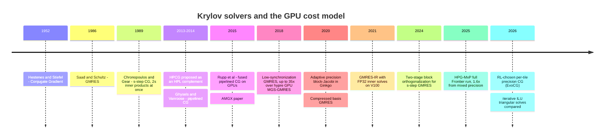
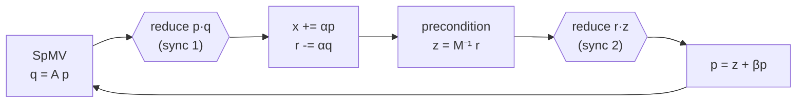
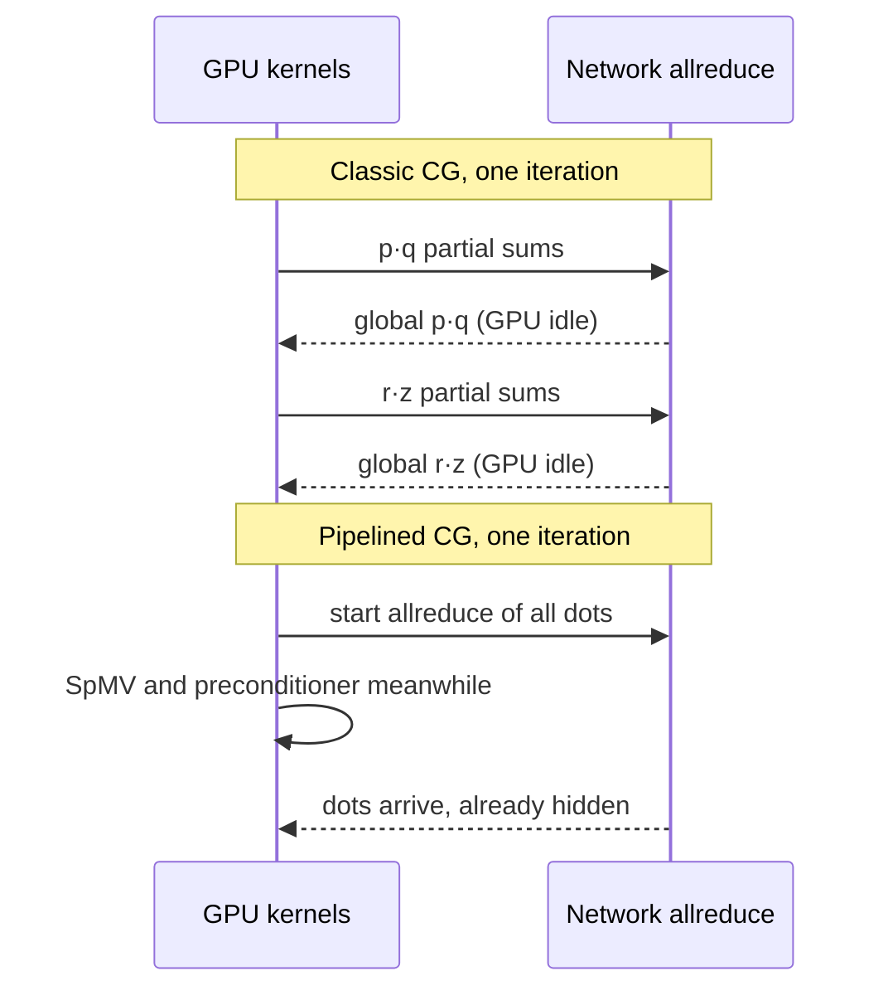

---
tags:
  - gpu-programming
  - libraries
  - linear-algebra
  - sparse
  - krylov
  - conjugate-gradient
  - gmres
  - preconditioning
  - mixed-precision
  - hpcg
aliases:
  - Krylov Methods on GPUs
  - Conjugate Gradient on GPUs
  - GMRES on GPUs
  - Iterative Solvers on GPUs
  - Pipelined CG
status: complete
sources:
  - https://www-users.cse.umn.edu/~saad/IterMethBook_2ndEd.pdf
  - https://www.cs.utsa.edu/~atc/pub/J1.pdf
  - https://petsc.org/main/manualpages/KSP/KSPPIPECG/
  - https://arxiv.org/pdf/1801.04728
  - https://arxiv.org/pdf/1410.4054
  - https://arxiv.org/pdf/1809.05805
  - https://research-hub.nrel.gov/en/publications/low-synchronization-gram-schmidt-and-generalized-minimal-residual/
  - https://arxiv.org/html/2402.15033v1
  - https://arxiv.org/pdf/2009.12101
  - https://riunet.upv.es/bitstream/10251/182695/3/FlegarAnztCojean%20-%20Adaptive%20Precision%20Block-Jacobi%20for%20High%20Performance%20Preconditioning%20in%20the%20Gi....pdf
  - https://www.osti.gov/servlets/purl/1813690
  - https://ar5iv.labs.arxiv.org/html/2105.07544
  - https://ar5iv.labs.arxiv.org/html/2507.11512
  - https://arxiv.org/pdf/2611.00552
  - https://arxiv.org/html/2611.04469
  - https://arxiv.org/pdf/2608.07327
  - https://arxiv.org/html/2510.13536
  - https://library.eecs.utk.edu/files/ut-eecs-15-736.pdf
  - https://www.osti.gov/servlets/purl/1089988
  - https://top500.org/lists/hpcg/2026/06/
  - https://hpcwire.com/off-the-wire/top500-leadership-holds-steady-as-new-system-turnover-falls-to-a-historic-low
  - https://github.com/NVIDIA/AMGX
  - https://icl.utk.edu/files/print//ginkgo-sc25.pdf
  - https://docs.nvidia.com/cuda/archive/11.6.2/cuda-samples/index.html
  - https://www.nvidia.com/en-us/data-center/h100/
  - https://glennklockwood.com/garden/processors/b200
  - https://arxiv.org/pdf/2611.13332
created: 2026-11-28
updated: 2026-11-28
---

## Table Of Contents

---

- [[#TL;DR|TL;DR]]
- [[#The Problem|The Problem]]
- [[#Foundations|Foundations]]
    - [[#Krylov Subspaces in One Paragraph|Krylov Subspaces in One Paragraph]]
    - [[#CG and GMRES Side by Side|CG and GMRES Side by Side]]
    - [[#Worked Example - Why CG Runs at About 1 Percent of Peak|Worked Example - Why CG Runs at About 1 Percent of Peak]]
    - [[#Worked Example - Where GMRES Spends Its Bytes|Worked Example - Where GMRES Spends Its Bytes]]
- [[#How We Got Here|How We Got Here]]
- [[#How It Works|How It Works]]
    - [[#Anatomy of a GPU CG Iteration|Anatomy of a GPU CG Iteration]]
    - [[#Fusing Kernels and Keeping Scalars on the Device|Fusing Kernels and Keeping Scalars on the Device]]
    - [[#Pipelined Krylov - Hiding the Reduction|Pipelined Krylov - Hiding the Reduction]]
    - [[#s-Step and Low-Synchronization GMRES|s-Step and Low-Synchronization GMRES]]
    - [[#Preconditioners That Suit a GPU|Preconditioners That Suit a GPU]]
    - [[#Mixed Precision Inside the Solver|Mixed Precision Inside the Solver]]
    - [[#Libraries|Libraries]]
- [[#Where It Is Now|Where It Is Now]]
- [[#Trade-offs & Open Problems|Trade-offs & Open Problems]]
- [[#Resources|Resources]]
- [[#Related Notes|Related Notes]]

## ***TL;DR***
---
*Krylov solvers (CG, GMRES, BiCGSTAB) solve huge sparse systems with nothing but sparse matrix-vector products, vector updates and dot products. On a GPU all three are memory-bound, and the dot products add a global synchronization every iteration, so the craft is moving fewer bytes and synchronizing less often.*

- **What they are.** Iterative solvers for $Ax = b$ that build the answer from the Krylov subspace $\{b, Ab, A^2b, \dots\}$. **CG** is for symmetric positive definite (SPD) matrices; **GMRES** and **BiCGSTAB** handle general ones. A **preconditioner** $M \approx A$ makes them converge in tens instead of thousands of iterations.
- **Why GPUs find them hard.** A CG iteration does about 0.15 flops per byte, so an H100 at 3.35 TB/s can sustain at most about 0.5 TFLOP/s of its 34 TFLOP/s FP64 ([[#Worked Example - Why CG Runs at About 1 Percent of Peak|worked example]]). The HPCG benchmark, which is preconditioned CG, scores about 1% of HPL on today's GPU exascale machines ([HPCG list](https://top500.org/lists/hpcg/2026/06/)).
- **The two enemies.** *Bandwidth*: every iteration streams the matrix and several vectors through HBM. *Synchronization*: every dot product is a global reduction, and a scalar like $\alpha = r^Tr / p^Tq$ must be known before the next step can start.
- **The fixes.** *Fuse* vector updates with reductions and keep scalars on the device ([Rupp et al.](https://arxiv.org/pdf/1410.4054): 6+ launches per CG iteration down to 2). *Pipeline* so the reduction overlaps the SpMV ([Ghysels and Vanroose 2014](https://petsc.org/main/manualpages/KSP/KSPPIPECG/)). *Batch* reductions: s-step and low-synchronization GMRES cut to one or two syncs per iteration or per $s$ iterations ([Swirydowicz et al.](https://arxiv.org/pdf/1809.05805), [Yamazaki et al.](https://arxiv.org/html/2402.15033v1)). *Store less*: keep the Krylov basis or preconditioner in FP32/FP16 while computing in FP64 ([CB-GMRES](https://arxiv.org/pdf/2009.12101), [adaptive block-Jacobi](https://riunet.upv.es/bitstream/10251/182695/3/FlegarAnztCojean%20-%20Adaptive%20Precision%20Block-Jacobi%20for%20High%20Performance%20Preconditioning%20in%20the%20Gi....pdf)).
- **Libraries.** cuSPARSE and cuBLAS give the building blocks; packaged solvers live in AMGX, Ginkgo, PETSc, Trilinos (Belos, Kokkos Kernels) and hypre.
- **Where it is now (Nov 2026).** LineShine still leads HPCG at 22.00 PFlop/s against 2,198 PFlop/s of HPL ([HPCwire](https://hpcwire.com/off-the-wire/top500-leadership-holds-steady-as-new-system-turnover-falls-to-a-historic-low)). Mixed precision is the active front: HPG-MxP on Frontier gets 1.6x from FP64/FP32 GMRES-IR ([Kashi et al.](https://ar5iv.labs.arxiv.org/html/2507.11512)), and EvoCG (PPoPP'27) picks a precision per matrix tile at run time for a 2.52x geomean over cuSPARSE CG on A100 ([EvoCG](https://arxiv.org/html/2611.04469)).

## ***The Problem***
---
*Sparse systems from PDEs, circuits and graphs are too big to factor directly: fill-in can turn a few gigabytes of nonzeros into terabytes of factors. Krylov methods need only the matrix and a handful of vectors, but every iteration is a pass over memory with a barrier in the middle.*

Where these solvers show up: implicit CFD and structural mechanics (the Nalu wind-turbine CFD solver motivated the low-synchronization GMRES work below), reservoir and groundwater flow, plasma simulation (XGC), power-grid and circuit simulation, the Poisson solve in every incompressible flow code, and the Newton steps of nonlinear and optimization solvers. They are also the "refinement engine" inside [[Mixed-Precision Iterative Refinement and HPL-MxP|mixed-precision refinement]].

Why not just factor? A sparse direct solver (cuDSS; see [[Sparse Linear Algebra on GPUs]]) is robust, but its factors fill in. For a 3D problem the fill grows much faster than the nonzero count, so beyond a few million unknowns per GPU an iterative method is often the only thing that fits. The price is that convergence depends on the matrix and the preconditioner, and every iteration touches all of memory.

What makes a Krylov iteration awkward on a GPU:

| Ingredient | What it costs | Why it hurts on a GPU |
|---|---|---|
| SpMV $q = Ap$ | Streams every nonzero once (value + index) | Below 0.2 flop/byte; pure [[Roofline Model and Arithmetic Intensity\|bandwidth]] |
| AXPY-style updates $x \leftarrow x + \alpha p$ | 2 reads and 1 write per element for 2 flops | Even lower intensity than SpMV |
| Dot products $r^Tr$, $p^Tq$ | A full [[Parallel Reduction and Scan\|reduction]] to one number | Global barrier; across GPUs an allreduce with network latency |
| Scalars $\alpha$, $\beta$ | Depend on the dot products | The next kernel cannot start until they exist; a naive code copies them to the host |
| Preconditioner $z = M^{-1}r$ | ILU or Gauss-Seidel are triangular solves | Sequential dependencies, the opposite of what a GPU wants |
| GMRES orthogonalization | Iteration $j$ touches all $j$ previous basis vectors | Memory and reductions grow with the iteration count |

## ***Foundations***
---
*What a Krylov subspace is, how CG and GMRES differ in cost, and two worked examples with real numbers. The examples show that the matrix bytes, not the flops, set the speed, and that GMRES's basis can cost more than its SpMV.*

### Krylov Subspaces in One Paragraph

Start from a guess $x_0$ with residual $r_0 = b - Ax_0$. The $k$-th **Krylov subspace** is

$$\mathcal{K}_k(A, r_0) = \operatorname{span}\{r_0,\ Ar_0,\ A^2 r_0,\ \dots,\ A^{k-1} r_0\}.$$

Plain reading: everything you can build from $r_0$ using only $k-1$ multiplications by $A$. A Krylov method picks the "best" $x_k \in x_0 + \mathcal{K}_k$ by some criterion, so each iteration costs one SpMV plus some vector work. CG picks the $x_k$ that minimizes the error in the $A$-norm (possible only when $A$ is SPD); GMRES picks the one with the smallest residual norm $\lVert b - Ax_k \rVert_2$ ([Saad, ch. 6](https://www-users.cse.umn.edu/~saad/IterMethBook_2ndEd.pdf)). How many iterations you need depends on the spread of $A$'s eigenvalues; for CG the classic bound shrinks the error by about $\left(\frac{\sqrt{\kappa}-1}{\sqrt{\kappa}+1}\right)$ per step, where $\kappa$ is the condition number. A preconditioner $M$ replaces $A$ with $M^{-1}A$, whose $\kappa$ is smaller.

### CG and GMRES Side by Side

| | CG (Hestenes and Stiefel, 1952) | GMRES (Saad and Schultz, 1986) |
|---|---|---|
| Matrices | SPD only | Any nonsingular |
| Recurrence | Short: only the last two directions | Long: every new vector is orthogonalized against all previous ones |
| Memory | About 4 vectors ($x, r, p, q$), plus $z$ if preconditioned | $m+1$ basis vectors for restart length $m$, plus a small $(m+1)\times m$ Hessenberg matrix |
| Work per iteration $j$ | 1 SpMV, 3 AXPYs, 2 dots | 1 SpMV, $j$ dots and $j$ AXPYs (or one GEMV pair), 1 norm |
| Global reductions per iteration | 2 in the textbook form ([Cornelis et al., Table 1](https://arxiv.org/pdf/1801.04728)) | $j+1$ with modified Gram-Schmidt; 2 with iterated classical Gram-Schmidt; 1 with low-synch variants ([Swirydowicz et al.](https://arxiv.org/pdf/1809.05805)) |
| Restart | Never needed | Restart every $m$ iterations to cap memory (GMRES($m$)), which can slow convergence |

BiCGSTAB sits between them: general matrices with short recurrences, two SpMVs and four dot products per iteration, but irregular convergence. On a GPU it costs like CG; most libraries offer all three.

A preconditioned CG iteration, in the form most GPU codes implement ([Saad, Alg. 9.1](https://www-users.cse.umn.edu/~saad/IterMethBook_2ndEd.pdf)):

```text
q     = A p                 # SpMV
alpha = rz / dot(p, q)      # reduction 1
x     = x + alpha p         # AXPY
r     = r - alpha q         # AXPY
z     = M^{-1} r            # preconditioner apply
rz'   = dot(r, z)           # reduction 2
beta  = rz' / rz;  rz = rz'
p     = z + beta p          # AXPY
```

Line by line: one SpMV, then a dot product whose result is needed *before* $x$ and $r$ can be updated, then the preconditioner, then a second dot product whose result is needed *before* $p$ can be updated. Those two "needed before" points are the synchronizations everything below is about.

### Worked Example - Why CG Runs at About 1 Percent of Peak

Take an unpreconditioned FP64 CG on a 3D 27-point stencil (the HPCG matrix shape: each interior row has 27 nonzeros, [Dongarra, Heroux and Luszczek](https://library.eecs.utk.edu/files/ut-eecs-15-736.pdf)) stored in CSR with 32-bit column indices. Count bytes and flops per matrix row per iteration:

| Step | Bytes per row | Flops per row |
|---|---|---|
| SpMV: 27 values × 8 B + 27 indices × 4 B + row pointer 4 B + $y$ write 8 B + $x$ read (cached) ≈ 8 B | ≈ 344 | 54 |
| $p^Tq$ (read 2 vectors) | 16 | 2 |
| $x \mathrel{+}= \alpha p$ (read 2, write 1) | 24 | 2 |
| $r \mathrel{-}= \alpha q$ | 24 | 2 |
| $r^Tr$ (read 1 vector) | 8 | 2 |
| $p = r + \beta p$ | 24 | 2 |
| **Total** | **≈ 440** | **64** |

Arithmetic intensity:

$$I = \frac{64\ \text{flop}}{440\ \text{B}} \approx 0.145\ \text{flop/B}.$$

Plain reading: for every byte loaded, CG does about one seventh of a flop. On an H100 SXM (3.35 TB/s HBM, 34 TFLOP/s FP64 vector; [NVIDIA](https://www.nvidia.com/en-us/data-center/h100/)) the [[Roofline Model and Arithmetic Intensity|roofline]] ceiling is

$$P \le I \times B = 0.145 \times 3.35\ \text{TB/s} \approx 0.49\ \text{TFLOP/s} \approx 1.4\%\ \text{of FP64 peak}.$$

Time per iteration is just bytes over bandwidth: $440\ \text{B} / 3.35\ \text{TB/s} \approx 131$ ps per row.

- $n = 10^8$ rows (about 37 GB of matrix and vectors, fits in 80 GB): about **13 ms** per iteration.
- $n = 10^5$ rows: about **13 µs** per iteration. Now the iteration is as short as a handful of kernel launches plus a device-to-host copy of $\alpha$. If each launch-and-sync costs on the order of 5 µs (an illustrative assumption), the unfused six-kernel version spends more time launching than computing. This is why [[#Fusing Kernels and Keeping Scalars on the Device|fusion]] matters most for small systems ([Rupp et al.](https://arxiv.org/pdf/1410.4054)).

Two lessons. First, the flops are irrelevant; only bytes moved count, so storing the matrix in fewer bytes (FP32 values, 16-bit indices, SELL formats; see [[Sparse Linear Algebra on GPUs]]) speeds CG almost one for one. Second, the HPCG result (about 1% of HPL on GPU machines) is not a software failure: it is this roofline, plus the preconditioner's triangular solves.

### Worked Example - Where GMRES Spends Its Bytes

Same matrix, GMRES($m$) with classical Gram-Schmidt done as two GEMVs per iteration ($h = V_j^T w$, then $w \leftarrow w - V_j h$). Iteration $j$ reads the $j$ basis vectors twice: $2 \times 8j$ bytes per row.

- Averaged over a restart cycle of $m = 50$, $j \approx 25$, so orthogonalization reads about $400$ B per row against the SpMV's $344$. **The basis costs more than the matrix.**
- Memory for $n = 10^8$: $51$ FP64 basis vectors × 0.8 GB = **40.8 GB**, on top of the matrix.
- Store the basis in FP32 and both numbers halve (20.4 GB, about 200 B per row of orthogonalization traffic), while arithmetic stays in FP64. That is exactly the idea behind compressed-basis GMRES, whose authors put the theoretical ceiling at 2x for 32-bit storage and 4x for 16-bit ([Aliaga et al.](https://arxiv.org/pdf/2009.12101)).

This is also why practical GMRES uses modest restarts ($m$ of 30 to 100) and why iterated classical Gram-Schmidt (two GEMV passes, a few reductions) is preferred on GPUs over modified Gram-Schmidt ($j$ separate dot products, $j$ reductions).

## ***How We Got Here***
---
*The algorithms are old; what changed is the cost model. On CPUs flops were the bottleneck, then memory, and on GPUs and at exascale the global synchronization became the thing to hide.*



- **1952 to 1986, the methods.** CG and GMRES were designed for exact arithmetic and serial machines; their structure (one matrix product, a few inner products per step) is in every textbook ([Saad](https://www-users.cse.umn.edu/~saad/IterMethBook_2ndEd.pdf)).
- **1989, batching inner products.** Chronopoulos and Gear's s-step CG builds $s$ directions at once so that "the 2s inner products required for one s-step iteration are executed simultaneously" ([Chronopoulos and Gear](https://www.cs.utsa.edu/~atc/pub/J1.pdf)). The idea waited two decades for hardware where synchronization mattered more than flops.
- **2013 to 2014, latency becomes the target.** Heroux and Dongarra proposed HPCG because HPL rankings were "no longer so strongly correlated to real application performance" ([SAND2013-4744](https://www.osti.gov/servlets/purl/1089988)). Ghysels and Vanroose published pipelined CG (Parallel Computing 40(7), 2014), which overlaps the single remaining reduction with the SpMV and preconditioner ([PETSc KSPPIPECG](https://petsc.org/main/manualpages/KSP/KSPPIPECG/)).
- **2015, GPU-specific engineering.** Rupp, Weinbub, Jüngel and Grasser showed that pipelining lets a GPU CG run in two fused kernels and one host transfer per iteration ([Rupp et al.](https://arxiv.org/pdf/1410.4054)); NVIDIA released AMGX. CUDA samples showed CG in one cooperative kernel (CUDA 9.0) and as a captured [[CUDA Graphs|CUDA Graph]] (CUDA 10.1) ([CUDA samples](https://docs.nvidia.com/cuda/archive/11.6.2/cuda-samples/index.html)).
- **2018 to 2021, fewer syncs and fewer bytes.** Low-synchronization Gram-Schmidt brought GMRES to one reduction per iteration ([Swirydowicz et al.](https://arxiv.org/pdf/1809.05805)). The Ginkgo group moved storage precision away from arithmetic precision: adaptive block-Jacobi and compressed-basis GMRES. Sandia measured FP32-inner GMRES-IR on GPUs ([Loe et al.](https://ar5iv.labs.arxiv.org/html/2105.07544)).
- **2024 to 2026, exascale tuning and adaptive precision.** Two-stage s-step GMRES on Summit ([Yamazaki et al.](https://arxiv.org/html/2402.15033v1)), HPG-MxP on all of Frontier ([Kashi et al.](https://ar5iv.labs.arxiv.org/html/2507.11512)), and run-time precision control ([EvoCG](https://arxiv.org/html/2611.04469)).

## ***How It Works***
---
*A GPU Krylov solver is a short loop of SpMV, vector updates and reductions. Each technique below attacks one cost: launches and host round trips, reduction latency, orthogonalization traffic, sequential preconditioners, or bytes per value.*

### Anatomy of a GPU CG Iteration



The hexagons are where every thread on every GPU must wait for one number. In a naive library-call version each box is its own kernel and the scalars travel to the host and back. Rupp et al. counted "at least six kernel launches" and possibly a second host-device transfer per iteration for such a translation ([Rupp et al.](https://arxiv.org/pdf/1410.4054)). NVIDIA's own CUDA sample families show the three escapes: library calls (`conjugateGradient`), library calls captured once and replayed as a graph (`conjugateGradientCudaGraphs`), and the whole loop as one kernel with grid-wide sync through [[Cooperative Groups]] (`conjugateGradientMultiBlockCG`, plus a multi-GPU version) ([CUDA samples](https://docs.nvidia.com/cuda/archive/11.6.2/cuda-samples/index.html)).

### Fusing Kernels and Keeping Scalars on the Device

Two habits remove most of the overhead on one GPU:

1. **Fuse each vector update with the reduction that follows it**, so the vector is read once while it is in registers.
2. **Never bring scalars to the host.** Store $\alpha$, $\beta$ and the dot results in device memory and compute them inside the kernels that use them. Then the loop has no host synchronization and can be captured in a [[CUDA Graphs|CUDA Graph]].

A fused residual update and norm, written that way:

```cuda
#include <cub/block/block_reduce.cuh>

__global__ void update_r_and_dot(int n,
    const double* __restrict__ rr_old,  // r·r from the previous iteration (device)
    const double* __restrict__ pq,      // p·q from this iteration (device)
    const double* __restrict__ q,
    double* __restrict__ r,
    double* __restrict__ rr_new)        // zeroed before launch
{
  using BlockReduce = cub::BlockReduce<double, 256>;
  __shared__ typename BlockReduce::TempStorage tmp;

  const double alpha = *rr_old / *pq;
  double local = 0.0;
  for (int i = blockIdx.x * blockDim.x + threadIdx.x; i < n;
       i += gridDim.x * blockDim.x) {
    double ri = r[i] - alpha * q[i];
    r[i] = ri;
    local += ri * ri;
  }
  double block_sum = BlockReduce(tmp).Sum(local);
  if (threadIdx.x == 0) atomicAdd(rr_new, block_sum);
}
```

In plain words:

- **`rr_old`, `pq` as pointers**: the scalars live on the GPU, written by earlier kernels; the host never reads them, so nothing stalls the launch queue.
- **`alpha = *rr_old / *pq`**: every thread recomputes the same scalar from two loads, which is cheaper than a separate kernel or a host round trip.
- **The grid-stride loop**: each thread walks the vector with a stride of the whole grid, so a fixed-size grid covers any $n$ with [[Memory Coalescing|coalesced]] accesses.
- **`ri = r[i] - alpha * q[i]; r[i] = ri; local += ri * ri;`**: the update and the norm share one read of `r` and `q`. Unfused, the norm would read `r` again: 8 extra bytes per row on a step that only moves 24.
- **`BlockReduce`**: a [[Parallel Reduction and Scan|block-level tree reduction]] in shared memory gives one partial sum per block.
- **`atomicAdd(rr_new, block_sum)`**: blocks combine partials with a double-precision atomic (sm_60 and later). The order of additions varies between runs, so the result is not bitwise reproducible; codes that need that use a fixed-order second pass ([[Deterministic and Batch-Invariant Kernels]]).

Rupp et al. pushed this to its end: a pipelined CG where the vector updates and their partial dot products are one kernel and the SpMV plus the next dot products is another, with partial results packed into one buffer. They measured a three-fold difference against PARALUTION's CG on AMD GPUs and two-fold for the smallest system on NVIDIA, and found that after pipelining about 85% of CG time is SpMV, so gains shrink as systems grow ([Rupp et al.](https://arxiv.org/pdf/1410.4054)). The general pattern is [[Kernel Fusion]]; the extreme version, the whole solve in one persistent kernel, is a small [[Megakernels|megakernel]].

### Pipelined Krylov - Hiding the Reduction

On many GPUs the reduction is no longer a kernel boundary but an `MPI_Allreduce` across the network, with a latency that does not shrink as you add nodes. Pipelined CG rewrites the recurrences, with extra auxiliary vectors, so that:

- there is **one** global reduction per iteration instead of two, and
- that reduction is **non-blocking**, started before the SpMV and preconditioner and finished after them.

PETSc's `KSPPIPECG` summarizes it as "only a single non-blocking reduction per iteration, compared to 2 blocking for standard `KSPPCG`", overlapped "by the matrix-vector product and preconditioner application", with the warning that MPI may need configuring for reductions to make asynchronous progress ([PETSc](https://petsc.org/main/manualpages/KSP/KSPPIPECG/)).



The cost is more vector work. Cornelis, Cools and Vanroose tabulate per-iteration costs ([Table 1](https://arxiv.org/pdf/1801.04728)):

| Variant | Global reductions | Vector flops (units of $n$) | Stored vectors | Time model |
|---|---|---|---|---|
| Classic CG | 2 | 10 | 3 | 2 × reduce + SpMV |
| Pipelined CG (p-CG) | 1, overlapped | 16 | 6 | max(reduce, SpMV) |
| Deep pipeline p($\ell$)-CG | 1, spread over $\ell$ iterations | $6\ell + 10$ | $3\ell + 3$ | max(reduce / $\ell$, SpMV) |

A small model on an H100-class GPU shows when this pays. Assume an allreduce latency of 30 µs (illustrative), the 440 B per row from the [[#Worked Example - Why CG Runs at About 1 Percent of Peak|worked example]] for classic CG, and that p-CG's vector traffic grows in proportion to its flops (96 B → about 154 B, so about 498 B per row):

| Rows per GPU | Classic: bytes + 2 reduces | Pipelined: max(bytes, reduce) | Speedup |
|---|---|---|---|
| $10^5$ | 13 µs + 60 µs = 73 µs | max(15, 30) = 30 µs | 2.4x |
| $10^6$ | 131 + 60 = 191 µs | max(149, 30) = 149 µs | 1.3x |
| $10^7$ | 1,313 + 60 = 1,373 µs | 1,487 µs | 0.92x (slower) |

```mermaid
xychart-beta
    title "Modelled CG iteration time (µs), 30 µs allreduce"
    x-axis ["1e5 rows/GPU", "1e6 rows/GPU", "1e7 rows/GPU (÷10)"]
    y-axis "µs" 0 --> 200
    bar [73, 191, 137]
    bar [30, 149, 149]
```



(First bar classic, second pipelined; the $10^7$ column is divided by 10 to fit.) Plain reading: pipelining wins in **strong scaling**, where each GPU's share is small and the network latency dominates, and loses when each GPU has so much work that the extra vectors cost more than the hidden latency. This matches the measurements: p(3)-CG reached about 5x over classic CG on 20 CPU nodes in PETSc, and deeper pipelines ($\ell \ge 4$) slowed down from start-up and AXPY overhead ([Cornelis et al.](https://arxiv.org/pdf/1801.04728)).

The other cost is accuracy. The extra recurrences let rounding errors grow: "the pipelining technique induces a trade-off between performance and numerical stability", and p($\ell$)-CG "will attain a less accurate maximal attainable precision with increasing $\ell$" ([Cornelis et al.](https://arxiv.org/pdf/1801.04728)). Codes compensate with residual replacement (recomputing $r = b - Ax$ now and then).

### s-Step and Low-Synchronization GMRES

GMRES's synchronization problem is worse because orthogonalization needs inner products against every basis vector. Two families attack it.

**Low-synchronization Gram-Schmidt.** Modified Gram-Schmidt needs $j+1$ separate reductions at iteration $j$, so "the amount of global communication grows quadratically"; iterated classical Gram-Schmidt "requires at least two global reductions". Swirydowicz, Langou, Ananthan, Yang and Thomas derived a one-synch MGS-GMRES with lagged normalization, "combining a mass inner-product and normalization into one global reduction" per iteration, keeping orthogonality to $O(\varepsilon)\kappa(A)$. On GPUs in hypre they report "up to a 35 times speed-up over the Hypre Level-1 BLAS MGS-GMRES algorithm" ([Swirydowicz et al.](https://arxiv.org/pdf/1809.05805); published as [Numer. Linear Algebra Appl. e2343](https://research-hub.nrel.gov/en/publications/low-synchronization-gram-schmidt-and-generalized-minimal-residual/)). The "mass inner product" is a tall-skinny GEMV ($V^T w$), which runs near bandwidth on a GPU, instead of $j$ tiny dot products.

**s-step (communication-avoiding) GMRES.** Generate $s$ new vectors at once with a matrix powers kernel ($Av, A^2v, \dots, A^sv$), then orthogonalize the block in one go, which "synchronizes only every s steps". The catch is that the monomial basis becomes ill-conditioned quickly, so Trilinos defaults to a conservative $s = 5$. Yamazaki, Higgins, Boman and Szyld's two-stage block orthogonalization pre-processes each panel of $s$ vectors cheaply and defers the full orthogonalization to a bigger block, cutting synchronizations from five per $s$ steps (BCGS2 with CholQR2) to about one. On up to 192 V100s on Summit, through Tpetra and Kokkos Kernels on top of cuBLAS, cuSPARSE and cuSOLVER, it reduced total solve time by up to 1.6x over the original s-step GMRES, which was itself 1.8x over standard GMRES ([Yamazaki et al.](https://arxiv.org/html/2402.15033v1)). The block orthogonalization is GEMM-shaped (CholQR is a small Gram matrix plus a Cholesky), so it reuses the dense kernels from [[cuBLAS and cuDNN]] and [[Dense LU and Cholesky Factorization on GPUs]].

### Preconditioners That Suit a GPU

The preconditioner usually decides both the iteration count and the time per iteration, and the best CPU preconditioners are the worst fit for a GPU.

| Preconditioner | Apply cost | GPU fit | Notes |
|---|---|---|---|
| Jacobi (diagonal) | One elementwise multiply | Excellent | Weak; fuse it into the vector update |
| Block-Jacobi | Small dense GEMVs, one per block | Very good | Blocks inverted up front with [[Batched Small-Matrix Linear Algebra\|batched]] kernels; see mixed precision below |
| Polynomial (Chebyshev, GMRES polynomial) | A few extra SpMVs | Very good | Trades reductions for SpMVs; needs eigenvalue estimates or a setup run |
| ILU / IC with exact triangular solves | Two sparse triangular solves | Poor | Level-set parallelism only; see [[Sparse Linear Algebra on GPUs#Sparse Triangular Solve\|SpTRSV]] |
| ILU with iterative triangular solves (Jacobi sweeps, ISAI) | A few SpMVs | Good | Approximate the triangular solve; can fail on hard matrices |
| Algebraic multigrid (AMG) | SpMVs plus smoothers per level | Good on fine levels, latency-bound on coarse | AMGX, hypre BoomerAMG; best for elliptic PDEs |
| Geometric multigrid with Gauss-Seidel | Triangular-like sweeps per level | Needs coloring | What HPCG uses |

The triangular-solve problem is concrete: a Nov 2026 comparison of iterative replacements for ILU triangular solves on a GPU found ISAI gave "the largest median speedups over a hipSPARSE exact triangular solve", 4.5x for ILU(0) and 6.8x for ILU(1), mostly from small problems where launch latency dominates the exact solve's hundreds of dependent level sets (median 529 for ILU(0)). On large problems all four methods gave about 2.1 to 2.6x, Jacobi sweeps failed on 21 of 91 matrices, and only a multigrid-style AIRG kept iteration counts flat under refinement ([Dargaville and Pain](https://arxiv.org/pdf/2611.00552)). NVIDIA attacked the same problem from the exact side: CUDA 13.5's new cuSPARSE SpSV algorithm is 2.7x faster than the old one by geomean ([[Sparse Linear Algebra on GPUs]]).

HPCG's preconditioner is a geometric multigrid with symmetric Gauss-Seidel smoothing on a 27-point Poisson problem; the authors note that coarse levels are latency-bound while fine levels and dot products are bandwidth-bound ([Dongarra, Heroux and Luszczek](https://library.eecs.utk.edu/files/ut-eecs-15-736.pdf)). Making Gauss-Seidel parallel on a GPU generally means multicoloring (rows of one color have no dependency on each other), which can change the iteration count.

### Mixed Precision Inside the Solver

Because the solver is bandwidth-bound, halving the bytes nearly halves the time, and the useful trick is to separate **storage precision** from **arithmetic precision**: load FP32 or FP16 data, convert in registers, compute in FP64.

| Technique | What is stored low | Reported result | Source |
|---|---|---|---|
| Adaptive precision block-Jacobi | Each inverted diagonal block, in FP64, FP32 or FP16 (and non-IEEE formats) chosen per block from its condition number | Preconditioner apply up to 1.7x (32-bit) and 2x (16-bit); CG solve 10 to 30% faster, no gain when blocks are ill-conditioned | [Flegar, Anzt, Cojean, Quintana-Ortí](https://riunet.upv.es/bitstream/10251/182695/3/FlegarAnztCojean%20-%20Adaptive%20Precision%20Block-Jacobi%20for%20High%20Performance%20Preconditioning%20in%20the%20Gi....pdf) (TOMS) |
| Compressed basis GMRES (CB-GMRES) | The Krylov basis vectors, in FP32, FP16, INT32 or INT16 | FP32 basis: median 1.4x on V100 with nearly the same iteration counts; 16-bit formats "regularly fail to preserve the convergence" | [Aliaga et al.](https://arxiv.org/pdf/2009.12101) |
| GMRES-IR with FP32 inner solve | The whole inner GMRES (matrix, vectors) in FP32; FP64 residual at each restart | SpMV 2.4 to 2.6x faster; total solve 24 to 36% faster | [Loe et al.](https://ar5iv.labs.arxiv.org/html/2105.07544) |
| HPG-MxP | HPCG-like problem solved by GMRES-IR, mixing FP64 and FP32 internally | 1.6x from FP64/FP32 mixing on all 9,408 Frontier nodes | [Kashi et al.](https://ar5iv.labs.arxiv.org/html/2507.11512) |
| EvoCG | Each matrix tile in FP64, FP32 or BF16, chosen every iteration by a small RL policy | 2.52x geomean over cuSPARSE CG on 47 SPD matrices (A100), true residual within 1.1% of FP64 | [Zhai et al.](https://arxiv.org/html/2611.04469) |

How the adaptive block-Jacobi chooses: each block $D_i$ is inverted in FP64 to get $E_i$, its condition number $\kappa_1(D_i) = \lVert D_i \rVert_1 \lVert E_i \rVert_1$ is computed, and $E_i$ is stored in the cheapest format whose unit roundoff $u$ keeps the target accuracy $a$, i.e. under a threshold of the form $\tau = a/u$. Application converts each stored block to FP64 in registers before the GEMV ([Flegar et al.](https://riunet.upv.es/bitstream/10251/182695/3/FlegarAnztCojean%20-%20Adaptive%20Precision%20Block-Jacobi%20for%20High%20Performance%20Preconditioning%20in%20the%20Gi....pdf)). Plain reading: a well-conditioned block loses little when rounded, so it can be stored in half the bytes; a nasty block stays in FP64.

Example: a block-Jacobi preconditioner with 32×32 blocks on $n = 10^8$ unknowns stores $10^8 \times 32 \times 8$ B = 25.6 GB in FP64. If most blocks qualify for FP32, that drops toward 12.8 GB, and applying it reads half as much, which is where the up-to-1.7x application speedup comes from.

The same thinking runs the other way when FP64 is scarce. Since CG needs only about 0.15 FP64 flops per byte, a GPU with 8 TB/s of HBM needs about 1.2 TFLOP/s of FP64 to stay bandwidth-bound (B200 has 37 to 45 TFLOP/s; [Klockwood](https://glennklockwood.com/garden/processors/b200)). An AMD study measured native FP64 GEMM at only about 1.1 TFLOP/s on GB300 ([Świrydowicz et al. 2026](https://arxiv.org/pdf/2611.13332)). If a GB300's vector FP64 rate is similar (that study measured GEMM, not vector FMA, so this is an inference to check), FP64 Krylov solvers on such a part could stop being purely bandwidth-bound, which would make mixed storage and refinement even more attractive there.

### Libraries

| Library | Krylov methods | GPU preconditioners | Precision features | Notes |
|---|---|---|---|---|
| cuSPARSE + cuBLAS | None packaged; SpMV, SpSV, dots, AXPYs | SpSV/SpSM for ILU/IC solves | FP16/BF16 matrices with FP32 vectors in CSR SpMV (CUDA 13.5) | You write the loop; see CUDA samples |
| AMGX (NVIDIA, open source) | CG, BiCGSTAB, GMRES "etc." | Classical and aggregation AMG; Jacobi, Gauss-Seidel, ILU, Chebyshev smoothers | "fp32, fp64 and mixed precision solve" | Nested solver configs ([GitHub](https://github.com/NVIDIA/AMGX)) |
| Ginkgo | BiCG, BiCGSTAB, CG, CGS, GCR, GMRES, FCG, FGMRES, IR, IDR, Chebyshev, MinRES | Block-Jacobi, Gauss-Seidel/SSOR, ILU/IC, parallel ILU/IC and ILUT/ICT, ISAI | FP64/FP32/FP16/BF16; CB-GMRES; adaptive block-Jacobi; batched solvers | CUDA, HIP, SYCL and OpenMP backends ([Ginkgo flyer](https://icl.utk.edu/files/print//ginkgo-sc25.pdf)) |
| PETSc | Full KSP family, including pipelined `KSPPIPECG`, `KSPPIPEFCG`, `KSPPGMRES` | Its own and external packages' preconditioners | Depends on backend | The standard for MPI-scale codes ([PETSc](https://petsc.org/main/manualpages/KSP/KSPPIPECG/)) |
| Trilinos (Belos, Tpetra, Kokkos Kernels) | GMRES (incl. s-step), CG, others | From other Trilinos packages | GMRES-IR through Belos | Portable across vendors via Kokkos ([Loe et al.](https://ar5iv.labs.arxiv.org/html/2105.07544), [Yamazaki et al.](https://arxiv.org/html/2402.15033v1)) |
| hypre | GMRES, PCG, BiCGSTAB | BoomerAMG on GPUs | | Where the low-synch GMRES work was measured ([Swirydowicz et al.](https://arxiv.org/pdf/1809.05805)) |

Batched Krylov is a separate regime: thousands of small independent systems, one per thread block, as in XGC's collision operator. Ginkgo's batched BiCGSTAB, CG and GMRES cut XGC's linear-solve time by about 85%, 80% and 70% on Perlmutter, Frontier and Aurora, by Ginkgo's own account ([Ginkgo flyer](https://icl.utk.edu/files/print//ginkgo-sc25.pdf)). That regime looks more like [[Batched Small-Matrix Linear Algebra]] than like the big-solve case above.

## ***Where It Is Now***
---
*As of November 2026 the core algorithms are settled and well packaged; progress is in synchronization-reducing variants at exascale, in separating storage from arithmetic precision, and in preconditioners that avoid triangular solves. HPCG keeps reminding everyone that GPU supercomputers deliver about 1% of their HPL rate on this workload.*

**HPCG, November 2026.** LineShine "continues to lead HPCG at 22.00 HPCG-Petaflop/s", followed by El Capitan and Fugaku ([HPCwire, Nov 2026](https://hpcwire.com/off-the-wire/top500-leadership-holds-steady-as-new-system-turnover-falls-to-a-historic-low)). Using the June 2026 HPCG list's figures for the leaders ([TOP500](https://top500.org/lists/hpcg/2026/06/)):

| System | HPCG (PFlop/s) | HPL Rmax (PFlop/s) | HPCG / HPL |
|---|---|---|---|
| LineShine | 22.00 | 2,198.4 | 1.0% |
| El Capitan (MI300A) | 17.41 | 1,809 | 0.96% |
| Fugaku (A64FX CPU) | 16.00 | 442.0 | 3.6% |
| Frontier (MI250X) | 14.05 | 1,353 | 1.04% |

Plain reading: the GPU machines sit right at the roofline ceiling from the [[#Worked Example - Why CG Runs at About 1 Percent of Peak|worked example]]; Fugaku's CPUs have far fewer flops per byte of bandwidth, so the same bandwidth-bound solver reaches a larger fraction of its (smaller) HPL. Meanwhile El Capitan leads HPL-MxP at 16.7 exaflop/s (same source), the dense mixed-precision counterpart covered in [[Mixed-Precision Iterative Refinement and HPL-MxP]].

**Recent results worth knowing (2025 to 2026):**

- **HPG-MxP at full scale.** ORNL ran the HPCG-like mixed-precision benchmark (GMRES-IR, one geometric multigrid V-cycle with forward Gauss-Seidel as preconditioner) on 9,408 Frontier nodes and reported 1.6x from mixing FP64 and FP32 ([Kashi et al.](https://ar5iv.labs.arxiv.org/html/2507.11512)).
- **Precision as run-time control.** EvoCG (PPoPP'27) uses a tiny reinforcement-learning policy inside the CG loop to choose FP64, FP32 or BF16 per matrix tile, on a Tile-CSC format with warp-centric kernels: 2.52x over cuSPARSE, 3.06x over PETSc and 2.48x over Ginkgo (geomean, 47 SuiteSparse SPD matrices, A100), and 1.28x over its own FP64 version at 11.4% more iterations; no run diverged ([EvoCG](https://arxiv.org/html/2611.04469)).
- **More directions per iteration.** ORNL's MBPCG solves several copies of the system from random starts with a block CG built on the Chronopoulos-Gear variant, reporting up to 5x shorter solves on hard sparse systems on a V100; it is orthogonal to preconditioning ([Xu and Regev](https://arxiv.org/pdf/2608.07327)).
- **Iterative triangular solves.** The Nov 2026 Dargaville and Pain comparison (above) is the current best map of when ISAI, Jacobi sweeps, GMRES polynomials or AIRG should replace an exact ILU solve on a GPU ([arXiv 2611.00552](https://arxiv.org/pdf/2611.00552)).
- **Higher precision when needed.** Mukunoki and Ozaki's quasi double- and triple-word CG gives more accurate answers at about 1.3x and 2.4x the cost of FP64 per iteration (CPU study so far), the opposite direction from mixed precision for ill-conditioned problems ([Mukunoki and Ozaki](https://arxiv.org/html/2510.13536)).
- **Libraries.** cuSPARSE's CUDA 13.5 SpSV and mixed-precision SpMV speed up the building blocks ([[Sparse Linear Algebra on GPUs]]); Ginkgo covers NVIDIA, AMD and Intel GPUs with mixed-precision and batched solvers; AMGX remains NVIDIA's packaged AMG plus Krylov solver.

## ***Trade-offs & Open Problems***
---
*Every speed trick in this note spends numerical robustness, memory or generality to buy back bandwidth or latency. Knowing which you can afford depends on the matrix, which is why there is still no single default.*

| Choice | You gain | You pay |
|---|---|---|
| Fused, device-resident loop | Fewer launches, no host syncs, graph-capturable | Custom kernels instead of library calls |
| Pipelined CG / GMRES | Hidden reduction latency in strong scaling | More vectors and flops; lower attainable accuracy; MPI must progress asynchronously |
| s-step / CA GMRES | One sync per $s$ steps; GEMM-shaped orthogonalization | Basis ill-conditioning limits $s$ (default 5); harder to precondition |
| Low-synch Gram-Schmidt | One reduction per iteration | Lagged normalization; more delicate stability analysis |
| Low-precision storage (basis, preconditioner, matrix) | Up to 2x fewer bytes | Possible extra iterations; 16-bit often fails; needs safeguards |
| Iterative triangular solves (ISAI, sweeps) | Parallel preconditioner apply | Approximate; fails on some matrices |
| AMG preconditioner | Near-constant iteration counts on elliptic PDEs | Expensive setup (SpGEMM), latency-bound coarse levels |
| Direct solver instead (cuDSS) | Robust, no convergence worries | Fill-in memory, factorization time |

Open problems:

- **Choosing precision automatically.** Adaptive block-Jacobi and EvoCG both decide per block or tile; neither has guarantees for arbitrary matrices, and a wrong choice shows up only as extra iterations or stagnation.
- **Stability of synchronization-reducing methods.** Pipelined and s-step methods lose attainable accuracy as depth grows; residual replacement and better bases (Newton, Chebyshev) help but add tuning knobs.
- **Preconditioners without sequential steps.** The strongest preconditioners (ILU, Gauss-Seidel, coarse multigrid levels) are the least parallel. Iterative triangular solves, polynomials and multicoloring each trade convergence for parallelism.
- **Coarse-grid latency.** In AMG and geometric multigrid, coarse levels have too little work to fill a GPU; agglomerating them onto fewer GPUs or the CPU is still hand-tuned.
- **FP64-poor GPUs.** If native FP64 keeps shrinking on some parts, the bandwidth-bound assumption behind Krylov tuning may stop holding (see the GB300 inference above), pushing solvers further toward mixed storage or [[Floating-Point Emulation on Tensor Cores|emulation]].
- **Reproducibility.** Atomic reductions make iteration counts and answers vary run to run; deterministic reductions cost a second pass.

## ***Resources***
---
*Primary sources first: the algorithm papers, then the GPU-specific engineering, then the mixed-precision work and the benchmarks that say where things stand.*

**Foundations**
- [Iterative Methods for Sparse Linear Systems, 2nd ed.](https://www-users.cse.umn.edu/~saad/IterMethBook_2ndEd.pdf), Yousef Saad, SIAM 2003 (free PDF): CG, GMRES, BiCGSTAB, preconditioning.
- [s-step iterative methods for symmetric linear systems](https://www.cs.utsa.edu/~atc/pub/J1.pdf), Chronopoulos and Gear, J. Comput. Appl. Math. 25, 1989.

**Synchronization and fusion**
- [PETSc KSPPIPECG](https://petsc.org/main/manualpages/KSP/KSPPIPECG/), citing Ghysels and Vanroose, "Hiding global synchronization latency in the preconditioned conjugate gradient algorithm", Parallel Computing 40(7), 2014.
- [The Communication-Hiding Conjugate Gradient Method with Deep Pipelines](https://arxiv.org/pdf/1801.04728), Cornelis, Cools, Vanroose.
- [Pipelined Iterative Solvers with Kernel Fusion for Graphics Processing Units](https://arxiv.org/pdf/1410.4054), Rupp, Weinbub, Jüngel, Grasser, ACM TOMS.
- [Low synchronization GMRES algorithms](https://arxiv.org/pdf/1809.05805), Swirydowicz, Langou, Ananthan, Yang, Thomas, 2018 ([published version](https://research-hub.nrel.gov/en/publications/low-synchronization-gram-schmidt-and-generalized-minimal-residual/)).
- [Two-Stage Block Orthogonalization to Improve Performance of s-step GMRES](https://arxiv.org/html/2402.15033v1), Yamazaki, Higgins, Boman, Szyld.

**Mixed precision**
- [Adaptive Precision Block-Jacobi for High Performance Preconditioning in the Ginkgo Linear Algebra Software](https://riunet.upv.es/bitstream/10251/182695/3/FlegarAnztCojean%20-%20Adaptive%20Precision%20Block-Jacobi%20for%20High%20Performance%20Preconditioning%20in%20the%20Gi....pdf), Flegar, Anzt, Cojean, Quintana-Ortí, ACM TOMS 2020 ([replication report](https://www.osti.gov/servlets/purl/1813690)).
- [Compressed Basis GMRES on High Performance GPUs](https://arxiv.org/pdf/2009.12101), Aliaga, Anzt, Grützmacher, Quintana-Ortí, Tomás, 2020.
- [Experimental Evaluation of Multiprecision Strategies for GMRES on GPUs](https://ar5iv.labs.arxiv.org/html/2105.07544), Loe, Glusa, Yamazaki, Boman, Rajamanickam, 2021.
- [Scaling the memory wall using mixed-precision: HPG-MxP on an exascale machine](https://ar5iv.labs.arxiv.org/html/2507.11512), Kashi et al. (ORNL).
- [EvoCG: Self-Evolving Precision Control for Faster Conjugate Gradient](https://arxiv.org/html/2611.04469), Zhai et al., PPoPP'27.

**Preconditioners**
- [A Comparison of Parallel Iterative Methods for ILU Triangular Solves](https://arxiv.org/pdf/2611.00552), Dargaville and Pain, Nov 2026.

**Libraries and samples**
- [AMGX](https://github.com/NVIDIA/AMGX), [Ginkgo SC25 flyer](https://icl.utk.edu/files/print//ginkgo-sc25.pdf), [PETSc KSP](https://petsc.org/main/manualpages/KSP/KSPPIPECG/).
- [CUDA samples](https://docs.nvidia.com/cuda/archive/11.6.2/cuda-samples/index.html): `conjugateGradient`, `conjugateGradientCudaGraphs`, `conjugateGradientMultiBlockCG`, `conjugateGradientMultiDeviceCG`, `conjugateGradientUM`.

**Benchmarks and where it is now**
- [HPCG Benchmark: a New Metric for Ranking High Performance Computing Systems](https://library.eecs.utk.edu/files/ut-eecs-15-736.pdf), Dongarra, Heroux, Luszczek, 2015, and the original [SAND2013-4744](https://www.osti.gov/servlets/purl/1089988).
- [HPCG list, June 2026](https://top500.org/lists/hpcg/2026/06/) and [TOP500 SC26 announcement](https://hpcwire.com/off-the-wire/top500-leadership-holds-steady-as-new-system-turnover-falls-to-a-historic-low).
- [Accelerating the Conjugate Gradient Method by Solving Multiple GPU-Parallelized Duplicate Systems](https://arxiv.org/pdf/2608.07327), Xu and Regev (ORNL).
- [Sparse Iterative Solvers Using High-Precision Arithmetic with Quasi Multi-Word Algorithms](https://arxiv.org/html/2510.13536), Mukunoki and Ozaki.
- Hardware figures: [NVIDIA H100](https://www.nvidia.com/en-us/data-center/h100/), [Glenn Klockwood, B200](https://glennklockwood.com/garden/processors/b200), [FP64 Performance and the Limits of Ozaki Emulation](https://arxiv.org/pdf/2611.13332).

## ***Related Notes***
---
*Krylov solvers sit on top of sparse kernels and reductions, and next to the dense and mixed-precision solvers they complement.*

- [[Sparse Linear Algebra on GPUs]] — SpMV, SpTRSV, cuSPARSE, cuDSS and AMGX: the kernels every iteration calls.
- [[Mixed-Precision Iterative Refinement and HPL-MxP]] — GMRES-IR as the refinement engine for low-precision dense factorizations.
- [[Dense LU and Cholesky Factorization on GPUs]] — The direct alternative, and the dense kernels inside s-step orthogonalization.
- [[Batched Small-Matrix Linear Algebra]] — Inverting block-Jacobi blocks, and batched Krylov for many small systems.
- [[Parallel Reduction and Scan]] — The dot products that synchronize every iteration.
- [[Kernel Fusion]] — Fusing vector updates with reductions.
- [[CUDA Graphs]] — Capturing a device-resident solver loop.
- [[Cooperative Groups]] — Grid-wide sync for single-kernel CG.
- [[Megakernels]] — The whole solve in one persistent kernel.
- [[Roofline Model and Arithmetic Intensity]] — Why CG runs at about 1% of peak.
- [[Memory Coalescing]] — Vector kernels that run at full bandwidth.
- [[Multi-GPU Communication - NVLink and NCCL]] — The allreduce that pipelined methods hide.
- [[Low-Precision Formats - FP8, FP4 and MX]] — The formats behind low-precision storage.
- [[Floating-Point Emulation on Tensor Cores]] — FP64 on FP64-poor GPUs.
- [[Deterministic and Batch-Invariant Kernels]] — Reproducible reductions.
- [[Graph Analytics on GPUs]] — PageRank and power iteration, the same SpMV-plus-reduction loop.
