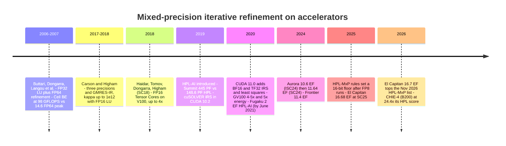
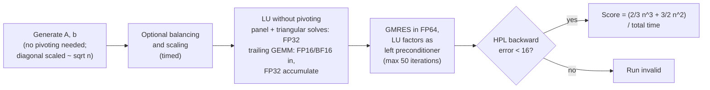
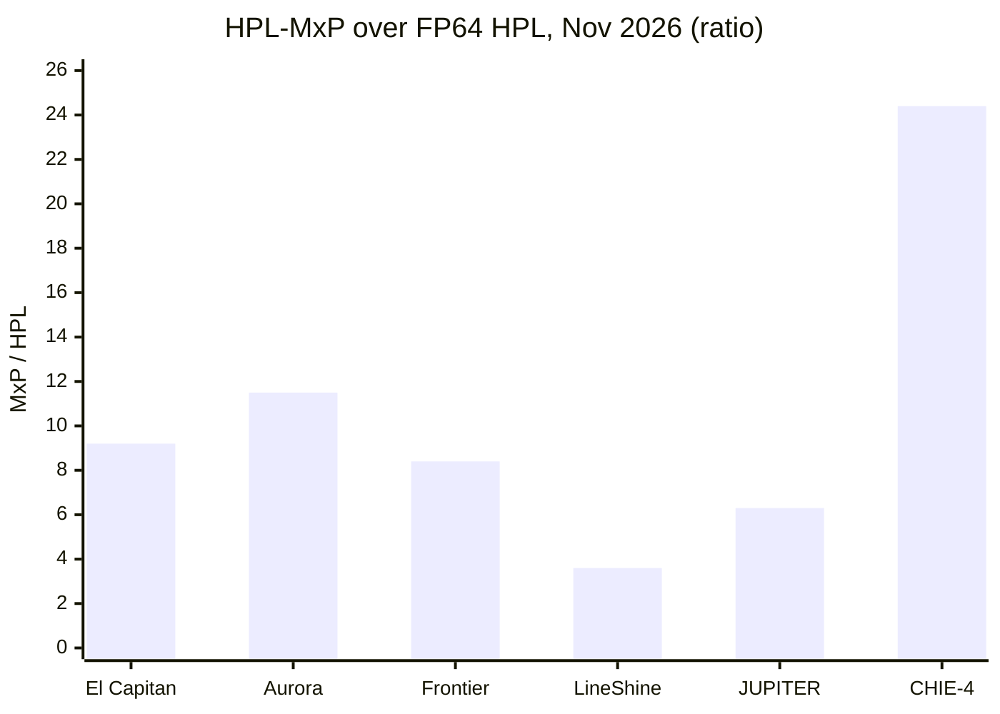

---
tags:
  - gpu-programming
  - libraries
  - linear-algebra
  - mixed-precision
  - iterative-refinement
  - cusolver
  - hpl-mxp
  - fp64
  - hpc
aliases:
  - Mixed-Precision Iterative Refinement
  - Iterative Refinement
  - GMRES-IR
  - HPL-MxP
  - HPL-AI
  - cuSOLVER IRS
status: complete
sources:
  - https://hpl-mxp.org/rules.md
  - https://arxiv.org/html/2509.19618v1
  - https://journals.sagepub.com/doi/10.1177/10943420251382476
  - https://top500.org/lists/top500/2026/11/highs/
  - https://arxiv.org/html/2604.09517
  - https://icl.utk.edu/files/print//hpl-mxp-sc25.pdf
  - https://glennklockwood.com/garden/HPL-MxP
  - https://docs.nvidia.com/cuda/cusolver/index.html
  - https://rocm.docs.amd.com/projects/HIPIFY/en/latest/_sources/reference/tables/CUSOLVER_API_supported_by_HIP.md
  - https://eprints.maths.manchester.ac.uk/2629/1/cahi18.pdf
  - https://www.cambridge.org/core/product/identifier/S0962492922000022/type/journal_article
  - https://eprints.maths.manchester.ac.uk/2664/
  - https://pmc.ncbi.nlm.nih.gov/articles/PMC7735315
  - https://eprints.maths.manchester.ac.uk/858/
  - https://www.netlib.org/utk/people/JackDongarra-20130-07-11/PAPERS/185_2007_Implementation-of-Mixed-Precision-in-Solving-Systems-of-Linear-Equations-on-the-Cell-Processor.pdf
  - https://www.nextbigfuture.com/2019/06/worlds-fastest-supercomputer-triples-performance-to-445-petaflops.html
  - https://top500.org/news/fugaku-holds-top-spot-exascale-remains-elusive/
  - https://github.com/KempnerInstitute/nvidia-hpc-benchmarks/blob/main/p2_nvidia_hpl_mxp/README.md
  - https://top500.org/system/180438
  - https://indico.cern.ch/event/1538409/contributions/6521976/attachments/3096181/5485165/cern-talk.pdf
  - https://arxiv.org/html/2601.08082v3
created: 2026-11-27
updated: 2026-11-27
---

## Table Of Contents

---

- [[#TL;DR|TL;DR]]
- [[#The Problem|The Problem]]
- [[#Foundations|Foundations]]
    - [[#Solving Ax = b with LU|Solving Ax = b with LU]]
    - [[#Unit Roundoff and the Condition Number|Unit Roundoff and the Condition Number]]
    - [[#Backward Error versus Forward Error|Backward Error versus Forward Error]]
- [[#How We Got Here|How We Got Here]]
- [[#How It Works|How It Works]]
    - [[#Classical Iterative Refinement|Classical Iterative Refinement]]
    - [[#A Working Toy in NumPy|A Working Toy in NumPy]]
    - [[#Three Precisions and GMRES-IR|Three Precisions and GMRES-IR]]
    - [[#Keeping FP16 in Range: Scaling|Keeping FP16 in Range: Scaling]]
    - [[#cuSOLVER IRS|cuSOLVER IRS]]
    - [[#HPL-MxP: The Benchmark|HPL-MxP: The Benchmark]]
    - [[#An Exascale Run, Worked|An Exascale Run, Worked]]
- [[#Where It Is Now|Where It Is Now]]
- [[#Trade-offs & Open Problems|Trade-offs & Open Problems]]
- [[#Resources|Resources]]
- [[#Related Notes|Related Notes]]

## ***TL;DR***
---
*Mixed-precision iterative refinement factors a matrix in cheap low precision on [[Tensor Cores]], then fixes the answer to full FP64 accuracy with a few FP64 residual-and-correct steps. It is the oldest and cheapest way to get double-precision answers out of AI hardware, and HPL-MxP is the TOP500-side benchmark built on it.*

- **The idea:** the $O(n^3)$ LU factorization runs in FP16, BF16, TF32 or FP32. Then, a handful of times, compute the residual $r = b - Ax$ in FP64, solve for a correction with the cheap factors, and add it. Each pass removes roughly the same fraction of the error, so a few passes reach FP64 accuracy, as long as the matrix is not too ill-conditioned ([Carson and Higham 2018](https://eprints.maths.manchester.ac.uk/2629/1/cahi18.pdf)).
- **GMRES-IR** uses the low-precision factors as a preconditioner for GMRES instead of as a direct solver, which stretches the usable condition number from about $10^4$ to about $10^{12}$ for an FP16 factorization ([Carson and Higham 2018](https://eprints.maths.manchester.ac.uk/2629/1/cahi18.pdf)).
- **On GPUs:** Haidar, Tomov, Dongarra and Higham showed up to 4x over FP64 with FP16 Tensor Cores on V100 (SC18), and 4 to 5x plus 5x better energy efficiency on a Quadro GV100 in 2020; the work shipped in MAGMA and in cuSOLVER's IRS routines ([Haidar et al. 2020](https://pmc.ncbi.nlm.nih.gov/articles/PMC7735315)).
- **cuSOLVER IRS** (`cusolverDn<t1><t2>gesv`, `cusolverDnIRSXgesv`, CUDA 10.2 and 11.0) takes FP64 or FP32 in and out and lets the factorization drop to FP32, FP16, BF16 or TF32, with GMRES refinement and an automatic fallback to full precision ([cuSOLVER docs](https://docs.nvidia.com/cuda/cusolver/index.html)).
- **HPL-MxP** (formerly HPL-AI, 2019) solves the same kind of dense system as HPL, but with a low-precision LU and FP64 GMRES refinement, and must still pass HPL's FP64 backward-error check. Since mid-2025 the lowest allowed precision is 16-bit ([HPL-MxP rules](https://hpl-mxp.org/rules.md)).
- **Where it is now (Nov 2026):** El Capitan leads the HPL-MxP list at 16.7 exaflops, 9.2x its FP64 HPL score; Aurora (11.6) and Frontier (11.4) follow. The TOP500 number one, LineShine, gets only 3.6x, and SoftBank's B200 cluster CHIE-4 gets 24.4x ([TOP500, Nov 2026](https://top500.org/lists/top500/2026/11/highs/)).

## ***The Problem***
---
*Science wants $Ax = b$ solved to double precision, the LU factorization behind it costs $\tfrac{2}{3}n^3$ operations, and on modern GPUs FP64 is the slowest arithmetic on the chip. Doing the LU in low precision is many times faster but, by itself, gives a low-precision answer.*

Dense linear solves sit under boundary-element methods, some electromagnetics and acoustics codes, quantum chemistry, and every TOP500 HPL run. Almost all of their cost is the LU factorization, and almost all of the LU is matrix multiplication (the trailing update; see [[Tiled Matrix Multiplication (GEMM)]]). So the speed of the solver is the speed of GEMM in whatever precision you factor in.

The gap between FP64 and low-precision Tensor Core throughput is the whole motivation:

| GPU | FP64 | Low precision | Gap | Source |
|---|---|---|---|---|
| V100 (theoretical) | 7.5 TFLOPS | 120 TFLOPS FP16 Tensor Core | 16x | [Haidar et al. 2020](https://pmc.ncbi.nlm.nih.gov/articles/PMC7735315) |
| Quadro GV100 (measured practical peak) | 6.8 TFLOPS | 85 TFLOPS FP16 Tensor Core | 12.5x | same |
| B300 (HGX) | about 1.2 TFLOPS | 4,500 TFLOPS FP8 | thousands of x | see [[Floating-Point Emulation on Tensor Cores]] |

Factor in FP16 alone and you get FP16-quality answers: about three or four significant digits. The question this note answers is how to keep the speed of the low-precision factorization and still return an answer as good as a full FP64 solve. There are two answers on GPUs today. This note covers iterative refinement, which changes the *algorithm* around the factorization; [[Floating-Point Emulation on Tensor Cores]] covers emulation, which changes the *arithmetic* inside each GEMM.

## ***Foundations***
---
*Three pieces of numerical analysis carry everything here: LU reduces a solve to a factorization plus two cheap triangular solves, the condition number says how much rounding error gets amplified, and a residual computed in high precision tells you exactly how wrong your current answer is.*

### Solving Ax = b with LU

LU factorization writes $A = LU$, with $L$ lower triangular and $U$ upper triangular. Solving then takes two triangular solves:

$$Ly = b, \qquad Ux = y$$

| Step | Cost | Where the time goes on a GPU |
|---|---|---|
| Factor $A = LU$ | $\tfrac{2}{3}n^3$ | Trailing-matrix GEMM updates, compute-bound |
| Two triangular solves | $2n^2$ | Bandwidth-bound, cheap for large $n$ |
| Residual $r = b - Ax$ | $2n^2$ | One matrix-vector product, bandwidth-bound |

Plain reading: for large $n$ the factorization is the only expensive part. A $50{,}000 \times 50{,}000$ system needs about $8.3 \times 10^{13}$ operations to factor but only about $5 \times 10^9$ for a solve or a residual, so you can afford many residual-and-solve passes if they let you factor in a cheaper precision.

HPL factors with *partial pivoting* (swapping rows so the biggest entry becomes the pivot), which keeps the factorization stable for any nonsingular matrix. Pivoting costs communication across a cluster, and HPL-MxP drops it, as the benchmark section explains.

### Unit Roundoff and the Condition Number

Each format has a *unit roundoff* $u$, the largest relative error from rounding one number:

| Format | Significand bits | $u$ | About |
|---|---|---|---|
| FP64 | 53 | $2^{-53}$ | $1.1 \times 10^{-16}$ |
| FP32 | 24 | $2^{-24}$ | $6.0 \times 10^{-8}$ |
| TF32 | 11 | $2^{-11}$ | $4.9 \times 10^{-4}$ |
| FP16 | 11 | $2^{-11}$ | $4.9 \times 10^{-4}$ |
| BF16 | 8 | $2^{-8}$ | $3.9 \times 10^{-3}$ |

(Values follow from the significand widths; see [[Low-Precision Formats - FP8, FP4 and MX]] for the bit layouts.)

The *condition number* $\kappa(A) = \|A\|\,\|A^{-1}\|$ measures how much a small change in the data can change the solution. The rule of thumb is that a stable solve in precision $u$ gives a relative error of about $\kappa(A)\,u$. With FP16 and $\kappa = 1000$, that is $1000 \times 4.9\times10^{-4} \approx 0.5$: half the answer is noise. The same matrix factored in FP64 gives about $10^{-13}$.

### Backward Error versus Forward Error

- **Forward error** is how far $\hat{x}$ is from the true $x$. You cannot measure it without knowing $x$.
- **Backward error** asks how small a change to $A$ and $b$ would make $\hat{x}$ an exact solution. You *can* measure it, from the residual $b - A\hat{x}$.

A backward-stable FP64 solver gives a backward error of order $u_{64} = 2^{-53}$. HPL and HPL-MxP check exactly this, in a scaled form, and that check is what makes a low-precision factorization "count" only if refinement brings the answer all the way back to FP64 quality ([HPL-MxP paper](https://arxiv.org/html/2509.19618v1)).

## ***How We Got Here***
---
*Refinement is an old textbook method that became a speed trick when hardware made 32-bit faster than 64-bit, and a big speed trick when Tensor Cores made 16-bit an order of magnitude faster still. HPL-MxP then turned it into a benchmark.*



- **The old method.** Iterative refinement was a well-known technique long before GPUs; the 2007 Cell paper cites Stewart's 1973 *Introduction to Matrix Computations* for it ([Kurzak and Dongarra 2007](https://www.netlib.org/utk/people/JackDongarra-20130-07-11/PAPERS/185_2007_Implementation-of-Mixed-Precision-in-Solving-Systems-of-Linear-Equations-on-the-Cell-Processor.pdf)). Classically it was used to *improve* accuracy, with the residual in extra precision.
- **2006 to 2007, speed instead of accuracy.** Buttari, Dongarra, Langou, Langou, Luszczek and Kurzak showed that factoring in 32-bit and refining in 64-bit keeps "64-bit accuracy of the resulting solution" while running at 32-bit speed, on CPUs, GPUs, FPGAs and the Cell BE ([Buttari et al. 2007](https://eprints.maths.manchester.ac.uk/858/)). On Cell the gap was dramatic: 204.8 GFLOPS single precision against 14.6 double, and the mixed solver reached 98 GFLOPS on a 3.2 GHz system ([Kurzak and Dongarra 2007](https://www.netlib.org/utk/people/JackDongarra-20130-07-11/PAPERS/185_2007_Implementation-of-Mixed-Precision-in-Solving-Systems-of-Linear-Equations-on-the-Cell-Processor.pdf)). The FP32-to-FP64 routine is known as `dsgesv`.
- **2017 to 2018, the theory for half precision.** Carson and Higham analysed refinement with three precisions (factorization, working, residual) and introduced GMRES-based refinement, showing that an FP16 factorization can still give FP64 accuracy for much worse-conditioned matrices than classical refinement allows ([Carson and Higham 2018](https://eprints.maths.manchester.ac.uk/2629/1/cahi18.pdf)).
- **2018, Tensor Cores.** Haidar, Tomov, Dongarra and Higham used V100 FP16 Tensor Cores for the LU and reported "up to 4 times speedup" for an FP64-quality solve, noting that FP32 accumulation inside the Tensor Core GEMM improves accuracy over plain FP16 ([SC18 paper](https://eprints.maths.manchester.ac.uk/2664/)).
- **2019, HPL-AI.** Summit posted 445 petaflops on the new mixed-precision benchmark, against 148.6 petaflops on standard HPL ([NextBigFuture, June 2019](https://www.nextbigfuture.com/2019/06/worlds-fastest-supercomputer-triples-performance-to-445-petaflops.html)). The same year cuSOLVER gained its first IRS routines (CUDA 10.2: `DHgesv`, `DSgesv`, `SHgesv`, `ZKgesv` and friends), with BF16 and TF32 variants and least-squares `gels` versions added in CUDA 11.0 ([HIPIFY cuSOLVER table](https://rocm.docs.amd.com/projects/HIPIFY/en/latest/_sources/reference/tables/CUSOLVER_API_supported_by_HIP.md)).
- **2020, the full GPU paper.** Haidar, Bayraktar, Tomov, Dongarra and Higham reported 4 to 5x speedups and 5x better energy efficiency over FP64 on a Quadro GV100, with scaling to keep FP16 in range and a multiple-right-hand-side variant, released in cuSOLVER and MAGMA ([Proc. R. Soc. A 476, 2020](https://pmc.ncbi.nlm.nih.gov/articles/PMC7735315)).
- **2020 to 2021, CPUs join.** Fugaku, with no GPUs, led HPL-AI at 2 exaflops by the 57th TOP500 list ([TOP500](https://top500.org/news/fugaku-holds-top-spot-exascale-remains-elusive/)).
- **2022, the survey.** Higham and Mary's *Acta Numerica* survey collected mixed-precision methods across factorizations, least squares and eigenproblems, with iterative refinement as the central technique ([Higham and Mary 2022](https://www.cambridge.org/core/product/identifier/S0962492922000022/type/journal_article)).
- **2024 to 2026, exascale.** The benchmark was renamed HPL-MxP. Aurora went from 10.6 exaflops at ISC24 to 11.64 at SC24 ([Aurora paper](https://arxiv.org/html/2604.09517)), El Capitan took first place, and the rules were tightened to a 16-bit floor ([HPL-MxP rules](https://hpl-mxp.org/rules.md)).

## ***How It Works***
---
*All variants share one loop: factor once cheaply, then repeatedly measure the error exactly and correct it cheaply. They differ in how the correction is solved, which precisions each step uses, and how the matrix is kept inside the low-precision range.*

### Classical Iterative Refinement

```text
factor  A ≈ L U                 in precision u_f   (FP16 / BF16 / TF32 / FP32)   O(n^3)
solve   x0 = U \ (L \ b)        in precision u_f                                   O(n^2)
repeat:
    r = b - A x                 in precision u_r   (FP64 or higher)                O(n^2)
    solve  L U d = r            in precision u_f                                   O(n^2)
    x = x + d                   in precision u     (FP64)                          O(n)
until  backward error is small enough
```

Line by line:

- **Factor once.** This is the only $O(n^3)$ step, so it is the one you put on low-precision Tensor Cores.
- **First solve.** Gives an answer with roughly $\kappa(A)\,u_f$ relative error: a rough draft.
- **Residual in high precision.** $r$ is exactly how much $Ax$ misses $b$. It must be computed in FP64 (or better) or it is drowned in its own rounding noise.
- **Correction with the cheap factors.** $d$ is an approximate solution of $A d = r$. It is wrong by the same *relative* amount as the first solve, but it is a correction to a small error, so the absolute error shrinks.
- **Update in FP64.** The answer is stored and accumulated at the working precision.

Why it converges: if the factors were exact, one step would finish the job. Because they carry error, each step multiplies the remaining error by a factor of about $\phi \approx c\,\kappa(A)\,u_f$. If $\phi < 1$ the error shrinks geometrically until it reaches the limit set by $u$ and $u_r$. Carson and Higham's convergence condition is $\phi \approx 3n\,\| |A^{-1}|\,|\hat{L}|\,|\hat{U}| \|_\infty\, u_f \ll 1$ ([Carson and Higham 2018](https://eprints.maths.manchester.ac.uk/2629/1/cahi18.pdf)).

### A Working Toy in NumPy

This runs on a laptop and shows the loop doing its job. It factors a $512 \times 512$ matrix without pivoting, rounding every stored value to FP16 (with FP32 arithmetic in each update, as a Tensor Core does), then refines in FP64 and reports HPL's backward-error measure.

```python
import numpy as np
rng = np.random.default_rng(0)
n = 512
A = rng.uniform(-1, 1, (n, n))
A[np.diag_indices(n)] += 2 * np.sqrt(n)        # diagonal boost so no-pivot LU is stable
x_true = rng.uniform(-1, 1, n)
b = A @ x_true

M = A.astype(np.float16).astype(np.float32)    # FP16 storage, FP32 arithmetic
for k in range(n - 1):
    M[k+1:, k] = (M[k+1:, k] / M[k, k]).astype(np.float16)
    M[k+1:, k+1:] = (M[k+1:, k+1:] - np.outer(M[k+1:, k], M[k, k+1:])).astype(np.float16)
L = np.tril(M, -1).astype(np.float64) + np.eye(n)
U = np.triu(M).astype(np.float64)

def solve(r):                                  # triangular solves with the FP16 factors
    return np.linalg.solve(U, np.linalg.solve(L, r))

def hpl_backward_error(x):                     # HPL / HPL-MxP check, must be < 16
    r = b - A @ x
    return np.abs(r).max() / ((np.abs(A).sum(1).max() * np.abs(x).max()
                               + np.abs(b).max()) * n * 2.0**-53)

x = solve(b)
for it in range(1, 8):
    x = x + solve(b - A @ x)                   # FP64 residual, cheap correction
    print(it, hpl_backward_error(x))
```

What each part does:

- **The diagonal boost** stands in for the HPL-MxP generator: it makes a random matrix safe to factor without pivoting. The resulting $\kappa_\infty(A)$ is about 52.
- **The factor loop** is textbook right-looking LU. Each `.astype(np.float16)` rounds what gets stored, as a GPU storing factors in FP16 would.
- **`solve`** applies the low-precision factors. (NumPy's triangular solves run in FP64 here; on a GPU they would use the low-precision factors directly.)
- **`hpl_backward_error`** is the benchmark's formula, explained below.

Output of this exact script (run Nov 27, 2026):

| Iteration | HPL backward error | Relative forward error |
|---|---|---|
| 0 (FP16 LU only) | $1.7 \times 10^{10}$ | $8.8 \times 10^{-3}$ |
| 1 | $1.9 \times 10^{8}$ | $9.0 \times 10^{-5}$ |
| 2 | $2.0 \times 10^{6}$ | $9.5 \times 10^{-7}$ |
| 3 | $2.1 \times 10^{4}$ | $1.0 \times 10^{-8}$ |
| 4 | 221 | $1.1 \times 10^{-10}$ |
| 5 | **2.3 (passes < 16)** | $1.1 \times 10^{-12}$ |
| 6 | 0.025 | $1.2 \times 10^{-14}$ |

Plain reading: the FP16 answer alone is ten orders of magnitude too inaccurate to pass the benchmark. Each refinement step gains about two decimal digits (the error shrinks by a factor near 95), which matches $\phi \approx \kappa\,u_{16} \approx 52 \times 4.9\times10^{-4} \approx 0.025$ to within the constant. Five cheap $O(n^2)$ passes turn an FP16 factorization into an answer that passes the FP64 check.

### Three Precisions and GMRES-IR

Carson and Higham name three precisions: $u_f$ for the factorization, $u$ for storing $x$ (working precision), and $u_r$ for residuals, with $u_r \le u \le u_f$ ([Carson and Higham 2018](https://eprints.maths.manchester.ac.uk/2629/1/cahi18.pdf)). Classical refinement only converges when $\kappa(A)\,u_f$ is well below 1, which for FP16 means $\kappa_\infty(A)$ up to about $10^4$.

**GMRES-IR** keeps the same outer loop but solves the correction equation differently. Instead of $d = \hat{U}^{-1}\hat{L}^{-1} r$, it runs GMRES (a Krylov method; see [[Sparse Linear Algebra on GPUs]] for Krylov solvers) on the *preconditioned* system

$$\tilde{A}\,d = \hat{U}^{-1}\hat{L}^{-1} r, \qquad \tilde{A} = \hat{U}^{-1}\hat{L}^{-1} A$$

Plain reading: the low-precision factors are no longer trusted to *solve* the system, only to make it *easier*. Even rough factors make $\tilde{A}$ close to the identity, and GMRES only needs $\tilde{A}$'s condition number to be much smaller than $A$'s; in the paper's words, "All that matters is that the factors yield an $\tilde{A}$ with condition number much smaller than that of $A$."

| Factorization $u_f$ | Working $u$ | Residual $u_r$ | Classical IR, max $\kappa_\infty$ | GMRES-IR, max $\kappa_\infty$ | Final accuracy |
|---|---|---|---|---|---|
| half | double | double | $10^4$ | | double |
| half | single | double | | $10^8$ | single |
| half | double | quad | $10^4$ | $10^{12}$ (forward error) | double |
| single | double | double | $10^8$ | | double |
| single | double | quad | $10^8$ | $10^{16}$ | double |

Source: Tables 7.1 and 8.1 of [Carson and Higham 2018](https://eprints.maths.manchester.ac.uk/2629/1/cahi18.pdf). The price is more work per correction (GMRES iterations, each a matrix-vector product plus two triangular solves), and for badly conditioned matrices GMRES can need so many iterations that the speedup disappears. In Haidar et al.'s tests, easy matrices converged in about four FP16 Tensor Core iterations, harder ones in about 17, and one matrix with $\kappa_\infty \approx 4.5 \times 10^8$ needed 83 ([Haidar et al. 2020](https://pmc.ncbi.nlm.nih.gov/articles/PMC7735315)).

### Keeping FP16 in Range: Scaling

FP16's largest finite value is about 65,504, and values grow during elimination, so entries can overflow to infinity. Haidar et al. use three tools ([Haidar et al. 2020](https://pmc.ncbi.nlm.nih.gov/articles/PMC7735315)):

- **Scalar scaling:** multiply the whole matrix so its largest entry is a fraction $\theta$ of the FP16 maximum, leaving headroom for growth ($\theta = 0.01$ suggested for many problems).
- **Two-sided diagonal scaling:** $A_\text{scaled} = R\,A\,C$ with diagonal $R$ and $C$, in the style of LAPACK's `xgeequ` equilibration; combined with scalar scaling at $\theta = 0.1$.
- **Auto-adaptive rounding:** clamp out-of-range values to about $\pm 65{,}504$ rather than letting them become infinity.

BF16 has FP32's exponent range, so it rarely needs this, but it has only 8 significand bits, which makes $u_f$ eight times worse than FP16's and shrinks the condition numbers refinement can handle. Range versus precision is the usual BF16 versus FP16 trade (see [[Low-Precision Formats - FP8, FP4 and MX]]).

### cuSOLVER IRS

cuSOLVER exposes refinement in two ways ([cuSOLVER docs](https://docs.nvidia.com/cuda/cusolver/index.html), [HIPIFY table](https://rocm.docs.amd.com/projects/HIPIFY/en/latest/_sources/reference/tables/CUSOLVER_API_supported_by_HIP.md)):

**1. One call per precision pair: `cusolverDn<t1><t2>gesv` and `<t1><t2>gels`.** The first letter is the input and output type, the second is the lowest precision the factorization may use:

| Name | Data | Factorization may use | Since |
|---|---|---|---|
| `DDgesv`, `SSgesv`, `ZZgesv`, `CCgesv` | FP64 / FP32 / complex | the same precision (no speedup; the baseline) | CUDA 10.2 |
| `DSgesv`, `ZCgesv` | FP64 | FP32 | 10.2 |
| `DHgesv`, `SHgesv`, `ZKgesv`, `CKgesv` | FP64 / FP32 | FP16 | 10.2 |
| `DBgesv`, `SBgesv`, `ZEgesv`, `CEgesv` | FP64 / FP32 | BF16 | 11.0 |
| `DXgesv`, `SXgesv`, `ZYgesv`, `CYgesv` | FP64 / FP32 | TF32 | 11.0 |
| `...gels` versions of all of the above | | least squares by QR | 11.0 |

**2. The expert interface: `cusolverDnIRSXgesv` and `cusolverDnIRSXgels`,** configured through a parameters object. A host-side sketch (prototypes for the parameter calls are from the docs; check the solver call's argument order against your CUDA version):

```c
cusolverDnIRSParams_t params;
cusolverDnIRSInfos_t  infos;
cusolverDnIRSParamsCreate(&params);
cusolverDnIRSParamsSetSolverPrecisions(params, CUSOLVER_R_64F,     // data in and out: FP64
                                               CUSOLVER_R_16BF);   // LU may drop to BF16
cusolverDnIRSParamsSetRefinementSolver(params, CUSOLVER_IRS_REFINE_GMRES);
cusolverDnIRSParamsSetMaxIters(params, 50);                        // the default
cusolverDnIRSInfosCreate(&infos);

size_t lwork;
cusolverDnIRSXgesv_bufferSize(handle, params, n, nrhs, &lwork);
/* ... cudaMalloc(&dWork, lwork) ... */
cusolver_int_t niters;
cusolverDnIRSXgesv(handle, params, infos, n, nrhs,
                   dA, lda, dB, ldb, dX, ldx,
                   dWork, lwork, &niters, d_info);
// niters < 0: refinement did not converge; with fallback on (the default)
// cuSOLVER re-solved in full FP64, so dX is still correct, only slower.
```

Line by line:

- **`SetSolverPrecisions`** sets the *main* precision (what you pass in and get back) and the *lowest* precision the factorization may use. Neither is set by default, and both must be set before the first call. For FP64 data the lowest can be FP64, FP32, FP16, BF16 or TF32.
- **`SetRefinementSolver`** picks the outer method. The options are `NONE` (factor and solve in the lowest precision, no refinement), `CLASSICAL` (LAPACK-style), `GMRES`, `CLASSICAL_GMRES` (classical outer loop with GMRES for each correction) and `GMRES_GMRES` (nested). The docs say: "Most of our experimentation shows that CUSOLVER_IRS_REFINE_GMRES is the best option."
- **Iterations and tolerance.** Outer and inner iteration caps both default to 50, the inner tolerance defaults to $10^{-4}$, and the stopping test is $\|r\|_\infty < \sqrt{n}\,\|x\|_\infty\,\|A\|_\infty\,\varepsilon \cdot \text{BWDMAX}$ with BWDMAX = 1, always evaluated in double.
- **Fallback.** On by default: if refinement fails, the solver re-solves in the main precision, which "will guarantee that the IRS solver always provide the good solution". With fallback off you get whatever refinement reached.

Expectations from the docs themselves: FP64 data with an FP32 factorization gives "a speedup of at most 2X for large problem sizes", since that is the FP64-to-FP32 rate ratio; the bigger wins come from FP16, BF16 and TF32 Tensor Cores. On AMD, HIPIFY maps only the same-precision pairs (`DDgesv`, `SSgesv`, `CCgesv`, `ZZgesv` and their `gels` forms) to hipSOLVER; the mixed pairs and the IRSX interface have no hipSOLVER equivalent listed ([HIPIFY table](https://rocm.docs.amd.com/projects/HIPIFY/en/latest/_sources/reference/tables/CUSOLVER_API_supported_by_HIP.md); see [[ROCm and HIP]]).

### HPL-MxP: The Benchmark

HPL ranks the TOP500 by solving a dense random system in FP64 with partially pivoted LU. HPL-MxP keeps HPL's harness and its accuracy test but frees the factorization ([HPL-MxP rules](https://hpl-mxp.org/rules.md), [Dongarra and Luszczek](https://arxiv.org/html/2509.19618v1)).



The rules in practice:

| Rule | What it says | Why |
|---|---|---|
| Precision floor | "The lowest allowed precision is 16-bit floating-point", for results submitted after the June 2025 list | FP8 runs roughly doubled scores without solving a harder problem |
| Typical split | Panel factorization and triangular solves in 32-bit; Schur-complement (trailing) update in 16-bit with 32-bit accumulation | The GEMM is where the flops are |
| Pivoting | Factor "in numerically stable fashion without requiring pivoting" | Pivoting needs row swaps across the cluster; the generator makes it unnecessary |
| Generator | Non-symmetric random matrix whose LU exists in FP64 without pivoting; strict diagonal dominance "for testing purposes only" | Too-easy matrices let GMRES converge without the preconditioner |
| Refinement | Iterative method (GMRES recommended) in 64-bit, with the low-precision factors as preconditioner | Brings the answer to FP64 quality |
| Iteration cap | More than 50 iterations is a failure | Stops a poor factorization from being rescued by brute-force iteration |
| Accuracy | HPL backward error must be below 16 | Same check as FP64 HPL |
| Score | Canonical FP64 count $\tfrac{2}{3}n^3 + \tfrac{3}{2}n^2$ over total time-to-solution | Reported as operations per second, not flops, since the real operations differ |

The backward-error check is:

$$\frac{\|Ax - b\|_\infty}{\left(\|A\|_\infty \|x\|_\infty + \|b\|_\infty\right)\, n\, \varepsilon} < 16, \qquad \varepsilon = 2^{-53}$$

Plain reading: the residual must be within a factor of 16 of what an ideal FP64 solve of an $n \times n$ system could leave behind. For $n = 10^6$ the right-hand side bound allows a scaled residual of $16 \times 10^6 \times 1.1 \times 10^{-16} \approx 1.8 \times 10^{-9}$; an FP16 factorization alone misses that by many orders of magnitude, as the toy above shows.

**The generator.** Dongarra and Luszczek studied matrices with uniform entries in $[-1, 1]$ up to $n = 46{,}340$: without pivoting, the largest pivot grows like roughly $\sqrt{n}$ and tends to appear in the last 1% of columns, and without diagonal scaling residuals grew by 2 to 5 orders of magnitude. They conclude diagonal scaling is essential and recommend $\sqrt{n}$ as the factor; scaling the diagonal by $n$ is allowed only for debugging ([HPL-MxP paper](https://arxiv.org/html/2509.19618v1)).

### An Exascale Run, Worked

Aurora's SC24 run used $N = 57{,}693{,}696$, block size 1,536, 9,500 nodes with two ranks per node each driving three GPUs, BF16 storage and BF16/FP32/FP64 arithmetic, with GMRES refinement on the CPUs ([Aurora paper](https://arxiv.org/html/2604.09517)). Its score was 11.64 exaflops.

$$\text{ops} = \tfrac{2}{3}N^3 + \tfrac{3}{2}N^2 \approx \tfrac{2}{3}(5.77\times10^{7})^3 \approx 1.28 \times 10^{23}$$

$$t = \frac{1.28 \times 10^{23}}{11.64 \times 10^{18}\ \text{ops/s}} \approx 1.1 \times 10^{4}\ \text{s} \approx 3.1\ \text{hours}$$

Plain reading: the whole solve took about three hours. The memory side is what the low precision really buys:

| Storage | Matrix size | Per GPU (57,000 GPUs) |
|---|---|---|
| BF16 (2 bytes) | $N^2 \times 2 \approx 6.7$ PB | about 117 GB |
| FP64 (8 bytes) | about 26.6 PB | about 467 GB |

(Arithmetic from the published $N$ and node counts.) Storing in BF16 lets the matrix be twice as large in each dimension as an FP64 one in the same memory, and the paper notes it allows block sizes up to 4x larger. Aurora's FP64 HPL run, by contrast, used $N = 28{,}773{,}888$ and reached 1.012 exaflops, so HPL-MxP was about 11.5x faster at a problem twice the size.

Other engineering details from the same paper: HPL-MxP uses no pivoting, so the row-swap phase that dominates the tail of FP64 HPL disappears; MPI runs from host buffers; and Intel AMX on the CPUs was the clearest change between the ISC24 (10.6 EF) and SC24 (11.64 EF) runs, though the authors call 6.7% an upper bound on its effect.

## ***Where It Is Now***
---
*As of November 2026, HPL-MxP shows 6 to 24x over FP64 HPL on the big GPU machines, cuSOLVER's refinement API is unchanged in CUDA 13 and still stops at 16-bit, and the action has moved to how refinement and FP64 emulation divide the work on chips with almost no FP64.*

**The November 2026 HPL-MxP list** ([TOP500, Nov 2026](https://top500.org/lists/top500/2026/11/highs/)):

| HPL-MxP rank | System | HPL-MxP (EF) | FP64 HPL (EF) | Ratio |
|---|---|---|---|---|
| 1 | El Capitan (LLNL, AMD MI300A) | 16.7 | 1.809 | 9.2x |
| 2 | Aurora (ANL, Intel) | 11.6 | 1.012 | 11.5x |
| 3 | Frontier (ORNL, AMD MI250X) | 11.4 | 1.353 | 8.4x |
| 4 | LineShine (NSCC Shenzhen) | 7.92 | 2.198 | 3.6x |
| 5 | JUPITER Booster (FZJ, NVIDIA GH200) | 6.25 | 1.000 | 6.3x |
| 6 | CHIE-4 (SoftBank, NVIDIA B200) | 3.3 | 0.135 | 24.4x |



What the ratios say:

- **The list barely moved.** The top three HPL-MxP scores are within rounding of SC25's (El Capitan 16.68, Aurora 11.643, Frontier 11.39 EF; [SC25 flyer](https://icl.utk.edu/files/print//hpl-mxp-sc25.pdf)). Large machines are rerun rarely.
- **The ratio tracks the low-to-high precision gap, not the machine's size.** LineShine, the TOP500 number one since June 2026, gets only 3.6x. CHIE-4, a DGX B200 system at 135.4 PF on HPL ([TOP500 system page](https://top500.org/system/180438)), gets 24.4x, the biggest ratio on the list. Blackwell's huge 16-bit Tensor Core rate relative to its FP64 rate is exactly what HPL-MxP rewards.
- **The 16-bit floor matters.** NVIDIA's HPC benchmark container still has an FP8 mode for the LU (`--sloppy-type 1`) alongside FP16 ([NVIDIA HPC Benchmarks README](https://github.com/KempnerInstitute/nvidia-hpc-benchmarks/blob/main/p2_nvidia_hpl_mxp/README.md)), but FP8 results cannot enter the list after the June 2025 change ([HPL-MxP rules](https://hpl-mxp.org/rules.md)). Glenn Lockwood's account is that FP8 submissions "broke" the rankings and prompted the rule ([Lockwood](https://glennklockwood.com/garden/HPL-MxP)).
- **The benchmark paper is now in a journal.** Dongarra and Luszczek's description of the algorithm, rules and generator appeared in *IJHPCA* vol. 40 (2026) ([SAGE](https://journals.sagepub.com/doi/10.1177/10943420251382476)).

**In libraries:**

- cuSOLVER's IRS interface in the CUDA 13 documentation still offers FP32, FP16, BF16 and TF32 as the lowest factorization precisions, with GMRES recommended and fallback on by default; there is no FP8 option ([cuSOLVER docs](https://docs.nvidia.com/cuda/cusolver/index.html)).
- NVIDIA is putting emulation inside cuSOLVER instead: a July 2025 NVIDIA talk showed FP32 emulation on B200 giving "Up to 2.3x for QR ... and LU vs. Hopper", "Coming soon in cuSOLVERDn and cuSOLVERMp", plus FP64-emulated QR that passes cuSOLVER's accuracy tests at 55 bits ([CERN talk](https://indico.cern.ch/event/1538409/contributions/6521976/attachments/3096181/5485165/cern-talk.pdf)). See [[Floating-Point Emulation on Tensor Cores]] for where that went in cuBLAS.
- Research keeps pushing the precision mix finer. A 2026 MIT and KAUST paper uses FP16 for large off-diagonal Cholesky blocks and FP32 or FP64 for diagonal blocks, reporting up to 5.07x over the vendor baseline on H200, but much smaller gains on MI300X and none for $n < 8192$ ([Carrica et al.](https://arxiv.org/html/2601.08082v3)).

**Refinement versus emulation, the two routes to FP64 answers on AI hardware:**

| | Mixed-precision iterative refinement | FP64 emulation (Ozaki) |
|---|---|---|
| What changes | The algorithm around the factorization | The arithmetic inside each GEMM |
| Works for | Linear systems and least squares (and, with more work, some eigenproblems) | Any code that calls DGEMM |
| Depends on conditioning | Yes: needs $\kappa(A)\,u_f$ well below 1, or GMRES to rescue it | Mostly on the exponent spread of rows and columns, not $\kappa(A)$ |
| Speedup ceiling | The full low-precision rate for the $n^3$ part | Several low-precision GEMMs per FP64 GEMM |
| Code changes | Call a different solver | None (library switch) |
| Shipped in | cuSOLVER IRS (2019), MAGMA | cuBLAS (CUDA 13.0 U2 and later) |

The two compose: the FP64 residuals and the GMRES steps in refinement are themselves FP64 work, which on a chip like B300 could run emulated. That combination is not in a shipping library as of this note.

## ***Trade-offs & Open Problems***
---
*Refinement is nearly free accuracy when the matrix is well-behaved and many right-hand sides share one factorization; it is a gamble on ill-conditioned problems, and as a benchmark it measures low-precision Tensor Core throughput more than FP64 capability.*

- **Conditioning sets the ceiling.** Classical refinement with an FP16 factorization handles $\kappa_\infty$ up to about $10^4$; GMRES-IR raises that, but iteration counts climb with difficulty (4 to 83 in Haidar et al.'s tests), and past some point the fallback to full FP64 runs and you pay for both ([Haidar et al. 2020](https://pmc.ncbi.nlm.nih.gov/articles/PMC7735315)). You usually do not know $\kappa$ in advance, so the fallback is a necessity, not a corner case.
- **Memory overhead.** You need the original $A$ in FP64 (for residuals) *and* the low-precision factors, plus GMRES workspace. For a single solve on a memory-limited GPU that can be the deciding cost. HPL-MxP sidesteps it at scale by storing the matrix in BF16 and regenerating what it needs, which a real application usually cannot do.
- **Small problems do not benefit.** The $O(n^2)$ refinement and launch overhead only disappear behind the $O(n^3)$ factorization for large $n$; the Cholesky study above saw no gain below $n = 8192$. Batched small systems are a different problem (see [[Device-Side Math Libraries (MathDx)]]).
- **Many right-hand sides amortize the factor.** One factorization serves every column of $B$, but each column needs its own refinement, so the refinement share grows with `nrhs`. The cuSOLVER docs advise taking "the number of right-hand sides, the size of the matrix as well as the convergence rate into account."
- **Pivoting.** Real matrices usually need partial pivoting. cuSOLVER's IRS factorizations pivot; HPL-MxP's do not, because its generator guarantees they need not. That is one reason HPL-MxP speedups overstate what a general solver gets.
- **What the benchmark measures.** At large $N$ the $N^3$ factorization dominates, so HPL-MxP mostly measures 16-bit GEMM throughput; halving the precision roughly doubles the score while solving the same problem, which is why the 16-bit floor was needed ([Lockwood](https://glennklockwood.com/garden/HPL-MxP)). A machine with weak FP64 and strong FP16 looks great, which is informative about AI-style hardware but says little about vector-bound FP64 codes.
- **Below 16 bits, there is no theory.** The rules justify the 16-bit floor partly because no analysis covers lower precisions ([HPL-MxP rules](https://hpl-mxp.org/rules.md)). FP8 has $u = 2^{-4}$ (E4M3) or worse, so $\kappa\,u_f < 1$ fails for almost any interesting matrix; making FP8 factorizations useful would need block scaling of the kind [[Low-Precision Formats - FP8, FP4 and MX]] describes, and new analysis.
- **Beyond $Ax = b$.** Refinement for least squares (cuSOLVER `gels` IRS), and research versions for eigenvalues and SVD, exist ([Higham and Mary 2022](https://www.cambridge.org/core/product/identifier/S0962492922000022/type/journal_article)), but much of scientific computing is sparse, iterative or vector-bound and does not reduce to one big dense factorization. For those codes neither refinement nor emulation recovers the FP64 that AI GPUs gave up (see [[Sparse Linear Algebra on GPUs]]).

## ***Resources***
---
*Primary sources first: the benchmark's own rules and paper, the cuSOLVER documentation, and the numerical-analysis papers that justify the method.*

**Benchmark**
- [HPL-MxP rules](https://hpl-mxp.org/rules.md): precision floor, no-pivot generator, GMRES, the 50-iteration cap and the backward-error check.
- [HPL-MxP Benchmark: Mixed-Precision Algorithms, Iterative Refinement, and Scalable Data Generation](https://arxiv.org/html/2509.19618v1), Dongarra and Luszczek; journal version in [IJHPCA 40(1), 2026](https://journals.sagepub.com/doi/10.1177/10943420251382476).
- [TOP500 November 2026 highlights](https://top500.org/lists/top500/2026/11/highs/): the current HPL-MxP top six.
- [HPL-MxP SC25 results flyer](https://icl.utk.edu/files/print//hpl-mxp-sc25.pdf), ICL.
- [HPL and HPL-MxP at Exascale on Aurora](https://arxiv.org/html/2604.09517): configurations, precisions and engineering of an exascale MxP run.
- [Glenn Lockwood, HPL-MxP](https://glennklockwood.com/garden/HPL-MxP): a practitioner's critique.
- [NVIDIA HPC Benchmarks, HPL-MxP README](https://github.com/KempnerInstitute/nvidia-hpc-benchmarks/blob/main/p2_nvidia_hpl_mxp/README.md) (mirrored by the Kempner Institute): FP16 and FP8 modes and single-node to multi-node numbers.

**Libraries**
- [cuSOLVER documentation, IRS section](https://docs.nvidia.com/cuda/cusolver/index.html): precisions, refinement solvers, tolerance, iteration caps, fallback.
- [HIPIFY cuSOLVER support table](https://rocm.docs.amd.com/projects/HIPIFY/en/latest/_sources/reference/tables/CUSOLVER_API_supported_by_HIP.md): every `<t1><t2>gesv/gels` variant with the CUDA version it appeared in.
- [Floating Point Emulation in NVIDIA Math Libraries](https://indico.cern.ch/event/1538409/contributions/6521976/attachments/3096181/5485165/cern-talk.pdf), NVIDIA at CERN, July 2025: cuSOLVER emulation plans.

**Numerical analysis**
- [Accelerating the Solution of Linear Systems by Iterative Refinement in Three Precisions](https://eprints.maths.manchester.ac.uk/2629/1/cahi18.pdf), Carson and Higham, SISC 2018: the three-precision analysis and GMRES-IR.
- [Mixed Precision Algorithms in Numerical Linear Algebra](https://www.cambridge.org/core/product/identifier/S0962492922000022/type/journal_article), Higham and Mary, *Acta Numerica* 2022: the survey.

**GPU implementations and history**
- [Harnessing GPU Tensor Cores for Fast FP16 Arithmetic to Speed up Mixed-Precision Iterative Refinement Solvers](https://eprints.maths.manchester.ac.uk/2664/), Haidar, Tomov, Dongarra, Higham, SC18.
- [Mixed-precision iterative refinement using tensor cores on GPUs to accelerate solution of linear systems](https://pmc.ncbi.nlm.nih.gov/articles/PMC7735315), Haidar, Bayraktar, Tomov, Dongarra, Higham, Proc. R. Soc. A 2020.
- [Mixed Precision Iterative Refinement Techniques for the Solution of Dense Linear Systems](https://eprints.maths.manchester.ac.uk/858/), Buttari et al., IJHPCA 2007.
- [Implementation of Mixed Precision in Solving Systems of Linear Equations on the Cell Processor](https://www.netlib.org/utk/people/JackDongarra-20130-07-11/PAPERS/185_2007_Implementation-of-Mixed-Precision-in-Solving-Systems-of-Linear-Equations-on-the-Cell-Processor.pdf), Kurzak and Dongarra, 2007.
- [Summit's 445 PF HPL-AI result](https://www.nextbigfuture.com/2019/06/worlds-fastest-supercomputer-triples-performance-to-445-petaflops.html), June 2019; [Fugaku at 2 EF](https://top500.org/news/fugaku-holds-top-spot-exascale-remains-elusive/).
- [Hierarchical Recursive Precision for Accelerating Symmetric Linear Solves on MXUs](https://arxiv.org/html/2601.08082v3), Carrica, Alomairy, Ringoot, Edelman, 2026.

## ***Related Notes***
---
*Refinement sits between the low-precision hardware that makes it fast, the libraries that ship it, and emulation, the other way to get FP64 answers from AI chips.*

- [[Floating-Point Emulation on Tensor Cores]] — The other route to FP64 on AI hardware: exact FP64 GEMMs from INT8 or FP8 products.
- [[Tensor Cores]] — The units the low-precision LU runs on.
- [[Low-Precision Formats - FP8, FP4 and MX]] — FP16, BF16, TF32 and FP8 layouts, and why range and precision trade off.
- [[cuBLAS and cuDNN]] — The GEMMs inside the factorization, and cuBLAS's emulation modes.
- [[Device-Side Math Libraries (MathDx)]] — cuSolverDx for small and batched factorizations inside your own kernels.
- [[Tiled Matrix Multiplication (GEMM)]] — The trailing-matrix update that is most of the LU's work.
- [[Sparse Linear Algebra on GPUs]] — Krylov solvers like GMRES, and the sparse codes refinement does not reach.
- [[Roofline Model and Arithmetic Intensity]] — Why the $O(n^3)$ factorization is compute-bound and the $O(n^2)$ refinement is bandwidth-bound.
- [[ROCm and HIP]] — What hipSOLVER does and does not map from cuSOLVER's IRS family.
- [[Blackwell Architecture]] — The FP64-poor, 16-bit-rich GPUs that HPL-MxP flatters most.
- [[AI Accelerators]] — Low-precision chips where refinement or emulation is the only route to FP64.
