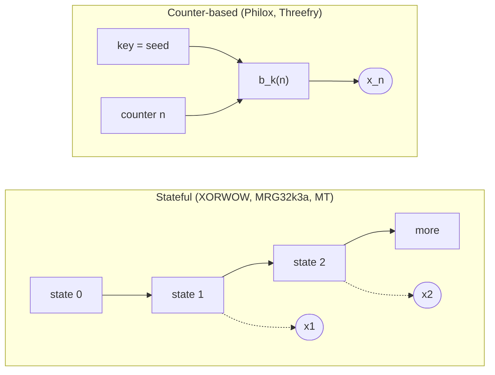
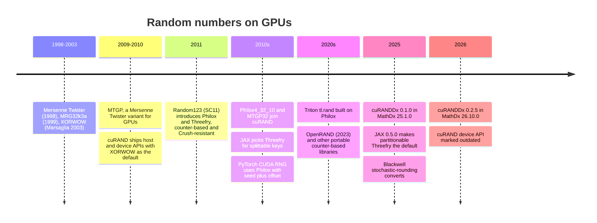
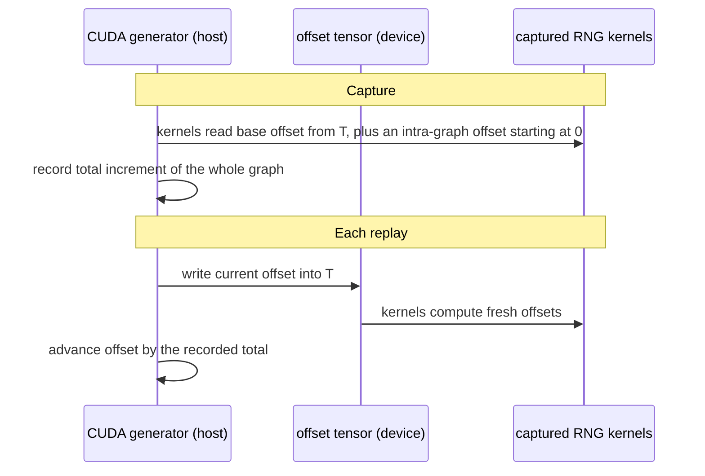

---
tags:
  - gpu-programming
  - libraries
  - random-numbers
  - curand
  - curanddx
  - philox
  - reproducibility
  - cuda
aliases:
  - GPU RNG
  - cuRAND
  - cuRANDDx
  - Philox
  - Counter-Based RNG
status: complete
sources:
  - https://users.cs.utah.edu/~hari/teaching/bigdata/random123sc11.pdf
  - https://github.com/DEShawResearch/random123
  - https://docs.nvidia.com/cuda/curand/index.html
  - https://docs.nvidia.com/cuda/curand/host-api-overview.html
  - https://docs.nvidia.com/cuda/curand/device-api-overview.html
  - https://docs.nvidia.com/cuda/curanddx/
  - https://docs.nvidia.com/cuda/curanddx/release_notes.html
  - https://docs.nvidia.com/cuda/curanddx/get_started/performance.html
  - https://docs.nvidia.com/cuda/curanddx/examples/introduction_philox.html
  - https://docs.nvidia.com/cuda/mathdx/index.html
  - https://triton-lang.org/main/getting-started/tutorials/04-low-memory-dropout.html
  - https://docs.jax.dev/en/latest/jax.random.html
  - https://gemfury.com/edgify/python:torch/-/content/include/ATen/cuda/CUDAGeneratorImpl.h
  - https://arxiv.org/pdf/2410.07531
  - https://arxiv.org/pdf/2310.19925
  - https://docs.nvidia.com/deeplearning/transformer-engine/user-guide/features/low_precision_training/nvfp4/nvfp4.html
  - https://lists.llvm.org/pipermail/mlir-commits/2025-October/138807.html
  - https://arxiv.org/pdf/2610.27313
created: 2026-11-27
updated: 2026-11-27
---

## Table Of Contents

---

- [[#TL;DR|TL;DR]]
- [[#The Problem|The Problem]]
- [[#Foundations|Foundations]]
    - [[#Stateful vs Counter-Based Generators|Stateful vs Counter-Based Generators]]
    - [[#Seed, Subsequence and Offset|Seed, Subsequence and Offset]]
    - [[#From Bits to Distributions|From Bits to Distributions]]
    - [[#What It Costs, Worked|What It Costs, Worked]]
- [[#How We Got Here|How We Got Here]]
- [[#How It Works|How It Works]]
    - [[#Inside Philox4x32-10|Inside Philox4x32-10]]
    - [[#cuRAND Host API|cuRAND Host API]]
    - [[#cuRAND Device API|cuRAND Device API]]
    - [[#cuRANDDx - RNG as Part of Your Kernel|cuRANDDx: RNG as Part of Your Kernel]]
    - [[#Recompute Instead of Store - Dropout in Triton|Recompute Instead of Store: Dropout in Triton]]
    - [[#Reproducibility Across Launches and CUDA Graphs|Reproducibility Across Launches and CUDA Graphs]]
- [[#Where It Is Now|Where It Is Now]]
- [[#Trade-offs & Open Problems|Trade-offs & Open Problems]]
- [[#Resources|Resources]]
- [[#Related Notes|Related Notes]]

## ***TL;DR***
---
*A GPU needs millions of independent random streams at once, and the classic one-state-per-generator design does not scale to that. The modern answer is the **counter-based** generator (Philox, Threefry): the n-th random number is a pure function of a key and a counter, so any thread can compute any number with no shared state.*

- **The core idea.** A counter-based RNG computes $x_n = b_k(n)$: a keyed, scrambling bijection $b_k$ applied to a counter $n$. Philox4x32 needs only a 16-byte counter and an 8-byte key, versus about 2.5 kB of state per thread for the Mersenne Twister ([Salmon et al., SC11](https://users.cs.utah.edu/~hari/teaching/bigdata/random123sc11.pdf)).
- **cuRAND** is NVIDIA's RNG library with two faces: a **host API** that launches its own kernels to fill a buffer, and a **device API** that each thread calls inside your kernel. It offers XORWOW, MRG32k3a, MTGP32, MT19937 and Philox4_32_10, plus Sobol' quasirandom sequences ([cuRAND host API](https://docs.nvidia.com/cuda/curand/host-api-overview.html)).
- **cuRANDDx** (part of [[Device-Side Math Libraries (MathDx)|MathDx]]) is the replacement for the device API, which NVIDIA now calls "out-dated and no longer being updated" ([cuRANDDx](https://docs.nvidia.com/cuda/curanddx/)). It adds PCG and a Philox with a chosen round count.
- **The key trick in ML.** Because Philox is stateless, frameworks keep only a seed and an offset. Triton's dropout regenerates the mask in the backward pass instead of storing it ([Triton tutorial](https://triton-lang.org/main/getting-started/tutorials/04-low-memory-dropout.html)), and PyTorch makes RNG work under [[CUDA Graphs]] by moving the offset into a device tensor.
- **Where it is now (Nov 2026).** cuRAND v13.4 docs (Oct 12, 2026) still list the same generators; MathDx 26.10.0 ships cuRANDDx 0.2.5 ([MathDx](https://docs.nvidia.com/cuda/mathdx/index.html)). Blackwell added stochastic-rounding convert instructions that take caller-supplied random bits, now used for NVFP4 gradients ([[Low-Precision Formats - FP8, FP4 and MX|low-precision formats]]). RNG cost still matters: in attention dropout it is issue-bound and "only 10-20%" of it hides inside the kernel on H100 ([Ma, Liu, Krashinsky](https://arxiv.org/pdf/2410.07531)).

## ***The Problem***
---
*CPU random number generators were built for one thread drawing numbers one after another. A GPU kernel has hundreds of thousands of threads that each want their own stream, want it now, and want the same numbers next time you run.*

Classic generators keep a **state** and step it forward: each number depends on the one before it. That creates four problems on a GPU:

| Problem | Why it hurts on a GPU |
|---|---|
| **State size** | The Mersenne Twister's state is about 2.5 kB per stream. Times 100,000 threads is 250 MB, and it cannot live in registers ([Salmon et al.](https://users.cs.utah.edu/~hari/teaching/bigdata/random123sc11.pdf)). |
| **Independence** | Thread $i$ and thread $j$ need streams that do not overlap or correlate. Seeding them with seeds $i$ and $j$ gives no such guarantee. |
| **Setup cost** | Jumping a stateful generator to "stream $i$" costs work proportional to how far it jumps; cuRAND warns that `curand_init` is slower than generation and that large offsets take longer ([device API](https://docs.nvidia.com/cuda/curand/device-api-overview.html)). |
| **Reproducibility** | The numbers each element gets should not depend on the grid size, the GPU model or how work was split, or debugging and checkpoint restarts break. |

On top of that, random numbers are pure overhead traffic if you generate them in one kernel and read them back in another. A Monte Carlo step, a dropout layer or a stochastic rounding pass wants the numbers born in registers and consumed right there ([[Kernel Fusion]]).

## ***Foundations***
---
*Four ideas carry the rest of the note: counter-based vs stateful generation, the seed/subsequence/offset address of a random number, the transforms that turn bits into a distribution, and what generation costs compared with memory traffic.*

### Stateful vs Counter-Based Generators



- **Stateful:** $s_{n+1} = f(s_n)$, $x_n = g(s_n)$. Getting $x_{1000}$ means stepping 1,000 times or using a skip-ahead formula.
- **Counter-based:** $x_n = b_k(n)$. Any $n$ costs the same. If $b_k$ is a bijection on $p$-bit integers, the period is $2^p$ ([Salmon et al.](https://users.cs.utah.edu/~hari/teaching/bigdata/random123sc11.pdf)).

*In words: a counter-based generator is a scrambler. Feed it 0, 1, 2, ... and a key, and out come numbers that pass every statistical test, even though the inputs were a simple count.*

The SC11 paper's state comparison (Table 2):

| Generator | State per stream | Crush-resistant (passes all of TestU01 BigCrush) |
|---|---|---|
| Mersenne Twister (mt19937_64) | 312 × 8 B ≈ 2.5 kB | Not in their GPU table |
| XORWOW (cuRAND's default in 2011) | 6 × 4 B = 24 B | No |
| Philox4x32 | 4 × 4 B = 16 B | Yes (from 7 rounds; 10 recommended) |
| AES-based (ARS/AES) | Up to 176 B with precomputed keys | Yes |

### Seed, Subsequence and Offset

Every serious GPU RNG gives a random number a three-part address:

| Part | Meaning | Typical choice |
|---|---|---|
| **Seed** (key) | Picks the whole family of streams | Set once per run, from the user |
| **Subsequence** | Picks one independent stream inside it | Global thread index |
| **Offset** | Position inside that stream | How many numbers this thread already used |

For cuRAND's Philox, "subsequence and offset together define offset in a sequence with period $2^{128}$", with each subsequence $2^{64}$ long; for XORWOW the subsequences are $2^{67}$ calls apart ([device API](https://docs.nvidia.com/cuda/curand/device-api-overview.html)).

*In words: with Philox there are $2^{64}$ streams per seed, each with room for $2^{64}$ numbers. A thread that draws a billion numbers ($\approx 2^{30}$) uses one four-billionth of its stream.*

### From Bits to Distributions

Generators produce 32-bit integers. Libraries turn them into distributions:

- **Uniform float:** scale the integer into $(0, 1]$ or $[0, 1)$ (cuRAND's uniform excludes 0 and includes 1; Triton's `tl.rand` gives $[0, 1)$).
- **Normal (Box–Muller):** from two uniforms $u_1, u_2$,

$$z_0 = \sqrt{-2 \ln u_1}\,\cos(2\pi u_2), \qquad z_1 = \sqrt{-2 \ln u_1}\,\sin(2\pi u_2)$$

*In words: turn two flat random numbers into a random radius and a random angle; the x and y of that point are two independent bell-curve samples. Example: $u_1 = 0.5$, $u_2 = 0.25$ gives radius $\sqrt{-2\ln 0.5} \approx 1.177$, angle 90°, so $z_0 = 0$ and $z_1 \approx 1.177$.* This is why normals come in pairs, and why Philox's four outputs per call give four floats or two doubles.
- **Log-normal, Poisson, discrete:** cuRAND's device API has all of these; discrete distributions use a histogram built on the host ([device API](https://docs.nvidia.com/cuda/curand/device-api-overview.html)).
- **Quasirandom (Sobol'):** not random at all, but low-discrepancy points that fill space evenly; they cut Monte Carlo integration error faster than pseudorandom points. cuRAND offers 32- and 64-bit Sobol', plain and scrambled.

### What It Costs, Worked

Two numbers decide where RNG belongs: how much memory a stored random tensor costs, and how much compute generation takes.

**Storing vs recomputing a dropout mask.** Attention with batch 8, 32 heads and sequence length 4,096 has $8 \times 32 \times 4096^2 \approx 4.3 \times 10^9$ score elements. A one-byte keep/drop mask is 4.3 GB per layer that the backward pass would have to read back. A Philox mask costs a seed and an offset: 16 bytes. Even writing it once on an H100 at about 3.35 TB/s is $4.3 / 3350 \approx 1.3$ ms, every layer, every step.

**Per-thread state.** OpenRAND's authors measured that replacing cuRAND's stored per-particle state with a counter-based generator saved "~64 MB of GPU memory per million particles", about 64 bytes per particle, and ran their RNG-bound Brownian dynamics benchmark 1.8× faster on V100/A100 ([OpenRAND](https://arxiv.org/pdf/2310.19925)). They warn the margin is specific to a kernel where RNG dominates.

**Compute.** Philox4x32-10 does 10 rounds of two 32×32→64-bit multiplies plus XORs for every four 32-bit outputs. On a GTX 580 it produced 145 GB/s of random bits, against 137 GB/s for XORWOW and 202 GB/s for 7-round Philox ([Salmon et al.](https://users.cs.utah.edu/~hari/teaching/bigdata/random123sc11.pdf)). On modern GPUs that is fast enough that writing the numbers to HBM is usually the bottleneck, which is why fusing generation into the consumer matters more than the generator's raw speed. Inside a busy kernel the cost shows up as issue slots instead: Philox uses the integer ALU path and no tensor cores, competing with the softmax and address math around it ([Ma, Liu, Krashinsky](https://arxiv.org/pdf/2410.07531)).

## ***How We Got Here***
---
*GPU RNG went from porting CPU generators, to designing generators for parallel hardware, to making randomness a stateless function that compilers and frameworks can move around freely.*



- **Porting era.** The first GPU generators were CPU designs with many copies of the state. MTGP adapted the Mersenne Twister so a whole thread block shares one large state; cuRAND's MTGP32 still carries that design, which is why it can only be called from blocks of 256 or fewer threads and has 200 pre-generated parameter sets ([device API](https://docs.nvidia.com/cuda/curand/device-api-overview.html)).
- **The counter-based turn.** Salmon, Moraes, Dror and Shaw (D. E. Shaw Research) showed in 2011 that weakened block ciphers make excellent RNGs: Philox (multiply-based, fast on GPUs), Threefry (add-rotate-xor, fast on CPUs without AES hardware) and ARS (AES rounds). All pass BigCrush, give at least $2^{64}$ streams with periods of $2^{128}$ or more, and need almost no state ([SC11 paper](https://users.cs.utah.edu/~hari/teaching/bigdata/random123sc11.pdf)). The paper noted that XORWOW, cuRAND's generator at the time, was not Crush-resistant.
- **Frameworks adopt it.** Stateless generation fits functional and compiled programs. JAX's default `threefry2x32` and its Philox options are counter-based and give the same numbers on CPU, GPU and TPU ([jax.random](https://docs.jax.dev/en/latest/jax.random.html)); Triton's PRNG "is based on the Philox algorithm" ([Triton](https://triton-lang.org/main/getting-started/tutorials/04-low-memory-dropout.html)).
- **Into the kernel.** cuRANDDx moved cuRAND-style generation into MathDx: 0.1.0 was the first early-access release (thread-level XORWOW, MRG32k3a, Philox and Sobol'), 0.2.0 added Blackwell, and later releases added PCG and dropped older architectures ([release notes](https://docs.nvidia.com/cuda/curanddx/release_notes.html), [MathDx](https://docs.nvidia.com/cuda/mathdx/index.html)).

## ***How It Works***
---
*Philox is a few multiplies and XORs repeated ten times. cuRAND wraps generators in a host API and a device API; cuRANDDx replaces the device API with compile-time descriptions; frameworks get reproducibility by tracking a seed and an offset.*

### Inside Philox4x32-10

One round of Philox4x32 in CUDA (constants from the [Random123 reference code](https://github.com/DEShawResearch/random123)):

```cuda
__device__ uint4 philox_round(uint4 c, uint2 k) {
    unsigned hi0 = __umulhi(0xD2511F53u, c.x), lo0 = 0xD2511F53u * c.x;
    unsigned hi1 = __umulhi(0xCD9E8D57u, c.z), lo1 = 0xCD9E8D57u * c.z;
    return make_uint4(hi1 ^ c.y ^ k.x, lo1, hi0 ^ c.w ^ k.y, lo0);
}

__device__ uint4 philox4x32_10(uint4 ctr, uint2 key) {
    for (int r = 0; r < 10; ++r) {
        ctr = philox_round(ctr, key);
        key.x += 0x9E3779B9u; key.y += 0xBB67AE85u;   // Weyl key schedule
    }
    return ctr;   // four 32-bit random numbers
}
```

- **`__umulhi(M, c.x)` and `M * c.x`:** the high and low 32 bits of one 64-bit product. A multiply spreads every input bit across the output, which is where Philox gets its mixing. The paper's S-box is exactly $L' = \text{mullo}(R, M)$, $R' = \text{mulhi}(R, M) \oplus k \oplus L$.
- **`make_uint4(...)`:** XOR the high halves with the other two words and the key, and shuffle the words so the next round mixes different pairs.
- **The loop:** ten rounds; the paper found seven is the minimum that passes BigCrush and recommends ten as a safety margin.
- **`key.x += ...`:** the key changes each round by adding fixed odd constants (a Weyl sequence), so rounds are not identical.
- **Inputs:** `ctr` is the 128-bit counter (for example, thread index and position), `key` the 64-bit seed. The output is four numbers; ask again with `ctr + 1` for four more.

### cuRAND Host API

The host API is the "fill this buffer" interface: create a generator, set a seed, call a generate function, which launches a kernel asynchronously on the generator's stream ([host API](https://docs.nvidia.com/cuda/curand/host-api-overview.html)).

```c
curandGenerator_t gen;
curandCreateGenerator(&gen, CURAND_RNG_PSEUDO_PHILOX4_32_10);
curandSetPseudoRandomGeneratorSeed(gen, 1234ULL);
curandSetGeneratorOrdering(gen, CURAND_ORDERING_PSEUDO_LEGACY);
curandGenerateNormal(gen, d_x, n, 0.0f, 1.0f);   // n floats into device memory
```

- **`curandCreateGenerator`:** a device generator; `curandCreateGeneratorHost` makes one that runs on the CPU and gives "the same sequence" as the device version.
- **Seed and offset:** a 64-bit seed; an offset skips that many numbers (not available for MTGP32 or MT19937).
- **Ordering** decides how results are laid out across the GPU's threads, and therefore what is guaranteed to stay the same:

| Ordering | Guarantee |
|---|---|
| `LEGACY` | Same results "for all cuRAND releases" |
| `BEST` / `DEFAULT` | Deterministic, but may change in future releases |
| `DYNAMIC` | Deterministic but "can be different on different GPUs" and across releases; fastest |
| `SEEDED` (XORWOW only) | Skips setup by seeding 4,096 threads differently; possible statistical weaknesses |

- **Performance:** "Fewer calls to generate many random numbers is more efficient than many calls generating only a few"; Philox is most efficient at multiples of four times the thread count, MTGP32 at multiples of 16,384.

The host API is right when you need a big buffer of random numbers anyway (initializing weights, a Monte Carlo input set) and wrong when the numbers are consumed immediately by your own kernel.

### cuRAND Device API

The device API puts a generator state in each thread ([device API](https://docs.nvidia.com/cuda/curand/device-api-overview.html)):

```cuda
__global__ void mc_step(curandStatePhilox4_32_10_t* states, float* out, int n,
                        unsigned long long seed) {
    int i = blockIdx.x * blockDim.x + threadIdx.x;
    if (i >= n) return;
    curandStatePhilox4_32_10_t s;
    curand_init(seed, /*subsequence=*/i, /*offset=*/0, &s);
    float4 g = curand_normal4(&s);       // four normals from one Philox call
    out[i] = g.x + g.y + g.z + g.w;
    states[i] = s;                       // optional: save to continue next launch
}
```

- **`curand_init(seed, i, 0, &s)`:** thread `i` gets subsequence `i`. For Philox this is cheap arithmetic on the counter; for XORWOW it is a skip-ahead that the docs call slow.
- **`curand_normal4`:** one Philox call gives four normals (two Box–Muller pairs).
- **`states[i] = s`:** "It is much faster to save and restore random generator state than to recalculate the starting state repeatedly", as long as the next launch uses the same thread layout.
- **The shortcut to avoid:** per-thread seeds with subsequence 0 set up faster but give "less guarantees about the mathematical properties".

Two consequences: the state structs live in registers or local memory and add to [[Register Pressure and Spilling|register pressure]], and stored states are a global-memory buffer that ties your results to your launch configuration.

### cuRANDDx - RNG as Part of Your Kernel

cuRANDDx describes the generator as a compile-time type, the same way cuBLASDx describes a GEMM ([MathDx](https://docs.nvidia.com/cuda/mathdx/index.html)). From NVIDIA's introductory example ([cuRANDDx example](https://docs.nvidia.com/cuda/curanddx/examples/introduction_philox.html)):

```cpp
using RNG = decltype(curanddx::Generator<curanddx::philox4_32>() +
                     curanddx::PhiloxRounds<10>() +
                     curanddx::SM<Arch>() + curanddx::Thread());

// inside the kernel, one thread:
curanddx::log_normal<double, curanddx::box_muller> dist(mean, stddev);
RNG rng(seed, (offset + i) % 65536, (offset + i) / 65536);   // seed, subsequence, offset
d_out[i] = dist.generate4(rng);                               // four values
```

- **`Generator<philox4_32>` + `PhiloxRounds<10>`:** the generator and its round count, chosen at compile time; 7 rounds is faster and still Crush-resistant ([performance guide](https://docs.nvidia.com/cuda/curanddx/get_started/performance.html)).
- **`SM<Arch>` and `Thread()`:** target architecture and thread-level execution.
- **`RNG rng(seed, subsequence, offset)`:** the state is a local object in registers, not a struct in global memory.
- **`generate4`:** four log-normal values from one Philox call; the example checks them bit-for-bit against the host API with `LEGACY` ordering.

What cuRANDDx adds over the device API: PCG ("fast for both state setup and bit generation"), a Philox with a chosen round count, and NVRTC support for runtime compilation. The guidance is to keep results in registers in fused kernels, and to split initialization into its own kernel when setup needs more registers than generation ([performance guide](https://docs.nvidia.com/cuda/curanddx/get_started/performance.html)).

### Recompute Instead of Store - Dropout in Triton

Triton's tutorial shows the pattern every fused dropout uses ([Triton](https://triton-lang.org/main/getting-started/tutorials/04-low-memory-dropout.html)):

```python
@triton.jit
def _seeded_dropout(x_ptr, output_ptr, n_elements, p, seed, BLOCK_SIZE: tl.constexpr):
    pid = tl.program_id(axis=0)
    offsets = pid * BLOCK_SIZE + tl.arange(0, BLOCK_SIZE)
    mask = offsets < n_elements
    x = tl.load(x_ptr + offsets, mask=mask)
    random = tl.rand(seed, offsets)
    x_keep = random > p
    output = tl.where(x_keep, x / (1 - p), 0.0)
    tl.store(output_ptr + offsets, output, mask=mask)
```

- **`offsets`:** each element's global index, which doubles as its Philox counter.
- **`tl.rand(seed, offsets)`:** one uniform in $[0, 1)$ per element, a pure function of seed and index.
- **`x / (1 - p)`:** inverted dropout scaling, so the expected value is unchanged.
- **Why it matters:** the backward pass calls the same function with the same seed and gets the same mask, so the mask "is never instantiated." The tutorial lists a smaller memory footprint, less data movement, and simpler handling of randomness across kernel calls.

FlashAttention uses the same idea inside its fused kernel ([[Kernel Fusion]]). The catch is cost: with state-of-the-art kernels, dropout "doubles the processing time of the Attention layer", raising end-to-end training time 1.3× to 1.7×, and RNG dominates it. Ma, Liu and Krashinsky propose generating the bits in a separate stream overlapped with the preceding GEMMs (which are tensor-core-bound and leave ALU slots idle), modeling a 1.26× speedup per Transformer block on H100 in FP8 ([arXiv 2410.07531](https://arxiv.org/pdf/2410.07531)).

### Reproducibility Across Launches and CUDA Graphs

A framework that uses Philox needs only two numbers per generator: a seed and a running offset. Each kernel that consumes randomness asks for an increment, uses the current offset, and the generator advances. PyTorch's `CUDAGeneratorImpl` stores exactly `seed_` and `philox_offset_per_thread_`, handing each kernel its state through `philox_cuda_state(increment)` ([PyTorch header](https://gemfury.com/edgify/python:torch/-/content/include/ATen/cuda/CUDAGeneratorImpl.h)).

[[CUDA Graphs]] break that scheme, because a captured graph replays kernels with frozen arguments; a frozen offset would give the same "random" numbers every replay. PyTorch's fix:



- **During capture**, kernels read their base offset from a one-element device tensor rather than a kernel argument, and the generator sums all increments in the captured region.
- **On replay**, the tensor is refilled with the generator's current offset and the generator advances by the recorded total, so "a CUDA graph containing multiple RNG ops behaves like a single giant kernel" to the code outside it.

Across machines, the guarantee is only as strong as the layout. cuRAND's `LEGACY` ordering is fixed across releases; `DYNAMIC` may differ per GPU. JAX's Threefry and Philox give identical results across CPU, GPU and TPU and across shardings; its experimental `rbg` options trade that for speed on TPU ([jax.random](https://docs.jax.dev/en/latest/jax.random.html)). For sampling and other places where determinism matters end to end, see [[Top-k and Sampling Kernels]].

## ***Where It Is Now***
---
*As of November 2026: the generators are settled, NVIDIA is moving in-kernel RNG from cuRAND's device API to cuRANDDx, and the new pressure comes from low-precision training, where hardware consumes random bits for stochastic rounding.*

- **cuRAND, v13.4 docs (updated Oct 12, 2026).** Nine generator types: XORWOW, MRG32k3a, MTGP32, Philox4_32_10, MT19937, and four Sobol' variants (32/64-bit, plain/scrambled), with the orderings above ([cuRAND](https://docs.nvidia.com/cuda/curand/index.html), [host API](https://docs.nvidia.com/cuda/curand/host-api-overview.html)). The host API remains the standard way to fill large buffers.
- **cuRANDDx 0.2.5 in MathDx 26.10.0.** Latest bundled version per the MathDx version table; the published release notes run through 0.2.4 (MathDx 26.06), which added `CURANDDX_SKIP_IF_NOT_APPLICABLE_SM()`. 0.2.3 dropped CUDA 12.0 and SM70/SM72 ([release notes](https://docs.nvidia.com/cuda/curanddx/release_notes.html), [MathDx](https://docs.nvidia.com/cuda/mathdx/index.html)). NVIDIA's docs call the cuRAND device API outdated and point new code to cuRANDDx.
- **Hardware stochastic rounding (Blackwell, 2025 to 2026).** Data-center Blackwell (sm_100a/sm_103a) has `cvt` forms with `.rs` rounding that take an `rbits` operand of caller-supplied random bits, for f32→f16x2/bf16x2 and f32x4→FP8/FP6/FP4 conversions; LLVM's NVVM dialect added them in Oct 2025 ([MLIR PR 165736](https://lists.llvm.org/pipermail/mlir-commits/2025-October/138807.html)). Transformer Engine's NVFP4 recipe applies stochastic rounding to gradients, "hardware-accelerated using native GPU instructions introduced with the Blackwell architecture" ([TE NVFP4 guide](https://docs.nvidia.com/deeplearning/transformer-engine/user-guide/features/low_precision_training/nvfp4/nvfp4.html)). The instruction rounds; your kernel still has to produce the bits, which makes a fast in-register generator part of every NVFP4 quantization kernel. See [[Low-Precision Formats - FP8, FP4 and MX]].
- **Frameworks.** JAX: partitionable Threefry has been the default since v0.5.0, so sharded random arrays are generated in parallel without changing values ([jax.random](https://docs.jax.dev/en/latest/jax.random.html)). Triton: `tl.rand`/`tl.randn`/`tl.randint` on Philox. PyTorch: Philox seed plus offset with graph-safe state.
- **New generators keep coming, slowly.** Vigna's scrambled multiply-with-carry family (arXiv 2610.27313, Oct 2026) proposes 32-bit variants for GPUs with jump functions for parallel streams; none of the major GPU libraries ships it yet ([paper](https://arxiv.org/pdf/2610.27313)).
- **RNG cost in fused kernels** is an active systems topic: hiding Philox behind GEMMs ([Ma et al.](https://arxiv.org/pdf/2410.07531)), dropping Philox rounds from 10 to 7 where acceptable, and keeping RNG out of the critical path of [[Warp Specialization|warp-specialized]] kernels.

## ***Trade-offs & Open Problems***
---
*The choices are speed vs statistical margin, convenience vs fusion, and reproducibility vs freedom to change the layout.*

| Choice | Option A | Option B |
|---|---|---|
| Generator | **Philox** (stateless, $2^{64}$ streams, Crush-resistant, ~10 multiplies per number pair) | **XORWOW/PCG** (cheaper per number, but per-thread state and setup) |
| Rounds | 10 (default margin) | 7 (faster, minimum that passed BigCrush) |
| API | Host API: simple, big buffers, extra HBM traffic | cuRANDDx / device API: fused, numbers in registers, you manage streams |
| Stored state vs recompute | Saved states: cheap to resume, tie results to the launch layout | Seed + offset: free to change grid, costs a few more instructions |
| Ordering | `LEGACY`: stable across releases | `DYNAMIC`: fastest, may differ per GPU |

- **Reproducibility is a contract, not a property.** Philox is deterministic given seed, subsequence and offset, but a framework that changes how it assigns counters (a different kernel, fused vs unfused, different unrolling) changes the numbers. Same seed does not mean same results across library versions unless the library promises it.
- **Seeding mistakes are silent.** Per-thread seeds with subsequence 0, or reusing the same offset in two kernels, produce correlated streams that pass casual checks and bias results.
- **Issue-slot pressure.** In compute-dense kernels the RNG competes with everything else on the ALU pipes; dropout in attention is the standing example.
- **Quasirandom is underused.** Sobol' sequences can cut Monte Carlo error substantially but need care with dimensions and scrambling, and most ML code never touches them.
- **Portability.** Counter-based generators are portable by construction (JAX gets identical numbers on CPU, GPU and TPU), but cuRAND and cuRANDDx are NVIDIA-only; AMD's rocRAND/hipRAND mirror the API ([[ROCm and HIP]]). OpenRAND shows a small header-only Philox/Threefry library can run on CUDA, HIP and Kokkos ([OpenRAND](https://arxiv.org/pdf/2310.19925)).
- **Open question:** whether stochastic rounding in low-precision training pushes GPUs toward a hardware random source, rather than every quantization kernel running its own Philox.

## ***Resources***
---
*Start with the SC11 paper for why counter-based generators won, then the cuRAND device API overview and the cuRANDDx example for code. The Triton dropout tutorial is the clearest demonstration of recompute-instead-of-store.*

- Salmon, Moraes, Dror, Shaw, [Parallel Random Numbers: As Easy as 1, 2, 3](https://users.cs.utah.edu/~hari/teaching/bigdata/random123sc11.pdf) (SC11) and the [Random123 library](https://github.com/DEShawResearch/random123): Philox, Threefry, ARS.
- [cuRAND documentation](https://docs.nvidia.com/cuda/curand/index.html): [host API](https://docs.nvidia.com/cuda/curand/host-api-overview.html) (generators, orderings, performance notes) and [device API](https://docs.nvidia.com/cuda/curand/device-api-overview.html) (curand_init, subsequences, distributions, skip-ahead).
- [cuRANDDx documentation](https://docs.nvidia.com/cuda/curanddx/), [introductory Philox example](https://docs.nvidia.com/cuda/curanddx/examples/introduction_philox.html), [performance guide](https://docs.nvidia.com/cuda/curanddx/get_started/performance.html), [release notes](https://docs.nvidia.com/cuda/curanddx/release_notes.html); [MathDx version table](https://docs.nvidia.com/cuda/mathdx/index.html).
- [Triton Low-Memory Dropout tutorial](https://triton-lang.org/main/getting-started/tutorials/04-low-memory-dropout.html).
- [jax.random docs](https://docs.jax.dev/en/latest/jax.random.html): Threefry, Philox and RBG compared on speed, sharding and cross-backend reproducibility.
- PyTorch [`CUDAGeneratorImpl.h`](https://gemfury.com/edgify/python:torch/-/content/include/ATen/cuda/CUDAGeneratorImpl.h): the "CUDA Graph-safe RNG states" note.
- Ma, Liu, Krashinsky, [Reducing the Cost of Dropout in Flash-Attention by Hiding RNG with GEMM](https://arxiv.org/pdf/2410.07531): measured RNG cost in attention on H100.
- [OpenRAND](https://arxiv.org/pdf/2310.19925): portable, reproducible counter-based RNG with numbers against cuRAND.
- [Transformer Engine NVFP4 guide](https://docs.nvidia.com/deeplearning/transformer-engine/user-guide/features/low_precision_training/nvfp4/nvfp4.html) and [MLIR PR 165736](https://lists.llvm.org/pipermail/mlir-commits/2025-October/138807.html): stochastic rounding on Blackwell.
- Vigna, [Scrambled Multiply-with-Carry Pseudorandom Number Generators](https://arxiv.org/pdf/2610.27313) (2026).

## ***Related Notes***
---
*RNG touches libraries, fusion, low-precision training and determinism.*

- [[Device-Side Math Libraries (MathDx)]] — cuRANDDx alongside cuBLASDx, cuFFTDx, cuSolverDx and nvCOMPDx.
- [[Kernel Fusion]] — Why generating numbers inside the consumer beats a separate RNG kernel.
- [[Triton]] — `tl.rand` and the seeded-dropout pattern.
- [[CUDA Graphs]] — Why frozen kernel arguments need graph-safe RNG offsets.
- [[Top-k and Sampling Kernels]] — Token sampling, where random draws meet determinism.
- [[Low-Precision Formats - FP8, FP4 and MX]] — Stochastic rounding and random Hadamard transforms in NVFP4 training.
- [[Register Pressure and Spilling]] — Where per-thread generator state ends up.
- [[Roofline Model and Arithmetic Intensity]] — When generating to HBM is bandwidth-bound.
- [[Numba and CuPy]] — `cp.random` and Monte Carlo kernels in Python.
- [[cuBLAS and cuDNN]] — The other host libraries in the CUDA Toolkit.
- [[ROCm and HIP]] — rocRAND and hipRAND on AMD.
- [[Warp Specialization]] — Keeping RNG off the critical path in specialized kernels.
- [[Streams, Events and Async Execution]] — Overlapping RNG with GEMMs on separate streams.
- [[Deterministic and Batch-Invariant Kernels]] — Run-to-run and GPU-to-GPU determinism (planned).
