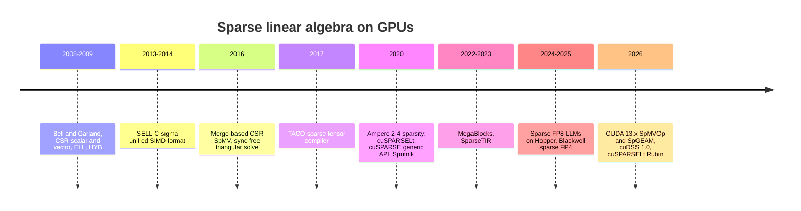

---
tags:
  - gpu-programming
  - libraries
  - sparse
  - cusparse
  - spmv
status: complete
sources:
  - https://research.nvidia.com/publication/2009-11_implementing-sparse-matrix-vector-multiplication-throughput-oriented-processors
  - https://www.nvidia.com/docs/io/66889/nvr-2008-004.pdf
  - https://github.com/dumerrill/merge-spmv
  - https://arxiv.org/abs/1307.6209
  - https://docs.nvidia.com/cuda/cusparse
  - https://docs.nvidia.com/cuda/cusparse/generic-api/generic-api.html
  - https://docs.nvidia.com/cuda/cusparse/generic-api/generic-api-functions.html
  - https://docs.nvidia.com/cuda/cusparse/generic-api/sparse-matrix.html
  - https://docs.nvidia.com/cuda/archive/12.8.1/cusparse/generic-api/dense-vector.html
  - https://developer.download.nvidia.com/video/gputechconf/gtc/2020/presentations/s22085-accelerating-sparsity-in-the-nvidia-ampere-architecture%E2%80%8B.pdf
  - https://docs.nvidia.com/cuda/archive/13.4.2/pdf/CUDA_Toolkit_Release_Notes.pdf
  - https://developer.nvidia.com/blog/nvidia-cuda-13-5-brings-nvidia-vera-rubin-ga-support/
  - https://docs.nvidia.com/cuda/cusparselt/release_notes.html
  - https://developer.nvidia.com/blog/exploiting-ampere-structured-sparsity-with-cusparselt/
  - https://developer.nvidia.com/blog/accelerating-matrix-multiplication-with-block-sparse-format-and-nvidia-tensor-cores
  - https://docs.nvidia.com/cuda/cudss/latest/release_notes.html
  - https://docs.nvidia.com/cuda/cudss/latest/index.html
  - https://research.nvidia.com/publication/2015-10_amgx-library-gpu-accelerated-algebraic-multigrid-and-preconditioned-iterative
  - https://nvidia.github.io/cccl/cub/api/structcub_1_1DeviceSpmv.html
  - https://github.com/NVIDIA/AMGX
  - https://weifengliu-ssslab.github.io/assets/papers/2016-liu-sptrsv.pdf
  - https://arxiv.org/abs/2002.11273
  - https://arxiv.org/abs/2006.10901
  - https://arxiv.org/abs/2211.15841
  - https://arxiv.org/abs/2207.04606
  - https://commit.csail.mit.edu/papers/2017/kjolstad-oopsla17-tensor-compiler.pdf
  - https://arxiv.org/abs/2309.10285
  - https://developers.redhat.com/articles/2024/12/18/24-sparse-llama-fp8-sota-performance-nvidia-hopper-gpus
  - https://arxiv.org/pdf/2610.28947
  - https://docs.nvidia.com/deeplearning/cudnn/latest/fe-oss-apis/dsa.html
  - https://www.nvidia.com/en-us/data-center/h100/
created: 2026-11-26
updated: 2026-11-28
---

## Table Of Contents

---

- [[#TL;DR|TL;DR]]
- [[#The Problem|The Problem]]
    - [[#Why Sparse Is Hard on GPUs|Why Sparse Is Hard on GPUs]]
    - [[#The SpMV Roofline, Worked|The SpMV Roofline, Worked]]
- [[#Foundations|Foundations]]
    - [[#One Matrix, Seven Formats|One Matrix, Seven Formats]]
    - [[#The Sparse Operations|The Sparse Operations]]
- [[#How We Got Here|How We Got Here]]
- [[#How It Works|How It Works]]
    - [[#Scalar and Vector CSR SpMV|Scalar and Vector CSR SpMV]]
    - [[#Merge-Based SpMV|Merge-Based SpMV]]
    - [[#SpMM, SpGEMM and SDDMM|SpMM, SpGEMM and SDDMM]]
    - [[#Sparse Triangular Solve|Sparse Triangular Solve]]
    - [[#cuSPARSE and the Generic API|cuSPARSE and the Generic API]]
    - [[#Structured Sparsity and cuSPARSELt|Structured Sparsity and cuSPARSELt]]
    - [[#Sparse Solvers, cuDSS and AMGX|Sparse Solvers, cuDSS and AMGX]]
    - [[#Sparsity in Machine Learning|Sparsity in Machine Learning]]
    - [[#Research Kernels and Sparse Compilers|Research Kernels and Sparse Compilers]]
- [[#Where It Is Now|Where It Is Now]]
- [[#Trade-offs & Open Problems|Trade-offs & Open Problems]]
- [[#Resources|Resources]]
- [[#Related Notes|Related Notes]]

## ***TL;DR***
---
*A sparse matrix stores only its nonzeros, which saves memory and flops but turns regular, predictable GPU work into irregular, data-dependent work. Sparse kernels are almost always memory-bound, and most of the craft is in the storage format and in balancing uneven rows across threads.*

- **What it is.** Sparse linear algebra multiplies, adds and solves with matrices that are mostly zeros: finite-element and circuit matrices, graphs, recommender tables, pruned neural-network weights, attention masks. The core kernels are **SpMV** (sparse matrix × dense vector), **SpMM** (sparse × dense matrix), **SpGEMM** (sparse × sparse), **SDDMM** (dense × dense, sampled at a sparse pattern) and **SpTRSV** (sparse triangular solve).
- **Why it's hard.** Irregular access (gathers from `x`), load imbalance (rows of wildly different lengths), and very low arithmetic intensity: FP64 CSR SpMV does 2 flops per at least 12 bytes, about 0.17 FLOP/byte, roughly 60x below an H100's FP64 ridge point ([[Roofline Model and Arithmetic Intensity]]). The best possible kernel just streams the matrix at full HBM bandwidth.
- **Formats.** COO and CSR are general; ELL and SELL-C-σ pad rows for [[Memory Coalescing|coalesced]] SIMD access; BSR and Blocked-ELL group nonzeros into dense blocks that [[Tensor Cores]] can use; HYB mixes ELL and COO ([Bell & Garland, 2009](https://research.nvidia.com/publication/2009-11_implementing-sparse-matrix-vector-multiplication-throughput-oriented-processors); [Kreutzer et al.](https://arxiv.org/abs/1307.6209)).
- **Libraries.** **cuSPARSE** (general sparse BLAS, "generic API"), **cuSPARSELt** (2:4 structured-sparse GEMM on Tensor Cores), **cuDSS** (direct sparse solver), **AMGX** (algebraic multigrid and Krylov solvers).
- **Where it is now (Nov 2026):** CUDA 13.5 (Nov 4, 2026) brings 1.65–2.27x faster CSR SpMM and a new triangular-solve algorithm 2.7x faster than the old one by geomean ([NVIDIA](https://developer.nvidia.com/blog/nvidia-cuda-13-5-brings-nvidia-vera-rubin-ga-support/)); cuSPARSELt 0.10.0 adds Rubin; cuDSS reached **v1.0.0**. Hardware 2:4 sparsity still delivers roughly 1.3–1.7x on real GEMMs, not 2x, and needs retraining, so it stays niche in LLM serving.

## ***The Problem***
---
*GPUs are built for regular work: every thread in a warp doing the same thing to neighbouring addresses, with lots of math per byte. Sparse matrices break all three assumptions, so a naive sparse kernel can run at a few percent of what the memory system allows.*

### Why Sparse Is Hard on GPUs

| Problem | What happens on the GPU | Vault note |
|---|---|---|
| **Irregular access** | `y[i] += A[i][j] * x[j]` reads `x` at column indices known only at run time. Those gathers hit random cache lines, so a warp's 32 loads can touch 32 different sectors | [[Memory Coalescing]], [[GPU Memory Hierarchy]] |
| **Load imbalance** | Row lengths vary by orders of magnitude (power-law graphs have rows with millions of nonzeros next to rows with one). If one thread or warp owns one row, the longest row sets the runtime | [[Warp Divergence and Warp-Level Primitives]], [[Occupancy and Latency Hiding]] |
| **Low arithmetic intensity** | Each stored nonzero is used once per SpMV: 2 flops (multiply, add) per value and index loaded. There is no reuse to tile for, unlike [[Tiled Matrix Multiplication (GEMM)]] | [[Roofline Model and Arithmetic Intensity]] |
| **Index overhead** | Every value carries at least one 4- or 8-byte index; for FP32 or FP16 values, indices can be half or more of the traffic | |
| **Dependencies** | Triangular solves and factorizations have row-to-row dependencies that limit parallelism | |
| **Unknown output size** | In SpGEMM, the number of output nonzeros isn't known until you compute it | |

Merrill and Garland summarize the consequence for conventional CSR SpMV: methods "often subject to order-of-magnitude performance variation across similarly-sized datasets" ([merge-spmv](https://github.com/dumerrill/merge-spmv)).

### The SpMV Roofline, Worked

Count bytes per nonzero for CSR SpMV with FP64 values and 32-bit column indices. Each nonzero needs its value (8 B) and column index (4 B); each row needs one row offset (4 B) and one write of `y` (8 B); `x` is read through the caches. Ignoring `x` and per-row costs for long rows:

$$
\text{AI}_{\text{SpMV}} \approx \frac{2 \text{ flops}}{8 + 4 \text{ bytes}} \approx 0.17 \ \text{FLOP/byte}
$$

*In plain English: every stored nonzero brings in 12 bytes and buys only one multiply-add, so performance is set by bandwidth, not math.*

**Worked example, H100 SXM** (3.35 TB/s HBM3, 34 TFLOPS FP64 vector, [H100 page](https://www.nvidia.com/en-us/data-center/h100/)):

- Ridge point: $34 / 3.35 \approx 10$ FLOP/byte. SpMV at 0.17 sits about **60x below** it.
- Best case: $3.35 \text{ TB/s} \times 0.17 \approx 0.56$ TFLOP/s, about **1.6% of FP64 peak**, even with a perfect kernel.
- A concrete matrix: 1 million rows, 20 nonzeros per row (20 M nonzeros). Traffic $\approx 20\text{M} \times 12 + 1\text{M} \times (4 + 8) + 1\text{M} \times 8$ (reading `x` once) $= 260$ MB. Time $\ge 260 \times 10^6 / 3.35 \times 10^{12} \approx 78\ \mu s$ for 40 M flops, about 0.52 TFLOP/s.
- If `x` misses in cache on every access, add up to 8 more bytes per nonzero: AI drops to 0.1 and the bound to about 0.34 TFLOP/s. That gap is why column ordering and cache reuse of `x` matter.

So the goal of a sparse kernel is not to find more flops; it is to stream values and indices at full bandwidth, keep `x` in L2, and keep every SM busy. FP32 values (8 B per nonzero) raise AI to 0.25, which is why mixed precision (FP16/BF16 values, FP32 vectors) is a recurring library feature.

## ***Foundations***
---
*A sparse format is a deal between compactness, regular access and how well it suits the matrix's structure. The same small matrix in each format shows the trade.*

### One Matrix, Seven Formats

Take this 4 × 4 matrix with 8 nonzeros and row lengths 3, 1, 3, 1:

$$
A = \begin{pmatrix} 10 & 20 & 0 & 30 \\ 0 & 40 & 0 & 0 \\ 50 & 0 & 60 & 70 \\ 0 & 0 & 0 & 80 \end{pmatrix}
$$

| Format | Arrays for $A$ | Stored slots | Good for |
|---|---|---|---|
| **COO** (coordinate) | `row = [0,0,0,1,2,2,2,3]`, `col = [0,1,3,1,0,2,3,3]`, `val = [10,20,30,40,50,60,70,80]` | 8 | Building matrices, simple atomics-based kernels; cuSPARSE assumes sorted by row ([cuSPARSE docs](https://docs.nvidia.com/cuda/cusparse)) |
| **CSR** (compressed sparse row) | `rowptr = [0,3,4,7,8]`, same `col`, `val` | 8 (+5 offsets) | The default general format; row `i` is `rowptr[i]..rowptr[i+1]-1` |
| **ELL** (ELLPACK) | Width $K = 3$ (longest row). Columns per row: `[0,1,3] [1,-,-] [0,2,3] [3,-,-]`, stored **column-major** so thread `i` reads slot `k` at `k*4+i` | 12 (4 padding) | Uniform row lengths; perfectly coalesced, but one long row pads everything |
| **SELL-C-σ** (sliced ELL) | $C = 2$, $\sigma = 1$: slices {0,1} and {2,3}, each width 3 → 12 slots. $C = 2$, $\sigma = 4$: sort rows by length inside the window → slices {0,2} width 3 and {1,3} width 1 → **8 slots, zero padding**, plus a row permutation | 12 or 8 | Most matrices on SIMD hardware; $C$ = warp size on GPUs ([Kreutzer et al.](https://arxiv.org/abs/1307.6209)) |
| **BSR** (block sparse row), 2 × 2 blocks | All four blocks contain a nonzero: `bsrRowPtr = [0,2,4]`, `bsrColInd = [0,1,0,1]`, 4 dense 2 × 2 blocks | 16 (8 explicit zeros) | Matrices with natural dense blocks (multi-dof FEM); feeds dense micro-kernels |
| **Blocked-ELL** | ELL over blocks: fixed number of block columns per block row, `-1` for empty blocks, values row-major ([cuSPARSE docs](https://docs.nvidia.com/cuda/cusparse)) | Depends on block size | Block-sparse SpMM on Tensor Cores |
| **HYB** (ELL + COO) | ELL part of width 1: `[10],[40],[50],[80]`; the rest in COO: `(0,1,20) (0,3,30) (2,2,60) (2,3,70)` | 4 + 4 | Mostly-uniform rows with a few long outliers ([Bell & Garland](https://research.nvidia.com/publication/2009-11_implementing-sparse-matrix-vector-multiplication-throughput-oriented-processors)) |

Three things to read off the table:

- **Padding is the price of regularity.** ELL wastes 4 of 12 slots here; on a power-law graph it can waste almost everything. SELL-C-σ bounds padding to each slice of $C$ rows and sorts rows within windows of $\sigma$ rows to group similar lengths. Kreutzer et al. measure this with the chunk occupancy $\beta = N_{nz} / \sum_i C \cdot cl_i$ (1 means no padding), and note SELL-$N$-1 is plain ELL and SELL-1-1 is CSR.
- **Blocking trades fill-in for dense math.** BSR stores 16 values for 8 nonzeros here because no 2 × 2 block is empty. It wins only when nonzeros really cluster.
- **CSR is the lingua franca** because it is compact and every library accepts it; specialized formats are usually converted to at kernel-setup time.

### The Sparse Operations

| Operation | Definition | Typical use | Bound by |
|---|---|---|---|
| **SpMV** | $y = \alpha A x + \beta y$, $A$ sparse | Krylov solvers (CG, GMRES), PageRank, power iteration | Bandwidth |
| **SpMM** | $C = \alpha A B + \beta C$, $A$ sparse, $B$ dense (many columns) | GNN aggregation, block Krylov, pruned-weight layers | Bandwidth, rising toward compute as $B$ widens (each nonzero reused $n$ times) |
| **SpGEMM** | $C = A B$, both sparse, output sparse | Algebraic multigrid setup, graph algorithms (triangle counting, BFS frontiers; see [[Graph Analytics on GPUs]]) | Memory and output-size management |
| **SDDMM** | $C = (A B^\top) \odot S$: compute dense dot products only where $S$ is nonzero | GNN edge scores, attention with a sparse mask | Like SpMM |
| **SpTRSV / SpSM** | Solve $L x = b$ with $L$ sparse triangular | Preconditioners (ILU, IC), direct-solver solve phase | Dependencies (latency) |

## ***How We Got Here***
---
*GPU sparse work grew from hand-written SpMV kernels in 2008 to a family of NVIDIA libraries, with each step driven by one problem: coalescing first, then load balance, then Tensor Cores and machine learning.*



- **2008–2009.** Nathan Bell and Michael Garland's NVIDIA report and SC09 paper laid out the basic GPU kernels for DIA, ELL, CSR (scalar and vector), COO, HYB and a packet format, and reported about 16 and 10 GFLOP/s in double precision on structured-grid and unstructured-mesh matrices on a GTX 285 ([NVIDIA Research](https://research.nvidia.com/publication/2009-11_implementing-sparse-matrix-vector-multiplication-throughput-oriented-processors), [tech report](https://www.nvidia.com/docs/io/66889/nvr-2008-004.pdf)).
- **2013–2014.** Kreutzer, Hager, Wellein, Fehske and Bishop proposed **SELL-C-σ** as a "catch-all" format that runs well on Sandy Bridge, Xeon Phi and a Tesla K20 alike ([arXiv:1307.6209](https://arxiv.org/abs/1307.6209)).
- **2016.** Merrill and Garland's **merge-based SpMV** (SC16) made CSR performance "substantially uncorrelated to the distribution of nonzeros among rows" ([merge-spmv](https://github.com/dumerrill/merge-spmv)); CUB shipped it as `DeviceSpmv` ([CCCL docs](https://nvidia.github.io/cccl/cub/api/structcub_1_1DeviceSpmv.html)). Liu, Li, Hou and Vinter published a **synchronization-free** triangular solve ([Euro-Par 2016](https://weifengliu-ssslab.github.io/assets/papers/2016-liu-sptrsv.pdf)).
- **2017.** Kjolstad et al.'s **TACO** generated sparse tensor kernels from an index expression plus a per-dimension format description ([OOPSLA 2017](https://commit.csail.mit.edu/papers/2017/kjolstad-oopsla17-tensor-compiler.pdf)).
- **2020.** Ampere A100 added **2:4 structured sparsity** in Tensor Cores and NVIDIA released **cuSPARSELt** to use it ([NVIDIA, Dec 2020](https://developer.nvidia.com/blog/exploiting-ampere-structured-sparsity-with-cusparselt/)). Google/Stanford's **Sputnik** showed unstructured sparse kernels for deep learning at "27% of single-precision peak on Nvidia V100" ([Gale et al.](https://arxiv.org/abs/2006.10901)).
- **2022–2023.** **MegaBlocks** recast mixture-of-experts layers as block-sparse matmuls ([MLSys 2023](https://arxiv.org/abs/2211.15841)); **SparseTIR** (ASPLOS 2023) brought composable formats to a deep-learning compiler ([arXiv](https://arxiv.org/abs/2207.04606)).
- **2024–2026.** cuDSS grew from a single-GPU preview (v0.1.0) to v1.0.0 ([release notes](https://docs.nvidia.com/cuda/cudss/latest/release_notes.html)). Sparse FP8 Llama models on Hopper via CUTLASS kernels in vLLM ([Red Hat, Dec 2024](https://developers.redhat.com/articles/2024/12/18/24-sparse-llama-fp8-sota-performance-nvidia-hopper-gpus)); cuSPARSELt 0.7.0 added Blackwell and block-scaled FP4; CUDA 13 rebuilt cuSPARSE around the generic API.

## ***How It Works***
---
*Sparse kernels differ mainly in how they map nonzeros to threads. Libraries wrap those choices behind descriptors, buffer queries and algorithm enums; structured sparsity and solvers sit on top.*

### Scalar and Vector CSR SpMV

The two original CSR kernels from Bell and Garland show the basic tension.

**Scalar CSR: one thread per row.**

```cuda
__global__ void spmv_csr_scalar(int m, const int* rowptr, const int* col,
                                const double* val, const double* x, double* y) {
  int row = blockIdx.x * blockDim.x + threadIdx.x;
  if (row < m) {
    double sum = 0.0;
    for (int k = rowptr[row]; k < rowptr[row + 1]; ++k)
      sum += val[k] * x[col[k]];
    y[row] = sum;
  }
}
```

- Line 3: each thread takes one row.
- Lines 6–7: walk that row's nonzeros and gather `x[col[k]]`.
- Line 8: one write per row, no atomics needed.
- **Problems:** neighbouring threads read `val[k]` from different rows, so loads are not [[Memory Coalescing|coalesced]], and a warp waits for its longest row ([[Warp Divergence and Warp-Level Primitives|divergence]]).

**Vector CSR: one warp per row.**

```cuda
__global__ void spmv_csr_vector(int m, const int* rowptr, const int* col,
                                const double* val, const double* x, double* y) {
  int warp = (blockIdx.x * blockDim.x + threadIdx.x) / 32;
  int lane = threadIdx.x % 32;
  if (warp < m) {
    double sum = 0.0;
    for (int k = rowptr[warp] + lane; k < rowptr[warp + 1]; k += 32)
      sum += val[k] * x[col[k]];
    for (int off = 16; off > 0; off /= 2)
      sum += __shfl_down_sync(0xffffffff, sum, off);
    if (lane == 0) y[warp] = sum;
  }
}
```

- Lines 3–4: a warp owns a row; `lane` is the thread's position in the warp.
- Lines 7–8: the 32 lanes stride through the row together, so `val` and `col` loads are contiguous and coalesce.
- Lines 9–10: a warp-shuffle tree reduction adds the 32 partial sums ([[Parallel Reduction and Scan]]).
- Line 11: lane 0 writes the result.
- **Problem:** a row with 3 nonzeros leaves 29 lanes idle; Bell and Garland measured only 1.0–1.3 GFLOP/s for vector CSR on matrices with fewer than four nonzeros per row ([tech report](https://www.nvidia.com/docs/io/66889/nvr-2008-004.pdf)). Vector CSR wins on long rows, scalar on short rows, and real matrices have both.

The fixes that followed: choose threads-per-row from the average row length, bin rows by length and launch a kernel per bin, or split work by nonzeros instead of by rows. The last idea is the cleanest.

### Merge-Based SpMV

Merrill and Garland frame CSR SpMV "as a logical merger of the CSR row-offsets and CSR non-zero data" ([merge-spmv](https://github.com/dumerrill/merge-spmv)). Imagine merging two sorted lists:

- list A: the row end offsets, `rowptr[1..m]`
- list B: the nonzero indices `0, 1, ..., nnz-1`

The merge has exactly $m + nnz$ steps. Consuming an item from B means "multiply-add this nonzero into the running sum"; consuming an item from A means "this row is done: write the sum to `y`, reset". Split the $m + nnz$ steps evenly across threads. Each thread finds its start with a 2-D binary search along a diagonal of the merge grid, then walks its segment. A row that straddles two threads leaves a partial sum, fixed up in a short second pass (a segmented reduction, see [[Parallel Reduction and Scan]]).

**Worked example on $A$.** Row ends `[3,4,7,8]`, nonzeros 0–7: the merge order is

`nz0 nz1 nz2 | R0 | nz3 | R1 | nz4 nz5 nz6 | R2 | nz7 | R3` (12 steps).

With 3 threads at 4 steps each:

| Thread | Steps | Result |
|---|---|---|
| T0 | nz0 nz1 nz2 R0 | Finishes row 0 |
| T1 | nz3 R1 nz4 nz5 | Finishes row 1; carries a partial sum for row 2 (nz4 + nz5) |
| T2 | nz6 R2 nz7 R3 | Writes its part of row 2, finishes row 3 |
| Fix-up | | Adds T1's carry-out into `y[2]` |

Every thread does the same amount of work no matter how lopsided the rows are. The repository's sample run shows the effect on a skewed matrix (circuit5M on a Tesla K40m): 6.92 ms for merge-based versus 316.8 ms for the cuSPARSE CsrMV of the time, numbers from the author's own README and hardware ([merge-spmv](https://github.com/dumerrill/merge-spmv)). The same work-centric idea reappears in dense GEMM as Stream-K ([[Persistent Kernels and Stream-K]]).

### SpMM, SpGEMM and SDDMM

- **SpMM** reuses each nonzero across the $n$ columns of the dense $B$, so intensity grows with $n$. Fast kernels give a warp a row (or row segment) of $A$ and a tile of $B$'s columns, load the row's indices once, and read $B$ rows with coalesced vector loads. Sputnik added **row swizzling** (sorting rows by length so that similar rows run together) and vector memory ops, reaching its 27%-of-peak figure at moderate sparsity ([Gale et al.](https://arxiv.org/abs/2006.10901)). Block formats let SpMM use [[Tensor Cores]]: cuSPARSE's Blocked-ELL SpMM walks only the active blocks of each output tile through Tensor Core MMAs; with 32 × 32 blocks in FP16 at M = N = K = 4096 it beats dense cuBLAS below about 40% density on V100 and 50% on A100 ([NVIDIA, Mar 2021](https://developer.nvidia.com/blog/accelerating-matrix-multiplication-with-block-sparse-format-and-nvidia-tensor-cores)).
- **SpGEMM** is usually Gustavson's row-by-row algorithm: row $i$ of $C$ is the sum of rows of $B$ selected and scaled by row $i$ of $A$. GPU implementations run in phases: estimate or count each output row's size (symbolic), allocate, then compute (numeric). The accumulator per row is the design choice: a hash table in shared memory, a dense array, or expand-sort-compress (ESC); see the survey by Gao et al. ([arXiv:2002.11273](https://arxiv.org/abs/2002.11273)) and [[Sorting and Hashing on GPUs]]. Memory is the constraint: intermediate products can far exceed the final output, which is why cuSPARSE offers lower-memory SpGEMM algorithms and 64-bit indices (added in CUDA 13.0).
- **SDDMM** computes dot products of rows of two dense matrices only where a sparse mask is nonzero. It is the backward partner of SpMM and the forward pass of masked attention and GNN edge scores.

### Sparse Triangular Solve

Solving $Lx = b$ row by row creates a dependency graph: $x_i$ needs every $x_j$ with $L_{ij} \neq 0$. Two GPU strategies:

- **Level scheduling.** An analysis phase groups rows into levels whose rows depend only on earlier levels; each level is one parallel step. Cheap to run, but deep, narrow dependency graphs leave the GPU idle and each level costs a synchronization.
- **Synchronization-free.** One analysis pass counts each component's dependencies; the solve then lets each row spin on an in-degree counter that predecessors decrement with atomics, so no global barriers are needed ([Liu et al., 2016](https://weifengliu-ssslab.github.io/assets/papers/2016-liu-sptrsv.pdf), [[CUDA Memory Model and Atomics]]).

cuSPARSE exposes this as `SpSV` (one right-hand side) and `SpSM` (many), each split into analysis and solve calls so the analysis can be reused across solves.

### cuSPARSE and the Generic API

cuSPARSE has two layers. The **legacy API** follows the Sparse BLAS style and "will not be improved in future releases"; the **generic API** is the standard interface, with opaque descriptors for sparse matrices (COO, CSR, CSC, BSR, Blocked-ELL, Sliced-ELL) and dense vectors and matrices, a choice of value, index (32- or 64-bit) and compute types, and an algorithm enum per routine ([cuSPARSE docs](https://docs.nvidia.com/cuda/cusparse), [generic types](https://docs.nvidia.com/cuda/cusparse/generic-api/generic-api.html)). Most routines can be captured in [[CUDA Graphs]], and the docs promise bit-wise identical results for identical calls on the same machine, except for transposed operations, a changed algorithm, or algorithms documented as non-deterministic (such as CSR SpMV ALG1).

Every generic routine follows the same pattern:


A CSR SpMV, $y = \alpha A x + \beta y$, in FP32 (the standard pattern from NVIDIA's samples; error checks omitted):

```cpp
cusparseHandle_t handle;  cusparseCreate(&handle);
cusparseSpMatDescr_t matA;  cusparseDnVecDescr_t vecX, vecY;
cusparseCreateCsr(&matA, m, n, nnz, dRowPtr, dCol, dVal,
                  CUSPARSE_INDEX_32I, CUSPARSE_INDEX_32I,
                  CUSPARSE_INDEX_BASE_ZERO, CUDA_R_32F);
cusparseCreateDnVec(&vecX, n, dX, CUDA_R_32F);
cusparseCreateDnVec(&vecY, m, dY, CUDA_R_32F);
size_t bytes = 0;  void* dBuf = nullptr;
cusparseSpMV_bufferSize(handle, CUSPARSE_OPERATION_NON_TRANSPOSE, &alpha, matA, vecX,
                        &beta, vecY, CUDA_R_32F, CUSPARSE_SPMV_ALG_DEFAULT, &bytes);
cudaMalloc(&dBuf, bytes);
cusparseSpMV(handle, CUSPARSE_OPERATION_NON_TRANSPOSE, &alpha, matA, vecX,
             &beta, vecY, CUDA_R_32F, CUSPARSE_SPMV_ALG_DEFAULT, dBuf);
```

- Lines 1–2: a library handle (bound to a stream with `cusparseSetStream`) and three opaque descriptors.
- Lines 3–5: wrap existing device arrays as a CSR matrix: 32-bit row offsets and column indices, zero-based, FP32 values. No data is copied.
- Lines 6–7: wrap `x` and `y` as dense vectors.
- Lines 8–10: ask how much scratch memory this exact call needs. The answer depends on the algorithm and sizes, which is why it is a separate query.
- Line 11: you own the allocation, so you can pool or reuse it.
- Lines 12–13: the actual SpMV. Signatures match the cuSPARSE reference ([SpMV](https://docs.nvidia.com/cuda/cusparse/generic-api/generic-api-functions.html), [CSR](https://docs.nvidia.com/cuda/cusparse/generic-api/sparse-matrix.html), [dense vector](https://docs.nvidia.com/cuda/archive/12.8.1/cusparse/generic-api/dense-vector.html)); the descriptor parameters are declared as `cusparseConst...` types, and non-const descriptors are accepted. The compute type (`CUDA_R_32F`) and algorithm enum are explicit. For CSR, `CUSPARSE_SPMV_CSR_ALG1` is the default and its results "may differ slightly between runs"; `CUSPARSE_SPMV_CSR_ALG2` is bit-wise deterministic for the non-transposed case but slower; `CUSPARSE_SPMV_SELL_ALG1` (Sliced-ELL) is deterministic ([SpMV reference](https://docs.nvidia.com/cuda/cusparse/generic-api/generic-api-functions.html)).

Two newer pieces matter for performance work. **SpMVOp** (experimental since CUDA 13.1) builds SpMV kernels at run time, with an optional user epilogue fused in, using nvJitLink, in the spirit of [[Kernel Fusion]]; later 13.x releases cut its planning latency and avoided recompiling the same epilogue ([CUDA 13.4 release notes](https://docs.nvidia.com/cuda/archive/13.4.2/pdf/CUDA_Toolkit_Release_Notes.pdf)). The JIT-based SpMM sibling, SpMMOp, was deprecated in 13.2 Update 1.

### Structured Sparsity and cuSPARSELt

Since Ampere, Tensor Cores support **fine-grained structured sparsity**: in every group of four consecutive weights, at least two are zero ("2:4"). The hardware skips the zeros, doubling math throughput, and the compressed operand needs half the storage and bandwidth ([NVIDIA, Dec 2020](https://developer.nvidia.com/blog/exploiting-ampere-structured-sparsity-with-cusparselt/)). The compressed matrix keeps the nonzero values plus a 2-bit index per kept value recording its position in its group of four: 12.5% overhead for FP16 data and 25% for 8-bit data, against 100–200% for CSR indices ([Pool, GTC 2020](https://developer.download.nvidia.com/video/gputechconf/gtc/2020/presentations/s22085-accelerating-sparsity-in-the-nvidia-ampere-architecture%E2%80%8B.pdf)).

Unlike general sparsity, 2:4 does not change the shape of the work: the kernel is still a dense, tiled GEMM ([[Tiled Matrix Multiplication (GEMM)]]) with half of one operand. That is why it reaches Tensor Cores and general sparsity mostly does not.

**cuSPARSELt** is the library for it. The workflow from NVIDIA's introduction post:

1. `cusparseLtInit` creates the handle.
2. `cusparseLtDenseDescriptorInit` / `cusparseLtStructuredDescriptorInit` describe the dense and the 50%-sparse operand.
3. `cusparseLtMatmulDescriptorInit`, `cusparseLtMatmulAlgSelectionInit` and `cusparseLtMatmulPlanInit` set up the GEMM and pick a kernel.
4. `cusparseLtSpMMAPrune` prunes to 2:4 (or `cusparseLtSpMMAPruneCheck` verifies a pre-pruned matrix); `cusparseLtSpMMACompress` packs it.
5. `cusparseLtMatmul` runs, repeatedly, with new dense inputs.

On A100, NVIDIA's own FP16 BERT-Large layer GEMMs sped up 1.3–1.6x (e.g. FC2: 211 → 339 TFLOPS), not 2x. Blackwell adds block-scaled FP4 sparse kernels (cuSPARSELt 0.7.0) and, per [[Tensor Cores]], a pairwise 4:8 pattern for NVFP4.

### Sparse Solvers, cuDSS and AMGX

- **cuDSS** is NVIDIA's direct sparse solver: it handles real and complex general, symmetric and positive-definite matrices in three phases (analysis with reordering and symbolic factorization, numerical factorization, solve, plus optional refactorization) so the analysis can be reused when only values change ([cuDSS docs](https://docs.nvidia.com/cuda/cudss/latest/index.html)). Its release notes trace the growth: v0.1.0 single GPU; v0.3.0 multi-GPU multi-node (MGMN) and hybrid host/device memory; v0.5.0 hybrid execution and Blackwell; v0.7.0 single-node multi-GPU, int64 indexing, Schur complements, deterministic mode and CUDA 13; v0.8.0 a double-double type; **v1.0.0** Bunch-Kaufman pivoting for indefinite matrices, opt-in FP64 emulation for factorization, FP64 factors stored in FP32, NVRTC runtime kernel compilation and Rubin support ([cuDSS release notes](https://docs.nvidia.com/cuda/cudss/latest/release_notes.html)).
- **AMGX** is NVIDIA's open-source library of algebraic multigrid (classical Ruge-Stuben and unsmoothed aggregation), Krylov solvers (CG, BiCGSTAB, GMRES) and smoothers (Jacobi, Gauss-Seidel, ILU, Chebyshev), described in a 2015 paper ([NVIDIA Research](https://research.nvidia.com/publication/2015-10_amgx-library-gpu-accelerated-algebraic-multigrid-and-preconditioned-iterative), [GitHub](https://github.com/NVIDIA/AMGX)). Its inner loops are exactly SpMV and SpGEMM (to build coarse levels).

Iterative solvers call SpMV hundreds of times per solve, so a 10% SpMV win is a 10% solver win; direct solvers spend their time in dense supernodal blocks, which is why cuDSS has had a runtime dependency on cuBLAS since v0.4.0 ([[cuBLAS and cuDNN]]).

### Sparsity in Machine Learning

| Use | Sparse pattern | How it runs on GPUs today |
|---|---|---|
| **Pruned weights** | Unstructured or 2:4 | 2:4 through cuSPARSELt or CUTLASS sparse GEMMs; unstructured through research kernels (Sputnik, Flash-LLM) |
| **[[Mixture of Experts]]** | Block-sparse (each token touches a few experts) | MegaBlocks expressed MoE as block-sparse matmuls to avoid dropping tokens ([arXiv:2211.15841](https://arxiv.org/abs/2211.15841)); today grouped GEMM is more common ([[Grouped GEMM and Ragged Batches]]) |
| **[[Sparse Attention]]** | Block masks or per-query top-k keys | Gather the selected keys into dense tiles and run dense attention kernels; cuDNN's frontend ships a DeepSeek Sparse Attention (DSA) API ([cuDNN docs](https://docs.nvidia.com/deeplearning/cudnn/latest/fe-oss-apis/dsa.html)) |
| **Graph neural networks** | Graph adjacency (power-law) | Message passing is SpMM (aggregate) plus SDDMM (edge scores); SparseTIR reports 1.20–2.34x over vendor libraries on GNN operators ([arXiv:2207.04606](https://arxiv.org/abs/2207.04606)) |
| **Recommenders, embeddings** | Sparse lookups | Gathers and segmented reductions rather than sparse BLAS |

The pattern across rows: ML only gets real speed when sparsity is coarse enough (blocks, experts, tiles) to turn back into dense Tensor Core work.

### Research Kernels and Sparse Compilers

- **Sputnik** (Gale, Zaharia, Young, Elsen, 2020): SpMM and SDDMM for deep learning; 1.2–2.1x speedups on sparse Transformer and MobileNet models and up to 12.8x memory savings ([arXiv:2006.10901](https://arxiv.org/abs/2006.10901)).
- **Flash-LLM** (Xia et al., VLDB 2024): "Load-as-Sparse and Compute-as-Dense": store unstructured sparse weights compressed, expand tiles to dense in shared memory, run dense Tensor Core MMAs. The skinny GEMMs of LLM decode are memory-bound, so redundant math is free. Reported 2.9x over Sputnik and 1.5x over SparTA at the kernel level, and up to 3.8x / 3.6x end-to-end over DeepSpeed / FasterTransformer on OPT-30B to 175B ([arXiv:2309.10285](https://arxiv.org/abs/2309.10285)).
- **TACO** (Kjolstad et al., OOPSLA 2017): compiles any tensor index expression over a per-dimension format description ("dense", "compressed", ...) into a fused kernel, removing the need for a hand-written kernel per format pair ([paper](https://commit.csail.mit.edu/papers/2017/kjolstad-oopsla17-tensor-compiler.pdf)). Follow-ups added GPU scheduling.
- **SparseTIR** (Ye, Lai, Shao, Chen, Ceze, ASPLOS 2023): composable formats (e.g. split a matrix into ELL buckets plus a remainder) and composable transformations inside Apache TVM, with a tuning search over both. Reported 1.05–2.98x on sparse attention and 0.56–7.45x on sparse convolution versus vendor libraries, and 4.20–40.18x end-to-end on RGCN inference ([arXiv:2207.04606](https://arxiv.org/abs/2207.04606)).

The compiler line of work answers the combinatorial problem of sparse libraries: formats × operations × data types × GPUs is too many kernels to write by hand.

## ***Where It Is Now***
---
*As of November 2026, NVIDIA is still investing steadily in cuSPARSE (faster SpMM and triangular solves, mixed precision, JIT-specialized SpMV) and has brought cuDSS to 1.0. Hardware structured sparsity is supported on every new GPU but remains a minor tool in practice.*

**cuSPARSE in CUDA 13.x** ([13.4 release notes](https://docs.nvidia.com/cuda/archive/13.4.2/pdf/CUDA_Toolkit_Release_Notes.pdf), [CUDA 13.5 post, Nov 4 2026](https://developer.nvidia.com/blog/nvidia-cuda-13-5-brings-nvidia-vera-rubin-ga-support/)):

| Release | Sparse changes |
|---|---|
| 13.0 | Dropped pre-Turing GPUs (Maxwell, Pascal, Volta); 64-bit indices in SpGEMM |
| 13.0 Update 1 | BSR in the generic SpMV; legacy BSR SpMV deprecated |
| 13.1 | Experimental **SpMVOp** API (JIT-specialized SpMV); all routines handle up to $2^{31}-1$ nonzeros with 32-bit indices |
| 13.1 Update 1 | `cusparseSpMVOp_bufferSize`; faster SpMVOp on B200 |
| 13.2 Update 1 | SpMVOp descriptor creation up to 2.5x faster; **SpMMOp and SpGEMMreuse deprecated** |
| 13.3 | Generic **SpGEAM** (sparse + sparse); CSC in SpSV/SpSM; CSR SpMV ALG2 11% faster on average; FP32 and mixed index types in SpMVOp |
| 13.3 Update 1 | SpGEAM about 40% faster on average; less SpMM ALG3 preprocessing |
| 13.4 (Sep 2026) | Bug fixes (SpMVOp caching); mixed-precision CSR/COO SpMM still unsupported in some cases |
| 13.5 (Nov 2026) | CSR SpMM 1.65–2.27x faster on data-center GPUs; new SpSV algorithm 2.7x faster than ALG1 (geomean) with less memory; 64-bit offsets with 32-bit indices across SpMV (CSR, SELL), SpMM (CSR), SpSV (SELL); FP16/BF16 matrices with FP32 vectors in CSR SpMV; experimental `cusparseSpMVGeneric` and `cusparseSpMatConvert`; about 3x faster `csrcolor` |

**cuSPARSELt** ([release notes](https://docs.nvidia.com/cuda/cusparselt/release_notes.html)): 0.6.0 added FP8 (E4M3, E5M2) sparse kernels for Hopper; 0.7.0 added Blackwell (SM 10.0, SM 12.0) and block-scaled E2M1 (FP4); 0.8.0 Thor and DGX Spark, up to 18% faster SM 10.0 kernels; 0.9.0 B300 (SM 10.3) and dropped CUDA 12.9; **0.10.0** adds functional Rubin (SM 10.7) support. The notes carry no dates.

**cuDSS:** v1.0.0 is the current release (see [[#Sparse Solvers, cuDSS and AMGX|above]]); NVIDIA's notes give no date.

**Is 2:4 used in practice?** Partly, and mostly at low precision:

- Red Hat (Neural Magic) shipped 2:4 sparse FP8 Llama 3.1 8B with CUTLASS-based kernels in vLLM: 1.7x lower latency than dense BF16 on H100, of which sparsity itself contributes "up to 30%", with full accuracy recovery after retraining ([Red Hat, Dec 2024](https://developers.redhat.com/articles/2024/12/18/24-sparse-llama-fp8-sota-performance-nvidia-hopper-gpus)).
- A 2026 single-author preprint measures 2:4 with cuSPARSELt at 1.42x over dense FP8 on H100 and 1.33x on an RTX PRO 6000 (SM 120), and pairwise 4:8 sparse NVFP4 at about 1.40x over dense NVFP4. But at equal bits, dropping a precision step beats adding 2:4, one-shot pruning is unusable (GSM8K 0.552 → 0.028), and Blackwell sparse FP4 was "fast but not yet usable" at the authors' retraining budget ([Qin, arXiv:2610.28947](https://arxiv.org/pdf/2610.28947); a preprint, not peer reviewed).
- The vault's [[Tensor Cores]] note records SemiAnalysis's finding that 2:4 on Hopper comes nowhere near 2x. Spec sheets still lead with sparse peak numbers, so halve them for dense work.

Net: in late 2026, [[Quantization]] and [[Low-Precision Formats - FP8, FP4 and MX|low-precision formats]] won the race that 2:4 sparsity was meant to run. Sparsity that pays in ML is coarse: experts, attention-block selection, and KV-cache paging.

## ***Trade-offs & Open Problems***
---
*No sparse format or kernel is best for all matrices, and the speed of sparse code is set by memory, not math. The open questions are how to pick formats automatically, how to use Tensor Cores for irregular data, and whether structured sparsity can ever beat quantization.*

| Choice | Gains | Costs |
|---|---|---|
| CSR | Compact, universal, every library supports it | Load imbalance unless the kernel balances by nonzeros |
| ELL / SELL-C-σ | Coalesced, SIMD-friendly, predictable | Padding; σ sorting adds a permutation and setup cost |
| BSR / Blocked-ELL | Dense blocks, Tensor Cores, fewer indices | Explicit zeros (fill-in) when blocks are partly empty |
| 2:4 structured | Real Tensor Core speedups, half the weight memory | Accuracy loss and retraining; 1.3–1.7x, not 2x |
| Merge-based / nonzero-split | Balanced work for any row distribution | Extra search and fix-up pass; atomics or carry-outs |
| JIT-specialized kernels (SpMVOp) | Kernel tuned to matrix and epilogue | Planning and compile latency; experimental APIs |
| Direct (cuDSS) vs iterative (AMGX, CG) | Direct is robust; iterative is memory-light | Direct fill-in memory; iterative convergence depends on preconditioner |

- **Memory-bound by nature.** Even a perfect SpMV reaches about 1–2% of an H100's FP64 peak. Faster GPUs gain flops much faster than bandwidth, so sparse codes fall further behind each generation unless they raise intensity (multiple right-hand sides, SpMM instead of SpMV, lower-precision values).
- **Format selection is still manual.** cuSPARSE makes you choose a format and an algorithm enum; ML-based or compiler-based autotuning (SparseTIR) helps but has not reached the mainstream libraries.
- **Tensor Cores and irregularity.** Tensor Cores need dense tiles. Blocked formats, 2:4 and "load sparse, compute dense" are three workarounds; none fits power-law graphs well. Blackwell's [[TMA and Asynchronous Copies|TMA gather4]] helps with row indexing but not with fine-grained sparsity.
- **SpGEMM output size.** Two-pass (count then fill) or over-allocate is still the choice; the deprecation of SpGEMMreuse in CUDA 13.2 suggests NVIDIA is still reworking that API.
- **Determinism.** Merge-style and atomic-based kernels can change floating-point summation order; cuSPARSE's own 13.0 notes flagged that `CUSPARSE_SPMM_CSR_ALG3` was not deterministic as documented (fixed in 13.1).
- **Portability.** cuSPARSE, cuSPARSELt and cuDSS are NVIDIA-only; AMD's ROCm has its own libraries ([[ROCm and HIP]]), and sparse compilers are the main portable route.
- **Is structured sparsity worth the silicon?** The 2026 evidence says it pays only at the lowest supported precision and after retraining. Whether Rubin-era models use it at all is open.

## ***Resources***
---
*Start with Bell & Garland for the formats and basic kernels, then Merrill & Garland for load balancing. For practice, read the cuSPARSE format chapter and the CUDA release notes; for ML, read Sputnik and Flash-LLM.*

**Foundations**
- [Implementing SpMV on Throughput-Oriented Processors](https://research.nvidia.com/publication/2009-11_implementing-sparse-matrix-vector-multiplication-throughput-oriented-processors): Bell & Garland, SC09; CSR scalar/vector, ELL, HYB. The [2008 tech report](https://www.nvidia.com/docs/io/66889/nvr-2008-004.pdf) has the full details.
- [Merge-Based Parallel SpMV](https://github.com/dumerrill/merge-spmv): Merrill & Garland, SC16; code and paper link.
- [SELL-C-σ](https://arxiv.org/abs/1307.6209): Kreutzer et al.; the unified SIMD format and its occupancy metric.
- [Synchronization-free SpTRSV](https://weifengliu-ssslab.github.io/assets/papers/2016-liu-sptrsv.pdf): Liu et al., Euro-Par 2016.
- [A Systematic Survey of General Sparse Matrix-Matrix Multiplication](https://arxiv.org/abs/2002.11273): Gao et al.; SpGEMM algorithms and accumulators.

**NVIDIA documentation and posts**
- [cuSPARSE documentation](https://docs.nvidia.com/cuda/cusparse): formats, generic API, reproducibility and graph-capture notes.
- [CUDA Toolkit 13.4 release notes](https://docs.nvidia.com/cuda/archive/13.4.2/pdf/CUDA_Toolkit_Release_Notes.pdf) and [CUDA 13.5 announcement](https://developer.nvidia.com/blog/nvidia-cuda-13-5-brings-nvidia-vera-rubin-ga-support/): what changed in cuSPARSE release by release.
- [Exploiting Ampere Structured Sparsity with cuSPARSELt](https://developer.nvidia.com/blog/exploiting-ampere-structured-sparsity-with-cusparselt/): Busato & Pool, Dec 2020; the 2:4 workflow and A100 numbers.
- [Accelerating Sparsity in the NVIDIA Ampere Architecture](https://developer.download.nvidia.com/video/gputechconf/gtc/2020/presentations/s22085-accelerating-sparsity-in-the-nvidia-ampere-architecture%E2%80%8B.pdf): Jeff Pool, GTC 2020; the 2:4 compressed format and its metadata overhead.
- [Accelerating Matrix Multiplication with Block Sparse Format and Tensor Cores](https://developer.nvidia.com/blog/accelerating-matrix-multiplication-with-block-sparse-format-and-nvidia-tensor-cores): Blocked-ELL SpMM.
- [cuSPARSELt release notes](https://docs.nvidia.com/cuda/cusparselt/release_notes.html) and [cuDSS release notes](https://docs.nvidia.com/cuda/cudss/latest/release_notes.html).
- [AMGX](https://github.com/NVIDIA/AMGX): algebraic multigrid and Krylov solvers.

**ML sparsity and compilers**
- [Sputnik: Sparse GPU Kernels for Deep Learning](https://arxiv.org/abs/2006.10901): Gale et al., SC20.
- [MegaBlocks](https://arxiv.org/abs/2211.15841): MoE as block-sparse matmuls, MLSys 2023.
- [Flash-LLM](https://arxiv.org/abs/2309.10285): unstructured sparse LLM inference on Tensor Cores, VLDB 2024.
- [SparseTIR](https://arxiv.org/abs/2207.04606) and [TACO](https://commit.csail.mit.edu/papers/2017/kjolstad-oopsla17-tensor-compiler.pdf): sparse compilers.
- [2:4 Sparse Llama FP8 on Hopper](https://developers.redhat.com/articles/2024/12/18/24-sparse-llama-fp8-sota-performance-nvidia-hopper-gpus): Red Hat, Dec 2024; production 2:4 numbers.
- [Is 2:4 Sparsity Still Worth It?](https://arxiv.org/pdf/2610.28947): 2026 preprint comparing 2:4 with quantization on H100 and Blackwell.

## Related Notes

- [[Roofline Model and Arithmetic Intensity]] — Why SpMV is bandwidth-bound; the worked numbers above.
- [[Memory Coalescing]] — What ELL and vector CSR are designed to achieve.
- [[Warp Divergence and Warp-Level Primitives]] — Row-length imbalance and warp-shuffle reductions.
- [[Parallel Reduction and Scan]] — Segmented reduction and merge path behind merge-based SpMV.
- [[Tiled Matrix Multiplication (GEMM)]] — The dense kernel that 2:4 and block formats fall back to.
- [[Tensor Cores]] — 2:4 sparsity, sparse peak figures and why they under-deliver.
- [[cuBLAS and cuDNN]] — The dense sibling libraries; cuDSS depends on cuBLAS, cuDNN has sparse attention.
- [[CUTLASS and CuTe]] — Sparse GEMM kernels used in vLLM; grouped GEMM for MoE.
- [[Persistent Kernels and Stream-K]] — The same work-centric balancing idea in dense GEMM.
- [[CUDA Memory Model and Atomics]] — Sync-free triangular solve and atomic SpMV.
- [[Sorting and Hashing on GPUs]] — Hash and sort accumulators in SpGEMM.
- [[Kernel Fusion]] — SpMVOp's fused epilogues.
- [[Low-Precision Formats - FP8, FP4 and MX|Low-Precision Formats: FP8, FP4 and MX]] — The competitor that overtook 2:4 sparsity.
- [[Mixture of Experts]] — Block-sparse expert routing.
- [[Graph Analytics on GPUs]] — BFS and PageRank as SpMV over semirings; the same load-imbalance fixes.
- [[Work Stealing and Dynamic Load Balancing]] — Merge path as static balancing, and the dynamic alternatives.
- [[Sparse Attention]] — Attention-side sparsity and its kernels.
- [[Quantization]] — The model-compression alternative to pruning.
- [[Mixed-Precision Iterative Refinement and HPL-MxP]] — GMRES as the refinement engine for dense mixed-precision solves.
- [[Batched Small-Matrix Linear Algebra]] — Batched dense factorizations for frontal matrices and block preconditioners, and cuDSS batches.
- [[Dense LU and Cholesky Factorization on GPUs]] — The dense LU and Cholesky kernels that sparse direct solvers apply to frontal matrices.
