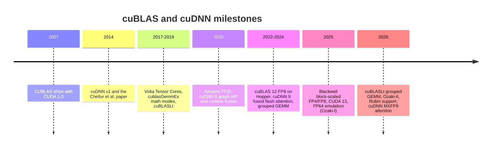
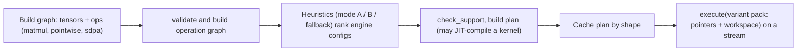

---
tags:
  - gpu-programming
  - libraries
  - cublas
  - cudnn
  - gemm
  - attention
status: draft
sources:
  - https://docs.nvidia.com/cuda/cublas/index.html
  - https://docs.nvidia.com/cuda/archive/13.4.2/cuda-toolkit-release-notes/index.html
  - https://docs.nvidia.com/cuda/cublas-patch-release-notes/index.html
  - https://developer.nvidia.com/blog/unlocking-tensor-core-performance-with-floating-point-emulation-in-cublas/
  - https://developer.nvidia.com/blog/faster-scientific-simulations-with-new-fp64-algorithms-in-nvidia-cublas/
  - https://developer.nvidia.com/blog/introducing-grouped-gemm-apis-in-cublas-and-more-performance-updates
  - https://developer.nvidia.com/blog/boosting-matrix-multiplication-speed-and-flexibility-with-nvidia-cublas-12-9
  - https://developer.nvidia.com/blog/improving-gemm-kernel-auto-tuning-efficiency-on-nvidia-gpus-with-heuristics-and-cutlass-4-2
  - https://arxiv.org/abs/1410.0759
  - https://arxiv.org/abs/1509.09308
  - https://docs.nvidia.com/cudnn/latest/developer/graph-api.md
  - https://docs.nvidia.com/deeplearning/cudnn/latest/developer/overview.html
  - https://docs.nvidia.com/deeplearning/cudnn/backend/v9.26.0/release-notes.html
  - https://docs.nvidia.com/deeplearning/cudnn/backend/v9.24.0/api/cudnn-cnn-library.html
  - https://developer.nvidia.com/blog/accelerating-transformers-with-nvidia-cudnn-9/
  - https://docs.nvidia.com/cuda/cublasmp/index.html
  - https://pytorch.org/docs/stable/notes/randomness.html
  - https://docs.pytorch.org/docs/main/cuda.tunable.html
  - https://arxiv.org/abs/2603.05451
created: 2026-11-26
updated: 2026-11-26
---

## Table Of Contents

---

- [[#TL;DR|TL;DR]]
- [[#The Problem|The Problem]]
- [[#Foundations|Foundations]]
    - [[#BLAS Levels|BLAS Levels]]
    - [[#Why GEMM Dominates|Why GEMM Dominates]]
- [[#How We Got Here|How We Got Here]]
- [[#How It Works|How It Works]]
    - [[#The cuBLAS API|The cuBLAS API]]
    - [[#Math Modes, TF32 and Emulation|Math Modes, TF32 and Emulation]]
    - [[#cuBLASLt|cuBLASLt]]
    - [[#Batched and Grouped GEMM|Batched and Grouped GEMM]]
    - [[#cuBLASXt, cuBLASMp and cuBLASDx|cuBLASXt, cuBLASMp and cuBLASDx]]
    - [[#cuDNN Legacy and Graph APIs|cuDNN Legacy and Graph APIs]]
    - [[#Engines, Heuristics and Runtime Fusion|Engines, Heuristics and Runtime Fusion]]
    - [[#Fused Attention (SDPA)|Fused Attention (SDPA)]]
    - [[#Convolution Algorithms|Convolution Algorithms]]
    - [[#How PyTorch Calls Them|How PyTorch Calls Them]]
    - [[#Determinism|Determinism]]
- [[#Where It Is Now|Where It Is Now]]
- [[#Trade-offs & Open Problems|Trade-offs & Open Problems]]
- [[#Resources|Resources]]
- [[#Related Notes|Related Notes]]

## ***TL;DR***
---
*cuBLAS (dense linear algebra) and cuDNN (deep-learning primitives) are NVIDIA's closed-source, hand-tuned kernel libraries. Most of the floating-point work a deep-learning job does on an NVIDIA GPU runs inside one of them, because matrix multiplies and attention dominate the work and these libraries ship the fastest tested kernels for every GPU generation on day one.*

- **cuBLAS** implements the BLAS standard (vector, matrix-vector and matrix-matrix routines) on the GPU, in column-major order, plus extensions: mixed-precision `cublasGemmEx`, strided-batched and grouped GEMM, and Tensor Core "math modes" such as TF32 ([cuBLAS docs](https://docs.nvidia.com/cuda/cublas/index.html)).
- **cuBLASLt** is cuBLAS's "lightweight library dedicated to GEneral Matrix-to-matrix Multiply (GEMM) operations with a new flexible API": descriptors for every operand, fused epilogues (bias, ReLU, GELU, their gradients), FP8 and block-scaled FP4/FP8 scaling, and explicit algorithm search. PyTorch and other frameworks route many matmuls through it, especially those with fused bias or low-precision scaling.
- **cuDNN** started in 2014 as a "BLAS for deep learning" ([Chetlur et al.](https://arxiv.org/abs/1410.0759)). Since cuDNN 8 its core is a **graph API**: you describe a small dataflow graph (matmul + bias + activation, or a whole attention block), and cuDNN picks or *compiles at runtime* an "engine" that runs it as one fused kernel ([graph API docs](https://docs.nvidia.com/cudnn/latest/developer/graph-api.md)). Its fused scaled-dot-product attention (SDPA) is one of PyTorch's attention backends.
- **Why it matters:** writing a GEMM or attention kernel that reaches 80–95% of peak on Hopper or Blackwell takes weeks of expert work per generation (see [[Tiled Matrix Multiplication (GEMM)]], [[CUTLASS and CuTe]]). These libraries are the baseline everyone else is measured against ("% of cuBLAS").
- **Where it is now (Nov 2026):** CUDA 13.4 Update 1 (Sep 2026) ships cuBLAS 13.8 with Rubin (compute capability 10.7) support, grouped GEMM in cuBLASLt, and FP64 GEMMs *emulated on integer Tensor Cores* with the Ozaki-II scheme, up to 175 TFLOPS on B200 ([CUDA 13.4 release notes](https://docs.nvidia.com/cuda/archive/13.4.2/cuda-toolkit-release-notes/index.html)). cuDNN 9.26 adds CUDA 13.4 and Rubin; 2026 releases added MXFP8 attention, deterministic attention backward on Blackwell and MoE grouped matmuls ([cuDNN 9.26 notes](https://docs.nvidia.com/deeplearning/cudnn/backend/v9.26.0/release-notes.html)).

## ***The Problem***
---
*A handful of operations (GEMM, convolution, attention) account for most of a neural network's arithmetic, and the fastest way to run each one changes with every GPU generation, every data type and often every matrix shape. Somebody has to write and tune those kernels.*

Writing a fast GEMM means getting [[Memory Coalescing|coalesced]] loads, [[Shared Memory and Bank Conflicts|bank-conflict-free]] shared memory, [[Tensor Cores]] fragment layouts, [[TMA and Asynchronous Copies|asynchronous copies]] and [[Warp Specialization|warp-specialized]] pipelines all right at once. Simon Boehm's well-known FP32 worklog needed ten kernel versions to climb from 1.3% to 93.7% of cuBLAS on one GPU ([Boehm](https://siboehm.com/articles/22/CUDA-MMM)), and that was without Tensor Cores.

And one kernel is not enough. The best kernel depends on:

| Factor | Why it changes the kernel |
|---|---|
| GPU generation | Each generation changed the Tensor Core instruction: `mma.sync` (Volta–Ampere), `wgmma` (Hopper), `tcgen05` (Blackwell) |
| Data type | FP64, TF32, BF16, FP8, block-scaled FP4 each need different instructions and scaling |
| Shape | A 8192³ training GEMM is compute-bound; a decode GEMM with 8 rows is memory-bound and wants a different tiling, split-K or a GEMV-like kernel |
| Layout and alignment | Transposes, leading dimensions and 16-byte alignment decide which fast paths are legal |
| What comes after | Bias, activation, scaling or quantization can be fused into the epilogue instead of costing another pass over HBM ([[Kernel Fusion]]) |

Vendor libraries solve this by shipping hundreds of pre-tuned kernels per architecture plus a **heuristic** that picks one for each call. The user writes one line; NVIDIA's engineers do the tuning, usually before the hardware ships.

## ***Foundations***
---
*BLAS sorts linear algebra into three levels by how much work each does per byte moved. Only level 3 (matrix-matrix) reuses data enough to run near a GPU's peak, which is why deep learning is built from GEMMs.*

### BLAS Levels

BLAS (Basic Linear Algebra Subprograms) is a 1970s–80s Fortran interface standard. cuBLAS keeps its names, argument order and **column-major** storage: "the cuBLAS library uses column-major storage, and 1-based indexing," with element $(i, j)$ of a matrix with leading dimension `ld` at offset `j*ld + i` in 0-based C code ([cuBLAS docs](https://docs.nvidia.com/cuda/cublas/index.html)).

| Level | Example | Work | Data | Work per element |
|---|---|---|---|---|
| 1 (vector-vector) | `axpy`: $y \leftarrow \alpha x + y$ | $O(n)$ | $O(n)$ | $O(1)$ |
| 2 (matrix-vector) | `gemv`: $y \leftarrow \alpha A x + \beta y$ | $O(n^2)$ | $O(n^2)$ | $O(1)$ |
| 3 (matrix-matrix) | `gemm`: $C \leftarrow \alpha\, op(A)\, op(B) + \beta C$ | $O(n^3)$ | $O(n^2)$ | $O(n)$ |

Names encode type and operation: `S`/`D`/`C`/`Z` for single, double, complex single, complex double, so `cublasDgemm` is FP64 GEMM and `cublasZgemm` is complex FP64. `op(A)` is `A`, its transpose or its conjugate transpose, chosen by the `transa` flag.

### Why GEMM Dominates

A GEMM of an $M \times K$ by a $K \times N$ matrix does

$$\text{FLOPs} = 2MNK$$

(one multiply and one add per term) while touching at least $(MK + KN + MN)$ elements. Its [[Roofline Model and Arithmetic Intensity|arithmetic intensity]] grows with size, so large GEMMs can saturate [[Tensor Cores]] while level 1 and 2 routines are always [[GPU Memory Hierarchy|memory-bound]].

**Worked example (H100 SXM: about 989 TFLOPS dense BF16, 67 TFLOPS FP32, 3.35 TB/s HBM3, per the [H100 page](https://www.nvidia.com/en-us/data-center/h100/)):**

| Case | FLOPs | Minimum bytes | Time at compute peak | Time at bandwidth peak | Bound |
|---|---|---|---|---|---|
| Training GEMM, $M = N = K = 8192$, BF16 | $2 \cdot 8192^3 \approx 1.10 \times 10^{12}$ | $3 \cdot 8192^2 \cdot 2 \approx 403$ MB | $\approx 1.11$ ms | $\approx 0.12$ ms | Compute |
| Same GEMM in FP32 on CUDA cores | $1.10 \times 10^{12}$ | $\approx 805$ MB | $\approx 16.4$ ms | $\approx 0.24$ ms | Compute |
| Decode GEMM, $M = 8$, $N = K = 8192$, BF16 | $2 \cdot 8 \cdot 8192^2 \approx 1.07 \times 10^{9}$ | weights alone $8192^2 \cdot 2 \approx 134$ MB | $\approx 1.1$ µs | $\approx 40$ µs | Memory |

Plain reading: the big GEMM is limited by math, so the library's job is to keep the Tensor Cores busy, and the precision you allow (BF16 vs FP32) changes the runtime by an order of magnitude. The skinny decode GEMM is limited by reading the weight matrix once, so the same library must switch to a completely different kernel. This is why shape-dependent kernel selection is the heart of cuBLAS.

## ***How We Got Here***
---
*cuBLAS shipped with the first CUDA release as a port of a 30-year-old standard; cuDNN followed in 2014 when deep learning needed its own primitives. Since then both libraries have been reshaped around Tensor Cores, low precision and fusion.*



- **2007, CUBLAS.** NVIDIA's first CUDA toolkit included a BLAS port; it used the Fortran conventions (column-major, `ld` arguments) that cuBLAS still has.
- **2014, cuDNN.** Chetlur et al. (NVIDIA, with Evan Shelhamer of Caffe) argued that deep learning lacked a BLAS-like library, so researchers kept rewriting kernels for each GPU. Integrating cuDNN into Caffe improved performance "by 36% on a standard model while also reducing memory consumption" ([arXiv 1410.0759](https://arxiv.org/abs/1410.0759)). Its convolution lowered to matrix multiply without materializing the full lowered matrix in memory, the idea now called **implicit GEMM**.
- **2015–2016, fast convolution.** Lavin and Gray showed Winograd's minimal filtering algorithms cut the multiplications in small 3×3 convolutions ([arXiv 1509.09308](https://arxiv.org/abs/1509.09308)); cuDNN added Winograd and FFT algorithms beside implicit GEMM.
- **2017–2019, Tensor Cores.** Volta's [[Tensor Cores]] made the "math mode" (may the library use reduced-precision Tensor Core math?) a first-class setting. cuBLASLt arrived as a separate, descriptor-based matmul API for the new mixed-precision world.
- **2020, TF32 and graphs.** Ampere's TF32 let FP32 GEMMs run on Tensor Cores with a 10-bit mantissa, opt-in in cuBLAS through `CUBLAS_TF32_TENSOR_OP_MATH`. cuDNN 8 introduced the graph (backend) API with runtime-compiled fusion engines (see [[Kernel Fusion]]).
- **2022–2024, Hopper and attention.** cuBLAS 12 added FP8 matmuls in cuBLASLt for Hopper. cuDNN 9.0 (2024) split into sub-libraries, switched some operators to cuBLASLt, sped up fused flash attention "by up to 50% on Hopper GPUs and up to 100% on Ampere GPUs" over 8.9.7 and fused pointwise ops into the matmul mainloop on Hopper ([cuDNN 9.0 notes](https://docs.nvidia.com/deeplearning/cudnn/release-notes.html)). cuBLAS 12.5 introduced grouped GEMM APIs ([NVIDIA blog](https://developer.nvidia.com/blog/introducing-grouped-gemm-apis-in-cublas-and-more-performance-updates)).
- **2025, Blackwell and emulation.** cuBLAS 12.8–12.9 added block-scaled FP4 and FP8 for Blackwell and reported up to 6,787 TFLOPS FP4 on GB200 ([cuBLAS 12.9 blog](https://developer.nvidia.com/blog/boosting-matrix-multiplication-speed-and-flexibility-with-nvidia-cublas-12-9)). CUDA 13.0 (2025) added experimental `CUBLAS_GEMM_AUTOTUNE`; 13.0 Update 2 added opt-in FP64 emulation on INT8 Tensor Cores (Ozaki-I) and FP32 emulation with BF16x9 ([emulation blog, Oct 2025](https://developer.nvidia.com/blog/unlocking-tensor-core-performance-with-floating-point-emulation-in-cublas/)).
- **2026.** Grouped GEMM moved into cuBLASLt (13.1), Ozaki-II emulation and Rubin support landed in cuBLAS 13.4, and cuDNN 9.18–9.26 added deterministic Blackwell attention backward, MXFP8 attention and MoE grouped matmuls (details in [[#Where It Is Now|Where It Is Now]]).

## ***How It Works***
---
*cuBLAS is a classic C library: create a handle, describe matrices by pointer and leading dimension, call a routine on a stream. cuBLASLt and cuDNN's graph API instead describe the whole operation with descriptors so the library can choose, fuse and cache a kernel. Both end in the same place: a heuristic picks one of many pre-built or runtime-compiled kernels.*

### The cuBLAS API

```cpp
cublasHandle_t h;
cublasCreate(&h);                                   // 1
cublasSetStream(h, stream);                         // 2
float alpha = 1.f, beta = 0.f;
// C (m x n) = A (m x k) * B (k x n), BF16 in, FP32 accumulate, BF16 out
cublasGemmEx(h, CUBLAS_OP_N, CUBLAS_OP_N,           // 3
             m, n, k, &alpha,
             A, CUDA_R_16BF, lda,                   // 4
             B, CUDA_R_16BF, ldb, &beta,
             C, CUDA_R_16BF, ldc,
             CUBLAS_COMPUTE_32F,                    // 5
             CUBLAS_GEMM_DEFAULT);                  // 6
cublasDestroy(h);
```

1. A **handle** holds the library context for one device: settings such as math mode and pointer mode, plus a workspace. Creating one is expensive, so you create it once and reuse it.
2. All work is enqueued on a CUDA stream (see [[Streams, Events and Async Execution]]); calls return before the GPU finishes.
3. `CUBLAS_OP_N` means "no transpose" for $A$ and $B$; `CUBLAS_OP_T` would use the transpose without copying anything.
4. Each matrix is a device pointer, a data type and a **leading dimension**: the distance in elements between the starts of consecutive columns (column-major). A sub-matrix of a bigger matrix is just a pointer offset with the parent's `ld`.
5. The **compute type** is the precision of the multiply-accumulate. `CUBLAS_COMPUTE_32F` with BF16 inputs means Tensor Core BF16 multiplies with FP32 accumulation.
6. The algorithm argument "has no effect" on sm_80 and newer; cuBLAS picks the kernel itself ([cuBLAS docs](https://docs.nvidia.com/cuda/cublas/index.html)).

**The row-major trick.** C, C++ and PyTorch store matrices row-major. A row-major matrix read as column-major is its transpose, so a row-major $C = AB$ is computed by asking cuBLAS for $C^T = B^T A^T$: swap the operand order and pass the row-major buffers unchanged. No data moves.

**Workspace.** Some kernels (split-K reductions, for example) need scratch memory. By default the handle uses a pool whose size is "GPU architecture dependent": 32 MiB on Hopper and newer (sm90+), 4 MiB otherwise; `cublasSetWorkspace()` lets you supply your own ([cuBLAS docs](https://docs.nvidia.com/cuda/cublas/index.html)).

### Math Modes, TF32 and Emulation

The math mode and compute type decide which hardware a call may use, and therefore how much precision you trade for speed ([cuBLAS docs](https://docs.nvidia.com/cuda/cublas/index.html)):

| Setting | Meaning |
|---|---|
| `CUBLAS_DEFAULT_MATH` | Default, highest performance at the prescribed precision; "Tensor Cores will be used whenever possible" |
| `CUBLAS_PEDANTIC_MATH` | Prescribed precision and standardized arithmetic in every phase (for testing) |
| `CUBLAS_TF32_TENSOR_OP_MATH` | Run single-precision routines on TF32 Tensor Cores |
| `CUBLAS_FP32_EMULATED_BF16X9_MATH` | Emulate FP32 with the BF16x9 algorithm on BF16 Tensor Cores |
| `CUBLAS_FP64_EMULATED_FIXEDPOINT_MATH` | Emulate FP64 with fixed-point (Ozaki) algorithms on integer Tensor Cores |
| `CUBLAS_MATH_DISALLOW_REDUCED_PRECISION_REDUCTION` | Force reductions to use the accumulator type |
| Compute types `CUBLAS_COMPUTE_32F_FAST_16F / _FAST_16BF / _FAST_TF32` | Per-call opt-in to down-convert FP32 inputs to FP16, BF16 or TF32 on Tensor Cores |

**TF32** keeps FP32's 8-bit exponent but only 10 mantissa bits, so it has FP32's range with roughly FP16's precision. On the H100 example above, enabling it moves an FP32 GEMM from the 67 TFLOPS FP32 pipe onto Tensor Cores at several times the throughput, which is why frameworks expose it as a switch (see [[#How PyTorch Calls Them|How PyTorch Calls Them]]).

**Emulation** goes the other way: it gets *higher* precision out of *lower*-precision Tensor Cores. Blackwell and Rubin put most of their silicon into low-precision math, so cuBLAS can now often compute FP64 faster by emulating it:

- **BF16x9** splits each FP32 value into three BF16 pieces and does nine BF16 products; NVIDIA reports it can emulate all normal and subnormal FP32 values, and up to 3x over native FP32 on GB200 NVL72 ([NVIDIA, Oct 2025](https://developer.nvidia.com/blog/unlocking-tensor-core-performance-with-floating-point-emulation-in-cublas/)).
- **Ozaki-I** slices each FP64 mantissa into 8-bit integer pieces and multiplies slices on INT8 Tensor Cores with exact integer accumulation; the number of GEMMs grows with the square of the slice count. Matching FP64 needs at least 53 mantissa bits, and how many slices that takes depends on the data's range.
- **Ozaki-II** uses the Chinese Remainder Theorem: one integer GEMM per modulus, so the GEMM count grows linearly, about half as many GEMMs as Ozaki-I for FP64-level accuracy ([NVIDIA, Nov 2026](https://developer.nvidia.com/blog/faster-scientific-simulations-with-new-fp64-algorithms-in-nvidia-cublas/)).
- **Automatic Dynamic Precision (ADP)** inspects the inputs at runtime to choose the number of bits needed for accuracy equal to or better than native FP64, and falls back to native FP64 when emulation would not be safe or faster. `cublasSetEmulationStrategy()` (or the `CUBLAS_EMULATION_STRATEGY` environment variable, `performant` or `eager`) and `cublasSetFixedPointEmulationMantissaControl()` give manual control ([cuBLAS docs](https://docs.nvidia.com/cuda/cublas/index.html)).

**Worked example (emulated DGEMM on GB200).** NVIDIA reports Ozaki-II DGEMM at up to 147 TFLOPS on GB200, 3.9x native FP64 ([NVIDIA, Nov 2026](https://developer.nvidia.com/blog/faster-scientific-simulations-with-new-fp64-algorithms-in-nvidia-cublas/)), which puts the native rate at about $147 / 3.9 \approx 38$ TFLOPS. A $8192^3$ DGEMM is $2 \cdot 8192^3 \approx 1.10 \times 10^{12}$ FLOPs, so:

$$t_\text{native} \approx \frac{1.10 \times 10^{12}}{38 \times 10^{12}} \approx 29 \text{ ms}, \qquad t_\text{emulated} \approx \frac{1.10 \times 10^{12}}{147 \times 10^{12}} \approx 7.5 \text{ ms}$$

Plain reading: on this GPU, splitting each double into integer pieces and doing many exact INT8 products is about four times faster than the FP64 units, while ADP keeps the answer as accurate as native FP64. The speedup depends on the data: inputs with a wide range of exponents need more slices or moduli, and ADP falls back to native FP64 when the bit count gets too high.

### cuBLASLt

The classic API takes a fixed argument list. cuBLASLt instead takes **descriptors**, so new features become new attributes rather than new functions:

```cpp
cublasLtMatmulDesc_t op;
cublasLtMatmulDescCreate(&op, CUBLAS_COMPUTE_32F, CUDA_R_32F);          // 1
cublasLtEpilogue_t epi = CUBLASLT_EPILOGUE_GELU_BIAS;                   // 2
cublasLtMatmulDescSetAttribute(op, CUBLASLT_MATMUL_DESC_EPILOGUE, &epi, sizeof(epi));
cublasLtMatmulDescSetAttribute(op, CUBLASLT_MATMUL_DESC_BIAS_POINTER, &bias, sizeof(bias));

cublasLtMatrixLayout_t a, b, c;                                          // 3
cublasLtMatrixLayoutCreate(&a, CUDA_R_16BF, m, k, lda);
cublasLtMatrixLayoutCreate(&b, CUDA_R_16BF, k, n, ldb);
cublasLtMatrixLayoutCreate(&c, CUDA_R_16BF, m, n, ldc);

cublasLtMatmulPreference_t pref;                                         // 4
cublasLtMatmulPreferenceCreate(&pref);
cublasLtMatmulPreferenceSetAttribute(pref, CUBLASLT_MATMUL_PREF_MAX_WORKSPACE_BYTES,
                                     &wsSize, sizeof(wsSize));
cublasLtMatmulHeuristicResult_t res[8]; int found;
cublasLtMatmulAlgoGetHeuristic(lt, op, a, b, c, c, pref, 8, res, &found); // 5

cublasLtMatmul(lt, op, &alpha, A, a, B, b, &beta, C, c, D, c,            // 6
               &res[0].algo, ws, wsSize, stream);
```

1. The matmul descriptor fixes the compute type (FP32 accumulate) and the scale type for $\alpha$, $\beta$.
2. An **epilogue** fuses work into the output stage: here $D = \text{GELU}(AB + \text{bias})$ in one kernel instead of three. Other epilogues add ReLU, store an auxiliary pre-activation buffer for backward, or compute the activation gradient and bias gradient (`DGELU`, `BGRADA`/`BGRADB`) in the backward GEMM.
3. Matrix layouts carry type, shape and leading dimension, and can also carry batch count and stride or a row-major order.
4. The preference limits what the heuristic may return, most importantly the workspace the caller can give it.
5. `cublasLtMatmulAlgoGetHeuristic` returns up to N candidate algorithms ranked by predicted speed. Each `algo` is an opaque, cacheable kernel configuration (tile, stages, split-K, swizzle, cluster shape and so on).
6. The matmul itself runs with the chosen algorithm. A framework caches the choice per shape, or **autotunes**: time several of the returned candidates once and keep the fastest.

**Low precision.** cuBLASLt is where FP8 and block-scaled formats live. FP8 matmuls take per-tensor scale pointers for A, B, C and D and can return the absolute maximum of the output (amax) for the next step's scaling. Blackwell's block-scaled formats (MXFP8, MXFP4, NVFP4; see [[Low-Precision Formats - FP8, FP4 and MX|Low-Precision Formats: FP8, FP4 and MX]]) attach one scale factor to every 16 or 32 elements, and cuBLASLt takes those scale tensors through layout attributes; CUDA 13.4 even added an experimental alternative MXFP8 scale layout ([CUDA 13.4 notes](https://docs.nvidia.com/cuda/archive/13.4.2/cuda-toolkit-release-notes/index.html)).

**Heuristics outside the library.** NVIDIA also packages its GEMM performance model separately as **nvMatmulHeuristics**, which CUTLASS 4.2+ uses to prune the configurations an autotuner has to try ([NVIDIA blog](https://developer.nvidia.com/blog/improving-gemm-kernel-auto-tuning-efficiency-on-nvidia-gpus-with-heuristics-and-cutlass-4-2)).

### Batched and Grouped GEMM

Many small GEMMs waste a GPU if launched one by one. cuBLAS offers three batch forms:

| Form | Call | Shapes | Typical use |
|---|---|---|---|
| Batched (pointer array) | `cublasGemmBatchedEx` | All the same; arbitrary addresses | Small independent problems |
| Strided batched | `cublasGemmStridedBatchedEx` | All the same; matrix $i$ at `base + i*stride` | Attention heads, `torch.bmm` |
| Grouped | `cublasGemmGroupedBatchedEx`; cuBLASLt grouped layouts | Different $M, N, K$ per group | [[Mixture of Experts]] layers where each expert gets a different number of tokens |

Grouped GEMM matters most for MoE: each expert's GEMM has its own token count, and padding them to one size wastes compute. CUDA 13.1 added experimental grouped GEMM to cuBLASLt with per-group layouts (`cublasLtGroupedMatrixLayoutCreate`), per-batch FP8 scaling and device-side $\alpha$/$\beta$; 13.2 extended it to MXFP8 and NVFP4; 13.4 added dynamic scheduling on Blackwell data-center GPUs for "up to 20%" gains at large group counts ([CUDA 13.4 notes](https://docs.nvidia.com/cuda/archive/13.4.2/cuda-toolkit-release-notes/index.html)). Grouped GEMM also produced most of 2026's correctness patches (see [[#Trade-offs & Open Problems|Trade-offs]]).

### cuBLASXt, cuBLASMp and cuBLASDx

- **cuBLASXt** is a host API for level-3 BLAS on one or more GPUs: data can stay on the host, and "the Library will take care of dispatching the operation to, and transferring the data to, one or multiple GPUs" ([cuBLAS docs](https://docs.nvidia.com/cuda/cublas/index.html)). It suits matrices bigger than GPU memory, not deep learning.
- **cuBLASMp** is a separate library for distributed dense linear algebra across GPUs and nodes (2D block-cyclic distributions, ScaLAPACK-style), with a guide for using it for tensor parallelism ([cuBLASMp docs](https://docs.nvidia.com/cuda/cublasmp/index.html)); see [[Multi-GPU Communication - NVLink and NCCL|Multi-GPU Communication: NVLink and NCCL]].
- **cuBLASDx** (not shipped with the toolkit) is the opposite: device-side GEMM building blocks you call *inside your own kernel*, so you can fuse a small GEMM with other work. It overlaps with [[CUTLASS and CuTe]].

### cuDNN Legacy and Graph APIs

cuDNN has had two generations of API:

- **Legacy API** (v1–v7 style): one function per operation, e.g. `cudnnConvolutionForward(handle, &alpha, xDesc, x, wDesc, w, convDesc, algo, workspace, wsSize, &beta, yDesc, y)`. You described tensors with descriptors and picked an algorithm yourself or with `cudnnFindConvolutionForwardAlgorithm`, which times them. In cuDNN 9 these live in sub-libraries such as `cudnn_cnn` ([cuDNN cnn library](https://docs.nvidia.com/deeplearning/cudnn/backend/v9.24.0/api/cudnn-cnn-library.html)).
- **Graph (backend) API** (cuDNN 8+): "An operation graph is a dataflow graph of operations on tensors." You build the graph, ask heuristics for **engine configurations** that support it, finalize one into an **execution plan**, and run the plan with a **variant pack** (the actual device pointers and workspace) ([graph API docs](https://docs.nvidia.com/cudnn/latest/developer/graph-api.md)).

The raw backend API is verbose C, so NVIDIA ships the open-source **cudnn-frontend** (header-only C++ and Python bindings) as the recommended way in ([cuDNN overview](https://docs.nvidia.com/deeplearning/cudnn/latest/developer/overview.html)):



### Engines, Heuristics and Runtime Fusion

An **engine** is one implementation strategy for a graph; it has **knobs** (tile sizes, split factors) that "allow fine grained control of the engine's behavior and performance," plus behavior notes (does it compile at runtime?) and numerical notes (does it down-convert?) ([graph API docs](https://docs.nvidia.com/cudnn/latest/developer/graph-api.md)). cuDNN groups engines into four classes:

| Class | What it is |
|---|---|
| Pre-compiled single-operation | One op, e.g. `ConvolutionFwd`, shipped as built kernels |
| Generic runtime fusion | "generate the kernel (or kernels) at runtime based on the graph pattern": matmul, convolution and pointwise fusions with a *mainloop* part (ops on inputs) and an *epilogue* part (ops on outputs) |
| Specialized runtime fusion | Runtime-compiled, but for a few important patterns (normalization, attention) |
| Specialized pre-compiled fusion | Fixed fused kernels for common patterns |

The **heuristic modes** trade CPU time for accuracy: mode A is "intended to be fast and be able to handle most operation graph patterns", mode B is "more generally accurate than mode A, but with the tradeoff of higher CPU latency", and the fallback mode gives working engines "without expectation of optimal performance". The recommended flow is to query A or B and take "the first engine config with support" ([graph API docs](https://docs.nvidia.com/cudnn/latest/developer/graph-api.md)). Runtime compilation costs time on the first call, so cuDNN 9.22 added a default kernel cache ([cuDNN 9.26 notes](https://docs.nvidia.com/deeplearning/cudnn/backend/v9.26.0/release-notes.html)).

### Fused Attention (SDPA)

cuDNN's most important modern feature is fused **scaled dot-product attention**: $\text{softmax}(QK^T \cdot s + \text{mask})V$ as one kernel that never writes the attention matrix to HBM, the same idea as [[FlashAttention]]. In cudnn-frontend's Python API it is one node:

```python
import cudnn
g = cudnn.pygraph(io_data_type=cudnn.data_type.BFLOAT16,          # 1
                  intermediate_data_type=cudnn.data_type.FLOAT,
                  compute_data_type=cudnn.data_type.FLOAT)
q, k, v = g.tensor_like(q_gpu), g.tensor_like(k_gpu), g.tensor_like(v_gpu)  # 2
o, stats = g.sdpa(name="attn", q=q, k=k, v=v,                     # 3
                  attn_scale=1.0 / head_dim**0.5,
                  use_causal_mask=True, is_inference=True)
o.set_output(True)
g.build([cudnn.heur_mode.A])                                       # 4
g.execute({q: q_gpu, k: k_gpu, v: v_gpu, o: o_gpu}, workspace)     # 5
```

1. The graph fixes input/output type (BF16) and the internal types for softmax and accumulation (FP32).
2. Graph tensors are created to match existing GPU tensors' shapes and strides.
3. `sdpa` adds the whole attention forward; `stats` (softmax log-sum-exp) is only needed when training, for the backward pass. Options cover causal and sliding-window masks, dropout, ALiBi, paged KV caches and ragged (THD) layouts.
4. `build` runs validation, heuristics and plan building (possibly compiling).
5. `execute` binds real pointers. The plan is reused for every call with the same shapes.

(Parameter names follow cudnn-frontend 1.x samples and have shifted between versions; treat this as the shape of the API rather than copy-paste code.)

cuDNN's attention numbers: NVIDIA's cuDNN 9 launch post reported fused FP8 and BF16 SDPA on H100 well ahead of non-fused attention ([NVIDIA, cuDNN 9](https://developer.nvidia.com/blog/accelerating-transformers-with-nvidia-cudnn-9/)). On Blackwell, independent kernels now compete hard: FlashAttention-4 reports 1.3x over cuDNN 9.13 on B200 BF16 ([Zadouri et al., 2026](https://arxiv.org/abs/2603.05451)), while Meta reports cuDNN still leading Triton's automatic warp specialization by 10–20% ([PyTorch, Jan 2026](https://pytorch.org/blog/warp-specialization-in-triton-design-and-roadmap/)).

### Convolution Algorithms

For convolutions, cuDNN chooses among very different algorithms (`cudnnConvolutionFwdAlgo_t`, [cuDNN cnn library](https://docs.nvidia.com/deeplearning/cudnn/backend/v9.24.0/api/cudnn-cnn-library.html)):

| Algorithm | Idea | Good for | Cost |
|---|---|---|---|
| `IMPLICIT_GEMM` / `IMPLICIT_PRECOMP_GEMM` | Treat convolution as a GEMM of size $(N \cdot H_o \cdot W_o) \times K \times (C \cdot R \cdot S)$, generating the "unrolled" input tiles on the fly; PRECOMP precomputes indices into a small workspace | The default on Tensor Cores; all shapes | Little or no workspace |
| `GEMM` | Explicit im2col: materialize the unrolled matrix, then call GEMM | Rarely best today | Large workspace |
| `FFT` / `FFT_TILING` | Convolve in the frequency domain (see [[FFT on GPUs]]) | Large filters | Large workspace; precision loss |
| `WINOGRAD` / `WINOGRAD_NONFUSED` | Lavin–Gray minimal filtering: e.g. $F(2 \times 2, 3 \times 3)$ needs 16 multiplies instead of 36 per output tile | Small 3×3 filters | Extra transforms; slightly worse numerics |
| `DIRECT` | Straightforward loop nest | Few cases | — |

The Winograd count comes straight from the paper: producing a $2 \times 2$ output tile with a $3 \times 3$ filter takes $(2+3-1)^2 = 16$ elementwise multiplies, versus $2 \cdot 2 \cdot 3 \cdot 3 = 36$ directly, a 2.25x reduction in multiplies ([Lavin & Gray](https://arxiv.org/abs/1509.09308)). On Tensor Core GPUs implicit GEMM usually wins, because Tensor Cores make multiplies cheap and the transforms are not.

### How PyTorch Calls Them

- **Matmuls.** `torch.matmul`, `nn.Linear` and `torch.bmm` on CUDA dispatch to cuBLAS or cuBLASLt (using the row-major trick above); fused bias + activation linear layers can use cuBLASLt epilogues; FP8 `torch._scaled_mm` calls cuBLASLt's scaled matmul.
- **TF32 switches.** `torch.backends.cuda.matmul.allow_tf32` and `torch.set_float32_matmul_precision("high")` let FP32 matmuls use TF32 in cuBLAS; `torch.backends.cudnn.allow_tf32` does the same for cuDNN convolutions.
- **Convolutions.** `nn.Conv*d` calls cuDNN. `torch.backends.cudnn.benchmark = True` makes PyTorch time cuDNN's algorithms on the first call for each new shape and cache the fastest, which is worth it when shapes stay fixed.
- **Attention.** `F.scaled_dot_product_attention` picks among FlashAttention, memory-efficient, cuDNN and math backends; `torch.nn.attention.sdpa_kernel(SDPBackend.CUDNN_ATTENTION)` forces cuDNN.
- **Tuning.** PyTorch's **TunableOp** can benchmark cuBLAS/cuBLASLt (and on AMD, hipBLASLt/rocBLAS) solutions per GEMM shape and save the winners to a file ([PyTorch docs](https://docs.pytorch.org/docs/main/cuda.tunable.html)). TorchInductor's `max-autotune` can instead generate [[Triton]] or [[CUTLASS and CuTe|CuTe DSL]] GEMMs and compare them against cuBLAS.

### Determinism

cuBLAS guarantees that routines from one toolkit version "generate the same bit-wise results at every run when executed on GPUs with the same architecture and the same number of SMs," but not across toolkit versions, and "this guarantee no longer holds when multiple CUDA streams are active or fixed-point emulation is used," because the library may pick different implementations to share its workspace. Remedies: one handle or one workspace per stream, `cublasLtMatmul` with a user-owned workspace, or the debug variable `CUBLAS_WORKSPACE_CONFIG=:16:8` (may cost speed) or `:4096:8` (about 24 MiB more memory) ([cuBLAS docs](https://docs.nvidia.com/cuda/cublas/index.html)). Atomics (enabled with `cublasSetAtomicsMode`) and split-K reductions with atomics also break bitwise reproducibility.

In PyTorch, `torch.use_deterministic_algorithms(True)` makes non-deterministic ops raise errors and requires `CUBLAS_WORKSPACE_CONFIG` to be set; `torch.backends.cudnn.deterministic = True` restricts cuDNN to deterministic convolution algorithms, and `benchmark = False` stops shape-dependent algorithm choice ([PyTorch reproducibility notes](https://pytorch.org/docs/stable/notes/randomness.html)). Attention backward is the hard case, since the usual fused kernels accumulate $dQ$ with atomics; cuDNN 9.18 and 9.19 added deterministic SDPA backward on Blackwell for FP16/BF16 and FP8 ([cuDNN notes](https://docs.nvidia.com/deeplearning/cudnn/backend/v9.26.0/release-notes.html)).

## ***Where It Is Now***
---
*As of November 2026, cuBLAS and cuDNN remain the default matmul, convolution and (often) attention kernels under the major frameworks on NVIDIA GPUs, now with Rubin support, MoE-oriented grouped GEMM and FP64 emulated on integer Tensor Cores. Their lead is no longer automatic: open kernels in CuTe DSL and Triton match or beat them on attention and some GEMM shapes.*

- **CUDA 13.4 / cuBLAS 13.7–13.8 (2026).** CUDA 13.4 (cuBLAS 13.7) added Rubin (compute capability 10.7), Ozaki-II emulated FP64 "when it provides" a speedup on Ampere and newer (up to 175 TFLOPS emulated DGEMM on B200 and 45 on RTX PRO 6000 Blackwell Server Edition), and grouped-GEMM dynamic scheduling. CUDA 13.4 Update 1 (release notes dated Sep 14, 2026; cuBLAS 13.8.0) improved ZGEMM peak by up to 25% on Rubin ([CUDA 13.4 notes](https://docs.nvidia.com/cuda/archive/13.4.2/cuda-toolkit-release-notes/index.html)). Earlier 13.x: TMA-based DSYMV (13.3 U1, 1.3x geomean), TF32 about 27% faster on Blackwell (13.3), Green Contexts support (13.3).
- **FP64 by emulation is mainstream.** NVIDIA's Nov 13, 2026 post reports Ozaki-II DGEMM at 5.5x native FP64 on Vera Rubin NVL72, 3.9x on GB200 and up to 23x on RTX PRO 6000 Blackwell; 2x faster than Ozaki-I on GB200; and up to 175 TFLOPS (VR NVL72) and 147 TFLOPS (GB200). End to end, BerkeleyGW ran 3.9x faster on GB200 than with native ZGEMM ([NVIDIA, Nov 2026](https://developer.nvidia.com/blog/faster-scientific-simulations-with-new-fp64-algorithms-in-nvidia-cublas/)). This is NVIDIA's answer to Blackwell and Rubin cutting native FP64 relative to low-precision throughput.
- **cuDNN 9.2x (2026).** 9.26.0 adds CUDA 13.4, Rubin and CUDA Green Contexts. 9.21 was the big feature release: MXFP8 SDPA on Blackwell, MXFP8/NVFP4 MoE grouped matmul, a Tensor IR sub-library for generic GEMM fusion on Blackwell, dynamic shapes for matmul and SDPA. 9.21.1 and 9.23 added head dimension 256 SDPA forward and backward on Blackwell using the 2-CTA MMA path; 9.24 expanded causal 1-D convolution for state-space-style models through a `SubquadraticOps` API ([cuDNN 9.26 notes](https://docs.nvidia.com/deeplearning/cudnn/backend/v9.26.0/release-notes.html); see [[State Space Models]]).
- **Patches are frequent.** cuBLAS shipped stand-alone patch releases through 2026 (13.4.1, 13.4.2, 13.6.1, 13.6.2, 13.8.1), mostly fixing grouped GEMM and NVFP4 correctness on Hopper, B300 and Rubin ([cuBLAS patch notes](https://docs.nvidia.com/cuda/cublas-patch-release-notes/index.html)).
- **The competition.** [[CUTLASS and CuTe]] (the open template library cuBLAS's own approach resembles) and its CuTe DSL power FlashAttention-4 and PyTorch's NVGEMM backend; [[Triton]] reaches cuBLAS on standard GEMMs; DeepSeek's DeepGEMM targets FP8 MoE shapes. Frameworks increasingly autotune library kernels against generated ones rather than trusting the library blindly.

| | cuBLAS / cuDNN | CUTLASS / CuTe DSL | Triton | FlashAttention |
|---|---|---|---|---|
| Source | Closed binaries | Open (BSD-3) | Open | Open |
| You write | One call or a small graph | Kernel from templates | Kernel in Python tiles | Nothing (one op) |
| New hardware | Day one, tuned by NVIDIA | Fast, needs expert | Lags on Hopper/Blackwell features | Rewritten per generation |
| Fusion | Fixed epilogues; cuDNN graph patterns | Arbitrary (EVT) | Arbitrary | Attention variants only |
| Vendors | NVIDIA only | NVIDIA only | NVIDIA, AMD, others | NVIDIA, partial AMD |

## ***Trade-offs & Open Problems***
---
*The libraries give near-peak speed for one line of code, at the price of opacity, fixed fusion options, large binaries and results that can change with version, shape or stream configuration.*

| Strength | Cost |
|---|---|
| Tuned kernels for every NVIDIA GPU at launch | Closed source: you cannot see or patch the kernel |
| Heuristic picks a good kernel instantly | The pick can be wrong for unusual shapes; autotuning fixes it but costs time and can't run during graph capture |
| Epilogues and cuDNN graphs fuse common patterns | Only the patterns NVIDIA supports; anything else needs [[CUTLASS and CuTe]] or [[Triton]] |
| Stable C API for decades | Column-major and handle/descriptor boilerplate; frameworks hide it |
| Bitwise reproducible in the simple case | Not across versions, GPUs with different SM counts, multiple streams, atomics or emulation |
| Covers FP64 to FP4 | Very large binaries, since kernels ship for every architecture and type |

- **Black box.** When a cuBLAS kernel is slow or wrong for your shape, you can file a bug or change the shape; you cannot change the kernel. The 2026 patch notes show that even NVIDIA's newest paths (grouped GEMM, NVFP4) needed several correctness fixes.
- **Shape coverage.** Heuristics are trained on common shapes. Skinny, odd-sized or misaligned problems can fall onto slow fallbacks; `CUBLAS_GEMM_AUTOTUNE` (experimental, cached in the handle, unsupported under stream capture) and PyTorch TunableOp exist because of this ([cuBLAS docs](https://docs.nvidia.com/cuda/cublas/index.html)).
- **Runtime compilation costs.** cuDNN's runtime fusion engines compile on first use; with dynamic shapes that can mean many compiles. Kernel caches and dynamic-shape support (9.21–9.22) are the mitigations.
- **Binary size and startup.** Shipping pre-built kernels for every architecture and data type makes these libraries some of the largest pieces of a CUDA install. cuDNN 9 split itself into sub-libraries, which its notes say "will allow more flexible loading in a future version" ([cuDNN 9.0 notes](https://docs.nvidia.com/deeplearning/cudnn/release-notes.html)).
- **Emulation semantics.** Emulated FP64 is accurate to FP64 under ADP but is not bit-identical to native FP64 and breaks the run-to-run reproducibility guarantee; scientific codes have to decide whether that is acceptable.
- **Lock-in.** Code written against cuBLAS and cuDNN is NVIDIA-only; AMD's hipBLASLt and MIOpen mirror the APIs closely enough for HIPIFY translation (see [[ROCm and HIP]]), but performance does not port.

## ***Resources***
---
*Read the cuBLAS docs' sections on data layout, math modes and reproducibility, then the cuBLASLt matmul API and the cuDNN graph API overview. For history, read the 2014 cuDNN paper and Lavin & Gray; for current state, the CUDA 13.4 release notes and NVIDIA's emulation posts.*

**Primary documentation**
- [cuBLAS documentation](https://docs.nvidia.com/cuda/cublas/index.html): API, math modes, reproducibility, cuBLASLt, cuBLASXt, emulation.
- [CUDA 13.4 Update 1 release notes](https://docs.nvidia.com/cuda/archive/13.4.2/cuda-toolkit-release-notes/index.html): cuBLAS 13.0–13.8 feature history.
- [cuBLAS patch release notes](https://docs.nvidia.com/cuda/cublas-patch-release-notes/index.html): stand-alone fixes between toolkits.
- [cuDNN graph API](https://docs.nvidia.com/cudnn/latest/developer/graph-api.md): engines, knobs, heuristic modes, fusion patterns.
- [cuDNN overview](https://docs.nvidia.com/deeplearning/cudnn/latest/developer/overview.html): frontend vs backend, sub-libraries.
- [cuDNN 9.26 release notes](https://docs.nvidia.com/deeplearning/cudnn/backend/v9.26.0/release-notes.html): 2026 features release by release.
- [cudnn_cnn library](https://docs.nvidia.com/deeplearning/cudnn/backend/v9.24.0/api/cudnn-cnn-library.html): legacy convolution API and algorithm enums.
- [cuBLASMp](https://docs.nvidia.com/cuda/cublasmp/index.html): distributed dense linear algebra.

**NVIDIA blog posts**
- [Floating point emulation in cuBLAS](https://developer.nvidia.com/blog/unlocking-tensor-core-performance-with-floating-point-emulation-in-cublas/): Oct 2025. BF16x9, Ozaki-I, ADP.
- [New FP64 algorithms in cuBLAS](https://developer.nvidia.com/blog/faster-scientific-simulations-with-new-fp64-algorithms-in-nvidia-cublas/): Nov 2026. Ozaki-II, 2M ZGEMM, Rubin numbers.
- [Grouped GEMM APIs in cuBLAS](https://developer.nvidia.com/blog/introducing-grouped-gemm-apis-in-cublas-and-more-performance-updates): 2024.
- [cuBLAS 12.9](https://developer.nvidia.com/blog/boosting-matrix-multiplication-speed-and-flexibility-with-nvidia-cublas-12-9): 2025. Block-scaled FP4/FP8 on Blackwell.
- [Accelerating Transformers with cuDNN 9](https://developer.nvidia.com/blog/accelerating-transformers-with-nvidia-cudnn-9/): 2024. Fused SDPA.
- [GEMM auto-tuning with nvMatmulHeuristics and CUTLASS 4.2](https://developer.nvidia.com/blog/improving-gemm-kernel-auto-tuning-efficiency-on-nvidia-gpus-with-heuristics-and-cutlass-4-2): 2025.

**Papers**
- [cuDNN: Efficient Primitives for Deep Learning](https://arxiv.org/abs/1410.0759): Chetlur et al., 2014.
- [Fast Algorithms for Convolutional Neural Networks](https://arxiv.org/abs/1509.09308): Lavin & Gray, 2015 (CVPR 2016). Winograd convolution.
- [FlashAttention-4](https://arxiv.org/abs/2603.05451): Zadouri et al., 2026. Benchmarks against cuDNN on B200.

**Framework docs**
- [PyTorch reproducibility notes](https://pytorch.org/docs/stable/notes/randomness.html): cuDNN and cuBLAS determinism flags.
- [PyTorch TunableOp](https://docs.pytorch.org/docs/main/cuda.tunable.html): per-shape GEMM tuning.

## Related Notes

- [[Tiled Matrix Multiplication (GEMM)]] — The algorithm inside every cuBLAS GEMM kernel.
- [[CUTLASS and CuTe]] — The open template library for kernels cuBLAS doesn't ship.
- [[Tensor Cores]] — The hardware math modes and compute types decide whether to use.
- [[Kernel Fusion]] — What cuBLASLt epilogues and cuDNN graphs provide.
- [[FlashAttention]] — The open alternative to cuDNN's fused SDPA.
- [[Triton]] — Generated kernels frameworks compare against cuBLAS.
- [[Low-Precision Formats - FP8, FP4 and MX|Low-Precision Formats: FP8, FP4 and MX]] — The block-scaled formats cuBLASLt and cuDNN support.
- [[Mixture of Experts]] — The workload behind grouped GEMM.
- [[Roofline Model and Arithmetic Intensity]] — Why GEMM shape decides the kernel.
- [[Streams, Events and Async Execution]] — Handles and streams, and why multiple streams affect determinism.
- [[CUDA Graphs]] — Library calls inside captured graphs; autotuning can't run during capture.
- [[Blackwell Architecture]] — The hardware behind block-scaled formats and FP64 emulation.
- [[Multi-GPU Communication - NVLink and NCCL|Multi-GPU Communication: NVLink and NCCL]] — Where cuBLASMp and tensor parallelism meet.
- [[ROCm and HIP]] — AMD's equivalents (hipBLASLt, MIOpen).
- [[Profiling with Nsight Compute and Nsight Systems]] — How to see which library kernel actually ran.
