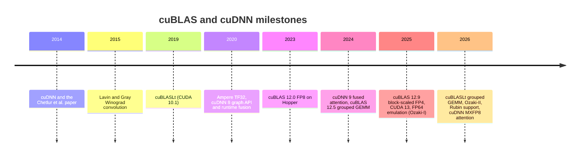
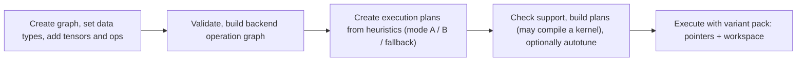

---
tags:
  - gpu-programming
  - libraries
  - cublas
  - cudnn
  - gemm
  - attention
status: complete
sources:
  - https://docs.nvidia.com/cuda/cublas/index.html
  - https://docs.nvidia.com/cuda/archive/13.4.2/cuda-toolkit-release-notes/index.html
  - https://docs.nvidia.com/cuda/cublas-patch-release-notes/index.html
  - https://developer.nvidia.com/blog/new-cublas-12-0-features-and-matrix-multiplication-performance-on-nvidia-hopper-gpus/
  - https://developer.nvidia.com/blog/introducing-grouped-gemm-apis-in-cublas-and-more-performance-updates
  - https://developer.nvidia.com/blog/boosting-matrix-multiplication-speed-and-flexibility-with-nvidia-cublas-12-9
  - https://developer.nvidia.com/blog/unlocking-tensor-core-performance-with-floating-point-emulation-in-cublas/
  - https://developer.nvidia.com/blog/faster-scientific-simulations-with-new-fp64-algorithms-in-nvidia-cublas/
  - https://developer.nvidia.com/blog/improving-gemm-kernel-auto-tuning-efficiency-on-nvidia-gpus-with-heuristics-and-cutlass-4-2
  - https://docs.nvidia.com/cuda/cublasmp/index.html
  - https://rocmdocs.amd.com/projects/HIPIFY/en/latest/reference/tables/CUBLAS_API_supported_by_ROC.html
  - https://arxiv.org/abs/1410.0759
  - https://arxiv.org/abs/1509.09308
  - https://docs.nvidia.com/cudnn/latest/developer/graph-api.md
  - https://docs.nvidia.com/deeplearning/cudnn/latest/developer/overview.html
  - https://docs.nvidia.com/cudnn/latest/operations/Attention.md
  - https://docs.nvidia.com/deeplearning/cudnn/release-notes.html
  - https://docs.nvidia.com/deeplearning/cudnn/backend/v9.26.0/release-notes.html
  - https://docs.nvidia.com/deeplearning/cudnn/backend/v9.24.0/api/cudnn-cnn-library.html
  - https://surban.github.io/managedCuda/api/ManagedCuda.CudaDNN.cudnnConvolutionFwdAlgo.html
  - https://developer.nvidia.com/blog/accelerating-transformers-with-nvidia-cudnn-9/
  - https://docs.pytorch.org/docs/2.15/notes/randomness.html
  - https://docs.pytorch.org/docs/2.2/_sources/notes/cuda.rst.txt
  - https://docs.pytorch.org/docs/2.7/_modules/torch/nn/attention.html
  - https://pytorch.org/blog/gemms-torchinductor-cutedsl-backend/
  - https://pytorch.org/blog/warp-specialization-in-triton-design-and-roadmap/
  - https://arxiv.org/abs/2603.05451
  - https://siboehm.com/articles/22/CUDA-MMM
  - https://www.nvidia.com/en-us/data-center/h100/
created: 2026-11-26
updated: 2026-11-28
---

## Table Of Contents

---

- [[#TL;DR|TL;DR]]
- [[#The Problem|The Problem]]
- [[#Foundations|Foundations]]
    - [[#BLAS Levels|BLAS Levels]]
    - [[#Why GEMM Dominates|Why GEMM Dominates]]
- [[#How We Got Here|How We Got Here]]
- [[#How It Works|How It Works]]
    - [[#The cuBLAS API|The cuBLAS API]]
    - [[#Math Modes, TF32 and Emulation|Math Modes, TF32 and Emulation]]
    - [[#cuBLASLt|cuBLASLt]]
    - [[#Batched and Grouped GEMM|Batched and Grouped GEMM]]
    - [[#cuBLASXt, cuBLASMp and cuBLASDx|cuBLASXt, cuBLASMp and cuBLASDx]]
    - [[#cuDNN Legacy and Graph APIs|cuDNN Legacy and Graph APIs]]
    - [[#Engines, Heuristics and Runtime Fusion|Engines, Heuristics and Runtime Fusion]]
    - [[#Fused Attention (SDPA)|Fused Attention (SDPA)]]
    - [[#Convolution Algorithms|Convolution Algorithms]]
    - [[#How PyTorch Calls Them|How PyTorch Calls Them]]
    - [[#Determinism|Determinism]]
- [[#Where It Is Now|Where It Is Now]]
- [[#Trade-offs & Open Problems|Trade-offs & Open Problems]]
- [[#Resources|Resources]]
- [[#Related Notes|Related Notes]]

## ***TL;DR***
---
*cuBLAS (dense linear algebra) and cuDNN (deep-learning primitives) are NVIDIA's closed-source, hand-tuned kernel libraries. Much of the floating-point work a deep-learning job does on an NVIDIA GPU runs inside one of them, because matrix multiplies, convolutions and attention dominate the arithmetic and these libraries ship tuned kernels for each new GPU generation.*

- **cuBLAS** implements the BLAS standard (vector, matrix-vector and matrix-matrix routines) on the GPU, in column-major order, plus extensions: mixed-precision `cublasGemmEx`, strided-batched and grouped GEMM, and Tensor Core "math modes" such as TF32 ([cuBLAS docs](https://docs.nvidia.com/cuda/cublas/index.html)).
- **cuBLASLt** is cuBLAS's "lightweight library dedicated to GEneral Matrix-to-matrix Multiply (GEMM) operations with a new flexible API": descriptors for every operand, fused epilogues (bias, ReLU, GELU, their gradients), FP8 and block-scaled FP4/FP8 scaling, and explicit algorithm search. NVIDIA encourages users on Ampere and newer to move from `cublasGemmEx` to `cublasLtMatmul` for tuning, fused epilogues and wider mixed-precision support ([NVIDIA, Jun 2024](https://developer.nvidia.com/blog/introducing-grouped-gemm-apis-in-cublas-and-more-performance-updates)).
- **cuDNN** started in 2014 as a "BLAS for deep learning" ([Chetlur et al.](https://arxiv.org/abs/1410.0759)). Since cuDNN 8 its core is a **graph API**: you describe a small dataflow graph (matmul + bias + activation, or a whole attention block), and cuDNN picks or *compiles at runtime* an "engine" that runs it as one fused kernel ([graph API docs](https://docs.nvidia.com/cudnn/latest/developer/graph-api.md)). Its fused scaled-dot-product attention (SDPA) is the default fused-attention backend in Transformer Engine on Hopper and one of PyTorch's SDPA backends.
- **Why it matters:** a fast GEMM-shaped kernel is weeks of expert work per GPU generation (see [[Tiled Matrix Multiplication (GEMM)]], [[CUTLASS and CuTe]]). These libraries are the baseline everyone else is measured against ("% of cuBLAS").
- **Where it is now (Nov 2026):** CUDA 13.4 Update 1 (Sep 2026) ships cuBLAS 13.8 with Rubin (compute capability 10.7) support, grouped GEMM in cuBLASLt, and FP64 GEMMs *emulated on integer Tensor Cores* with the Ozaki-II scheme, up to 175 TFLOPS on B200 ([CUDA 13.4 release notes](https://docs.nvidia.com/cuda/archive/13.4.2/cuda-toolkit-release-notes/index.html)). cuDNN 9.26 adds CUDA 13.4 and Rubin; 2026 releases added MXFP8 attention, deterministic attention backward on Blackwell and MoE grouped matmuls ([cuDNN 9.26 notes](https://docs.nvidia.com/deeplearning/cudnn/backend/v9.26.0/release-notes.html)).

## ***The Problem***
---
*A handful of operations (GEMM, convolution, attention) account for most of a neural network's arithmetic, and the fastest way to run each one changes with every GPU generation, every data type and often every matrix shape. Somebody has to write and tune those kernels.*

Writing a fast GEMM means getting [[Memory Coalescing|coalesced]] loads, [[Shared Memory and Bank Conflicts|bank-conflict-free]] shared memory, [[Tensor Cores]] fragment layouts, [[TMA and Asynchronous Copies|asynchronous copies]] and [[Warp Specialization|warp-specialized]] pipelines all right at once. Simon Boehm's well-known FP32 worklog needed ten kernel versions to climb from 1.3% to 93.7% of cuBLAS on one GPU ([Boehm](https://siboehm.com/articles/22/CUDA-MMM)), and that was without Tensor Cores.

And one kernel is not enough. The best kernel depends on:

| Factor | Why it changes the kernel |
|---|---|
| GPU generation | Each generation changed the Tensor Core instruction: `mma.sync` (Volta–Ampere), `wgmma` (Hopper), `tcgen05` (Blackwell) |
| Data type | FP64, TF32, BF16, FP8, block-scaled FP4 each need different instructions and scaling |
| Shape | A 8192³ training GEMM is compute-bound; a decode GEMM with 8 rows is memory-bound and wants a different tiling, split-K or a GEMV-like kernel |
| Layout and alignment | Transposes, leading dimensions and 16-byte alignment decide which fast paths are legal |
| What comes after | Bias, activation, scaling or quantization can be fused into the epilogue instead of costing another pass over HBM ([[Kernel Fusion]]) |

Vendor libraries solve this by shipping many pre-tuned kernels per architecture plus a **heuristic** that picks one for each call. The user writes one line; NVIDIA's engineers do the tuning. The heuristic is good but not perfect: NVIDIA reports cuBLAS's runtime recommender reaching about 93% (geomean) of the best available kernel across its problem space ([NVIDIA, Jun 2024](https://developer.nvidia.com/blog/introducing-grouped-gemm-apis-in-cublas-and-more-performance-updates)).

## ***Foundations***
---
*BLAS sorts linear algebra into three levels by how much work each does per byte moved. Only level 3 (matrix-matrix) reuses data enough to run near a GPU's peak, which is why deep learning is built from GEMMs.*

### BLAS Levels

BLAS (Basic Linear Algebra Subprograms) is the long-standing Fortran interface standard for these routines. cuBLAS keeps its naming and **column-major** storage: "the cuBLAS library uses column-major storage, and 1-based indexing," with element $(i, j)$ of a matrix with leading dimension `ld` at offset `j*ld + i` in 0-based C code ([cuBLAS docs](https://docs.nvidia.com/cuda/cublas/index.html)).

| Level | Example | Work | Data | Work per element |
|---|---|---|---|---|
| 1 (vector-vector) | `axpy`: $y \leftarrow \alpha x + y$ | $O(n)$ | $O(n)$ | $O(1)$ |
| 2 (matrix-vector) | `gemv`: $y \leftarrow \alpha A x + \beta y$ | $O(n^2)$ | $O(n^2)$ | $O(1)$ |
| 3 (matrix-matrix) | `gemm`: $C \leftarrow \alpha\, op(A)\, op(B) + \beta C$ | $O(n^3)$ | $O(n^2)$ | $O(n)$ |

Names encode type and operation: `S`/`D`/`C`/`Z` for single, double, complex single, complex double, so `cublasDgemm` is FP64 GEMM and `cublasZgemm` is complex FP64. `op(A)` is `A`, its transpose or its conjugate transpose, chosen by the `transa` flag.

### Why GEMM Dominates

A GEMM of an $M \times K$ by a $K \times N$ matrix does

$$\text{FLOPs} = 2MNK$$

(one multiply and one add per term) while touching at least $(MK + KN + MN)$ elements. Its [[Roofline Model and Arithmetic Intensity|arithmetic intensity]] grows with size, so large GEMMs can saturate [[Tensor Cores]] while level 1 and 2 routines are always [[GPU Memory Hierarchy|memory-bound]].

**Worked example (H100 SXM: about 989 TFLOPS dense BF16, 67 TFLOPS FP32, 3.35 TB/s HBM3, per the [H100 page](https://www.nvidia.com/en-us/data-center/h100/)):**

| Case | FLOPs | Minimum bytes | Time at compute peak | Time at bandwidth peak | Bound |
|---|---|---|---|---|---|
| Training GEMM, $M = N = K = 8192$, BF16 | $2 \cdot 8192^3 \approx 1.10 \times 10^{12}$ | $3 \cdot 8192^2 \cdot 2 \approx 403$ MB | $\approx 1.11$ ms | $\approx 0.12$ ms | Compute |
| Same GEMM in FP32 on CUDA cores | $1.10 \times 10^{12}$ | $\approx 805$ MB | $\approx 16.4$ ms | $\approx 0.24$ ms | Compute |
| Decode GEMM, $M = 8$, $N = K = 8192$, BF16 | $2 \cdot 8 \cdot 8192^2 \approx 1.07 \times 10^{9}$ | weights alone $8192^2 \cdot 2 \approx 134$ MB | $\approx 1.1$ µs | $\approx 40$ µs | Memory |

Plain reading: the big GEMM is limited by math, so the library's job is to keep the Tensor Cores busy, and the precision you allow (BF16 vs FP32) changes the runtime by an order of magnitude. The skinny decode GEMM is limited by reading the weight matrix once, so the same library must switch to a completely different kernel. This is why shape-dependent kernel selection is the heart of cuBLAS.

## ***How We Got Here***
---
*cuBLAS brought the decades-old BLAS standard to the GPU; cuDNN followed in 2014 when deep learning needed its own primitives. Since then both libraries have been reshaped around Tensor Cores, low precision and fusion.*



- **cuBLAS.** A GPU port of BLAS that keeps the Fortran conventions (column-major, `ld` arguments) it still has today ([cuBLAS docs](https://docs.nvidia.com/cuda/cublas/index.html)).
- **2014, cuDNN.** Chetlur, Woolley, Vandermersch, Cohen, Tran, Catanzaro and Shelhamer argued that deep learning lacked a BLAS-like library, so researchers kept rewriting kernels for each new GPU. Integrating cuDNN into Caffe improved performance "by 36% on a standard model while also reducing memory consumption" ([arXiv 1410.0759](https://arxiv.org/abs/1410.0759)).
- **2015, fast convolution.** FFT convolution suits large filters, but networks had moved to small 3×3 filters. Lavin and Gray showed Winograd's minimal filtering algorithms cut the multiplications for small tiles and stay fast at small batch sizes ([arXiv 1509.09308](https://arxiv.org/abs/1509.09308)). cuDNN's convolution menu now includes Winograd and FFT algorithms beside implicit GEMM (see [[#Convolution Algorithms|Convolution Algorithms]]).
- **2019, cuBLASLt.** With [[Tensor Cores]] and mixed precision, the fixed BLAS argument lists stopped fitting. cuBLASLt, a separate descriptor-based matmul API, has existed "since CUDA 10.1" ([NVIDIA, cuBLAS 12.0 post](https://developer.nvidia.com/blog/new-cublas-12-0-features-and-matrix-multiplication-performance-on-nvidia-hopper-gpus/)). The old `CUBLAS_TENSOR_OP_MATH` mode is now deprecated because the default math mode uses Tensor Cores "whenever possible" ([cuBLAS docs](https://docs.nvidia.com/cuda/cublas/index.html)).
- **2020, TF32 and graphs.** Ampere added TF32 to the Tensor Cores (see [[Tensor Cores]]): inputs are rounded "to have 10 bits of mantissa" and results accumulate in FP32 ([PyTorch CUDA notes](https://docs.pytorch.org/docs/2.2/_sources/notes/cuda.rst.txt)); cuBLAS exposes it through `CUBLAS_TF32_TENSOR_OP_MATH`. cuDNN 8 introduced the graph (backend) API with runtime-compiled fusion engines (see [[Kernel Fusion]]).
- **2023–2024, Hopper and attention.** cuBLAS 12.0 brought FP8 matmuls to cuBLASLt, "only available on NVIDIA Hopper" at the time, with per-matrix scale factors and amax outputs, and reported FP16 GEMMs about 3x faster on H100 SXM than A100 ([NVIDIA, Feb 2023](https://developer.nvidia.com/blog/new-cublas-12-0-features-and-matrix-multiplication-performance-on-nvidia-hopper-gpus/)). cuDNN 9.0 (2024) split into sub-libraries, switched some operators to cuBLASLt, sped up fused flash attention "by up to 50% on Hopper GPUs and up to 100% on Ampere GPUs" over 8.9.7 and fused pointwise ops into the matmul mainloop on Hopper ([cuDNN 9.0 notes](https://docs.nvidia.com/deeplearning/cudnn/release-notes.html)). cuBLAS 12.5 (Jun 2024) introduced grouped GEMM APIs ([NVIDIA blog](https://developer.nvidia.com/blog/introducing-grouped-gemm-apis-in-cublas-and-more-performance-updates)).
- **2025, Blackwell and emulation.** cuBLAS 12.9 (May 2025) added block-scaled FP4 and FP8 for Blackwell and reported up to 6,787 TFLOPS FP4 on GB200 ([cuBLAS 12.9 blog](https://developer.nvidia.com/blog/boosting-matrix-multiplication-speed-and-flexibility-with-nvidia-cublas-12-9)). CUDA 13.0 added experimental `CUBLAS_GEMM_AUTOTUNE`; 13.0 Update 2 added opt-in FP64 emulation on INT8 Tensor Cores (Ozaki-I) and FP32 emulation with BF16x9 ([emulation blog, Oct 2025](https://developer.nvidia.com/blog/unlocking-tensor-core-performance-with-floating-point-emulation-in-cublas/)).
- **2026.** Grouped GEMM moved into cuBLASLt (13.1), Ozaki-II emulation and Rubin support landed in cuBLAS 13.4, and cuDNN 9.18–9.26 added deterministic Blackwell attention backward, MXFP8 attention and MoE grouped matmuls (details in [[#Where It Is Now|Where It Is Now]]).

## ***How It Works***
---
*cuBLAS is a classic C library: create a handle, describe matrices by pointer and leading dimension, call a routine on a stream. cuBLASLt and cuDNN's graph API instead describe the whole operation with descriptors so the library can choose, fuse and cache a kernel. Both end in the same place: a heuristic picks one of many pre-built or runtime-compiled kernels.*

### The cuBLAS API

```cpp
cublasHandle_t h;
cublasCreate(&h);                                   // 1
cublasSetStream(h, stream);                         // 2
float alpha = 1.f, beta = 0.f;
// C (m x n) = A (m x k) * B (k x n), BF16 in, FP32 accumulate, BF16 out
cublasGemmEx(h, CUBLAS_OP_N, CUBLAS_OP_N,           // 3
             m, n, k, &alpha,
             A, CUDA_R_16BF, lda,                   // 4
             B, CUDA_R_16BF, ldb, &beta,
             C, CUDA_R_16BF, ldc,
             CUBLAS_COMPUTE_32F,                    // 5
             CUBLAS_GEMM_DEFAULT);                  // 6
cublasDestroy(h);
```

1. A **handle** holds the library context: settings such as math mode, plus a workspace and cached algorithm choices (for example `CUBLAS_GEMM_AUTOTUNE` results are "cached in cublas handle"). Create it once and reuse it.
2. All work is enqueued on a CUDA stream (see [[Streams, Events and Async Execution]]); calls return before the GPU finishes.
3. `CUBLAS_OP_N` means "no transpose" for $A$ and $B$; `CUBLAS_OP_T` would use the transpose without copying anything.
4. Each matrix is a device pointer, a data type and a **leading dimension**: the distance in elements between the starts of consecutive columns (column-major). A sub-matrix of a bigger matrix is just a pointer offset with the parent's `ld`.
5. The **compute type** is the precision of the multiply-accumulate. `CUBLAS_COMPUTE_32F` with BF16 inputs means Tensor Core BF16 multiplies with FP32 accumulation.
6. The algorithm argument "has no effect" on sm_80 and newer; cuBLAS picks the kernel itself ([cuBLAS docs](https://docs.nvidia.com/cuda/cublas/index.html)).

**The row-major trick.** C, C++ and PyTorch store matrices row-major. A row-major matrix read as column-major is its transpose, so a row-major $C = AB$ is computed by asking cuBLAS for $C^T = B^T A^T$: swap the operand order and pass the row-major buffers unchanged. No data moves.

**Workspace.** Some kernels (split-K reductions, for example) need scratch memory. By default the handle uses a pool whose size is "GPU architecture dependent": 32 MiB on Hopper and newer (sm90+), 4 MiB otherwise; `cublasSetWorkspace()` lets you supply your own ([cuBLAS docs](https://docs.nvidia.com/cuda/cublas/index.html)).

### Math Modes, TF32 and Emulation

The math mode and compute type decide which hardware a call may use, and therefore how much precision you trade for speed ([cuBLAS docs](https://docs.nvidia.com/cuda/cublas/index.html)):

| Setting | Meaning |
|---|---|
| `CUBLAS_DEFAULT_MATH` | Default, highest performance at the prescribed precision; "Tensor Cores will be used whenever possible" |
| `CUBLAS_PEDANTIC_MATH` | Prescribed precision and standardized arithmetic in every phase (for testing) |
| `CUBLAS_TF32_TENSOR_OP_MATH` | Run single-precision routines on TF32 Tensor Cores |
| `CUBLAS_FP32_EMULATED_BF16X9_MATH` | Emulate FP32 with the BF16x9 algorithm on BF16 Tensor Cores |
| `CUBLAS_FP64_EMULATED_FIXEDPOINT_MATH` | Emulate FP64 with fixed-point (Ozaki) algorithms on integer Tensor Cores |
| `CUBLAS_MATH_DISALLOW_REDUCED_PRECISION_REDUCTION` | Force reductions to use the accumulator type |
| Compute types `CUBLAS_COMPUTE_32F_FAST_16F / _FAST_16BF / _FAST_TF32` | Per-call opt-in to down-convert FP32 inputs to FP16, BF16 or TF32 on Tensor Cores |

**TF32** rounds FP32 inputs to 10 mantissa bits and accumulates in FP32 ([PyTorch CUDA notes](https://docs.pytorch.org/docs/2.2/_sources/notes/cuda.rst.txt); bit layout in [[Tensor Cores]]). On the H100 example above, enabling it moves an FP32 GEMM off the 67 TFLOPS FP32 pipe and onto Tensor Cores, which is why frameworks expose it as a switch (see [[#How PyTorch Calls Them|How PyTorch Calls Them]]).

**Emulation** goes the other way: it gets *higher* precision out of *lower*-precision Tensor Cores (the algorithms in depth: [[Floating-Point Emulation on Tensor Cores]]). Blackwell and Rubin offer far more low-precision Tensor Core throughput than FP64 throughput, so cuBLAS can often compute FP64 faster by emulating it:

- **BF16x9** emulates FP32 matmuls on Blackwell's BF16 Tensor Cores; NVIDIA reports it can emulate all normal and subnormal FP32 values, with up to 3x over native FP32 on GB200 NVL72 ([NVIDIA, Oct 2025](https://developer.nvidia.com/blog/unlocking-tensor-core-performance-with-floating-point-emulation-in-cublas/)).
- **Ozaki-I** splits FP64 numbers into 8-bit slices and multiplies them on INT8 Tensor Cores; the number of GEMMs grows with the square of the slice count. Matching FP64 accuracy needs at least 53 mantissa bits, and the bit count required depends on the data ([NVIDIA, Oct 2025](https://developer.nvidia.com/blog/unlocking-tensor-core-performance-with-floating-point-emulation-in-cublas/)).
- **Ozaki-II** uses the Chinese Remainder Theorem: one integer GEMM per modulus, so the GEMM count grows linearly, about half as many GEMMs as Ozaki-I for FP64-level accuracy ([NVIDIA, Nov 2026](https://developer.nvidia.com/blog/faster-scientific-simulations-with-new-fp64-algorithms-in-nvidia-cublas/)).
- **Automatic Dynamic Precision (ADP)** inspects the inputs at runtime to choose the number of bits needed for accuracy equal to or better than native FP64, and falls back to native FP64 when emulation would not be safe or faster. `cublasSetEmulationStrategy()` (or the `CUBLAS_EMULATION_STRATEGY` environment variable, `performant` or `eager`) and `cublasSetFixedPointEmulationMantissaControl()` give manual control ([cuBLAS docs](https://docs.nvidia.com/cuda/cublas/index.html)).

**Worked example (emulated DGEMM on GB200).** NVIDIA reports Ozaki-II DGEMM at up to 147 TFLOPS on GB200, 3.9x native FP64 ([NVIDIA, Nov 2026](https://developer.nvidia.com/blog/faster-scientific-simulations-with-new-fp64-algorithms-in-nvidia-cublas/)), which puts the native rate at about $147 / 3.9 \approx 38$ TFLOPS. A $8192^3$ DGEMM is $2 \cdot 8192^3 \approx 1.10 \times 10^{12}$ FLOPs, so:

$$t_\text{native} \approx \frac{1.10 \times 10^{12}}{38 \times 10^{12}} \approx 29 \text{ ms}, \qquad t_\text{emulated} \approx \frac{1.10 \times 10^{12}}{147 \times 10^{12}} \approx 7.5 \text{ ms}$$

Plain reading: on this GPU, splitting each double into integer pieces and doing many exact INT8 products is about four times faster than the FP64 units, while ADP keeps the answer as accurate as native FP64. If the bits needed exceed the library default or a user-set maximum, cuBLAS falls back to native FP64 instructions ([NVIDIA, Nov 2026](https://developer.nvidia.com/blog/faster-scientific-simulations-with-new-fp64-algorithms-in-nvidia-cublas/)).

### cuBLASLt

The classic API takes a fixed argument list. cuBLASLt instead takes **descriptors**, so new features become new attributes rather than new functions:

```cpp
cublasLtMatmulDesc_t op;
cublasLtMatmulDescCreate(&op, CUBLAS_COMPUTE_32F, CUDA_R_32F);          // 1
cublasLtEpilogue_t epi = CUBLASLT_EPILOGUE_GELU_BIAS;                   // 2
cublasLtMatmulDescSetAttribute(op, CUBLASLT_MATMUL_DESC_EPILOGUE, &epi, sizeof(epi));
cublasLtMatmulDescSetAttribute(op, CUBLASLT_MATMUL_DESC_BIAS_POINTER, &bias, sizeof(bias));

cublasLtMatrixLayout_t a, b, c;                                          // 3
cublasLtMatrixLayoutCreate(&a, CUDA_R_16BF, m, k, lda);
cublasLtMatrixLayoutCreate(&b, CUDA_R_16BF, k, n, ldb);
cublasLtMatrixLayoutCreate(&c, CUDA_R_16BF, m, n, ldc);

cublasLtMatmulPreference_t pref;                                         // 4
cublasLtMatmulPreferenceCreate(&pref);
cublasLtMatmulPreferenceSetAttribute(pref, CUBLASLT_MATMUL_PREF_MAX_WORKSPACE_BYTES,
                                     &wsSize, sizeof(wsSize));
cublasLtMatmulHeuristicResult_t res[8]; int found;
cublasLtMatmulAlgoGetHeuristic(lt, op, a, b, c, c, pref, 8, res, &found); // 5

cublasLtMatmul(lt, op, &alpha, A, a, B, b, &beta, C, c, D, c,            // 6
               &res[0].algo, ws, wsSize, stream);
```

1. The matmul descriptor fixes the compute type (FP32 accumulate) and the scale type for $\alpha$, $\beta$.
2. An **epilogue** fuses work into the output stage: here $D = \text{GELU}(AB + \text{bias})$ in one kernel instead of three. The epilogue enum also has `RELU`, `RELU_BIAS`, `GELU_AUX` and `GELU_AUX_BIAS` (which also store an auxiliary output, "meant to be used when computing gradients"), and backward variants `DRELU`, `DGELU`, `DRELU_BGRAD`, `DGELU_BGRAD`, `BGRADA` and `BGRADB` that fuse the activation and bias gradients into the backward GEMM ([cuBLAS 12.0 post](https://developer.nvidia.com/blog/new-cublas-12-0-features-and-matrix-multiplication-performance-on-nvidia-hopper-gpus/); identifier list from [AMD HIPIFY's cuBLAS table](https://rocmdocs.amd.com/projects/HIPIFY/en/latest/reference/tables/CUBLAS_API_supported_by_ROC.html)).
3. Matrix layouts carry type, shape and leading dimension; further layout attributes (`cublasLtMatrixLayoutAttribute_t`) include the memory order (`cublasLtOrder_t`).
4. The preference limits what the heuristic may return, most importantly the workspace the caller can give it.
5. `cublasLtMatmulAlgoGetHeuristic` returns candidate implementations, best predicted first, that you can benchmark to find something faster than the default pick ([NVIDIA, Jun 2024](https://developer.nvidia.com/blog/introducing-grouped-gemm-apis-in-cublas-and-more-performance-updates)). Each `algo` is an opaque kernel configuration that can be reused across calls; cuBLASLt also keeps a heuristics cache mapping problems to previously selected kernels.
6. The matmul itself runs with the chosen algorithm. To **autotune**, time several returned candidates once per shape and keep the fastest (see [[GEMM Autotuning and Kernel Selection]]). NVIDIA recommends at least 32 MiB of workspace for cuBLASLt calls ([cuBLAS 12.0 post](https://developer.nvidia.com/blog/new-cublas-12-0-features-and-matrix-multiplication-performance-on-nvidia-hopper-gpus/)).

**Low precision.** cuBLASLt is where FP8 and block-scaled formats live. FP8 matmuls take "per-matrix scaling factors for A, B, C, and D matrices in addition to the traditional alpha and beta": the A, B and C scales dequantize inputs, the D scale quantizes the output, and the library can return the absolute maximum (amax) of D and the Aux output for the next step's scaling ([cuBLAS 12.0 post](https://developer.nvidia.com/blog/new-cublas-12-0-features-and-matrix-multiplication-performance-on-nvidia-hopper-gpus/)). Blackwell's block-scaled formats (MXFP8, NVFP4; see [[Low-Precision Formats - FP8, FP4 and MX|Low-Precision Formats: FP8, FP4 and MX]]) carry a scale per small block of elements; CUDA 13.4 added an experimental alternative MXFP8 scale layout, `CUBLASLT_MATMUL_MATRIX_SCALE_VEC32_MN_K4_UE8M0` ([CUDA 13.4 notes](https://docs.nvidia.com/cuda/archive/13.4.2/cuda-toolkit-release-notes/index.html)).

**Heuristics outside the library.** **nvMatmulHeuristics**, which NVIDIA calls "a core part of the cuBLAS heuristics", was released in early access in Sep 2025 with a CUTLASS 4.2 integration: it predicts a short list of good kernel configurations per GEMM, CUTLASS builds only those, and the profiler picks the fastest. For Llama 3 405B shapes on H100 SXM, exhaustive search took over 700 minutes, while 16 heuristic candidates reached 96% of peak in about 150 minutes ([NVIDIA, Sep 2025](https://developer.nvidia.com/blog/improving-gemm-kernel-auto-tuning-efficiency-on-nvidia-gpus-with-heuristics-and-cutlass-4-2)).

### Batched and Grouped GEMM

Many small GEMMs waste a GPU if launched one by one. cuBLAS offers three batch forms:

| Form | Call | Shapes | Typical use |
|---|---|---|---|
| Batched | `cublasGemmBatchedEx` | All the same; one pointer per matrix | Many small independent problems |
| Strided batched | `cublasGemmStridedBatchedEx` | All the same; matrix $i$ at `base + i*stride` | Per-head attention matmuls |
| Grouped | `cublas<t>gemmGroupedBatched`, `cublasGemmGroupedBatchedEx`; cuBLASLt grouped layouts | Different sizes, transposes and scales per group, one launch | [[Mixture of Experts]] layers where each expert gets a different number of tokens |

NVIDIA describes grouped GEMM as "a generalization of the batched APIs". It matters most for MoE: each expert's GEMM has its own token count ([[Grouped GEMM and Ragged Batches]]). In cuBLAS 12.5, for MoE generation with batch sizes 8 and 64 in FP16, the grouped API ran about 1.2x faster than looping over batched GEMM calls ([NVIDIA, Jun 2024](https://developer.nvidia.com/blog/introducing-grouped-gemm-apis-in-cublas-and-more-performance-updates)). CUDA 13.1 added experimental grouped GEMM to cuBLASLt with per-group layouts (`cublasLtGroupedMatrixLayoutCreate`), per-batch FP8 scaling and device-side $\alpha$/$\beta$; 13.2 extended it to MXFP8 and NVFP4; 13.4 added dynamic scheduling on Blackwell data-center GPUs for "up to 20%" gains at large group counts ([CUDA 13.4 notes](https://docs.nvidia.com/cuda/archive/13.4.2/cuda-toolkit-release-notes/index.html)). Grouped GEMM also produced most of 2026's correctness patches (see [[#Trade-offs & Open Problems|Trade-offs]]). cuBLAS also has batched LU, QR and least-squares routines (`getrfBatched`, `geqrfBatched`, `gelsBatched` and friends); [[Batched Small-Matrix Linear Algebra]] covers those and when MAGMA or cuSolverDx beats them.

### cuBLASXt, cuBLASMp and cuBLASDx

- **cuBLASXt** is a host API for level-3 BLAS on one or more GPUs: data can stay on the host, and "the Library will take care of dispatching the operation to, and transferring the data to, one or multiple GPUs" ([cuBLAS docs](https://docs.nvidia.com/cuda/cublas/index.html)). It suits matrices bigger than GPU memory, not deep learning.
- **cuBLASMp** is "a high-performance, multi-process, GPU-accelerated library for distributed basic dense linear algebra": it uses a 2D block-cyclic data layout, PBLAS-like C APIs and an NCCL communication backend, and has a guide for using it for tensor parallelism ([cuBLASMp docs](https://docs.nvidia.com/cuda/cublasmp/index.html)); see [[Multi-GPU Communication - NVLink and NCCL|Multi-GPU Communication: NVLink and NCCL]].
- **cuBLASDx** is a separate download ("not shipped with the CUDA Toolkit") documented in its own section of the cuBLAS docs. It runs GEMM and TRSM inside your own kernel; see [[Device-Side Math Libraries (MathDx)]].

### cuDNN Legacy and Graph APIs

cuDNN has had two generations of API:

- **Legacy API**: one function per operation, such as `cudnnConvolutionForward()`, with tensors described by descriptors and an algorithm chosen by heuristics (`cudnnGetConvolutionForwardAlgorithm_v7()`) or by timing (`cudnnFindConvolutionForwardAlgorithm()`, which returns performance results). In cuDNN 9 these live in sub-libraries such as `cudnn_cnn`, and the legacy convolution types are marked "deprecated and ... currently only used by deprecated APIs" ([cuDNN cnn library](https://docs.nvidia.com/deeplearning/cudnn/backend/v9.24.0/api/cudnn-cnn-library.html)).
- **Graph (backend) API** (cuDNN 8+): "An operation graph is a dataflow graph of operations on tensors." You build the graph, ask heuristics for **engine configurations** that support it, build them into **execution plans** (plan 0 has top priority), and execute with a **variant pack** mapping each tensor to a device pointer, plus a user-allocated workspace ([graph API docs](https://docs.nvidia.com/cudnn/latest/developer/graph-api.md), [cuDNN overview](https://docs.nvidia.com/deeplearning/cudnn/latest/developer/overview.html)).

The raw backend API is verbose C, so NVIDIA ships "open-source frontend Python and C++ API layers" that are "functionally equivalent" and offer all of the backend's graph functionality ([cuDNN overview](https://docs.nvidia.com/deeplearning/cudnn/latest/developer/overview.html)). The cuDNN team recommends them over the C backend unless you need a C interface ([NVIDIA, cuDNN 9 post](https://developer.nvidia.com/blog/accelerating-transformers-with-nvidia-cudnn-9/)). The frontend workflow:



### Engines, Heuristics and Runtime Fusion

An **engine** is one implementation strategy for a graph; it has **knobs** (tile sizes, split factors) that "allow fine grained control of the engine's behavior and performance," plus behavior notes (does it compile at runtime?) and numerical notes (does it down-convert?) ([graph API docs](https://docs.nvidia.com/cudnn/latest/developer/graph-api.md)). cuDNN groups engines into four classes:

| Class | What it is |
|---|---|
| Pre-compiled single-operation | One op, e.g. `ConvolutionFwd`, shipped as built kernels |
| Generic runtime fusion | "generate the kernel (or kernels) at runtime based on the graph pattern": matmul, convolution and pointwise fusions with a *mainloop* part (ops on inputs) and an *epilogue* part (ops on outputs) |
| Specialized runtime fusion | Runtime-compiled, but for a few important patterns (normalization, attention) |
| Specialized pre-compiled fusion | Fixed fused kernels for common patterns |

The **heuristic modes** trade CPU time for accuracy: mode A is "intended to be fast and be able to handle most operation graph patterns", mode B is "more generally accurate than mode A, but with the tradeoff of higher CPU latency", and the fallback mode gives working engines "without expectation of optimal performance". The recommended flow is to query A or B and take "the first engine config with support" ([graph API docs](https://docs.nvidia.com/cudnn/latest/developer/graph-api.md)). Runtime-compiled engines pay their compile cost when a plan is built; cuDNN 9.22 added a default kernel cache ([cuDNN 9.26 notes](https://docs.nvidia.com/deeplearning/cudnn/backend/v9.26.0/release-notes.html)).

### Fused Attention (SDPA)

cuDNN's most important modern feature is fused **scaled dot-product attention**: $\text{softmax}(QK^T \cdot s + \text{mask})V$ as one kernel that never writes the attention matrix to HBM, the same idea as [[FlashAttention]]. Its heuristics set knobs such as tile size from the problem size and GPU, and choose among algorithms from non-flash to flash-style ([NVIDIA, cuDNN 9 post](https://developer.nvidia.com/blog/accelerating-transformers-with-nvidia-cudnn-9/)). In the Python frontend it is one graph node, `graph.sdpa` ([cuDNN attention docs](https://docs.nvidia.com/cudnn/latest/operations/Attention.md)):

```python
import cudnn
g = cudnn.pygraph(...)            # 1  graph with IO, intermediate and compute data types
q, k, v = ...                     # 2  graph tensors describing the device Q, K, V buffers
outs = g.sdpa(q, k, v,            # 3
              attn_scale=1.0 / head_dim**0.5,
              diagonal_band_right_bound=0,          # causal: no keys to the right
              diagonal_alignment=...,               # TOP_LEFT or BOTTOM_RIGHT
              generate_stats=False)                 # inference: no softmax stats
g.build()                         # 4
g.execute(variant_pack, workspace)  # 5
```

1. The graph fixes the input/output type (say BF16) and the internal types for softmax and accumulation.
2. Graph tensors describe the shapes and strides of existing GPU buffers; no data is copied.
3. `sdpa` adds the whole attention forward. It returns the output $O$, plus a `stats` tensor (the softmax log-sum-exp, FP32) only when `generate_stats=True`, which training needs for the backward pass. Causal masking is expressed as a diagonal band with right bound 0; other parameters cover sliding windows (`diagonal_band_left_bound`), ALiBi, padding and per-sequence lengths, dropout, block masks, paged KV caches (`paged_attention_k_table`, `paged_attention_v_table`) and ragged (THD) layouts. FP8 uses a separate `sdpa_fp8` node (Hopper or newer) and MXFP8 an `sdpa_mxfp8` node.
4. `build` runs the frontend workflow above: validation, heuristics and plan building, possibly compiling a kernel.
5. `execute` binds the variant pack (tensor-to-pointer map) and workspace. The built plan is reused for every call with the same shapes.

This is a sketch: helper calls and enum spellings are elided, and older frontend versions used a different method name (`scaled_dot_product_flash_attention`) and flags such as `is_inference` and `use_causal_mask`, which are now deprecated or replaced ([cuDNN attention docs](https://docs.nvidia.com/cudnn/latest/operations/Attention.md)).

**How fast.** NVIDIA's cuDNN 9 post (May 2024) reported cuDNN SDPA up to 2x faster in BF16 and up to 3x in FP8 than the best PyTorch eager implementation on H200 (causal mask, head dimension 128), FP8 forward up to 1.2 PFLOPS on H200, and 1.11x (BF16) and 1.15x (FP8) end-to-end speedups for Llama 2 70B LoRA fine-tuning on an 8-GPU H200 node ([NVIDIA, cuDNN 9 post](https://developer.nvidia.com/blog/accelerating-transformers-with-nvidia-cudnn-9/)). On Blackwell, open kernels compete hard: FlashAttention-4 reports 1.3x over cuDNN 9.13 on B200 BF16 ([Zadouri et al., 2026](https://arxiv.org/abs/2603.05451)), while Meta reports cuDNN still leading Triton's automatic warp specialization by 10–20% ([PyTorch, Jan 2026](https://pytorch.org/blog/warp-specialization-in-triton-design-and-roadmap/)).

### Convolution Algorithms

The legacy convolution API exposes the choice of algorithm directly (`cudnnConvolutionFwdAlgo_t`; descriptions follow the cuDNN API reference as mirrored in [ManagedCuda's docs](https://surban.github.io/managedCuda/api/ManagedCuda.CudaDNN.cudnnConvolutionFwdAlgo.html)):

| Algorithm | Idea | Workspace |
|---|---|---|
| `IMPLICIT_GEMM` | Express the convolution as a matrix product "without explicitly forming" the unrolled input matrix | None needed |
| `IMPLICIT_PRECOMP_GEMM` | Same, but precompute some indices into workspace | Some |
| `GEMM` | Explicit matrix product: materialize the unrolled input matrix (im2col), then multiply | Significant |
| `DIRECT` | Compute the convolution directly, without an explicit or implicit matrix product | — |
| `FFT` | Convolve in the frequency domain (see [[FFT on GPUs]]) | Significant |
| `FFT_TILING` | FFT on 32×32 input tiles | Much less than `FFT` on large images |
| `WINOGRAD` | Winograd minimal filtering transform | Moderate |

As a GEMM, a forward convolution with batch $N$, $C$ input channels, $K$ filters of size $R \times S$ and output size $H_o \times W_o$ has $M = N H_o W_o$, $N_{gemm} = K$ and reduction length $C R S$; implicit GEMM generates the needed input patches on the fly instead of storing that $M \times CRS$ matrix.

**Why Winograd helps, and what it costs.** Lavin and Gray: "F(2×2,3×3) uses 4×4=16 multiplications, whereas the standard algorithm uses 2×2×3×3=36", a 2.25x cut in multiplies per $2 \times 2$ output tile. FFT methods suit large filters; Winograd targets the small 3×3 filters and small batches modern networks use. The catch: transform coefficients grow with tile size, which "effectively reduces the numeric accuracy of the computation" for large tiles ([Lavin & Gray](https://ar5iv.arxiv.org/html/1509.09308)). In cuDNN 9 these legacy convolution types are deprecated in favor of the graph API, where convolution is one more operation that engines and heuristics handle.

### How PyTorch Calls Them

- **Matmuls.** FP32, FP16 and BF16 matmuls on CUDA go through cuBLAS; PyTorch's switches for TF32 and for reduced-precision reductions in FP16/BF16 GEMMs are cuBLAS settings underneath ([PyTorch CUDA notes](https://docs.pytorch.org/docs/2.2/_sources/notes/cuda.rst.txt)).
- **TF32 switches.** `torch.backends.cuda.matmul.allow_tf32` controls TF32 for matmuls and "defaults to False" (since PyTorch 1.12; it was True in 1.7–1.11), while `torch.backends.cudnn.allow_tf32` controls cuDNN convolutions and "defaults to True". `torch.set_float32_matmul_precision` sets matmul precision more broadly ([PyTorch CUDA notes](https://docs.pytorch.org/docs/2.2/_sources/notes/cuda.rst.txt)).
- **Convolutions.** `nn.Conv*d` calls cuDNN. With `torch.backends.cudnn.benchmark = True`, cuDNN benchmarks algorithms and may pick a faster one; with `False`, it "deterministically select[s] an algorithm, possibly at the cost of reduced performance" ([PyTorch reproducibility notes](https://docs.pytorch.org/docs/2.15/notes/randomness.html)).
- **Attention.** `F.scaled_dot_product_attention` has math, flash, memory-efficient and cuDNN backends (`SDPBackend.CUDNN_ATTENTION`); the beta context manager `torch.nn.attention.sdpa_kernel` restricts which ones may run ([PyTorch source docs](https://docs.pytorch.org/docs/2.7/_modules/torch/nn/attention.html)). In May 2024 NVIDIA noted that PyTorch eager SDPA did not yet use cuDNN and that an implementation was in progress; cuDNN was already the default fused attention in Transformer Engine on Hopper, and reachable from JAX/XLA ([NVIDIA, cuDNN 9 post](https://developer.nvidia.com/blog/accelerating-transformers-with-nvidia-cudnn-9/)).
- **Generated alternatives.** TorchInductor gained a CuTe DSL GEMM backend ("NVGEMM") in 2026, up to 1.73x on BF16 decode shapes ([PyTorch, Apr 2026](https://pytorch.org/blog/gemms-torchinductor-cutedsl-backend/)), so compiled models can compare generated kernels with cuBLAS (see [[CUTLASS and CuTe]], [[Triton]]).

### Determinism

cuBLAS guarantees that routines from one toolkit version "generate the same bit-wise results at every run when executed on GPUs with the same architecture and the same number of SMs," but not across toolkit versions, and "this guarantee no longer holds when multiple CUDA streams are active or fixed-point emulation is used," because the library may pick different internal implementations. Remedies: one handle or one workspace per stream, `cublasLtMatmul` with a user-owned workspace, or the debug variable `CUBLAS_WORKSPACE_CONFIG=:16:8` (may limit performance) or `:4096:8` (about 24 MiB more GPU memory) ([cuBLAS docs](https://docs.nvidia.com/cuda/cublas/index.html)).

In PyTorch, `torch.use_deterministic_algorithms(True)` makes PyTorch use deterministic algorithms where available and raise an error for operations known to be nondeterministic; `torch.backends.cudnn.deterministic = True` makes cuDNN choose deterministic algorithms without affecting other operations; and with `warn_only=True` the fused SDPA backends only warn and keep their nondeterministic paths ([PyTorch reproducibility notes](https://docs.pytorch.org/docs/2.15/notes/randomness.html)). Attention backward is the hard case: cuDNN 9.18 added deterministic SDPA backward for FP16 on Blackwell, and 9.19 for FP8 ([cuDNN notes](https://docs.nvidia.com/deeplearning/cudnn/backend/v9.26.0/release-notes.html)).

## ***Where It Is Now***
---
*As of November 2026, cuBLAS and cuDNN remain the default matmul, convolution and (often) attention kernels under the major frameworks on NVIDIA GPUs, now with Rubin support, MoE-oriented grouped GEMM and FP64 emulated on integer Tensor Cores. Their lead is no longer automatic: open kernels in CuTe DSL and Triton match or beat them on attention and some GEMM shapes.*

- **CUDA 13.4 / cuBLAS 13.7–13.8 (2026).** CUDA 13.4 (cuBLAS 13.7) added Rubin (compute capability 10.7), Ozaki-II emulated FP64 "when it provides" a speedup on Ampere and newer (up to 175 TFLOPS emulated DGEMM on B200 and 45 on RTX PRO 6000 Blackwell Server Edition), and grouped-GEMM dynamic scheduling. CUDA 13.4 Update 1 (release notes dated Sep 14, 2026; cuBLAS 13.8.0) improved ZGEMM peak by up to 25% on Rubin ([CUDA 13.4 notes](https://docs.nvidia.com/cuda/archive/13.4.2/cuda-toolkit-release-notes/index.html)). Earlier 13.x: TMA-based DSYMV (13.3 U1, 1.3x geomean), TF32 about 27% faster on Blackwell (13.3), Green Contexts support (13.3).
- **FP64 by emulation is mainstream.** NVIDIA's Nov 13, 2026 post reports Ozaki-II DGEMM at 5.5x native FP64 on Vera Rubin NVL72, 3.9x on GB200 and up to 23x on RTX PRO 6000 Blackwell; 2x faster than Ozaki-I on GB200; and up to 175 TFLOPS (VR NVL72) and 147 TFLOPS (GB200). End to end, BerkeleyGW ran 3.9x faster on GB200 than with native ZGEMM ([NVIDIA, Nov 2026](https://developer.nvidia.com/blog/faster-scientific-simulations-with-new-fp64-algorithms-in-nvidia-cublas/)). NVIDIA says it plans to extend FP32 and FP64 emulation to more BLAS level-3 and LAPACK routines ([NVIDIA, Oct 2025](https://developer.nvidia.com/blog/unlocking-tensor-core-performance-with-floating-point-emulation-in-cublas/)).
- **cuDNN 9.2x (2026).** 9.26.0 adds CUDA 13.4, Rubin and CUDA Green Contexts. 9.21 was the big feature release: MXFP8 SDPA on Blackwell, MXFP8/NVFP4 MoE grouped matmul, a Tensor IR sub-library for generic GEMM fusion on Blackwell, dynamic shapes for matmul and SDPA. 9.21.1 and 9.23 added head dimension 256 SDPA forward and backward on Blackwell using the 2-CTA MMA path; 9.24 expanded causal 1-D convolution for state-space-style models through a `SubquadraticOps` API ([cuDNN 9.26 notes](https://docs.nvidia.com/deeplearning/cudnn/backend/v9.26.0/release-notes.html); see [[State Space Models]]).
- **Patches are frequent.** cuBLAS shipped stand-alone patch releases through 2026 (13.4.1, 13.4.2, 13.6.1, 13.6.2, 13.8.1), mostly fixing grouped GEMM and NVFP4 correctness on Hopper, B300 and Rubin ([cuBLAS patch notes](https://docs.nvidia.com/cuda/cublas-patch-release-notes/index.html)).
- **The competition.** [[CUTLASS and CuTe]] and its CuTe DSL power FlashAttention-4 and PyTorch's NVGEMM backend; [[Triton]]'s tutorial matmul runs at about 217 TFLOPS against cuBLAS's 224 on an A100 at 4096 (see [[Triton]]); NVIDIA itself ships nvMatmulHeuristics so CUTLASS users can autotune cheaply. The libraries remain the baseline, but for attention and unusual GEMMs they are now one option among several.

| | cuBLAS / cuDNN | CUTLASS / CuTe DSL | Triton | FlashAttention |
|---|---|---|---|---|
| Source | Closed binaries | Open (BSD-3) | Open | Open |
| You write | One call or a small graph | Kernel from templates | Kernel in Python tiles | Nothing (one op) |
| New hardware | Tuned by NVIDIA in each toolkit release | Fast, needs an expert | Some Hopper/Blackwell features hard to express | Rewritten per generation |
| Fusion | Fixed epilogues; cuDNN graph patterns | Arbitrary (EVT) | Arbitrary | Attention variants only |
| Vendors | NVIDIA only | NVIDIA only | NVIDIA, AMD, Intel | Per-generation NVIDIA kernels (FA3 Hopper, FA4 Blackwell) |

## ***Trade-offs & Open Problems***
---
*The libraries give near-peak speed for one line of code, at the price of opacity, fixed fusion options, large binaries and results that can change with version, shape or stream configuration.*

| Strength | Cost |
|---|---|
| Tuned kernels for each supported NVIDIA GPU, updated as new architectures arrive | Closed source: you cannot see or patch the kernel |
| Heuristic picks a good kernel instantly | About 93% of the best kernel on geomean, so some shapes get a worse pick; `CUBLAS_GEMM_AUTOTUNE` fixes it but costs time and isn't supported during stream capture |
| Epilogues and cuDNN graphs fuse common patterns | Only the patterns NVIDIA supports; anything else needs [[CUTLASS and CuTe]] or [[Triton]] |
| Standard BLAS-style C API | Column-major and handle/descriptor boilerplate; frameworks hide it |
| Bitwise reproducible in the simple case | Not across toolkit versions, GPU architectures or SM counts, nor with multiple streams or emulation |
| Covers FP64 to FP4 | Very large binaries, since kernels ship for every architecture and type |

- **Black box.** When a cuBLAS kernel is slow or wrong for your shape, you can file a bug or change the shape; you cannot change the kernel. The 2026 patch notes show that even NVIDIA's newest paths (grouped GEMM, NVFP4) needed several correctness fixes.
- **Shape coverage.** NVIDIA's own figure for the runtime recommender is about 93% of the best available kernel (geomean), which means some shapes get noticeably less ([NVIDIA, Jun 2024](https://developer.nvidia.com/blog/introducing-grouped-gemm-apis-in-cublas-and-more-performance-updates)). The experimental `CUBLAS_GEMM_AUTOTUNE` benchmarks candidates and caches the winner in the handle, but returns `CUBLAS_STATUS_NOT_SUPPORTED` under stream capture if nothing is cached yet ([cuBLAS docs](https://docs.nvidia.com/cuda/cublas/index.html)), which matters for [[CUDA Graphs]].
- **Runtime compilation costs.** cuDNN's runtime fusion engines generate kernels when a plan is built, so new shapes cost CPU time before the first run; heuristic mode B also trades "higher CPU latency" for accuracy ([graph API docs](https://docs.nvidia.com/cudnn/latest/developer/graph-api.md)). cuDNN 9.21–9.22 added dynamic-shape support and a default kernel cache ([cuDNN notes](https://docs.nvidia.com/deeplearning/cudnn/backend/v9.26.0/release-notes.html)).
- **Binary size and startup.** Shipping pre-built kernels for every architecture and data type makes these libraries large. cuDNN 9 split itself into sub-libraries, which its notes say "will allow more flexible loading in a future version" ([cuDNN 9.0 notes](https://docs.nvidia.com/deeplearning/cudnn/release-notes.html)).
- **Emulation semantics.** Under ADP, emulated FP64 aims at accuracy equal to or better than native FP64, but cuBLAS's run-to-run bitwise guarantee does not hold with fixed-point emulation ([cuBLAS docs](https://docs.nvidia.com/cuda/cublas/index.html)), and manual mantissa settings trade accuracy for speed (Quantum Espresso nearly 3x with 39 bits versus about 1.5x with ADP; [NVIDIA, Oct 2025](https://developer.nvidia.com/blog/unlocking-tensor-core-performance-with-floating-point-emulation-in-cublas/)).
- **Lock-in.** Code written against cuBLAS and cuDNN runs only on NVIDIA GPUs. AMD's HIPIFY tool maps cuBLAS and cuBLASLt calls, epilogues included, onto AMD's ROCm libraries ([HIPIFY cuBLAS table](https://rocmdocs.amd.com/projects/HIPIFY/en/latest/reference/tables/CUBLAS_API_supported_by_ROC.html); see [[ROCm and HIP]]), but the kernels and their tuning are vendor-specific.

## ***Resources***
---
*Read the cuBLAS docs' sections on data layout, math modes and reproducibility, then the cuBLASLt matmul API and the cuDNN graph API overview. For history, read the 2014 cuDNN paper and Lavin & Gray; for current state, the CUDA 13.4 release notes and NVIDIA's emulation posts.*

**Primary documentation**
- [cuBLAS documentation](https://docs.nvidia.com/cuda/cublas/index.html): API, math modes, reproducibility, cuBLASLt, cuBLASXt, emulation.
- [CUDA 13.4 Update 1 release notes](https://docs.nvidia.com/cuda/archive/13.4.2/cuda-toolkit-release-notes/index.html): cuBLAS 13.0–13.8 feature history.
- [cuBLAS patch release notes](https://docs.nvidia.com/cuda/cublas-patch-release-notes/index.html): stand-alone fixes between toolkits.
- [cuDNN graph API](https://docs.nvidia.com/cudnn/latest/developer/graph-api.md): engines, knobs, heuristic modes, fusion patterns.
- [cuDNN overview](https://docs.nvidia.com/deeplearning/cudnn/latest/developer/overview.html): frontend vs backend, sub-libraries.
- [cuDNN 9.26 release notes](https://docs.nvidia.com/deeplearning/cudnn/backend/v9.26.0/release-notes.html): 2026 features release by release.
- [cudnn_cnn library](https://docs.nvidia.com/deeplearning/cudnn/backend/v9.24.0/api/cudnn-cnn-library.html): legacy convolution API and algorithm enums.
- [cuBLASMp](https://docs.nvidia.com/cuda/cublasmp/index.html): distributed dense linear algebra.
- [cuDNN attention operations](https://docs.nvidia.com/cudnn/latest/operations/Attention.md): the `sdpa` node's parameters, FP8 and MXFP8 variants, hardware requirements.

**NVIDIA blog posts**
- [New cuBLAS 12.0 features](https://developer.nvidia.com/blog/new-cublas-12-0-features-and-matrix-multiplication-performance-on-nvidia-hopper-gpus/): Feb 2023. FP8 scaling, amax, epilogues, Hopper numbers.
- [Floating point emulation in cuBLAS](https://developer.nvidia.com/blog/unlocking-tensor-core-performance-with-floating-point-emulation-in-cublas/): Oct 2025. BF16x9, Ozaki-I, ADP.
- [New FP64 algorithms in cuBLAS](https://developer.nvidia.com/blog/faster-scientific-simulations-with-new-fp64-algorithms-in-nvidia-cublas/): Nov 2026. Ozaki-II, 2M ZGEMM, Rubin numbers.
- [Grouped GEMM APIs in cuBLAS](https://developer.nvidia.com/blog/introducing-grouped-gemm-apis-in-cublas-and-more-performance-updates): 2024.
- [cuBLAS 12.9](https://developer.nvidia.com/blog/boosting-matrix-multiplication-speed-and-flexibility-with-nvidia-cublas-12-9): 2025. Block-scaled FP4/FP8 on Blackwell.
- [Accelerating Transformers with cuDNN 9](https://developer.nvidia.com/blog/accelerating-transformers-with-nvidia-cudnn-9/): 2024. Fused SDPA.
- [GEMM auto-tuning with nvMatmulHeuristics and CUTLASS 4.2](https://developer.nvidia.com/blog/improving-gemm-kernel-auto-tuning-efficiency-on-nvidia-gpus-with-heuristics-and-cutlass-4-2): 2025.

**Papers**
- [cuDNN: Efficient Primitives for Deep Learning](https://arxiv.org/abs/1410.0759): Chetlur et al., 2014.
- [Fast Algorithms for Convolutional Neural Networks](https://arxiv.org/abs/1509.09308): Lavin & Gray, 2015 (CVPR 2016). Winograd convolution.
- [FlashAttention-4](https://arxiv.org/abs/2603.05451): Zadouri et al., 2026. Benchmarks against cuDNN on B200.

**Framework docs**
- [PyTorch reproducibility notes](https://docs.pytorch.org/docs/2.15/notes/randomness.html): `cudnn.benchmark`, `cudnn.deterministic`, `use_deterministic_algorithms`.
- [PyTorch CUDA semantics notes](https://docs.pytorch.org/docs/2.2/_sources/notes/cuda.rst.txt): TF32 flags and their defaults.
- [torch.nn.attention source docs](https://docs.pytorch.org/docs/2.7/_modules/torch/nn/attention.html): SDPA backends including cuDNN.
- [AMD HIPIFY cuBLAS table](https://rocmdocs.amd.com/projects/HIPIFY/en/latest/reference/tables/CUBLAS_API_supported_by_ROC.html): every cuBLAS/cuBLASLt identifier and its ROCm mapping.

## Related Notes

- [[Tiled Matrix Multiplication (GEMM)]] — The algorithm inside every cuBLAS GEMM kernel.
- [[Floating-Point Emulation on Tensor Cores]] — BF16x9, Ozaki-I, Ozaki-II and ADP explained.
- [[CUTLASS and CuTe]] — The open template library for kernels cuBLAS doesn't ship.
- [[Tensor Cores]] — The hardware math modes and compute types decide whether to use.
- [[Kernel Fusion]] — What cuBLASLt epilogues and cuDNN graphs provide.
- [[FlashAttention]] — The open alternative to cuDNN's fused SDPA.
- [[Triton]] — Generated kernels frameworks compare against cuBLAS.
- [[Low-Precision Formats - FP8, FP4 and MX|Low-Precision Formats: FP8, FP4 and MX]] — The block-scaled formats cuBLASLt and cuDNN support.
- [[Mixture of Experts]] — The workload behind grouped GEMM.
- [[Grouped GEMM and Ragged Batches]] — How grouped GEMM kernels schedule, pad and fuse.
- [[Roofline Model and Arithmetic Intensity]] — Why GEMM shape decides the kernel.
- [[Streams, Events and Async Execution]] — Handles and streams, and why multiple streams affect determinism.
- [[CUDA Graphs]] — Library calls inside captured graphs; autotuning can't run during capture.
- [[Blackwell Architecture]] — The hardware behind block-scaled formats and FP64 emulation.
- [[Multi-GPU Communication - NVLink and NCCL|Multi-GPU Communication: NVLink and NCCL]] — Where cuBLASMp and tensor parallelism meet.
- [[ROCm and HIP]] — AMD's stack, and HIPIFY's translation of cuBLAS calls.
- [[Profiling with Nsight Compute and Nsight Systems]] — How to see which library kernel actually ran.
- [[GEMM Autotuning and Kernel Selection]] — Heuristics, `CUBLAS_GEMM_AUTOTUNE`, TunableOp and model-pruned tuning in depth.
- [[Device-Side Math Libraries (MathDx)]] — cuBLASDx and cuSolverDx: BLAS and solvers called inside your own kernel.
- [[Batched Small-Matrix Linear Algebra]] — cuBLAS and cuSOLVER batched factorizations, and the MAGMA and cuSolverDx alternatives.
- [[Mixed-Precision Iterative Refinement and HPL-MxP]] — cuSOLVER's IRS solvers, which run their LU on low-precision cuBLAS GEMMs and refine in FP64.
- [[Deterministic and Batch-Invariant Kernels]] — The reproducibility guarantees above in context, plus batch invariance and zero-workspace cuBLASLt.
- [[Dense LU and Cholesky Factorization on GPUs]] — How cuSOLVER builds getrf and potrf on these GEMM, TRSM and SYRK kernels.
