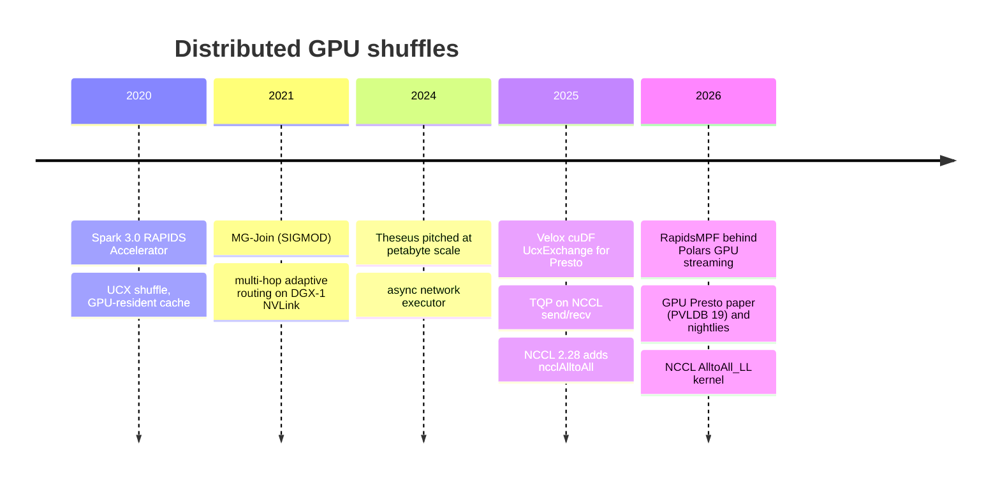
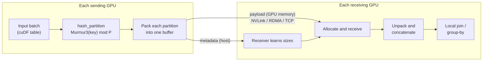
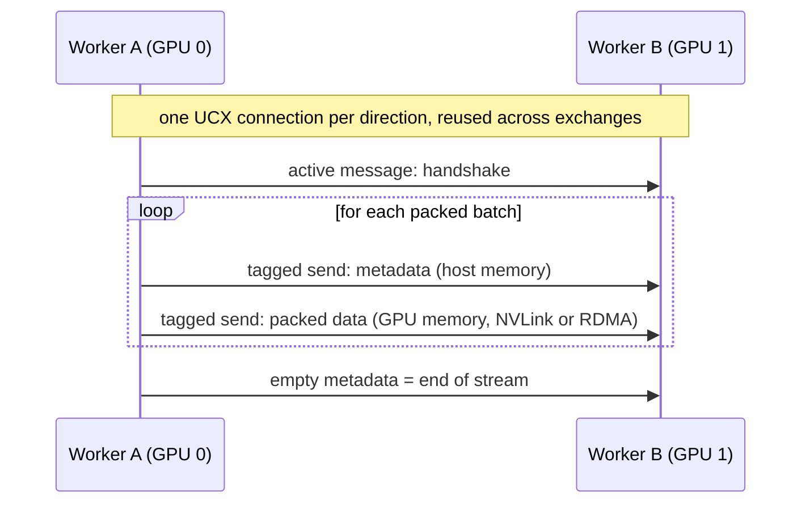

---
aliases:
  - GPU Shuffle
  - Distributed GPU Shuffle
  - GPU Exchange
  - RapidsMPF
tags:
  - gpu-programming
  - multi-gpu
  - shuffle
  - distributed-query-processing
  - databases
  - nccl
  - ucx
status: complete
sources:
  - https://docs.nvidia.com/rapidsmpf/26.12/background/shuffle-architecture/
  - https://docs.nvidia.com/rapidsmpf/26.12/
  - https://pola.rs/posts/gpu-streaming-backend
  - https://docs.nvidia.com/cudf-spark/latest/additional-functionality/rapids-shuffle.html
  - https://developer.nvidia.com/blog/accelerating-apache-spark-3-0-with-gpus-and-rapids/
  - https://arxiv.org/pdf/2606.24647
  - https://developer.nvidia.com/blog/accelerating-large-scale-data-analytics-with-gpu-native-velox-and-nvidia-cudf
  - https://prestodb.io/blog/2026/06/24/gpu-accelerated-presto-c/
  - https://arxiv.org/html/2508.05029v1
  - https://www.comp.nus.edu.sg/~hebs/pub/mgjoin-sigmod21.pdf
  - https://www.vldb.org/pvldb/vol18/p4653-maltenberger.pdf
  - https://arxiv.org/html/2506.09226v2
  - https://arxiv.org/html/2512.02862v3
  - https://arxiv.org/pdf/2512.22036
  - https://docs.nvidia.com/deeplearning/nccl/release-notes/rel_2-28-3.html
  - https://docs.nvidia.com/deeplearning/nccl/release-notes/rel_2-32-6.html
  - https://docs.nvidia.com/cudf/26.12/libcudf/api_docs/reorder_partition/
  - https://spark.apache.org/docs/3.1.3/sql-performance-tuning.html
  - https://arxiv.org/html/2508.04701v3
created: 2026-11-28
updated: 2026-11-28
---

## Table Of Contents

---

- [[#TL;DR|TL;DR]]
- [[#The Problem|The Problem]]
- [[#Foundations|Foundations]]
    - [[#What a Shuffle Is|What a Shuffle Is]]
    - [[#Shuffle vs Broadcast|Shuffle vs Broadcast]]
    - [[#A Cost Model|A Cost Model]]
- [[#How We Got Here|How We Got Here]]
- [[#How It Works|How It Works]]
    - [[#The Pipeline - Partition, Pack, Send, Receive|The Pipeline: Partition, Pack, Send, Receive]]
    - [[#A Shuffle in NCCL|A Shuffle in NCCL]]
    - [[#UCX Exchanges - Spark RAPIDS and Velox|UCX Exchanges: Spark RAPIDS and Velox]]
    - [[#Streaming Shuffles - RapidsMPF|Streaming Shuffles: RapidsMPF]]
    - [[#Topology - When All-to-All Is Not Uniform|Topology: When All-to-All Is Not Uniform]]
    - [[#Skew|Skew]]
- [[#Where It Is Now|Where It Is Now]]
- [[#Trade-offs & Open Problems|Trade-offs & Open Problems]]
- [[#Resources|Resources]]
- [[#Related Notes|Related Notes]]

## ***TL;DR***
---
*A distributed shuffle moves every row to the GPU that owns its key, so joins, group-bys and sorts can run locally on each GPU. On GPUs the local operators are so fast that the shuffle, not the compute, decides how well a query engine scales.*

- **What it is:** each GPU hash-partitions its rows into one bucket per destination, then every GPU sends every other GPU its bucket: an **all-to-all** exchange with uneven sizes ([RapidsMPF](https://docs.nvidia.com/rapidsmpf/26.12/background/shuffle-architecture/)).
- **Why it matters:** once operators run on [[GPU Databases and Dataframes|libcudf]], the old CPU-style exchange (serialize, write to disk, send over HTTP) becomes the bottleneck. Replacing Presto's HTTP exchange with a GPU-to-GPU UCX exchange made all 22 TPC-H queries at SF1000 on 8 A100s run in 93 s instead of 828 s ([Bauer et al., PVLDB 19, 2026](https://arxiv.org/pdf/2606.24647)).
- **The transports:** UCX (Spark RAPIDS, Velox, RapidsMPF, Theseus) picks NVLink inside a node and RDMA across nodes; NCCL send/recv groups (Microsoft's TQP, PystachIO) and, since NCCL 2.28, a native `ncclAlltoAll` ([NCCL 2.28.3](https://docs.nvidia.com/deeplearning/nccl/release-notes/rel_2-28-3.html)).
- **Where it is now (Nov 2026):** shuffles are *streaming* collectives that send chunks as they are produced and spill to host memory under pressure (RapidsMPF, behind Polars' GPU engine since cudf-polars 26.06); GPU Presto ships nightly images; research reaches TPC-H SF1000 in 0.53 s on 40 H100s ([Wu et al.](https://arxiv.org/html/2506.09226v2)).
- **The catch:** across nodes a GPU's NIC is roughly 10× slower than its NVLink, so shuffles eat most of the runtime at scale; skewed keys pile data onto one GPU; and most GPU engines still need the working set to fit in (aggregate) GPU memory.

## ***The Problem***
---
*A join on one GPU is a hash table and a probe. A join on 40 GPUs is first a question of moving terabytes so that matching keys meet, and the interconnect is two orders of magnitude slower than HBM.*

Relational operators that combine rows by key need all rows with the same key in one place:

| Operator | Why it needs a shuffle |
|---|---|
| Hash join | Build and probe rows with equal keys must meet in one hash table ([[Sorting and Hashing on GPUs]]) |
| Group-by (high cardinality) | All rows of a group must reach one aggregator; low-cardinality group-bys can pre-aggregate and need far less |
| Distinct, window functions | Same reason, per key or per partition key |
| Distributed sort | Range-partition by sampled splitters, then sort locally |

On CPUs this was the classic Hadoop/Spark shuffle: write partitioned files to local disk, then fetch them over the network. NVIDIA's 2020 Spark write-up lists the costs: shuffles involve "disk I/O, data serialization, and network I/O" ([NVIDIA, Jul 2020](https://developer.nvidia.com/blog/accelerating-apache-spark-3-0-with-gpus-and-rapids/)). On a CPU cluster those costs hide behind slow operators. On GPUs they do not:

- **The compute got 10× faster, the exchange did not.** In the GPU Presto work, exchange-heavy queries such as TPC-H Q9 ran more than 20× faster once the exchange moved to UCX, while Q1, which moves 4 rows, gained nothing ([Bauer et al.](https://arxiv.org/pdf/2606.24647)).
- **Shuffles dominate at scale.** Microsoft's TQP study measured that on 5 machines of 8 H100s, shuffle plus broadcast took 55.1% of TPC-H time over InfiniBand and 92.3% over Ethernet ([Wu et al.](https://arxiv.org/html/2506.09226v2)). MG-Join found communication taking up to 66% of a multi-GPU join on a DGX-1 ([Paul et al., SIGMOD 2021](https://www.comp.nus.edu.sg/~hebs/pub/mgjoin-sigmod21.pdf)). In distributed Sirius, whose exchange is built on NCCL, the shuffle was the bottleneck of TPC-H Q3 ([Yogatama et al.](https://arxiv.org/html/2508.04701v3)).
- **GPU memory is small.** A shuffle's output size is unknown until all input has been seen, and a GPU has tens to a few hundred GB. The exchange must spill, stream, or fail.

## ***Foundations***
---
*Three ideas carry the rest of the note: a shuffle is a variable-size all-to-all, a broadcast is its cheaper cousin for small tables, and the time of either is set by the slowest link and the most loaded GPU.*

### What a Shuffle Is

- **Rank:** one process per GPU. RapidsMPF uses exactly this "process-per-GPU" model ([RapidsMPF](https://docs.nvidia.com/rapidsmpf/26.12/background/shuffle-architecture/)).
- **Partition function:** a hash of the key columns modulo the number of partitions; each rank knows which partitions it owns. libcudf's `hash_partition` uses Murmur3 by default and returns `num_partitions + 1` offsets, where partition $i$ is rows `[offsets[i], offsets[i+1])` ([libcudf](https://docs.nvidia.com/cudf/26.12/libcudf/api_docs/reorder_partition/)).
- **All-to-all (v):** rank $i$ holds one bucket for each rank $j$ and ends with every rank's bucket for $j$ (the collective table is in [[Multi-GPU Communication - NVLink and NCCL]]). In a shuffle the buckets have different sizes, which is the "v" in MPI's `Alltoallv`.
- **Co-partitioning:** if both join inputs are partitioned with the same function and the same partition count, partition $k$ of the left side only ever meets partition $k$ of the right side, so the join finishes locally with no further communication.

### Shuffle vs Broadcast

| | Shuffle (hash/partitioned join) | Broadcast join |
|---|---|---|
| What moves | Both sides, each row once | Only the small side, copied to every GPU |
| Bytes per GPU (P GPUs) | $\approx S\cdot\frac{P-1}{P}$ of its own data | The whole small table |
| Scales with machines | Aggregate bandwidth grows | Gets worse: every new machine needs another copy |
| Used when | Both sides large | One side small (Spark's default cut-off: `spark.sql.autoBroadcastJoinThreshold`, 10 MB ([Spark](https://spark.apache.org/docs/3.1.3/sql-performance-tuning.html))) |

TQP's models make the scaling difference concrete: shuffle throughput grows as $\frac{V^2}{V-1}B_n$ with $V$ machines, while broadcast throughput falls as $\frac{N}{N-1}\min(B_n, B_g)$ ([Wu et al.](https://arxiv.org/html/2506.09226v2)). Theseus picks between the two at run time: each side first estimates and broadcasts how many bytes it would receive, then chooses hash partitioning or broadcast ([Aramburú et al., 2025](https://arxiv.org/html/2508.05029v1)).

### A Cost Model

With $V$ nodes of $G$ GPUs each ($P = GV$ GPUs), each GPU holding $S$ bytes, and keys spread uniformly, a GPU keeps $\frac{1}{P}$ of its data, sends $\frac{G-1}{P}S$ to GPUs in its own node and $\frac{V-1}{V}S$ to other nodes. If intra-node and inter-node transfers overlap:

$$
T_{\text{shuffle}} \approx \max\!\left(\frac{\frac{G-1}{P}\,S}{B_{\text{NVLink}}},\; \frac{\frac{V-1}{V}\,S}{B_{\text{NIC}}}\right)
$$

*In words:* the shuffle takes as long as the slower of two pipes: the small share that stays inside the node over NVLink, and the large share that leaves the node over the per-GPU NIC.

*Worked example.* A 1 TB table spread over 5 nodes × 8 H100 ($P = 40$, $S = 25$ GB per GPU). H100 NVLink is 900 GB/s bidirectional, about 450 GB/s per direction ([[Multi-GPU Communication - NVLink and NCCL]]); one 400 Gb/s NIC per GPU gives 50 GB/s.

- Intra-node: $\frac{7}{40}\times 25 = 4.4$ GB at 450 GB/s ≈ **10 ms**.
- Inter-node: $\frac{4}{5}\times 25 = 20$ GB at 50 GB/s ≈ **0.4 s**.

The network share takes about 40× longer (more bytes over a link 9× slower), which is why the TQP study found shuffle time dominating once a query left a single machine. The same model on one 8-GPU node ($V = 1$) has no network term at all, which is why single-node results look so much better than multi-node ones.

## ***How We Got Here***
---
*GPU shuffles started as a plug-in to Spark's shuffle, became research joins tuned to NVLink topologies, and are now standalone streaming libraries that several query engines share.*



- **Spark RAPIDS (2020).** NVIDIA's accelerated shuffle was "built upon the GPU-accelerated Unified Communication X (UCX) library": shuffle data stayed cached on the producing GPU, NVLink moved it between GPUs in a node at 300 GB/s, and RDMA moved it across nodes at up to 100 Gb/s ([NVIDIA, Jul 2020](https://developer.nvidia.com/blog/accelerating-apache-spark-3-0-with-gpus-and-rapids/)).
- **Topology-aware research joins (2021).** On a DGX-1 the NVLink mesh is not fully connected; MG-Join found PCIe involved in 63% of direct GPU-to-GPU routes and routed 2 MB packets through intermediate GPUs instead ([Paul et al.](https://www.comp.nus.edu.sg/~hebs/pub/mgjoin-sigmod21.pdf)).
- **Standalone distributed engines (2024 to 2025).** Voltron Data's Theseus built a dedicated networking executor with TCP and UCX back ends, compression and a pinned host bounce-buffer pool ([Aramburú et al.](https://arxiv.org/html/2508.05029v1)). IBM and NVIDIA added a UCX exchange to Velox for Presto ([NVIDIA, Oct 2025](https://developer.nvidia.com/blog/accelerating-large-scale-data-analytics-with-gpu-native-velox-and-nvidia-cudf)).
- **Borrowing ML collectives (2025).** Microsoft's TQP built shuffles from NCCL/RCCL point-to-point calls, running the same code on NVIDIA and AMD clusters ([Wu et al.](https://arxiv.org/html/2506.09226v2)). NCCL 2.28 then added host `ncclAlltoAll`, `ncclScatter` and `ncclGather` ([NCCL 2.28.3](https://docs.nvidia.com/deeplearning/nccl/release-notes/rel_2-28-3.html)).
- **Shared streaming libraries (2026).** RapidsMPF factored the shuffle out of any single engine; Polars' GPU engine moved onto it in cudf-polars 26.06, replacing a Dask-based executor from 25.06 ([Polars, Aug 2026](https://pola.rs/posts/gpu-streaming-backend)).

## ***How It Works***
---
*Every GPU shuffle has the same four steps: hash-partition rows on the GPU, pack each partition into a contiguous buffer, move buffers over the fastest available link, and reassemble tables on the receiver. Engines differ in transport, in whether they stream, and in what happens when memory runs out.*

### The Pipeline - Partition, Pack, Send, Receive



1. **Partition.** A GPU kernel hashes the key columns and scatters rows into $P$ contiguous ranges; this is a histogram, a [[Parallel Reduction and Scan|prefix sum]] over it, and a scatter, the same pattern as one pass of radix sort ([[Sorting and Hashing on GPUs]]).
2. **Pack.** Columns of a partition (data, validity masks, string offsets and chars, see [[GPU String Processing]]) are copied into one contiguous buffer so the transport sends one message per destination instead of one per column. Velox's `CudfPartitionedOutput` "packs and hash-partitions" cuDF tables into per-destination queues ([Bauer et al.](https://arxiv.org/pdf/2606.24647)).
3. **Send metadata, then data.** The receiver needs sizes before it can allocate. GPU Presto sends CPU-resident metadata (schema and size) first, then the GPU-resident packed data, and an empty metadata message to signal the end (same source). The NCCL approach exchanges sizes in a first round (below).
4. **Receive and reassemble.** Received buffers are unpacked into tables and concatenated or fed straight to the next operator.

### A Shuffle in NCCL

The TQP design uses `ncclSend`/`ncclRecv` pairs inside one group so each pair can carry a different size, with sizes exchanged first so receive buffers can be preallocated ([Wu et al.](https://arxiv.org/html/2506.09226v2)). A minimal sketch of that pattern:

```cpp
// Phase 1: every rank learns how many bytes it will receive from each peer.
ncclGroupStart();
for (int p = 0; p < nranks; ++p) {
  if (p == rank) continue;
  ncclSend(dSendBytes + p, 1, ncclInt64, p, comm, stream);
  ncclRecv(dRecvBytes + p, 1, ncclInt64, p, comm, stream);
}
ncclGroupEnd();
cudaMemcpyAsync(hRecvBytes, dRecvBytes, nranks * sizeof(int64_t),
                cudaMemcpyDeviceToHost, stream);
cudaStreamSynchronize(stream);   // host needs the sizes to allocate

// ... allocate recvBuf with the summed size, prefix-sum offsets ...

// Phase 2: move the partitions themselves.
ncclGroupStart();
for (int p = 0; p < nranks; ++p) {
  if (p == rank) continue;       // own partition: a local cudaMemcpyAsync
  ncclSend(sendBuf + sendOff[p], hSendBytes[p], ncclUint8, p, comm, stream);
  ncclRecv(recvBuf + recvOff[p], hRecvBytes[p], ncclUint8, p, comm, stream);
}
ncclGroupEnd();
```

Line by line:

- **`ncclGroupStart` / `ncclGroupEnd`:** NCCL treats everything between them as one operation, so all the sends and receives are issued together and cannot deadlock waiting on each other's order.
- **Phase 1 loop:** each rank sends one 64-bit number (its bucket size for peer `p`) and receives one back. This is a tiny all-to-all of sizes.
- **`cudaMemcpyAsync` + `cudaStreamSynchronize`:** the sizes land in GPU memory, but the host must allocate the receive buffer, so it copies them back and waits. This sync is a real cost; PystachIO's "deferred synchronization" exists to hide hidden syncs like it ([Luo et al., 2026](https://arxiv.org/html/2512.02862v3)).
- **Phase 2 loop:** the actual data, sent as raw bytes (`ncclUint8`) from each partition's offset in the packed send buffer to the matching offset in the receive buffer.
- **`p == rank`:** a rank's own partition never touches the network; it is a device-local copy.

Since NCCL 2.28 the fixed-size case also has `ncclAlltoAll`, and the copy-engine collectives free SMs for the application during it ([NCCL 2.28.3](https://docs.nvidia.com/deeplearning/nccl/release-notes/rel_2-28-3.html)); a later release adds an experimental latency-oriented `AlltoAll_LL` kernel for small per-peer messages ([NCCL 2.32.6](https://docs.nvidia.com/deeplearning/nccl/release-notes/rel_2-32-6.html)). Variable-size shuffles still use grouped send/recv or a padded layout.

### UCX Exchanges - Spark RAPIDS and Velox

UCX is a communication library that chooses a transport per pair of endpoints. Query engines like it because it fits their existing point-to-point exchange model better than collectives do.



- **GPU Presto / Velox `UcxExchange`.** Uses UCX tagged send/receive for asynchronous transfers and active messages for the handshake; UCX "selects NVLink within a machine, RDMA across machines, or TCP as a fallback"; each worker pair keeps one connection per direction, reused because setup is costly; a single-threaded communicator drives UCX; sends block when queues pass a threshold ([Bauer et al.](https://arxiv.org/pdf/2606.24647)). NVIDIA's earlier measurement put it at more than 6× faster than Presto's HTTP exchange on a DGX A100 ([NVIDIA, Oct 2025](https://developer.nvidia.com/blog/accelerating-large-scale-data-analytics-with-gpu-native-velox-and-nvidia-cudf)).
- **Spark RAPIDS Shuffle Manager.** Two modes. The default *Multi-Threaded* mode is "similar to the built-in Spark shuffle" with a 20-thread pool for compression and I/O. *UCX* mode has "a spillable cache, and a transport": shuffle output stays in the producing GPU's memory, spills to host and then disk under pressure, local tasks "short-circuit read from the cache", and remote blocks move GPU-to-GPU over NVLink, PCIe, InfiniBand, RoCE or TCP through device and host bounce-buffer pools sized below the GPU's PCIe BAR ([Spark RAPIDS docs](https://docs.nvidia.com/cudf-spark/latest/additional-functionality/rapids-shuffle.html)). It cannot use Spark's external shuffle service, so dynamic allocation must be off.

### Streaming Shuffles - RapidsMPF

A blocking shuffle waits for all input, then moves everything. A **streaming** shuffle moves chunks while the producers are still running, which overlaps communication with compute and bounds memory.

RapidsMPF's collective has four steps ([RapidsMPF](https://docs.nvidia.com/rapidsmpf/26.12/background/shuffle-architecture/)):

1. Every rank creates the collective (identified by a `tag` that must match on all ranks; several can run at once).
2. Each rank **inserts** chunks; each chunk goes to the rank that owns its hash key "as soon as it arrives" ([Polars](https://pola.rs/posts/gpu-streaming-backend)).
3. Each rank inserts a **finish marker** after its last chunk.
4. Each rank **extracts** the chunks it owns, which may block until they are ready.

Design choices that matter:

- **The library allocates outputs.** "rapidsmpf is responsible for allocation of output Buffers," because output size is unknown until all input is seen; it "never interprets your data: it just sends and receives bytes" (RapidsMPF docs).
- **Spilling is built in.** Under memory pressure, chunks move from device memory to host memory and come back when extracted, so a shuffle larger than GPU memory still completes ([Polars](https://pola.rs/posts/gpu-streaming-backend)).
- **Transport is pluggable.** A Communicator over UCX/UCXX or MPI handles CPU and GPU data the same way; going from one GPU to many "is therefore a change in rank count rather than in program structure" (same source).
- **Backpressure.** Polars' operators are actors linked by bounded channels, so "a slow consumer throttles its producer" (same source).

Theseus reaches the same goals with different machinery: separate Compute, Memory, Pre-loading and Networking executors, Batch Holders that can always store a batch somewhere, and its own spilling, which its authors found an order of magnitude faster than relying on [[Unified Memory]] ([Aramburú et al.](https://arxiv.org/html/2508.05029v1)).

### Topology - When All-to-All Is Not Uniform

The cost model assumes every GPU pair has the same bandwidth. That holds on NVSwitch systems (HGX H100/B200, NVL72) but not on older meshes:

- **DGX-1 (V100, hybrid cube mesh).** MG-Join forwarded 2 MB packets through up to 3 intermediate GPUs, choosing each batch's route by link cost plus current queueing delay. It reported up to 97% bisection-bandwidth use on eight GPUs, up to 2.35× more transfer throughput than direct routing, and 3.6× faster joins than the prior best on average ([Paul et al.](https://www.comp.nus.edu.sg/~hebs/pub/mgjoin-sigmod21.pdf)).
- **NVSwitch (DGX H100).** Maltenberger, Tolovski and Rabl's multi-GPU sort-merge join does an all-to-all bucket exchange over peer-to-peer NVLink in its radix sort and reaches 3.9× from 1 to 8 GPUs; it beats non-P2P multi-GPU joins by 8.7× ([PVLDB 18, 2025](https://www.vldb.org/pvldb/vol18/p4653-maltenberger.pdf)).
- **Across nodes,** the NIC dominates, and GPUDirect RDMA is only a win when the GPU and NIC share a PCIe switch. Spark RAPIDS' own example shows a cross-node GPU-to-GPU transfer at about 4.6 GB/s *with* GPUDirect RDMA and 6.1 GB/s without, on a machine where GPUs and NICs hang off the root complex ([Spark RAPIDS docs](https://docs.nvidia.com/cudf-spark/latest/additional-functionality/rapids-shuffle.html); see [[GPUDirect RDMA and Storage]]).

### Skew

Hash partitioning only balances load if keys are spread evenly. If one key holds a fraction $f$ of $N$ rows, the GPU that owns it receives at least $fN$ rows against an average of $N/P$:

$$
\text{imbalance} \ge f \cdot P
$$

*In words:* a hot key makes one GPU do $fP$ times the average work, and the whole stage waits for it. *Worked example:* a key with 10% of the rows on 40 GPUs ($f = 0.1$, $P = 40$) gives one GPU at least 4× the average share; the shuffle and the join after it both take roughly 4× longer than the balanced case.

What engines do about it:

- **Split and replicate.** Spark's adaptive execution treats a partition as skewed if it is more than 5× the median and above 256 MB, then splits it and replicates the matching side ([Spark](https://spark.apache.org/docs/3.1.3/sql-performance-tuning.html)); the RAPIDS plugin runs under Spark's planner.
- **Selective broadcast.** MG-Join assigns partitions with a migration and selective-broadcast scheme adapted from CPU joins ([Paul et al.](https://www.comp.nus.edu.sg/~hebs/pub/mgjoin-sigmod21.pdf)).
- **Sort instead of hash.** The DGX H100 sort-merge join *gets faster* as Zipf skew rises (5% to 12% shorter joins) because ranges, not hashes, decide placement ([Maltenberger et al.](https://www.vldb.org/pvldb/vol18/p4653-maltenberger.pdf)).
- **Compact tiny batches.** In production, skewed joins in GPU Presto produced "many millions of small vectors" that saturated cuDF, so the authors added optional compaction before sending ([Bauer et al.](https://arxiv.org/pdf/2606.24647)).

The same problem on a CPU cluster is in [[Hot Keys and Cache Stampedes]] and [[Partitioning]].

## ***Where It Is Now***
---
*As of late November 2026: shuffles run GPU-to-GPU over UCX or NCCL in every serious GPU query engine, streaming designs with spilling are replacing blocking ones, and the best published numbers come from single NVSwitch nodes or InfiniBand clusters with one NIC per GPU.*

| System | Shuffle | Status (date) | Source |
|---|---|---|---|
| RapidsMPF | Streaming collectives (shuffle, AllGather) over UCX/UCXX or MPI, with spilling | Docs at 26.12; streaming engine called "nascent" | [RapidsMPF](https://docs.nvidia.com/rapidsmpf/26.12/) |
| Polars GPU engine | RapidsMPF streaming backend; Ray, Dask or SPMD launchers | Since cudf-polars 26.06 (Aug 2026 post) | [Polars](https://pola.rs/posts/gpu-streaming-backend) |
| GPU Presto (Velox cuDF) | `UcxExchange`; no GPU-to-CPU spill yet | Nightly images since Jun 2026, "Do not run this in production"; paper in PVLDB 19 | [Presto](https://prestodb.io/blog/2026/06/24/gpu-accelerated-presto-c/), [Bauer et al.](https://arxiv.org/pdf/2606.24647) |
| Spark RAPIDS (cuDF plugin for Spark) | Multi-Threaded (default) or UCX mode; UCX 1.19.1 minimum | Current docs | [Spark RAPIDS](https://docs.nvidia.com/cudf-spark/latest/additional-functionality/rapids-shuffle.html) |
| Theseus | Async network executor, TCP or UCX, compression, adaptive shuffle-vs-broadcast | Paper Aug 2025 | [Aramburú et al.](https://arxiv.org/html/2508.05029v1) |
| NCCL | `ncclAlltoAll` (2.28); experimental `AlltoAll_LL` | Release notes, 2026 | [2.28.3](https://docs.nvidia.com/deeplearning/nccl/release-notes/rel_2-28-3.html), [2.32.6](https://docs.nvidia.com/deeplearning/nccl/release-notes/rel_2-32-6.html) |

Numbers worth knowing:

- **GPU Presto (PVLDB 19, Jun 2026).** 8×A100, TPC-H-like SF1000: 93 s with `UcxExchange` vs 828 s with HTTP; with NVLink disabled, 269 s. At SF10K, 8 B200s took 179.6 s and 24 GB200s took 73.2 s; SF30K finished in about 4.5 minutes on 24 to 40 GB200s ([Bauer et al.](https://arxiv.org/pdf/2606.24647)).
- **Polars GPU streaming (Aug 2026).** PDS-H SF3K on 8 B200s: 48.2 s vs 1,118.3 s on a dual-socket Xeon, 23.2×; PDS-DS 11.0× ([Polars](https://pola.rs/posts/gpu-streaming-backend)).
- **TQP (Microsoft, 2025).** TPC-H SF1000 in 0.53 s on 40 H100s over InfiniBand, 1.3 s at SF3000; shuffle microbenchmarks reached 3.1 TB/s on one 8-GPU VM and 1.8 TB/s across four ([Wu et al.](https://arxiv.org/html/2506.09226v2)).
- **Theseus.** All TPC-H and TPC-DS queries at SF100K on as few as two DGX A100 nodes; up to 4× faster than Databricks Photon at cost parity ([Aramburú et al.](https://arxiv.org/html/2508.05029v1)).
- **PystachIO (2026).** Overlapping NCCL all-to-all with partitioning and probing over 200G RoCE raised a join's network use from under 50% of line rate to more than 17 of 22.3 GiB/s ([Luo et al.](https://arxiv.org/html/2512.02862v3)).

The same machinery appears outside databases. Expert parallelism in [[Mixture of Experts]] is a shuffle of tokens to experts; FUSCO fuses the layout transform into the all-to-all and reports up to 3.84× over NCCL and 2.01× over DeepEP on 8 H100 nodes ([Zhu et al., Dec 2025](https://arxiv.org/pdf/2512.22036)). Distributed FFTs do the same transpose ([[FFT on GPUs]]).

## ***Trade-offs & Open Problems***
---
*The shuffle is where GPU query engines lose their advantage: the network is slow, memory is small, and skew concentrates both problems on one GPU. Most open work is about scheduling, not kernels.*

- **Network vs NVLink.** Inside an NVSwitch node a shuffle is nearly free; across nodes it dominates. TQP projects that adding machines stops helping beyond about six ([Wu et al.](https://arxiv.org/html/2506.09226v2)). Placement that keeps exchanges inside the scale-up domain ([[Gang and Topology-Aware Scheduling]]) matters as much as transport tuning.
- **Memory.** GPU Presto requires the working set to fit in GPU memory and has no GPU-to-CPU spill yet ([Bauer et al.](https://arxiv.org/pdf/2606.24647)); RapidsMPF and Theseus spill, at the cost of host-memory bandwidth. Flow control is still local (blocking when queues fill); the Presto authors call resource-aware global scheduling future work.
- **Small exchanges.** UCX and NCCL have per-message overheads, and the size-exchange round needs a host sync. Queries that move little data (TPC-H Q1) see no gain or a small loss ([Bauer et al.](https://arxiv.org/pdf/2606.24647)). Batching and compaction trade latency for efficiency.
- **Compression.** Compressing batches before sending (Theseus does) trades GPU time for network bytes; it wins across nodes and usually loses over NVLink ([[GPU Data Compression]]).
- **SMs used for communication.** Kernel-driven collectives borrow SMs from the query; NCCL's copy-engine path for `ncclAlltoAll` exists to give them back ([NCCL 2.28.3](https://docs.nvidia.com/deeplearning/nccl/release-notes/rel_2-28-3.html)). GPU-initiated transfers (NVSHMEM, NCCL's device API) could let operators push rows directly, but no shipping query engine does this yet.
- **Skew.** Splitting and replicating needs sizes that only exist after the shuffle starts. Adaptive, skew-aware partitioning on GPUs is still mostly research.
- **Fault tolerance.** TQP relies on re-executing the query ([Wu et al.](https://arxiv.org/html/2506.09226v2)); Spark RAPIDS' UCX mode keeps shuffle data in executor GPU memory and cannot use Spark's external shuffle service, so shuffle data lives and dies with the executor that produced it ([Spark RAPIDS docs](https://docs.nvidia.com/cudf-spark/latest/additional-functionality/rapids-shuffle.html)).
- **Planners are not GPU-aware.** Presto's planner still plans for CPUs ([Bauer et al.](https://arxiv.org/pdf/2606.24647)); choosing shuffle vs broadcast vs partial aggregation with GPU costs in mind is open.

## ***Resources***
---
*Start with the RapidsMPF architecture page and the GPU Presto paper; read MG-Join for topology and TQP for the cost models.*

**Docs**
- [RapidsMPF Shuffle Architecture](https://docs.nvidia.com/rapidsmpf/26.12/background/shuffle-architecture/): NVIDIA, 26.12. The streaming collective, insert/finish/extract, spilling.
- [RapidsMPF documentation](https://docs.nvidia.com/rapidsmpf/26.12/): channels, actors, streaming engine.
- [RAPIDS Shuffle Manager](https://docs.nvidia.com/cudf-spark/latest/additional-functionality/rapids-shuffle.html): Spark RAPIDS UCX and Multi-Threaded modes, configs, `ucx_perftest` numbers.
- [libcudf partitioning API](https://docs.nvidia.com/cudf/26.12/libcudf/api_docs/reorder_partition/): `hash_partition`, `partition`, `round_robin_partition`.
- [NCCL 2.28.3 release notes](https://docs.nvidia.com/deeplearning/nccl/release-notes/rel_2-28-3.html) and [2.32.6](https://docs.nvidia.com/deeplearning/nccl/release-notes/rel_2-32-6.html): `ncclAlltoAll`, `AlltoAll_LL`.
- [Spark SQL performance tuning](https://spark.apache.org/docs/3.1.3/sql-performance-tuning.html): skew-join and broadcast thresholds.

**Papers**
- [Accelerating Presto with GPUs](https://arxiv.org/pdf/2606.24647): Bauer et al., IBM + NVIDIA, PVLDB 19, 2026. `UcxExchange`, skew compaction, scaling to GB200.
- [Theseus](https://arxiv.org/html/2508.05029v1): Aramburú et al., Voltron Data + CMU, Aug 2025. Async executors, adaptive exchange, spilling.
- [Terabyte-Scale Analytics in the Blink of an Eye](https://arxiv.org/html/2506.09226v2): Wu, Cui, Curino, Interlandi, Sen, Microsoft, 2025. NCCL shuffles, shuffle vs broadcast models.
- [MG-Join](https://www.comp.nus.edu.sg/~hebs/pub/mgjoin-sigmod21.pdf): Paul, Lu, He, Lau, SIGMOD 2021. Multi-hop adaptive routing.
- [Efficiently Joining Large Relations on Multi-GPU Systems](https://www.vldb.org/pvldb/vol18/p4653-maltenberger.pdf): Maltenberger, Tolovski, Rabl, PVLDB 18, 2025.
- [PystachIO](https://arxiv.org/html/2512.02862v3): Luo, Boeschen, El-Hindi, Binnig, 2026. Overlapping NCCL shuffles with storage and compute.
- [FUSCO](https://arxiv.org/pdf/2512.22036): Zhu et al., Dec 2025. Fusing layout transforms into MoE all-to-all.

**Posts**
- [GPU streaming backend for Polars](https://pola.rs/posts/gpu-streaming-backend): Polars, Aug 2026.
- [Accelerating Large-Scale Data Analytics with GPU-Native Velox and NVIDIA cuDF](https://developer.nvidia.com/blog/accelerating-large-scale-data-analytics-with-gpu-native-velox-and-nvidia-cudf): NVIDIA, Oct 2025.
- [GPU-Accelerated Presto C++ is Here](https://prestodb.io/blog/2026/06/24/gpu-accelerated-presto-c/): Presto, Jun 2026.
- [Accelerating Apache Spark 3.0 with GPUs and RAPIDS](https://developer.nvidia.com/blog/accelerating-apache-spark-3-0-with-gpus-and-rapids/): NVIDIA, Jul 2020. The original UCX shuffle.

## ***Related Notes***
---
*Read GPU Databases and Dataframes for the engines that call these shuffles, and NVLink and NCCL for the links underneath.*

- [[GPU Databases and Dataframes]] — The engines (cuDF, Polars, Presto, Spark, Theseus) whose joins and group-bys need shuffles.
- [[Multi-GPU Communication - NVLink and NCCL]] — The all-to-all collective, NVSwitch, and NCCL's send/recv and device APIs.
- [[GPUDirect RDMA and Storage]] — How shuffle data reaches the NIC without host copies, and when it does not help.
- [[Sorting and Hashing on GPUs]] — Hash partitioning, radix partitioning and the local join after the shuffle.
- [[Parallel Reduction and Scan]] — The histogram and prefix sum inside every partition kernel.
- [[GPU String Processing]] — Packing and moving variable-length string columns.
- [[GPU Data Compression]] — Compressing batches before they cross the network.
- [[Unified Memory]] — The spill fallback that Theseus found an order of magnitude slower than its own.
- [[Streams, Events and Async Execution]] — Overlapping partitioning, communication and probing.
- [[Mixture of Experts]] — Expert-parallel all-to-all, the same shuffle for tokens.
- [[FFT on GPUs]] — Distributed FFT transposes, another all-to-all.
- [[Coherent CPU-GPU Superchips]] — GH200 and GB200 nodes, where spilling to host memory is cheaper.
- [[Partitioning]] — Hash and range partitioning in distributed systems.
- [[Distributed SQL]] — Distributed query execution on CPU clusters.
- [[Hot Keys and Cache Stampedes]] — Skew, the same problem one level up.
- [[Gang and Topology-Aware Scheduling]] — Keeping chatty exchanges inside one NVLink domain.
- [[GPU-Initiated Communication with NVSHMEM]] — Device-side puts, a possible future transport for shuffles (planned).
- [[Fused MoE Kernels - Dispatch, Expert GEMM and Combine]] — Fusing the all-to-all into compute kernels (planned).
