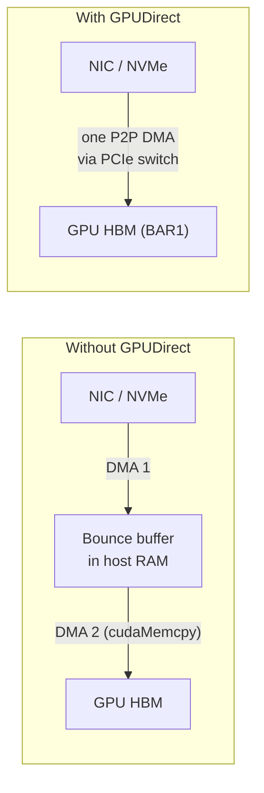
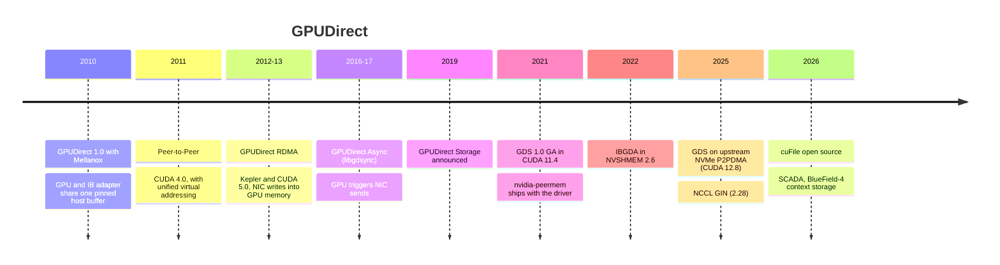
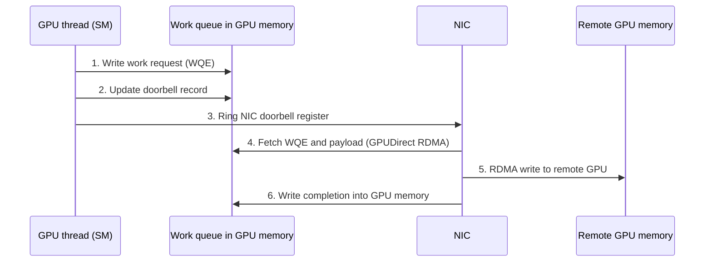

---
aliases:
  - GPUDirect
  - GPUDirect RDMA
  - GPUDirect Storage
  - GDS
tags:
  - gpu-programming
  - multi-gpu
  - gpudirect
  - rdma
  - storage
  - networking
status: complete
sources:
  - https://developer.nvidia.com/gpudirect
  - https://network.nvidia.com/pdf/whitepapers/TB_GPU_Direct.pdf
  - https://nvidianews.nvidia.com/news/new-cuda-4-0-release-makes-parallel-programming-easier
  - https://docs.nvidia.com/cuda/gpudirect-rdma/
  - https://download.nvidia.com/XFree86/Linux-x86_64/575.64/README/nvidia-peermem.html
  - https://docs.nvidia.com/datacenter/cloud-native/gpu-operator/24.6.0/gpu-operator-rdma.html
  - https://www.phoronix.com/news/RDMA-DMA-BUF-P2P-Linux-5.12
  - https://docs.kernel.org/6.18/driver-api/pci/p2pdma.html
  - https://github.com/gpudirect/libgdsync
  - https://developer.nvidia.com/blog/improving-network-performance-of-hpc-systems-using-nvidia-magnum-io-nvshmem-and-gpudirect-async
  - https://arxiv.org/abs/2511.15076v2
  - https://developer.nvidia.com/blog/fusing-communication-and-compute-with-new-device-api-and-copy-engine-collectives-in-nvidia-nccl-2-28/
  - https://github.com/deepseek-ai/DeepEP
  - https://developer.nvidia.com/blog/gpudirect-storage/
  - https://developer.nvidia.com/blog/accelerating-io-in-the-modern-data-center-magnum-io-storage/
  - https://docs.nvidia.com/gpudirect-storage/overview-guide/index.html
  - https://docs.nvidia.com/gpudirect-storage/api-reference-guide/index.html
  - https://docs.nvidia.com/gpudirect-storage/release-notes/index.html
  - https://developer.nvidia.com/blog/boosting-data-ingest-throughput-with-gpudirect-storage-and-rapids-cudf
  - https://github.com/rapidsai/kvikio/
  - https://developer.nvidia.com/blog/powering-next-generation-ai-networking-with-nvidia-supernics/
  - https://docs.nvidia.com/enterprise-reference-architectures/hgx-ai-factory/latest/networking-physical-topologies.html
  - https://www.blocksandfiles.com/ai-ml/2025/11/25/nvidia-scada-offloads-storage-control-path-to-the-gpu/1711995
  - https://blogs.nvidia.com/blog/ai-storage-fms/
  - https://www.storagereview.com/news/nvidia-scada-puts-storage-control-on-the-gpu-as-cufile-goes-open-source
  - https://nvidianews.nvidia.com/news/nvidia-bluefield-4-powers-new-class-of-ai-native-storage-infrastructure-for-the-next-frontier-of-ai
  - https://developer.nvidia.com/blog/enhancing-distributed-inference-performance-with-the-nvidia-inference-transfer-library
created: 2026-11-26
updated: 2026-11-26
---

## Table Of Contents

---

- [[#TL;DR|TL;DR]]
- [[#The Problem|The Problem]]
- [[#Foundations|Foundations]]
    - [[#DMA, BARs and Peer-to-Peer PCIe|DMA, BARs and Peer-to-Peer PCIe]]
    - [[#The Bounce Buffer|The Bounce Buffer]]
- [[#How We Got Here|How We Got Here]]
- [[#How It Works|How It Works]]
    - [[#GPUDirect RDMA|GPUDirect RDMA]]
    - [[#Two Kernel Paths - nvidia-peermem and dma-buf|Two Kernel Paths: nvidia-peermem and dma-buf]]
    - [[#GPUDirect Async - Taking the CPU Out of Control|GPUDirect Async: Taking the CPU Out of Control]]
    - [[#GPUDirect Storage|GPUDirect Storage]]
    - [[#A cuFile Read in Code|A cuFile Read in Code]]
    - [[#Topology Is Everything|Topology Is Everything]]
- [[#Where It Is Now|Where It Is Now]]
- [[#Trade-offs & Open Problems|Trade-offs & Open Problems]]
- [[#Resources|Resources]]
- [[#Related Notes|Related Notes]]

## ***TL;DR***
---
*GPUDirect is NVIDIA's family of features that let other devices (NICs, NVMe drives, other GPUs) move data straight into and out of GPU memory over PCIe, without first copying it through a buffer in CPU memory. RDMA does it for the network, Storage (GDS) for disks.*

- **The problem:** without GPUDirect, data from a NIC or SSD lands in host RAM, then a second DMA copies it to the GPU. That "bounce buffer" doubles memory traffic, adds latency and burns CPU time ([NVIDIA, 2019](https://developer.nvidia.com/blog/gpudirect-storage/)).
- **The trick:** the GPU exposes part of its memory through a PCIe BAR window. The NIC or NVMe controller DMAs straight to those addresses: a PCIe peer-to-peer transfer ([GPUDirect RDMA guide](https://docs.nvidia.com/cuda/gpudirect-rdma/)).
- **Family:** Peer-to-Peer (GPU to GPU, CUDA 4.0, 2011), RDMA (Kepler and CUDA 5.0), Async (the GPU also *triggers* the NIC, e.g. NVSHMEM's IBGDA and NCCL's GIN), Storage (cuFile API, GA in CUDA 11.4, 2021).
- **Where it is now (Nov 2026):** NVIDIA recommends the upstream Linux dma-buf path over its `nvidia-peermem` module, GDS uses the kernel's own NVMe P2PDMA since CUDA 12.8, cuFile went open source in August 2026, and the frontier is GPU-initiated I/O: GIN for networking, SCADA for storage.
- **The catch:** it only works well when GPU and device share a PCIe switch, it needs data-center or workstation GPUs, and every pinned byte spends a limited BAR1 budget.

## ***The Problem***
---
*A GPU's memory is fast, but the GPU sits at the end of a PCIe link with the CPU in the middle. Every byte that must reach it from the network or a disk normally makes two trips and wakes the CPU twice.*

Two workloads make this hurt:

- **Multi-node training and inference.** Every gradient all-reduce, expert all-to-all ([[Mixture of Experts]]) and KV-cache transfer between prefill and decode servers ([[LLM Serving]]) crosses the NIC. In [[GPU Cluster Infrastructure|rail-optimised clusters]] each GPU has its own 400 to 800 Gb/s NIC; the host path cannot keep up with eight of them.
- **Data loading.** Training data, checkpoints and offloaded [[KV Cache]] live on NVMe or network storage. NVIDIA's 2019 DGX-2 measurements found the CPU-memory-to-GPU path "limited to 50 GB/s", while the machine's local NVMe, NICs and RAID together could supply about 200 GB/s ([NVIDIA, 2019](https://developer.nvidia.com/blog/gpudirect-storage/)). The bottleneck was the detour, not the drives.

## ***Foundations***
---
*GPUDirect is ordinary PCIe machinery used in an unusual way: two devices doing DMA to each other instead of each doing DMA to host RAM.*

### DMA, BARs and Peer-to-Peer PCIe

- **DMA:** a device reads or writes memory itself, given physical (bus) addresses, without the CPU copying bytes.
- **BAR (base address register):** each PCIe device exposes "linear windows" of the physical address space; reads and writes to those addresses go to the device ([GPUDirect RDMA guide](https://docs.nvidia.com/cuda/gpudirect-rdma/)). The GPU's **BAR1** window can be mapped onto pages of its own memory.
- **Peer-to-peer DMA:** if a NIC is given BAR1 addresses instead of host RAM addresses, its DMA writes go straight into GPU memory. The PCIe switch routes the packets between the two devices without touching the CPU's memory.
- **Pinning:** the mapping must not move while the DMA runs, so the GPU pages are pinned and their physical addresses handed to the other device's driver. NVIDIA's kernel call for this is `nvidia_p2p_get_pages()`, "an expensive operation [that] should be performed as infrequently as possible" (same source). The Linux equivalent concept is P2PDMA, which gives such memory "ZONE_DEVICE `struct pages` so that it may be used with any DMA request" ([kernel docs](https://docs.kernel.org/6.18/driver-api/pci/p2pdma.html)).

### The Bounce Buffer



Both GPUDirect RDMA and GPUDirect Storage "avoid extra copies through a bounce buffer in the CPU's memory" ([NVIDIA, 2019](https://developer.nvidia.com/blog/gpudirect-storage/)). A rough model of what that buys:

$$
B_{\text{bounce}} \le \min\!\left(B_{\text{dev}},\; B_{\text{host→GPU}},\; \frac{B_{\text{DRAM}}}{2}\right)
\qquad
B_{\text{direct}} \le \min\!\left(B_{\text{dev}},\; B_{\text{PCIe link}}\right)
$$

*In words:* through a bounce buffer, throughput is capped by the slowest of the device, the host-to-GPU path, and half the host memory bandwidth (each byte is written to DRAM and read back). Directly, only the device and its PCIe link matter, and with one NIC or SSD set per PCIe switch, all switches can run in parallel. *Worked example (DGX-2, 2019):* host path capped at 50 GB/s; direct paths summed to about 200 GB/s, roughly 4x, and NVIDIA measured "end-to-end latency decreased by 3.8x on 80 GB of data" ([NVIDIA, 2019](https://developer.nvidia.com/blog/gpudirect-storage/)).

## ***How We Got Here***
---
*Each GPUDirect generation removed one more hop: first a host-side copy, then the host entirely for GPU-to-GPU, then for NIC-to-GPU, then for disk-to-GPU, and finally the CPU from the control path too.*



| When | Step | What it removed | Source |
|---|---|---|---|
| May 2010 | GPUDirect (with Mellanox) | One host memcpy; GPU and IB adapter "share the same system memory". NVIDIA/Mellanox claimed 30% lower GPU-to-GPU communication time | [Mellanox brief](https://network.nvidia.com/pdf/whitepapers/TB_GPU_Direct.pdf) |
| Feb 2011 | Peer-to-Peer, CUDA 4.0 | The host staging copy for GPU-to-GPU "within a single server" | [NVIDIA](https://nvidianews.nvidia.com/news/new-cuda-4-0-release-makes-parallel-programming-easier) |
| 2012 to 2013 | RDMA | Host RAM on the NIC path: "introduced in Kepler-class GPUs and CUDA 5.0"; NIC and MPI support followed in 2013 to 2014 | [RDMA guide](https://docs.nvidia.com/cuda/gpudirect-rdma/) |
| ~2016 | Async (libgdsync) | CPU from the *trigger*: "moving control logic from third-party devices to the GPU"; a prototype needing CUDA 8 | [libgdsync](https://github.com/gpudirect/libgdsync) |
| Aug 2019 / Aug 2021 | Storage | Host RAM on the disk path; "Release v1.0 with CUDA 11.4" | [2019 blog](https://developer.nvidia.com/blog/gpudirect-storage/), [2021 blog](https://developer.nvidia.com/blog/accelerating-io-in-the-modern-data-center-magnum-io-storage/) |
| Nov 2022 | IBGDA in NVSHMEM 2.6 | The CPU proxy thread for network control | [NVIDIA, 2022](https://developer.nvidia.com/blog/improving-network-performance-of-hpc-systems-using-nvidia-magnum-io-nvshmem-and-gpudirect-async) |

## ***How It Works***
---
*Data path and control path are separate problems. RDMA and Storage fix the data path; Async and GIN fix the control path, so the GPU can start I/O without waiting for a CPU thread.*

### GPUDirect RDMA

*With RDMA, a remote NIC writes into GPU memory as if it were ordinary registered memory. The application registers a `cudaMalloc` pointer with the RDMA stack, and the NIC does the rest.*

- **Registration:** with the classic path, the application calls `ibv_reg_mr()` on a GPU pointer; the RDMA core asks a "peer memory client" (the NVIDIA module) to pin the GPU pages and return their bus addresses ([nvidia-peermem README](https://download.nvidia.com/XFree86/Linux-x86_64/575.64/README/nvidia-peermem.html)).
- **Page size:** GPU pages are 64 KB (CPU pages are usually 4 KB) and BAR1 is mapped in 64 KB chunks, so buffers should be aligned to 64 KB ([RDMA guide](https://docs.nvidia.com/cuda/gpudirect-rdma/)).
- **Ordering:** "Only CUDA synchronization and work submission APIs provide memory ordering of GPUDirect RDMA operations." A kernel cannot assume a NIC write has landed just because the NIC said so; it needs a CUDA-ordered signal (same source).
- **What is not supported:** "CUDA Unified Memory is not explicitly supported in combination with GPUDirect RDMA" (same source), because [[Unified Memory|managed pages]] can migrate.
- **Who uses it:** NCCL's NET transport (see [[Multi-GPU Communication - NVLink and NCCL]]), MPI libraries such as MVAPICH2-GDR and Open MPI with UCX, NVSHMEM, and NIXL for KV-cache transfer.

### Two Kernel Paths - nvidia-peermem and dma-buf

| Path | How it works | Needs | Status |
|---|---|---|---|
| **nvidia-peermem** (was `nv_peer_mem`) | Plugs into MLNX_OFED's PeerDirect API, "an API between the InfiniBand Core and peer memory clients such as NVIDIA GPUs" | MLNX_OFED / DOCA-OFED; any supported driver | Legacy; ships with the driver since CUDA 11.4 |
| **dma-buf** | GPU memory exported as a Linux dma-buf fd; the RDMA stack registers it as a memory region (Linux 5.12) | Open GPU kernel module, CUDA 11.7+, Linux 5.12+ | "NVIDIA recommends using the DMA-BUF rather than using the `nvidia-peermem` kernel module" |

Sources: [nvidia-peermem README](https://download.nvidia.com/XFree86/Linux-x86_64/575.64/README/nvidia-peermem.html), [GPU Operator RDMA docs](https://docs.nvidia.com/datacenter/cloud-native/gpu-operator/24.6.0/gpu-operator-rdma.html), [Phoronix, 2021](https://www.phoronix.com/news/RDMA-DMA-BUF-P2P-Linux-5.12). The dma-buf route is the upstream, vendor-neutral way: the same kernel mechanism serves AMD and Intel GPUs, and it does not depend on an out-of-tree NVIDIA module.

### GPUDirect Async - Taking the CPU Out of Control

*RDMA removed the CPU from the bytes but not from the decisions. A CPU thread still had to notice the GPU was ready and ring the NIC's doorbell. GPUDirect Async lets an SM ring it.*



That is NVSHMEM's **IBGDA** transport (InfiniBand GPUDirect Async), introduced in NVSHMEM 2.6.0; it "eliminates the CPU from the communication control path". Against the older CPU-proxy transport (IBRC), on 4 DGX A100 nodes with 200 Gb/s ConnectX-6: small-message put rate rose from about 1.7 to about 180 million operations per second (the NIC's limit is about 215), and block-put throughput for messages under 1 KiB was up to 9.5x higher ([NVIDIA, 2022](https://developer.nvidia.com/blog/improving-network-performance-of-hpc-systems-using-nvidia-magnum-io-nvshmem-and-gpudirect-async)).

NCCL followed in 2.28 with **GPU-Initiated Networking (GIN)**, part of its device API ([NCCL 2.28](https://developer.nvidia.com/blog/fusing-communication-and-compute-with-new-device-api-and-copy-engine-collectives-in-nvidia-nccl-2-28/)). The GIN paper describes two backends: **GDAKI** (GPUDirect Async Kernel-Initiated, built on DOCA GPUNetIO, ConnectX-6 Dx or newer) and a **Proxy** backend over "lock-free GPU-to-CPU queues" for any RDMA NIC. On H100 nodes of NVIDIA's EOS cluster, small put-with-signal round trips took 16.7 µs with GDAKI versus 24.3 µs for NVSHMEM IBGDA, and DeepEP's low-latency MoE kernels ran about 9% faster on GIN than on NVSHMEM ([GIN paper](https://arxiv.org/abs/2511.15076v2)). DeepSeek's DeepEP V2 "switched from the NVSHMEM backend to the more lightweight NCCL Gin backend" ([DeepEP](https://github.com/deepseek-ai/DeepEP)).

### GPUDirect Storage

*GDS does for files what RDMA does for the network: the NVMe controller (or a storage NIC) DMAs file blocks straight into GPU memory. Programs reach it through the cuFile API instead of `read()`.*

- **Components:** the user library `libcufile.so` and, originally, the kernel driver `nvidia-fs.ko`, which handles the DMA setup ([GDS overview](https://docs.nvidia.com/gpudirect-storage/overview-guide/index.html)). Since CUDA 12.8 (GDS 1.13), local NVMe can instead use the kernel's upstream PCI P2PDMA, with no `nvidia-fs.ko` and no patched NVMe driver; it needs Linux 6.2+ and the open kernel module 570 or later (same source; [release notes](https://docs.nvidia.com/gpudirect-storage/release-notes/index.html)).
- **Compat mode:** for unsupported setups, cuFile "maps IO operations to a fallback path" through CPU memory, so the same code runs everywhere, just without the speedup ([GDS overview](https://docs.nvidia.com/gpudirect-storage/overview-guide/index.html)). GeForce GPUs and DGX Spark run only in compat mode ([release notes](https://docs.nvidia.com/gpudirect-storage/release-notes/index.html)).
- **File systems:** ext4 and XFS on local NVMe, NFS over RDMA, Lustre (DDN EXAScaler, AWS FSx), WekaFS, VAST, BeeGFS, IBM Storage Scale (GPFS), and others; ZFS, Btrfs, tmpfs and OverlayFS are compat-only (same source).
- **APIs:** blocking `cuFileRead`/`cuFileWrite` (like `pread`/`pwrite`), stream-ordered `cuFileReadAsync`/`cuFileWriteAsync` (since GDS 1.7, CUDA 12.2), and a batch API (`cuFileBatchIOSubmit`, then poll `cuFileBatchIOGetStatus`) ([cuFile API](https://docs.nvidia.com/gpudirect-storage/api-reference-guide/index.html)).
- **Measured gains:** at GA NVIDIA reported "3x lower latency" as common, about 3x better CPU utilisation, and 185+ GB/s from 8 NICs on a DGX A100 ([NVIDIA, 2021](https://developer.nvidia.com/blog/accelerating-io-in-the-modern-data-center-magnum-io-storage/)). RAPIDS cuDF saw "up to 3–4x higher" read throughput on some files, 30 to 50% on average for files of 512 MiB and up ([NVIDIA, 2022](https://developer.nvidia.com/blog/boosting-data-ingest-throughput-with-gpudirect-storage-and-rapids-cudf)).

### A cuFile Read in Code

*Register the file, optionally register the GPU buffer, then read file bytes straight into device memory.*

```cpp
int fd = open("shard.bin", O_RDONLY | O_DIRECT);        // 1
CUfileDescr_t d = {};
d.handle.fd = fd;
d.type = CU_FILE_HANDLE_TYPE_OPAQUE_FD;
CUfileHandle_t fh;
cuFileHandleRegister(&fh, &d);                          // 2
void* dev; cudaMalloc(&dev, size);
cuFileBufRegister(dev, size, 0);                        // 3
ssize_t n = cuFileRead(fh, dev, size, /*file_off*/ 0,   // 4
                       /*dev_off*/ 0);
cuFileBufDeregister(dev);                               // 5
cuFileHandleDeregister(fh); close(fd);
```

1. Open the file normally. `O_DIRECT` bypasses the [[Page Cache and Memory Reclaim|page cache]]; cuFile also accepts non-`O_DIRECT` descriptors.
2. Wrap the POSIX descriptor in a cuFile handle. This also starts the driver session if `cuFileDriverOpen` was not called.
3. Pin the GPU buffer and map it into BAR1. This "incurs a significant performance cost", so do it once and reuse the buffer. It is optional: unregistered buffers go through cuFile's internal bounce buffers.
4. Read `size` bytes from offset 0 straight into GPU memory. Like `pread`, it blocks and returns the bytes read; it "works correctly for unaligned offsets and any data size", though aligned 4 KB I/O is fastest.
5. Unpin and clean up.

Source: [cuFile API reference](https://docs.nvidia.com/gpudirect-storage/api-reference-guide/index.html). From Python, RAPIDS **KvikIO** wraps the same calls (`kvikio.CuFile(path, "r").read(cupy_array)`) and "also works efficiently when GDS isn't available" ([KvikIO](https://github.com/rapidsai/kvikio/)).

### Topology Is Everything

*Peer-to-peer DMA is only as good as the PCIe path between the two devices. GPUDirect is designed around servers where each GPU and its NIC sit under the same PCIe switch.*

| Path between GPU and device | Result (per NVIDIA) |
|---|---|
| Through PCIe switches only | Best case |
| Through one CPU's root complex | Works, lower performance |
| Across CPU sockets (QPI/UPI) | May be "severely limited or unreliable" |

The two devices "must share the same upstream PCI Express root complex", and because GPUDirect RDMA assumes identical physical addresses for every device, the IOMMU must be off or in pass-through unless the driver uses `nvidia_p2p_dma_map_pages()` ([RDMA guide](https://docs.nvidia.com/cuda/gpudirect-rdma/)). This is why AI servers are wired **rail-optimised**: NVIDIA's HGX B300 reference architecture gives "each GPU ... a dedicated NVIDIA ConnectX-8 SuperNIC" at 800 Gb/s on a separate RDMA compute fabric, with storage on a different network through BlueField-3 DPUs ([NVIDIA reference architecture](https://docs.nvidia.com/enterprise-reference-architectures/hgx-ai-factory/latest/networking-physical-topologies.html)). ConnectX-8 offers "GPUDirect RDMA at speeds up to 800 Gb/s" ([NVIDIA, Oct 2024](https://developer.nvidia.com/blog/powering-next-generation-ai-networking-with-nvidia-supernics/)).

## ***Where It Is Now***
---
*As of November 2026: the plumbing is moving upstream into Linux, the control path is moving onto the GPU, and storage is being rebuilt around inference's appetite for small random reads of KV cache.*

- **Upstream kernel paths.** dma-buf for RDMA and P2PDMA for NVMe replace NVIDIA's out-of-tree modules on new installs. GDS 1.17 added dma-buf interop, 1.19 added scatter-gather cuFile APIs and RAID1/10 on NVMe; the current release is GDS 1.19.1, documented September 17, 2026 ([GDS release notes](https://docs.nvidia.com/gpudirect-storage/release-notes/index.html); [GDS overview](https://docs.nvidia.com/gpudirect-storage/overview-guide/index.html)).
- **GPU-initiated everything.** NCCL GIN (2.28, Nov 2025) brought IBGDA-style networking into the default collective library, and DeepEP V2 moved onto it ([GIN paper](https://arxiv.org/abs/2511.15076v2); [DeepEP](https://github.com/deepseek-ai/DeepEP)).
- **SCADA and open cuFile.** "Scaled Accelerated Data Access" moves the storage *control* path onto the GPU for small (<4 KB) random reads; at SC25 a Micron demo reached 230 million random-read IOPS from 44 PCIe Gen6 SSDs driven by three H100s ([Blocks & Files, Nov 2025](https://www.blocksandfiles.com/ai-ml/2025/11/25/nvidia-scada-offloads-storage-control-path-to-the-gpu/1711995)). In August 2026 NVIDIA said "cuFile is an open source component of NVIDIA GPUDirect Storage", with its "Storage-Next" effort counting "over 40 leading storage and flash vendors" ([NVIDIA, Aug 2026](https://blogs.nvidia.com/blog/ai-storage-fms/)). StorageReview reports the code lives in a new XIO-SIG GitHub organisation with Google, Intel, Meta and NVIDIA as founding maintainers, and calls SCADA the product of the BaM research line ([StorageReview, Aug 2026](https://www.storagereview.com/news/nvidia-scada-puts-storage-control-on-the-gpu-as-cufile-goes-open-source)).
- **KV cache as a storage workload.** NVIDIA's BlueField-4 storage platform (CES, Jan 2026) targets KV cache that "cannot be stored on GPUs long term", claiming up to 5x tokens per second, for H2 2026 ([NVIDIA, Jan 2026](https://nvidianews.nvidia.com/news/nvidia-bluefield-4-powers-new-class-of-ai-native-storage-infrastructure-for-the-next-frontier-of-ai)). NIXL, the transfer library under NVIDIA Dynamo, has GDS, NVMe, RDMA and object-storage backends behind one API ([NVIDIA, Mar 2026](https://developer.nvidia.com/blog/enhancing-distributed-inference-performance-with-the-nvidia-inference-transfer-library)).
- **Grace platforms.** On Grace Hopper ([[Coherent CPU-GPU Superchips]]), migratable memory (`cudaMallocManaged`, system-allocated) does not use the GDS P2P path and falls back to bounce buffers ([GDS overview](https://docs.nvidia.com/gpudirect-storage/overview-guide/index.html)); NICs still hang off PCIe, so GPUDirect RDMA into HBM is still the fast path.

## ***Trade-offs & Open Problems***
---
*GPUDirect trades generality for speed. It is fastest on carefully wired servers with the right drivers, and the hard parts are now operational: topology, pinning budgets, security and debugging.*

- **Topology dependence.** Cross-socket paths may be "severely limited or unreliable"; PCIe Access Control Services (ACS) on switches, meant for isolation, can force peer traffic up to the root complex; the kernel's P2PDMA only allows peer transfers between devices "behind the same PCI bridge" unless the host bridge is whitelisted ([kernel docs](https://docs.kernel.org/6.18/driver-api/pci/p2pdma.html)). Performance depends on how the server was built, not just which GPU it has.
- **Isolation vs speed.** GPUDirect assumes devices can DMA to each other freely, which means IOMMU off or pass-through. In multi-tenant and confidential-computing settings, that loosens the DMA isolation the IOMMU normally provides.
- **Pinning is finite and slow.** `nvidia_p2p_get_pages` and `cuFileBufRegister` are expensive and limited by BAR1 size; libraries keep registration caches, and cuFile falls back to compat mode when BAR1 runs out ([cuFile API](https://docs.nvidia.com/gpudirect-storage/api-reference-guide/index.html)).
- **Hardware gating.** RDMA is documented for data-center and workstation GPUs; GeForce runs GDS in compat mode only ([release notes](https://docs.nvidia.com/gpudirect-storage/release-notes/index.html)).
- **Ordering bugs.** NIC writes are not ordered against running kernels, and GPU-initiated designs need explicit fences and signal flags; mistakes show up as rare silent corruption or hangs.
- **Driver churn.** peermem vs dma-buf, nvidia-fs vs P2PDMA, proprietary vs open kernel modules: the right combination depends on kernel, CUDA and OFED versions, and the wrong one silently falls back to slower paths.
- **Small I/O.** GDS shines on large sequential reads. Inference wants millions of tiny random reads (KV blocks, embeddings), where per-request CPU overhead dominates; SCADA and BaM-style GPU-initiated storage are the bet, still early.

## ***Resources***
---
*The two NVIDIA guides (RDMA and GDS overview) are the reference; the IBGDA post and GIN paper explain the control-path half.*

**Primary**
- [GPUDirect RDMA guide](https://docs.nvidia.com/cuda/gpudirect-rdma/): BAR1, `nvidia_p2p_*`, topology, ordering, dma-buf (v13.4, Oct 2026).
- [GDS overview guide](https://docs.nvidia.com/gpudirect-storage/overview-guide/index.html), [cuFile API reference](https://docs.nvidia.com/gpudirect-storage/api-reference-guide/index.html), [GDS release notes](https://docs.nvidia.com/gpudirect-storage/release-notes/index.html).
- [nvidia-peermem README](https://download.nvidia.com/XFree86/Linux-x86_64/575.64/README/nvidia-peermem.html) and [GPU Operator RDMA page](https://docs.nvidia.com/datacenter/cloud-native/gpu-operator/24.6.0/gpu-operator-rdma.html): which kernel path to use.
- [Linux P2PDMA docs](https://docs.kernel.org/6.18/driver-api/pci/p2pdma.html).

**Posts and papers**
- [GPUDirect Storage: A Direct Path Between Storage and GPU Memory](https://developer.nvidia.com/blog/gpudirect-storage/): Thompson & Newburn, NVIDIA, Aug 2019.
- [Accelerating IO in the Modern Data Center: Magnum IO Storage](https://developer.nvidia.com/blog/accelerating-io-in-the-modern-data-center-magnum-io-storage/): NVIDIA, Aug 2021. GDS 1.0.
- [Improving Network Performance of HPC Systems Using NVSHMEM and GPUDirect Async](https://developer.nvidia.com/blog/improving-network-performance-of-hpc-systems-using-nvidia-magnum-io-nvshmem-and-gpudirect-async): NVIDIA, Nov 2022. IBGDA.
- [GPU-Initiated Networking for NCCL](https://arxiv.org/abs/2511.15076v2): Hamidouche et al., Nov 2025.
- [DeepEP](https://github.com/deepseek-ai/DeepEP): DeepSeek's MoE all-to-all library.
- [KvikIO](https://github.com/rapidsai/kvikio/): Python/C++ cuFile bindings.

**Where it is going**
- [NVIDIA SCADA puts storage control on the GPU](https://www.storagereview.com/news/nvidia-scada-puts-storage-control-on-the-gpu-as-cufile-goes-open-source): StorageReview, Aug 2026.
- [NVIDIA at FMS 2026](https://blogs.nvidia.com/blog/ai-storage-fms/): open cuFile, Storage-Next.

## ***Related Notes***
---
*NVLink covers GPU-to-GPU inside the rack; this note covers the PCIe side, toward NICs and disks.*

- [[Multi-GPU Communication - NVLink and NCCL]] — NCCL's NET transport is the main user of GPUDirect RDMA; its device API brings GIN.
- [[GPU Cluster Infrastructure]] — Rail-optimised fabrics, RoCE vs InfiniBand, at cluster scale.
- [[Kernel Bypass Networking]] — RDMA and verbs from the operating-system side.
- [[Unified Memory]] — Why migratable memory and GPUDirect do not mix.
- [[Streams, Events and Async Execution]] — Stream ordering, which GDS async APIs and RDMA ordering rely on.
- [[GPU Memory Hierarchy]] — HBM, the destination of every GPUDirect transfer.
- [[MIG and MPS - Sharing a GPU]] — Sharing one GPU; MIG instances and GPUDirect have their own limits.
- [[Blackwell Architecture]] — GB200 and Grace with NVLink-C2C, where host memory is closer.
- [[KV Cache]] — The inference data now being offloaded to storage.
- [[LLM Serving]] — Disaggregated prefill and decode, which move KV cache over RDMA.
- [[Mixture of Experts]] — Expert-parallel all-to-all, the workload behind DeepEP and GIN.
- [[Page Cache and Memory Reclaim]] — What `O_DIRECT` and GDS bypass.
- [[Coherent CPU-GPU Superchips]] — Grace platforms, where host memory is coherent but NICs and NVMe stay on PCIe.
- [[GPU Data Compression]] — Shrinking checkpoints, columns and KV cache before they cross storage and network links.
