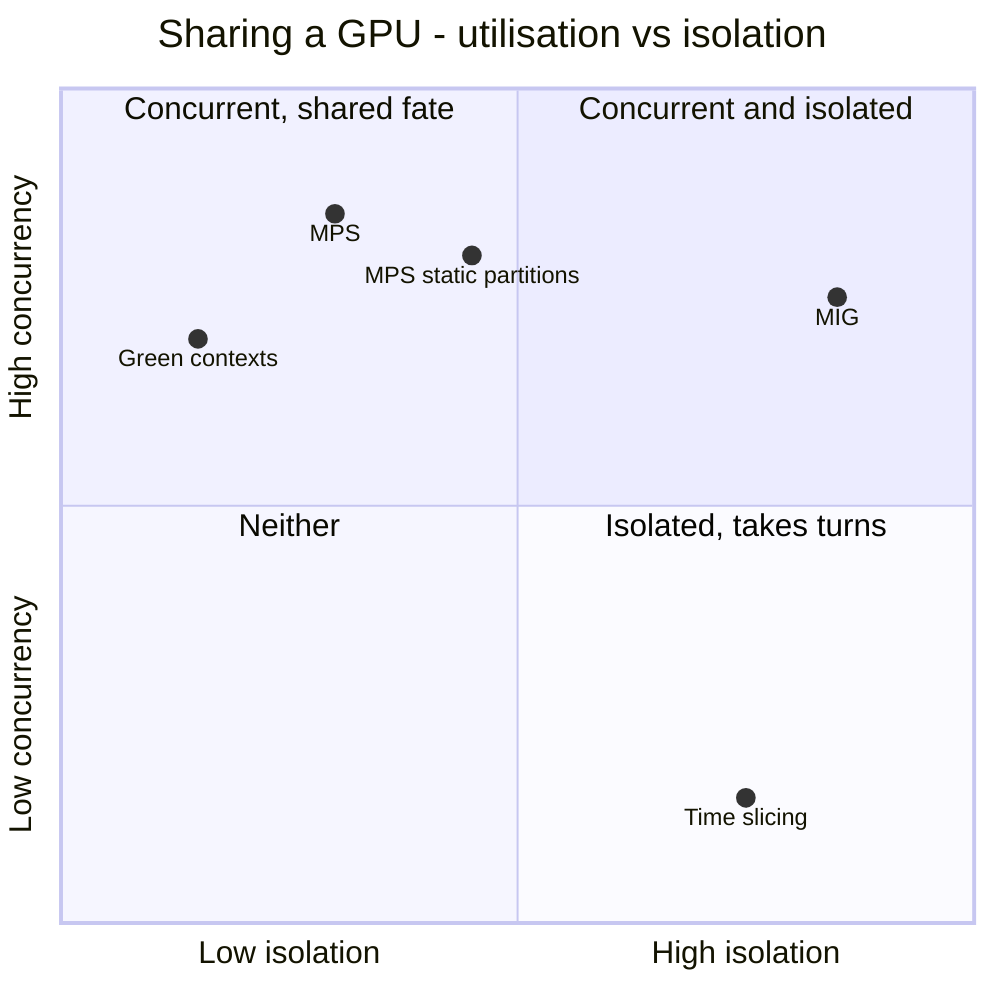
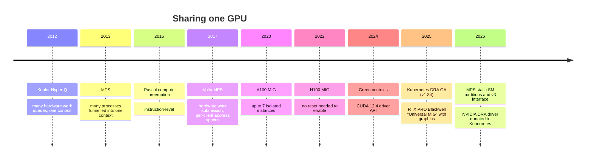
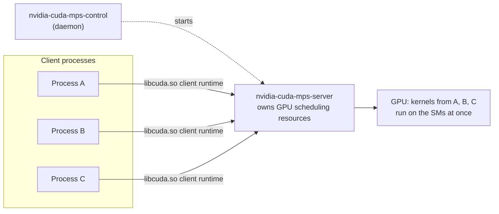
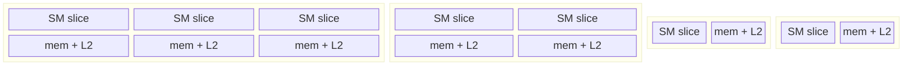

---
aliases:
  - "MIG and MPS: Sharing a GPU"
  - MIG
  - MPS
  - Multi-Instance GPU
  - Multi-Process Service
  - GPU Sharing
tags:
  - gpu-programming
  - multi-gpu
  - mig
  - mps
  - gpu-sharing
  - kubernetes
status: complete
sources:
  - https://docs.nvidia.com/deploy/mps/index.html
  - https://docs.nvidia.com/deploy/mps/architecture.html
  - https://docs.nvidia.com/deploy/mps/when-to-use-mps.html
  - https://docs.nvidia.com/deploy/mps/595/appendix-common-tasks.html
  - https://www.olcf.ornl.gov/wp-content/uploads/2021/06/MPS_ORNL_20210817.pdf
  - https://docs.nvidia.com/cuda/pdf/Pascal_Tuning_Guide.pdf
  - https://docs.nvidia.com/cuda/cuda-programming-guide/04-special-topics/green-contexts.html
  - https://docs.nvidia.com/cuda/archive/12.4.1/cuda-driver-api/group__CUDA__GREEN__CONTEXTS.html
  - https://docs.nvidia.com/datacenter/tesla/mig-user-guide/
  - https://docs.nvidia.com/datacenter/tesla/mig-user-guide/concepts.html
  - https://docs.nvidia.com/datacenter/tesla/mig-user-guide/supported-mig-profiles.html
  - https://docs.nvidia.com/datacenter/tesla/mig-user-guide/620/supported-gpus.html
  - https://docs.nvidia.com/datacenter/tesla/mig-user-guide/getting-started-with-mig.html
  - https://docs.nvidia.com/datacenter/tesla/mig-user-guide/deployment-considerations.html
  - https://docs.nvidia.com/datacenter/cloud-native/gpu-operator/latest/gpu-sharing.html
  - https://github.com/NVIDIA/k8s-device-plugin
  - https://www.kubernetes.io/docs/concepts/scheduling-eviction/dynamic-resource-allocation
  - https://dra-driver-nvidia-gpu.sigs.k8s.io/docs/
  - https://blogs.nvidia.com/blog/nvidia-at-kubecon-2026
  - https://developer.nvidia.com/blog/maximize-ai-infrastructure-throughput-by-consolidating-underutilized-gpu-workloads/
  - https://arxiv.org/abs/2504.15465
  - https://arxiv.org/html/2504.14489v1
  - https://lmsys.org/blog/2025-09-28-pdmux
  - https://proceedings.mlr.press/v235/duan24a.html
  - https://arxiv.org/abs/2207.11428v1
created: 2026-11-26
updated: 2026-11-26
---

## Table Of Contents

---

- [[#TL;DR|TL;DR]]
- [[#The Problem|The Problem]]
- [[#Foundations|Foundations]]
    - [[#Contexts and Time Slicing|Contexts and Time Slicing]]
    - [[#Four Ways to Share|Four Ways to Share]]
- [[#How We Got Here|How We Got Here]]
- [[#How It Works|How It Works]]
    - [[#MPS - One Server, Many Clients|MPS: One Server, Many Clients]]
    - [[#Limiting MPS Clients|Limiting MPS Clients]]
    - [[#MIG - Cutting the Chip into Slices|MIG: Cutting the Chip into Slices]]
    - [[#MIG Profiles|MIG Profiles]]
    - [[#Setting Up MIG|Setting Up MIG]]
    - [[#Green Contexts - Partitioning Inside One Process|Green Contexts: Partitioning Inside One Process]]
    - [[#Sharing in Kubernetes|Sharing in Kubernetes]]
- [[#Where It Is Now|Where It Is Now]]
- [[#Trade-offs & Open Problems|Trade-offs & Open Problems]]
- [[#Resources|Resources]]
- [[#Related Notes|Related Notes]]

## ***TL;DR***
---
*A big GPU is often more than one job needs. NVIDIA offers three ways to share it: take turns (time slicing), run at the same time on shared hardware (MPS), or cut the chip into hardware-isolated pieces (MIG). They trade utilisation against isolation.*

- **Time slicing** is the default: work from different processes never runs simultaneously; the GPU switches between them. Full isolation, but a small kernel still owns the whole GPU while it runs.
- **MPS (Multi-Process Service)** funnels many processes into one server so their kernels run *concurrently* on the SMs. Since Volta each client has its own address space, but a fatal fault in one client still hits the others ([MPS docs](https://docs.nvidia.com/deploy/mps/when-to-use-mps.html)).
- **MIG (Multi-Instance GPU)**, since A100 (2020), splits the chip into up to 7 instances, each with its own SMs, L2 slices, memory controllers and HBM. It is the only mode that isolates memory bandwidth and faults ([MIG concepts](https://docs.nvidia.com/datacenter/tesla/mig-user-guide/concepts.html)).
- **Green contexts** (CUDA 12.4, runtime API in 13.1) partition SMs *inside one process*, which LLM servers use to split prefill and decode ([Programming Guide](https://docs.nvidia.com/cuda/cuda-programming-guide/04-special-topics/green-contexts.html)).
- **Where it is now (Nov 2026):** MPS gained exclusive static SM partitions and a new v3 control interface; MIG runs on every Blackwell data-center part and, with graphics, on RTX PRO Blackwell; Kubernetes Dynamic Resource Allocation is GA and NVIDIA donated its GPU DRA driver to the Kubernetes project in March 2026.

## ***The Problem***
---
*GPUs are sized for the biggest jobs, but most jobs are small. An inference service at low traffic, a notebook, or a CI test can leave an 80 to 180 GB, 132 to 148 SM GPU nearly idle, at full price.*

- **Small kernels can't fill the chip.** A batch-1 inference kernel may launch fewer blocks than there are SMs, so most SMs sit idle (see [[Occupancy and Latency Hiding]]).
- **Memory is often the real request.** A 7B model in BF16 needs about 14 GB plus [[KV Cache]], a small fraction of a B200's 180 GB.
- **Time slicing wastes the gaps.** When two processes share a GPU by default, only one context runs at a time, so neither job's idle SMs help the other.

*Worked example.* Three small models each keep an A100 about a quarter busy. NVIDIA consolidated a voice pipeline (speech recognition, text-to-speech and an 8B vision-language model, 50 users) from 3 A100s onto 2. Per-GPU throughput went from about 0.74 requests/s (one model per GPU) to about 0.76 with time slicing and about 1.00 with MIG (two 3g.40gb instances) ([NVIDIA, Mar 2026](https://developer.nvidia.com/blog/maximize-ai-infrastructure-throughput-by-consolidating-underutilized-gpu-workloads/)). One GPU saved, and MIG beat time slicing by about a third, because the jobs actually ran side by side.

## ***Foundations***
---
*Everything here hinges on the CUDA context: the per-process state (address space, loaded code, work queues) through which a program talks to the GPU. Sharing a GPU is really a question of what contexts are allowed to do at the same time.*

### Contexts and Time Slicing

- Inside one context, [[Streams, Events and Async Execution|streams]] let kernels overlap freely. Kepler's Hyper-Q gave many hardware work queues, but "GPUs with Hyper-Q have a concurrent scheduler to schedule work from work queues belonging to a single CUDA context". Work from *different* contexts is time-sliced ([MPS architecture](https://docs.nvidia.com/deploy/mps/architecture.html)).
- Each context also costs memory: NVIDIA measured about 300 MB per CUDA context on V100 ([NVIDIA MPS deck, 2021](https://www.olcf.ornl.gov/wp-content/uploads/2021/06/MPS_ORNL_20210817.pdf)).
- Since Pascal GP100 (2016), compute preemption "allows compute tasks running on the GPU to be interrupted at instruction-level granularity", saving registers and shared memory to DRAM, so a long kernel cannot starve others for its whole run ([Pascal Tuning Guide](https://docs.nvidia.com/cuda/pdf/Pascal_Tuning_Guide.pdf)).

### Four Ways to Share

| | Time slicing | MPS | MIG | Green contexts |
|---|---|---|---|---|
| Unit | Process / context | Process (MPS client) | GPU instance | Partition inside one process |
| Runs at the same time? | No, takes turns | Yes | Yes | Yes |
| SMs | Whole GPU per turn | Shared, optionally capped or statically partitioned | Dedicated slices | Dedicated SM groups (if not overlapping) |
| Memory capacity | Shared, no limits | Optional per-client limit | Dedicated | Shared |
| Memory bandwidth and L2 | Shared | Shared | **Dedicated** | Shared |
| Memory protection | Yes | Yes (Volta+) | Yes | Same process |
| Fault isolation | Yes | **No** | Yes | Same process |
| Reconfigure | Any time | Restart clients | Drain the GPU | At runtime, cheap |

Sources: [MIG concepts](https://docs.nvidia.com/datacenter/tesla/mig-user-guide/concepts.html), [MPS docs](https://docs.nvidia.com/deploy/mps/when-to-use-mps.html), [green contexts](https://docs.nvidia.com/cuda/cuda-programming-guide/04-special-topics/green-contexts.html), [NVIDIA MPS deck](https://www.olcf.ornl.gov/wp-content/uploads/2021/06/MPS_ORNL_20210817.pdf).



## ***How We Got Here***
---
*MPS came first, as an HPC tool for MPI codes whose many ranks each underused the GPU. MIG came with the A100, when cloud providers wanted to sell slices of a very large GPU with guarantees.*



- **Pre-Volta MPS** used software work submission and put all clients in one shared GPU address space, so one client could corrupt another. **Volta MPS (2017)** added "faster, hardware-accelerated work submission" and a separate address space per client ([NVIDIA MPS deck](https://www.olcf.ornl.gov/wp-content/uploads/2021/06/MPS_ORNL_20210817.pdf)). Client limits went from 16 per GPU pre-Volta to 48 on Volta (same source); today's docs say 60 ([MPS docs](https://docs.nvidia.com/deploy/mps/when-to-use-mps.html)).
- **MIG** arrived with the A100 in 2020 with up to 7 instances. On Hopper, enabling MIG no longer needs a GPU reset ([MIG getting started](https://docs.nvidia.com/datacenter/tesla/mig-user-guide/getting-started-with-mig.html)).
- **Blackwell** extended MIG to B200, GB200, B300 and GB300 (7 instances each) and to the RTX PRO 6000/5000/4500 Blackwell (4 or 2 instances), adding `+gfx` profiles: "Universal MIG" lets "both compute and graphics workloads ... run on the same GPU with hardware isolation" ([supported GPUs](https://docs.nvidia.com/datacenter/tesla/mig-user-guide/620/supported-gpus.html); [MIG profiles](https://docs.nvidia.com/datacenter/tesla/mig-user-guide/supported-mig-profiles.html)).

## ***How It Works***
---
*MPS is a software trick: make many processes look like one context so the hardware scheduler can mix their kernels. MIG is a hardware partition: the chip's crossbar, caches and memory controllers are physically divided.*

### MPS - One Server, Many Clients



- Three pieces: the control daemon `nvidia-cuda-mps-control`, the server `nvidia-cuda-mps-server` ("the clients' shared connection to the GPU and owner of the GPU scheduling resources"), and a client runtime inside `libcuda.so`. Applications need no code changes ([MPS docs](https://docs.nvidia.com/deploy/mps/index.html)).
- On Volta and later, "a client CUDA context manages most of the hardware resources" and the server mediates only shared ones ([MPS architecture](https://docs.nvidia.com/deploy/mps/architecture.html)).
- Limits: "up to 60 client CUDA contexts per-device"; Linux and QNX, 64-bit only; no dynamic parallelism; one user's server at a time unless run as root in multi-user mode ([MPS docs](https://docs.nvidia.com/deploy/mps/when-to-use-mps.html)).
- **Faults are shared.** A fatal GPU fault is reported to *all* clients on the affected GPUs, without saying which one caused it; the server goes to a FAULT state and refuses new clients until the existing ones exit (same source). In multi-user mode, "a fatal fault from one client may bring down a different user's client" ([MPS architecture](https://docs.nvidia.com/deploy/mps/architecture.html)).
- Each MPS client still has overhead: about 164 MB on V100 and 221 MB on A100 ([NVIDIA MPS deck](https://www.olcf.ornl.gov/wp-content/uploads/2021/06/MPS_ORNL_20210817.pdf)).

### Limiting MPS Clients

*Plain MPS lets any client grab all SMs. Three knobs give some quality of service.*

| Knob | What it does | Hard or soft |
|---|---|---|
| `CUDA_MPS_ACTIVE_THREAD_PERCENTAGE` | Caps a client at a percentage of SMs; can be oversubscribed (sum over 100%); per client since CUDA 11.2 | A cap, "does not reserve dedicated resources" |
| `CUDA_MPS_PINNED_DEVICE_MEM_LIMIT` / server memory limit | Allocations past the limit return out-of-memory | Hard on capacity, not bandwidth |
| **Static SM partitioning** (`-S`, `sm_partition add`, `CUDA_MPS_SM_PARTITION`) | Exclusive SM sets per client on Ampere and newer, in chunks of 8 SMs on Hopper-class GPUs | Hard on SMs; L2 and HBM bandwidth still shared |

Sources: [MPS docs](https://docs.nvidia.com/deploy/mps/when-to-use-mps.html), [MPS common tasks (R595)](https://docs.nvidia.com/deploy/mps/595/appendix-common-tasks.html), [NVIDIA MPS deck](https://www.olcf.ornl.gov/wp-content/uploads/2021/06/MPS_ORNL_20210817.pdf). For $n$ equal clients NVIDIA suggests a percentage of $100/n$ for a strict split, or $100/(0.5n)$ for a relaxed one that lets idle capacity flow to busy clients. *Example:* 4 clients on a 132-SM H100 → 25% each, about 33 SMs; relaxed → 50% each, so any two can use the whole GPU when the others are idle.

### MIG - Cutting the Chip into Slices

*MIG divides the GPU along its real hardware boundaries: groups of SMs, slices of L2, and memory controllers with their HBM. Each piece behaves like a smaller GPU with its own guaranteed bandwidth.*

- **Memory slice:** "the smallest fraction of the GPU's memory, including the corresponding memory controllers", about 1/8 of capacity and bandwidth. **SM slice:** about 1/7 of the SMs. **GPU slice:** one of each ([MIG concepts](https://docs.nvidia.com/datacenter/tesla/mig-user-guide/concepts.html)).
- **GPU instance (GI):** "a combination of GPU slices and GPU engines (DMAs, NVDECs, and so on)". Its memory slices bring their L2 cache slices and memory controllers, so capacity *and* bandwidth are isolated (same source).
- **Compute instance (CI):** "a subset of the parent GPU instance's SM slices". CIs in one GI get their own SMs but share the GI's memory and engines, a two-level split (same source).
- **Why 7 and 8?** Seven SM slices against eight memory slices is why a "3g" and a "4g" instance both get half the memory: 3g.20gb has 3/7 of the SMs, 4g.20gb has 4/7, both with 4/8 of the memory on an A100 40GB ([MIG profiles](https://docs.nvidia.com/datacenter/tesla/mig-user-guide/supported-mig-profiles.html)).



*An illustrative 3g + 2g + 1g + 1g layout: each GPU instance owns whole columns of SMs and memory. Real placements follow the fixed slots that `nvidia-smi mig -lgipp` lists, and the 8th memory slice belongs to whichever instance's profile includes it.*

### MIG Profiles

*Profile names read as `<SM slices>g.<memory>gb`. The memory number grows each generation; the slicing stays at 7 on data-center GPUs.*

| GPU | Smallest | Half | Whole | Max instances |
|---|---|---|---|---|
| A100 40GB | 1g.5gb | 3g.20gb / 4g.20gb | 7g.40gb | 7 |
| A100 80GB | 1g.10gb | 3g.40gb / 4g.40gb | 7g.80gb | 7 |
| H100 80GB | 1g.10gb (also 1g.20gb: one SM slice, double memory) | 3g.40gb / 4g.40gb | 7g.80gb | 7 |
| H200 141GB | 1g.18gb | 3g.71gb / 4g.71gb | 7g.141gb | 7 |
| B200 180GB | 1g.23gb | 3g.90gb / 4g.90gb | 7g.180gb | 7 |
| GB300 252GB | 1g.31gb | 3g.126gb / 4g.126gb | 7g.251gb | 7 |
| RTX PRO 6000 Blackwell 96GB | 1g.24gb (1/4 of SMs, memory, L2) | 2g.48gb | 4g.96gb | 4 |

Sources: [MIG profiles](https://docs.nvidia.com/datacenter/tesla/mig-user-guide/supported-mig-profiles.html), [supported GPUs](https://docs.nvidia.com/datacenter/tesla/mig-user-guide/620/supported-gpus.html). Suffixes: `+me` adds a media engine (video decode), `-me` excludes them, `+gfx` adds graphics APIs on RTX PRO Blackwell.

### Setting Up MIG

```bash
sudo nvidia-smi -i 0 -mig 1                 # 1
nvidia-smi mig -lgip                        # 2
sudo nvidia-smi mig -cgi 9,3g.20gb -C       # 3
nvidia-smi -L                               # 4
CUDA_VISIBLE_DEVICES=MIG-<uuid> python serve.py   # 5
```

1. Turn on MIG mode for GPU 0. On Hopper and later this needs no reset and does not persist across reboots; on Ampere it does both. Stop services like DCGM first.
2. List the GPU-instance profiles this GPU offers, with their IDs and how many fit.
3. Create two GPU instances: profile ID 9 and the 3g.20gb profile (two names for the same thing on an A100 40GB). `-C` also creates the default compute instance inside each.
4. List devices; each MIG instance shows up with its own `MIG-...` UUID.
5. Run a program on one instance. To CUDA it looks like a smaller GPU.

Source: [MIG getting started](https://docs.nvidia.com/datacenter/tesla/mig-user-guide/getting-started-with-mig.html). Instances do not survive a reboot, and creating and destroying them fragments the GPU: an instance's physical slot limits what fits beside it, and in mixed layouts the order of creation can matter ([MIG concepts](https://docs.nvidia.com/datacenter/tesla/mig-user-guide/concepts.html)).

**What MIG gives up** ([deployment considerations](https://docs.nvidia.com/datacenter/tesla/mig-user-guide/deployment-considerations.html)):
- "No graphics APIs are supported", except the new `+gfx` profiles.
- "CUDA IPC across GPU instances is not supported", P2P only between instances on the same GPU, and "NCCL is currently not supported with MIG": a MIG slice cannot join NVLink collectives (see [[Multi-GPU Communication - NVLink and NCCL]]).
- "Profiling of shared GPU resources is not supported."
- MPS can run *inside* a MIG instance; the MPS client limit shrinks in proportion to the compute instance's size.

### Green Contexts - Partitioning Inside One Process

*Sometimes the two jobs sharing a GPU are parts of the same program, like an LLM server's prefill and decode. Green contexts give one process several SM partitions without the cost of a full context each.*

- A green context is a "lightweight context" bound at creation to a set of SMs and work queues; work launched into it only runs on those SMs, and kernels need no changes ([Programming Guide](https://docs.nvidia.com/cuda/cuda-programming-guide/04-special-topics/green-contexts.html)).
- Driver API since CUDA 12.4 (`cuGreenCtxCreate`, `cuDevSmResourceSplitByCount`); runtime API since 13.1 (`cudaGreenCtxCreate`, `cudaDevSmResourceSplitByCount`, `cudaExecutionCtxStreamCreate`), which the guide now recommends (same source; [12.4.1 driver API](https://docs.nvidia.com/cuda/archive/12.4.1/cuda-driver-api/group__CUDA__GREEN__CONTEXTS.html)).
- Granularity: on compute capability 9.0 and newer, partitions come in multiples of 8 SMs, so asking for 11-SM groups on a 132-SM GH200 yields 16-SM groups (same sources).
- Caveats: "concurrent execution of independent GPU work is not guaranteed", partitions may overlap if you ask, and green contexts can be combined with MIG to split an instance further ([Programming Guide](https://docs.nvidia.com/cuda/cuda-programming-guide/04-special-topics/green-contexts.html)).

### Sharing in Kubernetes

| Mechanism | How it is exposed | Notes |
|---|---|---|
| Time slicing | GPU Operator config: `replicas: 4` "advertises four GPUs" | "No memory or fault-isolation between replicas" |
| MIG | Device plugin strategies `none`, `single`, `mixed`; `mixed` exposes `nvidia.com/mig-3g.40gb` etc. | Profiles normally pre-configured per node |
| MPS | Device plugin, "experimental" since v0.15.0; N replicas each get 1/N of compute and memory | Not on MIG-enabled devices |
| DRA | `resource.k8s.io` claims; NVIDIA DRA driver can "allocate MIG devices dynamically" and share via time slicing or MPS | GA API in Kubernetes 1.34 |

Sources: [GPU Operator sharing](https://docs.nvidia.com/datacenter/cloud-native/gpu-operator/latest/gpu-sharing.html), [k8s-device-plugin](https://github.com/NVIDIA/k8s-device-plugin), [Kubernetes DRA](https://www.kubernetes.io/docs/concepts/scheduling-eviction/dynamic-resource-allocation), [NVIDIA DRA driver](https://dra-driver-nvidia-gpu.sigs.k8s.io/docs/). Fractional GPUs are a scheduling problem as much as a hardware one; see [[Cluster Scheduling]].

## ***Where It Is Now***
---
*As of November 2026, the three mechanisms are converging: MPS is gaining hard partitions, MIG is gaining flexibility through dynamic allocation, and LLM servers partition SMs themselves with green contexts.*

- **MPS v3 and static partitions.** The MPS docs (updated November 11, 2026) introduce MPS v3, "a new, opt-in control daemon interface" that replaces the interactive shell of Legacy MPS v2, with named servers, namespaces, a configuration file and memory partitioning; "all existing Legacy MPS v2 functionality continues to work unchanged" ([MPS docs](https://docs.nvidia.com/deploy/mps/index.html)). Static SM partitioning gives clients exclusive SMs on Ampere and newer, closing part of the gap with MIG; memory bandwidth, L2 and fault fate are still shared ([MPS docs](https://docs.nvidia.com/deploy/mps/when-to-use-mps.html)).
- **MIG everywhere in Blackwell.** B200 and GB200 (from R570 drivers), B300 and GB300 (R595, CUDA 13), RTX PRO Blackwell with graphics-capable instances, and Jetson Thor's integrated GPU with one compute and one graphics instance ([supported GPUs](https://docs.nvidia.com/datacenter/tesla/mig-user-guide/620/supported-gpus.html)).
- **Kubernetes.** DRA's API went GA in Kubernetes 1.34 (Sep 2025) and is "Stable since Kubernetes v1.35" ([Kubernetes docs](https://www.kubernetes.io/docs/concepts/scheduling-eviction/dynamic-resource-allocation)). NVIDIA's DRA driver (v0.5.1, needs Kubernetes 1.32+) handles dynamic MIG, MPS, time slicing and multi-node NVLink "ComputeDomains" ([DRA driver docs](https://dra-driver-nvidia-gpu.sigs.k8s.io/docs/)); at KubeCon EU on March 24, 2026 NVIDIA donated it to the Kubernetes project, and its KAI scheduler (with GPU fractions) joined the CNCF Sandbox ([NVIDIA, Mar 2026](https://blogs.nvidia.com/blog/nvidia-at-kubecon-2026)).
- **LLM serving on shared SMs.** Instead of separate GPUs for prefill and decode ([[LLM Serving]]), several systems share one GPU's compute between them. MuxServe (ICML 2024) colocates several LLMs and separates prefill and decode so they can share compute, reporting up to 1.8x higher throughput ([PMLR](https://proceedings.mlr.press/v235/duan24a.html)). PD-Multiplexing uses green contexts to "allocate just enough SMs to the decode phase to guarantee the ITL SLO, then dedicate all remaining SMs to prefill"; as of its Sep 2025 post it was a proof of concept with "full integration into SGLang ... underway" ([LMSYS](https://lmsys.org/blog/2025-09-28-pdmux); [arXiv 2504.14489](https://arxiv.org/html/2504.14489v1)).
- **An OS for the GPU.** LithOS (arXiv, Apr 2025) schedules "at the granularity of individual TPCs" (pairs of SMs), splits kernels into atoms to reduce head-of-line blocking, and right-sizes the TPCs each atom gets, transparently to applications. It reports tail latencies "13x" lower than MPS when stacking inference jobs ([arXiv 2504.15465](https://arxiv.org/abs/2504.15465)).
- **Research on picking partitions.** MISO (SoCC 2022) uses "the lightweight, more flexible Multi-Process Service (MPS) capability to predict the best MIG partition allocation", avoiding repeated MIG reconfiguration while it explores; it reports 49% and 16% lower average job completion time than unpartitioned and optimal static partitioning ([arXiv 2207.11428](https://arxiv.org/abs/2207.11428v1)).

## ***Trade-offs & Open Problems***
---
*There is no free lunch: the mode that packs best (MPS) isolates worst, and the mode that isolates best (MIG) wastes the most when demand shifts.*

- **Isolation vs packing.** MPS lets idle SMs flow to whichever client needs them, but one bad kernel can take everyone down. MIG guarantees bandwidth and fault isolation but leaves a slice idle if its tenant is idle.
- **Coarse, fixed shapes.** MIG offers sevenths (or quarters) in fixed placements. A job needing 2.5 slices rounds up, and reconfiguring means draining the GPU. Fragmentation is real, which is why schedulers like MISO and DRA's dynamic MIG exist.
- **Bandwidth is the hidden shared resource.** MPS caps and static partitions limit SMs, not HBM bandwidth or L2. Two memory-bound tenants on MPS still slow each other down; see [[Roofline Model and Arithmetic Intensity]].
- **MIG and multi-GPU don't mix.** No NCCL, no IPC across instances: MIG is for many small jobs, not slices of a big distributed one.
- **Observability.** Profiling shared resources under MIG is unsupported, and under time slicing DCGM can't attribute metrics to containers ([GPU Operator](https://docs.nvidia.com/datacenter/cloud-native/gpu-operator/latest/gpu-sharing.html)). "Who used the GPU" is still hard to answer.
- **Security.** MPS clients share a server and a fault domain; for untrusted tenants, MIG (or whole GPUs, or VMs with MIG-backed vGPU) is the safe choice. Confidential computing combined with MIG is still settling across driver releases.

## ***Resources***
---
*Read NVIDIA's MIG user guide and MPS docs first; the 2021 NVIDIA MPS slide deck is the best single comparison of all the modes.*

**Primary**
- [MIG User Guide](https://docs.nvidia.com/datacenter/tesla/mig-user-guide/): [concepts](https://docs.nvidia.com/datacenter/tesla/mig-user-guide/concepts.html), [profiles](https://docs.nvidia.com/datacenter/tesla/mig-user-guide/supported-mig-profiles.html), [getting started](https://docs.nvidia.com/datacenter/tesla/mig-user-guide/getting-started-with-mig.html), [deployment considerations](https://docs.nvidia.com/datacenter/tesla/mig-user-guide/deployment-considerations.html).
- [MPS docs](https://docs.nvidia.com/deploy/mps/index.html): [architecture](https://docs.nvidia.com/deploy/mps/architecture.html), [when to use MPS](https://docs.nvidia.com/deploy/mps/when-to-use-mps.html), [static partitioning how-to (R595)](https://docs.nvidia.com/deploy/mps/595/appendix-common-tasks.html).
- [CUDA Programming Guide: green contexts](https://docs.nvidia.com/cuda/cuda-programming-guide/04-special-topics/green-contexts.html).
- [NVIDIA MPS slide deck for ORNL](https://www.olcf.ornl.gov/wp-content/uploads/2021/06/MPS_ORNL_20210817.pdf): 2021. History, limits and comparison tables.

**Kubernetes**
- [GPU Operator: GPU sharing](https://docs.nvidia.com/datacenter/cloud-native/gpu-operator/latest/gpu-sharing.html), [k8s-device-plugin](https://github.com/NVIDIA/k8s-device-plugin), [NVIDIA DRA driver](https://dra-driver-nvidia-gpu.sigs.k8s.io/docs/), [Kubernetes DRA](https://www.kubernetes.io/docs/concepts/scheduling-eviction/dynamic-resource-allocation).

**Measurements and research**
- [Maximize AI infrastructure throughput by consolidating underutilized GPU workloads](https://developer.nvidia.com/blog/maximize-ai-infrastructure-throughput-by-consolidating-underutilized-gpu-workloads/): NVIDIA, Mar 2026. Time slicing vs MIG on A100.
- [LithOS](https://arxiv.org/abs/2504.15465): arXiv, Apr 2025. TPC-granularity GPU scheduling.
- [PD-Multiplexing](https://arxiv.org/html/2504.14489v1) and [LMSYS post](https://lmsys.org/blog/2025-09-28-pdmux): green contexts for prefill/decode, headed for SGLang.
- [MuxServe](https://proceedings.mlr.press/v235/duan24a.html): ICML 2024.
- [MISO](https://arxiv.org/abs/2207.11428v1): SoCC 2022.

## ***Related Notes***
---
*The neighbours: how one GPU is scheduled internally, and how many GPUs talk to each other.*

- [[Occupancy and Latency Hiding]] — Why a small kernel leaves SMs idle, the reason sharing pays.
- [[Streams, Events and Async Execution]] — Concurrency inside one context, the starting point for MPS.
- [[GPU Memory Hierarchy]] — L2 and HBM, the resources only MIG partitions.
- [[Multi-GPU Communication - NVLink and NCCL]] — The opposite direction; NCCL is unsupported on MIG.
- [[GPUDirect RDMA and Storage]] — Device-to-GPU paths, also limited under MIG.
- [[Blackwell Architecture]] — The GPUs whose MIG profiles are listed above.
- [[Persistent Kernels and Stream-K]] — Another way to keep every SM busy, from inside one kernel.
- [[LLM Serving]] — Prefill/decode splitting, the main modern use of SM partitioning.
- [[KV Cache]] — Often the real memory request behind a GPU slice.
- [[Cluster Scheduling]] — Placing fractional-GPU jobs across a cluster.
- [[Containers, Namespaces and cgroups]] — The OS-level isolation that MIG mirrors in hardware.
- [[Virtualization and Hypervisors]] — vGPU and VMs on MIG slices.
- [[GPU Fault Tolerance in Production]] — How Xid responses differ with MIG on, and DCGM in production.
