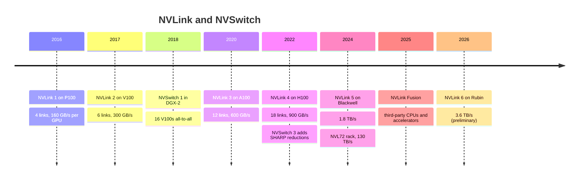
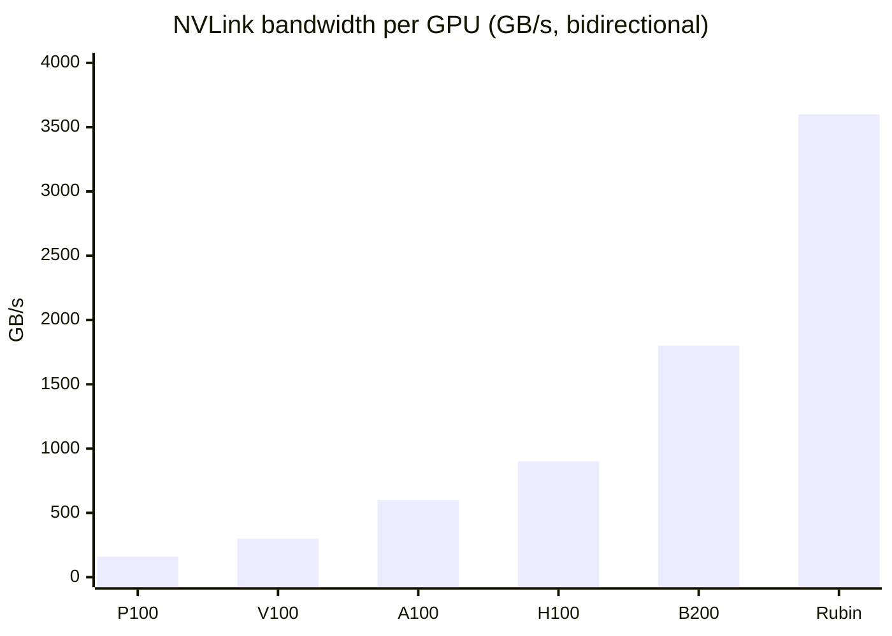
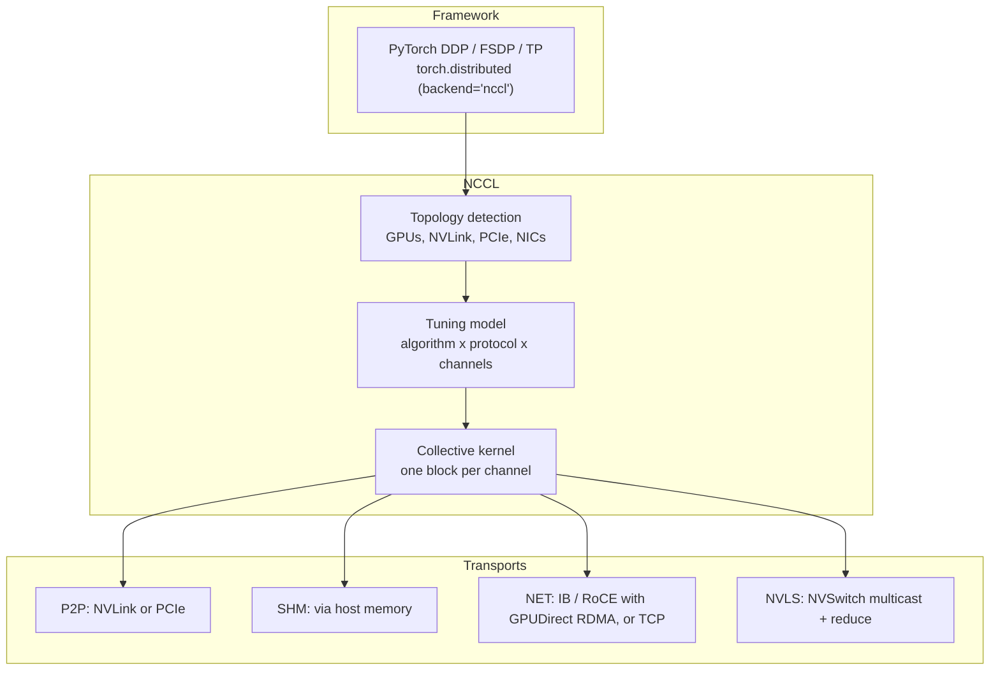

---
aliases:
  - "Multi-GPU Communication: NVLink and NCCL"
  - NVLink
  - NCCL
tags:
  - gpu-programming
  - multi-gpu
  - nvlink
  - nccl
  - collectives
status: complete
sources:
  - https://www.nvidia.com/content/dam/en-zz/Solutions/Data-Center/tesla-product-literature/nvidia-teslap100-techoverview.pdf
  - https://developer.nvidia.com/blog/nvswitch-accelerates-nvidia-dgx2/
  - https://developer.nvidia.com/blog/nvidia-ampere-architecture-in-depth
  - https://developer.nvidia.com/blog/nvidia-hopper-architecture-in-depth/
  - https://developer.nvidia.com/blog/nvidia-gb200-nvl72-delivers-trillion-parameter-llm-training-and-real-time-inference/
  - https://www.nvidia.com/en-us/data-center/nvlink/
  - https://www.nvidia.com/en-us/data-center/vera-rubin-nvl72/
  - https://nvidianews.nvidia.com/news/nvidia-nvlink-fusion-semi-custom-ai-infrastructure-partner-ecosystem
  - https://glennklockwood.com/garden/NVLink
  - https://docs.nvidia.com/cuda/cuda-programming-guide/03-advanced/multi-gpu-systems.html
  - https://docs.nvidia.com/cuda/cuda-programming-guide/04-special-topics/virtual-memory-management.html
  - https://docs.nvidia.com/cuda/cuda-driver-api/cuda_driver_api/group__CUDA__MULTICAST.html
  - https://docs.nvidia.com/deeplearning/nccl/archives/nccl_2165/user-guide/docs/api.html
  - https://arxiv.org/html/2507.04786v2
  - https://developer.nvidia.com/blog/massively-scale-deep-learning-training-nccl-2-4
  - https://developer.nvidia.com/blog/new-scaling-algorithm-and-initialization-with-nvidia-collective-communications-library-2-23
  - https://raw.githubusercontent.com/NVIDIA/nccl-tests/master/doc/PERFORMANCE.md
  - https://developer.nvidia.com/blog/enabling-fast-inference-and-resilient-training-with-nccl-2-27
  - https://developer.nvidia.com/blog/fusing-communication-and-compute-with-new-device-api-and-copy-engine-collectives-in-nvidia-nccl-2-28/
  - https://docs.nvidia.com/deeplearning/nccl/archives/nccl_2323/pdf/NCCL-Release-Notes.pdf
  - https://docs.nvidia.com/deeplearning/nccl/archives/index.html
  - https://docs.nvidia.com/nvshmem/api/latest/introduction.html
  - https://docs.pytorch.org/docs/2.10/symmetric_memory.html
  - https://arxiv.org/abs/2510.20171v4
  - https://arxiv.org/html/2504.09014v3
created: 2026-11-26
updated: 2026-11-26
---

## Table Of Contents

---

- [[#TL;DR|TL;DR]]
- [[#The Problem|The Problem]]
- [[#Foundations|Foundations]]
    - [[#Scale-Up vs Scale-Out|Scale-Up vs Scale-Out]]
    - [[#The Collectives|The Collectives]]
    - [[#Bandwidth Accounting - algbw and busbw|Bandwidth Accounting: algbw and busbw]]
- [[#How We Got Here|How We Got Here]]
    - [[#NVLink Generations|NVLink Generations]]
- [[#How It Works|How It Works]]
    - [[#Peer-to-Peer in CUDA|Peer-to-Peer in CUDA]]
    - [[#NVSwitch and NVLink SHARP|NVSwitch and NVLink SHARP]]
    - [[#NCCL - the Library Everyone Calls|NCCL: the Library Everyone Calls]]
    - [[#NCCL Runs as CUDA Kernels|NCCL Runs as CUDA Kernels]]
    - [[#Algorithms and Protocols|Algorithms and Protocols]]
    - [[#An All-Reduce in Code|An All-Reduce in Code]]
- [[#Where It Is Now|Where It Is Now]]
- [[#Trade-offs & Open Problems|Trade-offs & Open Problems]]
- [[#Resources|Resources]]
- [[#Related Notes|Related Notes]]

## ***TL;DR***
---
*NVLink is NVIDIA's GPU-to-GPU link, many times faster than PCIe; NVSwitch turns it into a crossbar so every GPU in a node or rack reaches every other at full speed. NCCL is the library that turns that wiring into all-reduce, all-gather and friends, running as CUDA kernels on the GPUs themselves.*

- **The problem:** once a model or its batch is split across GPUs, they must swap gradients, activations or KV cache every step. Over PCIe that swap can take longer than the math.
- **NVLink:** from 160 GB/s per GPU on P100 (2016) to 1.8 TB/s on Blackwell (2024) and a preliminary 3.6 TB/s on Rubin. All numbers NVIDIA quotes are *bidirectional*; halve them for one direction ([NVIDIA NVLink page](https://www.nvidia.com/en-us/data-center/nvlink/)).
- **NVSwitch:** a switch chip that gives all-to-all NVLink. Since Hopper it can also *reduce* data in the switch (NVLink SHARP), and since Blackwell it spans a 72-GPU rack (GB200 NVL72, 130 TB/s total) ([NVIDIA, Mar 2024](https://developer.nvidia.com/blog/nvidia-gb200-nvl72-delivers-trillion-parameter-llm-training-and-real-time-inference/)).
- **NCCL:** detects the topology, picks an algorithm (ring, tree, NVLS, PAT) and a protocol (Simple, LL, LL128) per call, and runs each collective as a CUDA kernel, one block per *channel*. That means communication uses SMs that would otherwise compute.
- **Where it is now (Nov 2026):** NCCL 2.32.6 is current. The big shift since 2025 is communication moving *into* user kernels (symmetric memory, the 2.28 device API, GPU-initiated networking) and *off* the SMs (copy-engine collectives).

## ***The Problem***
---
*Splitting work across GPUs only pays if moving the data costs less than computing it. For tensor and expert parallelism that is a race the interconnect loses unless it is NVLink-class.*

Every form of [[Distributed Training|distributed training]] and multi-GPU inference ends in communication:

| Parallelism | What moves | How often | Collective |
|---|---|---|---|
| Data parallel | Gradients (whole model) | Once per step | All-reduce, or reduce-scatter + all-gather |
| Tensor parallel | Partial activations | Twice per layer | All-reduce |
| Expert parallel ([[Mixture of Experts]]) | Tokens to their experts | Twice per MoE layer | All-to-all |
| Pipeline parallel | Activations between stages | Per micro-batch | Send / receive |

*Worked example.* Tensor parallelism over 8 GPUs on a layer with hidden size 8,192, batch × sequence = 8,192 tokens, BF16: each all-reduce moves an activation of $8192 \times 8192 \times 2 = 134$ MB. A ring all-reduce sends about $2 \cdot \frac{7}{8} \cdot 134 \approx 235$ MB per GPU. Over PCIe Gen5 x16 (about 64 GB/s per direction) that is about 3.7 ms; over H100 NVLink (450 GB/s per direction) about 0.5 ms. With two of these per layer and 80 layers, PCIe would add roughly 0.6 s per forward pass. That gap is why tensor parallelism stays inside an NVLink domain.

## ***Foundations***
---
*Three ideas carry the rest of the note: the split between the fast in-rack network and the slower network between racks, the handful of collective operations, and how to read a bandwidth number.*

### Scale-Up vs Scale-Out

- **Scale-up:** GPUs joined by NVLink (through NVSwitch) behave almost like one big GPU: load/store across GPUs, hundreds of GB/s to TB/s per GPU, microsecond latency. Size: 8 GPUs per HGX board, 72 per NVL72 rack.
- **Scale-out:** nodes joined by NICs (InfiniBand or RoCE Ethernet) at 400 to 800 Gb/s per GPU, which is 50 to 100 GB/s. Covered in [[GPU Cluster Infrastructure]] and [[GPUDirect RDMA and Storage]].
- **The rule:** put the chattiest parallelism (tensor, expert) on scale-up and the most tolerant (data, pipeline) on scale-out. NCCL does the same internally: reduce inside the node first, then send only the reduced data over the NICs.

### The Collectives

| Collective | Before | After |
|---|---|---|
| **All-reduce** | Each rank has a vector | Every rank has the elementwise sum |
| **Reduce-scatter** | Each rank has a vector | Rank $i$ has the sum of chunk $i$ |
| **All-gather** | Rank $i$ has chunk $i$ | Every rank has all chunks |
| **Broadcast** | One rank has the data | Every rank has it |
| **All-to-all** | Rank $i$ has a piece for each rank $j$ | Rank $j$ has every rank's piece for $j$ |

All-reduce = reduce-scatter + all-gather. The ring version of that, and its proof of bandwidth optimality, is worked through step by step in [[GPU Cluster Infrastructure#Ring All-Reduce and Its Cost|GPU Cluster Infrastructure]].

### Bandwidth Accounting - algbw and busbw

*Benchmarks report two numbers. Only one of them can be compared to the link speed.*

`nccl-tests` defines **algorithm bandwidth** as "size (S) / time (t)", and **bus bandwidth** as algbw times a factor that "reflect[s] the speed of the inter-GPU communication" ([nccl-tests PERFORMANCE.md](https://raw.githubusercontent.com/NVIDIA/nccl-tests/master/doc/PERFORMANCE.md)):

$$
\text{busbw}_{\text{all-reduce}} = \text{algbw} \times \frac{2(n-1)}{n}
$$

*In words:* a ring all-reduce of $S$ bytes makes each GPU send $\frac{2(n-1)}{n}S$ bytes, so multiplying by that factor gives the bytes per second actually crossing each GPU's links, which is comparable to the hardware peak no matter how many GPUs there are. The factor is $\frac{n-1}{n}$ for all-gather, reduce-scatter and all-to-all, and 1 for broadcast and reduce (same source).

*Worked example:* 8 GPUs all-reduce 1 GB in 2.5 ms. algbw = 1 GB / 2.5 ms = 400 GB/s. busbw = 400 × 1.75 = 700 GB/s. On B200 (900 GB/s per direction) that is 78% of link peak. Quote busbw when comparing systems, algbw when estimating step time.

## ***How We Got Here***
---
*NVLink began in 2016 because PCIe 3.0 could not feed GPUs that were being ganged together for deep learning. Each generation since has doubled per-GPU bandwidth, and NVSwitch has grown from 16 GPUs in a box to 72 in a rack.*



### NVLink Generations

| Gen | GPU | Links per GPU | Per GPU (bidirectional) | Notes | Source |
|---|---|---|---|---|---|
| 1 | P100 (2016) | 4 | 160 GB/s | "over 5X the bandwidth of PCI Express Gen3" | [P100 overview](https://www.nvidia.com/content/dam/en-zz/Solutions/Data-Center/tesla-product-literature/nvidia-teslap100-techoverview.pdf) |
| 2 | V100 (2017) | 6 | 300 GB/s | 25 GB/s per link per direction, 25.78 Gbit/s signalling | [NVSwitch/DGX-2](https://developer.nvidia.com/blog/nvswitch-accelerates-nvidia-dgx2/) |
| 3 | A100 (2020) | 12 | 600 GB/s | 50 Gbit/s per pair, half the pairs per link | [Ampere in depth](https://developer.nvidia.com/blog/nvidia-ampere-architecture-in-depth) |
| 4 | H100/H200 (2022) | 18 | 900 GB/s | "7x the bandwidth of PCIe Gen 5" | [Hopper in depth](https://developer.nvidia.com/blog/nvidia-hopper-architecture-in-depth/) |
| 5 | B200/GB200/B300 (2024) | 18 | 1,800 GB/s | 100 GB/s per link; "over 14x" PCIe Gen5 | [NVL72 blog](https://developer.nvidia.com/blog/nvidia-gb200-nvl72-delivers-trillion-parameter-llm-training-and-real-time-inference/) |
| 6 | Rubin (2026) | 36 | 3,600 GB/s | NVIDIA marks it "Preliminary"; sources disagree on per-link rate | [NVLink page](https://www.nvidia.com/en-us/data-center/nvlink/), [Vera Rubin NVL72](https://www.nvidia.com/en-us/data-center/vera-rubin-nvl72/) |



The pattern across generations: NVIDIA kept per-link bandwidth fixed for three generations (25 GB/s per direction) while halving the wires per link (8 pairs, then 4, then 2), and used the saved pins for more links. Blackwell doubled the per-link rate instead; Rubin doubles the link count ([Hopper in depth](https://developer.nvidia.com/blog/nvidia-hopper-architecture-in-depth/); [Glenn Lockwood](https://glennklockwood.com/garden/NVLink)).

The switch grew alongside: NVSwitch 1 had 18 ports for a 16-GPU DGX-2 (2018); NVSwitch 3 had 64 NVLink 4 ports and 13.6 Tbit/s; the NVLink 5 switch tray holds two switch chips with 144 ports at 100 GB/s, and 72 GPUs at 1.8 TB/s make up the NVL72's "130 TB/s of total NVLink bandwidth" ([NVIDIA, Mar 2024](https://developer.nvidia.com/blog/nvidia-gb200-nvl72-delivers-trillion-parameter-llm-training-and-real-time-inference/)). NVLink Fusion (May 18, 2025) opened the fabric to other companies' CPUs and accelerators, with MediaTek, Marvell, Alchip, Astera Labs, Synopsys and Cadence as first partners and Fujitsu and Qualcomm CPUs able to join ([NVIDIA, May 2025](https://nvidianews.nvidia.com/news/nvidia-nvlink-fusion-semi-custom-ai-infrastructure-partner-ecosystem)).

On the software side, NCCL started as single-node ring collectives, went multi-node with NCCL 2, then added double binary trees in 2.4 (Feb 2019, "up to 180x improvement at 24k GPUs" on Summit), NVLink SHARP for H100, PAT for scale in 2.23 (Jan 2025), and a device API in 2.28 (Nov 2025) ([NCCL 2.4](https://developer.nvidia.com/blog/massively-scale-deep-learning-training-nccl-2-4); [NCCL 2.23](https://developer.nvidia.com/blog/new-scaling-algorithm-and-initialization-with-nvidia-collective-communications-library-2-23); [NCCL 2.28](https://developer.nvidia.com/blog/fusing-communication-and-compute-with-new-device-api-and-copy-engine-collectives-in-nvidia-nccl-2-28/)).

## ***How It Works***
---
*At the bottom, CUDA lets one GPU read and write another's memory. NVSwitch makes that all-to-all and can sum data in flight. NCCL sits on top, choosing paths, algorithms and wire formats so a single `ncclAllReduce` call runs near link speed.*



### Peer-to-Peer in CUDA

*Before any library, CUDA itself can move data between GPUs, and on NVLink a kernel can simply dereference a pointer that lives on another GPU.*

- `cudaDeviceCanAccessPeer()` says whether two GPUs can talk directly; `cudaDeviceEnablePeerAccess()` turns it on and "operates globally on all previous and subsequent GPU memory allocations on the peer device" ([Programming Guide: multi-GPU](https://docs.nvidia.com/cuda/cuda-programming-guide/03-advanced/multi-gpu-systems.html)).
- With unified virtual addressing (UVA), "a unified virtual address space is used for both devices", so a pointer identifies its GPU and kernels can load and store through it. Copies use `cudaMemcpyPeer()` / `cudaMemcpyPeerAsync()` or plain `cudaMemcpy` with `cudaMemcpyDefault` (same source).
- Limits: whether P2P works depends on "the PCIe and/or NVLink topology", and "on non-NVSwitch enabled systems, each device can support a system-wide maximum of eight peer connections" (same source).
- **Across processes and nodes:** the virtual memory management (VMM) API allocates with `cuMemCreate`, maps with `cuMemMap` and grants access with `cuMemSetAccess`. Since CUDA 12.4 a `CU_MEM_HANDLE_TYPE_FABRIC` handle can be shared with other processes and other nodes in a multi-node NVLink rack, provided the administrator has enabled IMEX channels ([Programming Guide: VMM](https://docs.nvidia.com/cuda/cuda-programming-guide/04-special-topics/virtual-memory-management.html)). This explicit sharing, rather than page migration as in [[Unified Memory]], is the plumbing NCCL and NVSHMEM build on.

### NVSwitch and NVLink SHARP

*A switch that only forwards bytes still makes every GPU send each byte several times. Hopper's NVSwitch can add the bytes up itself.*

Third-generation NVSwitch "provides hardware acceleration of collective operations with multicast and NVIDIA SHARP in-network reductions" ([Hopper in depth](https://developer.nvidia.com/blog/nvidia-hopper-architecture-in-depth/)). Programmers reach it through **multicast objects**: `cuMulticastCreate` makes a team, `cuMulticastAddDevice` adds each GPU, `cuMulticastBindMem` binds memory, and then "certain memory operations [are] broadcast to a team of devices" ([Driver API: multicast](https://docs.nvidia.com/cuda/cuda-driver-api/cuda_driver_api/group__CUDA__MULTICAST.html)). Kernels then issue `multimem` PTX loads and stores to the multicast address: a reducing load asks the switch to fetch from every GPU, add, and return one result; a store is broadcast to all. The VMM guide recommends going through MPI, NCCL or NVSHMEM rather than doing this by hand ([Programming Guide: VMM](https://docs.nvidia.com/cuda/cuda-programming-guide/04-special-topics/virtual-memory-management.html)).

Why it helps: in a ring all-reduce each GPU sends $\approx 2S$ bytes. With in-switch reduction each GPU sends its $S$ bytes once and receives the reduced $S$ once, and the GPU's SMs do no adding. NCCL calls these algorithms NVLS.

### NCCL - the Library Everyone Calls

*NCCL (pronounced "nickel") gives MPI-style collectives for NVIDIA GPUs, stream-ordered so they slot into CUDA streams like any kernel.*

- **API groups:** communicator setup (`ncclGetUniqueId`, `ncclCommInitRank`, `ncclCommDestroy`, `ncclCommAbort`), collectives (`ncclAllReduce`, `ncclBroadcast`, `ncclReduce`, `ncclAllGather`, `ncclReduceScatter`), point-to-point (`ncclSend`, `ncclRecv`) and group calls (`ncclGroupStart`/`ncclGroupEnd`) that fuse several operations into one launch ([NCCL API](https://docs.nvidia.com/deeplearning/nccl/archives/nccl_2165/user-guide/docs/api.html)).
- **Topology first:** NCCL builds a graph of GPUs, NVLinks, PCIe switches, CPUs and NICs, then searches it for rings and trees ([Demystifying NCCL](https://arxiv.org/html/2507.04786v2)).
- **Transports:** *P2P* inside a node (NVLink preferred, PCIe as fallback); *SHM* through host memory when P2P is unavailable or slow, for example across CPU sockets; *NET* across nodes over InfiniBand/RoCE verbs, using [[GPUDirect RDMA and Storage|GPUDirect RDMA]] when NIC and GPU share a PCIe switch, or TCP sockets as a last resort (same source).
- **Who calls it:** PyTorch's `torch.distributed` with `backend="nccl"`, and through it DDP, FSDP and tensor-parallel libraries. AMD's RCCL keeps the same API for ROCm (see [[ROCm and HIP]]).

### NCCL Runs as CUDA Kernels

*There is no separate communication processor in a classic NCCL call. The SMs move the data, which is why communication competes with compute.*

- Each collective is split into **channels**; each channel is one CUDA block on its own SM, so the grid is `(nChannels, 1, 1)`. Inside a block, warp 0 loads communicator metadata, warp 1 loads channel data, and the remaining warps copy and reduce. Each channel's buffer is split into `NCCL_STEPS` slots (typically 8) so sending, receiving and reducing pipeline ([Demystifying NCCL](https://arxiv.org/html/2507.04786v2)).
- **The cost:** NVIDIA notes ring all-gather and reduce-scatter "can use 16 or more SMs", out of 132 on an H100; offloading to SHARP cuts that "to 6 SMs or fewer" ([NCCL 2.27](https://developer.nvidia.com/blog/enabling-fast-inference-and-resilient-training-with-nccl-2-27)).
- **Overlap:** frameworks launch NCCL on a separate [[Streams, Events and Async Execution|stream]] so the backward pass keeps computing while earlier gradients are reduced. The stolen SMs and the shared HBM bandwidth are the price of that overlap.

### Algorithms and Protocols

*NCCL chooses two things per call: the communication pattern (algorithm) and the wire format (protocol). Small messages want few hops and cheap synchronisation; large ones want every link busy.*

| Algorithm | Shape | Best for |
|---|---|---|
| **Ring** | Logical ring through all ranks | Large messages; bandwidth-optimal, latency grows with rank count |
| **Tree** | Double binary tree across nodes, chain inside a node | Small/medium messages at many nodes; logarithmic latency |
| **CollNet** | Uses InfiniBand SHARP switches to reduce across nodes | Clusters with SHARP-capable IB |
| **NVLS / NVLSTree** | NVSwitch multicast and in-switch reduction, plus a tree across nodes | Hopper and newer NVSwitch systems |
| **PAT** | "A variation of the Bruck algorithm", logarithmic steps (2.23) | All-gather and reduce-scatter at scale, initially one GPU per node |

Sources: [Demystifying NCCL](https://arxiv.org/html/2507.04786v2), [NCCL 2.4](https://developer.nvidia.com/blog/massively-scale-deep-learning-training-nccl-2-4), [NCCL 2.23](https://developer.nvidia.com/blog/new-scaling-algorithm-and-initialization-with-nvidia-collective-communications-library-2-23).

| Protocol | Wire format | Bandwidth | Latency per hop |
|---|---|---|---|
| **Simple** | Plain data, memory fences, then a flag | Near peak | ~6 µs |
| **LL** (low latency) | "4 bytes of data followed by a 4-byte flag", 8-byte atomic writes | "only 25–50 percent of peak" | ~1 µs |
| **LL128** | 120 bytes data + 8-byte flag per 128-byte line | "approximately 95 percent of the peak" | ~2 µs |

Source: [Demystifying NCCL](https://arxiv.org/html/2507.04786v2), measured on GH200 nodes of the Alps supercomputer. *The trick in LL and LL128:* the flag travels inside the same write as the data, so the receiver can poll the data itself and needs no separate fence-then-flag round trip. The cost is the bytes spent on flags. LL128 needs 128-byte writes to arrive atomically, so NCCL disables it on platforms that do not guarantee that (same source).

The knobs, when the tuner guesses wrong: `NCCL_ALGO`, `NCCL_PROTO`, `NCCL_DEBUG=INFO` to print what was chosen, and `NCCL_IB_HCA` to pick NICs ([NCCL env vars](https://docs.nvidia.com/deeplearning/nccl/archives/nccl_2323/user-guide/docs/env.html)).

### An All-Reduce in Code

*One process per GPU, a shared ID passed out of band, then a collective that looks like a kernel launch.*

```cpp
ncclUniqueId id;
if (rank == 0) ncclGetUniqueId(&id);                 // 1
MPI_Bcast(&id, sizeof(id), MPI_BYTE, 0, MPI_COMM_WORLD); // 2
cudaSetDevice(localRank);                            // 3
ncclComm_t comm;
ncclCommInitRank(&comm, nRanks, id, rank);           // 4
ncclAllReduce(sendbuf, recvbuf, count, ncclBfloat16, // 5
              ncclSum, comm, stream);
cudaStreamSynchronize(stream);                       // 6
ncclCommDestroy(comm);
```

1. One rank creates a unique ID that names this communicator.
2. Any side channel (MPI, a TCP store, PyTorch's rendezvous) ships those bytes to every rank. NCCL does not bootstrap itself.
3. Each process binds to its GPU.
4. Every rank joins with its rank number. This is collective: it blocks until all ranks arrive, and it is where NCCL probes topology and builds rings and trees.
5. The all-reduce is *enqueued on `stream`* and returns immediately, like a kernel launch. Every rank must make the same sequence of NCCL calls, or they deadlock.
6. Wait for the result; in real code you would instead order later work on the same stream.

## ***Where It Is Now***
---
*As of November 2026: NVLink 5 racks are the deployed standard, NVLink 6 on Rubin is ramping, and NCCL has turned from a host-called library into something kernels call directly, while trying to use fewer SMs.*

- **Hardware.** NVIDIA's NVL72 page lists Vera Rubin NVL72 with "3.6 terabytes per second (TB/s) of all-to-all, scale-up bandwidth per GPU" and a "260 TB/s" NVLink 6 switch fabric, marked preliminary; Vera Rubin is described as "ramping into full production" ([NVIDIA](https://www.nvidia.com/en-us/data-center/vera-rubin-nvl72/)). One regional NVIDIA page still showed 3.0 TB/s and 216 TB/s, so treat the exact Rubin numbers as unsettled.
- **Symmetric memory (NCCL 2.27, Jul 2025).** When buffers sit at "identical virtual addresses across all ranks", NCCL uses kernels that write straight into peers' memory: "up to 9x reduction in latency for small message sizes" for all-reduce on NVL72, up to 2.5x on 8-GPU nodes. The same release added SHARP for all-gather and reduce-scatter and `ncclCommShrink` to drop failed ranks ([NCCL 2.27](https://developer.nvidia.com/blog/enabling-fast-inference-and-resilient-training-with-nccl-2-27)).
- **Device API (NCCL 2.28, Nov 2025).** CUDA kernels initiate communication themselves through three transports: **LSA** (load/store over NVLink P2P), **Multimem** (NVLink SHARP multicast) and **GIN** (GPU-initiated networking over the NIC). **Copy-engine collectives** move all-gather and all-to-all onto the DMA engines for "zero-SM operation"; on 8 Blackwell GPUs CE multicast all-gather reached about 780 GB/s against about 620 GB/s for the SM path ([NCCL 2.28](https://developer.nvidia.com/blog/fusing-communication-and-compute-with-new-device-api-and-copy-engine-collectives-in-nvidia-nccl-2-28/)).
- **2.29 to 2.32 (2026).** `ncclCommSuspend`/`ncclCommResume` to release communicator memory, TMA in some symmetric kernels, IB port recovery, hierarchical zero-SM collectives, up to 2 ranks per GPU with MPS (experimental), per-collective config APIs, and in 2.32.3 "initial Rubin platform support" ([release notes](https://docs.nvidia.com/deeplearning/nccl/archives/nccl_2323/pdf/NCCL-Release-Notes.pdf)). The archive lists 2.32.6 as newest, last updated November 12, 2026 ([NCCL archives](https://docs.nvidia.com/deeplearning/nccl/archives/index.html)).
- **Alternatives and layers.** NVSHMEM gives OpenSHMEM-style symmetric memory where "CUDA kernel threads can call device-side APIs" ([NVSHMEM docs](https://docs.nvidia.com/nvshmem/api/latest/introduction.html)). PyTorch's `torch.distributed._symmetric_memory` (alpha) exposes `multimem_all_reduce_`, one-shot and two-shot all-reduce, with NVSHMEM, CUDA or NCCL backends ([PyTorch docs](https://docs.pytorch.org/docs/2.10/symmetric_memory.html)). Meta's NCCLX targets "clusters exceeding 100,000 GPUs" ([arXiv 2510.20171](https://arxiv.org/abs/2510.20171v4)); Microsoft's MSCCL++ reports up to 5.4x faster collectives than NCCL/RCCL in its tests and is used in Azure AI services ([arXiv 2504.09014](https://arxiv.org/html/2504.09014v3)).
- **Competitors to NVLink.** AMD connects MI300-class GPUs point to point with Infinity Fabric (no switch inside an 8-GPU node) and uses RCCL; the open UALink consortium published its 200G 1.0 spec in April 2025 for up to 1,024 accelerators. Neither has shipped a rack-scale switched domain matching NVL72 at the time of writing.

## ***Trade-offs & Open Problems***
---
*The interconnect is fast enough that the bottlenecks have moved: to the SMs NCCL borrows, to tiny messages where latency dominates, and to the boundary between the NVLink domain and the network.*

- **SMs vs bandwidth.** Classic NCCL kernels take SMs from GEMMs and contend for HBM. Copy engines and SHARP free SMs but cover only some collectives and some topologies.
- **Small messages.** Decode-time tensor parallelism sends many kilobyte-scale all-reduces; the fixed few-microsecond cost per step, not bandwidth, sets the pace. Symmetric-memory one-shot kernels and fusing communication into the GEMM ([[Kernel Fusion]]) are the current answers.
- **Two very different networks.** Inside NVL72: TB/s per GPU, load/store. Outside: 100 GB/s per GPU over NICs. Model parallelism plans have to respect that 10-18x cliff.
- **Tuning is a guess.** NCCL's cost model picks algorithm and protocol from message size and topology; when it guesses wrong, users set `NCCL_ALGO`/`NCCL_PROTO` by hand, and forks (NCCLX, MSCCL++) exist partly to fix that.
- **Lock-in.** NVLink, NVSwitch and NCCL's device API are NVIDIA-only. RCCL mirrors the API, UALink offers an open fabric, but code written against NVLS or multimem PTX does not port.
- **Failures.** One hung rank stalls every collective. `ncclCommAbort`, `ncclCommShrink` and IB port recovery are recent and still evolving; see [[GPU Cluster Infrastructure#Failures at Scale|GPU Cluster Infrastructure]] and, for the device side, [[GPU Fault Tolerance in Production]].

## ***Resources***
---
*Start with the Demystifying NCCL paper for how the library really works, then the NCCL 2.27 and 2.28 posts for where it is going.*

**Primary: hardware**
- [NVIDIA NVLink and NVSwitch page](https://www.nvidia.com/en-us/data-center/nvlink/): per-generation table, NVLink 6 preliminary specs.
- [NVIDIA Hopper Architecture In-Depth](https://developer.nvidia.com/blog/nvidia-hopper-architecture-in-depth/): NVLink 4, NVSwitch 3, SHARP.
- [NVIDIA Ampere Architecture In-Depth](https://developer.nvidia.com/blog/nvidia-ampere-architecture-in-depth): NVLink 3 and signalling rates.
- [GB200 NVL72](https://developer.nvidia.com/blog/nvidia-gb200-nvl72-delivers-trillion-parameter-llm-training-and-real-time-inference/): NVIDIA, Mar 2024. 130 TB/s rack.
- [Glenn Lockwood: NVLink](https://glennklockwood.com/garden/NVLink): per-link and per-switch details collected from NVIDIA sources.

**Primary: software**
- [CUDA Programming Guide: multi-GPU systems](https://docs.nvidia.com/cuda/cuda-programming-guide/03-advanced/multi-gpu-systems.html) and [virtual memory management](https://docs.nvidia.com/cuda/cuda-programming-guide/04-special-topics/virtual-memory-management.html).
- [NCCL API](https://docs.nvidia.com/deeplearning/nccl/archives/nccl_2165/user-guide/docs/api.html), [release notes 2.29 to 2.32](https://docs.nvidia.com/deeplearning/nccl/archives/nccl_2323/pdf/NCCL-Release-Notes.pdf).
- [nccl-tests PERFORMANCE.md](https://raw.githubusercontent.com/NVIDIA/nccl-tests/master/doc/PERFORMANCE.md): algbw vs busbw.
- NCCL posts: [2.4 double binary trees](https://developer.nvidia.com/blog/massively-scale-deep-learning-training-nccl-2-4), [2.23 PAT](https://developer.nvidia.com/blog/new-scaling-algorithm-and-initialization-with-nvidia-collective-communications-library-2-23), [2.27 symmetric memory](https://developer.nvidia.com/blog/enabling-fast-inference-and-resilient-training-with-nccl-2-27), [2.28 device API](https://developer.nvidia.com/blog/fusing-communication-and-compute-with-new-device-api-and-copy-engine-collectives-in-nvidia-nccl-2-28/).

**Papers**
- [Demystifying NCCL](https://arxiv.org/html/2507.04786v2): Hu, Shen, Bonato, Jeaugey, ..., Hoefler, Jul 2025. Channels, protocols, transports, measured.
- [NCCLX: Collective Communication for 100k+ GPUs](https://arxiv.org/abs/2510.20171v4): Meta, Oct 2025 (rev. Jan 2026).
- [MSCCL++](https://arxiv.org/html/2504.09014v3): Microsoft, 2025.

**Layers above**
- [NVSHMEM introduction](https://docs.nvidia.com/nvshmem/api/latest/introduction.html), [PyTorch symmetric memory](https://docs.pytorch.org/docs/2.10/symmetric_memory.html).

## ***Related Notes***
---
*Read GPU Cluster Infrastructure for the network beyond the rack, and GPUDirect for how GPUs reach NICs and disks.*

- [[GPU Cluster Infrastructure]] — Ring all-reduce math, fabrics, failures at thousands of GPUs.
- [[GPUDirect RDMA and Storage]] — How NCCL's network transport reaches the NIC without host copies.
- [[MIG and MPS - Sharing a GPU]] — The opposite problem: many jobs on one GPU (NCCL can now run 2 ranks per GPU under MPS).
- [[Blackwell Architecture]] — NVLink 5, NVL72 and the GPUs on the end of the links.
- [[Distributed Training]] — Data, tensor, pipeline and expert parallelism and the traffic each creates.
- [[Mixture of Experts]] — All-to-all traffic for expert parallelism.
- [[LLM Serving]] — Tensor-parallel inference, where small all-reduces dominate.
- [[Streams, Events and Async Execution]] — How NCCL calls overlap with compute.
- [[Unified Memory]] — The other way to share memory across devices, by page migration.
- [[Kernel Fusion]] — Fusing communication into compute kernels.
- [[Thread Block Clusters and Distributed Shared Memory]] — The same "write into a neighbour's memory" idea, one level down inside a GPU.
- [[Cooperative Groups]] — Grid-wide sync, the single-GPU counterpart of a barrier across ranks.
- [[ROCm and HIP]] — AMD's stack, with RCCL in place of NCCL.
- [[GPU Architecture Basics]] — SMs, the resource NCCL kernels borrow.
- [[GPU Fault Tolerance in Production]] — NVLink Xids, NCCL timeouts and recovering jobs when a GPU fails.
