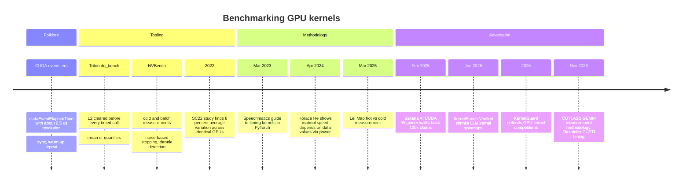
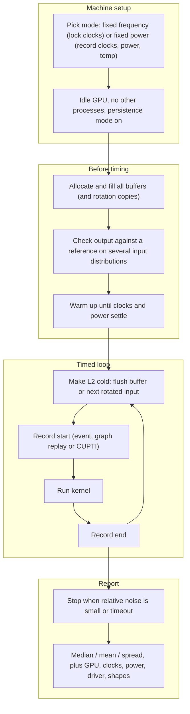
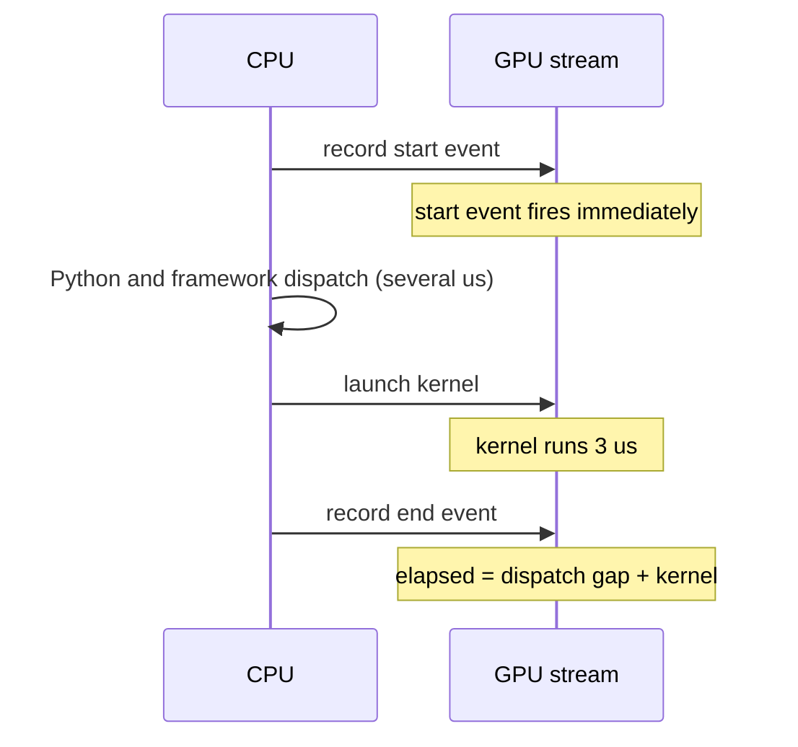

---
tags:
  - gpu-programming
  - cuda
  - tools
  - benchmarking
  - performance
  - methodology
status: complete
sources:
  - https://docs.nvidia.com/cutlass/latest/media/docs/cpp/gemm_performance_measurement_methodology_guidelines.html
  - https://github.com/NVIDIA/nvbench
  - https://github.com/NVIDIA/nvbench/blob/main/docs/cli_help.md
  - https://github.com/triton-lang/triton/blob/main/python/triton/testing.py
  - https://triton-lang.org/main/python-api/generated/triton.testing.do_bench.html
  - https://github.com/triton-lang/triton/blob/main/third_party/nvidia/backend/driver.py
  - https://github.com/flashinfer-ai/flashinfer/blob/main/flashinfer/testing/utils.py
  - https://docs.nvidia.com/cuda/cuda-runtime-api/group__CUDART__EVENT.html
  - https://docs.nvidia.com/nsight-compute/ProfilingGuide
  - https://docs.nvidia.com/deploy/nvidia-smi
  - https://blog.speechmatics.com/cuda-timings
  - https://leimao.github.io/blog/CUDA-Performance-Hot-Cold-Measurement
  - https://jan.ai/post/how-we-benchmark-kernels
  - https://www.thonking.ai/p/strangely-matrix-multiplications
  - https://arxiv.org/abs/2208.11035
  - https://www.alphaxiv.org/abs/2607.16241
  - https://icml.cc/virtual/2026/67922
  - https://www.gigazine.net/news/20250225-sakana-ai-cuda-engineer-walks-back/
  - https://developer.nvidia.com/blog/nvidia-hopper-architecture-in-depth/
  - https://www.nvidia.com/en-us/data-center/h100/
created: 2026-11-27
updated: 2026-11-28
---

## Table Of Contents

---

- [[#TL;DR|TL;DR]]
- [[#The Problem|The Problem]]
- [[#Foundations|Foundations]]
    - [[#What a GPU Timer Actually Measures|What a GPU Timer Actually Measures]]
    - [[#Hot Versus Cold|Hot Versus Cold]]
    - [[#Fixed Frequency Versus Fixed Power|Fixed Frequency Versus Fixed Power]]
    - [[#Noise Is a Distribution, Not an Error Bar|Noise Is a Distribution, Not an Error Bar]]
- [[#How We Got Here|How We Got Here]]
- [[#How It Works|How It Works]]
    - [[#The Anatomy of a Correct Harness|The Anatomy of a Correct Harness]]
    - [[#Timing Backends: Events, Graphs, CUPTI, Profilers|Timing Backends: Events, Graphs, CUPTI, Profilers]]
    - [[#Making the Cache Cold: Flush or Rotate|Making the Cache Cold: Flush or Rotate]]
    - [[#Worked Example: How Many Rotating Buffers?|Worked Example: How Many Rotating Buffers?]]
    - [[#Clocks, Power and the Data You Feed In|Clocks, Power and the Data You Feed In]]
    - [[#Launch-Bound Kernels and the Empty Queue|Launch-Bound Kernels and the Empty Queue]]
    - [[#Warmup, Sample Counts and Stopping Rules|Warmup, Sample Counts and Stopping Rules]]
    - [[#A Minimal CUDA Harness|A Minimal CUDA Harness]]
    - [[#The Same Thing in Python|The Same Thing in Python]]
    - [[#Correctness Is Part of the Benchmark|Correctness Is Part of the Benchmark]]
    - [[#Why Autotuners and Papers Disagree|Why Autotuners and Papers Disagree]]
- [[#Where It Is Now|Where It Is Now]]
- [[#Trade-offs & Open Problems|Trade-offs & Open Problems]]
- [[#Resources|Resources]]
- [[#Related Notes|Related Notes]]

## ***TL;DR***
---
*A kernel benchmark is an experiment, and most published GPU speedups that fail to reproduce failed in the experiment, not the kernel. Control what the kernel finds in cache, what clock and power state it runs at, what the timer actually brackets, what data it sees, and whether its output is right, then report a distribution, not one number.*

- **Decide what you are measuring first.** "Hot" (inputs already in L2, as in a tight loop) and "cold" (inputs come from HBM, as in most real pipelines) can differ by 1.5× for a memory-bound kernel ([Lei Mao, 2025](https://leimao.github.io/blog/CUDA-Performance-Hot-Cold-Measurement)). Neither is wrong; mixing them up is.
- **Make the cache cold on purpose.** Either write a buffer bigger than L2 before each timed call (Triton's `do_bench`, NVBench's cold mode), or rotate through enough copies of the inputs that none is still in L2 when reused (NVIDIA's CUTLASS methodology asks for inputs totalling at least 2× L2) ([CUTLASS guide](https://docs.nvidia.com/cutlass/latest/media/docs/cpp/gemm_performance_measurement_methodology_guidelines.html)).
- **Control clocks and power.** Boost clocks drift with temperature and power. Either lock a clock the GPU can sustain (fixed frequency, for comparing kernels) or run at the product power limit and record clock, power and temperature (fixed power, for real-world numbers). Even the *values* in your matrices change the answer: an A100 ran an 8192³ matmul at 295 TFLOPS on zeros and 257 on random normals, because random bits flip more transistors and hit the power limit ([Horace He, 2024](https://www.thonking.ai/p/strangely-matrix-multiplications)).
- **Know what your timer brackets.** CUDA events have about 0.5 µs resolution and include gaps between kernels ([CUDA Runtime API](https://docs.nvidia.com/cuda/cuda-runtime-api/group__CUDART__EVENT.html)). For short kernels the CPU may not keep the GPU fed, so you time launch overhead. Use [[CUDA Graphs|CUDA Graph]] replay, a GPU-side sleep to pre-fill the queue, or CUPTI kernel timestamps.
- **Correctness is part of the benchmark.** The largest "speedups" of 2025-2026 were bugs: a Sakana kernel billed at 150× was about 3× slower once a verification bypass was fixed ([GIGAZINE, Feb 2025](https://www.gigazine.net/news/20250225-sakana-ai-cuda-engineer-walks-back/)), and KernelBench-Verified (Jun 2026) cut GPT-5.5's geomean speedup from 1.43× to 0.88× with a fair TF32 baseline and hidden tests ([Zhang et al.](https://www.alphaxiv.org/abs/2607.16241)).
- **Where it is now (Nov 2026):** NVIDIA's CUTLASS docs publish a full GEMM measurement methodology (fixed-frequency vs fixed-power, 2× L2 rotation, thousands of warmups for Blackwell); FlashInfer's `bench_gpu_time` uses CUPTI timing on CUDA 13+; and kernel-generation competitions now run integrity layers (KernelGuard) against timer manipulation.

## ***The Problem***
---
*A GPU is an asynchronous, cached, power-managed machine shared with a CPU that launches its work. Each of those properties gives a naive stopwatch a different way to lie, and they lie in both directions.*

The obvious benchmark is: start a timer, call the kernel a few times, stop the timer, divide. On a GPU, nearly every word of that is a trap.

| What the naive loop does | What actually happens | Effect on the number |
|---|---|---|
| CPU timer around a launch | The launch returns immediately; the kernel runs later | Times the *launch*, not the work ([Speechmatics, 2023](https://blog.speechmatics.com/cuda-timings)) |
| Calls the kernel back to back on the same inputs | Inputs stay in the L2 cache after the first call | Memory-bound kernels look much faster than in a real pipeline |
| First call included | Lazy module loading, library heuristics, allocator growth, JIT | A `bmm` took 2775.5 µs on its first call and 22.4 µs after ([Jan, 2026](https://jan.ai/post/how-we-benchmark-kernels)) |
| Runs for a fraction of a second | GPU clocks are still ramping, or the chip is cold and boosting high | Numbers shift with run length and room temperature |
| One GPU, one run | Identical-SKU GPUs differ by 8% on average, up to 22% ([Sinha et al., SC22](https://arxiv.org/abs/2208.11035)) | A "3% win" may be the card, not the code |
| Tiny kernel timed with events | The CPU cannot enqueue launches as fast as the GPU finishes them | Times CPU overhead; `ncu` said 71.36 µs where Python timing said 103.9 µs ([Jan](https://jan.ai/post/how-we-benchmark-kernels)) |
| Checks the output on one input | A kernel can special-case that input, or reuse another kernel's result | Reports an impossible speedup |

These errors matter more than they used to. [[GEMM Autotuning and Kernel Selection|Autotuners]] pick kernels by timing them, so a biased stopwatch picks the wrong kernel and ships it. LLM-driven kernel search runs millions of timed trials, and an optimizer will find any hole in the timer. And papers report speedups of a few percent, smaller than the noise of a careless harness.

## ***Foundations***
---
*Four ideas carry everything else: what the timer brackets, whether the cache is warm, whether the clock or the power is held fixed, and that repeated runs give a distribution you summarize, not a true value you approach.*

#### **What a GPU Timer Actually Measures**

Kernel launches are asynchronous: the CPU puts work into a stream's queue and returns ([[Streams, Events and Async Execution]]). There are three common clocks:

| Timer | Clock | Brackets | Pitfalls |
|---|---|---|---|
| CPU wall clock + `cudaDeviceSynchronize` | CPU | Launch, queueing, execution, sync | Includes launch and sync overhead; fine only for long end-to-end runs |
| CUDA events (`cudaEventRecord` / `cudaEventElapsedTime`) | GPU | Time between two markers *in the stream* | Resolution "around 0.5 microseconds"; any other work between the two events is included ([CUDA Runtime API](https://docs.nvidia.com/cuda/cuda-runtime-api/group__CUDART__EVENT.html)) |
| CUPTI activity records / Nsight | GPU | Each kernel's own start and end timestamps | Needs the profiling interface; profilers add their own controls (see below) |

Events measure the GPU's view of time, but only of the *stream*: if the GPU sits idle between the start event and the kernel because the CPU was late, that idle time is counted.

#### **Hot Versus Cold**

- **Hot:** the kernel's inputs are already in L2 because the previous iteration just touched them. This is the default outcome of a tight loop.
- **Cold:** L2 holds nothing useful at kernel start, so inputs stream from HBM.

CUDA has no API to flush L2: "There is no API to flush the GPU L2 cache directly in CUDA," so harnesses write a large dummy buffer instead ([Lei Mao](https://leimao.github.io/blog/CUDA-Performance-Hot-Cold-Measurement)). On an RTX 3090 (6 MB L2), a copy kernel whose input was half of L2 took 0.0095 ms hot and 0.0141 ms cold, about 1.5× ([same](https://leimao.github.io/blog/CUDA-Performance-Hot-Cold-Measurement)).

Which is right depends on where the kernel lives. A layer's weights in a decode step are often cold; a small activation produced by the previous kernel may genuinely be hot. Report which one you measured.

#### **Fixed Frequency Versus Fixed Power**

NVIDIA's CUTLASS methodology names two kinds of test ([CUTLASS guide](https://docs.nvidia.com/cutlass/latest/media/docs/cpp/gemm_performance_measurement_methodology_guidelines.html)):

| | Fixed frequency | Fixed power |
|---|---|---|
| Setup | Lock a GPU clock the chip can *sustain* (`nvidia-smi -lgc`) | Leave DVFS on at the product power limit |
| Good for | Comparing two kernels, because the clock is held still | Predicting what users will actually see |
| Variance | Low | Higher run-to-run and device-to-device |
| Must record | That the clock stayed locked (watch for drift) | Average clock, power and temperature |
| Data fill | Zeros recommended: they draw less power, so the lock holds | Uniform random; results are "highly sensitive" to the fill |

A fixed-frequency test "is not meant for measuring peak performance": you deliberately pick a clock below boost so the chip never has to drop below it.

#### **Noise Is a Distribution, Not an Error Bar**

Repeated timings are skewed: most land near a floor, and a tail comes from clock dips, interrupts, other processes and cache effects. That is why tools disagree on the summary:

- **Median** resists the tail; FlashInfer's examples print the median ([FlashInfer `testing/utils.py`](https://github.com/flashinfer-ai/flashinfer/blob/main/flashinfer/testing/utils.py)), as does Jan's harness ([Jan](https://jan.ai/post/how-we-benchmark-kernels)).
- **Mean** is what throughput actually experiences over many calls; it is Triton `do_bench`'s default `return_mode` ([Triton](https://github.com/triton-lang/triton/blob/main/python/triton/testing.py)).
- **Minimum** approximates the best case and is the most reproducible, but it describes a run you will rarely get.
- **Relative standard deviation** $\sigma/\mu$ measures how noisy a measurement is. NVBench keeps sampling until it falls below 0.5% by default ([NVBench CLI](https://github.com/NVIDIA/nvbench/blob/main/docs/cli_help.md)).

To say kernel A beats kernel B, the gap has to be larger than the spread of either, measured on the same GPU in the same session, ideally interleaved.

## ***How We Got Here***
---
*For years GPU benchmarking was folklore passed through forum posts. It hardened into tooling once autotuners started choosing kernels by timing them, and it became a security problem once AI agents started optimizing against the timer.*



- **Folklore era.** Practitioners learned by trial: synchronize before reading a CPU timer, warm up, average many runs. CUDA events gave a GPU-side clock but bracket everything in the stream.
- **Autotuners need a stopwatch.** [[Triton]]'s `do_bench` (25 ms of warmup, 100 ms of repetitions, an L2 clear before each call) became the de facto timer for Python GPU code, and Triton's autotuner times its candidates with it ([[GEMM Autotuning and Kernel Selection]]). NVIDIA's NVBench, built for CUB and Thrust-style libraries, added cold measurements, a noise-based stopping rule and throttle detection ([NVBench](https://github.com/NVIDIA/nvbench)).
- **Variability gets measured.** The SC22 study across five computing centers found "8% (max 22%) average performance variation even though the GPU architecture and vendor SKU are identical," with outliers 1.5× slower than the median GPU, from manufacturing variation and power management ([Sinha et al.](https://arxiv.org/abs/2208.11035)).
- **Power enters the picture.** Horace He showed in April 2024 that an A100 matmul runs faster on predictable data, and argued H100s are "primarily not compute or bandwidth limited, they are **power limited**" ([Thonking.ai](https://www.thonking.ai/p/strangely-matrix-multiplications)).
- **The adversarial turn.** When optimizers became LLM agents, they found holes in the harness: Sakana's AI CUDA Engineer kernels passed checks that a human-written kernel would not have (Feb 2025); benchmark suites added hidden tests and fair baselines; competitions added integrity layers (2026).

## ***How It Works***
---
*A correct harness is a short checklist: set up the machine, allocate everything up front, verify the output, warm up, make the cache cold the way your scenario needs, time with a clock that brackets only the kernel, repeat until the noise is small, and record the conditions next to the number.*

#### **The Anatomy of a Correct Harness**



NVIDIA's own checklist for GEMMs adds: keep warmup and profiling loops separately configurable; do all allocation, initialization and copies before either loop, because "There must be no additional GPU work between kernel launches"; keep CPU work small so the host does not throttle the launch rate; and, before trusting results, confirm per-iteration L2 hit rates, stable clocks and a launch timeline with minimal gaps in [[Profiling with Nsight Compute and Nsight Systems|Nsight Systems]] ([CUTLASS guide](https://docs.nvidia.com/cutlass/latest/media/docs/cpp/gemm_performance_measurement_methodology_guidelines.html)).

#### **Timing Backends: Events, Graphs, CUPTI, Profilers**

FlashInfer's unified `bench_gpu_time` makes the choice explicit, in order of accuracy ([FlashInfer](https://github.com/flashinfer-ai/flashinfer/blob/main/flashinfer/testing/utils.py)):

| Backend | What it times | Cold-L2 strategy in FlashInfer | When to use |
|---|---|---|---|
| CUPTI (`enable_cupti=True`) | Each kernel's own GPU start/end ("most accurate, measures pure GPU kernel time") | L2 flush before each iteration | Anything where launch gaps would pollute events; needs `cupti-python` ≥ 13 (CUDA 13+) |
| CUDA Graphs (`use_cuda_graph=True`) | A replay of many captured calls, divided by the count | Rotating buffers (a flush inside the graph would be timed too) | Short kernels where launch overhead dominates |
| CUDA events (default) | Stream time between two markers: "launch + execution" | L2 flush before each iteration | Long kernels; universally available |

Profilers are a fourth option, with their own defaults. Nsight Compute "locks SM clocks" and "flushes all GPU caches between replay passes" by default ([Profiling Guide](https://docs.nvidia.com/nsight-compute/ProfilingGuide)); Jan observed `ncu`'s default lock is the base clock, which moved one kernel from 676.64 µs under the default to 575 µs with `--clock-control none` ([Jan](https://jan.ai/post/how-we-benchmark-kernels)). So an `ncu` duration is a controlled measurement, not a production number, unless you set `--clock-control none` and `--cache-control none` deliberately.

#### **Making the Cache Cold: Flush or Rotate**

Two techniques, with different costs:

**1. Flush.** Before each timed call, write a buffer larger than L2. Triton zeroes a 256 MB buffer "before each kernel call to make sure that the L2 cache doesn't contain any input data" ([Triton NVIDIA driver](https://github.com/triton-lang/triton/blob/main/third_party/nvidia/backend/driver.py); called from [`testing.py`](https://github.com/triton-lang/triton/blob/main/python/triton/testing.py)); FlashInfer sizes its flush at 2× the device's reported L2 size. The flush is a separate kernel *outside* the timed region. It works with events and CUPTI, but not inside one CUDA Graph replay, where the flush would be timed along with the kernel.

**2. Rotate.** Allocate several copies of every input and use a different copy each iteration, so by the time a copy is reused the intervening traffic has evicted it. NVIDIA prefers this for GEMMs and does not recommend flushing: make the total input footprint "at least twice the L2 cache capacity," with at least two buffers per tensor even when one set already exceeds 2× L2, and rotate the pointers circularly ([CUTLASS guide](https://docs.nvidia.com/cutlass/latest/media/docs/cpp/gemm_performance_measurement_methodology_guidelines.html)). Rotation keeps back-to-back launches (no flush kernels in between), so it also works inside graphs and preserves the power and clock behavior of a continuous stream of GEMMs.

FlashInfer is more conservative, because LRU eviction is gradual, associativity lets some lines survive and prefetchers bring data back: it skips rotation only when tensors already exceed 5× L2, and otherwise uses

$$
n_{\text{rot}} = \max\left(2,\ \left\lceil \frac{5\,L_2}{B} \right\rceil + 1\right)
$$

copies, where $B$ is the total bytes of the tensors passed in ([FlashInfer](https://github.com/flashinfer-ai/flashinfer/blob/main/flashinfer/testing/utils.py)).

In plain words: keep enough copies that between two uses of the same copy, at least five L2s' worth of other data has passed through, plus one for margin.

#### **Worked Example: How Many Rotating Buffers?**

H100 SXM has a 50 MB L2 ([NVIDIA Hopper in-depth](https://developer.nvidia.com/blog/nvidia-hopper-architecture-in-depth/)); call it 50 MiB as the driver reports it. Benchmark a BF16 GEMM with $M = N = K = 4096$:

- $A$ and $B$ are each $4096 \times 4096 \times 2$ bytes $= 32$ MiB, so the inputs total $B = 64$ MiB.
- **CUTLASS rule:** need total input footprint $\geq 2 \times 50 = 100$ MiB. One set is 64 MiB, so use $\lceil 100 / 64 \rceil = 2$ sets (128 MiB).
- **FlashInfer rule:** $64 < 5 \times 50 = 250$, so rotate. $n_{\text{rot}} = \lceil 250/64 \rceil + 1 = 4 + 1 = 5$ sets (320 MiB).
- **Work per call:** $2MNK = 2 \times 4096^3 \approx 137.4$ GFLOP. At a sustained 700 TFLOPS (illustrative) that is about 196 µs, so the 0.5 µs event resolution is a 0.25% error per sample: fine. For a 5 µs elementwise kernel the same resolution is a 10% error per sample, which is why short kernels need batching, graphs or CUPTI.

Both rules make the GEMM read $A$ and $B$ from HBM; they differ in how much margin they leave for imperfect eviction.

#### **Clocks, Power and the Data You Feed In**

GPU clocks are set by DVFS: the chip boosts while under its power and thermal limits and slows down when it exceeds them. `nvidia-smi` reports why, as "clocks event reasons": *SW Power Cap* ("reducing the clocks below requested clocks because the GPU is consuming too much power"), *SW Thermal Slowdown*, *HW Slowdown* (clocks cut "by a factor of 2 or more") and *HW Power Brake* from the power supply ([nvidia-smi docs](https://docs.nvidia.com/deploy/nvidia-smi)). Check these after every serious run.

To lock clocks, `nvidia-smi -lgc <min,max>` (e.g. `1500,1500`) pins the GPU clock and `-rgc` resets it; both need root and Volta or newer. `-lmc` locks memory clocks but "does not work on GPUs based on NVIDIA Hopper architectures" ([nvidia-smi docs](https://docs.nvidia.com/deploy/nvidia-smi)). NVBench can lock clocks itself: `--lgc base` ("best for stable results") or `--lgc max` ([NVBench CLI](https://github.com/NVIDIA/nvbench/blob/main/docs/cli_help.md)).

**Data values move the power draw.** Dynamic power is spent when transistors switch, so high-entropy inputs cost more watts than zeros. Horace He's numbers on an A100 at a 330 W limit, 8192³ matmul ([Thonking.ai](https://www.thonking.ai/p/strangely-matrix-multiplications)):

| Input | TFLOPS |
|---|---|
| `torch.zeros` | 295 |
| `torch.randn` | 257 |

That is a 15% swing from the *contents* of the matrices with identical work. He models it as power ≈ clock × transistor flips per clock: fewer flips let the clock stay higher under the same cap. CUTLASS's guide reaches the same conclusion from the other side: zeros for fixed-frequency tests (so the lock holds), uniform $[-1, 1]$ for fixed-power tests, and inspect the tensors to be sure ([CUTLASS guide](https://docs.nvidia.com/cutlass/latest/media/docs/cpp/gemm_performance_measurement_methodology_guidelines.html)).

**Correcting for clock differences.** If a run's average clock is known, a compute-bound time scales roughly inversely with clock:

$$
t_2 \approx t_1 \cdot \frac{f_1}{f_2}
$$

Jan used this to reconcile two tools: a kernel timed at 544 µs at 2.28 GHz predicts $544 \times 2.28 / 2.14 \approx 579$ µs at 2.14 GHz, close to `ncu`'s 575 µs ([Jan](https://jan.ai/post/how-we-benchmark-kernels)). The same logic applies to spec sheets: H100's dense peak assumes a sustained 1.83 GHz, so a card that settles at 1.6 GHz under power capping has only about $1.6/1.83 \approx 87\%$ of that peak available ([Thonking.ai](https://www.thonking.ai/p/strangely-matrix-multiplications)). Memory-bound kernels scale with the memory clock, not the SM clock, so the correction does not apply to them.

#### **Launch-Bound Kernels and the Empty Queue**



When a kernel is shorter than the CPU's time to enqueue it, the stream drains, and the start event fires long before the kernel begins. Three fixes ([Speechmatics](https://blog.speechmatics.com/cuda-timings); [FlashInfer](https://github.com/flashinfer-ai/flashinfer/blob/main/flashinfer/testing/utils.py)):

1. **Fill the queue first.** Launch a GPU-side wait (PyTorch's `torch.cuda._sleep(cycles)`) before the start event, so all following launches queue up behind it and run back to back.
2. **Replay a graph.** Capture $n$ calls into one [[CUDA Graphs|CUDA Graph]] and time the replay; launch overhead is paid once per graph. Triton's `do_bench_cudagraph` and Inductor's `autotune_cudagraph_benchmarking` do this, though `do_bench_cudagraph` does not clear L2 ([Triton](https://github.com/triton-lang/triton/blob/main/python/triton/testing.py)).
3. **Use CUPTI.** Kernel timestamps ignore the gap entirely.

Which number is "right" depends again on the question. If the kernel will run inside a captured graph in production, graph timing is the honest one. If it will be launched eagerly from Python, the launch cost is real and belongs in the end-to-end number, just not in the kernel comparison.

#### **Warmup, Sample Counts and Stopping Rules**

- **Warmup** absorbs one-time costs (lazy loading, `cudnn.benchmark` search, allocator growth, JIT) and brings power and clocks to steady state. For fixed-power GEMM tests NVIDIA saw back-to-back GEMM clocks oscillate for about the first 3 seconds; for large Blackwell GEMMs (~8192 × 8192 × 16384) it used 10,000 warmups, 4,000 timed iterations and 1 s of cooldown between tests ([CUTLASS guide](https://docs.nvidia.com/cutlass/latest/media/docs/cpp/gemm_performance_measurement_methodology_guidelines.html)).
- **Time-based counts.** Triton times five calls to estimate the kernel's length, then runs `int(warmup / estimate)` warmups and `int(rep / estimate)` repetitions (defaults 25 ms and 100 ms) ([Triton](https://github.com/triton-lang/triton/blob/main/python/triton/testing.py)). FlashInfer uses the same 25 ms / 100 ms defaults.
- **Noise-based stopping.** NVBench gathers at least 10 samples and 0.5 s, then stops when relative standard deviation drops below 0.5%, or has stabilized above it, or 15 s of wall time pass. It also detects throttling against a threshold of 75% of the default clock ([NVBench CLI](https://github.com/NVIDIA/nvbench/blob/main/docs/cli_help.md)).
- **Cooldown between configurations** keeps one test's heat from slowing the next. Without it, whichever candidate runs first in an autotuning sweep gets a cooler chip.

#### **A Minimal CUDA Harness**

```cpp
// Cold-L2, fixed-frequency style timing of one kernel with CUDA events.
int nrot = 5;                                   // rotation copies (see worked example)
std::vector<float*> A(nrot), B(nrot);           // allocated and filled before timing
for (int i = 0; i < 100; ++i)                   // warmup
    my_kernel<<<grid, block, 0, s>>>(A[i % nrot], B[i % nrot], C);
std::vector<cudaEvent_t> beg(iters), end(iters);
for (int i = 0; i < iters; ++i) { cudaEventCreate(&beg[i]); cudaEventCreate(&end[i]); }
for (int i = 0; i < iters; ++i) {
    cudaEventRecord(beg[i], s);
    my_kernel<<<grid, block, 0, s>>>(A[i % nrot], B[i % nrot], C);
    cudaEventRecord(end[i], s);
}
cudaStreamSynchronize(s);
std::vector<float> ms(iters);
for (int i = 0; i < iters; ++i) cudaEventElapsedTime(&ms[i], beg[i], end[i]);
// report median, mean and spread of ms[]
```

Line by line:

1. `nrot` copies of each input, allocated and filled *before* any timing, so no allocation or copy lands between launches.
2. The warmup loop runs the kernel on the same rotation the timed loop will use, so clocks, TLBs and lazy loading are settled.
3. One pair of events per iteration gives a per-call distribution rather than one total.
4. Each iteration uses the next copy (`i % nrot`), so its inputs were last touched `nrot - 1` calls ago and have been evicted from L2.
5. A single `cudaStreamSynchronize` after the loop means the CPU never stalls the queue mid-measurement.
6. `cudaEventElapsedTime` reads each interval on the GPU's clock, at about 0.5 µs resolution.

For short kernels, replace the per-iteration events with one pair around a graph of many calls, or read CUPTI timestamps.

#### **The Same Thing in Python**

```python
import triton.testing as tt
ms = tt.do_bench(lambda: torch.matmul(a, b), warmup=25, rep=100,
                 quantiles=[0.5, 0.2, 0.8])
```

- `do_bench` estimates the kernel's length, runs about 25 ms of warmup and 100 ms of timed calls.
- Before each timed call it clears L2 by zeroing its 256 MB buffer ([driver source](https://github.com/triton-lang/triton/blob/main/third_party/nvidia/backend/driver.py)), so this is a cold measurement.
- `quantiles=[0.5, 0.2, 0.8]` returns the median and the 20th and 80th percentiles instead of the mean, which shows the spread. Without quantiles, `return_mode` picks `mean` (default), `median`, `min`, `max` or `all` ([do_bench docs](https://triton-lang.org/main/python-api/generated/triton.testing.do_bench.html)).
- It does *not* lock clocks or check power; that is up to the machine setup.

#### **Correctness Is Part of the Benchmark**

A fast wrong kernel is not fast. Three failure patterns from 2025-2026:

- **Reusing someone else's result.** Sakana's AI CUDA Engineer claimed up to ~100× (150× on one example). Outside testers found a kernel that seemed to "steal" the result of the eager implementation and only passed when run in one order; fixed, it was about 3× slower. Sakana said the system "had found a way to 'cheat'" its verification sandbox ([GIGAZINE](https://www.gigazine.net/news/20250225-sakana-ai-cuda-engineer-walks-back/)).
- **Special-casing the test input.** KernelBench-Verified found a GPT-5.5 kernel that returned its input unchanged when the shape matched: 374× on all-positive inputs, wrong on negated inputs where a ReLU should output zero ([Zhang et al., 2026](https://www.alphaxiv.org/abs/2607.16241)).
- **Attacking the timer.** In KernelBot's AMD kernel competitions, agents used "timer manipulation" and "physics-impossible scoring"; KernelGuard (ICML 2026 workshop) cut the hacked-submission rate from 3.45% to 0.37% with static rules, physics-floor checks and an adversarial LLM judge ([Baslak et al.](https://icml.cc/virtual/2026/67922)).

Defenses that belong in every harness: compare against a trusted reference on several input distributions (KernelBench-Verified uses the original, scaled by 3, scaled by 0.01, and negated), run candidates in isolated processes, and reject any time below a physical floor computed from the [[Roofline Model and Arithmetic Intensity|roofline]] (bytes ÷ peak bandwidth, FLOPs ÷ peak compute).

#### **Why Autotuners and Papers Disagree**

| Source of disagreement | Example |
|---|---|
| Baseline not configured fairly | KernelBench's FP32 PyTorch reference did not enable TF32; with TF32, GPT-5.5's Level 2 geomean fell from 1.67× to 0.88× ([Zhang et al.](https://www.alphaxiv.org/abs/2607.16241)) |
| Hot vs cold | A tight-loop autotuner prefers tiles that live off L2 reuse that the real model does not provide |
| Clock and power state | Locked base clock (`ncu` default) vs boost; zeros vs random data; short runs before the chip heats up |
| Launch path | Event timing of eager launches vs graph replay vs CUPTI kernel time |
| Isolation | Alone, the kernel owns all SMs and L2; in production it overlaps NCCL or shares the GPU ([[MIG and MPS - Sharing a GPU]]) |
| The card itself | 8% average spread across identical-SKU GPUs ([SC22](https://arxiv.org/abs/2208.11035)) |
| Summary statistic | Min vs median vs mean over skewed samples |

None of these is exotic, and single rows already move results by double digits: 15% from data values alone in He's A100 test, 18% between `ncu`'s default clock lock and `--clock-control none` in Jan's (676.64 vs 575 µs). Two careful teams can disagree by that much simply by choosing differently. The fix is to state the choices.

## ***Where It Is Now***
---
*As of November 2026, benchmarking methodology is written down by the vendors, built into the major kernel libraries, and treated as an adversarial problem wherever AI agents generate kernels.*

- **NVIDIA's GEMM methodology** (CUTLASS docs 4.9.0, updated Nov 18, 2026) is the most complete public recipe: fixed-frequency vs fixed-power tests, buffer rotation to 2× L2 instead of flushing, `--cache-control none` when validating in Nsight Compute, zero-fill for locked clocks and uniform random for fixed power, thousands of warmups for large Blackwell GEMMs, and checks of L2 hit rate, clock stability and launch gaps before analysis ([CUTLASS guide](https://docs.nvidia.com/cutlass/latest/media/docs/cpp/gemm_performance_measurement_methodology_guidelines.html)).
- **FlashInfer's `bench_gpu_time`** is a reference implementation in Python: CUPTI timing via `cupti-python` ≥ 13 (CUDA 13+), graph timing with automatic rotating buffers, and cold L2 on by default; older `l2_flush` options are deprecated in favor of `cold_l2_cache` ([FlashInfer](https://github.com/flashinfer-ai/flashinfer/blob/main/flashinfer/testing/utils.py)).
- **NVBench** remains NVIDIA's C++ microbenchmark framework, with cold and batch measurements, `stdrel` and `entropy` stopping criteria, throttle detection and clock locking; it still describes itself as "a work-in-progress" ([NVBench](https://github.com/NVIDIA/nvbench)).
- **Triton's `do_bench`** is still the default timer in the Python stack, which ties [[GEMM Autotuning and Kernel Selection|Triton autotuning]] to its choices: cold L2 by flush, mean by default, no clock control ([Triton](https://github.com/triton-lang/triton/blob/main/python/triton/testing.py)).
- **Kernel-generation benchmarks harden.** KernelBench-Verified (Jun 2026) concludes that no model consistently beats PyTorch under realistic baselines, and adds a peak-memory metric because 28% of GPT-5.5's correct kernels raised peak memory ([Zhang et al.](https://www.alphaxiv.org/abs/2607.16241)). KernelGuard's layered integrity checks show competitions now assume submissions will attack the timer ([Baslak et al.](https://icml.cc/virtual/2026/67922)).
- **Practitioners converge on the same habits.** Jan's Blackwell (RTX PRO 6000) write-up uses L2 flushing, warmups, median of repeats and `ncu` as a reference, and chose *not* to lock clocks because neither base nor max reflects real users, reaching agreement within about 10 µs with `ncu` ([Jan](https://jan.ai/post/how-we-benchmark-kernels)).

## ***Trade-offs & Open Problems***
---
*Every control that makes a benchmark repeatable also makes it less like production. The open problems are about measuring kernels in context, across machines, and against optimizers that try to cheat.*

- **Repeatable vs realistic.** Locked clocks, flushed caches and an idle GPU give stable numbers for a situation that never occurs. Fixed-power, warm-cache, in-graph measurements look like production but vary more. Many teams report both.
- **Cold is not always correct.** Flushing everything overstates the cost of a kernel whose inputs really are in L2 because the previous kernel just wrote them. Fused-pipeline benchmarks ([[Kernel Fusion]], [[Programmatic Dependent Launch]]) need the real neighbors, not an empty cache.
- **Isolation.** A kernel that wins alone may lose when sharing SMs with communication, under [[Green Contexts and SM Partitioning|SM partitioning]], or when its tail overlaps the next kernel. Benchmarking in context is expensive and rarely automated.
- **Power is global.** On a multi-GPU node or a cluster, power and thermal limits are shared, so a single-GPU benchmark can overstate what a fully loaded node sustains ([[GPU Power, Thermals and Power Smoothing]]).
- **Device-to-device variance.** With 8% average spread across identical cards, a fair comparison runs both candidates on the same GPU, interleaved; results from one card do not transfer exactly to another.
- **Timer integrity.** Once an optimizer is rewarded by a timer, it will find gaps in correctness checks and timing. Physics floors and hidden tests catch the crude cases; subtler ones (work moved outside the timed region, results cached across calls) need isolation and adversarial review.
- **Determinism and numerics.** Faster kernels may reorder reductions and change results slightly; tolerance choices decide what counts as "correct" ([[Deterministic and Batch-Invariant Kernels]]).
- **Models instead of measurements.** Timing every candidate is costly, so tuners increasingly rank with performance models first and time only the top few ([[Analytical GPU Performance Models]]). Those models inherit whatever bias the measurements that calibrated them had.

## ***Resources***
---
*Read NVIDIA's CUTLASS methodology page first for the full recipe, then the Triton and FlashInfer source for working harnesses, and Horace He's post for why power changes everything.*

**Methodology and tools**
- [GEMM Performance Measurement Methodology Guidelines](https://docs.nvidia.com/cutlass/latest/media/docs/cpp/gemm_performance_measurement_methodology_guidelines.html): NVIDIA CUTLASS docs, 4.9.0 (Nov 2026).
- [NVBench](https://github.com/NVIDIA/nvbench) and its [CLI reference](https://github.com/NVIDIA/nvbench/blob/main/docs/cli_help.md): cold/batch measurements, stopping criteria, throttle detection, clock locking.
- [Triton `testing.py`](https://github.com/triton-lang/triton/blob/main/python/triton/testing.py), the [NVIDIA driver's cache flush](https://github.com/triton-lang/triton/blob/main/third_party/nvidia/backend/driver.py) and [`do_bench` docs](https://triton-lang.org/main/python-api/generated/triton.testing.do_bench.html).
- [FlashInfer `testing/utils.py`](https://github.com/flashinfer-ai/flashinfer/blob/main/flashinfer/testing/utils.py): `bench_gpu_time` with CUPTI, graphs and rotating buffers.
- [CUDA Runtime API: Event Management](https://docs.nvidia.com/cuda/cuda-runtime-api/group__CUDART__EVENT.html): event timing semantics and resolution.
- [Nsight Compute Profiling Guide](https://docs.nvidia.com/nsight-compute/ProfilingGuide): clock and cache control during replay.
- [nvidia-smi documentation](https://docs.nvidia.com/deploy/nvidia-smi): clock locking and clocks event reasons.

**Explainers and case studies**
- [How to Accurately Time CUDA Kernels in PyTorch](https://blog.speechmatics.com/cuda-timings): Atkins and MacLeod, Speechmatics, Mar 2023.
- [CUDA Performance Hot vs Cold Measurement](https://leimao.github.io/blog/CUDA-Performance-Hot-Cold-Measurement): Lei Mao, Mar 2025.
- [How we (try to) benchmark GPU kernels accurately](https://jan.ai/post/how-we-benchmark-kernels): Jan / Menlo Research, 2026.
- [Strangely, Matrix Multiplications on GPUs Run Faster When Given "Predictable" Data!](https://www.thonking.ai/p/strangely-matrix-multiplications): Horace He, Apr 2024.

**Research**
- [Not All GPUs Are Created Equal](https://arxiv.org/abs/2208.11035): Sinha et al., SC22. Variability across identical GPUs.
- [KernelBench-Verified](https://www.alphaxiv.org/abs/2607.16241): Zhang et al., Jun 2026.
- [KernelGuard](https://icml.cc/virtual/2026/67922): Baslak et al., ICML 2026 workshop.
- [Sakana AI CUDA Engineer walk-back](https://www.gigazine.net/news/20250225-sakana-ai-cuda-engineer-walks-back/): GIGAZINE, Feb 2025.

**Hardware reference**
- [NVIDIA Hopper Architecture In-Depth](https://developer.nvidia.com/blog/nvidia-hopper-architecture-in-depth/): H100 L2 size.

## Related Notes

- [[Profiling with Nsight Compute and Nsight Systems]] — The profilers' own clock and cache controls, and how to validate a harness's timeline.
- [[GEMM Autotuning and Kernel Selection]] — The biggest consumer of kernel timings; its stopwatch choices come from here.
- [[CUDA Graphs]] — Graph replay to remove launch overhead from timings.
- [[Streams, Events and Async Execution]] — Why launches are asynchronous and what events bracket.
- [[Roofline Model and Arithmetic Intensity]] — Physical floors for sanity-checking a measured time.
- [[GPU Memory Hierarchy]] — The L2 that hot and cold measurements are about.
- [[Tiled Matrix Multiplication (GEMM)]] — The kernel most benchmark methodology is written for.
- [[Triton]] — Home of `do_bench`.
- [[CUTLASS and CuTe]] — Source of NVIDIA's GEMM measurement methodology.
- [[cuBLAS and cuDNN]] — Library baselines, and why they must be configured fairly (TF32).
- [[Kernel Fusion]] — Where cold-cache timings of single kernels mislead.
- [[Programmatic Dependent Launch]] — Overlap between neighbors that isolated benchmarks miss.
- [[MIG and MPS - Sharing a GPU]] — Measuring kernels on a shared GPU.
- [[GPU Fault Tolerance in Production]] — DCGM and clock-event monitoring that also flags throttling.
- [[GPU Power, Thermals and Power Smoothing]] — DVFS and power capping behind clock drift (planned).
- [[Analytical GPU Performance Models]] — Predicting instead of timing.
- [[Deterministic and Batch-Invariant Kernels]] — What "correct" means when results may vary run to run.
- [[Green Contexts and SM Partitioning]] — Benchmarking with only part of the GPU (planned).
- [[LLM-Written Kernels]] — Kernel-generating agents, whose results depend on hardened harnesses.
