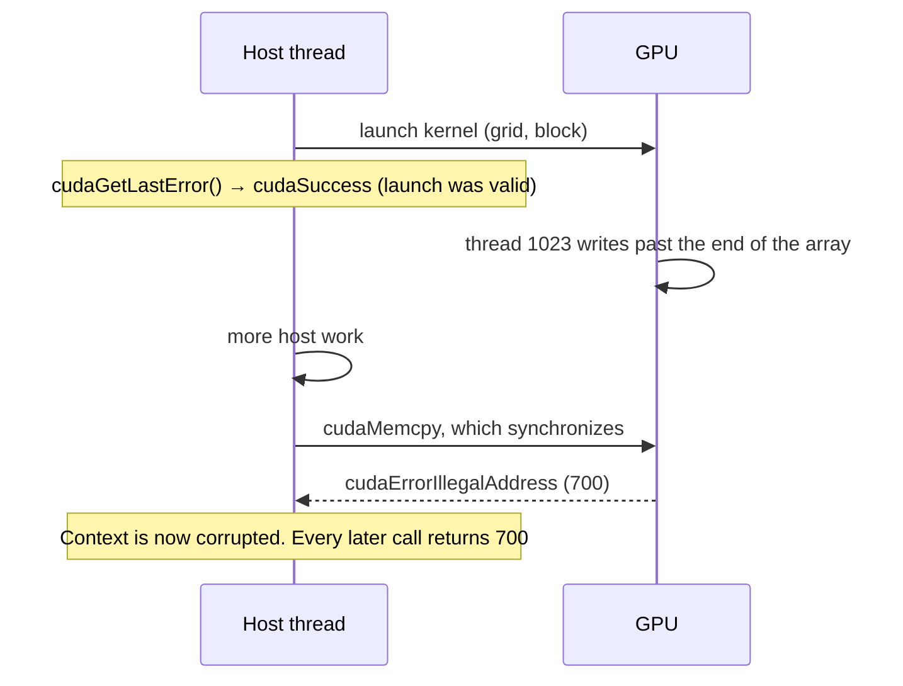
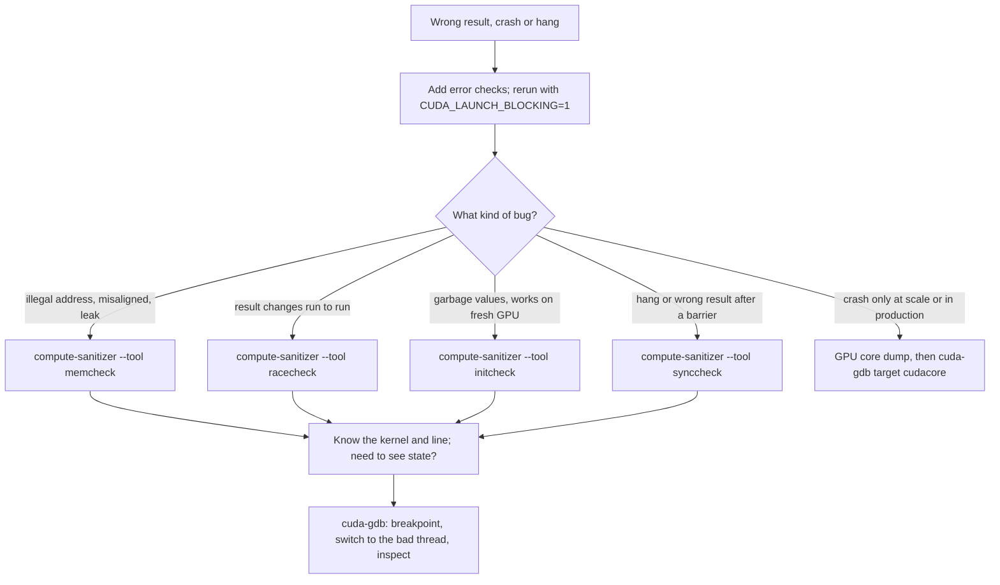

---
tags:
  - gpu-programming
  - tools
  - debugging
  - compute-sanitizer
  - cuda-gdb
status: complete
sources:
  - https://docs.nvidia.com/compute-sanitizer/ComputeSanitizer/index.html
  - https://docs.nvidia.com/compute-sanitizer/ReleaseNotes/index.html
  - https://docs.nvidia.com/compute-sanitizer/SanitizerNvtxGuide/index.html
  - https://docs.nvidia.com/cuda/archive/13.4.2/cuda-gdb/index.html
  - https://docs.nvidia.com/cuda/archive/13.3.1/cuda-runtime-api/group__CUDART__ERROR.html
  - https://docs.nvidia.com/cuda/cuda-programming-guide/02-basics/intro-to-cuda-cpp.html
  - https://forums.developer.nvidia.com/t/cuda-errors-determine-sticky-ness/271625
  - https://developer.nvidia.com/blog/debugging-cuda-more-efficiently-with-nvidia-compute-sanitizer
  - https://developer.nvidia.com/blog/efficient-cuda-debugging-memory-initialization-and-thread-synchronization-with-nvidia-compute-sanitizer
  - https://developer.nvidia.com/blog/efficient-cuda-debugging-using-compute-sanitizer-with-nvtx-and-creating-custom-tools
  - https://developer.nvidia.com/blog/better-bug-detection-how-compile-time-instrumentation-for-compute-sanitizer-enhances-memory-safety/
  - https://developer.nvidia.com/blog/nvidia-cuda-13-5-brings-nvidia-vera-rubin-ga-support/
  - https://vllm.ai/blog/2025-08-11-cuda-debugging
  - https://discuss.pytorch.org/t/how-to-enable-torch-use-cuda-dsa/202824
  - https://docs.pytorch.org/docs/2.14/user_guide/torch_compiler/torch.compiler_aot_inductor_debugging_guide.html
  - https://triton-lang.org/main/programming-guide/chapter-3/debugging.html
  - https://rocm.docs.amd.com/projects/ROCgdb
  - https://rocm.docs.amd.com/en/docs-6.1.5/conceptual/using-gpu-sanitizer.html
  - https://docs.nvidia.com/nsight-visual-studio-code-edition/latest/introduction/index.html
  - https://forums.developer.nvidia.com/t/size-of-printf-buffer/160957
  - https://stackoverflow.com/questions/72565993/is-it-possible-to-get-assertion-info-from-within-a-cuda-kernel
created: 2026-11-26
updated: 2026-11-26
---

## Table Of Contents

---

- [[#TL;DR|TL;DR]]
- [[#The Problem|The Problem]]
- [[#Foundations|Foundations]]
    - [[#Synchronous, Asynchronous and Sticky Errors|Synchronous, Asynchronous and Sticky Errors]]
    - [[#Debug Information: -G vs -lineinfo|Debug Information: -G vs -lineinfo]]
    - [[#The Toolbox at a Glance|The Toolbox at a Glance]]
- [[#How We Got Here|How We Got Here]]
- [[#How It Works|How It Works]]
    - [[#Error-Checking Discipline|Error-Checking Discipline]]
    - [[#memcheck|memcheck]]
    - [[#racecheck|racecheck]]
    - [[#initcheck|initcheck]]
    - [[#synccheck|synccheck]]
    - [[#Options, Annotations and Compile-Time Instrumentation|Options, Annotations and Compile-Time Instrumentation]]
    - [[#cuda-gdb|cuda-gdb]]
    - [[#GPU Core Dumps|GPU Core Dumps]]
    - [[#IDEs, printf and assert|IDEs, printf and assert]]
    - [[#PyTorch and Triton|PyTorch and Triton]]
    - [[#AMD Equivalents|AMD Equivalents]]
- [[#Where It Is Now|Where It Is Now]]
- [[#Trade-offs & Open Problems|Trade-offs & Open Problems]]
- [[#Resources|Resources]]
- [[#Related Notes|Related Notes]]

## ***TL;DR***
---
*GPU bugs are hard because errors show up later than they happen, one bad thread can poison the whole process, and many bugs give wrong answers with no error at all. The fix is a habit (check every call) plus two tools: compute-sanitizer, which finds bad memory accesses, races, uninitialized reads and barrier misuse automatically, and cuda-gdb, which lets you stop inside a kernel and look at any thread.*

- **Check every CUDA call, and check kernels twice.** A launch returns nothing, so call `cudaGetLastError()` after it (bad launch configuration) and check `cudaDeviceSynchronize()` while debugging (faults while running). A clean launch "does not confirm that the kernel ran successfully" ([CUDA Programming Guide](https://docs.nvidia.com/cuda/cuda-programming-guide/02-basics/intro-to-cuda-cpp.html)).
- **Errors from device code are asynchronous and sticky.** An out-of-bounds access raises `cudaErrorIllegalAddress` (700) at some later call, and it "corrupt[s] the CUDA context": the only recovery is to let the process exit ([NVIDIA forums, Crovella](https://forums.developer.nvidia.com/t/cuda-errors-determine-sticky-ness/271625)).
- **compute-sanitizer** (v2026.3, Sep 2026) runs your unmodified program under four tools: **memcheck** (out-of-bounds, misaligned, leaks, API errors), **racecheck** (shared-memory hazards), **initcheck** (reads of uninitialized memory) and **synccheck** (barrier misuse) ([user guide](https://docs.nvidia.com/compute-sanitizer/ComputeSanitizer/index.html)). It replaced `cuda-memcheck`, deprecated in CUDA 11.6 and removed in 12.0 ([NVIDIA, 2023](https://developer.nvidia.com/blog/debugging-cuda-more-efficiently-with-nvidia-compute-sanitizer)).
- **cuda-gdb** is GDB extended for the GPU: breakpoints in kernels, switching focus between blocks, threads, warps and lanes, and loading **GPU core dumps** written when a kernel faults ([CUDA-GDB docs](https://docs.nvidia.com/cuda/archive/13.4.2/cuda-gdb/index.html)).
- **Where it is now (Nov 2026):** CUDA 13.1 added compile-time memcheck instrumentation (`-fdevice-sanitize=memcheck`); Compute Sanitizer 2026.x adds Rubin support and checks TMA loads; CUDA 13.5 (Nov 4, 2026) lets CUDA-GDB stop on driver log events and write core dumps while CUPTI tracing is on ([CUDA 13.5 blog](https://developer.nvidia.com/blog/nvidia-cuda-13-5-brings-nvidia-vera-rubin-ga-support/)).

## ***The Problem***
---
*On a CPU a crash usually points at the line that caused it. On a GPU, the error arrives late, the stack trace points at the wrong place, and the culprit is one of hundreds of thousands of threads. Worse, many GPU bugs don't crash at all.*

Six things make GPU bugs hard:

| Difficulty | What happens | Example |
|---|---|---|
| **Asynchronous errors** | Kernel launches return immediately ([[Streams, Events and Async Execution]]). A fault inside the kernel is reported by whatever CUDA call happens to synchronize next | `cudaMemcpy` three lines later returns "an illegal memory access was encountered"; PyTorch says errors "might be asynchronously reported" ([vLLM, 2025](https://vllm.ai/blog/2025-08-11-cuda-debugging)) |
| **Sticky errors** | A device-side fault destroys the context; every later call fails with the same error | You can't catch the error and carry on; the process must exit |
| **Scale** | The bug is in one thread out of a whole grid | See the worked example below |
| **Races** | Two threads touch the same [[Shared Memory and Bank Conflicts\|shared memory]] word without a barrier; the result depends on timing | A reduction sums to 4 instead of 1024 ([NVIDIA, 2023](https://developer.nvidia.com/blog/debugging-cuda-more-efficiently-with-nvidia-compute-sanitizer)) |
| **Uninitialized memory** | `cudaMalloc` does not zero memory, so a missed write reads leftover data | Works on a fresh GPU, fails after another job ran |
| **Silent wrong answers** | An out-of-bounds read that lands inside another valid allocation does not fault | The output is plausible but wrong, sometimes only on some shapes |

**How many threads might be the culprit?** The number of threads resident on the GPU at once is

$$T_{\text{resident}} = N_{\text{SM}} \times T_{\text{max per SM}}$$

In words: the number of streaming multiprocessors times the most threads each SM can hold. On an H100 SXM with 132 SMs and 2,048 threads per SM ([[Occupancy and Latency Hiding]], [[GPU Memory Hierarchy]]): $132 \times 2048 = 270{,}336$ threads in flight, and a large grid runs many waves of that. Printing from all of them is useless; you need a tool that watches every access and reports only the bad one, or a debugger that lets you pick one thread.

## ***Foundations***
---
*Three ideas make the tools make sense: which errors are reported when (and which kill the context), what debug information the compiler must emit for a report to name a source line, and which tool answers which question.*

### Synchronous, Asynchronous and Sticky Errors



- **Synchronous errors** are detected when the call is made: an invalid argument, a launch with too many threads per block, out of memory on `cudaMalloc`. They do not damage the context; the vLLM team lists `cudaMalloc` out-of-memory as a "non-sticky" error ([vLLM, 2025](https://vllm.ai/blog/2025-08-11-cuda-debugging)).
- **Asynchronous errors** happen while device code runs: illegal addresses, misaligned accesses, a failed device `assert`, hardware exceptions. Robert Crovella (NVIDIA) states that "all asynchronous errors are sticky" and "only asynchronous errors are sticky" ([forums](https://forums.developer.nvidia.com/t/cuda-errors-determine-sticky-ness/271625)).
- **Sticky** means the context is corrupted. The same error "will reoccur… if any non-trivial usage of the CUDA runtime API is attempted"; the only way out is to let the process terminate (same thread).
- **The two query functions.** `cudaGetLastError()` returns the last error "and resets it to `cudaSuccess`"; `cudaPeekAtLastError()` returns it without resetting. Both "may also return error codes from previous, asynchronous launches" ([Runtime API](https://docs.nvidia.com/cuda/archive/13.3.1/cuda-runtime-api/group__CUDART__ERROR.html)). Resetting does nothing for a sticky error: the context is already gone.

### Debug Information: -G vs -lineinfo

A tool can only name a source line if the compiler left a map from machine code back to source.

| Flag | What it adds | Effect on the code | Use it for |
|---|---|---|---|
| none | Nothing: reports show kernel name and a SASS offset | Fully optimized | Production |
| `-lineinfo` | Line-number tables only | "without changing the optimization level" ([sanitizer guide](https://docs.nvidia.com/compute-sanitizer/ComputeSanitizer/index.html)) | compute-sanitizer, core dumps, [[Profiling with Nsight Compute and Nsight Systems\|Nsight Compute]] source view |
| `-G` | Full device debug info (variables, frames) | Forces `-O0` apart from limited dead-code and spill optimizations; bigger binary, slower ([CUDA-GDB docs](https://docs.nvidia.com/cuda/archive/13.4.2/cuda-gdb/index.html)) | Stepping and inspecting variables in cuda-gdb |
| `-g` | Host debug info | Host only | Host side of cuda-gdb |
| `-Xcompiler -rdynamic` | Keeps host function symbols (Linux) | None on device | Host backtraces in sanitizer reports |

The sanitizer guide's sample build is `nvcc -Xcompiler -rdynamic -lineinfo -o out in.cu`; the debugger's is `nvcc -g -G foo.cu -o foo`. With optimized code (no `-G`), cuda-gdb's stepping and breakpoints "may behave erratically", because instructions are reordered and variables live only in registers. See [[PTX and SASS]] for what the compiler is doing.

### The Toolbox at a Glance



## ***How We Got Here***
---
*The memory checker started as `cuda-memcheck`, a standalone tool, and was rebuilt as Compute Sanitizer on a public instrumentation API; cuda-gdb has tracked upstream GDB. Since 2024 both have mostly been chasing new hardware (Hopper TMA, Blackwell tcgen05, Rubin) and adding support for Python and production crashes.*

| When | Event |
|---|---|
| CUDA 10.1 (2019) | Compute Sanitizer API released (2019.1) ([release notes](https://docs.nvidia.com/compute-sanitizer/ReleaseNotes/index.html)) |
| CUDA 11.0 (2020) | `compute-sanitizer` tool ships (2020.1), with CUDA graph and memory pool support |
| 2021 | `--padding`, `--nvtx`, `--launch-count/--launch-skip`, WSL2 support |
| CUDA 11.6 | `cuda-memcheck` deprecated ([NVIDIA, 2023](https://developer.nvidia.com/blog/debugging-cuda-more-efficiently-with-nvidia-compute-sanitizer)) |
| 2022 | Hopper and Ada support, stream-ordered race detection |
| CUDA 12.0 | `cuda-memcheck` removed; cuda-gdb drops its memcheck integration and points to Compute Sanitizer ([CUDA-GDB docs](https://docs.nvidia.com/cuda/archive/13.4.2/cuda-gdb/index.html)) |
| 2023 | Sanitizer core dumps (`--coredump-behavior`), `--suppressions`, HMM/ATS |
| 2024 | Hopper `cp.async.bulk` (TMA) support; 2024.4 adds Blackwell |
| CUDA 12.7 | cuda-gdb Python extension API |
| CUDA 12.8 | cuda-gdb deprecates Maxwell, Pascal, Volta |
| 2025 | Sanitizer 2025.1: native Python host backtraces, `tcgen05` guardrails; 2025.2: racecheck deadlock detection; 2025.3: Maxwell, Pascal and Volta removed |
| CUDA 13.0 | cuda-gdb removes `CUDA_ENABLE_LIGHTWEIGHT_COREDUMP` |
| CUDA 13.1 (Dec 2025) | `-fdevice-sanitize=memcheck`: compile-time instrumentation ([NVIDIA, Dec 2025](https://developer.nvidia.com/blog/better-bug-detection-how-compile-time-instrumentation-for-compute-sanitizer-enhances-memory-safety/)) |
| CUDA 13.2–13.5 (2026) | cuda-gdb moves to GDB 16.3, adds launch backtraces and driver-log stops; Sanitizer adds TMA load checks and Rubin |

## ***How It Works***
---
*Start with error checks so failures surface at the right line, then let compute-sanitizer find the class of bug, then use cuda-gdb or a core dump to inspect the state that caused it.*

### Error-Checking Discipline

A macro that checks every call and reports where it failed:

```cpp
#define CUDA_CHECK(call)                                                   \
  do {                                                                     \
    cudaError_t err_ = (call);                                             \
    if (err_ != cudaSuccess) {                                             \
      fprintf(stderr, "%s:%d: %s failed: %s (%s)\n", __FILE__, __LINE__,   \
              #call, cudaGetErrorName(err_), cudaGetErrorString(err_));    \
      exit(EXIT_FAILURE);                                                  \
    }                                                                      \
  } while (0)

CUDA_CHECK(cudaMalloc(&d_x, n * sizeof(float)));
scale<<<blocks, threads>>>(d_x, n);
CUDA_CHECK(cudaGetLastError());       // was the launch itself valid?
#ifndef NDEBUG
CUDA_CHECK(cudaDeviceSynchronize());  // did the kernel run without faulting?
#endif
```

Line by line:
- `do { ... } while (0)` makes the macro one statement, so it works after an `if` without braces.
- `cudaError_t err_ = (call);` evaluates the call exactly once and keeps its return code.
- `#call` turns the argument into a string, so the message shows the code that failed; `__FILE__` and `__LINE__` give where.
- `cudaGetErrorName` gives the enum name (`cudaErrorIllegalAddress`); `cudaGetErrorString` the human description.
- `exit(EXIT_FAILURE)`: after a sticky error there is nothing useful to do with the context, so stop.
- After the launch, `cudaGetLastError()` catches configuration errors (bad grid or block size, too much shared memory), which are reported at launch.
- `cudaDeviceSynchronize()` waits for the kernel and returns any fault from it. It serializes the GPU, so it is for debug builds only.

**`CUDA_LAUNCH_BLOCKING=1`** makes every launch synchronous, so an error is reported at the call that caused it; it is slow and only for debugging (see [[Streams, Events and Async Execution]]). It has limits: inside a [[CUDA Graphs|CUDA graph]] the error moves only to the graph launch (`g.replay()` in PyTorch), which does not name the faulty kernel, and a raw launch with no check after it still reports nothing ([vLLM, 2025](https://vllm.ai/blog/2025-08-11-cuda-debugging)).

### memcheck

The default tool. It checks device memory accesses for out-of-bounds and misaligned addresses, plus device `malloc`/`free`, hardware exceptions, CUDA API return codes, and leaks ([user guide](https://docs.nvidia.com/compute-sanitizer/ComputeSanitizer/index.html)):

```bash
nvcc -Xcompiler -rdynamic -lineinfo -o app app.cu
compute-sanitizer ./app                               # memcheck is the default
compute-sanitizer --tool memcheck --leak-check full ./app
```

A report names the access, the source line, the thread and block, and why the address is bad:

```text
========= Invalid __global__ write of size 4 bytes
=========     at unaligned_kernel():0x160 in memcheck_demo.cu:6
=========     by thread (0,0,0) in block (0,0,0)
=========     Address 0x7f6510c00001 is misaligned
```

For an out-of-bounds access the last line instead reads "is out of bounds" and says how far past the nearest allocation it landed. Each report also carries host and device backtraces, and the run ends with an `ERROR SUMMARY: N errors` line.

| Error type | Where | Precision |
|---|---|---|
| Memory access error (out of bounds, misaligned) | Device | Precise |
| Hardware exception | Device | Imprecise |
| `malloc`/`free` errors (device heap) | Device | Precise |
| CUDA API errors | Host | Precise |
| `cudaMalloc` memory leaks | Host | Precise |
| Device heap leaks | Device | Imprecise |

"Precise" means the tool reports the exact thread and instruction; "imprecise" means the hardware only reports the error somewhere in the kernel.

**Worked example.** NVIDIA's tutorial scales a 1,023-element managed array with 4 blocks of 256 threads ($4 \times 256 = 1024$ threads), so thread 1023 reads one element past the end. memcheck reports an invalid 4-byte global read at line 8; the fix is `if (i < n)`. The same program never frees the array; with `--leak-check full` memcheck reports "Leaked 4092 bytes", which is $1023 \times 4$ bytes of `float` ([NVIDIA, 2023](https://developer.nvidia.com/blog/debugging-cuda-more-efficiently-with-nvidia-compute-sanitizer)).

### racecheck

racecheck reports hazards on **shared memory**: two threads in a block accessing the same address, at least one writing, with no barrier between them.

```bash
compute-sanitizer --tool racecheck --racecheck-report hazard ./app
```

```text
========= ERROR: Potential WAW hazard detected at __shared__ 0x0 in block (0,0,0) :
=========     Write Thread (0,0,0) at WAW()+0x2f0 in raceWAW.cu:20
=========     Write Thread (1,0,0) at WAW()+0x2f0 in raceWAW.cu:20
=========     Current Value : 1, Incoming Value : 2
```

- Hazards are classed as WAW (write after write), WAR (write after read) and RAW (read after write).
- `--racecheck-report analysis` (the default) groups raw hazards into a few root causes: the guide's example reports one race between a write at line 41 and a read at line 51 that accounts for 508 hazards, fixed by a `__syncthreads()` at line 42 ([user guide](https://docs.nvidia.com/compute-sanitizer/ComputeSanitizer/index.html)).
- The tutorial reduction that summed to 4 instead of 1024 showed 16 hazards on one line; the fix was `atomicAdd` ([NVIDIA, 2023](https://developer.nvidia.com/blog/debugging-cuda-more-efficiently-with-nvidia-compute-sanitizer)), or better a proper [[Parallel Reduction and Scan|tree reduction]].
- Newer versions also follow the async machinery: `cp.async.bulk` ([[TMA and Asynchronous Copies|TMA]]), mbarriers, thread block clusters (`--racecheck-filter-cluster-id`), and since 2025.2 deadlock detection (`--racecheck-deadlock-timeout`) ([release notes](https://docs.nvidia.com/compute-sanitizer/ReleaseNotes/index.html)).

### initcheck

initcheck reports reads of device memory that nothing has written. It checks global memory by default, shared memory with `--initcheck-address-space shared`, and can report allocations with bytes never used (`--track-unused-memory`).

```bash
compute-sanitizer --tool initcheck ./app
compute-sanitizer --tool initcheck --track-unused-memory ./app
```

**Worked example.** NVIDIA's example zeroes only 64 bytes of a 256-byte `float` array with `cudaMemset`, then reads all of it. The untouched part is $(256 - 64) / 4 = 48$ floats, and initcheck reports exactly 48 errors, each "Uninitialized __global__ memory read of size 4 bytes", the first from thread 16 ($64/4 = 16$). The fix is `cudaMemset(d, 0, sizeof(float) * BLOCKS * THREADS)`. A second example writes 8 of 10 elements and `--track-unused-memory` reports "Not written 8 bytes… 20% of allocation were unused"; this works for `cudaMalloc` memory but not `cudaMallocManaged` ([NVIDIA, Oct 2023](https://developer.nvidia.com/blog/efficient-cuda-debugging-memory-initialization-and-thread-synchronization-with-nvidia-compute-sanitizer)).

### synccheck

synccheck reports invalid use of synchronization: divergent threads at a block barrier, divergent threads at a warp barrier, and invalid arguments (for example a `__syncwarp(mask)` reached by a thread not in `mask`) ([user guide](https://docs.nvidia.com/compute-sanitizer/ComputeSanitizer/index.html)).

```bash
compute-sanitizer --tool synccheck ./app
```

NVIDIA's example uses `<=` instead of `<` when building a warp mask, so thread 17 calls `__syncwarp` without being in the mask. synccheck reports "Barrier error detected. Invalid arguments" with 17 errors, because one bad participant makes the whole collective fail; the program printed 0 instead of 120 ([NVIDIA, Oct 2023](https://developer.nvidia.com/blog/efficient-cuda-debugging-memory-initialization-and-thread-synchronization-with-nvidia-compute-sanitizer)). Mask rules are covered in [[Warp Divergence and Warp-Level Primitives]]. On Hopper it also checks `wgmma` sequences ("Warpgroup MMA sequence error detected"), see [[Tensor Cores]].

### Options, Annotations and Compile-Time Instrumentation

| Option | Default | What it does |
|---|---|---|
| `--tool` | `memcheck` | `memcheck`, `racecheck`, `initcheck`, `synccheck` |
| `--leak-check full` | `no` | Report `cudaMalloc` allocations never freed |
| `--padding N` | `0` | Add N bytes after each allocation so overruns hit unowned memory; costs device memory |
| `--target-processes` | `all` | Also check child processes (`application-only` to restrict) |
| `--print-limit N` | `100` | Stop printing after N errors (`0` = unlimited) |
| `--kernel-name`, `--launch-skip`, `--launch-count` | all kernels | Check only some kernels or launches, to save time |
| `--save file` | none | Write the report to a file |
| `--error-exitcode N` | `0` | Return N if errors were found: useful in CI |
| `--show-backtrace` | `yes` | `host`, `device` or `no` |
| `--nvtx` | `true` | Read NVTX annotations |

All defaults are from the v2026.3 guide ([user guide](https://docs.nvidia.com/compute-sanitizer/ComputeSanitizer/index.html)).

**NVTX memory annotations.** A custom allocator (a memory pool that carves one big `cudaMalloc` into pieces) hides bugs: an overrun from one piece into the next stays inside a valid allocation. The NVTX Memory API lets you tell the sanitizer about the pieces. `nvtxMemHeapRegister` registers the pool, `nvtxMemRegionsRegister` registers each sub-allocation, `nvtxMemRegionsResize` changes one, a naming API labels regions in leak reports, and a permissions API can mark a region read-only or atomic-only. NVIDIA's example catches a write one element past a 63-element bucket that stays inside the pool ([NVIDIA, Mar 2024](https://developer.nvidia.com/blog/efficient-cuda-debugging-using-compute-sanitizer-with-nvtx-and-creating-custom-tools), [NVTX for Compute Sanitizer](https://docs.nvidia.com/compute-sanitizer/SanitizerNvtxGuide/index.html)). The same post covers the Compute Sanitizer API (callback, patching and memory sub-APIs) for writing your own tools.

**Compile-time instrumentation (CUDA 13.1+).** By default the sanitizer patches the binary and checks each access on its own, so it cannot tell which allocation a pointer was meant for. With

```bash
nvcc -fdevice-sanitize=memcheck -lineinfo -o app app.cu
compute-sanitizer --tool memcheck ./app
```

the compiler turns pointers into fat pointers that carry base and bounds, so an overrun into a neighboring allocation is reported ("is inside the nearest allocation") where binary patching reported nothing. NVIDIA says overhead is lower, "in some cases, nearly an order of magnitude lower", but the code uses more registers, may fail to launch ("too many resources requested"), must be rebuilt with the same toolkit version as the sanitizer, and does not support HMM memory ([NVIDIA, Dec 2025](https://developer.nvidia.com/blog/better-bug-detection-how-compile-time-instrumentation-for-compute-sanitizer-enhances-memory-safety/)). It is for memcheck only.

### cuda-gdb

cuda-gdb is GDB with GPU support, for Linux and QNX ([CUDA-GDB docs](https://docs.nvidia.com/cuda/archive/13.4.2/cuda-gdb/index.html)). A short session:

```text
$ nvcc -g -G -o vadd vadd.cu
$ cuda-gdb ./vadd
(cuda-gdb) break vadd.cu:23 if threadIdx.x == 1 && i < 5
(cuda-gdb) run
(cuda-gdb) info cuda kernels
(cuda-gdb) cuda block 1 thread 3
(cuda-gdb) print a[i]
(cuda-gdb) info cuda warps
(cuda-gdb) cuda device 0 sm 1 warp 2 lane 3
```

Line by line:
- `nvcc -g -G` builds host and device debug info; `-G` turns device optimizations off.
- `break vadd.cu:23 if ...` sets a breakpoint inside a kernel that fires only for matching threads. `break my_kernel` stops at kernel entry, and `set cuda break_on_launch application` stops at every kernel launch. Watchpoints in device code are not supported.
- `info cuda kernels` lists active kernels with grid and block dimensions; `info cuda blocks`, `threads`, `warps`, `lanes`, `barriers` and `clusters` show more.
- `cuda block 1 thread 3` switches **focus**: the thread whose variables `print`, `step` and `backtrace` act on. Focus can be given in software coordinates (kernel, block, thread) or hardware coordinates (device, SM, warp, lane); `cuda device sm warp lane block thread` with no numbers shows the current focus.
- `print a[i]` reads a variable in the focused thread.
- `info cuda warps` shows each warp's state and PC, and which lanes are active, which is how you see [[Warp Divergence and Warp-Level Primitives|divergence]].
- Stepping moves a whole warp, not one thread: "device code single-stepping works at the warp level", advancing the active threads of the focused warp ([CUDA-GDB docs](https://docs.nvidia.com/cuda/archive/13.4.2/cuda-gdb/index.html)).
- `set cuda api_failures stop` makes the debugger stop when any CUDA API call returns an error, so you land on the failing call instead of a later one.

**Autostep** single-steps a region you name automatically, so a fault inside it is reported at the exact instruction instead of somewhere in the kernel (`help autostep` for syntax). **Attaching:** set `CUDA_DEVICE_WAITS_ON_EXCEPTION=1` and a faulting app pauses so you can attach with GDB's attach command; distributions that restrict ptrace need `/proc/sys/kernel/yama/ptrace_scope` set to 0; for remote machines use `cuda-gdbserver :1234 --attach <pid>` ([CUDA-GDB docs](https://docs.nvidia.com/cuda/archive/13.4.2/cuda-gdb/index.html)).

### GPU Core Dumps

When a crash happens only at scale, after hours, or inside a CUDA graph, a **GPU core dump** captures the state at the fault so you can inspect it later:

```bash
export CUDA_ENABLE_COREDUMP_ON_EXCEPTION=1
export CUDA_COREDUMP_SHOW_PROGRESS=1
export CUDA_COREDUMP_FILE="/persistent/cuda_coredump_%h.%p.%t"
export CUDA_COREDUMP_GENERATION_FLAGS="skip_nonrelocated_elf_images,skip_global_memory,skip_shared_memory,skip_local_memory"
./app
cuda-gdb -ex "target cudacore /persistent/cuda_coredump_host.1234.1700000000"
```

- `CUDA_ENABLE_COREDUMP_ON_EXCEPTION=1` turns dumps on (off by default).
- `CUDA_COREDUMP_SHOW_PROGRESS=1` prints progress and where the file went.
- `CUDA_COREDUMP_FILE` sets the name; `%h`, `%p`, `%t` expand to host, PID and timestamp, so dumps survive a container being torn down. A pipe such as `'| gzip -9 > cuda-coredump.gz'` also works.
- `CUDA_COREDUMP_GENERATION_FLAGS` skips memory contents to keep dumps small; the vLLM team recommends this list (plus an undocumented `skip_constbank_memory`) and advises against `skip_abort` because it can hide the error ([vLLM, 2025](https://vllm.ai/blog/2025-08-11-cuda-debugging)).
- `target cudacore` loads the dump; `target core core.cpu core.cuda` loads CPU and GPU dumps together. cuda-gdb then shows the exception (e.g. Warp Illegal Address), kernel, block, thread, SM, warp and PC.

The vLLM post traced an illegal access inside a CUDA graph, which `CUDA_LAUNCH_BLOCKING` could not localize, to a vectorized `fill` kernel launched with an oversized grid. Dumps only fire for device exceptions: non-sticky API errors and hardware errors produce none, and dumps add overhead ([vLLM, 2025](https://vllm.ai/blog/2025-08-11-cuda-debugging)). `CUDA_ENABLE_USER_TRIGGERED_COREDUMP=1` lets you request a dump of a hung process, and compute-sanitizer can write one on its first error with `--generate-coredump yes` ([CUDA-GDB docs](https://docs.nvidia.com/cuda/archive/13.4.2/cuda-gdb/index.html)).

### IDEs, printf and assert

- **IDEs.** Nsight Visual Studio Code Edition is a VS Code extension that debugs CPU and GPU code in one session: breakpoints (including conditional ones, evaluated per kernel thread) in device code, stepping, a disassembly view, CUDA built-ins and PTX special registers, and focus controls to pick a CUDA thread. It can start `cuda-gdbserver` itself to debug remote Linux or QNX targets, including VMs and Docker containers ([docs](https://docs.nvidia.com/nsight-visual-studio-code-edition/latest/introduction/index.html)). Nsight Visual Studio Edition plays the same role inside Visual Studio on Windows. The same `-G` caveats apply.
- **`printf` in kernels** works and is often the fastest first step, but output is buffered on the device and appears only when the host synchronizes, and with many threads you must guard it (`if (i == 1023) printf(...)`). The buffer defaults to 1 MB and is set with `cudaDeviceSetLimit(cudaLimitPrintfFifoSize, bytes)`; it also holds the arguments and metadata, so far less text fits than its size suggests, and final formatting happens on the host ([NVIDIA forums](https://forums.developer.nvidia.com/t/size-of-printf-buffer/160957)).
- **`assert` in kernels** stops the faulting thread and prints the file, line, function, block and thread, e.g. ``kernel.cu:162: void my_failing_kernel(...): block: [0,0,0], thread: [0,0,0] Assertion `x!=5` failed.`` The host then sees "device-side assert triggered" at its next synchronization, and like any device-side error it corrupts the context ([Stack Overflow, 2022](https://stackoverflow.com/questions/72565993/is-it-possible-to-get-assertion-info-from-within-a-cuda-kernel)).

### PyTorch and Triton

Most GPU code today is launched from Python, and the same tools work there with a few extra switches:

| Switch | What it does |
|---|---|
| `CUDA_LAUNCH_BLOCKING=1` | Synchronous launches so the Python traceback points at the right op; does not localize errors inside CUDA graphs |
| `TORCH_USE_CUDA_DSA` | Device-side assertions with more detail. It is a **build-time** flag: "won't have any effect on the runtime unless you build PyTorch with this env variable" ([PyTorch forums, ptrblck](https://discuss.pytorch.org/t/how-to-enable-torch-use-cuda-dsa/202824)) |
| `PYTORCH_NO_CUDA_MEMORY_CACHING=1` | Turns off the caching allocator, which "often explains non-deterministic IMAs" ([PyTorch AOTI debugging guide](https://docs.pytorch.org/docs/2.14/user_guide/torch_compiler/torch.compiler_aot_inductor_debugging_guide.html)) |
| `TORCHINDUCTOR_NAN_ASSERTS=1` | NaN checks around each Inductor kernel (same guide) |
| `NVCC_PREPEND_FLAGS='-lineinfo'` | Builds extensions (e.g. vLLM kernels) with line info so dumps and sanitizer reports name lines ([vLLM, 2025](https://vllm.ai/blog/2025-08-11-cuda-debugging)) |

- **compute-sanitizer on Python:** `compute-sanitizer --tool memcheck python train.py`. `--target-processes all` is the default, so worker processes are checked too. Since 2025.1 reports include native Python host backtraces ([release notes](https://docs.nvidia.com/compute-sanitizer/ReleaseNotes/index.html)).
- **Why turn the caching allocator off under the sanitizer.** PyTorch's allocator, like any pool, serves tensors out of large cached blocks, so a tensor overrun often lands in memory that is still inside a valid `cudaMalloc`. That is exactly the case binary memcheck cannot see (see compile-time instrumentation above); with caching off each tensor is its own allocation.
- **Triton:** `TRITON_INTERPRET=1` runs kernels on the CPU through NumPy, one program instance at a time, so you can use `print` and `pdb.set_trace()` inside a kernel. It does not support `bfloat16` (cast to `float32`) or indirect loads (load a pointer, then load through it). `tl.device_print` works on the GPU; `tl.device_assert` runs only with `TRITON_DEBUG=1`; and prefixing the run with `compute-sanitizer` checks races and memory errors ([Triton debugging guide](https://triton-lang.org/main/programming-guide/chapter-3/debugging.html)). Triton 3.8 added built-in sanitizers (FpSan, GSan, ConSan); see [[Triton]].

### AMD Equivalents

- **ROCgdb** is AMD's GDB-based debugger for ROCm; it debugs host code and AMD GPU code, including HIP kernels, in one session, with breakpoints, stepping and memory inspection on GPU threads ([ROCgdb docs](https://rocm.docs.amd.com/projects/ROCgdb)). Its docs include a page on debugging Python-launched kernels.
- **AddressSanitizer on the GPU.** ROCm supports LLVM's AddressSanitizer for HIP and OpenMP device code, documented as a beta release. It instruments at compile time, closer in spirit to `-fdevice-sanitize` than to binary patching ([ROCm docs](https://rocm.docs.amd.com/en/docs-6.1.5/conceptual/using-gpu-sanitizer.html)):

```bash
hipcc -g --offload-arch=gfx90a:xnack+ -fsanitize=address -shared-libsan mini.hip -o mini
HSA_XNACK=1 ./mini
```

  `-fsanitize=address` adds the checks, `-shared-libsan` links the shared runtime, and the `xnack+` target feature is required (other targets compile, but their device code is not instrumented); `HSA_XNACK=1` enables it at run time on MI200/MI300-class GPUs. It finds errors such as heap buffer overflows and use-after-free, but does not instrument stack variables or LDS (AMD's shared memory), can miss accesses beyond its red zones, and AMD warns of slowdowns of about 3x or more and higher memory use. The Triton guide points ROCm users to it.
- Porting caveat: AMD wavefronts are 64 lanes, so warp-mask bugs found by synccheck on NVIDIA have different shapes there (see [[ROCm and HIP]]).

## ***Where It Is Now***
---
*As of November 2026, the tools are keeping pace with Blackwell and Rubin features (TMA, tcgen05, clusters, fabric memory), moving checks into the compiler, and adding hooks for production crashes and for AI coding agents.*

- **Compute Sanitizer 2026.3** (guide v2026.3.0, Sep 9, 2026): Rubin support, Windows on Arm, initcheck for `cudaMemcpyBatchAsync`, out-of-bounds detection beyond shared and dynamic shared memory with compile-time patching on Hopper and newer, and `--racecheck-filter-cluster-id`. Earlier 2026 releases added memcheck for TMA loads (2026.2), fabric operations (2026.2.1) and extended CUDA API error reporting on by default (2026.1) ([release notes](https://docs.nvidia.com/compute-sanitizer/ReleaseNotes/index.html)). The notes do not tie each release to a CUDA version.
- **Blackwell coverage** built up over 2024–2025: architecture support (2024.4), `tcgen05` guardrails (2025.1), new vector load/store sizes (2025.2), `st.async`/`red.async` (2025.3), and `cp.async.bulk` checks across all directions ([release notes](https://docs.nvidia.com/compute-sanitizer/ReleaseNotes/index.html)). See [[Blackwell Architecture]].
- **cuda-gdb in 13.x:** GDB 16.3 base (13.2); `set cuda break_on_launch application`, optional kernel launch backtraces and log-only core dumps (13.3); richer `info cuda barriers` and detection of mismatched `cuda-gdb`/`cuda-gdbserver` (13.4) ([CUDA-GDB docs](https://docs.nvidia.com/cuda/archive/13.4.2/cuda-gdb/index.html)).
- **CUDA 13.5** (Nov 4, 2026): CUDA-GDB can stop on CUDA driver log events, filtered by thread, severity or message, and show the host call stack; GPU core dumps can be generated while CUPTI tracing is on, so a crash under a profiler no longer has to be rerun; and a Compute Sanitizer agent skill "helps AI coding agents choose the right diagnostics" ([CUDA 13.5 blog](https://developer.nvidia.com/blog/nvidia-cuda-13-5-brings-nvidia-vera-rubin-ga-support/)).
- **Old GPUs are out.** Compute Sanitizer dropped Maxwell, Pascal and Volta in 2025.3; cuda-gdb deprecated them in 12.8. Debugging a V100 means an older toolkit.
- **Practice in the LLM stack.** Inference teams use core dumps plus `-lineinfo` builds as the first tool for illegal-address crashes inside CUDA graphs, and compute-sanitizer once a kernel is isolated ([vLLM, 2025](https://vllm.ai/blog/2025-08-11-cuda-debugging)).

## ***Trade-offs & Open Problems***
---
*Every debugging tool changes the program it watches: it slows it down, changes timing, or changes the code. And all of them are dynamic, so they only find bugs on paths that actually ran.*

| Choice | Gain | Cost |
|---|---|---|
| Error checks + `cudaDeviceSynchronize` | Errors at the right line | Serializes the GPU; debug builds only |
| `CUDA_LAUNCH_BLOCKING=1` | Simple, no rebuild | Slow; useless inside CUDA graphs; can hide races |
| compute-sanitizer (binary patching) | No rebuild, catches most memory bugs | Large slowdown and memory; misses overruns into neighboring allocations |
| `-fdevice-sanitize=memcheck` | Base-and-bounds checks, lower overhead | Rebuild; more registers; may not launch; no HMM |
| `--padding` | Catches small overruns without rebuild | More device memory; can't pad shared memory or globals |
| cuda-gdb with `-G` | Full variables and stepping | `-O0` code: different timing, registers and sometimes behavior |
| Core dumps | Post-mortem of production crashes | Only device exceptions; overhead; large files unless trimmed |

- **Heisenbugs.** A race that depends on timing may vanish under a sanitizer, `CUDA_LAUNCH_BLOCKING` or `-G`, because all three change scheduling. NVIDIA warns that races "can change behavior under instrumentation" and to check with racecheck ([NVIDIA, Dec 2025](https://developer.nvidia.com/blog/better-bug-detection-how-compile-time-instrumentation-for-compute-sanitizer-enhances-memory-safety/)).
- **`-G` changes the code.** It forces `-O0`, so a bug caused by the optimizer (or by register pressure, see [[Register Pressure and Spilling]]) may disappear in the debug build. `-lineinfo` keeps optimized code but gives only line numbers, and stepping may be erratic.
- **Overhead.** NVIDIA does not publish a single slowdown figure. The guide warns that tracking data can exhaust device memory with many concurrent launches, and that padding raises memory pressure ([user guide](https://docs.nvidia.com/compute-sanitizer/ComputeSanitizer/index.html)). Use `--kernel-name` and `--launch-count` to check only the kernel you suspect.
- **Coverage limits.** racecheck covers shared memory, not races through global memory between blocks (those need [[CUDA Memory Model and Atomics|atomics and fences]] done right, and reasoning). Sanitizer core dumps include only threads that hit errors, and racecheck does not work with them. Child kernels launched with dynamic parallelism (CDP) are not checked unless they match a filter. Undefined behavior can give false positives or negatives.
- **Silent data corruption is out of scope.** A kernel that computes wrong numbers with in-bounds, race-free accesses passes every tool. That needs reference implementations and tolerance tests; faulty hardware is its own problem ([[Silent Data Corruption]]).
- **Tile languages hide threads.** In [[Triton]], [[CUDA Tile and cuTile|cuTile]] and the CuTe DSL, the source has no per-thread code, so "switch to thread 1023" maps poorly back to what you wrote. Tool support for these levels is still young.

## ***Resources***
---
*Read the Compute Sanitizer user guide's quick-start and run all four tools on a deliberately buggy kernel, then do NVIDIA's three-part blog series. For production crashes, the vLLM core-dump post is the most practical guide.*

**Primary documentation**
- [Compute Sanitizer User Guide](https://docs.nvidia.com/compute-sanitizer/ComputeSanitizer/index.html): v2026.3. Tools, options, sample output, compile flags.
- [Compute Sanitizer Release Notes](https://docs.nvidia.com/compute-sanitizer/ReleaseNotes/index.html): what each version added, 2019 to 2026.
- [NVTX API for Compute Sanitizer](https://docs.nvidia.com/compute-sanitizer/SanitizerNvtxGuide/index.html): annotating custom allocators.
- [CUDA-GDB documentation (13.4)](https://docs.nvidia.com/cuda/archive/13.4.2/cuda-gdb/index.html): focus, `info cuda`, core dumps, attaching, release notes.
- [CUDA Runtime API: Error Handling](https://docs.nvidia.com/cuda/archive/13.3.1/cuda-runtime-api/group__CUDART__ERROR.html): `cudaGetLastError` vs `cudaPeekAtLastError`.

**NVIDIA posts**
- [Efficient CUDA Debugging: How to Hunt Bugs with Compute Sanitizer](https://developer.nvidia.com/blog/debugging-cuda-more-efficiently-with-nvidia-compute-sanitizer): Graham and Kabiri Chimeh, Jun 2023. memcheck, leaks, racecheck.
- [Memory Initialization and Thread Synchronization with Compute Sanitizer](https://developer.nvidia.com/blog/efficient-cuda-debugging-memory-initialization-and-thread-synchronization-with-nvidia-compute-sanitizer): Oct 2023. initcheck and synccheck.
- [Using Compute Sanitizer with NVTX and Creating Custom Tools](https://developer.nvidia.com/blog/efficient-cuda-debugging-using-compute-sanitizer-with-nvtx-and-creating-custom-tools): Mar 2024. Memory pools and the Sanitizer API.
- [Compile-Time Instrumentation for Compute Sanitizer](https://developer.nvidia.com/blog/better-bug-detection-how-compile-time-instrumentation-for-compute-sanitizer-enhances-memory-safety/): Stephenson, Damani and Ladram, Dec 2025.
- [CUDA 13.5 release blog](https://developer.nvidia.com/blog/nvidia-cuda-13-5-brings-nvidia-vera-rubin-ga-support/): Nov 2026, including CUDA-GDB and core dump changes.

**Practice**
- [CUDA Core Dump: An Effective Tool to Debug Memory Access Issues and Beyond](https://vllm.ai/blog/2025-08-11-cuda-debugging): Kaichao You (vLLM), Aug 2025. Core dumps on real LLM-serving crashes.
- [CUDA errors: determine sticky-ness](https://forums.developer.nvidia.com/t/cuda-errors-determine-sticky-ness/271625): the clearest statement of what sticky errors are.
- [PyTorch AOTInductor debugging guide](https://docs.pytorch.org/docs/2.14/user_guide/torch_compiler/torch.compiler_aot_inductor_debugging_guide.html): env vars for illegal memory access in compiled models.
- [Debugging Triton](https://triton-lang.org/main/programming-guide/chapter-3/debugging.html): interpreter mode, device print and assert.

**AMD and IDEs**
- [ROCgdb documentation](https://rocm.docs.amd.com/projects/ROCgdb) and [AddressSanitizer on the GPU](https://rocm.docs.amd.com/en/docs-6.1.5/conceptual/using-gpu-sanitizer.html).
- [Nsight Visual Studio Code Edition](https://docs.nvidia.com/nsight-visual-studio-code-edition/latest/introduction/index.html): graphical cuda-gdb front end.

## Related Notes

- [[CUDA Programming Model]] — Where launches, error codes and the thread hierarchy are introduced.
- [[Streams, Events and Async Execution]] — Why errors surface late; `CUDA_LAUNCH_BLOCKING`.
- [[CUDA Graphs]] — Errors surface at graph replay; core dumps localize them.
- [[Profiling with Nsight Compute and Nsight Systems]] — The sister tools for speed rather than correctness; same `-lineinfo` builds.
- [[Shared Memory and Bank Conflicts]] — What racecheck watches.
- [[Warp Divergence and Warp-Level Primitives]] — The mask rules synccheck enforces.
- [[Parallel Reduction and Scan]] — The classic place races and missing barriers appear.
- [[TMA and Asynchronous Copies]] — Async copies the sanitizer now models.
- [[Tensor Cores]] — `wgmma` and `tcgen05` checks in synccheck and memcheck.
- [[PTX and SASS]] — What sanitizer offsets and cuda-gdb disassembly refer to.
- [[Triton]] — Interpreter mode and built-in sanitizers.
- [[Blackwell Architecture]] — The newest hardware the tools track.
- [[CUDA Memory Model and Atomics]] — Global-memory races racecheck cannot see.
- [[Register Pressure and Spilling]] — Why `-G` and compile-time instrumentation change resource use.
- [[ROCm and HIP]] — AMD's toolchain, ROCgdb and GPU ASan.
- [[Silent Data Corruption]] — Wrong answers no software tool catches.
