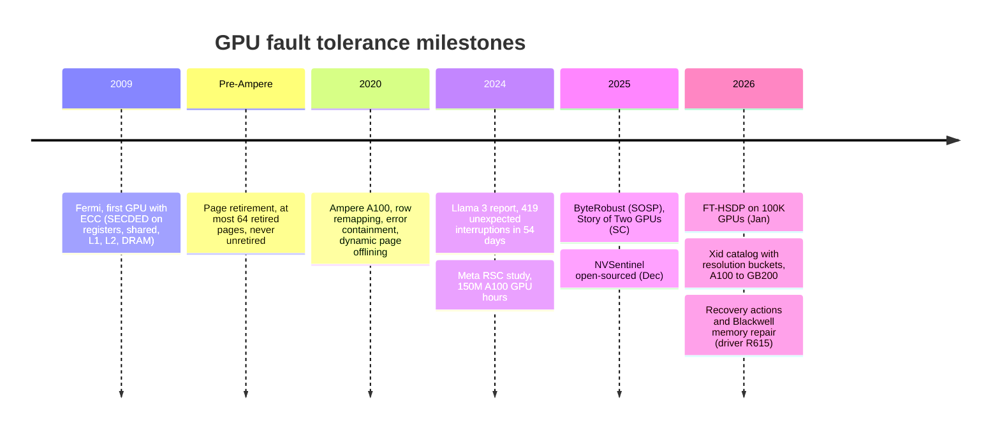
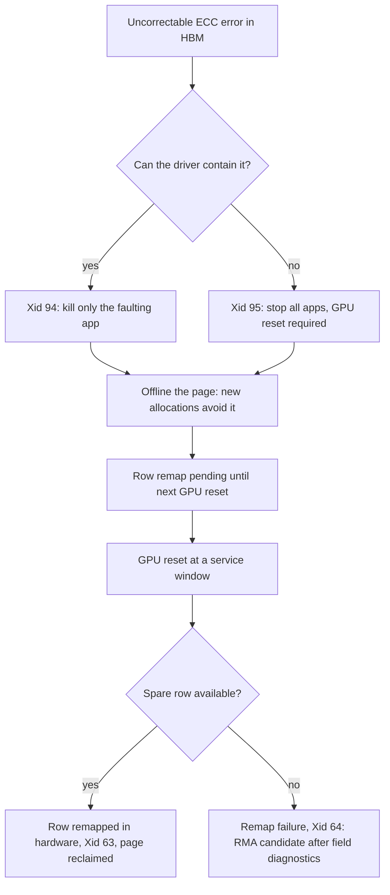
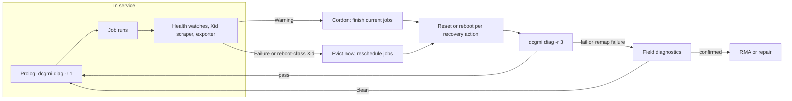

---
aliases:
  - GPU Fault Tolerance
  - GPU Reliability
  - Xid Errors
  - Row Remapping
  - DCGM
  - GPU RAS
tags:
  - gpu-programming
  - tools
  - reliability
  - xid
  - ecc
  - dcgm
status: complete
sources:
  - https://docs.nvidia.com/deploy/xid-errors/working-with-xid-errors.html
  - https://docs.nvidia.com/deploy/xid-errors/analyzing-xid-catalog.html
  - https://docs.nvidia.com/deploy/a100-gpu-mem-error-mgmt/pdf/NVIDIA_GPU_Memory_Error_Management.pdf
  - https://docs.nvidia.com/deploy/a100-gpu-mem-error-mgmt/response-to-uncorrectable-contained-ecc-errors.html
  - https://docs.nvidia.com/deploy/a100-gpu-mem-error-mgmt/latest/user-visible-statistics.html
  - https://docs.nvidia.com/deploy/gpu-debug-guidelines/gpu-node-triage.html
  - https://docs.nvidia.com/datacenter/dcgm/latest/user-guide/dcgm-diagnostics.html
  - https://docs.nvidia.com/datacenter/dcgm/latest/learn/modules/health-monitoring.html
  - https://docs.nvidia.com/datacenter/dcgm/latest/reference/dcgm-exporter-metrics.html
  - https://man.archlinux.org/man/nvidia-smi.1.en
  - https://developer.nvidia.com/blog/automate-kubernetes-ai-cluster-health-with-nvsentinel
  - https://github.com/NVIDIA/NVSentinel
  - https://rocm.docs.amd.com/projects/amdsmi/en/develop/conceptual/ras.html
  - https://www.ece.lsu.edu/koppel/gp/refs/NVIDIA_Fermi_Compute_Architecture_Whitepaper.pdf
  - https://arxiv.org/pdf/2407.21783
  - https://arxiv.org/html/2410.21680v2
  - https://arxiv.org/html/2503.11901v4
  - https://arxiv.org/html/2509.16293v4
  - https://arxiv.org/abs/2602.00277v1
created: 2026-11-26
updated: 2026-11-26
---

## Table Of Contents

---

- [[#TL;DR|TL;DR]]
- [[#The Problem|The Problem]]
- [[#Foundations|Foundations]]
    - [[#Error Classes: Corrected, Contained, Uncontained, Silent|Error Classes: Corrected, Contained, Uncontained, Silent]]
    - [[#What an Xid Is|What an Xid Is]]
    - [[#Failure Rates and Why Scale Changes Everything|Failure Rates and Why Scale Changes Everything]]
- [[#How We Got Here|How We Got Here]]
- [[#How It Works|How It Works]]
    - [[#Reading Xids with the Catalog|Reading Xids with the Catalog]]
    - [[#ECC, Page Offlining and Row Remapping|ECC, Page Offlining and Row Remapping]]
    - [[#Recovery Actions: Restart, Reset, Reboot, Drain|Recovery Actions: Restart, Reset, Reboot, Drain]]
    - [[#DCGM: Passive Health Watches|DCGM: Passive Health Watches]]
    - [[#DCGM: Active Diagnostics|DCGM: Active Diagnostics]]
    - [[#The Node Lifecycle in a Cluster|The Node Lifecycle in a Cluster]]
    - [[#From Device Faults to Job Recovery|From Device Faults to Job Recovery]]
    - [[#AMD Equivalents|AMD Equivalents]]
- [[#Where It Is Now|Where It Is Now]]
- [[#Trade-offs & Open Problems|Trade-offs & Open Problems]]
- [[#Resources|Resources]]
- [[#Related Notes|Related Notes]]

## ***TL;DR***
---
*A GPU in a big cluster will fail, often several times a day across the fleet. Fault tolerance in production is a pipeline: the driver reports an Xid, the memory system tries to contain and repair the error, monitoring turns signals into a decision (restart the app, reset the GPU, reboot, or pull the node), and the training job recovers from a checkpoint or a spare.*

- **The signal.** The NVIDIA driver logs hardware and driver events to the kernel log as `NVRM: Xid` lines, each with a PCI bus ID, a number and event data ([NVIDIA, Working with Xid Errors](https://docs.nvidia.com/deploy/xid-errors/working-with-xid-errors.html)). The Xid catalog maps each number to an immediate action and an investigatory action ([NVIDIA Xid Catalog](https://docs.nvidia.com/deploy/xid-errors/analyzing-xid-catalog.html)).
- **The memory story.** Uncorrectable memory errors are *contained* when possible (Xid 94: only the affected app dies) or *uncontained* (Xid 95: the GPU must be reset). The bad page is offlined at once; at the next reset, spare rows in the DRAM bank replace the bad row (row remapping), up to 8 uncorrectable remaps per bank and 512 in total ([NVIDIA GPU Memory Error Management, R615](https://docs.nvidia.com/deploy/a100-gpu-mem-error-mgmt/pdf/NVIDIA_GPU_Memory_Error_Management.pdf)).
- **The tools.** `nvidia-smi` for state and reset, DCGM health watches for passive monitoring, `dcgmi diag -r 1..4` for active tests from seconds to over two hours, field diagnostics for RMA ([DCGM Diagnostics](https://docs.nvidia.com/datacenter/dcgm/latest/user-guide/dcgm-diagnostics.html), [GPU Node Triage](https://docs.nvidia.com/deploy/gpu-debug-guidelines/gpu-node-triage.html)).
- **The scale problem.** On Meta's Llama 3 run, GPUs and their memory caused 58.7% of 419 unexpected interruptions in 54 days ([Llama 3 paper](https://arxiv.org/pdf/2407.21783)). Meta's RSC data projects one failure every 1.8 hours for a 16,384-GPU job ([Kokolis et al.](https://arxiv.org/html/2410.21680v2)).
- **Now (Nov 2026):** NVIDIA's catalog covers A100 through GB200 with resolution buckets; drivers expose an explicit *recovery action* (Xid 154) and Blackwell adds in-field memory repair; NVSentinel automates cordon, drain and reset on Kubernetes; and training systems such as ByteRobust (up to 97% ETTR on 9,600 GPUs) and FT-HSDP (100K GPUs) keep jobs running through faults ([ByteRobust](https://arxiv.org/html/2509.16293v4), [FT-HSDP](https://arxiv.org/abs/2602.00277v1)).

## ***The Problem***
---
*Every layer of GPU software assumes the hardware computes correctly or stops. At fleet scale, hardware does neither reliably: it crashes, corrupts, hangs, or slows down, and one bad GPU stalls a synchronous job on thousands of healthy ones.*

Four things make GPU faults a production problem rather than a rare event:

| Pressure | What happens | Evidence |
|---|---|---|
| **Synchronous coupling** | A training step needs every rank. One dead GPU stops the [[Multi-GPU Communication - NVLink and NCCL\|collective]], and the whole job waits for a timeout | Default PyTorch timeouts are about 10 minutes; ByteDance's inspections cut detection to seconds ([ByteRobust](https://arxiv.org/html/2509.16293v4)) |
| **Scale multiplies rare events** | A per-device rate that is negligible on one GPU becomes hourly on 16K | 1.8 h projected MTTF at 16,384 GPUs, 0.23 h at 131,072 ([Kokolis et al.](https://arxiv.org/html/2410.21680v2)) |
| **Bigger memory, more errors** | HBM capacity grew faster than its resilience | H100's per-GPU MTBE for uncorrectable memory errors is 3.2x lower than A100's ([Story of Two GPUs, SC '25](https://arxiv.org/html/2503.11901v4)) |
| **Ambiguous symptoms** | The same symptom (an NCCL timeout, a hang, "GPU unavailable") can come from user code, software or hardware | Meta's taxonomy maps one symptom to several possible domains ([Kokolis et al.](https://arxiv.org/html/2410.21680v2)) |

The job of fault tolerance is to turn each fault into the cheapest correct action: let the app restart, reset one GPU, reboot a node, or take the node out for repair, and get the job running again before the waste piles up.

## ***Foundations***
---
*Three ideas carry the rest of the note: which kinds of errors exist and who can see them, what an Xid line is, and how failure rates scale with GPU count.*

### Error Classes: Corrected, Contained, Uncontained, Silent

Hardware protects most state with error-correcting codes. Since Fermi, NVIDIA GPUs protect register files, shared memory, L1, L2 and DRAM with SECDED codes, which correct single-bit errors and detect double-bit ones ([Fermi whitepaper](https://www.ece.lsu.edu/koppel/gp/refs/NVIDIA_Fermi_Compute_Architecture_Whitepaper.pdf)). What happens next depends on the class:

| Class | What it means | Effect on work | Typical signal |
|---|---|---|---|
| **Corrected** | ECC fixed the bit; nothing is wrong yet | None, but a rising rate predicts failure | Single-bit counters; Xid 92 if the rate is excessive |
| **Uncorrectable, contained** | The driver knows which context touched bad data and stops only that one | That app is terminated; others keep running | Xid 94 |
| **Uncorrectable, uncontained** | The driver cannot bound where bad data went | Every app on the GPU must stop; GPU reset needed | Xid 95 |
| **Silent** | Wrong result, no error raised | Wrong answers propagate | Nothing; see [[Silent Data Corruption]] |

Containment "ensures that erroneous data does not continue to propagate, and the affected application is terminated" ([NVIDIA, contained ECC errors](https://docs.nvidia.com/deploy/a100-gpu-mem-error-mgmt/response-to-uncorrectable-contained-ecc-errors.html)). Everything in this note handles the first three rows. The fourth is the hard case and gets its own note.

### What an Xid Is

An Xid is a numbered error message the NVIDIA driver writes to the Linux kernel log; you find them by searching for `NVRM: Xid`. Each line carries the GPU's PCI bus ID, the Xid number and event-specific data ([NVIDIA, Working with Xid Errors](https://docs.nvidia.com/deploy/xid-errors/working-with-xid-errors.html)). An Xid is a report, not a diagnosis: Xid 13 (graphics engine exception) and Xid 31 (GPU memory page fault) are usually application bugs such as an out-of-bounds access, while Xid 79 (fallen off the bus) is usually hardware or the PCIe link ([NVIDIA Xid Catalog](https://docs.nvidia.com/deploy/xid-errors/analyzing-xid-catalog.html)). That split is why the catalog gives two actions per Xid, an immediate one and an investigatory one, and why the app-bug Xids point to [[Debugging with compute-sanitizer and cuda-gdb|Compute Sanitizer and cuda-gdb]].

### Failure Rates and Why Scale Changes Everything

If each node fails independently at rate $r$ (failures per node-day), a job spanning $n$ nodes fails at

$$
\lambda_{\text{job}} = n \cdot r, \qquad \text{MTTF}_{\text{job}} = \frac{1}{n \cdot r}
$$

*In plain words: the job is only as reliable as all its nodes together, so its mean time to failure shrinks in direct proportion to its size.*

**Worked example, with Meta's RSC-1 rate** of 6.50 failures per 1,000 node-days on 8-GPU A100 nodes ([Kokolis et al.](https://arxiv.org/html/2410.21680v2)):

| Job size | Nodes $n$ | Failures per day $n \cdot r$ | MTTF |
|---|---|---|---|
| 1,024 GPUs | 128 | $128 \times 0.0065 = 0.83$ | about 29 h from node failures alone |
| 16,384 GPUs | 2,048 | $2{,}048 \times 0.0065 = 13.3$ | $24 / 13.3 \approx$ **1.8 h** |
| 131,072 GPUs | 16,384 | $16{,}384 \times 0.0065 = 106.5$ | $24 / 106.5 \approx$ **0.23 h** (13.5 min) |

The 1.8 h and 0.23 h rows match the paper's projections. The 1,024-GPU row is a floor: the paper *measured* 7.9 h for 1,024-GPU jobs, because jobs also fail from software, network and filesystem causes.

**The same arithmetic for memory errors alone.** The Delta study measured a per-GPU MTBE of 88,768 hours for uncorrectable ECC errors on H100 ([Story of Two GPUs](https://arxiv.org/html/2503.11901v4)). Across 16,384 GPUs, $88{,}768 / 16{,}384 \approx 5.4$ hours between uncorrectable memory errors somewhere in the job. Containment does not save the job: Xid 94 still terminates the affected process, and in a synchronous job that rank's loss stops everyone.

**How often to checkpoint.** With checkpoint write time $\delta$ and MTTF $M$, Young's approximation for the interval that minimizes lost work is

$$
\tau_{\text{opt}} \approx \sqrt{2\,\delta\,M}
$$

*In plain words: checkpoint more often when failures are frequent or checkpoints are cheap.* With $\delta = 5$ min and $M = 1.8$ h $= 108$ min, $\tau \approx \sqrt{2 \times 5 \times 108} \approx 33$ minutes. Meta uses this Daly-Young model to compute effective training time ratio (ETTR), and finds a ~12,000-GPU run needs either about 1 failure per 1,000 node-days or about 10-second checkpoint writes to reach 0.9 ([Kokolis et al.](https://arxiv.org/html/2410.21680v2)).

## ***How We Got Here***
---
*GPU reliability went from "a graphics card that might glitch a pixel" to datacenter RAS in three steps: ECC in 2009, containment and row remapping with Ampere, and fleet-scale automation once training jobs reached tens of thousands of GPUs.*



| Era | What changed | Why it mattered | Source |
|---|---|---|---|
| **2009, Fermi** | ECC on every major memory structure | GPUs became acceptable for HPC, where a flipped bit is a wrong answer | [Fermi whitepaper](https://www.ece.lsu.edu/koppel/gp/refs/NVIDIA_Fermi_Compute_Architecture_Whitepaper.pdf) |
| **Legacy page retirement** | A page with errors is blacklisted on the next reboot; at most 64 retirements, never unretired | Memory shrinks with each repair; a reboot is needed | [NVIDIA Memory Error Mgmt](https://docs.nvidia.com/deploy/a100-gpu-mem-error-mgmt/pdf/NVIDIA_GPU_Memory_Error_Management.pdf) |
| **Ampere and later** | Containment (only the faulting app dies), page offlining without reset, row remapping in hardware | Most memory errors no longer need a reboot, and repairs leave no holes in the address space | same |
| **Hyperscale training (2024 to 2026)** | Operators publish fleet data and build automated detect, evict, replace loops | The problem moves from "fix the GPU" to "keep the job's ETTR high" | [Llama 3](https://arxiv.org/pdf/2407.21783), [Kokolis et al.](https://arxiv.org/html/2410.21680v2), [ByteRobust](https://arxiv.org/html/2509.16293v4) |
| **2025 to 2026** | NVIDIA standardizes actions (catalog buckets, Xid 154 recovery action) and open-sources remediation (NVSentinel) | Every operator no longer has to rebuild the same Xid-to-action table | [Xid Catalog](https://docs.nvidia.com/deploy/xid-errors/analyzing-xid-catalog.html), [NVSentinel](https://developer.nvidia.com/blog/automate-kubernetes-ai-cluster-health-with-nvsentinel) |

## ***How It Works***
---
*A fault moves through four layers: the hardware detects it, the driver reports and contains it, monitoring decides what to do with the GPU, and the training system decides what to do with the job.*

### Reading Xids with the Catalog

The catalog (last updated Sep 2026) covers Ampere and newer, with Yes/No flags for A100, H100, B100 and GB200, an immediate and an investigatory "resolution bucket", and trigger notes ([NVIDIA Xid Catalog](https://docs.nvidia.com/deploy/xid-errors/analyzing-xid-catalog.html)). The Xids you will actually see in a training fleet:

| Xid | Meaning | Immediate action | Usual cause |
|---|---|---|---|
| **13** | Graphics engine exception | RESTART_APP | App bug, e.g. out-of-bounds access |
| **31** | GPU memory page fault (MMU) | RESTART_APP | Usually app; can be driver or hardware |
| **43** | GPU stopped processing | IGNORE | Software fault that killed the app; GPU healthy |
| **45** | Preemptive cleanup after previous errors | Follow the other Xid | Driver tearing down an app after Ctrl-C, reset or another error |
| **48** | Double-bit (uncorrectable) ECC error | Xid 48 workflow | Memory; needs reset or reboot to clear |
| **63 / 64** | Row remap recorded / remap failed | IGNORE / RESET_GPU | ECC handling; 64 means the repair failed |
| **74** | NVLink error | NVLink workflow | GPU-to-GPU or GPU-to-NVSwitch link; may come from the remote end |
| **79** | GPU has fallen off the bus | RESTART_BM (reboot) | PCIe link failure or failing GPU |
| **92** | High single-bit ECC rate | IGNORE | Early warning |
| **94** | Contained memory error | RESTART_APP | Only one app affected; reset when convenient |
| **95** | Uncontained memory error | RESET_GPU | Several apps affected; reset before restarting |
| **119 / 120** | GSP RPC timeout / GSP error | RESET_GPU | GPU System Processor firmware fault or timeout |
| **140** | ECC error escaped page offlining and remapping | RESET_GPU | Repair path could not run |
| **154** | GPU recovery action changed | Informational | Tells you what the driver now requires (below) |

Two habits make this table usable. First, **read the first Xid, not the last**: Xid 45 and the "IGNORE (sympathetic)" entries are follow-on noise after a primary error. Second, **app-bug Xids are not hardware tickets**: Xid 13 and 31 trigger notes suggest rerunning under cuda-gdb or Compute Sanitizer memcheck, or setting `CUDA_DEVICE_WAITS_ON_EXCEPTION=1` and attaching cuda-gdb ([Xid Catalog](https://docs.nvidia.com/deploy/xid-errors/analyzing-xid-catalog.html)).

### ECC, Page Offlining and Row Remapping

On Ampere and later, an uncorrectable DRAM error runs a fixed sequence ([NVIDIA GPU Memory Error Management, R615, Sep 2026](https://docs.nvidia.com/deploy/a100-gpu-mem-error-mgmt/pdf/NVIDIA_GPU_Memory_Error_Management.pdf)):



- **Page offlining** marks the page with the error unusable, so other apps keep running and new work can launch "without requiring a GPU reset" ([NVIDIA, contained errors](https://docs.nvidia.com/deploy/a100-gpu-mem-error-mgmt/response-to-uncorrectable-contained-ecc-errors.html)).
- **Row remapping** replaces the bad DRAM row with a spare row in the same bank. It "requires a GPU reset to take effect"; until then the *pending* flag is set. It fixes memory "without creating any holes in the address space."
- **Limits.** A remap fails, and the failure flag is set, if the bank already has **8** uncorrectable-error remaps, if the same row was already remapped, or if total remaps reach **512**. The failure flag, validated by field diagnostics, is the RMA criterion.
- **Blackwell adds in-field repair.** GB10x parts list "RAS Repair for GPU memory" (not guaranteed on all Blackwell GPUs); Xid 160 means memory was marked for repair, and channel repair needs a reboot. Xid 171 and 172 split uncorrectable errors into DRAM and SRAM.

**Seeing the state.** `nvidia-smi -q -d ROW_REMAPPER` prints the remapper section ([nvidia-smi man page](https://man.archlinux.org/man/nvidia-smi.1.en)):

| Field | What it tells you |
|---|---|
| Correctable Error | Active remaps caused by correctable errors |
| Uncorrectable Error | Active remaps caused by uncorrectable errors |
| Pending | A remap waits for the next GPU reset |
| Remapping Failure Occurred | A remap has failed at some point: an RMA flag |
| Bank Remap Availability Histogram | How many banks have Max, High, Partial, Low or no spare rows left |

The counts are entries recorded in the InfoROM, not hardware remaps ([NVIDIA, user-visible statistics](https://docs.nvidia.com/deploy/a100-gpu-mem-error-mgmt/latest/user-visible-statistics.html)). Older GPUs show the `PAGE_RETIREMENT` section instead, with a pending-blacklist flag for the next reboot.

### Recovery Actions: Restart, Reset, Reboot, Drain

Newer drivers stop making you infer the action from the Xid. Xid 154 announces a change in the GPU's **recovery action**, for example "from 0x0 (None) to 0x2 (Node Reboot Required)", also queryable through NVML as `NVML_FI_DEV_GET_GPU_RECOVERY_ACTION` ([Xid Catalog](https://docs.nvidia.com/deploy/xid-errors/analyzing-xid-catalog.html), [Memory Error Mgmt](https://docs.nvidia.com/deploy/a100-gpu-mem-error-mgmt/pdf/NVIDIA_GPU_Memory_Error_Management.pdf)):

| Recovery action | What to do |
|---|---|
| **None** | Start a new GPU process; nothing else |
| **GPU Reset Required** | Stop GPU processes, `nvidia-smi -r`, restart processes |
| **Node Reboot Required** | Reboot the OS; the fault may have left it inconsistent |
| **Drain P2P** | Stop peer-to-peer processes, disable UVM persistence, drain traffic, re-query |
| **Drain and Reset** | GPU runs at reduced capacity: schedule nothing new, let work finish, then reset |

NVIDIA's node-triage guide gives the classic per-Xid playbook: after Xid 48 followed by 63 or 64, drain and cordon then reset; for Xid 94 restart the app and reset later; for Xid 95 drain and reset with MIG on, reboot at once with MIG off; for Xid 79 drain and report ([GPU Node Triage, Nov 2026](https://docs.nvidia.com/deploy/gpu-debug-guidelines/gpu-node-triage.html)). Inside VMs a GPU reset is often unsupported, so the VM restarts instead. Whether [[MIG and MPS - Sharing a GPU|MIG]] is on changes the Xid 95 response, as above.

### DCGM: Passive Health Watches

DCGM (Data Center GPU Manager) runs a host engine that samples GPU telemetry. Its **health** module turns field readings into incidents without applying any load ([DCGM Health Monitoring](https://docs.nvidia.com/datacenter/dcgm/latest/learn/modules/health-monitoring.html)):

```bash
dcgmi health -g 1 -s mpi        # watch memory, PCIe and InfoROM on GPU group 1
dcgmi health -g 1 -c            # check: overall and per-GPU result
dcgmi health --set pmitnd --group 1 --update-interval 30 --max-keep-age 600
```

- Line 1 turns on watches. Selectors are `p` PCIe, `m` memory, `i` InfoROM, `t` thermal and power, `n` NVLink, `d` driver, `e` IMEX, `x` ConnectX, `a` all.
- Line 2 asks whether any enabled rule fired. Results are **Healthy**, **Warning** (look later; e.g. more than 8 PCIe replays per minute) or **Failure** (likely interrupts work; e.g. fallen off the bus, certain Xids).
- Line 3 is the long-job pattern: sample every 30 s, keep 600 s of history, then poll `--check` and `--clear`. Some watches need about 60 s of samples before a check means anything.

"Healthy" only means no enabled rule saw an incident in the retained data, not that the GPU passed a stress test.

For fleet dashboards, `dcgm-exporter` ships these reliability metrics in its default set: `DCGM_FI_DEV_XID_ERRORS`, `DCGM_FI_DEV_PCIE_REPLAY_COUNTER`, `DCGM_FI_DEV_CORRECTABLE_REMAPPED_ROWS`, `DCGM_FI_DEV_UNCORRECTABLE_REMAPPED_ROWS` and `DCGM_FI_DEV_ROW_REMAP_FAILURE`; ECC totals, retired pages and NVLink CRC counters are optional ([DCGM Exporter Metrics](https://docs.nvidia.com/datacenter/dcgm/latest/reference/dcgm-exporter-metrics.html)).

### DCGM: Active Diagnostics

`dcgmi diag -r N` runs load-applying tests when the GPU can leave service. Each level includes the ones below it (DCGM 4.6, times for Hopper) ([DCGM Diagnostics](https://docs.nvidia.com/datacenter/dcgm/latest/user-guide/dcgm-diagnostics.html)):

| Level | Tests added | Time, 4 GPUs | Time, 8 GPUs | Typical use |
|---|---|---|---|---|
| **r1** short | `software` | under 2.5 s | under 2.5 s | Job prolog |
| **r2** medium | `pcie`, `memory`, `memory_bandwidth` | under 2.5 min | under 10.5 min | Epilog, after a suspicious Xid |
| **r3** long | `diagnostic`, `targeted_stress`, `targeted_power`, `nvbandwidth`, `nccl_tests` | under 10 min | under 35 min | Before returning a node to service |
| **r4** extra long | `memtest`, `pulse` | under 45 min | under 2.25 h | Deep validation, suspected memory or power faults |

NVIDIA's triage guide recommends `dcgmi diag -r 3` for node checks and shorter levels as pre-flight checks ([GPU Node Triage](https://docs.nvidia.com/deploy/gpu-debug-guidelines/gpu-node-triage.html)). DCGM warns that all of these are *online* diagnostics: full hardware validation and RMA require NVIDIA's separate offline **field diagnostics**, "the authoritative and comprehensive NVIDIA tool for determining the health of GPUs" ([DCGM Health Monitoring](https://docs.nvidia.com/datacenter/dcgm/latest/learn/modules/health-monitoring.html), [GPU Node Triage](https://docs.nvidia.com/deploy/gpu-debug-guidelines/gpu-node-triage.html)).

### The Node Lifecycle in a Cluster

Put together, a GPU node in a large cluster cycles like this:



Meta's RSC clusters run health checks on every node every five minutes; high-severity failures (GPU inaccessible, NVLink or uncorrectable ECC errors, IB or PCIe link errors, missing mounts) remove the node immediately and reschedule its jobs, lower-severity ones remove it after current jobs finish, and failed nodes stay out until they pass every check ([Kokolis et al.](https://arxiv.org/html/2410.21680v2)). Meta also hunts **lemon nodes**, machines that fail repeatedly: 40 of them (1.2% to 1.7% of the clusters) were found with over 85% accuracy, and removing them cut failures for 512+ GPU jobs from 14% to 4%. Lemons are a [[Gray and Fail-Slow Failures|gray failure]]: each check passes, but the history doesn't.

**NVSentinel** packages this loop for Kubernetes: modular monitors (DCGM, kernel logs, cloud provider APIs), a rule-based analyzer that classifies events as transient, hardware or systemic, cordon and drain with NodeConditions for the scheduler, and pluggable remediation hooks; v1.0 (Beta/Stable) arrived in March 2026 with GPU reset and preflight checks ([NVIDIA blog, Dec 2025, updated 2026](https://developer.nvidia.com/blog/automate-kubernetes-ai-cluster-health-with-nvsentinel), [GitHub](https://github.com/NVIDIA/NVSentinel)).

### From Device Faults to Job Recovery

Device-level handling only decides the GPU's fate. The job still has to survive, which is the subject of [[GPU Cluster Infrastructure]] and [[Distributed Training]]. The parts that touch the device layer:

- **Detection latency is the first cost.** Without inspection, ByteDance found most failures surfaced only through the roughly 10-minute PyTorch timeout; with second-level inspections of DCGM, PCIe, row remapping, temperature and `dmesg` Xids, a lost GPU is caught in 10 s and an OS kernel fault in 2 s ([ByteRobust, SOSP '25](https://arxiv.org/html/2509.16293v4)).
- **CUDA errors dominate incidents.** In ByteDance's three-month data (about 55,000 incidents), CUDA errors were 36.1% and job hangs 9.9%; GPU memory errors as such were 0.3%. Mean resolution time for a CUDA error was 93 s, and direct machine eviction resolved about a third of failures on its 9,600-GPU jobs.
- **Spares beat repair.** ByteRobust keeps pre-validated warm standby machines sized at the P99 of a binomial failure model, cutting recovery scheduling time 10.87x; its two 9,600-GPU jobs held cumulative ETTR up to 97%.
- **Shrink instead of stopping.** FT-HSDP makes each data-parallel replica a unit of fault tolerance: when a GPU fails, only its replica restarts while the others keep training. At about 100K GPUs it cut recovery stalls from 10 to 3 minutes and raised effective training time from 44% to 80% ([FT-HSDP, Jan 2026](https://arxiv.org/abs/2602.00277v1)). NCCL's `ncclCommShrink` gives the communication side of this (see [[Multi-GPU Communication - NVLink and NCCL]]).
- **Flight recorders for hangs.** Llama 3 used PyTorch's NCCL flight recorder, which dumps collective metadata and stack traces on watchdog or heartbeat timeouts, to find the stuck rank ([Llama 3 paper](https://arxiv.org/pdf/2407.21783)).

### AMD Equivalents

AMD Instinct reports RAS through `amd-smi` ([AMD SMI RAS docs](https://rocm.docs.amd.com/projects/amdsmi/en/develop/conceptual/ras.html)):

| NVIDIA | AMD |
|---|---|
| ECC counters in `nvidia-smi -q -d ECC` | `amd-smi metric -e` (totals) and `-k` (per block); `amd-smi monitor -e` for live single, double and PCIe replay counts |
| Xid lines in the kernel log | **CPER** records (UEFI Common Platform Error Record): `amd-smi ras --cper`, with severities fatal, non-fatal uncorrected, corrected and informational |
| Xid catalog numbers | **AFIDs** (AMD Field IDs), up to 12 per CPER record, decodable offline with `amd-smi ras --afid --cper-file <file>` |

AMD's ECC counters also report *deferred* errors, in total and per block. See [[ROCm and HIP]] for the wider stack.

## ***Where It Is Now***
---
*As of November 2026: NVIDIA has turned Xid handling into a published decision table and an explicit recovery-action API, Blackwell repairs memory in the field, monitoring and remediation are open source, and the research frontier is keeping 10K to 100K GPU jobs running through faults rather than just detecting them.*

- **Catalog with actions (Sep 2026).** The Xid catalog lists A100, H100, B100 and GB200 applicability and resolution buckets such as RESTART_APP, RESET_GPU, RESTART_BM, CHECK_MECHANICALS and per-Xid workflows, plus a downloadable spreadsheet ([NVIDIA Xid Catalog](https://docs.nvidia.com/deploy/xid-errors/analyzing-xid-catalog.html)). Blackwell-era Xids cover NVLink 5 (144 to 150), resource retirement (156, 157), channel retirement (160, 161) and DRAM vs SRAM uncorrectables (171, 172).
- **Recovery actions and repair (driver R615, Sep 2026).** NVML and SMBPBI expose the recovery action, including the two drain states, and GB10x adds RAS memory repair ([Memory Error Mgmt](https://docs.nvidia.com/deploy/a100-gpu-mem-error-mgmt/pdf/NVIDIA_GPU_Memory_Error_Management.pdf)).
- **DCGM 4.6** puts `nvbandwidth` and `nccl_tests` in r3 and a power `pulse` test in r4, and health watches now include IMEX daemon and ConnectX selectors ([DCGM Diagnostics](https://docs.nvidia.com/datacenter/dcgm/latest/user-guide/dcgm-diagnostics.html), [Health Monitoring](https://docs.nvidia.com/datacenter/dcgm/latest/learn/modules/health-monitoring.html)).
- **Measured reliability.** On NCSA's Delta (1,056 GPUs, 11.7M GPU hours), H100 nodes had a higher overall MTBE than A100 nodes (292 vs 154 h) thanks to far fewer GSP and NVLink errors, but worse memory: 3.2x lower per-GPU MTBE for uncorrectable ECC errors. Row remapping and containment handled about 92% of H100 uncorrectable memory errors, yet about a third of remapping events failed. Node availability was 99.3% to 99.4%, about 10 minutes of downtime per node per day, and keeping 99.9% job availability needs about 5% overprovisioning ([Story of Two GPUs, SC '25](https://arxiv.org/html/2503.11901v4)).
- **Fleet data.** Llama 3: 419 unexpected interruptions in 54 days on up to 16K H100s; faulty GPUs 148 and HBM3 72 of them; above 90% effective training time with three manual interventions ([Llama 3](https://arxiv.org/pdf/2407.21783)). (The paper prints 30.1% for 148 of 419, which is about 35%; see [[GPU Cluster Infrastructure]].)
- **Job-level frontier.** ByteRobust (up to 97% ETTR at 9,600 GPUs) and FT-HSDP (80% effective training time at ~100K GPUs) are the reference designs ([ByteRobust](https://arxiv.org/html/2509.16293v4), [FT-HSDP](https://arxiv.org/abs/2602.00277v1)).

## ***Trade-offs & Open Problems***
---
*Every remedy costs something: resets cost time, timeouts cost either false alarms or wasted GPU-hours, spares cost money, and none of it catches a GPU that silently computes the wrong answer.*

| Tension | Trade-off | Notes |
|---|---|---|
| **Reset vs reboot** | A GPU reset is minutes; a reboot is longer and drops every GPU on the node | `nvidia-smi -r` needs an idle GPU, and the man page still says reset "is not recommended for production environments at this time", even as recovery actions call for it ([man page](https://man.archlinux.org/man/nvidia-smi.1.en)) |
| **Timeout length** | Short timeouts misfire on transient link flaps; long ones idle thousands of GPUs | Second-level inspection beats tuning one global timeout ([ByteRobust](https://arxiv.org/html/2509.16293v4)) |
| **Diagnostic depth** | r1 is free; r4 takes up to 2.25 h per 8-GPU node | Online tests can pass while field diagnostics would fail |
| **Spare rows don't scale** | 512 remaps per GPU regardless of capacity | Delta's authors call current mechanisms insufficient as HBM grows ([Story of Two GPUs](https://arxiv.org/html/2503.11901v4)) |
| **App-level recovery** | Restarting a rank still kills a synchronous job | Delta found application-level recovery largely ineffective; elastic training (FT-HSDP) is the answer, at the cost of changed parallel layouts |
| **Ambiguous root causes** | NCCL timeouts and hangs have no Xid | Many failures in Meta's data have no attributed cause ([Kokolis et al.](https://arxiv.org/html/2410.21680v2)) |
| **Silent errors** | Nothing here sees them | Needs redundant computation or in-training detectors: [[Silent Data Corruption]] |
| **Overprovisioning cost** | 5% spare GPUs keeps 99.9% job availability | Estimated at over $1M per month on Delta-scale assumptions ([Story of Two GPUs](https://arxiv.org/html/2503.11901v4)) |

Open problems: letting multi-GPU jobs survive an uncorrectable memory error without restarting (Delta's authors call it open), removing single points of failure such as GSP and PMU on older parts, attributing NCCL hangs automatically, and making memory repair keep pace with HBM capacity.

## ***Resources***
---
*Start with NVIDIA's Xid catalog and memory error guide for what the hardware reports, DCGM docs for what to run, and the three fleet studies for how often it happens.*

**NVIDIA operations docs**
- [Working with Xid Errors](https://docs.nvidia.com/deploy/xid-errors/working-with-xid-errors.html) and [Analyzing Xid Errors with the Xid Catalog](https://docs.nvidia.com/deploy/xid-errors/analyzing-xid-catalog.html): what an Xid is; every code with actions per GPU generation.
- [NVIDIA GPU Memory Error Management (PDF, R615)](https://docs.nvidia.com/deploy/a100-gpu-mem-error-mgmt/pdf/NVIDIA_GPU_Memory_Error_Management.pdf), [contained ECC errors](https://docs.nvidia.com/deploy/a100-gpu-mem-error-mgmt/response-to-uncorrectable-contained-ecc-errors.html) and [user-visible statistics](https://docs.nvidia.com/deploy/a100-gpu-mem-error-mgmt/latest/user-visible-statistics.html): containment, offlining, row remapping limits, recovery actions.
- [GPU Node Triage](https://docs.nvidia.com/deploy/gpu-debug-guidelines/gpu-node-triage.html): Xid playbook, when to reset, reboot or RMA.
- [nvidia-smi man page](https://man.archlinux.org/man/nvidia-smi.1.en): ROW_REMAPPER and PAGE_RETIREMENT fields, reset constraints.

**DCGM and automation**
- [DCGM Diagnostics](https://docs.nvidia.com/datacenter/dcgm/latest/user-guide/dcgm-diagnostics.html), [Health Monitoring](https://docs.nvidia.com/datacenter/dcgm/latest/learn/modules/health-monitoring.html), [Exporter metrics](https://docs.nvidia.com/datacenter/dcgm/latest/reference/dcgm-exporter-metrics.html).
- [NVSentinel blog](https://developer.nvidia.com/blog/automate-kubernetes-ai-cluster-health-with-nvsentinel) and [repository](https://github.com/NVIDIA/NVSentinel).

**Fleet studies**
- [The Llama 3 Herd of Models, §3.3.4](https://arxiv.org/pdf/2407.21783): interruption root causes on 16K H100s.
- [Kokolis et al., Revisiting Reliability in Large-Scale ML Research Clusters](https://arxiv.org/html/2410.21680v2): 150M A100 GPU hours, MTTF scaling, ETTR, lemon nodes.
- [Story of Two GPUs (SC '25)](https://arxiv.org/html/2503.11901v4): H100 vs A100 resilience on Delta.
- [ByteRobust (SOSP '25)](https://arxiv.org/html/2509.16293v4) and [FT-HSDP (2026)](https://arxiv.org/abs/2602.00277v1): keeping 10K to 100K GPU jobs running.

**History and AMD**
- [NVIDIA Fermi Compute Architecture Whitepaper](https://www.ece.lsu.edu/koppel/gp/refs/NVIDIA_Fermi_Compute_Architecture_Whitepaper.pdf): ECC arrives on GPUs.
- [AMD SMI RAS](https://rocm.docs.amd.com/projects/amdsmi/en/develop/conceptual/ras.html): ECC counters, CPER and AFIDs.

## ***Related Notes***
---
*Where the device-level layer meets the rest of the vault: debugging app-caused Xids, sharing GPUs, communication, and the cluster and training systems that recover jobs.*

- [[Debugging with compute-sanitizer and cuda-gdb]] — Xid 13 and 31 are usually bugs; this is how to find them.
- [[Profiling with Nsight Compute and Nsight Systems]] — The sister tools for performance, not health.
- [[MIG and MPS - Sharing a GPU]] — Fault isolation between partitions changes the reset playbook.
- [[Multi-GPU Communication - NVLink and NCCL]] — NVLink Xids, NCCL timeouts and communicator shrink.
- [[GPU Memory Hierarchy]] — The HBM, L2 and SRAM structures that ECC protects.
- [[GPU Architecture Basics]] — Where GSP, the MMU and the memory controllers sit.
- [[ROCm and HIP]] — AMD's stack and its RAS tooling.
- [[Silent Data Corruption]] — The errors none of these tools see.
- [[GPU Cluster Infrastructure]] — Job-level detection, recovery and checkpointing at scale.
- [[Gray and Fail-Slow Failures]] — Lemon nodes and GPUs that degrade without failing.
- [[Failure Models]] — Fail-stop vs Byzantine, the theory behind containment.
- [[Distributed Training]] — The parallelism a failure interrupts.
- [[Cluster Scheduling]] — Cordon, drain and reliability-aware placement.
