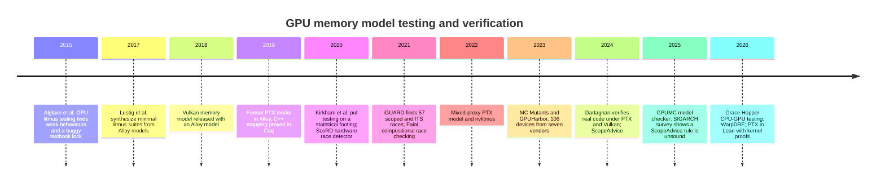
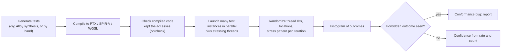

---
tags:
  - gpu-programming
  - tools
  - memory-model
  - litmus-tests
  - formal-verification
  - race-detection
  - ptx
status: complete
sources:
  - https://www.doc.ic.ac.uk/~afd/papers/2015/ASPLOS.pdf
  - https://tyler-utah.github.io/files/markdown/asplos2015.md
  - https://research.nvidia.com/publication/2017-04_automated-synthesis-comprehensive-memory-model-litmus-test-suites
  - https://research.nvidia.com/publication/2019-04_formal-analysis-nvidia-ptx-memory-consistency-model
  - https://kar.kent.ac.uk/id/document/3276638
  - https://gitee.com/mirrors_NVlabs/mixedproxy
  - https://gitee.com/mirrors_KhronosGroup/Vulkan-MemoryModel
  - https://mrmgroup.cs.princeton.edu/papers/jkirkham-oopsla2020.pdf
  - https://tyler-utah.github.io/files/markdown/oopsla2020.md
  - https://tyler-utah.github.io/files/summaries/mcmutants2023.md
  - https://arquinn.github.io/assets/pdf/Levine23.pdf
  - https://tyler-utah.github.io/files/markdown/gpuharbor2023.md
  - https://dev.vulkan.org/user/pages/09.events/vulkanised-2024/vulkanised-2024-reese-levine-ucsc.pdf
  - https://hgpu.org/?p=29276
  - https://research.cs.aalto.fi/theory/seminar/pdf/Heljanko-Unified-GPU-Analysis.pdf
  - https://www.st.ewi.tudelft.nl/sschakraborty/papers/CAV25-GPUMC.pdf
  - https://arxiv.org/abs/2505.20207
  - https://akkamath.github.io/files/SOSP21_iGUARD.pdf
  - https://akkamath.github.io/files/ISCA20_ScoRD.pdf
  - https://hgpu.org/?p=29518
  - https://www.sigarch.org/gpu-memory-consistency-specifications-testing-and-opportunities-for-performance-tooling/
  - https://users.cs.utah.edu/~vijay/papers/ismm26.pdf
  - https://arxiv.org/pdf/2610.07541
  - https://link.springer.com/chapter/10.1007/978-3-030-81685-8_19
  - https://arxiv.org/pdf/2611.04447
  - https://docs.nvidia.com/compute-sanitizer/ComputeSanitizer/index.html
created: 2026-11-26
updated: 2026-11-26
---

## Table Of Contents

---

- [[#TL;DR|TL;DR]]
- [[#The Problem|The Problem]]
- [[#Foundations|Foundations]]
    - [[#Three Different Questions|Three Different Questions]]
    - [[#Litmus Tests|Litmus Tests]]
    - [[#Axiomatic Models|Axiomatic Models]]
    - [[#Scoped and Heterogeneous Races|Scoped and Heterogeneous Races]]
- [[#How We Got Here|How We Got Here]]
- [[#How It Works|How It Works]]
    - [[#Writing a Litmus Test in CUDA|Writing a Litmus Test in CUDA]]
    - [[#Running It on Hardware - Stress and Statistics|Running It on Hardware: Stress and Statistics]]
    - [[#Worked Example - How Many Iterations|Worked Example: How Many Iterations]]
    - [[#Making Sure the Compiler Kept the Test|Making Sure the Compiler Kept the Test]]
    - [[#Mutation Testing the Testers|Mutation Testing the Testers]]
    - [[#Asking the Model - Alloy, herd7 and nvlitmus|Asking the Model: Alloy, herd7 and nvlitmus]]
    - [[#Model Checking Real Kernels - Dartagnan and GPUMC|Model Checking Real Kernels: Dartagnan and GPUMC]]
    - [[#Race Detectors for Real Programs|Race Detectors for Real Programs]]
    - [[#Static Checkers and Proofs|Static Checkers and Proofs]]
    - [[#Case Study - Checking a Performance Optimization|Case Study: Checking a Performance Optimization]]
- [[#Where It Is Now|Where It Is Now]]
- [[#Trade-offs & Open Problems|Trade-offs & Open Problems]]
- [[#Resources|Resources]]
- [[#Related Notes|Related Notes]]

## ***TL;DR***
---
*GPU memory models are weak, and the bugs they allow show up perhaps once in a million runs, so ordinary testing does not find them. This area is the toolbox for that gap: litmus tests run under stress to check that hardware and compilers keep their promises, formal models and model checkers to say what a program may do, and race detectors and proofs to check real kernels.*

- **Litmus tests** are tiny concurrent programs (two threads, two memory locations) with one "weak" outcome that the memory model either allows or forbids. Running them millions of times on a GPU, with extra threads hammering memory, checks the hardware and compiler against the spec ([Alglave et al., ASPLOS 2015](https://www.doc.ic.ac.uk/~afd/papers/2015/ASPLOS.pdf)).
- **The spec itself is a program.** NVIDIA's PTX model and Khronos's Vulkan model are written in Alloy, and both have been ported to the `cat` language used by herd7 and Dartagnan. Tools can then say exactly which outcomes are allowed ([Lustig et al., ASPLOS 2019](https://research.nvidia.com/publication/2019-04_formal-analysis-nvidia-ptx-memory-consistency-model); [Tong et al., ASPLOS 2024](https://hgpu.org/?p=29276)).
- **Real programs** are checked by model checkers (Dartagnan for PTX and Vulkan, GPUMC for scoped C++), runtime race detectors (compute-sanitizer racecheck for shared memory, iGUARD for scoped global-memory races) and, since 2026, machine-checked proofs.
- **What it has found:** wrong locks in a CUDA textbook (2015), coherence bugs in Arm Mali and NVIDIA Tegra X1 drivers (2023), 57 races in 21 applications including NVIDIA's own grid-sync code (2021), two bugs in the PTX and Vulkan formal models themselves (2024), and an "optimization" from a MICRO 2024 paper that is unsound under PTX (2025).
- **Where it is now (Nov 2026):** testing has moved to CPU-GPU superchips (Grace Hopper matches the compound ARM/PTX model, ISMM 2026), warp-level primitives got a precise data-race-free contract (WarpDRF, Oct 2026), and a Lean formalization of PTX proved seven kernels correct including a TMA/WGMMA matmul (Nov 2026). None of this is in NVIDIA's shipping tools yet: compute-sanitizer still checks only shared-memory races.

## ***The Problem***
---
*A memory-model bug is a program that is wrong but almost always works. Finding it by running the program is hopeless, so the field builds tests that make weak behavior likely and specs that make "wrong" precise.*

The [[CUDA Memory Model and Atomics|CUDA memory model]] lets plain loads and stores be reordered and cached. A program that publishes data with a plain store to a flag can read stale data on the other side. The catch is how rarely it happens. In the 2015 study, the message-passing test failed between 0 and about 12% of runs depending on the chip, and several weak outcomes never appeared at all until the testers added "stressing" threads ([Alglave et al.](https://tyler-utah.github.io/files/markdown/asplos2015.md)). At GPU deployment scale, though, rare is not the same as never: the 2025 SIGARCH survey makes the point that memory-model bugs can be "rare" per run yet frequent across a fleet ([Basu et al., SIGARCH, Jun 2025](https://www.sigarch.org/gpu-memory-consistency-specifications-testing-and-opportunities-for-performance-tooling/)).

There are three ways a weak-memory bug can enter, and each needs a different tool:

| Who is wrong | Example | Tool that finds it |
|---|---|---|
| The hardware or driver | A GPU shows an outcome the spec forbids | Litmus testing on the device (GPUHarbor, MC Mutants) |
| The spec | The formal model allows or forbids something its authors did not intend | Model validation: porting the model to a second tool, running generated tests (Dartagnan, Alloy) |
| The programmer | A lock without fences, a block-scope atomic used across blocks | Model checkers, race detectors, static checkers, proofs |

The textbook case shows all three at once. *CUDA by Example*'s spin lock let a critical section read stale data on real GPUs, and NVIDIA's erratum added `__threadfence()`. The bug was in the program, the hardware was allowed to do it, and nobody had a precise enough spec to say so until the litmus tests and models existed ([ASPLOS 2015](https://www.doc.ic.ac.uk/~afd/papers/2015/ASPLOS.pdf); [[CUDA Memory Model and Atomics]]).

## ***Foundations***
---
*Four ideas carry the whole area: separating hardware, spec and program; litmus tests; axiomatic models written as relations between events; and scoped races, the bug class GPUs add to the CPU list.*

### Three Different Questions

- **Conformance:** does this GPU, driver and compiler ever produce an outcome the spec forbids? Answered by running tests on the device. A test can find a violation but can never prove there is none.
- **Model validation:** does the formal model say what its authors meant, and does it agree with hardware? Answered by checking that every outcome observed on hardware is allowed by the model ("experimentally sound"), and by cross-checking the model in more than one tool.
- **Program correctness:** can this kernel reach a bad state under the spec? Answered by model checking (explore every allowed execution of a small instance), race detection (watch real executions), or proof (cover all sizes).

### Litmus Tests

A litmus test is a few threads, a few shared locations, and a question about one final state. The names come from the CPU literature and are used unchanged on GPUs ([Kirkham et al., OOPSLA 2020](https://tyler-utah.github.io/files/markdown/oopsla2020.md)):

| Test | Thread 0 | Thread 1 | Weak outcome asked about | What it checks |
|---|---|---|---|---|
| **MP** (message passing) | `x=1; y=1` | `r0=y; r1=x` | `r0=1, r1=0` | Can a reader see the flag but not the data? The producer-consumer pattern. |
| **SB** (store buffering) | `x=1; r0=y` | `y=1; r1=x` | `r0=0, r1=0` | Can both threads miss each other's store? Dekker-style locks. |
| **LB** (load buffering) | `r0=x; y=1` | `r1=y; x=1` | `r0=1, r1=1` | Can a load see a store that comes later in the other thread? |
| **S** | `x=2; y=1` | `r0=y; x=1` | `r0=1, x=2` finally | Mix of MP and write-write order. |
| **R** | `x=1; y=1` | `y=2; r0=x` | `y=2, r0=0` | Mix of SB and write order. |
| **2+2W** | `x=1; y=2` | `y=1; x=2` | `x=1, y=1` finally | Can two threads' writes land in opposite orders? |
| **CoRR** | `x=1` | `r0=x; r1=x` | `r0=1, r1=0` | Coherence: can a later read of the same location go back in time? |

Two facts make litmus tests useful:

1. **Each weak outcome is allowed or forbidden by the spec**, and the answer changes with what you add. Plain MP may show `r0=1, r1=0`; MP with a release store and an acquire load at a scope that covers both threads must not.
2. **The outcome is a pattern, not a program.** Thousands of variants come from changing the instruction (plain, relaxed, acquire, release), the fence and its scope, and where the threads sit (same warp, same block, different blocks, CPU and GPU). The 2015 study generated 10,930 GPU tests this way with an extended version of the `diy` generator ([ASPLOS 2015](https://tyler-utah.github.io/files/markdown/asplos2015.md)).

### Axiomatic Models

Modern memory models are not described as machines but as rules over a graph of events. Each execution is a set of reads and writes plus relations between them:

| Relation | Plain meaning |
|---|---|
| `po` (program order) | The order instructions appear in one thread |
| `rf` (reads-from) | Which write each read got its value from |
| `co` (coherence order) | The single order in which writes to one location take effect |
| `fr` (from-read) | A read comes before writes that overwrite the value it saw |

The model is a list of axioms such as "no cycle in this combination of relations". An outcome is allowed if some execution producing it satisfies every axiom. Because this is just logic over finite graphs, a solver can enumerate executions. The PTX model was formalized in **Alloy** and its C++ mapping proved in **Coq** ([ASPLOS 2019](https://research.nvidia.com/publication/2019-04_formal-analysis-nvidia-ptx-memory-consistency-model)); Vulkan's model also ships as an Alloy file, `spirv.als`, with a litmus test translator ([Khronos Vulkan-MemoryModel repo](https://gitee.com/mirrors_KhronosGroup/Vulkan-MemoryModel)). Dartagnan and herd7 read models written in the **`cat`** language; the Helsinki group's PTX 7.5 model is written in `cat` ([Tong et al. slides, Apr 2025](https://research.cs.aalto.fi/theory/seminar/pdf/Heljanko-Unified-GPU-Analysis.pdf)).

### Scoped and Heterogeneous Races

GPUs add **scopes**: an atomic or fence names who it synchronizes with (block, cluster, GPU, system), and is cheaper when the scope is smaller. Block-scoped fences can be up to 21x faster than device-scoped ones ([SIGARCH 2025](https://www.sigarch.org/gpu-memory-consistency-specifications-testing-and-opportunities-for-performance-tooling/)). That speed invites a new bug: synchronizing with too small a scope. A block-scope atomic read by a thread in another block is a **scoped race** (iGUARD's term) or **heterogeneous race** (GPUMC's term) ([iGUARD, SOSP 2021](https://akkamath.github.io/files/SOSP21_iGUARD.pdf); [GPUMC, CAV 2025](https://www.st.ewi.tudelft.nl/sschakraborty/papers/CAV25-GPUMC.pdf)). Since Volta, [[Warp Divergence and Warp-Level Primitives|independent thread scheduling]] adds a second GPU-only class: code that assumed a warp runs in lockstep and skipped `__syncwarp()`.

## ***How We Got Here***
---
*The field went from "is there even a weak behavior on GPUs?" (2015) to formal vendor specs (2018 and 2019), to statistical testing and crowd-scale device studies (2020 to 2023), to verifiers that run on real kernels and proofs of Hopper matmuls (2024 to 2026).*



- **2015, first GPU litmus testing.** Alglave, Batty, Donaldson, Gopalakrishnan, Ketema, Poetzl, Sorensen and Wickerson ported CPU litmus tooling to NVIDIA (PTX) and AMD (OpenCL), found coherence violations on Fermi and Kepler (for example 11,642 per 100k runs on a GTX 540m, none on Maxwell's GTX 750), broken locks in published code, and wrote an RMO-based model of PTX in herd that was experimentally sound against all 10,930 tests ([ASPLOS 2015](https://tyler-utah.github.io/files/markdown/asplos2015.md)).
- **2017, tests from the spec.** Lustig, Wright, Papakonstantinou and Giroux synthesized litmus suites directly from an Alloy model under a minimality rule: no synchronization in a test can be weakened without exposing a new behavior. It reproduced every hand-written test in existing suites and found new ones ([ASPLOS 2017](https://research.nvidia.com/publication/2017-04_automated-synthesis-comprehensive-memory-model-litmus-test-suites)).
- **2018 and 2019, vendor specs.** Khronos published the Vulkan memory model in 2018 and NVIDIA formalized PTX in 2019 ([SIGARCH 2025](https://www.sigarch.org/gpu-memory-consistency-specifications-testing-and-opportunities-for-performance-tooling/); [ASPLOS 2019](https://research.nvidia.com/publication/2019-04_formal-analysis-nvidia-ptx-memory-consistency-model)).
- **2020, testing becomes statistics.** Kirkham, Sorensen, Tureci and Martonosi showed that "effective stressing parameters are exponentially rare", tuned them efficiently, and found a bug in Intel's OpenCL compiler ([OOPSLA 2020](https://tyler-utah.github.io/files/markdown/oopsla2020.md)). The same year ScoRD proposed hardware for detecting scoped races ([ISCA 2020](https://akkamath.github.io/files/ISCA20_ScoRD.pdf)).
- **2021, races in real code.** iGUARD found 57 races in 21 applications on existing GPUs ([SOSP 2021](https://akkamath.github.io/files/SOSP21_iGUARD.pdf)). Faial checked data-race freedom of CUDA kernels compositionally ([CAV 2021](https://link.springer.com/chapter/10.1007/978-3-030-81685-8_19)).
- **2022, proxies.** The mixed-proxy extension to PTX shipped with an Alloy front end, nvlitmus ([ISCA 2022](https://kar.kent.ac.uk/id/document/3276638); [NVlabs mixedproxy](https://gitee.com/mirrors_NVlabs/mixedproxy)).
- **2023, testing at scale.** MC Mutants measured how good a testing setup is and was adopted by the WebGPU conformance suite; GPUHarbor ran about 395.5 billion iterations on 106 devices ([ASPLOS 2023](https://tyler-utah.github.io/files/summaries/mcmutants2023.md); [ISSTA 2023](https://tyler-utah.github.io/files/markdown/gpuharbor2023.md)).
- **2024 to 2026, real code and proofs.** Dartagnan (ASPLOS 2024), ScopeAdvice (MICRO 2024), GPUMC (CAV 2025), the Grace Hopper study (ISMM 2026), WarpDRF (Oct 2026) and the Lean PTX proofs (Nov 2026), covered below.

## ***How It Works***
---
*A litmus test is easy to write and hard to run well: the harness, the stress, the statistics and the compiler check are where the work is. Then the same test can be fed to a formal model to get the "allowed or forbidden" answer, and bigger tools scale that answer to whole kernels.*

### Writing a Litmus Test in CUDA

Message passing between two blocks, written the wrong way:

```cuda
__global__ void mp_test(int* data, int* flag, int* out) {
  if (blockIdx.x == 0 && threadIdx.x == 0) {         // producer in block 0
    data[0] = 1;                                     // write the payload
    flag[0] = 1;                                     // publish with a plain store
  } else if (blockIdx.x == 1 && threadIdx.x == 0) {  // consumer in block 1
    out[0] = flag[0];                                // r0: read the flag
    out[1] = data[0];                                // r1: read the payload
  }
}
```

- The `if` puts one thread in each of two blocks, so the test is **inter-block** (inter-CTA). Same-block and same-warp placements are separate variants with different results.
- `data[0] = 1; flag[0] = 1;` are plain stores. Under PTX nothing stops them from becoming visible to the other block in the opposite order.
- The consumer reads the flag, then the data, into `out`. The host checks for `out = {1, 0}`: saw the flag, missed the data. That is the weak outcome.
- One launch tells you almost nothing. A harness runs this pattern millions of times, resetting `data` and `flag` between runs, and counts each of the four possible outcomes.

The correct version makes the flag a release/acquire pair at device scope:

```cuda
#include <cuda/atomic>
// producer
data[0] = 1;
cuda::atomic_ref<int, cuda::thread_scope_device> f(flag[0]);
f.store(1, cuda::memory_order_release);   // payload is visible before the flag
// consumer
int r0 = f.load(cuda::memory_order_acquire); // if this sees 1...
int r1 = data[0];                             // ...this must see 1
```

- `thread_scope_device` covers both blocks. With `thread_scope_block` the pair would not synchronize across blocks, and the test becomes a scoped race.
- The spec now forbids `{1, 0}`. Seeing it even once in billions of runs is a conformance bug.

### Running It on Hardware: Stress and Statistics

A good harness does far more than loop:



The 2015 study named four "incantations", the tricks that make weak behavior show up. Their measured effect on a GTX Titan ([ASPLOS 2015](https://tyler-utah.github.io/files/markdown/asplos2015.md)):

| Incantation | What it does | Measured effect |
|---|---|---|
| Memory stress | Spare threads hammer other memory locations | Without it, SB and LB were never seen on Titan; with thread randomization it gave the most inter-block weak behaviors |
| Bank conflicts | Spare threads cause shared-memory bank conflicts | Alone, nothing; with memory stress it cut LB from 2,247 to 486, but helped intra-block CoRR |
| Thread randomization | Shuffle which hardware threads run the test | Intra-block CoRR from 3,993 to 9,985 |
| Thread synchronization | Line the test threads up with a software barrier first | SB from 1,403 to 6,673 |

Later work turned this craft into engineering:

- **Tuning is a search.** Kirkham et al. parameterized stress (number of stress lines, access pattern, location stride, occupancy, ID shuffling) and found good settings are "exponentially rare". Stopping weak configurations early ("data peeking") sped tuning up 5.5x to 8.2x, and one global setting kept 88% of the efficiency of per-GPU-per-test tuning ([OOPSLA 2020](https://tyler-utah.github.io/files/markdown/oopsla2020.md)).
- **Parallel instances.** MC Mutants runs many copies of the test at once across the GPU rather than one at a time, which it reports as three orders of magnitude faster than prior work, about 64 seconds per test for its confidence target ([ASPLOS 2023](https://tyler-utah.github.io/files/summaries/mcmutants2023.md)).
- **Tune on an allowed outcome, hunt a forbidden one.** GPUHarbor tuned stress on plain MP, where the weak outcome is allowed and common, and those settings also exposed buggy MP-CO (coherence) outcomes; the correlation between the two rates was 0.73 to 0.83 ([ISSTA 2023](https://tyler-utah.github.io/files/markdown/gpuharbor2023.md)).

### Worked Example: How Many Iterations

Kirkham et al. estimate how reproducible an observation is from its count. If a behavior was seen $n$ times in a run of $N$ iterations, the chance of seeing it at least once in another run of the same length is about

$$P_{\text{repro}} \approx 1 - e^{-n}$$

*In words: treat the weak outcome as a rare random event; three sightings mean a repeat run of the same length finds it again about 95% of the time.* ($1 - e^{-3} \approx 0.95$.) ([OOPSLA 2020](https://tyler-utah.github.io/files/markdown/oopsla2020.md))

Turn it around to plan a test. Suppose a bug fires at rate $p$ per iteration. To expect $n = 3$ sightings you need $N \approx 3/p$ iterations.

- The 2015 Tesla C2075 message-passing failure with a device fence showed up 187 times per 100,000 runs ([[CUDA Memory Model and Atomics]]), so $p \approx 1.9 \times 10^{-3}$ and about 1,600 iterations would do.
- A bug at one per million needs about 3 million iterations per test, per stress setting, per device. With 10,000 tests that is 30 billion iterations, which is why GPUHarbor's 395.5 billion iterations came from crowdsourcing 106 devices, and why the scaled run still took 31.1 hours, about 19 minutes per device ([ISSTA 2023](https://tyler-utah.github.io/files/markdown/gpuharbor2023.md); [Vulkanised 2024](https://dev.vulkan.org/user/pages/09.events/vulkanised-2024/vulkanised-2024-reese-levine-ucsc.pdf)).
- Reanalyzing the 2015 dataset, Kirkham et al. found about 19% of tests with any weak behavior had only one or two observations (weak evidence by this formula), and roughly 86 million of its iterations were unnecessary.

The 2015 authors put the limit of all this plainly: "the possibility, not probability of weak behaviours is what matters." Testing finds bugs; it never proves their absence.

### Making Sure the Compiler Kept the Test

A litmus test written in PTX is not what runs: `ptxas` can reorder or delete accesses, which silently turns one test into another. The 2015 work built **optcheck**: it embeds the intended access order in the PTX as marker `xor` instructions, disassembles the SASS with `cuobjdump`, and checks the order survived. To keep an address dependency the compiler might prove useless, it ANDs the address with a constant whose only set bit is high ([ASPLOS 2015](https://tyler-utah.github.io/files/markdown/asplos2015.md)). The compiler is also a source of bugs in its own right: CUDA 5.5 reordered volatile loads on Maxwell, AMD's GCN 1.0 OpenCL compiler removed a fence between loads, and Kirkham's tests caught an Intel OpenCL compiler bug (34 weak MP outcomes in 100k iterations) that was fixed in a release/acquire mapping update ([ASPLOS 2015](https://tyler-utah.github.io/files/markdown/asplos2015.md); [OOPSLA 2020](https://tyler-utah.github.io/files/markdown/oopsla2020.md)). See [[PTX and SASS]] for why the two levels differ.

### Mutation Testing the Testers

If a test run finds nothing, is the GPU correct or is the harness weak? **MC Mutants** answers by mutating litmus tests to simulate bugs: take a test whose weak outcome is forbidden and make a closely related one where it is allowed. A good testing environment should observe the allowed weak outcome in the mutant; the fraction of mutants it catches is its **mutation score** ([ASPLOS 2023](https://arquinn.github.io/assets/pdf/Levine23.pdf)). Kirkham's tuned conformance tests exposed 83% of mutants where the existing conformance tests exposed none ([OOPSLA 2020](https://tyler-utah.github.io/files/markdown/oopsla2020.md)). MC Mutants won ASPLOS 2023 distinguished paper and artifact awards, found two WebGPU implementation bugs (one led to a spec change) and its tests went into the official WebGPU conformance suite ([MC Mutants summary](https://tyler-utah.github.io/files/summaries/mcmutants2023.md); [Vulkanised 2024](https://dev.vulkan.org/user/pages/09.events/vulkanised-2024/vulkanised-2024-reese-levine-ucsc.pdf)).

### Asking the Model: Alloy, herd7 and nvlitmus

Testing tells you what a GPU did; the model tells you what it may do. The main tools:

| Tool | Input | Model language | GPU models | Best for |
|---|---|---|---|---|
| **Alloy** + nvlitmus | Litmus test in NVIDIA's text format | Alloy | PTX with mixed proxies ([NVlabs mixedproxy](https://gitee.com/mirrors_NVlabs/mixedproxy)) | The vendor's own reference answer for small tests |
| **Alloy** + `litmus.cpp` | Litmus test in Khronos's syntax | Alloy (`spirv.als`) | Vulkan ([Khronos repo](https://gitee.com/mirrors_KhronosGroup/Vulkan-MemoryModel)) | Vulkan and SPIR-V questions |
| **herd7** | Litmus test | `cat` | 2015 PTX model; others contributed | Fast "can this state be reached?" for small tests ([SIGARCH 2025](https://www.sigarch.org/gpu-memory-consistency-specifications-testing-and-opportunities-for-performance-tooling/)) |
| **Dartagnan** | Real code (C, LLVM, SPIR-V) or litmus | `cat` | PTX and Vulkan ([ASPLOS 2024](https://hgpu.org/?p=29276)) | Whole kernels, races, termination |
| **GPUMC** | LLVM IR | Scoped RC11 | Scoped C/C++ (covers PTX and Vulkan primitives) | Fast exhaustive exploration, race repair ([CAV 2025](https://www.st.ewi.tudelft.nl/sschakraborty/papers/CAV25-GPUMC.pdf)) |

nvlitmus first runs a sanity check that the test is well formed, then asks Alloy whether the outcome is allowed; the artifact is a BSD-3 research prototype with a test suite runnable via Docker or `make check` ([NVlabs mixedproxy](https://gitee.com/mirrors_NVlabs/mixedproxy)). The Alloy tools hit a wall quickly, though: Alloy-Vulkan ran out of memory at about 20 instructions and Alloy-PTX at about 60, which is why tools that read real code matter ([Tong et al. slides](https://research.cs.aalto.fi/theory/seminar/pdf/Heljanko-Unified-GPU-Analysis.pdf)).

### Model Checking Real Kernels: Dartagnan and GPUMC

**Dartagnan** (Helsinki and Huawei Dresden) translated both the PTX and Vulkan models into its `cat` engine, making it "the first analysis tool for multiple GPU consistency models that can analyze real GPU code". Validating the translations found two bugs in the original PTX and Vulkan models ([ASPLOS 2024](https://hgpu.org/?p=29276)). One is public: a "broken atomicity" bug in the Vulkan model, fixed by adding a `locord` term to the definition of from-read (Vulkan-MemoryModel issue #36) ([Tong et al. slides](https://research.cs.aalto.fi/theory/seminar/pdf/Heljanko-Unified-GPU-Analysis.pdf)). Its pipeline for an OpenCL kernel:

1. Compile to SPIR-V with `clspv`.
2. Upgrade with `spirv-opt --upgrade-memory-model`, disassemble with `spirv-dis`.
3. Add a header giving inputs, expected outputs and the thread grid.
4. Run Dartagnan with `--target=vulkan` to check final-state assertions, data races and possible non-termination.

Its showcase is the XF inter-block barrier (Xiao and Feng, IPDPS 2010): 457 instructions over 9 threads, far past what Alloy handles ([slides](https://research.cs.aalto.fi/theory/seminar/pdf/Heljanko-Unified-GPU-Analysis.pdf)). That same barrier is the one that deadlocks when not all blocks are resident, see [[Forward Progress and Inter-Block Synchronization]].

**GPUMC** (TU Delft, IIT Bombay, Aarhus) is a *stateless* model checker: instead of encoding all executions as one logic formula, it walks them one by one with dynamic partial-order reduction (DPOR), skipping executions that differ only in irrelevant ordering. It extends GenMC-TruSt, works on LLVM IR under scoped RC11, and finds assertion violations, data races, heterogeneous races and barrier divergence; it can also repair heterogeneous races by widening scopes ([CAV 2025](https://www.st.ewi.tudelft.nl/sschakraborty/papers/CAV25-GPUMC.pdf); [arXiv 2505.20207](https://arxiv.org/abs/2505.20207)).

| On the paper's benchmarks | GPUMC | Dartagnan |
|---|---|---|
| Time on synchronization primitives | about 0.1 to 500 s | up to about 1,300 s, two timeouts |
| Memory | about 84 to 127 MB | up to about 1,500 MB |
| XF-Barrier variants at a 6x4 grid | race found in under a second | reported no race (wrong) |
| Multi-kernel applications | handled | could not encode |
| Largest exhaustive run | about 4.19 million executions of LB-22 in about 5,650 s | |

Read the table as a snapshot from the GPUMC authors' own benchmarks; Dartagnan covers the vendor PTX and Vulkan models directly, GPUMC a scoped C++ model.

### Race Detectors for Real Programs

Model checkers handle small instances exhaustively. Race detectors watch real, full-size runs but only see the executions that happen:

| Tool | Memory covered | Scoped / ITS races | How | Overhead |
|---|---|---|---|---|
| **compute-sanitizer racecheck** | Shared memory within a block | No | NVIDIA tool, unmodified binary | Varies ([user guide](https://docs.nvidia.com/compute-sanitizer/ComputeSanitizer/index.html)) |
| **compute-sanitizer synccheck** | Barrier and warp-mask misuse | Partly (divergent barriers) | Same | Varies |
| **Barracuda** | Global | No scoped atomics, ITS or CG | Software, CPU-assisted | About 58.9x average on 20 workloads ([iGUARD](https://akkamath.github.io/files/SOSP21_iGUARD.pdf)) |
| **ScoRD** (ISCA 2020) | Global | Scoped yes, ITS no | Proposed GPU hardware | Low, but needs new hardware ([ScoRD](https://akkamath.github.io/files/ISCA20_ScoRD.pdf)) |
| **iGUARD** (SOSP 2021) | Global | Both, plus lock misuse | NVBit binary instrumentation, detection runs on the GPU | 5.1x average on 42 workloads; 3.9x vs Barracuda's 58.9x on the 20 both ran |

iGUARD keeps 16 bytes of metadata per 4 bytes of global memory (last reader and writer and their synchronization state) in unified memory, and checks scope, happens-before and lockset rules. It reported 57 races in 21 applications with no false positives, including a grid-sync race in NVIDIA's Cooperative Groups library (acknowledged), similar races in cuML and CUB, 7 in Gunrock and 5 in LonestarGPU ([SOSP 2021](https://akkamath.github.io/files/SOSP21_iGUARD.pdf); [[Cooperative Groups]]).

### Static Checkers and Proofs

- **Faial** checks data-race freedom of CUDA kernels compositionally, without running them ([CAV 2021](https://link.springer.com/chapter/10.1007/978-3-030-81685-8_19)).
- **WarpDRF** (Chen, Cogumbreiro, Kagle, Sorensen; arXiv Oct 2026) writes down the contract warp primitives rely on: conflicting accesses must be ordered, and every shuffle, reduction, barrier or tensor-core operation must have an unambiguous set of participating threads. They prove in Rocq that kernels meeting it behave like a simple reference semantics, fuzzed 16 device and backend pairs (all meet the weakest configuration, which matches CUDA; every NVIDIA pair fails the strongest), and extended Faial into WarpDRF-Faial. On llama.cpp, 77 of 95 warp-primitive CUDA kernels passed; the authors report 18 buggy kernels in four patterns (12 in MoE expert selection), and one unordered shared-memory handoff was fixed upstream ([arXiv 2610.07541](https://arxiv.org/pdf/2610.07541); [[Warp Divergence and Warp-Level Primitives]]).
- **Proofs.** A November 2026 paper formalizes PTX in Lean on the Lustig et al. model with mixed proxies (PTX ISA 9.4) and proves seven kernels correct, including a Hopper TMA plus WGMMA matmul and a megakernel with atomic work distribution: 454 PTX instructions, 34,034 proof lines ([arXiv 2611.04447](https://arxiv.org/pdf/2611.04447); [[Megakernels]]; [[TMA and Asynchronous Copies]]).

### Case Study: Checking a Performance Optimization

ScopeAdvice (Nayak and Basu, MICRO 2024) finds **over-synchronization**: fences and atomics with a wider scope than needed. Removing what it found sped up several applications by up to 55% ([MICRO 2024](https://hgpu.org/?p=29518)). In 2025 the testing and verification groups checked its three rules against PTX ([SIGARCH 2025](https://www.sigarch.org/gpu-memory-consistency-specifications-testing-and-opportunities-for-performance-tooling/)):

| ScopeAdvice rule | Dartagnan under PTX | GPUHarbor on hardware |
|---|---|---|
| Use a block-scoped fence between blocks when the shared variable is volatile or a device-scope RMW | **Unsound** | No bad outcome while the code kept its loop; bad outcomes appeared once the loop was removed |
| Drop a fence that sits next to a barrier | Sound | |
| Specialize scope-agnostic lock and unlock routines | Sound | |

This is the whole field in one example. The model caught an unsound rule. Hardware testing hid it, because the loop's control dependency happened to supply the ordering on real GPUs. And the disagreement raises a question about the model itself: PTX may be stricter about dependencies than any shipping GPU, which is a cost for programmers who want to rely on them.

## ***Where It Is Now***
---
*As of late November 2026 the research tools are mature for small kernels and synchronization primitives, testing has reached CPU-GPU superchips, and warp-level and tensor-core code is getting precise contracts. The vendor tooling most CUDA developers use has not caught up.*

- **CPU-GPU coherence is tested (ISMM, Jun 2026).** Bagchi, Srivastava, Levine, Sorensen, Stutsman and Nagarajan tested Grace Hopper against the compound ARM/PTX model: 7 MP variants on Grace (225M runs each with litmus7), 560 on Hopper, and 1,960 CPU-GPU variants. Weak behavior appeared exactly where the model predicts and never in correctly synchronized system-scope tests. Fetch-and-add gave correct counts even at `cta` scope across devices, stronger than PTX requires, which the authors warn may not hold on future hardware. Their probes suggest Hopper's L1 is self-invalidated on GPU- or system-scope acquires rather than snooped ([ISMM 2026](https://users.cs.utah.edu/~vijay/papers/ismm26.pdf); [[Unified Memory]]).
- **Warp primitives have a contract (arXiv, Oct 2026).** WarpDRF and its checker, above, are the first precise data-race-free rule for shuffles and tensor-core operations.
- **Proofs reach Hopper kernels (arXiv, Nov 2026).** The Lean PTX formalization covers mixed proxies, so it can state the TMA and WGMMA ordering rules that most async-copy bugs violate.
- **Model checkers are fast enough for primitives.** GPUMC (CAV 2025) explores millions of executions on a laptop-scale budget; Dartagnan reads SPIR-V, and the SIGARCH authors report work to extend it through SPIR-V to libraries such as CUB.
- **Conformance testing is in a shipping suite.** MC Mutants-style memory tests are in the WebGPU CTS; GPUHarbor's web and Android apps remain the broadest public device survey ([Vulkanised 2024](https://dev.vulkan.org/user/pages/09.events/vulkanised-2024/vulkanised-2024-reese-levine-ucsc.pdf)).
- **NVIDIA's tools:** compute-sanitizer 2026.3 racecheck still covers shared-memory hazards only; global-memory races between blocks need reasoning or a research tool ([[Debugging with compute-sanitizer and cuda-gdb]]). No public NVIDIA tool checks scoped races or the async proxy on Hopper and Blackwell.

## ***Trade-offs & Open Problems***
---
*Each tool trades coverage for scale: tests see real hardware but never prove anything, model checkers prove small instances, race detectors see full runs but only one schedule, proofs cover everything at great human cost.*

| Approach | Finds | Misses | Cost |
|---|---|---|---|
| Litmus testing on hardware | Hardware, driver and compiler bugs | Anything the stress does not provoke; says nothing about your program | Billions of iterations per device |
| Formal model queries (Alloy, herd7) | Exact allowed outcomes | Programs beyond tens of instructions | Seconds to out-of-memory |
| Model checking (Dartagnan, GPUMC) | All behaviors of a small instance | Bugs that need bigger grids or more loop iterations than checked | Minutes to hours |
| Runtime race detection (iGUARD, racecheck) | Races in full-size real runs | Races on schedules that did not happen; weak behaviors that are not races | 4x to 60x slowdown |
| Static checking (Faial, WarpDRF-Faial) | Race classes across all inputs | Alarms need manual triage | Cheap per kernel |
| Proof (Lean PTX) | Everything, for all sizes | Nothing within the model's assumptions | About 75 proof lines per PTX instruction |

Open problems:

- **Dependencies.** The ScopeAdvice case suggests hardware respects control dependencies that PTX does not promise. Formalizing them is hard and the SIGARCH authors list it as open ([SIGARCH 2025](https://www.sigarch.org/gpu-memory-consistency-specifications-testing-and-opportunities-for-performance-tooling/)).
- **Async proxy and tensor memory.** TMA, mbarriers, Blackwell's TMEM and `tcgen05` add ordering rules that only the Lean formalization models; there is no public litmus testing of them on hardware yet ([[Blackwell Architecture]]; [[Warp Specialization]]).
- **Stronger-than-spec hardware.** Grace Hopper's atomics and real GPUs' respect for dependencies make buggy code work today. Code tested only on current hardware may break on the next generation.
- **Testing finds possibility, not absence.** The best harness still cannot certify a GPU; the minimum is a conformance suite with stress, which only WebGPU's CTS has adopted publicly.
- **Integration.** The SIGARCH authors argue for one toolchain that finds an optimization, checks it against the model and tests it on hardware. Today those are three research tools from three groups.
- **Progress, not just safety.** Memory-model tools check what values are seen; whether a spin-wait ever finishes depends on the scheduler, a separate model with its own litmus tests ([[Forward Progress and Inter-Block Synchronization]]).

## ***Resources***
---
*Start with the 2015 paper for the method and the 2025 SIGARCH post for the current map, then pick by need: MC Mutants and GPUHarbor for testing, Dartagnan and GPUMC for checking code, iGUARD for full applications.*

**Testing**
- [GPU Concurrency: Weak Behaviours and Programming Assumptions](https://www.doc.ic.ac.uk/~afd/papers/2015/ASPLOS.pdf): Alglave et al., ASPLOS 2015; [readable summary](https://tyler-utah.github.io/files/markdown/asplos2015.md).
- [Foundations of Empirical Memory Consistency Testing](https://mrmgroup.cs.princeton.edu/papers/jkirkham-oopsla2020.pdf): Kirkham, Sorensen, Tureci, Martonosi, OOPSLA 2020; [summary](https://tyler-utah.github.io/files/markdown/oopsla2020.md).
- [MC Mutants: Evaluating and Improving Testing for Memory Consistency Specifications](https://arquinn.github.io/assets/pdf/Levine23.pdf): Levine et al., ASPLOS 2023; [summary](https://tyler-utah.github.io/files/summaries/mcmutants2023.md).
- [GPUHarbor: Testing GPU Memory Consistency at Large](https://tyler-utah.github.io/files/markdown/gpuharbor2023.md): Levine et al., ISSTA 2023.
- [Reese Levine, Vulkanised 2024 talk](https://dev.vulkan.org/user/pages/09.events/vulkanised-2024/vulkanised-2024-reese-levine-ucsc.pdf): bugs found by vendor and CTS adoption.
- [Consistency and Coherence of the NVIDIA Grace-Hopper Superchip](https://users.cs.utah.edu/~vijay/papers/ismm26.pdf): Bagchi et al., ISMM 2026.

**Models and model checking**
- [A Formal Analysis of the NVIDIA PTX Memory Consistency Model](https://research.nvidia.com/publication/2019-04_formal-analysis-nvidia-ptx-memory-consistency-model): Lustig, Sahasrabuddhe, Giroux, ASPLOS 2019.
- [Mixed-Proxy Extensions for the NVIDIA PTX Memory Consistency Model](https://kar.kent.ac.uk/id/document/3276638): Lustig, Cooksey, Giroux, ISCA 2022; [nvlitmus artifact](https://gitee.com/mirrors_NVlabs/mixedproxy).
- [Automated Synthesis of Comprehensive Memory Model Litmus Test Suites](https://research.nvidia.com/publication/2017-04_automated-synthesis-comprehensive-memory-model-litmus-test-suites): Lustig et al., ASPLOS 2017.
- [Vulkan-MemoryModel repository](https://gitee.com/mirrors_KhronosGroup/Vulkan-MemoryModel): Khronos's Alloy model and litmus tests.
- [Towards Unified Analysis of GPU Consistency](https://hgpu.org/?p=29276): Tong, Gavrilenko, Ponce de León, Heljanko, ASPLOS 2024; [slides](https://research.cs.aalto.fi/theory/seminar/pdf/Heljanko-Unified-GPU-Analysis.pdf).
- [GPUMC: A Stateless Model Checker for GPU Weak Memory Concurrency](https://www.st.ewi.tudelft.nl/sschakraborty/papers/CAV25-GPUMC.pdf): Chakraborty, Krishna, Pavlogiannis, Tuppe, CAV 2025; [arXiv](https://arxiv.org/abs/2505.20207).
- [Formalizing PTX in Lean to Prove GPU Kernel Correctness](https://arxiv.org/pdf/2611.04447): arXiv, Nov 2026.

**Race detection and static checking**
- [iGUARD: In-GPU Advanced Race Detection](https://akkamath.github.io/files/SOSP21_iGUARD.pdf): Kamath and Basu, SOSP 2021.
- [ScoRD: A Scoped Race Detector for GPUs](https://akkamath.github.io/files/ISCA20_ScoRD.pdf): Kamath, George, Basu, ISCA 2020.
- [Checking Data-Race Freedom of GPU Kernels, Compositionally](https://link.springer.com/chapter/10.1007/978-3-030-81685-8_19): Cogumbreiro, Lange, Liew, Zicarelli, CAV 2021 (Faial).
- [WarpDRF: The Unwritten Contract of GPU Warp Programming](https://arxiv.org/pdf/2610.07541): Chen, Cogumbreiro, Kagle, Sorensen, arXiv Oct 2026.
- [Compute Sanitizer User Guide](https://docs.nvidia.com/compute-sanitizer/ComputeSanitizer/index.html): racecheck and synccheck.

**Survey and case study**
- [GPU Memory Consistency: Specifications, Testing, and Opportunities for Performance Tooling](https://www.sigarch.org/gpu-memory-consistency-specifications-testing-and-opportunities-for-performance-tooling/): Basu, Gavrilenko, Heljanko, Levine, Nayak, Ponce de León, Sorensen, Tong, SIGARCH, Jun 2025.
- [Over-synchronization in GPU Programs](https://hgpu.org/?p=29518): Nayak and Basu, MICRO 2024 (ScopeAdvice).

## ***Related Notes***
---
*The memory model note is the spec this note tests; the progress note covers the other half of "will my spin-wait work"; the debugging note covers the tools NVIDIA ships.*

- [[CUDA Memory Model and Atomics]] — the scoped PTX and C++ model these tools test and check.
- [[Forward Progress and Inter-Block Synchronization]] — progress models, their litmus tests, and the XF barrier.
- [[Debugging with compute-sanitizer and cuda-gdb]] — racecheck and synccheck, and what they do not cover.
- [[Warp Divergence and Warp-Level Primitives]] — independent thread scheduling and the races WarpDRF formalizes.
- [[Cooperative Groups]] — grid sync, where iGUARD found a race in NVIDIA's library.
- [[PTX and SASS]] — why a test written in PTX must be checked after `ptxas`.
- [[TMA and Asynchronous Copies]] — the async proxy, the least-tested part of the model.
- [[Megakernels]] — atomic work distribution, one of the kernels proved correct in Lean.
- [[Unified Memory]] — CPU-GPU sharing, tested on Grace Hopper.
- [[Work Stealing and Dynamic Load Balancing]] — atomic queues and spin-waits that depend on getting ordering right.
