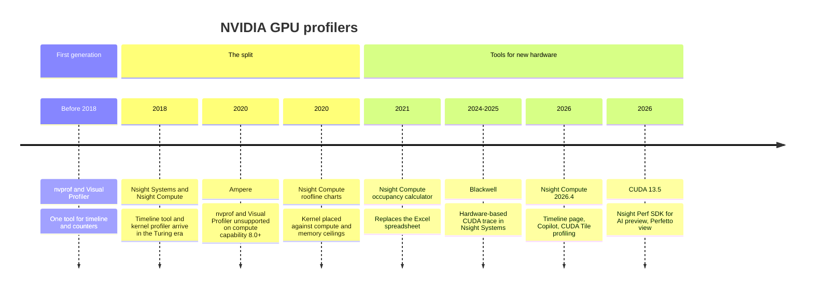
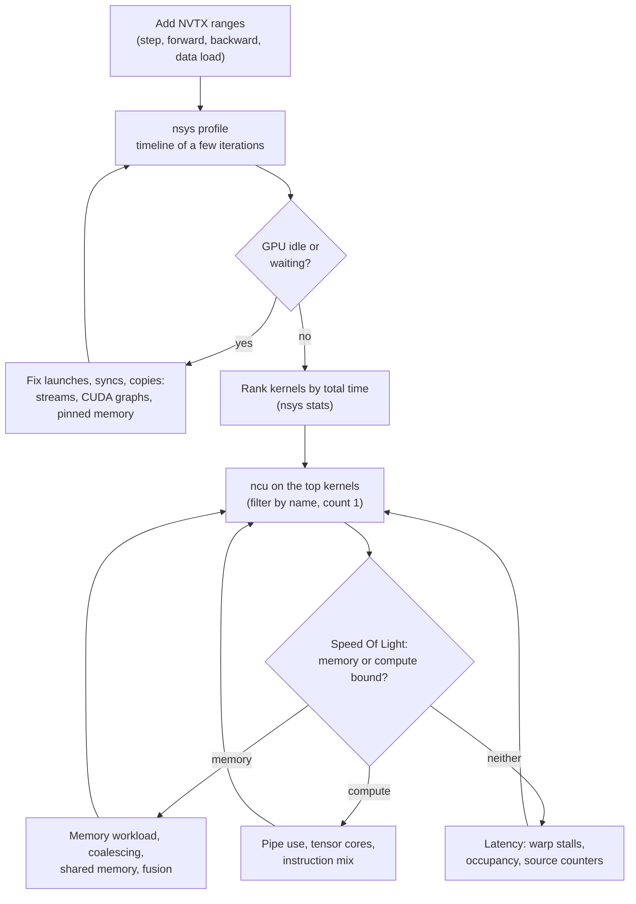

---
tags:
  - gpu-programming
  - cuda
  - profiling
  - nsight
  - performance
status: draft
sources:
  - https://docs.nvidia.com/nsight-systems/UserGuide
  - https://docs.nvidia.com/nsight-compute/ProfilingGuide
  - https://developer.nvidia.com/nsight-compute-2026_4-new-features
  - https://docs.nvidia.com/nsight-compute/2023.3/ProfilingGuide/index.html
  - https://developer.nvidia.com/blog/accelerating-hpc-applications-with-nsight-compute-roofline-analysis
  - https://developer.nvidia.com/blog/using-nsight-compute-to-inspect-your-kernels
  - https://docs.nvidia.com/cuda/profiler-users-guide/changelog.html
  - https://developer.nvidia.com/blog/nvidia-cuda-13-5-brings-nvidia-vera-rubin-ga-support/
created: 2026-11-26
updated: 2026-11-26
---

## Table Of Contents

---

- [[#TL;DR|TL;DR]]
- [[#The Problem|The Problem]]
- [[#Foundations|Foundations]]
    - [[#Two Tools, Two Questions|Two Tools, Two Questions]]
    - [[#Tracing Versus Counting|Tracing Versus Counting]]
    - [[#Measuring Changes What You Measure|Measuring Changes What You Measure]]
- [[#How We Got Here|How We Got Here]]
- [[#How It Works|How It Works]]
    - [[#The Workflow: Outside In|The Workflow: Outside In]]
    - [[#Nsight Systems: Where Does the Time Go?|Nsight Systems: Where Does the Time Go?]]
    - [[#Nsight Compute: Why Is This Kernel Slow?|Nsight Compute: Why Is This Kernel Slow?]]
    - [[#Reading Metric Names|Reading Metric Names]]
    - [[#A Worked Example: Placing a Kernel on the Roofline|A Worked Example: Placing a Kernel on the Roofline]]
    - [[#Warp Stall Reasons|Warp Stall Reasons]]
    - [[#Traps That Give Wrong Numbers|Traps That Give Wrong Numbers]]
- [[#Where It Is Now|Where It Is Now]]
- [[#Trade-offs & Open Problems|Trade-offs & Open Problems]]
- [[#Resources|Resources]]
- [[#Related Notes|Related Notes]]

## ***TL;DR***
---
*NVIDIA ships two profilers for two different questions. Nsight Systems draws a timeline of the whole program (CPU, CUDA API, kernels, copies) and tells you where the time goes; Nsight Compute dissects one kernel with hardware counters and tells you why it is slow. Use them in that order.*

- **Nsight Systems (`nsys`)** is a low-overhead, system-wide tracer. It records CUDA API calls, GPU kernels and copies, OS runtime calls, CPU samples, NVTX ranges you add, and libraries like cuBLAS, cuDNN and NCCL, all on one timeline. It finds idle GPUs, launch gaps, synchronizations and slow copies ([Nsight Systems User Guide](https://docs.nvidia.com/nsight-systems/UserGuide)).
- **Nsight Compute (`ncu`)** is a kernel profiler. It replays each kernel several times to read hundreds of hardware counters, then organizes them into sections: Speed Of Light (how close to peak compute and memory), roofline, memory workload, scheduler and warp-state statistics, and per-line source counters ([Nsight Compute Profiling Guide](https://docs.nvidia.com/nsight-compute/ProfilingGuide)).
- **They disagree on purpose.** By default Nsight Compute locks SM clocks, flushes all GPU caches between replay passes and serializes kernel launches; Nsight Systems does none of that. So a kernel's duration in `ncu` is a controlled measurement, not what it takes in your real run ([Profiling Guide](https://docs.nvidia.com/nsight-compute/ProfilingGuide)).
- **History:** both replaced the older Visual Profiler and `nvprof`, which do not support GPUs of compute capability 8.0 (Ampere) and newer ([Profiler User's Guide](https://docs.nvidia.com/cuda/profiler-users-guide/changelog.html)).
- **Where it is now (Nov 2026):** Nsight Systems 2026.6 uses hardware-based CUDA tracing by default from Blackwell onward and traces CUDA graphs as whole graphs by default ([User Guide](https://docs.nvidia.com/nsight-systems/UserGuide)). Nsight Compute 2026.4 (Nov 5, 2026) adds CUDA 13.5 support, a Timeline page, CUDA Tile kernel profiling on Windows on Arm and an AI assistant, Nsight Copilot, inside the GUI ([NVIDIA](https://developer.nvidia.com/nsight-compute-2026_4-new-features)). CUDA 13.5 also brought an always-on Nsight Perf SDK for AI in public preview, viewable in Perfetto ([CUDA 13.5 blog](https://developer.nvidia.com/blog/nvidia-cuda-13-5-brings-nvidia-vera-rubin-ga-support/)).

## ***The Problem***
---
*GPU performance problems hide in two places: between kernels (the GPU waiting on the CPU, copies or synchronization) and inside kernels (memory traffic, stalls, idle units). Guessing which one you have is the most common way to waste a week of optimization.*

A GPU program can be slow for reasons that look identical from the outside, as a long wall-clock time:

- **The GPU is idle.** The CPU launches too slowly, a `cudaMemcpy` blocks, a `cudaDeviceSynchronize` sits in a loop, a data loader stalls, or a collective waits on another rank. No amount of kernel tuning helps.
- **The GPU is busy but inefficient.** A kernel is memory-bound with uncoalesced loads, has bank conflicts, runs at low occupancy, or never touches the tensor cores. No amount of launch tuning helps.

Wall-clock timers and CUDA events tell you *that* something is slow. They cannot tell you which of these it is. And the obvious instinct, "this kernel looks expensive, let me optimize it," is often wrong: the kernel may take 5% of the step while the GPU sits idle for 40%.

So profiling has to answer two separate questions, in order: *where does the time go across the whole program*, and *what limits this particular kernel*. That is why NVIDIA split its tooling in two.

## ***Foundations***
---
*Three ideas: each tool answers one question, timelines come from tracing events while kernel analysis comes from counting hardware events, and any measurement perturbs what it measures, which the two tools handle in opposite ways.*

#### **Two Tools, Two Questions**

| | Nsight Systems | Nsight Compute |
|---|---|---|
| Question | Where does the time go? | Why is this kernel slow? |
| Scope | Whole process tree, CPU and GPU, many minutes | One kernel launch (or a range) at a time |
| Data | Traces of API calls, kernels, copies, NVTX, OS calls; CPU samples; sampled GPU metrics | Hundreds of hardware performance counters, per kernel and per source line |
| Passes | One run | Many replay passes per kernel |
| Overhead | Low; launches are not serialized | High; kernels serialized and replayed |
| CLI | `nsys profile` | `ncu` |

Sources: [Nsight Systems User Guide](https://docs.nvidia.com/nsight-systems/UserGuide), [Nsight Compute Profiling Guide](https://docs.nvidia.com/nsight-compute/ProfilingGuide).

#### **Tracing Versus Counting**
- **Tracing** records events with timestamps: "kernel X started at t₁ and ended at t₂ on stream 7", "the CPU called `cudaMemcpy` at t₃". That produces a timeline, which shows ordering, overlap and gaps. It is what Nsight Systems does.
- **Counting** reads hardware performance counters: how many DRAM bytes moved, how many instructions issued, how many cycles warps spent waiting on memory. Only a limited number of counters can be read in one pass, so collecting more metrics needs more passes, and Nsight Compute replays the kernel to get them ([Profiling Guide](https://docs.nvidia.com/nsight-compute/ProfilingGuide)).

#### **Measuring Changes What You Measure**
Replaying a kernel ten times with caches flushed and clocks pinned gives repeatable numbers for one kernel, but it is not the kernel's life in the real program, where it may share the GPU with concurrent kernels and find warm data in L2. Nsight Systems keeps the program's real behavior but sees less detail. Neither view is "the truth"; you need both.

## ***How We Got Here***
---
*NVIDIA's first-generation tools, nvprof and the Visual Profiler, mixed timelines and counters in one tool. With Turing and CUDA 10 they were split into Nsight Systems and Nsight Compute, and from Ampere onward the old tools stopped working. Since then both tools have grown features for each new GPU feature, from roofline charts to graphs to AI assistants.*



| When | Step | What it fixed | Source |
|---|---|---|---|
| Ampere era | Visual Profiler and `nvprof` do not support compute capability 8.0 and newer; NVIDIA points users to Nsight Systems and Nsight Compute | One tool trying to do both jobs | [Profiler User's Guide](https://docs.nvidia.com/cuda/profiler-users-guide/changelog.html) |
| 2019 | NVIDIA's walkthrough of Nsight Compute on a matrix kernel with uncoalesced accesses | Showing kernel analysis on a real bug | [Crovella, 2019](https://developer.nvidia.com/blog/using-nsight-compute-to-inspect-your-kernels) |
| 2020 | Roofline charts in Nsight Compute, with a hierarchical (L1, L2, DRAM) variant used at NERSC | Seeing at a glance whether a kernel is memory- or compute-bound | [NVIDIA blog](https://developer.nvidia.com/blog/accelerating-hpc-applications-with-nsight-compute-roofline-analysis) |
| 2021 | Occupancy calculator moves into Nsight Compute | A separate spreadsheet that drifted from the hardware | [[Occupancy and Latency Hiding]] |
| Blackwell | Nsight Systems' `cuda` trace uses hardware (HES) trace by default; `cuda-sw` forces the old software trace | Tracing overhead on launch-heavy workloads | [User Guide](https://docs.nvidia.com/nsight-systems/UserGuide) |
| Nov 2026 | Nsight Compute 2026.4: Timeline page, Copilot, CUDA graph topology in the Python report interface | Navigating huge reports, scripting analysis | [NVIDIA](https://developer.nvidia.com/nsight-compute-2026_4-new-features) |

## ***How It Works***
---
*Work outside in: annotate the code, capture a timeline, fix gaps and synchronizations, then pick the few kernels that dominate and profile those in Nsight Compute. Read its sections top-down, from Speed Of Light to roofline to stall reasons to source lines.*

#### **The Workflow: Outside In**



#### **Nsight Systems: Where Does the Time Go?**
First, mark the phases of your program with NVTX so the timeline has names you recognize:

```cpp
#include <nvtx3/nvToolsExt.h>
for (int step = 0; step < nsteps; ++step) {
    nvtxRangePushA("train_step");
    nvtxRangePushA("forward");  forward(batch);  nvtxRangePop();
    nvtxRangePushA("backward"); backward();      nvtxRangePop();
    nvtxRangePop();
}
```

- `nvtxRangePushA("train_step")` opens a named range on this CPU thread; Nsight Systems draws it as a bar on the timeline and projects it onto the GPU work it launched.
- Nested pushes give a hierarchy (train_step contains forward and backward).
- `nvtxRangePop()` closes the innermost range. PyTorch exposes the same thing as `torch.cuda.nvtx.range_push` and `range_pop`.

Then capture a short run:

```bash
nsys profile -t cuda,nvtx,osrt --cuda-graph-trace=node \
    --capture-range=cudaProfilerApi -o step_trace --stats=true ./train
nsys analyze step_trace.nsys-rep
```

- `-t cuda,nvtx,osrt` traces the CUDA API and GPU work, your NVTX ranges and OS runtime calls such as blocking reads and locks (these three plus OpenGL are the default set).
- `--cuda-graph-trace=node` shows every kernel inside a CUDA graph. The default, `graph`, records only whole graphs because node-level tracing "may cause significant runtime overhead."
- `--capture-range=cudaProfilerApi` records only between `cudaProfilerStart()` and `cudaProfilerStop()`, so you skip warm-up.
- `--stats=true` prints summary tables after collection; `nsys stats` does the same later from a saved report.
- `nsys analyze` runs expert rules such as `gpu_gaps`, `gpu_time_util`, `cuda_api_sync` and `cuda_memcpy_sync`, which flag idle stretches, blocking synchronizations and synchronous copies ([User Guide](https://docs.nvidia.com/nsight-systems/UserGuide)).

What to look for on the timeline:

| Pattern on the timeline | Usual cause | Fix |
|---|---|---|
| Gaps between short kernels, CPU thread busy in launch calls | Launch overhead | [[CUDA Graphs]], [[Kernel Fusion]] |
| GPU idle while CPU sits in `cudaStreamSynchronize` or `cudaMemcpy` | Unneeded synchronization, pageable copies | Async copies, pinned memory, [[Streams, Events and Async Execution]] |
| Copies and kernels never overlap | Everything on one stream | Chunk work across streams |
| GPU idle at the start of each step | Data loading on the CPU | More loader workers, prefetching |
| Long NCCL kernels on one rank only | Straggler rank or imbalance | Look at that rank's CPU timeline |

GPU metric sampling (`--gpu-metrics-devices`, default 10 kHz) adds coarse counters such as SM activity and DRAM bandwidth to the timeline, enough to see whether a busy kernel actually keeps the GPU busy.

#### **Nsight Compute: Why Is This Kernel Slow?**
Profile only the kernels that matter. Profiling every launch of a long program can take hours.

```bash
ncu --kernel-name regex:gemm --launch-skip 10 --launch-count 1 \
    --set full -o gemm_report ./train
```

- `--kernel-name regex:gemm` profiles only kernels whose names match.
- `--launch-skip 10` skips the first ten matching launches (warm-up, autotuning).
- `--launch-count 1` profiles one launch and lets the rest run normally.
- `--set full` collects every section; the default set is smaller and faster.
- `-o gemm_report` saves a `.ncu-rep` file to open in the GUI.

How replay works ([Profiling Guide](https://docs.nvidia.com/nsight-compute/ProfilingGuide)):

| Replay mode | How | Use when |
|---|---|---|
| Kernel (default) | Saves the memory the kernel can access, then restores the written part before each extra pass | Most kernels |
| Application | Re-runs the whole program once per pass and matches kernels by name and grid size | Kernels that depend on host responses, or cache-sensitive measurements |
| Range | Profiles a range of API calls and kernels (from `cudaProfilerStart/Stop` or NVTX) as one unit, without serializing | Concurrent kernels, CUDA graphs, small kernels with interactions |
| Application range | Re-runs the program once per range | Ranges that cannot be captured in place |

The report is organized into sections, read roughly top-down:

| Section | Answers |
|---|---|
| GPU Speed Of Light | Compute and memory throughput as % of theoretical peak: which one is the limit? |
| Roofline charts | Where the kernel sits against the bandwidth slope and compute ceiling, per precision and for tensor cores |
| Memory Workload Analysis | Cache hit rates, bytes moved at each level, whether a memory unit is saturated |
| Launch statistics and occupancy | Grid size, registers, shared memory, theoretical vs achieved occupancy |
| Scheduler Statistics | Active, eligible and issued warps per scheduler; skipped issue slots mean latency is not hidden |
| Warp State Statistics | Cycles per issued instruction and what stalled warps were waiting for |
| Source Counters | Which source or SASS lines stall, uncoalesced accesses, branch efficiency |

The guide's own advice: look at stall reasons only when schedulers fail to issue an instruction every cycle. If they issue every cycle, stalls are already hidden.

#### **Reading Metric Names**
Nsight Compute metrics follow a pattern ([Profiling Guide](https://docs.nvidia.com/nsight-compute/ProfilingGuide)):

```
unit__(subunit)_(pipestage)_quantity_(qualifiers).rollup.submetric
```

- **unit** is the hardware block: `sm` (streaming multiprocessor), `l1tex`, `lts` (L2 slices), `dram`, `gpu`.
- **rollup** combines per-instance counters: `.sum`, `.avg`, `.min`, `.max`.
- **submetric** normalizes: `.per_second`, `.per_cycle_active`, `.pct_of_peak_sustained_elapsed`.

Example: `dram__bytes_read.sum.per_second` is DRAM read bandwidth summed over all memory partitions. `l1tex__t_sectors_pipe_lsu_mem_global_op_ld.sum` counts 32-byte sectors fetched for global loads, the counter behind [[Memory Coalescing]]. A *throughput* metric such as `sm__throughput` is the maximum percentage among the counters that make it up, and only has `.pct_of_peak_sustained_active` and `.pct_of_peak_sustained_elapsed` forms.

#### **A Worked Example: Placing a Kernel on the Roofline**
The roofline (see [[Roofline Model and Arithmetic Intensity]]) needs two measured numbers: work done (FLOPs) and bytes moved from DRAM. Nsight Compute counts both. Suppose `ncu` reports, for one launch of a hypothetical elementwise-heavy kernel on an H100 SXM (peak DRAM bandwidth 3.35 TB/s, dense BF16 tensor peak 989 TFLOP/s):

- duration 1.0 ms
- DRAM bytes moved: 2.0 GB
- floating-point operations: 4.0 GFLOP

Then:

$$
\text{AI} = \frac{\text{FLOPs}}{\text{bytes}} = \frac{4.0 \times 10^9}{2.0 \times 10^9} = 2 \ \text{FLOP/byte}
$$

$$
\text{achieved bandwidth} = \frac{2.0\ \text{GB}}{1.0\ \text{ms}} = 2.0\ \text{TB/s} \approx 60\%\ \text{of}\ 3.35\ \text{TB/s}
$$

*In plain English: the kernel does 2 FLOPs per byte, far left of the H100's BF16 ridge at about 295 FLOP/byte, so its ceiling is the bandwidth slope: $2 \times 3.35 = 6.7$ TFLOP/s. It reaches 4 TFLOP/s, 60% of that ceiling.* The right next step is fewer bytes (fusion, better reuse, lower precision), not more math throughput. Speed Of Light would show the same story as high memory throughput and low compute throughput.

#### **Warp Stall Reasons**
When warps cannot issue, Nsight Compute records why. The common ones ([Nsight Compute 2023.3](https://docs.nvidia.com/nsight-compute/2023.3/ProfilingGuide/index.html)):

| Stall reason | Waiting on | Usual fix |
|---|---|---|
| Long Scoreboard | An L1TEX operation, such as a global or local load | Better coalescing and reuse, prefetch into shared memory, more warps or ILP |
| Short Scoreboard | Shared memory and other MIO operations | Remove [[Shared Memory and Bank Conflicts\|bank conflicts]], fewer special-function ops |
| Wait | A fixed-latency dependency | More independent instructions per thread |
| Math Pipe Throttle | A busy execution unit | Already near compute peak; use tensor cores or cheaper instructions |
| Barrier | Other warps at `__syncthreads()` | Balance work across warps, smaller blocks |

Source Counters map these stalls onto SASS lines (see [[PTX and SASS]]), so you can find the exact load or barrier responsible.

#### **Traps That Give Wrong Numbers**
From the Profiling Guide's section on workload durations ([Profiling Guide](https://docs.nvidia.com/nsight-compute/ProfilingGuide)):

- **Locked clocks.** `ncu` locks SM clocks by default, so a kernel may run slower or faster than under boost clocks. For comparisons, lock clocks yourself with `nvidia-smi` and pass `--clock-control none`.
- **Flushed caches.** `ncu` flushes all GPU caches between replay passes. A kernel that normally finds its inputs in L2 looks worse. For cache-sensitive kernels use `--replay-mode application --cache-control none`.
- **Serialization.** `ncu` serializes kernel launches outside range replay, so concurrency effects vanish. Durations will not match Nsight Systems.
- **Host timers lie under the profiler.** CUDA events and CPU timers include the tool's overhead; use the reported `gpu__time_duration`.
- **Tracing overhead.** In Nsight Systems, node-level graph tracing, Unified Memory page-fault tracing (`--cuda-um-cpu-page-faults`, `--cuda-um-gpu-page-faults`) and CUDA backtraces can add significant overhead, and runs longer than five minutes are not officially supported ([User Guide](https://docs.nvidia.com/nsight-systems/UserGuide)).

## ***Where It Is Now***
---
*As of November 2026, both tools track each new GPU and CUDA release closely, tracing is moving into hardware, and NVIDIA is adding AI assistance and always-on profiling for production AI workloads.*

- **Nsight Systems 2026.6** (docs updated Nov 4, 2026): hardware-event (HES) CUDA tracing is the default on supported GPUs from Blackwell on; CUDA graphs are traced per graph by default, per node on request; `nsys recipe` runs multi-report statistics and plots, and `nsys analyze` runs expert rules ([User Guide](https://docs.nvidia.com/nsight-systems/UserGuide)).
- **Nsight Compute 2026.4** (Nov 5, 2026): CUDA 13.5 support; a Timeline page that gathers the timelines previously on the Details page; Nsight Copilot in the GUI, with an `/explain` command for source markers and answers that link to metrics and source lines; CUDA Tile kernel profiling on Windows on Arm; CUDA graph topology, node parameters and dependencies in the Python Report Interface; profiling and replay of NVLink-utilization split graph kernel nodes on Rubin; and a new `launch__count` metric that warns when a result has no kernel launches ([NVIDIA](https://developer.nvidia.com/nsight-compute-2026_4-new-features)).
- **CUDA 13.5 tooling** (Nov 2026): the Nsight Perf SDK for AI entered public preview for always-on profiling of AI workloads, with results viewable in Perfetto; CUDA-GDB can stop on driver log events; GPU core dumps work with CUPTI tracing enabled; and Nsight Cloud adds OpenTelemetry export ([CUDA 13.5 blog](https://developer.nvidia.com/blog/nvidia-cuda-13-5-brings-nvidia-vera-rubin-ga-support/)).
- **Frameworks lean on the same plumbing.** PyTorch users typically add NVTX ranges and run under `nsys`, or use the PyTorch profiler, which also collects GPU activity through NVIDIA's CUPTI interface.

## ***Trade-offs & Open Problems***
---
*The core tension is detail versus fidelity: the more a profiler tells you about one kernel, the less that kernel behaves as it does in production. The open problems are profiling at cluster scale, in production, and for workloads whose behavior changes from step to step.*

| Choice | Gain | Cost |
|---|---|---|
| Nsight Systems timeline | Real behavior, whole program, low overhead | Little detail about inside a kernel |
| Nsight Compute full set | Hundreds of counters, per-line attribution | Many replay passes, locked clocks, flushed caches, serialized launches |
| Kernel replay | Accurate counters for one launch | Memory save and restore cost; kernels that wait on the host can hang |
| Application replay | No save and restore; works with host interaction | Program must be deterministic; host work repeated per pass |
| Node-level graph tracing | Every kernel in a graph visible | Significant runtime overhead |

Open problems:
- **Scale.** A training job on thousands of GPUs produces thousands of timelines. Finding the one slow rank, and why, is still largely manual; multi-report recipes and always-on sampling are early answers.
- **Production profiling.** Replay-based tools cannot run on live inference traffic. Low-overhead, always-on approaches such as the Nsight Perf SDK for AI preview are the direction, with less detail.
- **Dynamic workloads.** LLM serving changes batch sizes and sequence lengths every step, so a single profiled launch may not represent the workload.
- **Interpretation.** The tools give hundreds of metrics; knowing which matter still takes experience. Rule-based hints in `ncu`, `nsys analyze` and now Copilot try to close that gap.

## ***Resources***
---
*Start with the two user guides' overview sections, then do one real profile: an nsys timeline of a training step and an ncu report on its slowest kernel. The roofline blog and Crovella's walkthrough show how to read what you get.*

**Primary documentation**
- [Nsight Systems User Guide](https://docs.nvidia.com/nsight-systems/UserGuide): version 2026.6. CLI options, trace types, analysis.
- [Nsight Compute Profiling Guide](https://docs.nvidia.com/nsight-compute/ProfilingGuide): replay modes, metric naming, sections, workload-duration caveats.
- [Nsight Compute 2023.3 Profiling Guide](https://docs.nvidia.com/nsight-compute/2023.3/ProfilingGuide/index.html): an older version with clear warp-stall descriptions.
- [Nsight Compute 2026.4 new features](https://developer.nvidia.com/nsight-compute-2026_4-new-features): Nov 2026.
- [Profiler User's Guide changelog](https://docs.nvidia.com/cuda/profiler-users-guide/changelog.html): the legacy `nvprof` and Visual Profiler.

**Walkthroughs**
- [Using Nsight Compute to Inspect your Kernels](https://developer.nvidia.com/blog/using-nsight-compute-to-inspect-your-kernels): Bob Crovella, 2019.
- [Accelerating HPC Applications with NVIDIA Nsight Compute Roofline Analysis](https://developer.nvidia.com/blog/accelerating-hpc-applications-with-nsight-compute-roofline-analysis): NVIDIA, 2020.
- [NVIDIA CUDA 13.5 release blog](https://developer.nvidia.com/blog/nvidia-cuda-13-5-brings-nvidia-vera-rubin-ga-support/): Nov 2026, including the tools updates.

## Related Notes

- [[Roofline Model and Arithmetic Intensity]] — The model behind Nsight Compute's roofline charts.
- [[Occupancy and Latency Hiding]] — What the occupancy, scheduler and stall sections diagnose.
- [[Memory Coalescing]] — The sector and request counters that measure it.
- [[Shared Memory and Bank Conflicts]] — Diagnosed with shared-memory wavefront counters and short-scoreboard stalls.
- [[PTX and SASS]] — Source Counters attribute stalls to SASS lines.
- [[CUDA Graphs]] — The usual fix for launch gaps seen in Nsight Systems.
- [[Streams, Events and Async Execution]] — Overlap and synchronization problems seen on the timeline.
- [[Unified Memory]] — Page faults and migrations that Nsight Systems can trace.
- [[Kernel Fusion]] — The fix for memory-bound chains of small kernels.
- [[GPU Memory Hierarchy]] — The L1, L2 and DRAM levels in memory workload analysis.
- [[Tensor Cores]] — Tensor-core rooflines and pipe utilization in Nsight Compute.
