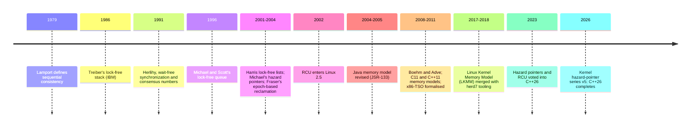

---
tags:
  - operating-systems
  - concurrency
  - lock-free
  - memory-ordering
status: draft
sources:
  - https://www.microsoft.com/en-us/research/publication/make-multiprocessor-computer-correctly-executes-multiprocess-programs/
  - https://www.cl.cam.ac.uk/~pes20/weakmemory/cacm.pdf
  - https://www.hpl.hp.com/techreports/2008/HPL-2008-56.pdf
  - https://dl.acm.org/doi/10.1145/114005.102808
  - https://www.cs.rochester.edu/~scott/papers/1996_PODC_queues.pdf
  - https://www.cs.otago.ac.nz/cosc440/readings/hazard-pointers.pdf
  - https://www.cl.cam.ac.uk/techreports/UCAM-CL-TR-579.pdf
  - https://dl.acm.org/doi/10.1145/3173162.3177156
  - https://github.com/torvalds/linux/tree/master/tools/memory-model
  - https://docs.kernel.org/core-api/wrappers/memory-barriers.html
  - https://www.kernel.org/doc/Documentation/memory-barriers.txt
  - https://docs.kernel.org/locking/seqlock.html
  - https://github.com/torvalds/linux/blob/master/include/linux/llist.h
  - https://github.com/torvalds/linux/blob/master/include/linux/ptr_ring.h
  - https://en.cppreference.com/w/cpp/atomic/memory_order
  - https://mirrors.edge.kernel.org/pub/linux/kernel/people/paulmck/perfbook/perfbook.html
  - https://preshing.com/20120612/an-introduction-to-lock-free-programming/
  - https://marabos.nl/atomics/
  - https://open-std.org/JTC1/sc22/wg21/docs/papers/2023/p2530r3.pdf
  - https://open-std.org/JTC1/sc22/wg21/docs/papers/2023/p2545r4.pdf
  - https://lkml.iu.edu/2602.2/09055.html
  - https://lwn.net/Articles/1084015/
  - https://docs.rs/crossbeam-epoch/latest/crossbeam_epoch/
created: 2026-11-26
updated: 2026-11-26
---

## Table Of Contents

---

- [[#TL;DR|TL;DR]]
- [[#The Problem|The Problem]]
- [[#Foundations|Foundations]]
    - [[#Progress Guarantees - Blocking, Lock-Free, Wait-Free|Progress Guarantees - Blocking, Lock-Free, Wait-Free]]
    - [[#Why Memory Gets Reordered|Why Memory Gets Reordered]]
    - [[#Sequential Consistency and Weaker Models|Sequential Consistency and Weaker Models]]
    - [[#The C11 and C++11 Orderings|The C11 and C++11 Orderings]]
- [[#How We Got Here|How We Got Here]]
- [[#How It Works|How It Works]]
    - [[#Seeing Reordering on Real Hardware|Seeing Reordering on Real Hardware]]
    - [[#Message Passing with Release and Acquire|Message Passing with Release and Acquire]]
    - [[#Compare-and-Swap Loops|Compare-and-Swap Loops]]
    - [[#The Treiber Stack|The Treiber Stack]]
    - [[#The ABA Problem|The ABA Problem]]
    - [[#Safe Memory Reclamation - Hazard Pointers, Epochs, RCU|Safe Memory Reclamation - Hazard Pointers, Epochs, RCU]]
    - [[#The Michael-Scott Queue and Ring Buffers|The Michael-Scott Queue and Ring Buffers]]
    - [[#Contention Still Costs - Measured|Contention Still Costs - Measured]]
    - [[#Inside the Linux Kernel - LKMM, Barriers and Lock-Free Idioms|Inside the Linux Kernel - LKMM, Barriers and Lock-Free Idioms]]
- [[#Where It Is Now|Where It Is Now]]
- [[#Trade-offs & Open Problems|Trade-offs & Open Problems]]
- [[#Resources|Resources]]
- [[#Related Notes|Related Notes]]

## ***TL;DR***
---
*Lock-free data structures let threads share data without locks by building every update out of single atomic instructions like compare-and-swap. They only work if you also control memory ordering: modern CPUs and compilers reorder loads and stores, and the memory model is the contract that says which reorderings you must prevent.*

- **Lock-free means "someone always makes progress":** a thread that stalls (preempted, page-faulting, crashed) can't block the others, unlike a lock holder. **Wait-free** is stronger: *every* thread finishes in a bounded number of steps ([Herlihy, 1991](https://dl.acm.org/doi/10.1145/114005.102808)).
- **Hardware reorders memory.** Even x86, the strictest mainstream architecture, lets a load run ahead of an earlier store to a different address (via the store buffer); Arm, POWER and RISC-V reorder far more ([x86-TSO, Sewell et al.](https://www.cl.cam.ac.uk/~pes20/weakmemory/cacm.pdf)). On the cloud VM this note was written on, a classic two-thread test showed the "impossible" outcome in 6 to 8% of 2 million runs, and 0 times once sequentially consistent atomics were used.
- **The tools:** `acquire`/`release` orderings pair up to publish data safely; `seq_cst` gives one global order at a higher cost; `relaxed` gives atomicity only. The kernel has its own, formally specified model (LKMM) and primitives like `smp_store_release()` and `READ_ONCE()` ([tools/memory-model](https://github.com/torvalds/linux/tree/master/tools/memory-model)).
- **The hard part is freeing memory.** A thread can't free a node another thread might still be reading. Hazard pointers, epoch-based reclamation and [[Read-Copy-Update (RCU)]] are the three standard answers, and the [[#The ABA Problem|ABA problem]] is what happens without one.
- **Where it is now (Nov 2026):** C++26 includes both hazard pointers and RCU in its standard library ([P2530](https://open-std.org/JTC1/sc22/wg21/docs/papers/2023/p2530r3.pdf), [P2545](https://open-std.org/JTC1/sc22/wg21/docs/papers/2023/p2545r4.pdf)); a kernel hazard-pointer series reached v5 in February 2026 and is being discussed as a complement to RCU ([LWN, July 2026](https://lwn.net/Articles/1084015/)).

## ***The Problem***
---
*Locks are simple, but a lock serialises everyone behind whoever holds it, and the holder can be preempted, interrupted or slow. On many-core machines and in contexts that can't sleep (interrupt handlers, NMIs, tracing code), that is unacceptable. Lock-free code removes the lock but exposes everything the lock was quietly handling: atomicity, ordering and object lifetime.*

What goes wrong with locks (see [[Locks and Synchronization]]):

| Problem | Example |
|---|---|
| Convoying | Holder is preempted; every other thread waits a whole scheduler time slice |
| Priority inversion | Low-priority holder blocks a real-time thread |
| Deadlock in restricted contexts | An NMI handler or tracer that takes a lock the interrupted code already holds |
| Scalability | Every acquire moves the lock's cache line between cores |

What a lock was doing for you, which lock-free code must do itself:

1. **Atomicity:** a multi-step update appears to happen at one instant.
2. **Ordering:** writes made before `unlock()` are visible to whoever does the next `lock()` (release/acquire).
3. **Lifetime:** nobody frees an object while another thread inside the critical section uses it.

Lock-free techniques give up (1) for multi-word updates (you get only single-word atomics), make (2) explicit, and turn (3) into the field of *safe memory reclamation*.

## ***Foundations***
---
*Three ideas: what "lock-free" promises, why CPUs and compilers reorder memory, and the vocabulary (sequential consistency, TSO, acquire/release) used to describe which reorderings are allowed.*

#### **Progress Guarantees - Blocking, Lock-Free, Wait-Free**

| Guarantee | Promise | If one thread stops mid-operation | Example |
|---|---|---|---|
| Blocking | None beyond correctness | Others may wait forever | Mutex, spinlock |
| Obstruction-free | A thread running alone finishes | Others may livelock but not block | Some STM designs |
| Lock-free | Some thread always finishes in finite steps | Others continue | Treiber stack, Michael-Scott queue |
| Wait-free | Every thread finishes in bounded steps | Others continue, each with a bound | Fetch-and-add counter, wait-free queues |

Herlihy's 1991 paper showed why hardware needs strong atomics: reads and writes alone (consensus number 1) can't build a wait-free version of even a two-thread queue, while compare-and-swap (consensus number ∞) can build any wait-free object ([Wait-Free Synchronization](https://dl.acm.org/doi/10.1145/114005.102808)).

#### **Why Memory Gets Reordered**

Three layers each reorder memory accesses for speed, and each is invisible to a single thread but visible to others:

1. **The compiler** keeps values in registers, merges loads, moves stores out of loops, and reorders independent accesses.
2. **The CPU core** executes out of order and speculatively; loads can complete before earlier loads or stores.
3. **The store buffer.** A store goes into a per-core buffer and drains to the cache later, so the core can continue immediately. The core's own later loads see its buffered store, but other cores don't yet.

Cache coherence (MESI and friends) keeps each *single* memory location consistent; it says nothing about the order in which *different* locations become visible. That is the memory model's job.

#### **Sequential Consistency and Weaker Models**

**Sequential consistency** (Lamport, 1979): the result is as if all threads' operations were interleaved in one global order that respects each thread's program order ([Lamport](https://www.microsoft.com/en-us/research/publication/make-multiprocessor-computer-correctly-executes-multiprocess-programs/)). It's what people intuitively expect, and no mainstream CPU provides it by default.

| Architecture | Model | Reorderings allowed (different addresses) |
|---|---|---|
| x86-64 | TSO (total store order) | Store → later load only |
| SPARC (TSO mode) | TSO | Store → later load only |
| Arm v8, RISC-V (RVWMO) | Weak, but multi-copy atomic | Load→load, load→store, store→store, store→load |
| POWER | Weak, not multi-copy atomic | All of the above, and different cores may see stores in different orders |

RISC-V also defines an optional `Ztso` extension, and Apple's M-series cores have a TSO mode, both so that translated x86 code runs correctly.

#### **The C11 and C++11 Orderings**

Since 2011, C and C++ have a portable memory model, based on Boehm and Adve's work: a program with a **data race** (two unsynchronised accesses to the same non-atomic location, at least one a write) has undefined behaviour; atomics come with an ordering argument ([Boehm & Adve, PLDI 2008](https://www.hpl.hp.com/techreports/2008/HPL-2008-56.pdf), [cppreference](https://en.cppreference.com/w/cpp/atomic/memory_order)):

| Ordering | Guarantees | Typical use | x86-64 store / load | Arm64 store / load |
|---|---|---|---|---|
| `relaxed` | Atomic, no ordering with other locations | Statistics counters | `mov` / `mov` | `str` / `ldr` |
| `release` (stores) | Earlier reads and writes can't move after it | Publishing data | `mov` / – | `stlr` / – |
| `acquire` (loads) | Later reads and writes can't move before it | Consuming published data | – / `mov` | – / `ldar` (or `ldapr`) |
| `acq_rel` | Both, for read-modify-writes | CAS in a lock-free structure | `lock cmpxchg` | `casal` |
| `seq_cst` | Acquire/release plus one global order over all `seq_cst` ops | Default; Dekker-style flags | `xchg` / `mov` | `stlr` / `ldar` |

The table shows why x86 programmers often get away with sloppy ordering: TSO makes acquire and release free, and only `seq_cst` stores cost extra (an `xchg`, which drains the store buffer). The same code on Arm can break. Rust uses the same model and names (`Ordering::Acquire` and so on) ([Mara Bos, Rust Atomics and Locks](https://marabos.nl/atomics/)).

## ***How We Got Here***
---
*Theory came first (1979–1991), practical algorithms followed (1986–2004), language memory models were formalised in the 2000s, and the last decade has been about proving the models right and standardising reclamation.*



- **Algorithms before models.** Treiber's stack (1986) and the Michael-Scott queue (1996) were designed against an informal idea of atomic CAS on sequentially consistent memory, then had to be patched with barriers as real machines turned out weaker.
- **Memory reclamation** was the missing piece for languages without garbage collection: Maged Michael's hazard pointers (2004) and Keir Fraser's epoch-based reclamation (2004) made lock-free structures usable in C and C++ ([Michael](https://www.cs.otago.ac.nz/cosc440/readings/hazard-pointers.pdf), [Fraser](https://www.cl.cam.ac.uk/techreports/UCAM-CL-TR-579.pdf)). Java had a garbage collector, which is why `java.util.concurrent` shipped lock-free queues in 2004.
- **Formal models.** The Cambridge group's x86-TSO (2009–2010) and Arm/POWER models replaced prose manuals with executable definitions ([Sewell et al.](https://www.cl.cam.ac.uk/~pes20/weakmemory/cacm.pdf)). The **Linux Kernel Memory Model** (Alglave, Maranget, McKenney, Parri, Stern, ASPLOS 2018) did the same for the kernel's own primitives, and ships in the kernel tree with the `herd7` checker ([paper](https://dl.acm.org/doi/10.1145/3173162.3177156)).

## ***How It Works***
---
*First see reordering happen, then the core patterns: message passing with release/acquire, CAS loops, a lock-free stack, why ABA breaks it, the three ways to reclaim memory, queues and rings, what contention costs, and how the Linux kernel does all of this.*

#### **Seeing Reordering on Real Hardware**

The **store buffering (SB)** litmus test. Two threads, `x` and `y` start at 0:

| Thread 1 | Thread 2 |
|---|---|
| `x = 1;` | `y = 1;` |
| `r1 = y;` | `r2 = x;` |

Under sequential consistency, at least one store must come first in the global order, so `r1 == 0 && r2 == 0` is impossible. Under TSO, both stores can sit in their store buffers while both loads read the old values from cache.

Measured on the 4-vCPU Intel Xeon cloud VM (gcc 13.3, `-O2`) this note was written on, 2 million trials each:

| Atomics used | Generated stores | Runs with `r1 == 0 && r2 == 0` |
|---|---|---|
| `memory_order_relaxed` (run 1) | plain `mov` | 120,616 (6.0%) |
| `memory_order_relaxed` (run 2) | plain `mov` | 162,821 (8.1%) |
| `memory_order_seq_cst` | `xchg` (locked, drains the store buffer) | 0 |

How to read it: the "impossible" outcome is not rare or theoretical; it showed up in roughly one trial in 15. Making the stores `seq_cst` made gcc emit `xchg`, and the outcome disappeared. This is exactly the pattern in Dekker's and Peterson's mutual-exclusion algorithms, which is why they fail on modern CPUs without fences.

#### **Message Passing with Release and Acquire**

The most common correct pattern: one thread prepares data, then sets a flag; another waits for the flag, then reads the data.

```c
struct msg { int a, b; };
struct msg m;                 /* plain, non-atomic data */
atomic_bool ready = false;

void producer(void) {
    m.a = 1; m.b = 2;                                          /* 1. write data   */
    atomic_store_explicit(&ready, true, memory_order_release); /* 2. publish      */
}

void consumer(void) {
    while (!atomic_load_explicit(&ready, memory_order_acquire)) /* 3. see flag    */
        ;
    use(m.a, m.b);                                             /* 4. read data    */
}
```

In plain words: the release store promises "everything I wrote before this is visible to anyone who sees this store", and the acquire load promises "nothing after me runs before me". When the acquire load reads the value written by the release store, the two **synchronise**, and steps 1 happen-before step 4. With `relaxed` instead, on Arm the consumer could see `ready == true` and stale `m.a`. The pairing matters: release with no matching acquire guarantees nothing.

#### **Compare-and-Swap Loops**

CAS atomically does "if the location still holds `expected`, write `desired`". Almost every lock-free update is a loop around it:

```c
void atomic_max(atomic_long *p, long v) {
    long cur = atomic_load_explicit(p, memory_order_relaxed);
    while (cur < v &&
           !atomic_compare_exchange_weak_explicit(p, &cur, v,
                memory_order_relaxed, memory_order_relaxed))
        ;   /* on failure, cur is refreshed with the current value; retry */
}
```

Read the current value, compute the new one, try to swap; if another thread changed it in between, the CAS fails and gives you the new current value, and you retry. The loop is lock-free (a failed CAS means someone else's succeeded) but not wait-free (an unlucky thread can retry forever). The `_weak` form may fail spuriously, which is fine in a loop and lets LL/SC machines (older Arm, RISC-V) use a cheaper instruction sequence.

#### **The Treiber Stack**

The simplest lock-free structure: a singly linked list where push and pop CAS the head pointer.

```c
struct node { struct node *next; void *val; };
_Atomic(struct node *) top;

void push(struct node *n) {
    struct node *old = atomic_load_explicit(&top, memory_order_relaxed);
    do {
        n->next = old;
    } while (!atomic_compare_exchange_weak_explicit(&top, &old, n,
                 memory_order_release, memory_order_relaxed));
}

struct node *pop(void) {
    struct node *old = atomic_load_explicit(&top, memory_order_acquire);
    while (old &&
           !atomic_compare_exchange_weak_explicit(&top, &old, old->next,
                 memory_order_acquire, memory_order_acquire))
        ;
    return old;   /* DANGER: see ABA and reclamation below */
}
```

Push is release so the node's contents are visible before it becomes reachable; pop is acquire so it sees them. `push` is safe as written. `pop` has two classic bugs, both about memory reuse.

#### **The ABA Problem**

1. Thread T1 in `pop()` reads `top = A` and `A->next = B`, then is preempted before its CAS.
2. Thread T2 pops A, pops B, frees B, then pushes A back. Now `top = A`, `A->next = C`.
3. T1 resumes; its CAS checks "is `top` still A?" Yes, so it sets `top = B`, a freed node. The stack is corrupted.

CAS compares values, not history: the pointer went A → B → A and looks unchanged. Fixes:

- **Tagged pointers:** pair the pointer with a counter incremented on every change and CAS both, using a double-width CAS (`cmpxchg16b` on x86-64) or spare pointer bits.
- **LL/SC:** a store-conditional fails if the location was *written* at all, so pure LL/SC is immune, though it's hard to use across a whole operation.
- **Don't reuse memory while anyone can see it:** the real fix, which also solves the second bug (T1 reading `old->next` after `old` was freed). That is safe memory reclamation.

#### **Safe Memory Reclamation - Hazard Pointers, Epochs, RCU**

The question: when is it safe to free a node that has been unlinked, given that other threads may still hold pointers they read before the unlink?

| Scheme | How a reader protects itself | When the writer frees | Reader cost | Unreclaimed memory bound |
|---|---|---|---|---|
| **Hazard pointers** ([Michael, 2004](https://www.cs.otago.ac.nz/cosc440/readings/hazard-pointers.pdf)) | Publishes the pointer it is about to use in a per-thread "hazard" slot, then re-checks it is still reachable | Scans all hazard slots; frees nodes no slot names | A store plus a full fence per protected pointer | Bounded: about (threads × slots) |
| **Epoch-based** ([Fraser, 2004](https://www.cl.cam.ac.uk/techreports/UCAM-CL-TR-579.pdf); Rust's crossbeam-epoch) | Announces "I'm active in epoch e" on entry | Advances the global epoch once all active threads have seen it; frees nodes retired two epochs ago | Cheap: one announcement per operation | Unbounded if a thread stalls inside |
| **RCU** ([[Read-Copy-Update (RCU)]]) | Nothing, or a preempt-disable, in the kernel | After a grace period: every CPU has passed a quiescent state | Near zero | Unbounded during long readers |
| **Reference counting** | Increment a count in the node | When the count hits zero | Atomic RMW on shared line per access | Exact, but contended counts don't scale |

Hazard pointers in a sentence: "before I dereference this pointer, I tell everyone I'm using it, then check it didn't vanish in the meantime." The re-check is what makes it safe; the full fence between the announcement and the re-check is what makes it cost. C++26 standardises both hazard pointers (`<hazard_pointer>`, [P2530](https://open-std.org/JTC1/sc22/wg21/docs/papers/2023/p2530r3.pdf)) and RCU (`<rcu>`, [P2545](https://open-std.org/JTC1/sc22/wg21/docs/papers/2023/p2545r4.pdf)).

#### **The Michael-Scott Queue and Ring Buffers**

- **Michael-Scott queue** (1996): a linked list with separate `head` and `tail` pointers and a dummy node, where enqueuers CAS `tail->next` then swing `tail`, and any thread that sees a lagging tail helps advance it ([paper](https://www.cs.rochester.edu/~scott/papers/1996_PODC_queues.pdf)). "Helping" is the key lock-free idea: instead of waiting for a slow thread, finish its work for it. Java's `ConcurrentLinkedQueue` is based on it.
- **Single-producer/single-consumer (SPSC) ring buffers** are the workhorse in practice, because with one writer per index they need no CAS at all: the producer writes the slot then does a release store of `tail`; the consumer does an acquire load of `tail`, reads the slot, then a release store of `head`. The [[io_uring]] submission and completion rings, the kernel's `kfifo`, BPF ring buffers, network card descriptor rings ([[Device Drivers and the Driver Model]]) and audio buffers all use this shape. Multi-producer rings (DPDK's `rte_ring`, the kernel's `ptr_ring`) add a CAS or a lock for the producer side ([ptr_ring.h](https://github.com/torvalds/linux/blob/master/include/linux/ptr_ring.h)).

#### **Contention Still Costs - Measured**

Lock-free does not mean free. Every atomic read-modify-write needs the cache line in exclusive state, so threads hammering one location still serialise on it. Measured on the same 4-vCPU VM, 10 million increments per thread:

| Method | 1 thread | 4 threads (total throughput) |
|---|---|---|
| Shared counter, `atomic_fetch_add` | 169 M ops/s (5.9 ns each) | 31 M ops/s |
| Shared counter, CAS loop | 83 M ops/s | 15 M ops/s |
| One counter per thread (padded) | 176 M ops/s | 117 M ops/s |

How to read it: adding threads to a shared lock-free counter made the *total* throughput 5× worse, because the cache line bounces between cores; the CAS loop is worse again because failed CASes retry. Splitting the counter per thread (and summing on read) is the real fix, which is why the kernel uses per-CPU counters for statistics. The 4-thread per-thread result is below the ideal 4 × 176 because the VM's virtual CPUs share physical cores with other tenants; treat these as illustrations, not benchmarks.

#### **Inside the Linux Kernel - LKMM, Barriers and Lock-Free Idioms**

The kernel predates C11 atomics and uses its own primitives with semantics defined by the LKMM ([memory-barriers.txt](https://www.kernel.org/doc/Documentation/memory-barriers.txt), [tools/memory-model](https://github.com/torvalds/linux/tree/master/tools/memory-model)):

| Kernel primitive | Meaning | Roughly like C11 |
|---|---|---|
| `READ_ONCE(x)`, `WRITE_ONCE(x, v)` | One untorn access the compiler can't merge, split or elide | `relaxed` load/store (plus volatile) |
| `smp_load_acquire(p)`, `smp_store_release(p, v)` | Acquire load, release store | `acquire`, `release` |
| `smp_mb()`, `smp_rmb()`, `smp_wmb()` | Full, read and write barriers between CPUs | `atomic_thread_fence` (`seq_cst`, roughly acquire, roughly release) |
| `rcu_dereference(p)` | Load a pointer and rely on address dependency for ordering | What `memory_order_consume` intended |
| `atomic_*()` returning a value | Fully ordered RMW | `seq_cst` RMW |
| `atomic_*_relaxed()`, `_acquire()`, `_release()` | Explicit ordering variants | Matching C11 orders |

The LKMM is written as a `herd7` model, so kernel developers can check a litmus test mechanically: `herd7 -conf linux-kernel.cfg SB+mbs.litmus` reports whether an outcome is allowed. Common kernel lock-free idioms:

- **Seqlocks:** a writer increments a sequence counter before and after updating; readers retry if the counter was odd or changed. Readers never block writers; used for timekeeping (`jiffies`, the vDSO clock data) ([seqlock docs](https://docs.kernel.org/locking/seqlock.html)).
- **`llist`:** a lock-less singly linked list with `llist_add()` (CAS push) and `llist_del_all()` (atomic exchange of the head), which avoids ABA by never popping single nodes concurrently ([llist.h](https://github.com/torvalds/linux/blob/master/include/linux/llist.h)).
- **Per-CPU data and `this_cpu_*()` operations:** avoid sharing entirely.
- **RCU** for read-mostly linked structures ([[Read-Copy-Update (RCU)]]).
- **Lock-free paths for contexts that can't take locks:** NMI-safe ring buffers in the tracing code and BPF ([[Kernel Observability and Tracing]], [[eBPF]]).

## ***Where It Is Now***
---
*As of November 2026, lock-free programming has moved from expert folklore toward standard, checkable building blocks: reclamation schemes in language standards, formal models with tools, and memory-model-aware Rust in the kernel.*

- **C++26 standardises reclamation.** Hazard pointers (P2530) and RCU (P2545), both voted into the C++26 working paper in 2023, are part of the C++26 standard library, so portable code no longer needs Folly or liburcu for them ([P2530R3](https://open-std.org/JTC1/sc22/wg21/docs/papers/2023/p2530r3.pdf), [P2545R4](https://open-std.org/JTC1/sc22/wg21/docs/papers/2023/p2545r4.pdf)).
- **Hazard pointers for the kernel.** Mathieu Desnoyers posted v5 of a kernel hazard-pointer series in February 2026 (on v7.0-rc1), with four per-CPU slots per cache line and a scheduler hook that moves a task's slots aside on context switch ([RFC v5](https://lkml.iu.edu/2602.2/09055.html)). LWN's July 2026 write-up frames it as a complement to RCU where long grace periods hold too much memory; it had no in-kernel users yet, which normally blocks merging, and lockdep is named as the first planned user ([LWN](https://lwn.net/Articles/1084015/)).
- **Rust in the kernel uses the kernel's model.** Rust code in Linux maps its atomics onto LKMM semantics rather than the C11 model, so Rust and C code sharing data agree on ordering; see [[Rust in the Linux Kernel]].
- **Weak memory everywhere.** Arm servers (AWS Graviton, Ampere, NVIDIA Grace, Google Axion, Microsoft Cobalt) and RISC-V make weak ordering the common case in data centres, so code that "worked on x86" is now regularly exposed. Arm's newer `LDAPR` (RCpc acquire) and LSE atomics (`CAS`, `LDADD`) make acquire and RMW operations cheaper than the older LL/SC sequences.

## ***Trade-offs & Open Problems***
---
*Lock-free code wins on progress guarantees and on read-mostly or single-producer workloads; it loses on complexity, and it does not escape the cost of cache-line contention.*

| Choice | Gain | Cost |
|---|---|---|
| Lock-free instead of a lock | No blocking on preempted or slow threads; usable in NMI/IRQ context | Much harder to write and verify; only single-word atomic updates |
| `seq_cst` everywhere | Easy reasoning | Extra fences on every store (x86) or many accesses (Arm, POWER) |
| Fine-tuned acquire/release/relaxed | Fastest code | Subtle bugs that appear on one architecture only |
| Hazard pointers | Bounded garbage | Store + fence per protected pointer |
| Epochs / RCU | Near-free readers | Garbage piles up behind a stalled reader |
| Shared atomic counter | Simple | Collapses under contention; per-CPU counters scale |

Open problems:

- **`memory_order_consume` never worked.** Compilers implement it as `acquire`, losing the cheap dependency ordering RCU relies on. The kernel sidesteps C11 here and relies on compiler behaviour plus the LKMM.
- **Out-of-thin-air values.** The C/C++ model still technically allows causally circular results for relaxed atomics, an unsolved theoretical problem with no practical fix agreed.
- **Verification.** Model checkers (herd7, GenMC, CDSChecker, Rust's loom) find bugs in small litmus tests and data structures, but whole-system checking remains out of reach.
- **Hardware transactional memory** was supposed to make multi-word atomic updates easy, but Intel disabled TSX on most CPUs after bugs and side-channel attacks ([[Transient Execution Attacks and Mitigations]]).

## ***Resources***
---
*For understanding: Preshing's introduction, then Mara Bos's book for C11/Rust orderings, then McKenney's perfbook for the kernel view. For depth: the original papers, the x86-TSO paper and the LKMM paper.*

**Books and tutorials**
- [Is Parallel Programming Hard, And, If So, What Can You Do About It?](https://mirrors.edge.kernel.org/pub/linux/kernel/people/paulmck/perfbook/perfbook.html): Paul McKenney's free book; memory ordering, counters, RCU.
- [Rust Atomics and Locks](https://marabos.nl/atomics/): Mara Bos (2023, free online). The clearest treatment of acquire/release, with hardware chapters.
- [An Introduction to Lock-Free Programming](https://preshing.com/20120612/an-introduction-to-lock-free-programming/): Jeff Preshing.
- [cppreference: std::memory_order](https://en.cppreference.com/w/cpp/atomic/memory_order).

**Papers**
- [How to Make a Multiprocessor Computer That Correctly Executes Multiprocess Programs](https://www.microsoft.com/en-us/research/publication/make-multiprocessor-computer-correctly-executes-multiprocess-programs/): Lamport, 1979.
- [Wait-Free Synchronization](https://dl.acm.org/doi/10.1145/114005.102808): Herlihy, TOPLAS 1991.
- [Simple, Fast, and Practical Non-Blocking and Blocking Concurrent Queue Algorithms](https://www.cs.rochester.edu/~scott/papers/1996_PODC_queues.pdf): Michael and Scott, PODC 1996.
- [Hazard Pointers: Safe Memory Reclamation for Lock-Free Objects](https://www.cs.otago.ac.nz/cosc440/readings/hazard-pointers.pdf): Michael, IEEE TPDS 2004.
- [Practical Lock-Freedom](https://www.cl.cam.ac.uk/techreports/UCAM-CL-TR-579.pdf): Fraser, PhD thesis 2004 (epoch-based reclamation).
- [Foundations of the C++ Concurrency Memory Model](https://www.hpl.hp.com/techreports/2008/HPL-2008-56.pdf): Boehm and Adve, PLDI 2008.
- [x86-TSO: A Rigorous and Usable Programmer's Model](https://www.cl.cam.ac.uk/~pes20/weakmemory/cacm.pdf): Sewell et al., CACM 2010.
- [Frightening Small Children and Disconcerting Grown-ups: Concurrency in the Linux Kernel](https://dl.acm.org/doi/10.1145/3173162.3177156): Alglave et al., ASPLOS 2018 (the LKMM).

**Kernel**
- [memory-barriers.txt](https://www.kernel.org/doc/Documentation/memory-barriers.txt) and [tools/memory-model](https://github.com/torvalds/linux/tree/master/tools/memory-model) (LKMM, litmus tests, herd7 setup).
- [Sequence counters and sequential locks](https://docs.kernel.org/locking/seqlock.html), [llist.h](https://github.com/torvalds/linux/blob/master/include/linux/llist.h), [ptr_ring.h](https://github.com/torvalds/linux/blob/master/include/linux/ptr_ring.h).

**Standards and 2026 news**
- [P2530R3 Hazard Pointers](https://open-std.org/JTC1/sc22/wg21/docs/papers/2023/p2530r3.pdf) and [P2545R4 Read-Copy Update](https://open-std.org/JTC1/sc22/wg21/docs/papers/2023/p2545r4.pdf) for C++26.
- [Kernel hazard pointers RFC v5](https://lkml.iu.edu/2602.2/09055.html), Feb 2026, and [LWN write-up](https://lwn.net/Articles/1084015/), July 2026.
- [crossbeam-epoch](https://docs.rs/crossbeam-epoch/latest/crossbeam_epoch/): epoch-based reclamation in Rust.

## Related Notes

- [[Locks and Synchronization]] — Atomic instructions, spinlocks, futexes; the blocking alternative.
- [[Read-Copy-Update (RCU)]] — The kernel's main reclamation scheme for read-mostly data.
- [[Signals and IPC]] — Shared-memory rings between processes, and measured wake-up costs.
- [[io_uring]] — SPSC rings shared between user space and the kernel.
- [[Device Drivers and the Driver Model]] — Descriptor rings and MMIO barriers between CPU and device.
- [[Kernel Observability and Tracing]] — Lock-free per-CPU trace buffers usable from NMIs.
- [[eBPF]] — BPF ring buffers and maps accessed concurrently.
- [[CPU Scheduling]] — Preemption is why blocking locks convoy.
- [[Interrupts and Exceptions]] — NMI and IRQ contexts that can't take locks.
- [[Rust in the Linux Kernel]] — Rust atomics mapped onto the kernel memory model.
- [[Transient Execution Attacks and Mitigations]] — Why hardware transactional memory faded.
- [[Kernel Bypass Networking]] — Lock-free rings at line rate (DPDK `rte_ring`).
- [[Consistency Models]] — The distributed-systems counterpart: linearizability and weaker models.
