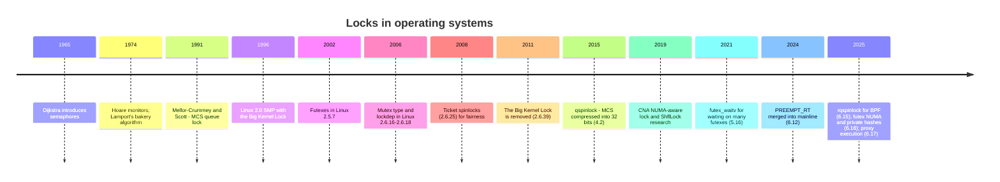
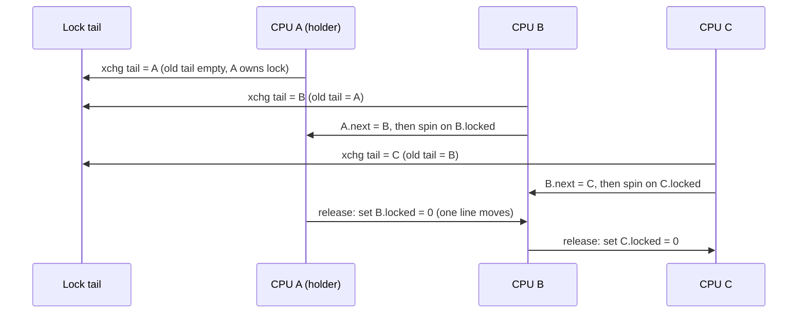
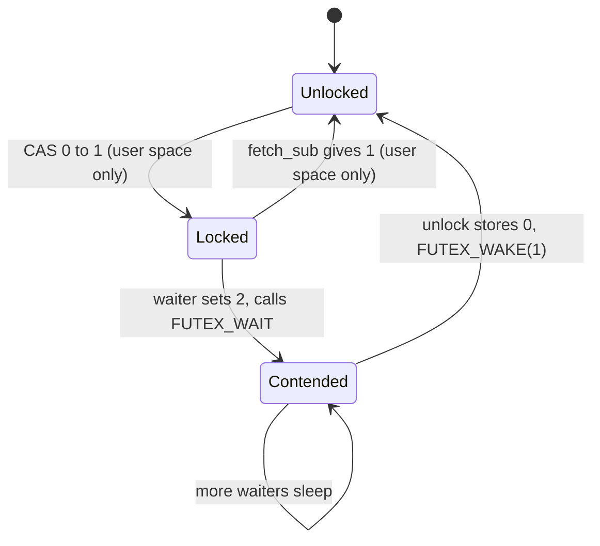
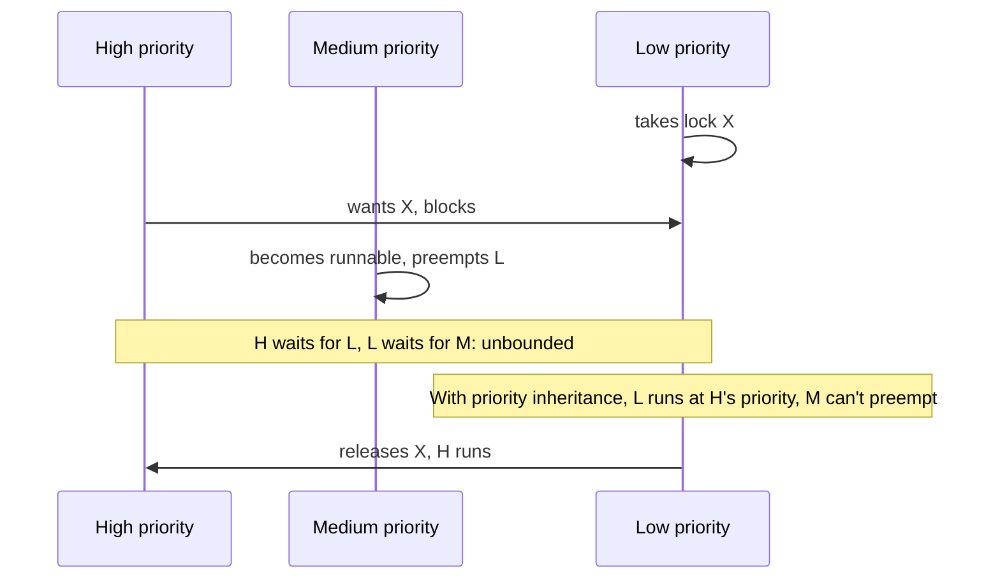

---
tags:
  - operating-systems
  - concurrency
  - locks
  - futex
  - spinlock
  - linux
status: draft
sources:
  - https://pages.cs.wisc.edu/~remzi/OSTEP/
  - https://www.kernel.org/doc/html/latest/locking/locktypes.html
  - https://lwn.net/Articles/590243/
  - https://kernel.org/doc/ols/2002/ols2002-pages-479-495.pdf
  - https://www.ic.unicamp.br/~islene/2s2013-mo806/futex/futex-are-tricky.pdf
  - https://man7.org/linux/man-pages/man2/futex_waitv.2.html
  - https://www.collabora.com/news-and-blog/blog/2023/02/17/the-futex-waitv-syscall-gaming-on-linux/
  - https://lkml.indiana.edu/hypermail/linux/kernel/2505.3/00381.html
  - https://phoronix.com/news/Linux-6.12-Does-Real-Time
  - https://lkml.indiana.edu/hypermail/linux/kernel/2507.3/04050.html
  - https://lwn.net/Articles/1082717/
  - https://lwn.net/Articles/1004354/
  - https://lkml.iu.edu/hypermail/linux/kernel/2503.3/05531.html
  - https://arxiv.org/pdf/1810.05600.pdf
  - https://gts3.org/assets/papers/2019/kashyap:shfllock.pdf
  - https://lkml.iu.edu/hypermail/linux/kernel/2512.0/04980.html
created: 2026-11-26
updated: 2026-11-26
---

## Table Of Contents

---

- [[#TL;DR|TL;DR]]
- [[#The Problem|The Problem]]
- [[#Foundations|Foundations]]
    - [[#Critical Sections and Mutual Exclusion|Critical Sections and Mutual Exclusion]]
    - [[#Atomic Instructions|Atomic Instructions]]
    - [[#Spin or Sleep|Spin or Sleep]]
    - [[#What a Good Lock Needs|What a Good Lock Needs]]
- [[#How We Got Here|How We Got Here]]
- [[#How It Works|How It Works]]
    - [[#Spinlocks: From Test-and-Set to Ticket Locks|Spinlocks: From Test-and-Set to Ticket Locks]]
    - [[#MCS Locks and Linux's qspinlock|MCS Locks and Linux's qspinlock]]
    - [[#Sleeping Locks: Mutexes, Semaphores, RW Semaphores|Sleeping Locks: Mutexes, Semaphores, RW Semaphores]]
    - [[#Futexes: Fast User-Space Locking|Futexes: Fast User-Space Locking]]
    - [[#Linux's Lock Types and Contexts|Linux's Lock Types and Contexts]]
    - [[#Priority Inversion|Priority Inversion]]
    - [[#Deadlock and Lockdep|Deadlock and Lockdep]]
    - [[#Why Locks Stop Scaling|Why Locks Stop Scaling]]
- [[#Where It Is Now|Where It Is Now]]
- [[#Trade-offs & Open Problems|Trade-offs & Open Problems]]
- [[#Resources|Resources]]
- [[#Related Notes|Related Notes]]

## ***TL;DR***
---
*A lock makes a piece of code run on one thread at a time, so shared data never sees half-finished updates. Every lock is built from a hardware atomic instruction and a decision about what a waiting thread does: burn CPU spinning, or go to sleep and be woken.*

- **Spinlocks** busy-wait. They're right for very short critical sections and for contexts that can't sleep (interrupt handlers). Linux's spinlock is a **qspinlock**, a 32-bit compressed MCS queue lock where each waiter spins on its own cache line ([LWN](https://lwn.net/Articles/590243/)).
- **Sleeping locks** (mutexes, semaphores, reader-writer semaphores) put waiters to sleep. Linux mutexes spin briefly first, then sleep.
- **Futexes** let user space take an uncontended lock with a single atomic instruction and only enter the kernel when there's contention. Every `pthread_mutex` on Linux is built on them ([Franke, Russell, Kirkwood 2002](https://kernel.org/doc/ols/2002/ols2002-pages-479-495.pdf)).
- **The hard parts** aren't mutual exclusion itself but fairness, cache-line traffic under contention, NUMA, priority inversion and deadlock.
- **Now (Nov 2026):** PREEMPT_RT is in mainline since Linux 6.12, turning most kernel spinlocks into sleeping, priority-inheriting locks on real-time builds ([Phoronix](https://phoronix.com/news/Linux-6.12-Does-Real-Time)); proxy execution (6.17) generalizes priority inheritance for mutexes ([6.17 pull](https://lkml.indiana.edu/hypermail/linux/kernel/2507.3/04050.html)); futexes got per-process hash tables and NUMA awareness in 6.16; BPF got a deadlock-detecting "resilient" spinlock in 6.15; and NUMA-aware queued spinlocks are again being proposed for mainline.

## ***The Problem***
---
*When two threads update the same data at once, the result can be something neither intended. Locks exist to make certain sequences of operations indivisible.*

The classic example: two threads each increment a shared counter a million times. You expect 2,000,000. You get less, and a different number each run.

```c
int counter = 0;               /* shared */
void *worker(void *arg) {
    for (int i = 0; i < 1000000; i++)
        counter++;             /* load, add 1, store: three steps */
    return NULL;
}
```

`counter++` compiles to load → add → store. If thread A loads 41, thread B loads 41, both add 1 and both store 42, one increment is lost. This is a **race condition**, and the sequence that must not be interleaved is a **critical section** ([OSTEP, Concurrency chapters](https://pages.cs.wisc.edu/~remzi/OSTEP/)).

In a kernel the stakes are higher: the shared data is the run queue, a page table, a socket buffer list, a file's inode. A lost update there is a crash or a security hole. And the kernel faces contexts user code doesn't: interrupt handlers that can arrive in the middle of a critical section ([[Interrupts and Exceptions]]), code that must never sleep, and hundreds of CPUs hitting the same structure.

## ***Foundations***
---
*Every lock rests on two things: an atomic read-modify-write instruction from the hardware, and a policy for waiting. Correctness is the easy part; performance under contention is the hard part.*

### Critical Sections and Mutual Exclusion

A lock provides `lock()` and `unlock()` around a critical section with these guarantees:
- **Mutual exclusion:** at most one thread inside at a time.
- **Progress:** if the lock is free and someone wants it, someone gets it (no deadlock among waiters).
- **Bounded waiting / fairness:** a waiting thread eventually gets in (no starvation).

Locks also act as **memory barriers**: `lock()` has acquire semantics and `unlock()` release semantics, so writes made inside the critical section are visible to the next thread that takes the lock. Without that, compilers and CPUs could reorder memory accesses out of the critical section.

### Atomic Instructions

Pure software algorithms (Dekker, Peterson, Lamport's bakery) can achieve mutual exclusion with ordinary loads and stores, but they break on modern CPUs that reorder memory accesses, and they're slow. Real locks use hardware atomics:

| Primitive | What it does atomically | Examples |
|---|---|---|
| Test-and-set / exchange | Write a new value, return the old one | x86 `XCHG` |
| Compare-and-swap (CAS) | If value == expected, write new; report success | x86 `LOCK CMPXCHG`, Arm `CAS` |
| Fetch-and-add | Add and return the old value | x86 `LOCK XADD`, Arm `LDADD` |
| Load-linked / store-conditional | Store succeeds only if no one wrote since the load | Arm `LDXR/STXR`, RISC-V `LR/SC` |

Each of these is implemented by the cache-coherence protocol: the CPU takes the cache line in exclusive state, so the instruction's cost depends heavily on where the line currently lives. That fact drives every lock design below.

### Spin or Sleep

A waiting thread can **spin** (loop checking the lock) or **block** (ask the scheduler to put it to sleep until woken).

| | Spin | Sleep |
|---|---|---|
| Cost while waiting | Burns a CPU | Free, CPU runs something else |
| Cost to acquire after release | Nanoseconds | A wakeup and a context switch, microseconds ([[Processes and Threads]]) |
| Usable in interrupt context | Yes | No: you can't sleep without a task to schedule |
| Good when | Critical section is shorter than a context switch | Critical section is long or holder may sleep |

**Rule of thumb:** spin if the expected wait is shorter than about two context switches; otherwise sleep. Adaptive locks spin while the holder is running on another CPU (it will probably release soon) and sleep if the holder is itself asleep.

### What a Good Lock Needs

| Property | Why it matters |
|---|---|
| Cheap uncontended path | Most acquisitions are uncontended; one atomic instruction is the target |
| Low coherence traffic under contention | Waiters hammering one cache line slow down the holder too |
| Fairness | FIFO handoff prevents starvation, but can hurt throughput |
| Small size | Locks are embedded in millions of objects (Linux's `struct page`), so 4 bytes matters |
| NUMA awareness | Handing a lock across sockets moves the protected data across sockets too |
| Priority awareness | High-priority work shouldn't wait behind low-priority holders indefinitely |

## ***How We Got Here***
---
*Lock design followed hardware: single-CPU kernels just disabled interrupts, the first SMP kernels used one big lock, and every later step attacked cache traffic and contention as core counts grew.*



- **Uniprocessor kernels** protected critical sections by disabling interrupts: with one CPU and no preemption, nothing else could run.
- **The Big Kernel Lock.** Linux's first SMP support wrapped the whole kernel in one lock, which was simple and correct and allowed only one CPU in the kernel at a time. Removing it took fifteen years of splitting it into fine-grained locks.
- **Fairness and cache traffic.** Simple test-and-set spinlocks let the CPU whose cache already held the line win repeatedly. Ticket spinlocks (2008) added FIFO fairness but kept every waiter spinning on the same line. MCS locks (1991) had already solved that, but were too big for Linux's structures until qspinlock squeezed them into 32 bits ([LWN, 2014](https://lwn.net/Articles/590243/)).
- **User space.** System V semaphores required a system call for every operation. Futexes (2002) moved the uncontended path entirely into user space ([Franke et al.](https://kernel.org/doc/ols/2002/ols2002-pages-479-495.pdf)).
- **Scalability over correctness.** Where locks remain the bottleneck, the answer is often to avoid them: per-CPU data, lock-free structures, and [[Read-Copy-Update (RCU)]] for read-mostly data.

## ***How It Works***
---
*Follow the waiting thread: where it spins, which cache line it touches, and who wakes it. That determines a lock's fairness, its scalability and its cost.*

### Spinlocks: From Test-and-Set to Ticket Locks

The simplest spinlock, in C11 atomics:

```c
typedef struct { atomic_bool held; } tas_lock;

void tas_acquire(tas_lock *l) {
    while (atomic_exchange_explicit(&l->held, true, memory_order_acquire))
        while (atomic_load_explicit(&l->held, memory_order_relaxed))
            cpu_relax();               /* spin on a read: "test-and-test-and-set" */
}
void tas_release(tas_lock *l) {
    atomic_store_explicit(&l->held, false, memory_order_release);
}
```

Waiters spin on a plain load, which hits in their own cache, and only try the expensive exchange when the lock looks free. It's still unfair (whoever's cache sees the release first wins) and on release every waiter's cached copy is invalidated at once, so they all rush the line.

A **ticket lock** adds fairness, like a bakery's take-a-number:

```c
typedef struct { atomic_uint next; atomic_uint serving; } ticket_lock;

void ticket_acquire(ticket_lock *l) {
    unsigned me = atomic_fetch_add(&l->next, 1);       /* take a number */
    while (atomic_load_explicit(&l->serving, memory_order_acquire) != me)
        cpu_relax();                                    /* wait for my turn */
}
void ticket_release(ticket_lock *l) {
    atomic_fetch_add_explicit(&l->serving, 1, memory_order_release);
}
```

Strict FIFO order, but every waiter still reads the same `serving` line, so each release triggers a coherence storm across all waiting CPUs.

### MCS Locks and Linux's qspinlock

The **MCS lock** fixes the storm by giving every waiter its own node to spin on. Waiters form a linked queue:

1. A thread atomically swaps its node into the lock's tail pointer. If the old tail was empty, it holds the lock.
2. Otherwise it links itself behind the old tail and spins on a flag in **its own node**, which sits in its own cache.
3. On release, the holder sets its successor's flag. Only that one cache line moves.



MCS nodes are too large to embed in every lock. Linux's **qspinlock** keeps the lock itself at 32 bits by storing the tail as a CPU number plus a 2-bit index into a small per-CPU array of MCS nodes (one per context: task, softirq, hardirq, NMI). Two optimizations: the first waiter spins on the lock word itself using a "pending" bit, skipping the queue entirely, and release is a plain store rather than a read-modify-write ([LWN](https://lwn.net/Articles/590243/)). Waiman Long's early benchmarks showed up to 116% improvement on a contended disk workload.


*The qspinlock word (for up to 16K CPUs): a locked byte, a pending bit, and the queue tail encoded as CPU number and per-CPU node index.*

### Sleeping Locks: Mutexes, Semaphores, RW Semaphores

| Type | Semantics | Notes |
|---|---|---|
| `mutex` | One owner, must be released by the owner | Spins optimistically while the owner is running on another CPU, then sleeps |
| `semaphore` | Counter: up to N holders | No owner, so any task may release; used rarely now |
| `rw_semaphore` | Many readers or one writer | Good for read-mostly data where critical sections may sleep |
| `rt_mutex` | Mutex with priority inheritance | Used by PI futexes and by PREEMPT_RT |
| `ww_mutex` | Wound/wait mutex for acquiring many locks in any order | GPU drivers lock many buffers at once |

All of these may only be taken where sleeping is allowed ([kernel locktypes](https://www.kernel.org/doc/html/latest/locking/locktypes.html)).

### Futexes: Fast User-Space Locking

A **futex** ("fast user-space mutex") is a 32-bit integer in user memory plus two kernel operations: `FUTEX_WAIT(addr, expected)` sleeps only if `*addr` still equals `expected`, and `FUTEX_WAKE(addr, n)` wakes up to `n` sleepers. The lock logic lives in user space; the kernel only keeps a wait queue, found by hashing the futex's physical identity (page plus offset), so processes sharing memory find the same queue ([Franke et al. 2002](https://kernel.org/doc/ols/2002/ols2002-pages-479-495.pdf)).

A correct futex mutex (Ulrich Drepper's three-state design from [Futexes Are Tricky](https://www.ic.unicamp.br/~islene/2s2013-mo806/futex/futex-are-tricky.pdf)):

```c
/* *m: 0 = unlocked, 1 = locked, 2 = locked with possible waiters */
void mutex_lock(atomic_int *m) {
    int c = 0;
    if (atomic_compare_exchange_strong(m, &c, 1))
        return;                          /* fast path: no syscall at all     */
    if (c != 2)
        c = atomic_exchange(m, 2);       /* announce that someone is waiting */
    while (c != 0) {
        futex_wait(m, 2);                /* sleep only if *m is still 2      */
        c = atomic_exchange(m, 2);
    }
}

void mutex_unlock(atomic_int *m) {
    if (atomic_fetch_sub(m, 1) != 1) {   /* was 2: there may be sleepers     */
        atomic_store(m, 0);
        futex_wake(m, 1);                /* wake exactly one                 */
    }
}
```

In plain words: the first CAS takes a free lock with no kernel involvement. A contender marks the lock "has waiters" (2) and sleeps; `futex_wait`'s check that the value is still 2 closes the race where the holder unlocks between the CAS and the sleep. The unlocker only pays for a system call when state 2 says someone might be asleep.



The 2002 paper measured the payoff: with one task, System V semaphores reached 25.1% efficiency in a lock microbenchmark versus 84.6–87.9% for user-level futex locks ([Franke et al.](https://kernel.org/doc/ols/2002/ols2002-pages-479-495.pdf)).

**Later futex features:**
- **PI futexes** (`FUTEX_LOCK_PI`) store the owner's thread ID in the word, so the kernel can apply priority inheritance through an `rt_mutex`.
- **`futex_waitv`** (Linux 5.16) waits on up to 128 futexes at once and wakes when any fires. Wine and Valve's Proton needed it to emulate Windows' wait-for-multiple-objects efficiently, replacing eventfd-based workarounds ([Collabora](https://www.collabora.com/news-and-blog/blog/2023/02/17/the-futex-waitv-syscall-gaming-on-linux/); [man page](https://man7.org/linux/man-pages/man2/futex_waitv.2.html)).
- **Private hashes and NUMA (Linux 6.16):** a process can get its own futex hash table instead of the global one, resizable or made immutable, and `FUTEX2_NUMA` adds a node word so waiters are queued on the right NUMA node ([6.16 locking pull](https://lkml.indiana.edu/hypermail/linux/kernel/2505.3/00381.html)).

### Linux's Lock Types and Contexts

The kernel's own rules split locks into three categories ([locktypes](https://www.kernel.org/doc/html/latest/locking/locktypes.html)):

| Category | Types | Rules |
|---|---|---|
| Sleeping | `mutex`, `rt_mutex`, `semaphore`, `rw_semaphore`, `ww_mutex`, `percpu_rw_semaphore` | Only in preemptible task context |
| CPU-local | `local_lock` | Protects per-CPU data; on normal kernels just disables preemption or interrupts |
| Spinning | `raw_spinlock_t`, bit spinlocks; also `spinlock_t`, `rwlock_t` on non-RT kernels | Disable preemption; `_irq`/`_irqsave`/`_bh` variants also block interrupts or softirqs |

**Nesting order** must be: sleeping locks, then `spinlock_t`/`rwlock_t`/`local_lock`, then `raw_spinlock_t`. You can never sleep while holding a spinning lock.

**Interrupt safety.** If data is touched both by normal code and by an interrupt handler, the normal-context code must use `spin_lock_irqsave()`. Otherwise an interrupt arriving on the same CPU while the lock is held would spin forever on a lock its own CPU holds.

**PREEMPT_RT changes the meaning.** With the real-time option, `spinlock_t` and `rwlock_t` become sleeping locks built on `rt_mutex`: preemption stays on, the `_irq` variants no longer disable hardware interrupts, and holders can be preempted by higher-priority tasks. Only `raw_spinlock_t` still truly spins, so it's reserved for core code that must not sleep ([locktypes](https://www.kernel.org/doc/html/latest/locking/locktypes.html)).

### Priority Inversion

**Priority inversion:** a high-priority task H waits for a lock held by low-priority L, and a medium-priority task M, which needs no lock, preempts L. H effectively runs at L's priority, behind M, for unbounded time. The best-known case is NASA's Mars Pathfinder in 1997, whose lander kept resetting until engineers enabled priority inheritance on a mutex remotely.



Fixes:
- **Priority inheritance:** while L holds a lock H wants, L runs at H's priority. Linux's `rt_mutex` and PI futexes do this.
- **Priority ceiling:** a lock raises any holder to a preset ceiling priority.
- **Proxy execution** (Linux 6.17, initial version): the blocked task stays on the run queue; when the scheduler picks it, the kernel runs the lock **owner** on the blocked task's scheduling context instead. This extends inheritance to deadline scheduling, where tasks have budgets rather than priorities ([6.17 scheduler pull](https://lkml.indiana.edu/hypermail/linux/kernel/2507.3/04050.html); [LWN](https://lwn.net/Articles/1082717/)). seL4's MCS kernel uses the same idea with scheduling contexts; see [[Microkernels and seL4]] and [[CPU Scheduling]].

### Deadlock and Lockdep

Deadlock needs all four Coffman conditions: mutual exclusion, hold-and-wait, no preemption of locks, and a circular wait. Kernels break the fourth by imposing a **lock order**: if code ever takes A then B, nobody may take B then A.

Linux enforces this with **lockdep**, a runtime validator in debug kernels. It doesn't track individual locks but **lock classes** (all `inode->i_lock`s are one class). The first time it sees A→B and later B→A anywhere, on any CPU, it reports a possible deadlock even if the deadlock never actually happened. It also checks interrupt-safety rules: a lock taken in an interrupt handler must never be taken with interrupts enabled elsewhere.

BPF programs complicate this: they can run inside almost any kernel code path, creating lock orders the kernel's authors never saw. Linux 6.15's **rqspinlock** is a qspinlock variant for BPF that detects AA and ABBA deadlocks at run time (and times out after about 0.5 s as a last resort) instead of proving their absence statically ([LWN](https://lwn.net/Articles/1004354/); [6.15 pull](https://lkml.iu.edu/hypermail/linux/kernel/2503.3/05531.html)). See [[eBPF]].

### Why Locks Stop Scaling

If a fraction $s$ of each operation must run inside one lock, Amdahl's law bounds the speedup on $N$ cores:

$$
S(N) = \frac{1}{s + \frac{1-s}{N}}
$$

**In plain words:** the serialized part never gets faster, so it eventually dominates.

**Worked example:** with 5% of time inside a global lock ($s = 0.05$) on 64 cores, $S = 1 / (0.05 + 0.95/64) = 1 / (0.05 + 0.0148) \approx 15.4$. Sixty-four cores give about 15x, and no number of cores can beat $1/s = 20$x.

Real locks do worse than Amdahl, because contention makes the critical section itself slower: every acquisition moves the lock's cache line (and the data it protects) between cores, and across sockets that transfer costs several times more than within one. Past a certain thread count throughput can **collapse**, falling as threads are added. Remedies, from cheapest to most invasive:
- **Shorter critical sections** and finer-grained locks (per-bucket instead of per-table).
- **Queue locks** (MCS, qspinlock) so waiters don't hammer one line.
- **NUMA-aware locks** that prefer handing the lock to a waiter on the same socket (cohort locks, CNA, [ShflLock](https://gts3.org/assets/papers/2019/kashyap:shfllock.pdf)), trading a little fairness for locality.
- **Avoiding locks for reads:** sequence locks, [[Read-Copy-Update (RCU)]], per-CPU counters.
- **Lock-free structures** using CAS directly, with their own complexity (ABA problem, memory reclamation).

## ***Where It Is Now***
---
*By late 2026 Linux's locking is in a busy period: real-time semantics are mainline, priority inheritance is being generalized, futexes are getting NUMA-aware, and BPF has forced the kernel to accept run-time deadlock recovery.*

| Change | Kernel / date | What it does |
|---|---|---|
| PREEMPT_RT in mainline | 6.12, Nov 2024 | After about 20 years out of tree, real-time locking semantics are a config option ([Phoronix](https://phoronix.com/news/Linux-6.12-Does-Real-Time)) |
| rqspinlock | 6.15, 2025 | Deadlock-detecting queued spinlock for BPF; BPF hash maps, LPM tries and freelists converted ([LWN](https://lwn.net/Articles/1004354/)) |
| Futex private hashes, `FUTEX2_NUMA`, `FUTEX2_MPOL` | 6.16, 2025 | Per-process futex hash tables and NUMA-aware futex wait queues ([pull](https://lkml.indiana.edu/hypermail/linux/kernel/2505.3/00381.html)) |
| Proxy execution (initial) | 6.17, 2025 | Run the mutex owner on the waiter's scheduling context; single run queue, behind `CONFIG_EXPERT` ([pull](https://lkml.indiana.edu/hypermail/linux/kernel/2507.3/04050.html)) |
| sched_ext + proxy execution | Targeted at 7.3, 2026 | Patches to let BPF schedulers coexist with proxy execution, previously mutually exclusive in Kconfig ([LWN, Jul 2026](https://lwn.net/Articles/1082717/)) |
| HQ spinlock (RFC) | Posted Dec 2025 | Hierarchical NUMA-aware queued spinlock for futex buckets and lockref; 26–35% over the earlier CNA lock at 32–96 threads on a 4-node arm64 server ([RFC v2](https://lkml.iu.edu/hypermail/linux/kernel/2512.0/04980.html)) |

Trends:
- **Real-time and general-purpose are converging.** With PREEMPT_RT mainline, more locking code must be correct under both semantics, and `raw_spinlock_t` use is scrutinized.
- **NUMA keeps resurfacing.** Machines with many nodes and chiplets make cross-node lock handoff expensive; CNA ([Dice and Kogan](https://arxiv.org/pdf/1810.05600.pdf)) and now HQ spinlock aim to get NUMA-aware locking into mainline.
- **Extensibility brings run-time safety nets.** BPF can't be statically prevented from all deadlocks, so the kernel detects and recovers instead.
- **Rust** brings lock types whose guards make "access without holding the lock" a compile error. See [[Rust in the Linux Kernel]].

## ***Trade-offs & Open Problems***
---
*Every lock design trades between uncontended speed, fairness, scalability, size and real-time behavior. The open problems are about many-socket machines, mixed real-time workloads, and code that runs where its authors didn't expect.*

| Choice | You get | You pay |
|---|---|---|
| Spinning | Fast handoff, usable in interrupt context | Wasted CPU; disaster if the holder is preempted or sleeps |
| Sleeping | No wasted CPU, holder may block | Wakeup and context-switch latency |
| Adaptive spinning | Best of both for short holds | Heuristics; worse under oversubscription (VMs whose vCPUs are descheduled) |
| FIFO fairness (ticket, MCS) | No starvation | Lock passes to a waiter whose cache is cold; less throughput than unfair handoff |
| NUMA-aware handoff | Data stays on one socket | Bounded unfairness; bigger, more complex locks |
| Priority inheritance | Bounded priority inversion | Complex, transitive chains; overhead on every contended path |
| Fine-grained locking | Scalability | Lock-ordering complexity and deadlock risk |
| Lock-free / RCU | Readers never block | Hard to get right; memory reclamation and ordering subtleties |

Open problems worth tracking:
- **Lock-holder preemption in VMs.** A vCPU holding a spinlock can be descheduled by the hypervisor while other vCPUs spin. Paravirtual spinlocks and hypervisor hints mitigate it. See [[Virtualization and Hypervisors]].
- **Proxy execution across CPUs.** The merged version handles a single run queue; migrating owners and waiters across CPUs, and making it work with sched_ext, is 2026 work ([LWN](https://lwn.net/Articles/1082717/)).
- **Verification of concurrent kernels.** Proofs like seL4's cover single-core kernels; lock and RCU correctness in multicore kernels is still checked mostly by tools like lockdep and KCSAN. See [[Formally Verified OS Components]].
- **Heterogeneous and tiered memory.** Locks protecting data in [[CXL and Memory Tiering|CXL-attached memory]] will see much higher handoff latency.
- **Collapse under oversubscription.** More runnable threads than cores turns spinning into waste and can collapse throughput; scheduler-lock cooperation is an active research area ([[CPU Scheduling]]).

## ***Resources***
---
*Learn the basics from OSTEP's concurrency chapters, the Linux rules from the kernel's locktypes document, and the user-space side from the futex paper and Drepper's "Futexes Are Tricky".*

**Textbooks and docs**
- [Operating Systems: Three Easy Pieces, Concurrency](https://pages.cs.wisc.edu/~remzi/OSTEP/): locks, condition variables, semaphores, common bugs.
- [Lock types and their rules](https://www.kernel.org/doc/html/latest/locking/locktypes.html): Linux kernel documentation, including PREEMPT_RT semantics.
- [futex_waitv(2)](https://man7.org/linux/man-pages/man2/futex_waitv.2.html): man page.

**Primary papers and articles**
- [Fuss, Futexes and Furwocks: Fast Userlevel Locking in Linux](https://kernel.org/doc/ols/2002/ols2002-pages-479-495.pdf): Franke, Russell, Kirkwood, OLS 2002.
- [Futexes Are Tricky](https://www.ic.unicamp.br/~islene/2s2013-mo806/futex/futex-are-tricky.pdf): Ulrich Drepper.
- [MCS locks and qspinlocks](https://lwn.net/Articles/590243/): Jonathan Corbet, LWN, 2014.
- [Compact NUMA-aware Locks (CNA)](https://arxiv.org/pdf/1810.05600.pdf): Dice and Kogan, EuroSys 2019.
- [Scalable and Practical Locking with Shuffling (ShflLock)](https://gts3.org/assets/papers/2019/kashyap:shfllock.pdf): Kashyap et al., SOSP 2019.

**Current state**
- [Real-time PREEMPT_RT merged for Linux 6.12](https://phoronix.com/news/Linux-6.12-Does-Real-Time): Phoronix.
- [Resilient Queued Spin Lock](https://lwn.net/Articles/1004354/): LWN; [6.15 pull](https://lkml.iu.edu/hypermail/linux/kernel/2503.3/05531.html).
- [Locking changes for v6.16](https://lkml.indiana.edu/hypermail/linux/kernel/2505.3/00381.html): futex private hashes and NUMA.
- [Scheduler updates for v6.17](https://lkml.indiana.edu/hypermail/linux/kernel/2507.3/04050.html): initial proxy execution.
- [sched_ext: enqueue() for sub-schedulers and proxy-execution support](https://lwn.net/Articles/1082717/): LWN, Jul 2026.
- [Hierarchical Queued NUMA-aware spinlock RFC v2](https://lkml.iu.edu/hypermail/linux/kernel/2512.0/04980.html): Dec 2025.
- [The futex_waitv() syscall and gaming on Linux](https://www.collabora.com/news-and-blog/blog/2023/02/17/the-futex-waitv-syscall-gaming-on-linux/): Collabora.

## Related Notes

- [[Read-Copy-Update (RCU)]] — The kernel's way to let readers skip locks entirely.
- [[Processes and Threads]] — Context switches, which set the cost of sleeping on a lock.
- [[CPU Scheduling]] — Priority inheritance, proxy execution, and how the scheduler interacts with blocked tasks.
- [[Interrupts and Exceptions]] — Why some locks must disable interrupts, and contexts that can't sleep.
- [[System Calls and the User-Kernel Boundary]] — The cost futexes avoid on the fast path.
- [[Memory Allocators]] — Per-CPU caches that exist largely to avoid lock contention.
- [[eBPF]] — BPF spinlocks and the resilient queued spinlock.
- [[sched_ext and Pluggable Scheduling]] — BPF schedulers and their clash with proxy execution.
- [[Microkernels and seL4]] — Scheduling contexts and lock-free rings instead of shared locks.
- [[Kernel Architectures]] — Multikernels avoid shared-memory locking by design.
- [[Virtualization and Hypervisors]] — Lock-holder preemption and paravirtual spinlocks.
- [[Rust in the Linux Kernel]] — Lock guards that make unlocked access a compile error.
- [[CXL and Memory Tiering]] — Higher-latency memory makes lock handoff costlier.
- [[Formally Verified OS Components]] — The difficulty of proving concurrent kernel code.
- [[Consistency Models]] — The distributed-systems counterpart to memory ordering and linearizability.
