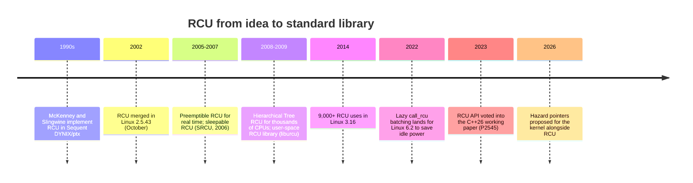
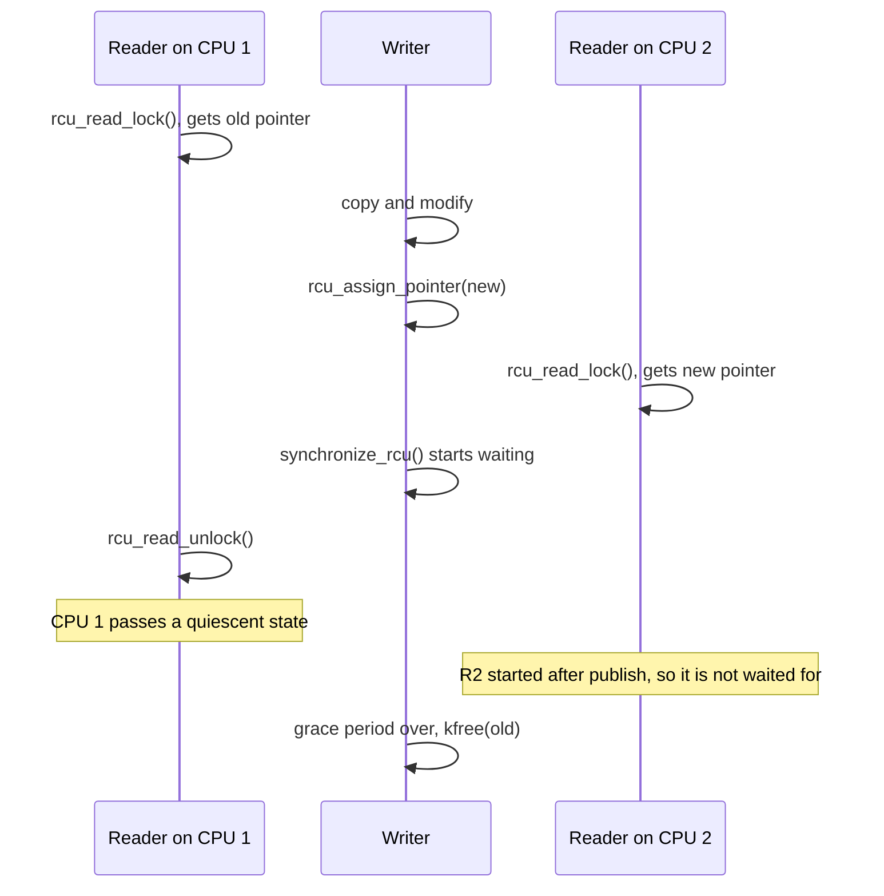

---
tags:
  - operating-systems
  - concurrency
  - rcu
  - linux-kernel
  - memory-reclamation
status: complete
sources:
  - https://docs.kernel.org/RCU/rcu.html
  - https://docs.kernel.org/next/RCU/Design/Requirements/Requirements.html
  - https://pdos.csail.mit.edu/6.1810/2019/readings/rcu-decade-later.pdf
  - https://kernel.org/doc/Documentation/RCU/RTFP.txt
  - https://www.phoronix.com/news/Lazy-RCU-Likely-For-Linux-6.2
  - https://lkml.iu.edu/hypermail/linux/kernel/2211.3/07110.html
  - https://lwn.net/Articles/1084015/
  - https://lkml.iu.edu/2602.2/09055.html
  - https://people.kernel.org/paulmck/stupid-rcu-tricks-rcu-api-in-cpp26
  - https://open-std.org/JTC1/sc22/wg21/docs/papers/2023/p2545r4.pdf
  - https://github.com/urcu/userspace-rcu
created: 2026-11-26
updated: 2026-11-26
---

## Table Of Contents

---

- [[#TL;DR|TL;DR]]
- [[#The Problem|The Problem]]
- [[#Foundations|Foundations]]
    - [[#Three Ideas|Three Ideas]]
    - [[#Grace Periods and Quiescent States|Grace Periods and Quiescent States]]
- [[#How We Got Here|How We Got Here]]
- [[#How It Works|How It Works]]
    - [[#The Core API|The Core API]]
    - [[#A Worked Update|A Worked Update]]
    - [[#Detecting the End of a Grace Period|Detecting the End of a Grace Period]]
    - [[#The RCU Family|The RCU Family]]
- [[#Where It Is Now|Where It Is Now]]
- [[#Trade-offs & Open Problems|Trade-offs & Open Problems]]
- [[#Resources|Resources]]
- [[#Related Notes|Related Notes]]

## ***TL;DR***

---

*RCU lets readers walk a shared data structure with no locks, no atomic instructions and no writes to shared memory, while writers still change it safely. Writers publish a new version, then wait for a "grace period" before freeing the old one. It is the reason much of the Linux kernel scales on machines with hundreds of CPUs.*

- **Readers are almost free:** an empty RCU read-side section cost 6 ns on one core, versus 89 ns for a reader-writer lock, and RCU's cost did not grow with core count while the lock's rose to 6,654 ns on 16 cores ([McKenney et al., "RCU Usage in the Linux Kernel: One Decade Later"](https://pdos.csail.mit.edu/6.1810/2019/readings/rcu-decade-later.pdf)).
- **Writers pay instead:** they copy, publish with one pointer store, and defer the free until every pre-existing reader is done ([kernel docs](https://docs.kernel.org/RCU/rcu.html)).
- **Everywhere in Linux:** from zero uses in 2002 to more than 9,000 by 2014, about half of them in networking ([One Decade Later](https://pdos.csail.mit.edu/6.1810/2019/readings/rcu-decade-later.pdf)).
- **Now leaving the kernel:** an RCU API is in C++26 ([McKenney](https://people.kernel.org/paulmck/stupid-rcu-tricks-rcu-api-in-cpp26)), and hazard pointers are proposed for the kernel as a sibling for cases RCU handles badly ([LWN, July 2026](https://lwn.net/Articles/1084015/)).

## ***The Problem***

---

*Read-mostly data (routing tables, the dentry cache, lists of loaded modules) is read millions of times for every change. Any lock, even a reader-writer lock, makes every reader write to a shared cache line, and that write is what kills scaling.*

A reader-writer lock looks ideal for read-mostly data: many readers can hold it at once. The catch is that taking it for read still means an atomic increment of a shared counter. On a multicore machine that counter's cache line bounces between CPUs on every acquire and release, so readers serialize on the hardware even though the lock lets them in together (see [[Locks and Synchronization]]).

Reference counting each object has the same flaw. In the One Decade Later measurements, a refcount increment and decrement cost 66 ns on one core and 2,819 ns on 16 cores, more than 400 times RCU's cost ([paper](https://pdos.csail.mit.edu/6.1810/2019/readings/rcu-decade-later.pdf)).

What readers actually need is a way to read without telling anyone. The hard part moves to the writer: if readers never announce themselves, how does a writer know when it is safe to free memory a reader might still be looking at? RCU is an answer to that one question, which is why it is best understood as a **deferred memory reclamation** scheme rather than a lock.

## ***Foundations***

---

*RCU splits an update into removal and reclamation, and puts a wait between them. Everything clever about RCU is in making that wait cheap to detect.*

### Three Ideas

| Idea | What it means | Kernel primitive |
|---|---|---|
| **Publish** | A writer builds a new version privately, then makes it visible with a single pointer store plus the ordering needed so readers see a fully built object | `rcu_assign_pointer()` |
| **Subscribe** | A reader loads the pointer with the ordering needed to see the object's contents, not stale memory | `rcu_dereference()` |
| **Wait for pre-existing readers** | Before freeing the old version, wait until every reader that might have seen it has finished | `synchronize_rcu()` / `call_rcu()` |

Readers mark their section with `rcu_read_lock()` / `rcu_read_unlock()`. In the classic non-preemptible kernel build these compile to nothing at all, or to preemption toggles; they exist mostly to tell tools and humans where the read-side section is ([kernel docs](https://docs.kernel.org/RCU/rcu.html)).

### Grace Periods and Quiescent States

- **Read-side critical section:** code between `rcu_read_lock()` and `rcu_read_unlock()`.
- **Grace period:** an interval long enough that "any readers accessing the item being deleted have since dropped their references" ([kernel docs](https://docs.kernel.org/RCU/rcu.html)).
- **Quiescent state:** a point where a CPU is known not to be inside any read-side section. In classic RCU, readers may not block, return to user mode or idle, so a context switch, user-mode execution or the idle loop each prove the CPU has left any earlier reader ([kernel docs](https://docs.kernel.org/RCU/rcu.html)).

As a formula: if an object is unlinked at time $t_r$, and $q_i$ is the first quiescent state of CPU $i$ after $t_r$, then the object can be freed at any time

$$t_{\text{free}} \;\ge\; \max_{i \in \text{CPUs}} q_i$$

In words: wait until the slowest CPU has passed through at least one quiescent state since the unlink. Readers who start after $t_r$ cannot find the old object, so they don't matter.

*Worked example:* a writer unlinks a route at $t_r = 100\,\mu s$. CPU 0 context-switches at 103, CPU 1 is idle (already quiescent at 100), CPU 2 returns to user space at 140, CPU 3 context-switches at 2,100. The grace period ends at $\max(103, 100, 140, 2100) = 2{,}100\,\mu s$, so the old route can be freed 2 ms later. One long-running reader on CPU 3 decides the whole wait, which is why grace periods are measured in milliseconds ([Requirements](https://docs.kernel.org/next/RCU/Design/Requirements/Requirements.html) notes `synchronize_rcu()` "may therefore incur several milliseconds of latency").

## ***How We Got Here***

---

*RCU started as a technique in a commercial Unix, entered Linux in 2002, and grew into one of the kernel's core subsystems with its own family of variants. The arc is from "readers are free" to "and it must also scale to thousands of CPUs, real time and idle phones".*



- **Origins:** McKenney and Slingwine first implemented and documented RCU in Sequent's DYNIX/ptx, then in Linux 2.5.43 in October 2002 ([One Decade Later](https://pdos.csail.mit.edu/6.1810/2019/readings/rcu-decade-later.pdf); the kernel keeps a full bibliography in [RTFP.txt](https://kernel.org/doc/Documentation/RCU/RTFP.txt)).
- **Growth:** the kernel went from zero RCU API uses in 2002 to 9,559 in Linux 3.16. Networking holds about half of them despite being about 5% of the code; the IPC subsystem is densest at 10.12 uses per thousand lines against a kernel average of 0.59 ([One Decade Later](https://pdos.csail.mit.edu/6.1810/2019/readings/rcu-decade-later.pdf)).
- **Variants:** McKenney showed preemptible readers were possible in 2005 (final -rt patch 2007), introduced SRCU in 2006, and described the combining-tree Tree RCU in November 2008; Mathieu Desnoyers started the user-space RCU library in February 2009 ([RTFP.txt](https://kernel.org/doc/Documentation/RCU/RTFP.txt)).
- **Pressure from three directions:** big machines ("thousands of CPUs running a single Linux kernel"), real time (readers must be preemptible without atomics or barriers on the fast path), and energy ("avoid unnecessarily awakening idle CPUs") ([Requirements](https://docs.kernel.org/next/RCU/Design/Requirements/Requirements.html)). Each pressure produced a variant, listed below.

## ***How It Works***

---

*Readers follow pointers as if nothing could change; writers copy, swap a pointer, and hand the old copy to RCU to free later. The kernel learns a grace period has ended by watching each CPU pass a quiescent state, batching thousands of waiting updates into one detection.*

### The Core API

From the One Decade Later paper's summary ([paper](https://pdos.csail.mit.edu/6.1810/2019/readings/rcu-decade-later.pdf)):

| Call | Who | Effect |
|---|---|---|
| `rcu_read_lock()` / `rcu_read_unlock()` | Reader | Begin / end a read-side critical section |
| `rcu_dereference(p)` | Reader | Load an RCU-protected pointer safely |
| `rcu_assign_pointer(p, v)` | Writer | Publish a new pointer value |
| `synchronize_rcu()` | Writer | Block until all pre-existing readers are done (new readers are not waited for) |
| `call_rcu(head, fn)` | Writer | Don't block; run `fn` after a grace period |

### A Worked Update

Replacing a config struct that many CPUs read:

```c
struct config { int timeout_ms; int retries; };
struct config __rcu *cur_cfg;
DEFINE_SPINLOCK(cfg_lock);            /* writers still exclude each other */

int read_timeout(void)                /* reader: no lock, no atomics */
{
    int t;
    rcu_read_lock();
    t = rcu_dereference(cur_cfg)->timeout_ms;
    rcu_read_unlock();
    return t;
}

void set_timeout(int ms)              /* writer: copy, update, publish, wait, free */
{
    struct config *newc = kmalloc(sizeof(*newc), GFP_KERNEL), *oldc;
    spin_lock(&cfg_lock);
    oldc = rcu_dereference_protected(cur_cfg, lockdep_is_held(&cfg_lock));
    *newc = *oldc;                    /* copy */
    newc->timeout_ms = ms;            /* update the private copy */
    rcu_assign_pointer(cur_cfg, newc);/* publish: readers now see newc */
    spin_unlock(&cfg_lock);
    synchronize_rcu();                /* wait for readers that may hold oldc */
    kfree(oldc);                      /* reclaim */
}
```

In plain words: a reader either sees the old struct or the new one, never a half-written one. RCU does not stop writers racing each other, so the writer still takes a spinlock; it only removes readers from the locking picture. A reader may also see the old value for a short while after the update, which is fine for routing tables and configuration but not for, say, a bank balance.



### Detecting the End of a Grace Period

- **Classic RCU** piggybacks on things the kernel does anyway: each CPU reports quiescent states roughly once per scheduler tick, and one grace period can satisfy more than 1,000 waiting `synchronize_rcu()` and `call_rcu()` requests in a single batch ([One Decade Later](https://pdos.csail.mit.edu/6.1810/2019/readings/rcu-decade-later.pdf)). That batching is why the per-update cost stays low despite millisecond grace periods.
- **Tree RCU** arranges CPUs in a hierarchy of nodes so that reports combine up a tree instead of every CPU touching one global bitmask; this is what lets RCU behave on machines with thousands of CPUs ([Requirements](https://docs.kernel.org/next/RCU/Design/Requirements/Requirements.html)).
- **Idle CPUs** are not woken just to report: RCU tracks a per-CPU "dyntick-idle" counter so an idle CPU counts as quiescent without doing anything ([Requirements](https://docs.kernel.org/next/RCU/Design/Requirements/Requirements.html)).
- **Expedited grace periods** (`synchronize_rcu_expedited()`) force quiescent states with inter-processor interrupts for latency-sensitive callers, accepting "modest degradation of real-time latency" on busy CPUs ([Requirements](https://docs.kernel.org/next/RCU/Design/Requirements/Requirements.html)).

### The RCU Family

| Variant | Why it exists |
|---|---|
| **Preemptible RCU** | For real-time kernels ([[PREEMPT_RT and Real-Time Linux]]): readers can be preempted, so the kernel tracks preempted readers explicitly instead of inferring from context switches ([Requirements](https://docs.kernel.org/next/RCU/Design/Requirements/Requirements.html)) |
| **SRCU (sleepable RCU)** | Readers may sleep, which ordinary RCU forbids; each user gets its own domain so one slow reader doesn't stall everyone |
| **Tiny RCU** | Single-CPU, small-memory systems where "memory footprint is critically important" |
| **Tasks RCU family** | Waits for whole tasks to pass a voluntary context switch rather than for CPUs, so code such as tracing trampolines can be freed safely |
| **Lazy `call_rcu`** | Batches callbacks on idle or lightly loaded systems to save power (below) |

## ***Where It Is Now***

---

*As of November 2026, RCU is mature kernel infrastructure whose active work is about power, memory footprint and alternatives for cases where its long grace periods hurt. The idea has also become portable: C++26 has an RCU API, and hazard pointers are being proposed for Linux.*

- **Power (since Linux 6.2):** lazy RCU marks asynchronous `call_rcu()` callbacks lazy, holding them until a timeout, a batch-size limit, or memory pressure flushes them, instead of starting a grace period right away. Reported savings were about 5-10% of power on idle or lightly loaded systems ([Phoronix](https://www.phoronix.com/news/Lazy-RCU-Likely-For-Linux-6.2); [v6.2 lazy call_rcu series](https://lkml.iu.edu/hypermail/linux/kernel/2211.3/07110.html)). Callers that cannot wait opt out with a "hurry" variant.
- **Hazard pointers (proposed, 2026):** Mathieu Desnoyers posted v5 of a kernel hazard-pointer series in February 2026, rebased on v7.0-rc1, with four per-CPU slots packed in one cache line and a scheduler hook that moves a task's slots aside on context switch ([RFC v5](https://lkml.iu.edu/2602.2/09055.html)). LWN's July 2026 write-up frames it as an option where RCU's delayed freeing raises memory use, with an API of `hazptr_acquire()`, `hazptr_release()` and `hazptr_synchronize()`. It had no in-kernel users yet, which normally blocks merging ([LWN](https://lwn.net/Articles/1084015/)); the cover letter names lockdep as a first planned user.
- **Outside the kernel:** RCU was accepted into C++26 via P2545 (header `<rcu>`: `rcu_default_domain()`, `rcu_obj_base<T>::retire()`, `rcu_retire()`, `rcu_synchronize()`, `rcu_barrier()`), the work of McKenney and others ([McKenney](https://people.kernel.org/paulmck/stupid-rcu-tricks-rcu-api-in-cpp26); [P2545R4](https://open-std.org/JTC1/sc22/wg21/docs/papers/2023/p2545r4.pdf)). The user-space RCU library, by Desnoyers and McKenney, brings the same API to ordinary programs ([userspace-rcu](https://github.com/urcu/userspace-rcu)).
- **Teaching:** MIT's OS course assigns the One Decade Later paper as a reading ([6.1810 readings](https://pdos.csail.mit.edu/6.1810/2019/readings/rcu-decade-later.pdf)).

## ***Trade-offs & Open Problems***

---

*RCU is a superb trade when reads vastly outnumber writes and slightly stale reads are acceptable. It is the wrong tool when writes are frequent, memory is tight, or every reader must see the latest value.*

| Strength | Cost |
|---|---|
| Near-zero, constant reader cost at any CPU count | Writers pay: copying, plus milliseconds of grace-period wait (or callback bookkeeping) |
| Readers can't deadlock with writers | Readers may see stale data briefly; algorithms must tolerate two versions coexisting |
| Batching amortizes one grace period over 1,000+ updates | Memory held until the grace period ends; a flood of `call_rcu()` can build a backlog of unfreed objects |
| Works for linked structures (lists, hash tables, trees) | Hard to reason about: pointer publication, memory ordering and "what can a reader see?" need care |

Open problems:
- **Memory footprint under update storms:** deferred frees pile up; lazy RCU trades even more delay for power, which pulls the other way. Hazard pointers bound unreclaimed memory per reader but cost readers a store and a fence ([LWN](https://lwn.net/Articles/1084015/)).
- **Long readers:** one reader that runs for a long time stretches every grace period on the machine (see the worked example). Preemptible RCU makes this worse on real-time systems, hence priority boosting of preempted readers.
- **Correctness tooling:** the kernel leans on lockdep annotations (`rcu_dereference_protected()`), sparse's `__rcu` checking and torture tests; misuse is still a recurring bug class.
- **Language memory models:** RCU depends on dependency ordering (`rcu_dereference()`), which C/C++'s `memory_order_consume` never captured well; the kernel uses its own memory model instead.

## ***Resources***

---

*Start with the kernel's concept page and the One Decade Later paper; read the Requirements tour once you want the hard cases.*

- [RCU Concepts, kernel.org](https://docs.kernel.org/RCU/rcu.html): the official introduction, grace periods explained.
- [A Tour Through RCU's Requirements](https://docs.kernel.org/next/RCU/Design/Requirements/Requirements.html): every constraint RCU must meet (scale, real time, energy).
- [McKenney, Boyd-Wickizer, Walpole: RCU Usage in the Linux Kernel: One Decade Later](https://pdos.csail.mit.edu/6.1810/2019/readings/rcu-decade-later.pdf): history, API, usage counts, benchmarks.
- [RTFP.txt](https://kernel.org/doc/Documentation/RCU/RTFP.txt): the kernel's annotated bibliography of RCU papers.
- [Lazy call_rcu for v6.2](https://lkml.iu.edu/hypermail/linux/kernel/2211.3/07110.html) and [Phoronix summary](https://www.phoronix.com/news/Lazy-RCU-Likely-For-Linux-6.2).
- [LWN: Hazard pointers for the kernel (July 2026)](https://lwn.net/Articles/1084015/) and [RFC v5 cover letter](https://lkml.iu.edu/2602.2/09055.html).
- [Stupid RCU Tricks: RCU API in C++26](https://people.kernel.org/paulmck/stupid-rcu-tricks-rcu-api-in-cpp26) and [P2545R4](https://open-std.org/JTC1/sc22/wg21/docs/papers/2023/p2545r4.pdf).

## ***Related Notes***

---

- [[Locks and Synchronization]]: the locks RCU removes from the read side, and the ones writers still need.
- [[Processes and Threads]]: context switches are RCU's quiescent states.
- [[Interrupts and Exceptions]]: expedited grace periods use inter-processor interrupts.
- [[Memory Allocators]]: `kfree_rcu()` and slab caches that delay reuse until a grace period ends.
- [[Page Cache and Memory Reclaim]]: lockless page-cache lookups rely on RCU.
- [[File Systems]]: the dentry cache's RCU path walk.
- [[eBPF]]: BPF programs run under RCU protection.
- [[Kernel Bypass Networking]]: networking holds about half of the kernel's RCU uses.
- [[Lock-Free Data Structures and Memory Ordering]]: hazard pointers and epochs compared with RCU, and the memory models RCU depends on.
