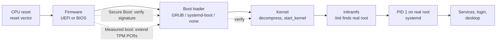
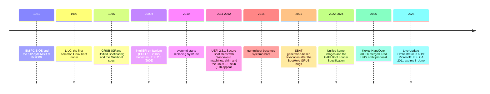
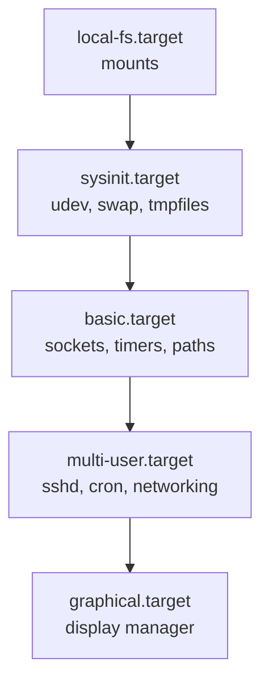

---
tags:
  - operating-systems
  - foundations
  - boot-process
status: complete
sources:
  - https://docs.kernel.org/arch/x86/boot.html
  - https://docs.kernel.org/admin-guide/efi-stub.html
  - https://docs.kernel.org/filesystems/ramfs-rootfs-initramfs.html
  - https://github.com/torvalds/linux/blob/master/init/main.c
  - https://github.com/torvalds/linux/blob/master/include/linux/init.h
  - https://docs.kernel.org/core-api/liveupdate.html
  - https://uapi-group.org/specifications/specs/boot_loader_specification/
  - https://uapi-group.org/specifications/specs/unified_kernel_image/
  - https://www.freedesktop.org/software/systemd/man/latest/bootup.html
  - https://uefi.org/specifications
  - https://github.com/rhboot/shim/blob/main/SBAT.md
  - https://pdos.csail.mit.edu/6.1810/2024/xv6/book-riscv-rev4.pdf
  - https://0xax.gitbook.io/linux-insides/summary/booting
  - https://lwn.net/Articles/1079808/
  - https://almalinux.org/blog/2026-07-14-secure-boot-2023-certificates/
  - https://www.redhat.com/en/blog/expiration-secure-boot-signing-certificates-2026
  - https://www.fedoraproject.org/wiki/Changes/Unified_Kernel_Support_Phase_2
  - https://docs.redhat.com/en/documentation/red_hat_enterprise_linux/10/deploy-overview_of_uki
  - https://fosdem.org/schedule/event/fosdem-2025-6469-no-more-boot-loader-boot-using-the-linux-kernel
  - https://lkml.iu.edu/2601.3/02897.html
  - https://lists.infradead.org/pipermail/kexec/2026-February/035020.html
  - https://kernelnewbies.org/Linux_6.19
  - https://www.theregister.com/2026/03/18/systemd_260/
  - https://helpnetsecurity.com/2026/06/22/systemd-261-released/
  - https://www.phoronix.com/news/systemd-262
created: 2026-11-26
updated: 2026-11-26
---

## Table Of Contents

---

- [[#TL;DR|TL;DR]]
- [[#The Problem|The Problem]]
- [[#Foundations|Foundations]]
    - [[#The Stages at a Glance|The Stages at a Glance]]
    - [[#Firmware - BIOS and UEFI|Firmware - BIOS and UEFI]]
    - [[#The Chain of Trust|The Chain of Trust]]
    - [[#What a Kernel Image Is|What a Kernel Image Is]]
- [[#How We Got Here|How We Got Here]]
- [[#How It Works|How It Works]]
    - [[#1. Reset and Firmware|1. Reset and Firmware]]
    - [[#2. Finding Something to Boot|2. Finding Something to Boot]]
    - [[#3. Secure Boot - shim, db and dbx|3. Secure Boot - shim, db and dbx]]
    - [[#4. The Boot Loader|4. The Boot Loader]]
    - [[#5. Early Kernel - From Entry Point to start_kernel|5. Early Kernel - From Entry Point to start_kernel]]
    - [[#6. start_kernel, initcalls and PID 1|6. start_kernel, initcalls and PID 1]]
    - [[#7. The initramfs and the Real Root|7. The initramfs and the Real Root]]
    - [[#8. Userspace Init - systemd|8. Userspace Init - systemd]]
    - [[#Measured Boot and the TPM|Measured Boot and the TPM]]
    - [[#Arm and RISC-V - Device Trees, U-Boot and OpenSBI|Arm and RISC-V - Device Trees, U-Boot and OpenSBI]]
    - [[#kexec - Booting Without the Firmware|kexec - Booting Without the Firmware]]
- [[#Where It Is Now|Where It Is Now]]
- [[#Trade-offs & Open Problems|Trade-offs & Open Problems]]
- [[#Resources|Resources]]
- [[#Related Notes|Related Notes]]

## ***TL;DR***
---
*Booting is a relay race: firmware wakes the hardware and finds a boot loader, the boot loader loads the kernel and its initial RAM disk, the kernel brings up its own subsystems and drivers, and finally it starts PID 1, which starts everything else. Each runner also vouches for the next one, which is what Secure Boot and measured boot are about.*

- **Five hand-offs.** Reset vector → firmware (UEFI or legacy BIOS) → boot loader (GRUB, systemd-boot, or none) → kernel (`start_kernel()`) → initramfs `/init` → the real root's PID 1 (usually systemd).
- **UEFI replaced BIOS.** Instead of jumping to 512 raw bytes at the start of a disk, UEFI firmware reads a FAT partition (the ESP), loads PE/COFF executables, and passes them a table of services. A Linux kernel can itself be a UEFI program (the EFI stub), so no separate boot loader is strictly needed ([kernel EFI stub docs](https://docs.kernel.org/admin-guide/efi-stub.html)).
- **Two kinds of trust.** *Secure Boot* refuses to run code whose signature isn't in the firmware's `db` (or is in the `dbx` blocklist). *Measured boot* runs anything but records a hash of each stage in a TPM, so a disk key can be sealed to "the expected chain booted".
- **Inside the kernel,** `start_kernel()` sets up memory, interrupts, the scheduler and timers, then runs thousands of `initcall`s (which is where most drivers probe), then hands off to userspace as PID 1 ([init/main.c](https://github.com/torvalds/linux/blob/master/init/main.c)).
- **Where it is now (Nov 2026):** Microsoft's 2011 UEFI CA, which signs every distribution's `shim`, expired on 26–27 June 2026; systems keep booting, but new shims are signed only by the 2023 CA, so firmware must trust it ([LWN, July 2026](https://lwn.net/Articles/1079808/)). Unified kernel images (UKIs) are the direction of travel, and the kernel's Live Update Orchestrator (Linux 6.19) plus systemd 261/262 let a machine `kexec` into a new kernel while keeping chosen state alive.

## ***The Problem***
---
*When power comes on, RAM is empty and uninitialised, no driver is loaded, and the CPU knows only one address. Getting from there to a running multi-user system is a bootstrapping problem: every stage needs something the previous stage has to set up.*

The name comes from "pulling yourself up by your bootstraps", and the circularity is real:

| To do this... | ...you need this first | Who provides it |
|---|---|---|
| Run the kernel | Kernel bytes in RAM | Boot loader or firmware |
| Read the kernel from disk | A storage driver and a file-system reader | Firmware (UEFI drivers) |
| Use RAM at all | DRAM training (timings, voltages) | Firmware, running from cache or ROM |
| Mount the real root file system | Drivers for RAID, LVM, LUKS, NVMe, network storage | The [[#7. The initramfs and the Real Root|initramfs]] |
| Run normal programs | A process to be their ancestor | PID 1, started by the kernel |

Two further requirements make it harder than "load and jump":

- **Trust.** Malware that runs before the kernel (a bootkit) sees everything and can hide from the kernel. So each stage should check the next one before running it.
- **Variety.** The same distribution image must boot on thousands of machines with different firmware, disks and buses, so most hardware discovery has to happen at runtime, not at build time.

## ***Foundations***
---
*Four ideas carry the whole note: boot is a sequence of stages that each load the next, the firmware's interface decides how that first hand-off works, trust is passed along the chain, and a "kernel image" is a carefully packed executable with a header the boot loader understands.*

#### **The Stages at a Glance**



| Stage | Runs from | Main job | Typical size |
|---|---|---|---|
| Firmware | SPI flash on the motherboard | Train DRAM, init chipset, enumerate PCIe, find a boot target | 16–32 MB flash image |
| Boot loader | EFI System Partition (ESP) | Pick a kernel, load kernel + initrd, pass command line | GRUB ≈ 2–3 MB, systemd-boot ≈ 100 KB |
| Kernel | ESP or `/boot` | Set up the machine, probe drivers | ~10–15 MB compressed on a distro |
| initramfs | Packed with or beside the kernel | Unlock and mount the real root | tens of MB |
| PID 1 | Real root file system | Start and supervise services | – |

#### **Firmware - BIOS and UEFI**

- **BIOS** (IBM PC, 1981) gave the CPU a 16-bit real-mode program in ROM. To boot, it read the first 512-byte sector of a disk (the **MBR**) to address `0x7C00` and jumped there if the sector ended in the signature bytes `0x55 0xAA`. 446 bytes of code could do very little, so boot loaders were chained: a tiny first stage loads a bigger second stage. Nicholas's [[Linux/Misc/The Boot Process.md|The Boot Process]] note walks through this real-mode path, including the reset address arithmetic.
- **UEFI** (Unified Extensible Firmware Interface) is a specification for the firmware's interface, not one product ([UEFI Forum specifications](https://uefi.org/specifications)). The firmware understands GPT partition tables and FAT file systems, loads **PE/COFF** executables (the Windows `.exe` format) from the **EFI System Partition**, and passes each one a pointer to the *system table*, which holds:
  - **Boot services:** memory allocation, file and block I/O, protocols for devices. Usable only until the OS calls `ExitBootServices()`.
  - **Runtime services:** a few calls that stay usable after the OS takes over, notably reading and writing **NVRAM variables** (boot order, Secure Boot keys) and the real-time clock.

#### **The Chain of Trust**

Each stage can check the next before running it. Two different mechanisms do this, and they answer different questions:

| | Secure Boot (verified boot) | Measured boot |
|---|---|---|
| Question it answers | "Is this code signed by someone I trust?" | "Exactly what code ran?" |
| What happens on a mismatch | Refuses to run it | Runs it, but the record differs |
| Where trust lives | Certificate databases in firmware NVRAM (`PK`, `KEK`, `db`, `dbx`) | TPM Platform Configuration Registers (PCRs) |
| What it enables | Blocking bootkits | Sealing disk keys to a known chain; remote attestation |

#### **What a Kernel Image Is**

The file `vmlinuz` (or `bzImage` on x86) is not the raw kernel. It is a small decompressor plus a compressed `vmlinux`, prefixed by a **setup header** whose fields the boot loader reads and writes: protocol version, where to load, the command-line pointer, the initrd's address and size ([Linux/x86 Boot Protocol](https://docs.kernel.org/arch/x86/boot.html)). With `CONFIG_EFI_STUB` the same file is also a valid PE/COFF executable, so UEFI firmware can run it directly ([EFI stub](https://docs.kernel.org/admin-guide/efi-stub.html)). How the linker lays these sections out at fixed addresses is covered in [[Linking and LTO]] and [[Linux/Memory/Compiler, Assembler, Linker, and Loader.md|Compiler, Assembler, Linker, and Loader]].

## ***How We Got Here***
---
*PC booting froze around 1981's BIOS conventions for 25 years, then moved to UEFI, then added signatures (2011–2012), and is now moving toward fewer, signed, self-describing pieces: one kernel file that carries its own initrd and command line.*



- **BIOS era.** The 512-byte MBR had a 4-entry partition table and capped disks at 2 TiB (32-bit sector numbers × 512 bytes). Boot loaders grew to work around everything: LILO stored disk block lists of the kernel; GRUB carried its own file-system drivers so it could read `/boot/vmlinuz` by name.
- **UEFI.** Intel designed EFI for Itanium in the late 1990s; the multi-vendor UEFI Forum took it over in 2005. GPT disks, a real file system for boot files, and 64-bit firmware drivers came with it.
- **Secure Boot.** UEFI 2.3.1 (2011) added signature checks, and Windows 8 certification required them on by default. Linux distributions could not each get keys into every PC's firmware, so the **shim** compromise appeared: Microsoft signs a small first-stage loader (`shim`) with its *third-party* UEFI CA, and `shim` embeds the distribution's own certificate to verify GRUB and the kernel.
- **systemd** (2010) replaced shell-script init with a parallel, dependency-driven service manager, and its project grew boot tooling: systemd-boot, `systemd-stub`, `ukify`, TPM-sealed disk unlocking. In March 2026, systemd 260 removed SysV init-script support entirely ([The Register](https://www.theregister.com/2026/03/18/systemd_260/)).
- **Simplification.** The UAPI Group's Boot Loader Specification describes boot entries as plain files in the ESP, and its Unified Kernel Image spec bundles kernel, initrd, command line and metadata into one signed PE file ([BLS](https://uapi-group.org/specifications/specs/boot_loader_specification/), [UKI](https://uapi-group.org/specifications/specs/unified_kernel_image/)).

## ***How It Works***
---
*Follow one x86-64 Linux laptop from power button to login prompt. The details differ on Arm and RISC-V, covered at the end, but the stages are the same.*

#### **1. Reset and Firmware**

- After reset the CPU runs in 16-bit real mode, but with a hidden code-segment base of `0xFFFF0000`, so its first fetch is at physical `0xFFFFFFF0`, 16 bytes below 4 GiB. The chipset maps the top of the address space to the SPI flash, so that address is firmware. (The classic textbook figure of `0xFFFF0` is the same arithmetic with the 8086's 20-bit bus.)
- There is no usable DRAM yet. Firmware first runs **cache-as-RAM**: it locks the CPU cache so it behaves like a small scratch memory, then runs the memory-training code that discovers DIMM timings.
- UEFI firmware built on Intel's Platform Initialization (PI) model then runs in phases: **SEC** (security, cache-as-RAM), **PEI** (pre-EFI init, DRAM), **DXE** (driver execution: loads firmware drivers for PCIe, USB, NVMe, graphics, network), and **BDS** (boot device selection).
- Firmware builds tables that describe the machine for the OS: the **memory map** (which physical ranges are usable RAM) and **ACPI** tables (CPUs, interrupt controllers, power management) or a **device tree** on many Arm boards. The kernel trusts these tables to learn what hardware exists, which is why firmware bugs show up as kernel bugs.

#### **2. Finding Something to Boot**

UEFI keeps boot choices in NVRAM variables: `Boot0000`, `Boot0001`... each naming a device and a file path, and `BootOrder` listing them. If nothing is configured, firmware falls back to `\EFI\BOOT\BOOTX64.EFI` on any ESP it finds, which is how USB installers boot. You can see these entries with `efibootmgr -v` on a running system.

#### **3. Secure Boot - shim, db and dbx**

The firmware holds four signature stores, all in authenticated NVRAM variables:

| Variable | Holds | Who controls it |
|---|---|---|
| `PK` (Platform Key) | One key that may change `KEK` | The machine's owner (usually the OEM) |
| `KEK` (Key Exchange Keys) | Keys that may update `db` and `dbx` | OEM and Microsoft |
| `db` (allowed) | Certificates and hashes that may run | Typically Microsoft Windows CA and Microsoft UEFI (third-party) CA |
| `dbx` (forbidden) | Revoked certificates and hashes | Updated via Windows Update or LVFS/fwupd |

A distribution boots like this:

1. Firmware loads `shimx64.efi`, checks its signature against `db` and `dbx`. It is signed by the Microsoft UEFI CA.
2. `shim` contains the distribution's certificate (for example "Red Hat Secure Boot CA"), and also honours **MOK** (Machine Owner Keys) that a user enrolls with `mokutil`, which is how people sign their own kernels or out-of-tree modules.
3. `shim` verifies and runs GRUB (or systemd-boot); the boot loader asks `shim`'s protocol to verify the kernel.
4. With Secure Boot on, the kernel enters **lockdown** mode: it requires signed modules and blocks interfaces that could modify the running kernel (`/dev/mem`, unsigned `kexec`).

Revoking every vulnerable GRUB by hash would overflow `dbx` (it is a few tens of KB of NVRAM). **SBAT** (Secure Boot Advanced Targeting) fixes this: each binary carries a small table of component generation numbers, and shim refuses anything whose generation is below a minimum, so one small update revokes a whole family ([shim SBAT.md](https://github.com/rhboot/shim/blob/main/SBAT.md)).

#### **4. The Boot Loader**

The boot loader's job is to choose a kernel, load it and its initrd into memory, set the command line, and jump. There are three common setups in 2026:

| Setup | How it works | Pros | Cons |
|---|---|---|---|
| **GRUB 2** | Large loader with its own file-system drivers, scripting and menus; reads `grub.cfg` | Boots from LVM, RAID, Btrfs, BIOS or UEFI, other OSes | Big attack surface; frequent CVEs drive SBAT bumps |
| **systemd-boot** | Tiny UEFI-only menu that reads [Boot Loader Specification](https://uapi-group.org/specifications/specs/boot_loader_specification/) entries from the ESP | Simple, small, fast | ESP-only; relies on firmware for file systems |
| **EFI stub / UKI, no menu** | Firmware boots the kernel directly via a `Boot####` entry | Fewest moving parts | No interactive menu; recovery needs firmware UI |

A **unified kernel image (UKI)** is a single PE file built by `ukify`: the `systemd-stub` program plus sections such as `.linux` (kernel), `.initrd`, `.cmdline`, `.osrel`, `.uname`, `.sbat` and optional `.pcrsig` (signed expected TPM values) ([UKI spec](https://uapi-group.org/specifications/specs/unified_kernel_image/)). Because the command line and initrd are inside the signed file, an attacker can no longer change them without breaking the signature, a gap that classic GRUB setups leave open.

#### **5. Early Kernel - From Entry Point to start_kernel**

On x86-64 under UEFI, the EFI stub runs first while boot services are still available. It reads the memory map, loads the initrd if asked, calls `ExitBootServices()`, and jumps into the kernel's own setup code ([EFI stub](https://docs.kernel.org/admin-guide/efi-stub.html)). From there, in outline ([linux-insides](https://0xax.gitbook.io/linux-insides/summary/booting)):

1. **Decompress.** `arch/x86/boot/compressed/` sets up a temporary identity-mapped page table, picks a randomised physical and virtual address if KASLR is on (see [[Kernel Security Hardening]]), decompresses `vmlinux` there and applies relocations.
2. **Enter the real kernel** at `startup_64`: build the early kernel page tables (see [[Virtual Memory and Paging]]), load a GDT and an early IDT so faults during boot can be caught (see [[Interrupts and Exceptions]]), set up the per-CPU area and a stack.
3. Call `x86_64_start_kernel()`, which calls the architecture-independent `start_kernel()`.

On the BIOS path, the boot loader instead loads the 16-bit setup code, which collects the memory map with BIOS `INT 0x15, E820` calls, switches to protected mode, then long mode, and reaches the same decompressor.

#### **6. start_kernel, initcalls and PID 1**

`start_kernel()` in [init/main.c](https://github.com/torvalds/linux/blob/master/init/main.c) is a long, ordered list of initialisations. Simplified (the real function has around 100 calls):

```c
asmlinkage __visible void __init start_kernel(void)
{
    setup_arch(&command_line);  /* parse firmware tables, memblock, early page tables */
    setup_per_cpu_areas();
    trap_init();                /* exception handlers in the IDT */
    mm_core_init();             /* buddy allocator, slab: real memory management */
    sched_init();               /* run queues; the boot code becomes the idle task */
    rcu_init();
    init_IRQ();                 /* interrupt controllers */
    time_init();                /* clock sources, timers */
    console_init();             /* printk reaches the screen or serial port */
    /* ... ~90 more ... */
    rest_init();                /* never returns */
}
```

In plain words: the kernel first learns what memory exists and how to allocate it (see [[Memory Allocators]]), then how to take interrupts, then how to schedule, then how to keep time. Only then can it run more than one thing.

`rest_init()` creates two kernel threads and turns the boot CPU into the idle task:

- **PID 1 `kernel_init`**, which will become the first user process.
- **PID 2 `kthreadd`**, the parent of every later kernel thread.

`kernel_init` brings up the other CPUs (SMP boot), then runs the **initcalls**: functions that subsystems and drivers register with macros such as `core_initcall()`, `subsys_initcall()`, `fs_initcall()`, `device_initcall()` and `late_initcall()` ([include/linux/init.h](https://github.com/torvalds/linux/blob/master/include/linux/init.h)). The linker collects each level into its own section, and `do_initcalls()` walks them in order. A built-in driver's `module_init()` is a `device_initcall`, so this is where most hardware is probed (see [[Device Drivers and the Driver Model]]). Code and data marked `__init` live in their own section, and the kernel frees that memory once boot is done ("Freeing unused kernel image (initmem) memory" in `dmesg`).

Finally `kernel_init` frees `__init` memory and calls `run_init_process()` on `rdinit=` (default `/init` in the initramfs) or, without an initramfs, on `init=` or `/sbin/init`. From the `execve()` onward, PID 1 is an ordinary user process (see [[Processes and Threads]]).

#### **7. The initramfs and the Real Root**

The kernel cannot contain drivers and logic for every possible root: an encrypted LVM volume on NVMe, a RAID set, an iSCSI LUN. So it starts with a small user space first ([ramfs, rootfs and initramfs](https://docs.kernel.org/filesystems/ramfs-rootfs-initramfs.html)):

1. The boot loader (or UKI) hands the kernel a **cpio archive**, usually compressed.
2. The kernel unpacks it into **rootfs**, an in-memory `tmpfs` or `ramfs` that is always the first root.
3. The archive's `/init` (on most distributions, systemd itself, built by `dracut` or `mkinitcpio`) loads the needed modules, waits for the root device, asks for the LUKS passphrase or unseals the key from the TPM, and mounts the real root at `/sysroot`.
4. It then calls `switch_root`: deletes the initramfs contents to free RAM, moves the new root to `/`, and `exec`s the real `/sbin/init`, still as PID 1.

The older **initrd** was a block-device image that needed a file-system driver to read; the cpio initramfs (added during the Linux 2.5/2.6 series, 2002–2004) replaced it, though the term "initrd" stuck.

#### **8. Userspace Init - systemd**

systemd as PID 1 reads unit files and builds a dependency graph from the target named on the command line (default `default.target`, usually `graphical.target` or `multi-user.target`). Units with no ordering between them start in parallel ([bootup(7)](https://www.freedesktop.org/software/systemd/man/latest/bootup.html)).



PID 1 is special to the kernel: it cannot be killed by signals it hasn't installed handlers for, orphaned processes are re-parented to it so someone reaps them (see [[Signals and IPC]]), and if it exits the kernel panics. `systemd-analyze` and `systemd-analyze critical-chain` report how long each stage took, split into firmware, loader, kernel, initrd and userspace.

#### **Measured Boot and the TPM**

A TPM's PCRs cannot be written, only **extended**. Each stage hashes the next stage before running it and extends a PCR:

$$\text{PCR}_{\text{new}} = \text{SHA-256}\big(\text{PCR}_{\text{old}} \,\Vert\, \text{measurement}\big)$$

In words: the new value is the hash of the old value glued to the hash of what is about to run. Order matters and nothing can be removed, so the final value summarises the whole chain.

Worked example, computed with real SHA-256 (the measurement here is the hash of the file *name*, standing in for the hash of the file's bytes; values truncated to 16 hex digits):

| Step | Measurement | PCR value |
|---|---|---|
| Reset | – | `0000000000000000…` (32 zero bytes) |
| Extend with `shimx64.efi` | `caaff3a76e5a79b2…` | `12c322c00b0265f9…` |
| Extend with `grubx64.efi` | `e63a20b1e0365125…` | `bcc99d8a9537dc3d…` |
| Same two, opposite order | | `b3fa9e02c06f9c5a…` |

The last row shows why the scheme works: a different chain, even with the same pieces, gives a different value, and there is no way to "un-extend". A disk-encryption key **sealed** to PCR 7 (Secure Boot policy) and PCR 11 (UKI contents, used by `systemd-stub`) is released by the TPM only when those values match, so a tampered boot chain cannot unlock the disk without the passphrase.

#### **Arm and RISC-V - Device Trees, U-Boot and OpenSBI**

- PCs describe hardware with ACPI. Many Arm and RISC-V boards can't enumerate their on-chip devices, so firmware passes a **device tree blob** (DTB): a compiled description of memory, CPUs, interrupt controllers and peripherals at fixed addresses. Linux matches drivers to device-tree nodes by their `compatible` strings. Arm servers (SBSA/SBBR) use UEFI and ACPI like PCs.
- **U-Boot** is the common embedded boot loader; modern U-Boot implements enough of UEFI to run `shim`, GRUB or a UKI.
- On RISC-V, **OpenSBI** runs in the most privileged mode (M-mode) and stays resident, offering the kernel a Supervisor Binary Interface for timers and inter-processor interrupts. MIT's teaching OS xv6 shows the minimal version: QEMU loads the kernel at `0x80000000`, `entry.S` sets a stack per CPU, and `start()` drops from M-mode to S-mode before `main()` ([xv6 book, ch. 2](https://pdos.csail.mit.edu/6.1810/2024/xv6/book-riscv-rev4.pdf)).

#### **kexec - Booting Without the Firmware**

`kexec` loads a new kernel from a running one and jumps to it, skipping firmware and boot loader entirely. It is used for crash dumps (`kdump` boots a small capture kernel into reserved memory) and fast reboots. Two newer pieces turn it into a live-update tool:

- **Kexec HandOver (KHO)** lets the old kernel pass preserved memory regions and a description of them to the new one.
- The **Live Update Orchestrator (LUO)**, merged for Linux 6.19 (released 8 Feb 2026), builds on KHO so user space can mark file descriptors (memfd, VFIO devices, iommufd) to survive the reboot. It is aimed at cloud hypervisors that want to upgrade the host kernel while guest VMs keep running and devices keep doing DMA ([LUO docs](https://docs.kernel.org/core-api/liveupdate.html), [Kernel Newbies 6.19](https://kernelnewbies.org/Linux_6.19)). Its flow is preserve → freeze (during the `reboot` syscall) → new kernel deserialises → user space retrieves by token → finish.

## ***Where It Is Now***
---
*As of November 2026: the Secure Boot certificate rollover is the operational story of the year, UKIs and TPM-sealed disks are becoming normal, and kexec-based live update moved from patches into the kernel and systemd. Dates below are from the cited sources.*

- **The 2011 → 2023 certificate rollover.** The Microsoft Corporation KEK CA 2011 expired 24 June 2026 and the Microsoft UEFI CA 2011 (the one that signs Linux shims) on 26–27 June 2026; replacements are "Microsoft UEFI CA 2023" (valid to 2038) and "KEK 2K CA 2023" ([AlmaLinux, 14 July 2026](https://almalinux.org/blog/2026-07-14-secure-boot-2023-certificates/), [LWN, 1 July 2026](https://lwn.net/Articles/1079808/)). Expiry does not stop existing machines booting, because firmware checks that the signer is in `db` and not in `dbx`, not the date. The risk is the next shim: since October 2025 Microsoft returned dual-signed shims, but new submissions get only the 2023 signature, and firmware that never received the 2023 certificate (unsupported hardware, VMs provisioned early, vendors that stopped shipping LVFS updates) will refuse it. Check with `mokutil --db | grep "UEFI CA 2023"`.
- **UKIs go mainstream.** Fedora's UKI work moved from opt-in images toward system-wide support, and RHEL 10 documents UKIs as a supported way to boot, notably on public clouds and for confidential VMs ([Fedora Phase 2](https://www.fedoraproject.org/wiki/Changes/Unified_Kernel_Support_Phase_2), [RHEL 10 UKI overview](https://docs.redhat.com/en/documentation/red_hat_enterprise_linux/10/deploy-overview_of_uki)).
- **systemd in 2026.** v260 (March) dropped SysV scripts; v261 (June) added a software-TPM fallback service, `ConditionSecurity=measured-os`, a boot-secret fallback in `systemd-stub` and PID 1 support for KHO/LUO, so services can keep their file-descriptor stores across a kexec ([Help Net Security](https://helpnetsecurity.com/2026/06/22/systemd-261-released/)); v262 (22 Sept) added `LUOSession=` for units and an optional statically linked PID 1 ([Phoronix](https://www.phoronix.com/news/systemd-262)).
- **Fewer boot loaders.** Red Hat's "no more boot loader" (nmbl) idea, presented at FOSDEM 2025, uses a small Linux kernel and initramfs as the boot menu, replacing GRUB's drivers with the kernel's own ([FOSDEM 2025](https://fosdem.org/schedule/event/fosdem-2025-6469-no-more-boot-loader-boot-using-the-linux-kernel)). In January 2026 x86 maintainers discussed making `CONFIG_EFI_STUB` unconditional, with H. Peter Anvin arguing the option no longer earns its keep and U-Boot's Simon Glass questioning the need ([LKML](https://lkml.iu.edu/2601.3/02897.html)).
- **Dynamic root of trust.** Instead of trusting everything from reset, Intel TXT/AMD SKINIT "late launch" re-establishes trust from a known point after firmware. The Linux "Secure Launch" series reached v15 in February 2026 and is still under review ([kexec list](https://lists.infradead.org/pipermail/kexec/2026-February/035020.html)).

## ***Trade-offs & Open Problems***
---
*Boot is where convenience, security and hardware variety collide, and most open problems are about who holds the keys and how to update trust without bricking machines.*

| Tension | One side | Other side |
|---|---|---|
| Flexibility vs attack surface | GRUB can boot anything from anywhere | Every file-system and script parser in GRUB is pre-kernel attack surface |
| Central trust vs owner control | Microsoft-signed shim boots everywhere by default | One vendor's CA is a single point of failure, as the 2026 rollover showed; enrolling your own `PK` is possible but rarely done |
| Revocation vs bootability | Pushing new `dbx`/certificate updates closes holes | Bad firmware updates have left machines unbootable, some permanently ([LWN](https://lwn.net/Articles/1079808/)) |
| Measured boot vs updates | Sealing keys to PCRs stops tampered boots | Every kernel or firmware update changes PCRs; signed PCR policies (`.pcrsig`) exist to avoid re-sealing |
| Boot speed vs probing | Parallel initcalls and async probe save time | Probe ordering bugs and deferred probes are hard to debug |
| Live update vs simplicity | LUO keeps VMs running across host kernel upgrades | Old and new kernels must share an ABI version for preserved state |

Open problems:

- **Firmware is opaque.** UEFI implementations are large, closed and rarely updated, and bugs there sit below every OS protection. Open firmware (coreboot, LinuxBoot) covers few consumer machines.
- **Revocation scale.** `dbx` space is small; SBAT helps, but every revocation still risks breaking old install media.
- **Device trees and ACPI quality.** The kernel inherits firmware's description of hardware, errors and all.

## ***Resources***
---
*Read the x86 boot protocol and EFI stub docs for the hand-off, `init/main.c` for what the kernel does, linux-insides for a guided walk through the code, and the 2026 LWN article for the Secure Boot rollover.*

**Kernel documentation and source**
- [The Linux/x86 Boot Protocol](https://docs.kernel.org/arch/x86/boot.html): setup header fields, load addresses, 32- and 64-bit entry points.
- [The EFI Boot Stub](https://docs.kernel.org/admin-guide/efi-stub.html): booting the kernel directly from UEFI.
- [Ramfs, rootfs and initramfs](https://docs.kernel.org/filesystems/ramfs-rootfs-initramfs.html): why initramfs replaced initrd and how `/init` runs.
- [init/main.c](https://github.com/torvalds/linux/blob/master/init/main.c) and [include/linux/init.h](https://github.com/torvalds/linux/blob/master/include/linux/init.h): `start_kernel()`, `rest_init()`, initcall levels.
- [Live Update Orchestrator](https://docs.kernel.org/core-api/liveupdate.html): KHO-based live update.

**Specifications**
- [UEFI specifications](https://uefi.org/specifications): UEFI and PI.
- [UAPI.1 Boot Loader Specification](https://uapi-group.org/specifications/specs/boot_loader_specification/) and [UAPI.5 Unified Kernel Images](https://uapi-group.org/specifications/specs/unified_kernel_image/).
- [shim SBAT.md](https://github.com/rhboot/shim/blob/main/SBAT.md): generation-based revocation.
- [systemd bootup(7)](https://www.freedesktop.org/software/systemd/man/latest/bootup.html): the target graph.

**Guided walkthroughs**
- [linux-insides: Kernel booting process](https://0xax.gitbook.io/linux-insides/summary/booting): from boot loader to `start_kernel`, with code.
- [xv6: a simple, Unix-like teaching OS, ch. 2](https://pdos.csail.mit.edu/6.1810/2024/xv6/book-riscv-rev4.pdf): the smallest real boot path, MIT 6.1810.

**2026 news**
- [Secure Boot certificate rollover](https://lwn.net/Articles/1079808/): LWN, 1 July 2026; [AlmaLinux guidance](https://almalinux.org/blog/2026-07-14-secure-boot-2023-certificates/); [Red Hat: expiration of Secure Boot signing certificates](https://www.redhat.com/en/blog/expiration-secure-boot-signing-certificates-2026).
- [Kernel Newbies: Linux 6.19](https://kernelnewbies.org/Linux_6.19): LUO merged.
- systemd [260](https://www.theregister.com/2026/03/18/systemd_260/), [261](https://helpnetsecurity.com/2026/06/22/systemd-261-released/), [262](https://www.phoronix.com/news/systemd-262).
- [x86 Secure Launch v15](https://lists.infradead.org/pipermail/kexec/2026-February/035020.html) and the [EFI stub discussion](https://lkml.iu.edu/2601.3/02897.html).

## Related Notes

- [[Linux/Misc/The Boot Process.md|The Boot Process]] — Nicholas's earlier step-by-step note on the legacy BIOS and real-mode path.
- [[Processes and Threads]] — PID 1 and `kthreadd`, the ancestors of every process and kernel thread.
- [[Interrupts and Exceptions]] — The IDT and interrupt controllers that `trap_init()` and `init_IRQ()` set up.
- [[Virtual Memory and Paging]] — Early page tables, identity mapping and the switch to the kernel's own tables.
- [[Memory Allocators]] — memblock during early boot, then the buddy and slab allocators from `mm_core_init()`.
- [[Device Drivers and the Driver Model]] — Initcalls, probing, ACPI and device-tree matching.
- [[Kernel Security Hardening]] — KASLR, lockdown and module signing.
- [[Transient Execution Attacks and Mitigations]] — Mitigations are selected early in boot from the command line.
- [[Virtualization and Hypervisors]] — Live update with LUO exists to upgrade hypervisor hosts without stopping guests.
- [[Confidential Computing]] — UKIs and measured boot for confidential VMs.
- [[Microkernels and seL4]] — A formally verified kernel still depends on an unverified boot chain.
- [[Signals and IPC]] — Why PID 1 reaps orphans and ignores default signal actions.
- [[Linking and LTO]] — Linker scripts that place kernel sections like `.init.text`.
