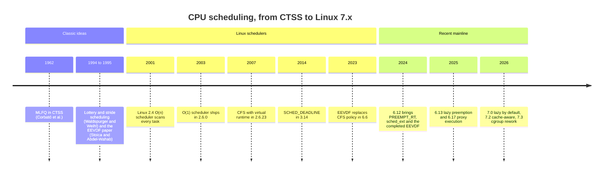
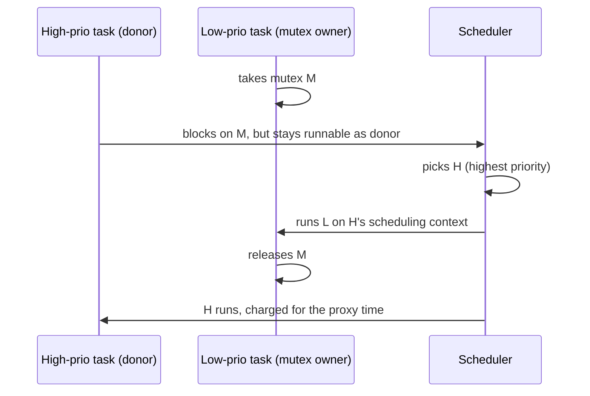

---
tags:
  - operating-systems
  - foundations
  - cpu-scheduling
status: draft
sources:
  - https://pages.cs.wisc.edu/~remzi/OSTEP/cpu-sched.pdf
  - https://pages.cs.wisc.edu/~remzi/OSTEP/cpu-sched-mlfq.pdf
  - https://pages.cs.wisc.edu/~remzi/OSTEP/cpu-sched-lottery.pdf
  - https://pages.cs.wisc.edu/~remzi/OSTEP/cpu-sched-multi.pdf
  - https://usenix.org/conference/osdi-94/lottery-scheduling-flexible-proportional-share-resource-management
  - https://people.eecs.berkeley.edu/~istoica/papers/eevdf-tr-95.pdf
  - https://people.ece.ubc.ca/~sasha/papers/eurosys16-final29.pdf
  - https://lkml.iu.edu/hypermail/linux/kernel/0312.2/0348.html
  - https://kernelnewbies.org/Linux_2_6_23
  - https://developer.ibm.com/tutorials/l-completely-fair-scheduler/
  - https://kernelnewbies.org/Linux_3.14
  - https://kernelnewbies.org/Linux_6.6
  - https://kernelnewbies.org/Linux_6.12
  - https://kernelnewbies.org/Linux_6.13
  - https://kernelnewbies.org/Linux_6.17
  - https://docs.kernel.org/scheduler/sched-design-CFS.html
  - https://docs.kernel.org/scheduler/sched-eevdf.html
  - https://docs.kernel.org/scheduler/sched-deadline.html
  - https://docs.kernel.org/scheduler/sched-domains.html
  - https://docs.kernel.org/scheduler/sched-energy.html
  - https://docs.kernel.org/scheduler/sched-ext.html
  - https://docs.kernel.org/core-api/real-time/differences.html
  - https://docs.kernel.org/admin-guide/cgroup-v2.html
  - https://docs.kernel.org/7.0/userspace-api/rseq.html
  - https://github.com/torvalds/linux/blob/master/kernel/sched/fair.c
  - https://github.com/torvalds/linux/blob/master/kernel/sched/core.c
  - https://github.com/torvalds/linux/blob/v6.5/kernel/sched/fair.c
  - https://lwn.net/Articles/925371/
  - https://lwn.net/Articles/969062/
  - https://lwn.net/Articles/992185/
  - https://lwn.net/Articles/1031713
  - https://lwn.net/SubscriberLink/1067029/7e4d08d3f0e37757/
  - https://lwn.net/Articles/1058288/
  - https://lwn.net/Articles/1082717/
  - https://lwn.net/Articles/1089244
  - https://lwn.net/Articles/1096073/
  - https://github.com/torvalds/linux/blob/master/include/asm-generic/vmlinux.lds.h
  - https://www.phoronix.com/news/Linux-7.3-CAS-Fixes-Coming
  - https://phoronix.com/news/Linux-7.3-rc2-Scheduler-Fixes
  - https://lkml.iu.edu/2502.1/11105.html
  - https://patchew.org/linux/176820500332.510.37525067093416732.tip-bot2@tip-bot2
  - https://lkml.iu.edu/2604.0/05933.html
  - https://lkml.iu.edu/2604.1/08000.html
  - https://phoronix.com/news/Linux-6.13-Lazy-Preemption
  - https://phoronix.com/news/Linux-6.12-Released
  - https://www.omgubuntu.co.uk/2026/08/linux-7-2-cache-aware-scheduling-ext4-btrfs/amp
  - https://www.phoronix.com/news/Linux-7.3-Scheduler
  - https://www.phoronix.com/news/Linux-7.3-Better-Intel-Hybrid
  - https://phoronix.com/news/Linux-7.3-sched-ext
  - https://phoronix.com/news/Linux-7.3-Released
  - https://phoronix.com/news/Linux-7.4
created: 2026-11-26
updated: 2026-11-26
---

## Table Of Contents

---

- [[#TL;DR|TL;DR]]
- [[#The Problem|The Problem]]
- [[#Foundations|Foundations]]
    - [[#Metrics That Pull Against Each Other|Metrics That Pull Against Each Other]]
    - [[#Preemption, Time Slices and Context Switches|Preemption, Time Slices and Context Switches]]
    - [[#Nice Values and Weights|Nice Values and Weights]]
    - [[#Policies and Scheduling Classes|Policies and Scheduling Classes]]
- [[#How We Got Here|How We Got Here]]
- [[#How It Works|How It Works]]
    - [[#Classic Policies (FIFO, SJF, STCF, Round Robin)|Classic Policies (FIFO, SJF, STCF, Round Robin)]]
    - [[#Multi-Level Feedback Queue|Multi-Level Feedback Queue]]
    - [[#Proportional Share (Lottery and Stride)|Proportional Share (Lottery and Stride)]]
    - [[#CFS and Virtual Runtime|CFS and Virtual Runtime]]
    - [[#EEVDF and Lag, Eligibility, Virtual Deadlines|EEVDF and Lag, Eligibility, Virtual Deadlines]]
    - [[#The Class Stack (Deadline, RT, Fair, Ext, Idle)|The Class Stack (Deadline, RT, Fair, Ext, Idle)]]
    - [[#Multicore Load Balancing and Scheduling Domains|Multicore Load Balancing and Scheduling Domains]]
    - [[#Hybrid Cores and Energy-Aware Placement|Hybrid Cores and Energy-Aware Placement]]
    - [[#Preemption Models and PREEMPT_RT|Preemption Models and PREEMPT_RT]]
    - [[#Group Scheduling and the cgroup cpu Controller|Group Scheduling and the cgroup cpu Controller]]
- [[#Where It Is Now|Where It Is Now]]
    - [[#Lazy Preemption Became the Default|Lazy Preemption Became the Default]]
    - [[#Proxy Execution Grows Up|Proxy Execution Grows Up]]
    - [[#EEVDF and cgroup Follow-ups|EEVDF and cgroup Follow-ups]]
    - [[#Cache and Topology Awareness|Cache and Topology Awareness]]
    - [[#sched_ext in Brief|sched_ext in Brief]]
- [[#Trade-offs & Open Problems|Trade-offs & Open Problems]]
- [[#Resources|Resources]]
- [[#Related Notes|Related Notes]]

## ***TL;DR***
---
*A CPU scheduler decides which runnable thread gets which core, and for how long. Every design trades throughput, latency and fairness against each other; Linux went from a scan of every task, to per-priority queues, to "fair share by virtual time" (CFS), to "fair share plus deadlines" (EEVDF), and is now tuning preemption, locking and topology around that core.*

- **The core problem:** there are more runnable threads than cores, the scheduler can't see the future, and every decision costs a context switch and cache warmth. See [[Processes and Threads]] for what is being scheduled.
- **Textbook policies:** FIFO, shortest-job-first and round robin each optimise one metric and hurt another. The **multi-level feedback queue** (MLFQ, 1962) learns from behaviour instead of needing job lengths ([OSTEP ch. 8](https://pages.cs.wisc.edu/~remzi/OSTEP/cpu-sched-mlfq.pdf)). **Lottery and stride** scheduling (1994 to 1995) make "share the CPU in proportion to weight" exact ([Waldspurger and Weihl](https://usenix.org/conference/osdi-94/lottery-scheduling-flexible-proportional-share-resource-management)).
- **Linux history:** O(n) in 2.4, O(1) in 2.6.0 (Dec 2003), **CFS** in 2.6.23 (Oct 2007) with a red-black tree ordered by *virtual runtime*, then **EEVDF** in 6.6 (Oct 2023), which adds *lag*, *eligibility* and *virtual deadlines* so a task can ask for low latency without asking for more CPU ([kernelnewbies 6.6](https://kernelnewbies.org/Linux_6.6)).
- **Around the fair class:** SCHED_DEADLINE (EDF, since 3.14), real-time FIFO/RR, sched_ext (BPF, since 6.12) and idle classes sit in a fixed priority stack; scheduling domains handle multicore balance; [[PREEMPT_RT and Real-Time Linux|PREEMPT_RT]] became mainline in 6.12 (Nov 2024).
- **Where it is now (Nov 2026):** Linux 7.0 (Apr 2026) made **lazy preemption** the default and added **time-slice extension**; **proxy execution** (6.17 onward) is spreading across CPUs and toward sched_ext; 7.2 added **cache-aware scheduling**; 7.3 (Oct 2026) reworked cgroup weighting; 7.4 (in rc) cuts latency for short-slice tasks by up to 55% ([Phoronix, Oct 2026](https://phoronix.com/news/Linux-7.4)).

## ***The Problem***
---
*A machine with 16 cores might have 2,000 threads, most asleep and a few dozen runnable. The scheduler must keep cores busy, respond quickly to interactive work, give each user or container its share, and do all of it in a few microseconds per decision, without knowing how long any job will run.*

| Pressure | What goes wrong without care | Example |
|---|---|---|
| Unknown job lengths | The best order for average completion time (shortest first) needs the future | A 100 ms batch job ahead of two 10 ms requests makes them wait 10x longer than needed ([OSTEP ch. 7](https://pages.cs.wisc.edu/~remzi/OSTEP/cpu-sched.pdf)) |
| Latency vs throughput | Short slices mean quick response but more context switches and colder caches | Making lazy preemption the default (7.0) exposed a 0.51x PostgreSQL throughput drop on one setup ([LKML, Apr 2026](https://lkml.iu.edu/2604.0/05933.html)) |
| Fairness and isolation | One user, process or container can flood the run queue | cgroup weights must hold across many CPUs; Linux 7.3 rewrote how ([LWN, Aug 2026](https://lwn.net/Articles/1089244)) |
| Priority inversion | A low-priority lock holder blocks a high-priority waiter | Proxy execution (6.17+) runs the holder on the waiter's behalf ([kernelnewbies 6.17](https://kernelnewbies.org/Linux_6.17)) |
| Multicore topology | Idle cores while threads wait; threads separated from their cache | EuroSys 2016 found load-balancing bugs that left cores idle for long periods ([Lozi et al.](https://people.ece.ubc.ca/~sasha/papers/eurosys16-final29.pdf)) |
| Heterogeneous cores | Big and small cores, shared L2 clusters, SMT siblings | Intel P/E-core cluster balancing fixed in 7.3 ([Phoronix, Aug 2026](https://www.phoronix.com/news/Linux-7.3-Better-Intel-Hybrid)) |

The scheduler gets control at three moments: a thread blocks or exits, a thread wakes up, or a timer [[Interrupts and Exceptions|interrupt]] (the tick) fires. Everything below is about what it does in those moments.

## ***Foundations***
---
*You need four ideas: the metrics a scheduler is judged on, what preemption and a time slice are, how Linux turns "nice" into a weight, and how policies are grouped into classes with a fixed pecking order.*

#### **Metrics That Pull Against Each Other**

$$
T_{\text{turnaround}} = T_{\text{completion}} - T_{\text{arrival}}, \qquad T_{\text{response}} = T_{\text{first run}} - T_{\text{arrival}}
$$

*In plain English: turnaround is how long the whole job took from submission; response is how long until it first got the CPU. Batch work cares about the first, interactive work about the second ([OSTEP ch. 7](https://pages.cs.wisc.edu/~remzi/OSTEP/cpu-sched.pdf)).*

| Metric | Question | Who cares |
|---|---|---|
| Turnaround | How soon does the job finish? | Batch, builds, HPC |
| Response / wakeup latency | How soon does a woken thread run? | UIs, audio, games, request handlers |
| Throughput | Jobs (or useful cycles) per second | Servers, databases |
| Fairness / proportional share | Does each task, user or cgroup get its weighted share? | Multi-tenant hosts, containers |
| Tail latency | What is the 99th-percentile wait? | Services with SLOs |
| Energy | Joules per unit of work | Phones, laptops, hybrid CPUs |

Policies that minimise turnaround (run short jobs to completion) are bad for response time, and round robin, which is great for response time, is close to the worst for turnaround ([OSTEP ch. 7](https://pages.cs.wisc.edu/~remzi/OSTEP/cpu-sched.pdf)).

#### **Preemption, Time Slices and Context Switches**
- **Preemption** means the kernel can take the CPU away from a running thread (on the tick, or when a more urgent thread wakes) instead of waiting for it to block.
- A **time slice** (quantum) is how long a thread may run before the scheduler reconsiders. Under EEVDF the default request is 0.70 ms × (1 + log₂ CPUs), which is 2.8 ms on machines with 8 or more CPUs ([fair.c](https://github.com/torvalds/linux/blob/master/kernel/sched/fair.c), [commit, Feb 2025](https://lkml.iu.edu/2502.1/11105.html)).
- A **context switch** saves one thread's registers and loads another's, possibly switching address spaces (see [[Virtual Memory and Paging]]). The direct cost is small; the indirect cost is lost cache and TLB warmth, which is why slices can't be arbitrarily short.

#### **Nice Values and Weights**
Linux maps a task's nice value (−20 to 19) to a **weight**. Nice 0 is 1024, and each step changes the weight by about 1.25x, which works out to roughly 10% CPU per nice level ([core.c](https://github.com/torvalds/linux/blob/master/kernel/sched/core.c)):

```c
/* kernel/sched/core.c */
const int sched_prio_to_weight[40] = {
 /* -20 */     88761,     71755,     56483,     46273,     36291,
 /* -15 */     29154,     23254,     18705,     14949,     11916,
 /* -10 */      9548,      7620,      6100,      4904,      3906,
 /*  -5 */      3121,      2501,      1991,      1586,      1277,
 /*   0 */      1024,       820,       655,       526,       423,
 /*   5 */       335,       272,       215,       172,       137,
 /*  10 */       110,        87,        70,        56,        45,
 /*  15 */        36,        29,        23,        18,        15,
};
```

*In plain words: the share of a CPU-bound task is its weight divided by the sum of weights on the run queue. Nice 0 against nice 1 is 1024 vs 820, so 55.5% vs 44.5%; nice −20 against nice 19 is about 5,900 to 1.*

#### **Policies and Scheduling Classes**
A **policy** is what user space asks for with `sched_setscheduler()`/`sched_setattr()`; a **class** is the kernel module that implements it ([CFS docs](https://docs.kernel.org/scheduler/sched-design-CFS.html), [deadline docs](https://docs.kernel.org/scheduler/sched-deadline.html)).

| Policy | Class | Picks by |
|---|---|---|
| `SCHED_DEADLINE` | deadline (`dl`) | Earliest absolute deadline, with bandwidth reservation |
| `SCHED_FIFO`, `SCHED_RR` | real-time (`rt`) | Fixed priority 1 to 99; RR adds a slice among equals |
| `SCHED_NORMAL` (aka `SCHED_OTHER`), `SCHED_BATCH`, `SCHED_IDLE` | fair | EEVDF by weight (SCHED_IDLE gets a tiny weight) |
| `SCHED_EXT` | ext | Whatever the loaded BPF scheduler decides ([[sched_ext and Pluggable Scheduling]]) |
| (per-CPU idle thread) | idle | Runs only when nothing else can |

## ***How We Got Here***
---
*The textbook ideas were in place by the mid-1990s: feedback queues, proportional share, and EEVDF itself. Linux's history is mostly about rediscovering them at scale: first fixing O(n) scanning, then replacing interactivity heuristics with fairness, then adding deadlines to fairness.*



| When | Step | Problem it answered | Source |
|---|---|---|---|
| 1962 | **MLFQ** in CTSS | Run short interactive jobs first without knowing job lengths | [OSTEP ch. 8](https://pages.cs.wisc.edu/~remzi/OSTEP/cpu-sched-mlfq.pdf) |
| 1994 to 1995 | **Lottery, stride, EEVDF** | Exact, controllable proportional share; EEVDF adds latency control | [Lottery](https://usenix.org/conference/osdi-94/lottery-scheduling-flexible-proportional-share-resource-management), [EEVDF TR](https://people.eecs.berkeley.edu/~istoica/papers/eevdf-tr-95.pdf) |
| 2.4 | **O(n) scheduler**: walk every task at each decision | Simple, but slows down as task count grows | [IBM Developer](https://developer.ibm.com/tutorials/l-completely-fair-scheduler/) |
| 2.5 dev cycle, shipped 2.6.0 (Dec 2003) | **O(1) scheduler** (Ingo Molnar): per-priority run queues, constant-time pick | Scalability; but its "interactivity estimator" grew hard to tune | [kernelnewbies 2.6.23](https://kernelnewbies.org/Linux_2_6_23), [2.6.0 announcement](https://lkml.iu.edu/hypermail/linux/kernel/0312.2/0348.html) |
| 2.6.23 (9 Oct 2007) | **CFS** (Molnar), inspired by Con Kolivas's RSDL fairness work | Replace heuristics with "ideal precise multitasking CPU"; red-black tree; nanosecond accounting | [kernelnewbies 2.6.23](https://kernelnewbies.org/Linux_2_6_23), [CFS docs](https://docs.kernel.org/scheduler/sched-design-CFS.html) |
| 3.14 (30 Mar 2014) | **SCHED_DEADLINE**: EDF plus constant bandwidth server | Real-time by runtime/deadline/period instead of priorities | [kernelnewbies 3.14](https://kernelnewbies.org/Linux_3.14) |
| 2016 | **"A Decade of Wasted Cores"** | Showed load-balancing bugs that kept cores idle while threads waited | [Lozi et al., EuroSys 2016](https://people.ece.ubc.ca/~sasha/papers/eurosys16-final29.pdf) |
| 6.6 (29 Oct 2023) | **EEVDF** (Peter Zijlstra) | CFS had no way to say "I need low latency" without more CPU; removed many tunables | [LWN, Mar 2023](https://lwn.net/Articles/925371/), [kernelnewbies 6.6](https://kernelnewbies.org/Linux_6.6) |
| 6.12 (17 Nov 2024) | **EEVDF completed**, **PREEMPT_RT** mainlined, **sched_ext** merged | Custom slices, delayed dequeue; real-time without an out-of-tree patch; BPF schedulers | [kernelnewbies 6.12](https://kernelnewbies.org/Linux_6.12), [LWN, Apr 2024](https://lwn.net/Articles/969062/) |
| 6.13 (19 Jan 2025) | **Lazy preemption** | Full-preemption latency for RT tasks, voluntary-like throughput for normal tasks | [kernelnewbies 6.13](https://kernelnewbies.org/Linux_6.13) |
| 6.17 (28 Sep 2025) | **Proxy execution**, single run queue | Priority inversion across lock holders | [kernelnewbies 6.17](https://kernelnewbies.org/Linux_6.17) |

## ***How It Works***
---
*Start with the textbook policies to see why each metric needs a different answer, then follow Linux's fair class from virtual runtime to EEVDF, then zoom out to the class stack, multicore balancing, heterogeneous cores, preemption models and cgroups.*

#### **Classic Policies (FIFO, SJF, STCF, Round Robin)**
**Worked example (turnaround).** Jobs A = 100 ms, B = 10 ms, C = 10 ms all arrive at t = 0 ([OSTEP ch. 7](https://pages.cs.wisc.edu/~remzi/OSTEP/cpu-sched.pdf)).

| Policy | Order | Completion times | Average turnaround |
|---|---|---|---|
| FIFO (A first) | A, B, C | 100, 110, 120 | 110 ms |
| Shortest Job First | B, C, A | 10, 20, 120 | 50 ms |

The long job in front is the **convoy effect**. SJF is optimal for average turnaround when all jobs arrive together. **STCF** (shortest time-to-completion first) adds preemption, so a short job that arrives later can kick out a long one.

**Worked example (response).** Three 5 ms jobs at t = 0.

| Policy | First run | Average response | Average turnaround |
|---|---|---|---|
| FIFO | 0, 5, 10 | 5 ms | (5 + 10 + 15) / 3 = 10 ms |
| Round robin, 1 ms slice | 0, 1, 2 | 1 ms | (13 + 14 + 15) / 3 = 14 ms |

Round robin wins response and loses turnaround: it stretches every job out to the end. Real schedulers also don't know job lengths, which kills SJF/STCF in practice and motivates MLFQ.

#### **Multi-Level Feedback Queue**
MLFQ keeps several queues at different priorities and moves jobs between them based on how they behave. The final rule set in [OSTEP ch. 8](https://pages.cs.wisc.edu/~remzi/OSTEP/cpu-sched-mlfq.pdf):

1. If Priority(A) > Priority(B), A runs.
2. If equal, A and B run round robin with that queue's slice.
3. A new job starts at the top queue.
4. Once a job uses up its time allotment at a level (however many times it yielded), it moves down one level.
5. After some period S, move every job back to the top (**priority boost**).

Rule 4 stops a job from gaming the scheduler by doing I/O just before its slice ends; rule 5 stops starvation and lets a job that turned interactive climb back up. The cost is "voodoo constants": number of queues, slice per level, and S. Linux's O(1) scheduler had the same flavour (per-priority arrays plus an interactivity bonus), which is the tuning burden CFS removed ([kernelnewbies 2.6.23](https://kernelnewbies.org/Linux_2_6_23)).

#### **Proportional Share (Lottery and Stride)**
Give each task **tickets**; its share should be its fraction of all tickets.

- **Lottery** ([Waldspurger and Weihl, OSDI 1994](https://usenix.org/conference/osdi-94/lottery-scheduling-flexible-proportional-share-resource-management)): at each slice, draw a random ticket. Correct on average, noisy over short windows.
- **Stride** (deterministic): each task has $\text{stride}_i = L / \text{tickets}_i$ and a counter $\text{pass}_i$. Run the task with the smallest pass, then add its stride.

$$
\text{share}_i = \frac{\text{tickets}_i}{\sum_j \text{tickets}_j}, \qquad \text{pass}_i \leftarrow \text{pass}_i + \frac{L}{\text{tickets}_i}
$$

*In plain English: each task carries a meter that runs slower the more tickets it holds; always run whoever's meter is lowest.*

**Worked example (OSTEP's numbers).** A = 100, B = 50, C = 250 tickets, $L$ = 10,000, so strides are 100, 200 and 40 ([OSTEP ch. 9](https://pages.cs.wisc.edu/~remzi/OSTEP/cpu-sched-lottery.pdf)).

| Pick | Pass before (A, B, C) | Runs |
|---|---|---|
| 1 | 0, 0, 0 | A |
| 2 | 100, 0, 0 | B |
| 3 | 100, 200, 0 | C |
| 4 | 100, 200, 40 | C |
| 5 | 100, 200, 80 | C |
| 6 | 100, 200, 120 | A |
| 7 | 200, 200, 120 | C |
| 8 | 200, 200, 160 | C |

After 8 slices: A 2, B 1, C 5, exactly 100 : 50 : 250. Stride's "pass" is the direct ancestor of CFS's virtual runtime. The open question stride leaves is the one EEVDF answers: what pass should a task that just woke up get?

#### **CFS and Virtual Runtime**
CFS models an "ideal, precise multi-tasking CPU" that would run $n$ tasks each at $1/n$ speed ([CFS docs](https://docs.kernel.org/scheduler/sched-design-CFS.html)). Each task keeps a **vruntime**: CPU time scaled by its weight. The run queue is a red-black tree ordered by vruntime, and the scheduler runs the leftmost (smallest) one.

$$
\Delta v_i = \Delta t_i \cdot \frac{w_0}{w_i}, \qquad w_0 = 1024
$$

*In plain English: a nice-0 task's vruntime advances at wall-clock speed; a heavier task's advances slower, so it stays "behind" longer and gets picked more.*

The core of it, from CFS as it was in 6.5 ([fair.c v6.5](https://github.com/torvalds/linux/blob/v6.5/kernel/sched/fair.c)):

```c
static void update_curr(struct cfs_rq *cfs_rq)
{
	struct sched_entity *curr = cfs_rq->curr;
	u64 now = rq_clock_task(rq_of(cfs_rq));
	u64 delta_exec = now - curr->exec_start;   /* real ns just run */

	curr->exec_start = now;
	curr->sum_exec_runtime += delta_exec;
	curr->vruntime += calc_delta_fair(delta_exec, curr); /* scale by 1024/w */
	update_min_vruntime(cfs_rq);
	/* ... */
}
```

*In plain words: on every tick or switch, charge the running task for the nanoseconds it used, scaled by its weight, then remember the smallest vruntime in the queue so that newly woken tasks can be placed near it rather than at 0.*

CFS also had a **target latency** (`sysctl_sched_latency`, 6 ms × (1 + log₂ CPUs)) and a minimum granularity of 0.75 ms; each task's slice was its weighted share of that period ([fair.c v6.5](https://github.com/torvalds/linux/blob/v6.5/kernel/sched/fair.c)).

**Worked example (real weights).** Task A is nice 0 (weight 1024), task B is nice 5 (weight 335), both CPU-bound on one CPU with 8+ CPUs in the system (period 24 ms).

| | A (nice 0) | B (nice 5) |
|---|---|---|
| Share $w_i / \sum w$ | 1024 / 1359 = 75.35% | 335 / 1359 = 24.65% |
| CFS slice of a 24 ms period | 18.08 ms | 5.92 ms |
| Real CPU per 100 ms | 75.35 ms | 24.65 ms |
| vruntime gained per 100 ms | 75.35 × 1024/1024 = 75.35 ms | 24.65 × 1024/335 = 75.35 ms |

Both vruntimes rise at the same rate, which is the definition of "fair". The problem CFS could not solve: **share and latency were one knob.** A task that wakes often to do a little work (audio, a game frame) could only get faster service by being given more weight, and wakeup placement relied on heuristics and tunables ([LWN, Mar 2023](https://lwn.net/Articles/925371/)).

#### **EEVDF and Lag, Eligibility, Virtual Deadlines**
EEVDF ("Earliest Eligible Virtual Deadline First", Stoica and Abdel-Wahab, 1995) keeps weighted virtual time but separates **how much** CPU a task gets (weight) from **how soon** (requested slice) ([EEVDF TR](https://people.eecs.berkeley.edu/~istoica/papers/eevdf-tr-95.pdf), [kernel docs](https://docs.kernel.org/scheduler/sched-eevdf.html)). The kernel's own derivation ([fair.c](https://github.com/torvalds/linux/blob/master/kernel/sched/fair.c)):

$$
V = \frac{\sum_i w_i\, v_i}{\sum_i w_i}, \qquad \text{lag}_i = w_i\,(V - v_i), \qquad \sum_i \text{lag}_i = 0
$$

$$
\text{eligible}_i \iff \text{lag}_i \ge 0 \iff v_i \le V, \qquad \text{vd}_i = v_i + \frac{r_i \cdot w_0}{w_i}
$$

*In plain English: $V$ is the weighted average of everyone's virtual runtime, the "where an ideal CPU would have everyone be" line. Lag is how far a task is behind that line (owed CPU) or ahead of it (overserved). Only tasks at or behind the line are eligible; among them, run the one whose virtual deadline (now plus its requested slice, scaled by weight) is earliest.*

In the kernel the deadline update is two lines ([fair.c](https://github.com/torvalds/linux/blob/master/kernel/sched/fair.c)):

```c
static bool update_deadline(struct cfs_rq *cfs_rq, struct sched_entity *se)
{
	if (vruntime_cmp(se->vruntime, "<", se->deadline))
		return false;                       /* request not used up yet */
	if (!se->custom_slice)
		se->slice = sysctl_sched_base_slice; /* 0.70 ms * (1 + ilog(ncpus)) */
	/* EEVDF: vd_i = ve_i + r_i / w_i */
	se->deadline = se->vruntime + calc_delta_fair(se->slice, se);
	avg_vruntime(cfs_rq);
	return true;                            /* reschedule */
}
```

*In plain words: when a task has used its requested slice, give it a new deadline one (weighted) slice ahead and ask for a reschedule.* The tree is now ordered by **deadline**, and each node is augmented with the minimum vruntime in its subtree, so `pick_eevdf()` can find the earliest-deadline eligible task in $O(\log n)$ by skipping subtrees that contain no eligible task.

**What 6.12 added to finish the job** ([LWN, Apr 2024](https://lwn.net/Articles/969062/), [kernelnewbies 6.12](https://kernelnewbies.org/Linux_6.12)):
- **Lag survives sleep.** A task that overran keeps its negative lag across a short sleep, so it can't game the scheduler by sleeping just before its slice ends (the same trick MLFQ rule 4 blocks). Lag is clamped to about one slice plus a tick.
- **Delayed dequeue.** An ineligible task that goes to sleep stays on the queue, unpickable, until its lag decays back to zero, then leaves.
- **Custom slices.** A `SCHED_NORMAL` task can request a slice with `sched_setattr()` (`sched_runtime`, 100 µs to 100 ms). Shorter slice means earlier deadlines and lower latency, same total share.

**Worked example 1 (weights).** A at nice 0 and B at nice 5, default slice 2.8 ms. A's virtual request is 2.8 × 1024/1024 = 2.8 ms; B's is 2.8 × 1024/335 = 8.56 ms. Both get the CFS shares above (75.35% / 24.65%), but B's deadlines are spaced 3x further apart in virtual time.

**Worked example 2 (latency without extra share).** A and B are both nice 0 (weight 1024, so virtual time equals real time). A uses the default 2.8 ms slice; B asked for 0.7 ms. For simplicity assume a decision every 0.7 ms (since 6.17 "run to parity" accounts for tasks with different slices, [kernelnewbies 6.17](https://kernelnewbies.org/Linux_6.17)).

| t (ms) | $v_A$ | $v_B$ | $V$ | lag A, B (virtual) | deadline A, B | Runs |
|---|---|---|---|---|---|---|
| 0 | 0 | 0 | 0 | 0, 0 | 2.8, 0.7 | B (both eligible, earlier deadline) |
| 0.7 | 0 | 0.7 | 0.35 | +0.35, −0.35 | 2.8, 1.4 | A (B not eligible) |
| 1.4 | 0.7 | 0.7 | 0.7 | 0, 0 | 2.8, 1.4 | B |
| 2.1 | 0.7 | 1.4 | 1.05 | +0.35, −0.35 | 2.8, 2.1 | A |
| 2.8 | 1.4 | 1.4 | 1.4 | 0, 0 | 2.8, 2.1 | B |

Each gets 50% of the CPU, but B never waits more than one 0.7 ms slot. Under CFS with equal weights, B's only way to run sooner was more weight. Eligibility is what stops B from running back-to-back: as soon as it is ahead of $V$, it must wait.

Setting a custom slice from user space (raw syscall; glibc has no wrapper for `sched_setattr`):

```c
#include <linux/sched/types.h>   /* struct sched_attr */
#include <sys/syscall.h>
#include <unistd.h>

struct sched_attr attr = {
	.size          = sizeof(attr),
	.sched_policy  = SCHED_OTHER,     /* stays in the fair class */
	.sched_runtime = 700 * 1000,      /* request a 0.7 ms slice (ns) */
};
syscall(SYS_sched_setattr, 0 /* this thread */, &attr, 0);
```

*In plain words: same weight, same share, shorter requests, so earlier virtual deadlines and quicker turns on the CPU.*

#### **The Class Stack (Deadline, RT, Fair, Ext, Idle)**
The core scheduler asks each class in fixed order for a task; the first class with something runnable wins. The order is fixed by the linker script ([vmlinux.lds.h](https://github.com/torvalds/linux/blob/master/include/asm-generic/vmlinux.lds.h)):


- **SCHED_DEADLINE** is EDF plus a **constant bandwidth server**: each task declares runtime, deadline and period, and is admitted only if total bandwidth fits, by default up to 95% of each CPU (950,000 µs of every 1,000,000 µs), leaving 5% for everyone else ([deadline docs](https://docs.kernel.org/scheduler/sched-deadline.html)). A task that overruns is throttled until its next period, so one misbehaving task can't break the others.
- **RT** classes pick by fixed priority. Priority inheritance on `rt_mutex` handles inversion for them; for deadline tasks, inheritance does not fit, which is one motivation for proxy execution ([LWN, Jul 2026](https://lwn.net/Articles/1082717/)).
- Starvation of fair tasks by RT tasks is bounded by RT throttling and, in current kernels, a **deadline server** (`fair_server`) that reserves a slice for the fair class ([fair.c](https://github.com/torvalds/linux/blob/master/kernel/sched/fair.c)).

```c
/* SCHED_DEADLINE: 10 ms of CPU in every 100 ms, done within 30 ms of each period start */
struct sched_attr dl = {
	.size = sizeof(dl), .sched_policy = SCHED_DEADLINE,
	.sched_runtime  = 10 * 1000 * 1000,
	.sched_deadline = 30 * 1000 * 1000,
	.sched_period   = 100 * 1000 * 1000,
};
syscall(SYS_sched_setattr, 0, &dl, 0);   /* fails with EBUSY if admission fails */
```

*In plain words: the task reserves 10% of a CPU with a 30 ms latency bound. Since Linux 7.1, `sched_getattr()` can also report remaining runtime and the absolute deadline ([v7.1 pull, Apr 2026](https://lkml.iu.edu/2604.1/08000.html)).*

#### **Multicore Load Balancing and Scheduling Domains**
Linux keeps a **run queue per CPU** (a global queue would be a lock-contention hotspot, [OSTEP ch. 10](https://pages.cs.wisc.edu/~remzi/OSTEP/cpu-sched-multi.pdf)), so it needs a balancer to move tasks between them. It uses a hierarchy of **scheduling domains** that mirrors the hardware ([sched-domains docs](https://docs.kernel.org/scheduler/sched-domains.html)):

| Level (typical) | Spans | Cost of moving a task |
|---|---|---|
| SMT | Hyperthreads of one core | Almost free; caches shared |
| Cluster / MC | Cores sharing an L2 or last-level cache | Small |
| Package | All cores of a socket | Lose private caches |
| [[NUMA]] | All sockets | Lose caches and memory locality |

- Each domain is split into **groups**, and balancing compares groups as units: find the busiest group, then the busiest run queue in it, then migrate the imbalance.
- The tick raises `SCHED_SOFTIRQ`; `sched_balance_domains()` walks up from the smallest domain and balances each one whose interval has expired. Lower levels balance often, higher levels rarely.
- Balancing also happens when a CPU goes idle (**newidle** balancing) and when a task wakes (`select_idle_sibling()` looks for an idle CPU sharing a cache with the waker or the task's last CPU).
- Bugs here are subtle and costly: Lozi et al. found that the hierarchy's averaging could hide an overloaded CPU inside a "balanced" group, leaving other cores idle ([EuroSys 2016](https://people.ece.ubc.ca/~sasha/papers/eurosys16-final29.pdf)).

#### **Hybrid Cores and Energy-Aware Placement**
Modern CPUs mix core types: Arm big.LITTLE, Intel P-cores with E-core and LPE-core clusters.

- The scheduler normalises each CPU's **capacity** to 1024 and compares it with each task's PELT utilisation signal, so a task too big for a small core is a "misfit" and gets moved up ([EAS docs](https://docs.kernel.org/scheduler/sched-energy.html)).
- **Energy Aware Scheduling (EAS)** uses an energy model to pick the CPU that adds the least energy at wakeup. It applies only to asymmetric systems, needs the schedutil governor, and switches off when a CPU passes 80% of capacity ("overutilized"), falling back to normal balancing ([EAS docs](https://docs.kernel.org/scheduler/sched-energy.html)).
- On x86 hybrids, **asymmetric packing** prefers higher-priority CPUs (`arch_asym_cpu_priority()` in [fair.c](https://github.com/torvalds/linux/blob/master/kernel/sched/fair.c)), and **cluster scheduling** (added 2021) spreads work across cores sharing an L2. That broke down on clusters of small cores; Linux 7.3 fixed it so leftover tasks spread evenly across E-core clusters, tested on Alder Lake, Lunar Lake and Panther Lake ([Phoronix, Aug 2026](https://www.phoronix.com/news/Linux-7.3-Better-Intel-Hybrid)).

#### **Preemption Models and PREEMPT_RT**
How often the kernel itself can be preempted is a build-time choice.

| Model | Kernel code preemptible? | Typical use |
|---|---|---|
| `PREEMPT_NONE` | Only at explicit points | Old server default; best raw throughput |
| `PREEMPT_VOLUNTARY` | Plus `cond_resched()` points | Old desktop default |
| `PREEMPT_FULL` | Anywhere not holding a spinlock or with preemption disabled | Low-latency desktops |
| `PREEMPT_LAZY` (6.13) | Like full, but fair-class preemption waits for the tick; RT/DL preempt immediately | Default since 7.0 where supported |
| `PREEMPT_RT` (6.12) | Almost everything, including most spinlock sections | Hard real-time |

Lazy preemption sets a "please reschedule" flag for fair tasks and only forces it at the next tick, so the average delay is about half a tick ([Phoronix](https://phoronix.com/news/Linux-6.13-Lazy-Preemption), [kernelnewbies 6.13](https://kernelnewbies.org/Linux_6.13)).

**PREEMPT_RT**, mainlined in 6.12 after about 20 years out of tree ([kernelnewbies 6.12](https://kernelnewbies.org/Linux_6.12), [LWN, Sep 2024](https://lwn.net/Articles/992185/)), makes the kernel preemptible almost everywhere ([real-time docs](https://docs.kernel.org/core-api/real-time/differences.html)):
- `spinlock_t` no longer disables preemption or interrupts (it becomes a sleeping lock); only `raw_spinlock_t`, used by the scheduler, timers and interrupt core, keeps classic semantics. See [[Locks and Synchronization]].
- Interrupt handlers are **forced into threads** (with a few flagged exceptions) and softirqs run in preemptible thread context, so an RT task can outrank an interrupt handler. See [[Interrupts and Exceptions]].
- hrtimers default to softirq context; irq_work and RCU callbacks run in threads. See [[Read-Copy-Update (RCU)]].

#### **Group Scheduling and the cgroup cpu Controller**
With group scheduling, a cgroup is itself a scheduling entity with a weight, and its tasks share that weight. In cgroup v2 the **cpu controller** exposes `cpu.weight` (proportional share) and `cpu.max` (a bandwidth quota per period) ([cgroup v2 docs](https://docs.kernel.org/admin-guide/cgroup-v2.html)); the older CFS docs show the same idea with `cpu.shares` 2048 vs 1024 giving one group twice the other's CPU ([CFS docs](https://docs.kernel.org/scheduler/sched-design-CFS.html)). This is how [[Containers, Namespaces and cgroups]] get CPU isolation, and how Kubernetes requests and limits turn into kernel settings (contrast [[Cluster Scheduling]], which decides which machine a container runs on).

The hard part is SMP: a group's weight has to be split across the CPUs where its tasks run. Until 7.3 Linux scaled each CPU's share by the fraction of the group's load on that CPU, which on big machines gave tiny factors that distorted competition; see the 7.3 changes below.

## ***Where It Is Now***
---
*As of late November 2026 the current release is Linux 7.3 (18 Oct 2026) and 7.4 is in release candidates. EEVDF is settled as the fair policy; the action is around it: making lazy preemption the norm, extending proxy execution, making placement cache- and topology-aware, fixing cgroup weighting, and letting BPF schedulers coexist with all of that.*

#### **Lazy Preemption Became the Default**
- **Linux 7.0 (Apr 2026)** made `PREEMPT_LAZY` the default ([LWN, Apr 2026](https://lwn.net/SubscriberLink/1067029/7e4d08d3f0e37757/)). The commit (queued 8 Jan 2026) limits `PREEMPT_NONE` to architectures with no preemption support and `PREEMPT_VOLUNTARY` to those without lazy support, leaving arm64, LoongArch, PowerPC, RISC-V, s390 and x86 with only full and lazy; the stated end goal is removing voluntary preemption and `cond_resched()` ([commit](https://patchew.org/linux/176820500332.510.37525067093416732.tip-bot2@tip-bot2)).
- **The regression scare (Apr 2026):** an Amazon engineer reported PostgreSQL pgbench at 0.51x throughput on a 96-vCPU Graviton4 with 55% of CPU time spinning in PostgreSQL's user-space spinlock, and proposed restoring `PREEMPT_NONE` ([LKML, 3 Apr 2026](https://lkml.iu.edu/2604.0/05933.html)). Andres Freund then found the drop appeared only without huge pages (longer critical sections from page faults and TLB pressure) and also without user-space spinlocks; with huge pages it vanished and talk of a revert faded ([LWN, 17 Apr 2026](https://lwn.net/SubscriberLink/1067029/7e4d08d3f0e37757/)).
- **Time-slice extension (7.0):** a thread can ask, through its rseq area, not to be preempted for a few microseconds while it holds a user-space lock. It opts in with `prctl(PR_RSEQ_SLICE_EXTENSION, ...)`, sets `rseq::slice_ctrl::request`, and calls `rseq_slice_yield()` afterwards if the kernel granted extra time. The default and minimum extension is 5 µs, tunable to 50 µs ([rseq docs, 7.0](https://docs.kernel.org/7.0/userspace-api/rseq.html)).

#### **Proxy Execution Grows Up**
When a high-priority task blocks on a mutex held by a low-priority task, proxy execution keeps the waiter (the **donor**) on the run queue and, when it is picked, runs the **owner** using the donor's scheduling context. Accounting follows `rq->donor`; `rq->curr` is what actually executes ([fair.c](https://github.com/torvalds/linux/blob/master/kernel/sched/fair.c), [LWN, Jul 2026](https://lwn.net/Articles/1082717/)).



- **6.17 (Sep 2025):** initial version, single run queue only (owner and donor on the same CPU), behind `CONFIG_EXPERT` ([kernelnewbies 6.17](https://kernelnewbies.org/Linux_6.17), [LWN, Aug 2025](https://lwn.net/Articles/1031713)).
- **7.1 (merge window Apr 2026):** migration of blocked waiters, including return migration, so donor and owner can be on different CPUs, plus fixes to balancing under proxy exec ([v7.1 pull](https://lkml.iu.edu/2604.1/08000.html)).
- **sched_ext compatibility (in review):** proxy exec and sched_ext were mutually exclusive at build time. Andrea Righi's series adds `SCX_OPS_ENQ_BLOCKED` so BPF schedulers can opt in; v14 (22 Sep 2026) targets the sched_ext for-7.4 branch and reported about 20% lower mutex wait in one priority-inversion test ([patch posting, Sep 2026](https://lwn.net/Articles/1096073/)). Not confirmed merged as of this writing.

#### **EEVDF and cgroup Follow-ups**
- **Base slice 0.75 to 0.70 ms (Feb 2025):** with HZ = 1000 the tick often fired a hair before the slice ended, so tasks got an extra full tick; lowering the base fixed it ([commit](https://lkml.iu.edu/2502.1/11105.html)).
- **7.1:** negative lag can no longer grow during delayed dequeue, `avg_vruntime` uses more weight bits, and newidle balancing became proportional ([v7.1 pull](https://lkml.iu.edu/2604.1/08000.html)).
- **7.3 (18 Oct 2026):** Peter Zijlstra's rework moved cgroup scheduling to a **single run queue** and added a `cgroup_mode` knob (debugfs): `smp` (old), `up`, `max`, `tasks`, and the new default **`concur`**, which scales a group's per-CPU weight by the lesser of available CPUs and its runnable tasks ([LWN, Aug 2026](https://lwn.net/Articles/1089244), [Phoronix](https://phoronix.com/news/Linux-7.3-Released)). Phoronix reports it targets cgroup scheduling pain such as gaming stutter on older hardware ([Phoronix, Aug 2026](https://www.phoronix.com/news/Linux-7.3-Scheduler)). 7.3 also lowered latency for short-slice tasks and made NOHZ balancing prefer fully idle cores ([Phoronix, Aug 2026](https://www.phoronix.com/news/Linux-7.3-Scheduler)).
- **7.4 (in rc as of Nov 2026):** Vincent Guittot's EEVDF change cuts scheduling latency for short-slice tasks by up to 55%; also a "steal governor" for VMs that reacts to steal time, random choice among equally shallow idle cores on large machines, and a preference for SMT siblings on NVIDIA Vera ([Phoronix, 22 Oct 2026](https://phoronix.com/news/Linux-7.4)).

#### **Cache and Topology Awareness**
- **Cache-aware scheduling (7.2, Aug 2026)** groups the threads of one process onto CPUs sharing a last-level cache, on the theory that they share data. Guardrails stop aggregation when a process already uses over 25% CPU time or 33% of a domain's load ([OMG! Ubuntu, Aug 2026](https://www.omgubuntu.co.uk/2026/08/linux-7-2-cache-aware-scheduling-ext4-btrfs/amp)). Tim Chen's (Intel) v3 series reported roughly 15 to 50% hackbench gains when threads fit in one LLC, about 20% (Sapphire Rapids) and 45% (Genoa) on ChaCha20, and no change on netperf, STREAM or stress-ng ([patch posting, Feb 2026](https://lwn.net/Articles/1058288/)). Follow-up fixes were queued for 7.3 and 7.4 ([Phoronix](https://www.phoronix.com/news/Linux-7.3-CAS-Fixes-Coming), [Phoronix, Oct 2026](https://phoronix.com/news/Linux-7.4)).
- **Hybrid Intel:** the 7.3 cluster-balancing fix above; 7.3-rc2 also fixed cache-aware scheduling misfits on hybrid CPUs ([Phoronix](https://phoronix.com/news/Linux-7.3-rc2-Scheduler-Fixes)).

#### **sched_ext in Brief**
sched_ext (merged 6.12) lets a BPF program implement the scheduling policy, with the kernel falling back to the fair class if it misbehaves ([sched_ext docs](https://docs.kernel.org/scheduler/sched-ext.html)). In 2026 it gained **sub-schedulers** attached to cgroups (dispatch path in 7.1; enqueue path with a capability model aimed at 7.3) ([LWN, Jul 2026](https://lwn.net/Articles/1082717/)); Phoronix describes sub-scheduler support as feature complete in 7.3 ([Phoronix](https://phoronix.com/news/Linux-7.3-sched-ext)). Details in [[sched_ext and Pluggable Scheduling]].

## ***Trade-offs & Open Problems***
---
*No policy wins every metric: each design moves the pain between latency, throughput, fairness and complexity. The open problems are less about the fair algorithm and more about everything that interacts with it: locks, caches, heterogeneous cores, cgroups and pluggable policies.*

| Design | Wins | Loses | Fails how |
|---|---|---|---|
| FIFO / SJF / STCF | Simple; SJF optimal turnaround | Needs job lengths; poor response | Convoy effect, starvation of long jobs |
| Round robin | Response time | Turnaround; switch overhead at small slices | Everything finishes late |
| MLFQ / O(1) heuristics | Interactivity without job lengths | Tuning "voodoo constants" | Gaming, misclassified tasks |
| CFS (vruntime) | Proportional share, no interactivity guessing | Latency tied to weight; wakeup heuristics | Latency-sensitive tasks need more weight than they deserve |
| EEVDF | Share and latency as separate knobs; lag-bounded fairness | Lag bookkeeping, delayed dequeue complexity | Edge cases around sleep, cgroups and different slices still being fixed in 2026 |
| SCHED_DEADLINE | Guaranteed bandwidth and latency | Needs runtime estimates; admission control | Overrun gets throttled; PI doesn't fit EDF |
| Lazy / full preemption | Lower latency, fewer `cond_resched()` hacks | Lock holders preempted mid-critical-section | Throughput cliffs on spin-heavy workloads |
| PREEMPT_RT | Bounded latency | Throughput; sleeping spinlocks change kernel code | Latency depends on every driver behaving |

Open problems:
- **Locks vs preemption.** The PostgreSQL episode shows that preempting a lock holder can cost more than any scheduling win. Time-slice extension and proxy execution attack it from user space and kernel space; neither yet covers all cases ([LWN, Apr 2026](https://lwn.net/SubscriberLink/1067029/7e4d08d3f0e37757/)). See [[Locks and Synchronization]].
- **cgroup weights on many CPUs.** 7.3 gave four ways to split a group's weight across CPUs because no single one is right for every workload ([LWN, Aug 2026](https://lwn.net/Articles/1089244)).
- **Topology keeps getting richer.** Shared L2 clusters, multiple LLCs per socket, P/E/LPE cores, SMT preferences that differ by vendor: each new layout has needed scheduler fixes (7.2, 7.3, 7.4).
- **Pluggable policies vs core features.** Each core feature (proxy exec, deadline servers) has to be made to work with sched_ext, and sub-schedulers raise isolation questions inside one machine ([LWN, Jul 2026](https://lwn.net/Articles/1082717/)).
- **Verification.** Load-balancer bugs that idle cores for long periods went unnoticed for years ([Lozi et al.](https://people.ece.ubc.ca/~sasha/papers/eurosys16-final29.pdf)); proving scheduler properties remains hard (see [[Formally Verified OS Components]]).

## ***Resources***
---
*Read OSTEP chapters 7 to 10 for the ideas, then LWN's two EEVDF articles and the kernel's EEVDF and CFS docs, then the comment blocks in kernel/sched/fair.c. For 2026, follow LWN's merge-window articles and Phoronix's per-release scheduler posts.*

**Textbooks and papers**
- [OSTEP ch. 7, Scheduling Introduction](https://pages.cs.wisc.edu/~remzi/OSTEP/cpu-sched.pdf): metrics, FIFO, SJF, STCF, round robin.
- [OSTEP ch. 8, MLFQ](https://pages.cs.wisc.edu/~remzi/OSTEP/cpu-sched-mlfq.pdf): the five rules and why.
- [OSTEP ch. 9, Lottery and Stride](https://pages.cs.wisc.edu/~remzi/OSTEP/cpu-sched-lottery.pdf): proportional share, including the stride example used above.
- [OSTEP ch. 10, Multiprocessor Scheduling](https://pages.cs.wisc.edu/~remzi/OSTEP/cpu-sched-multi.pdf): single vs per-CPU queues, affinity.
- [Lottery Scheduling](https://usenix.org/conference/osdi-94/lottery-scheduling-flexible-proportional-share-resource-management): Waldspurger and Weihl, OSDI 1994.
- [EEVDF technical report](https://people.eecs.berkeley.edu/~istoica/papers/eevdf-tr-95.pdf): Stoica and Abdel-Wahab, 1995.
- [The Linux Scheduler: a Decade of Wasted Cores](https://people.ece.ubc.ca/~sasha/papers/eurosys16-final29.pdf): Lozi et al., EuroSys 2016.

**Kernel documentation and source**
- [EEVDF Scheduler](https://docs.kernel.org/scheduler/sched-eevdf.html) and [CFS Scheduler](https://docs.kernel.org/scheduler/sched-design-CFS.html).
- [Deadline Task Scheduling](https://docs.kernel.org/scheduler/sched-deadline.html), [Scheduler Domains](https://docs.kernel.org/scheduler/sched-domains.html), [Energy Aware Scheduling](https://docs.kernel.org/scheduler/sched-energy.html), [sched_ext](https://docs.kernel.org/scheduler/sched-ext.html).
- [How realtime kernels differ](https://docs.kernel.org/core-api/real-time/differences.html): PREEMPT_RT semantics.
- [Control Group v2](https://docs.kernel.org/admin-guide/cgroup-v2.html): the cpu controller.
- [Restartable Sequences (7.0)](https://docs.kernel.org/7.0/userspace-api/rseq.html): time-slice extension.
- [kernel/sched/fair.c](https://github.com/torvalds/linux/blob/master/kernel/sched/fair.c) and [core.c](https://github.com/torvalds/linux/blob/master/kernel/sched/core.c): the lag derivation, `update_deadline()`, `pick_eevdf()`, the weight table. [fair.c at v6.5](https://github.com/torvalds/linux/blob/v6.5/kernel/sched/fair.c) for CFS as it was.

**LWN and mailing lists**
- [An EEVDF CPU scheduler for Linux](https://lwn.net/Articles/925371/): Corbet, Mar 2023.
- [Completing the EEVDF scheduler](https://lwn.net/Articles/969062/): Apr 2024.
- [The 7.0 scheduler regression that wasn't](https://lwn.net/SubscriberLink/1067029/7e4d08d3f0e37757/): Corbet, Apr 2026.
- [Sched-ext: enqueue() for sub-schedulers and proxy-execution support](https://lwn.net/Articles/1082717/): Corbet, Jul 2026.
- [The beginning of the 7.3 merge window](https://lwn.net/Articles/1089244): Corbet, Aug 2026 (cgroup_mode).
- [Scheduler changes for v7.1](https://lkml.iu.edu/2604.1/08000.html): Molnar's pull request, Apr 2026.
- [Cache Aware Scheduling v3](https://lwn.net/Articles/1058288/): Tim Chen, Feb 2026.

**Release notes and news**
- kernelnewbies: [2.6.23](https://kernelnewbies.org/Linux_2_6_23), [3.14](https://kernelnewbies.org/Linux_3.14), [6.6](https://kernelnewbies.org/Linux_6.6), [6.12](https://kernelnewbies.org/Linux_6.12), [6.13](https://kernelnewbies.org/Linux_6.13), [6.17](https://kernelnewbies.org/Linux_6.17).
- Phoronix: [Linux 7.3 scheduler](https://www.phoronix.com/news/Linux-7.3-Scheduler), [7.3 Intel hybrid](https://www.phoronix.com/news/Linux-7.3-Better-Intel-Hybrid), [7.4 scheduler](https://phoronix.com/news/Linux-7.4).
- [Inside the Linux 2.6 Completely Fair Scheduler](https://developer.ibm.com/tutorials/l-completely-fair-scheduler/): IBM Developer, history from O(n) to CFS.

## Related Notes

- [[Processes and Threads]] — What the scheduler schedules: task states, run queues, context switches.
- [[Interrupts and Exceptions]] — The tick and wakeups that give the scheduler control; threaded IRQs under PREEMPT_RT.
- [[Locks and Synchronization]] — Priority inversion, rt_mutex, proxy execution and why preempting lock holders hurts.
- [[sched_ext and Pluggable Scheduling]] — BPF schedulers, sub-schedulers and how they coexist with the class stack.
- [[Containers, Namespaces and cgroups]] — The cgroup cpu controller (`cpu.weight`, `cpu.max`) built on group scheduling.
- [[Cluster Scheduling]] — The machine-level counterpart: placing containers on nodes rather than threads on cores.
- [[Virtual Memory and Paging]] — Context-switch cost, TLBs, and huge pages (which decided the 2026 PostgreSQL regression).
- [[Read-Copy-Update (RCU)]] — RCU callbacks and grace periods interact with preemption models.
- [[Virtualization and Hypervisors]] — vCPU scheduling and steal time (the 7.4 steal governor).
- [[Formally Verified OS Components]] — Why scheduler correctness is hard to prove.
