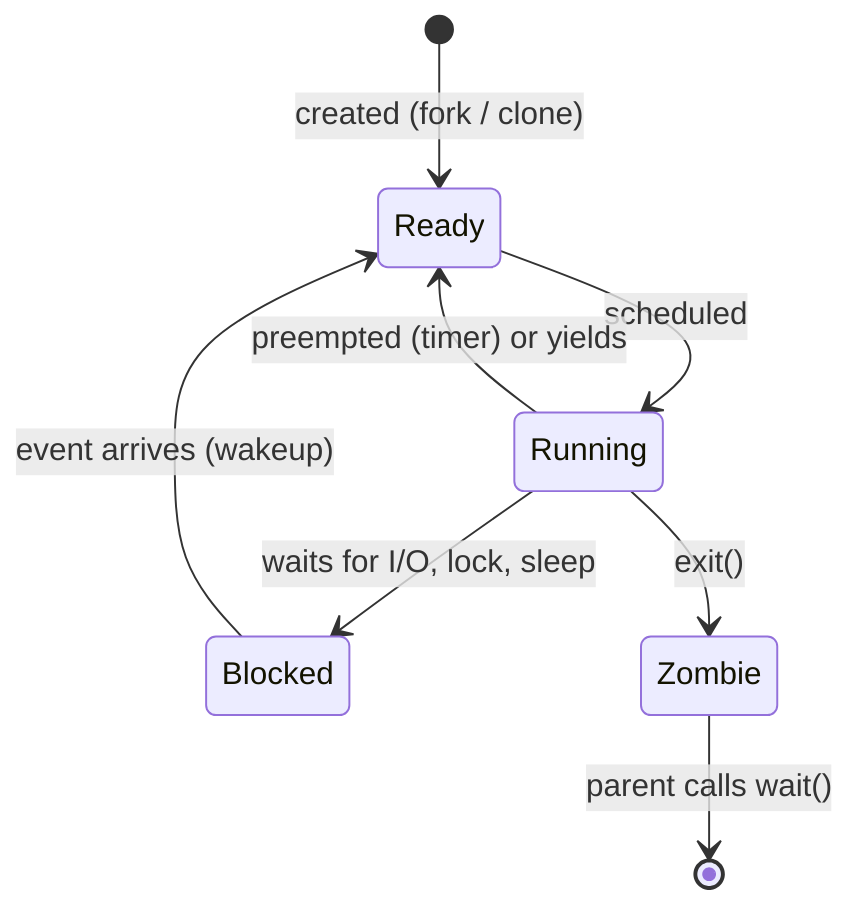
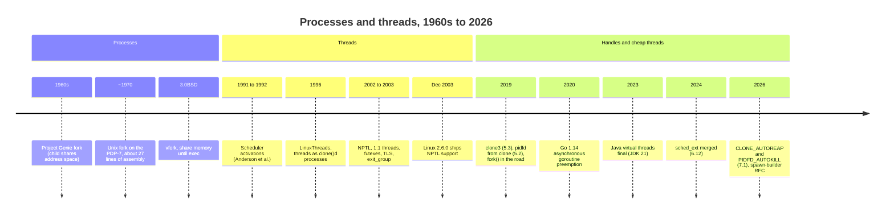
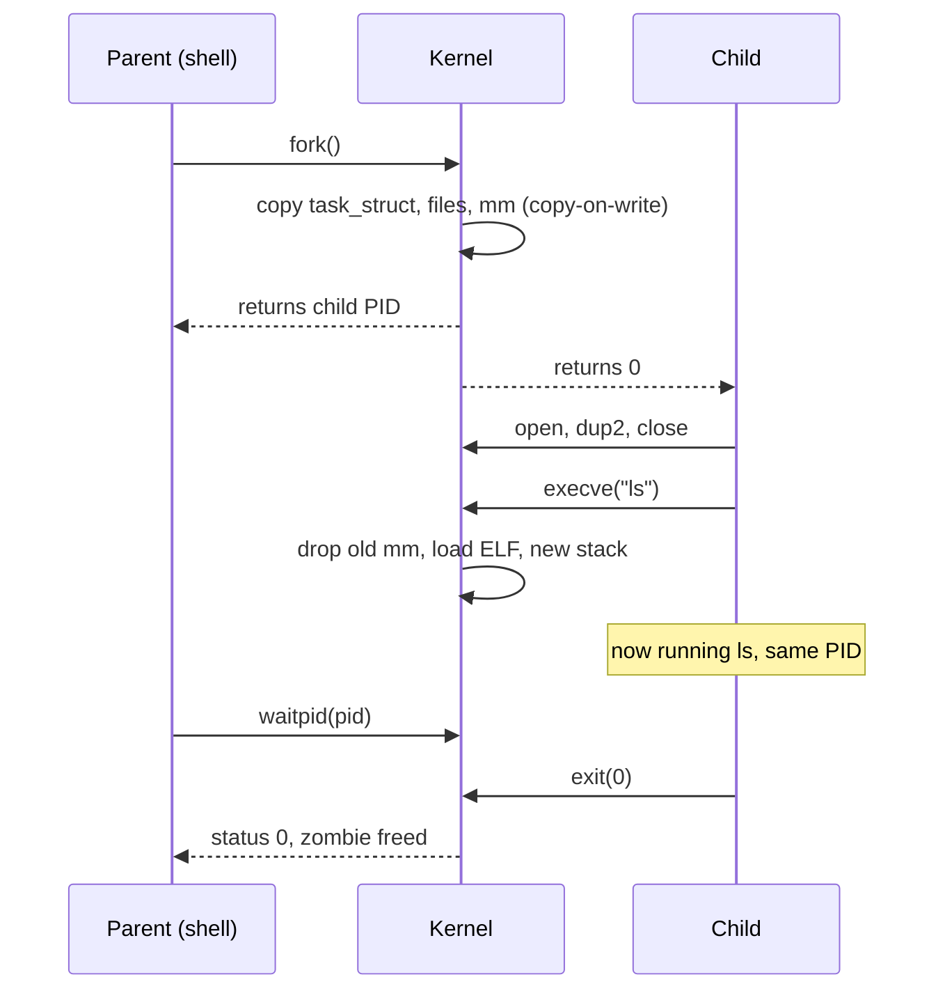
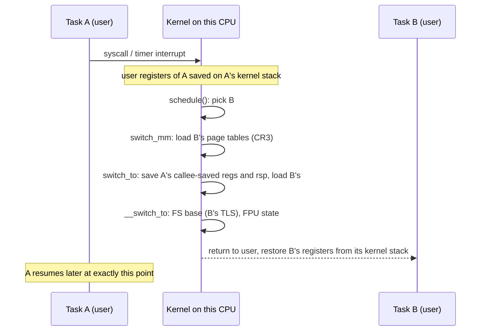

---
tags:
  - operating-systems
  - foundations
  - processes-and-threads
status: draft
sources:
  - https://pages.cs.wisc.edu/~remzi/OSFEP/cpu-intro.pdf
  - https://pages.cs.wisc.edu/~remzi/OSFEP/cpu-api.pdf
  - https://github.com/torvalds/linux/blob/master/include/linux/sched.h
  - https://github.com/torvalds/linux/blob/master/include/uapi/linux/sched.h
  - https://github.com/torvalds/linux/blob/master/kernel/fork.c
  - https://github.com/torvalds/linux/blob/master/kernel/sched/core.c
  - https://github.com/torvalds/linux/blob/master/arch/x86/entry/entry_64.S
  - https://github.com/torvalds/linux/blob/master/Makefile
  - https://man7.org/linux/man-pages/man2/clone3.2.html
  - https://man7.org/linux/man-pages/man2/vfork.2.html
  - https://man7.org/linux/man-pages/man3/posix_spawn.3.html
  - https://www.microsoft.com/en-us/research/publication/a-fork-in-the-road
  - https://www.bu.edu/rhcollab/files/2019/04/fork-in-the-road.pdf
  - https://homes.cs.washington.edu/~tom/pubs/sched_act.pdf
  - https://lkml.iu.edu/hypermail/linux/kernel/0209.2/1075.html
  - https://compas.cs.stonybrook.edu/~nhonarmand/courses/sp17/cse506/papers/nptl-design.pdf
  - https://en.wikipedia.org/wiki/Native_POSIX_Thread_Library
  - https://en.wikipedia.org/wiki/LinuxThreads
  - https://lkml.iu.edu/hypermail/linux/kernel/0312.2/0348.html
  - https://eli.thegreenplace.net/2018/measuring-context-switching-and-memory-overheads-for-linux-threads/
  - https://lkml.iu.edu/hypermail/linux/kernel/1707.1/01682.html
  - https://android.googlesource.com/platform//bionic/+show/HEAD/docs/elf-tls.md
  - https://www.akkadia.org/drepper/tls.pdf
  - https://go.dev/doc/go1.14
  - https://go.dev/blog/container-aware-gomaxprocs
  - https://github.com/golang/go/blob/master/src/runtime/proc.go
  - https://openjdk.org/jeps/444
  - https://openjdk.org/jeps/491
  - https://inside.java/2024/11/15/jep491-target-jdk24/
  - https://infoq.com/articles/virtual-threads-after-jdk24
  - https://tokio.rs/blog/2019-10-scheduler
  - https://patchew.org/linux/20230328210754.2745989-1-posk@google.com
  - https://lkml.iu.edu/hypermail/linux/kernel/2501.2/05737.html
  - https://kernelnewbies.org/Linux_6.12
  - https://lwn.net/SubscriberLink/1002371/0ff2be6a2c7624ca
  - https://linuxplumbersconf.org/event/16/contributions/1213/attachments/1012/1945/io-uring-spawn.pdf
  - https://lwn.net/Articles/1059673/
  - https://lkml.iu.edu/2604.1/05323.html
  - https://lkml.iu.edu/2604.1/05288.html
  - https://lwn.net/Articles/1078356/
  - https://lwn.net/Articles/1076018/
  - https://lkml.iu.edu/2607.2/01230.html
  - https://kernsec.org/pipermail/linux-security-module-archive/2026-August/058921.html
created: 2026-11-26
updated: 2026-11-26
---

## Table Of Contents

---

- [[#TL;DR|TL;DR]]
- [[#The Problem|The Problem]]
- [[#Foundations|Foundations]]
    - [[#Program vs Process|Program vs Process]]
    - [[#The Process Control Block and task_struct|The Process Control Block and task_struct]]
    - [[#Process States|Process States]]
    - [[#Address Spaces|Address Spaces]]
    - [[#What a Thread Shares and What It Owns|What a Thread Shares and What It Owns]]
- [[#How We Got Here|How We Got Here]]
- [[#How It Works|How It Works]]
    - [[#fork, exec and wait|fork, exec and wait]]
    - [[#vfork and posix_spawn|vfork and posix_spawn]]
    - [[#Everything Is a Task - clone and clone3|Everything Is a Task - clone and clone3]]
    - [[#The Context Switch|The Context Switch]]
    - [[#What a Context Switch Costs|What a Context Switch Costs]]
    - [[#Threading Models - 1 to 1, N to 1, M to N|Threading Models - 1 to 1, N to 1, M to N]]
    - [[#User-Level Scheduling - Goroutines, Virtual Threads, Async Runtimes|User-Level Scheduling - Goroutines, Virtual Threads, Async Runtimes]]
    - [[#Thread-Local Storage|Thread-Local Storage]]
- [[#Where It Is Now|Where It Is Now]]
    - [[#Linux Process Creation in 2026|Linux Process Creation in 2026]]
    - [[#Moving Beyond fork and exec|Moving Beyond fork and exec]]
    - [[#User-Mode Scheduling in the Kernel - UMCG and sched_ext|User-Mode Scheduling in the Kernel - UMCG and sched_ext]]
    - [[#Language Runtimes|Language Runtimes]]
- [[#Trade-offs & Open Problems|Trade-offs & Open Problems]]
- [[#Resources|Resources]]
- [[#Related Notes|Related Notes]]

## ***TL;DR***
---
*A process is a running program with its own address space and resources; a thread is one flow of execution inside it. On Linux both are "tasks" made by the same `clone()` call with different sharing flags, and the cost of switching between them is what pushed languages toward cheap user-level threads.*

- **Process = isolation, thread = execution.** A process owns an address space, open files, credentials and namespaces. A thread owns registers, a stack and thread-local storage, and shares everything else with the other threads of its process ([OSTEP ch. 4](https://pages.cs.wisc.edu/~remzi/OSFEP/cpu-intro.pdf)).
- **Unix creates processes in two steps:** `fork()` copies the caller, `exec()` replaces the copy's program. It is simple and flexible, but it is slow for big processes and unsafe with threads, and a 2019 paper argued it should be deprecated ([A fork() in the road, HotOS 2019](https://www.microsoft.com/en-us/research/publication/a-fork-in-the-road)).
- **Linux has one object, the task (`struct task_struct`).** `fork`, `vfork` and `pthread_create` are all `clone()` with different flags: share memory or copy it, share files or copy them, same thread group or a new one ([kernel/fork.c](https://github.com/torvalds/linux/blob/master/kernel/fork.c)).
- **Threads are 1:1 on Linux** since NPTL (2002 to 2003): every user thread is a kernel task. A kernel thread switch costs on the order of 1 to 2 µs, a Go goroutine switch about 170 ns ([Bendersky, 2018](https://eli.thegreenplace.net/2018/measuring-context-switching-and-memory-overheads-for-linux-threads/)), which is why runtimes multiplex many cheap threads onto few kernel threads (M:N).
- **Where it is now (Nov 2026):** Linux 7.1 (June 2026) added `CLONE_AUTOREAP`, `CLONE_NNP` and `CLONE_PIDFD_AUTOKILL` to `clone3()`, making the pidfd the natural handle for a child ([pidfs pull for 7.1](https://lkml.iu.edu/2604.1/05323.html)). A pidfd-based "spawn builder" that would replace fork+exec is at RFC stage ([Li Chen, July 2026](https://lkml.iu.edu/2607.2/01230.html)). Java virtual threads lost their worst pinning problem in JDK 24, and Go 1.25 made `GOMAXPROCS` follow container CPU limits.

## ***The Problem***
---
*A computer has a few CPUs and one physical memory, but we want to run hundreds of programs and thousands of concurrent activities, each believing it has the machine to itself, without letting them corrupt each other.*

The operating system has to solve three problems at once:

| Problem | What the OS provides | Where it is covered |
|---|---|---|
| Share a few CPUs among many activities | Time-sharing: run one, stop it, save its state, run another | [[CPU Scheduling]], [[Interrupts and Exceptions]] |
| Keep programs from reading or wrecking each other's memory | A private address space per process | [[Virtual Memory and Paging]] |
| Let one program do many things at once cheaply | Threads that share one address space | [[Locks and Synchronization]] |

The tension is between **isolation** and **cost**. Separate processes are safe but expensive to create and to switch between (new page tables, cold caches). Threads are cheap to create and share data directly, but any bug in one thread can corrupt every other thread's memory, and shared data needs locks. Every design in this note, from `fork()` to goroutines, is a different point on that line.

## ***Foundations***
---
*Five ideas: a process is a program plus execution state, the kernel tracks it in one structure, it moves between a handful of states, its memory is a private virtual address space, and threads split "who runs" from "what memory and resources are owned".*

#### **Program vs Process**
A **program** is a file: code and initial data on disk (an ELF file on Linux; see [[Compiler, Assembler, Linker, and Loader]]). A **process** is a program being run: the program's code plus everything that changes as it runs. OSTEP lists the machine state that makes up a process ([OSTEP ch. 4](https://pages.cs.wisc.edu/~remzi/OSFEP/cpu-intro.pdf)):

- **Address space:** code, static data, heap and stack.
- **Registers:** including the program counter (next instruction) and stack pointer.
- **I/O state:** open files and similar resources.

One program can be many processes at once (ten shells all run `/bin/bash`), and one process can run several programs over its life (by calling `exec`).

#### **The Process Control Block and task_struct**
The kernel keeps one record per process, the **process control block** (PCB). In teaching kernels it is small: xv6's `struct proc` holds the saved registers (`context`), memory size, kernel stack, state, pid, parent, open files, current directory and trap frame ([OSTEP ch. 4](https://pages.cs.wisc.edu/~remzi/OSFEP/cpu-intro.pdf)).

Linux's PCB is `struct task_struct`, several hundred fields long. The important ones ([include/linux/sched.h](https://github.com/torvalds/linux/blob/master/include/linux/sched.h)):

| Field | What it holds |
|---|---|
| `__state` | Current state (running, sleeping, stopped...) |
| `stack` | This task's kernel stack |
| `prio`, `se`, `sched_class` | Scheduling priority, the scheduler's per-task entity, which scheduler owns it (see [[CPU Scheduling]]) |
| `mm`, `active_mm` | The address space (`NULL` `mm` means a kernel thread) |
| `pid`, `tgid` | Task ID, and thread-group ID (the "process ID" user space sees) |
| `cred`, `real_cred` | Credentials: uids, gids, capabilities |
| `fs`, `files` | Root and current directory, file descriptor table |
| `nsproxy` | Namespaces (see [[Containers, Namespaces and cgroups]]) |
| `signal`, `sighand` | Shared signal state and handlers |
| `thread` | Architecture-specific saved CPU state (`struct thread_struct`) |

The key design point: `mm`, `files`, `fs`, `signal` and `nsproxy` are **pointers to separately reference-counted objects**. Two tasks that point at the same `mm` share memory; two tasks that point at the same `files` share file descriptors. That is how Linux expresses "thread" without a separate thread object.

#### **Process States**
Textbooks use three states: **running** (on a CPU), **ready** (could run, waiting for a CPU) and **blocked** (waiting for an event such as I/O), plus a **zombie** state for a finished process whose parent has not yet collected its exit status ([OSTEP ch. 4](https://pages.cs.wisc.edu/~remzi/OSFEP/cpu-intro.pdf)).



Linux merges "ready" and "running" into one state, `TASK_RUNNING` (runnable: on a CPU or on a run queue), and splits "blocked" by how it can be woken ([sched.h](https://github.com/torvalds/linux/blob/master/include/linux/sched.h)):

| `ps` letter | Kernel state | Meaning |
|---|---|---|
| R | `TASK_RUNNING` | Running or on a run queue |
| S | `TASK_INTERRUPTIBLE` | Sleeping; a signal can wake it |
| D | `TASK_UNINTERRUPTIBLE` | Sleeping; signals can't wake it (usually waiting on disk or a kernel lock) |
| I | `TASK_IDLE` (= uninterruptible + `TASK_NOLOAD`) | Idle kernel thread; not counted in load average |
| T / t | `__TASK_STOPPED` / `__TASK_TRACED` | Stopped by a signal / by a debugger |
| Z | `EXIT_ZOMBIE` | Exited, waiting for the parent's `wait()` |
| X | `EXIT_DEAD` | Being removed |

There is also `TASK_KILLABLE` (uninterruptible except for fatal signals), defined as `TASK_WAKEKILL | TASK_UNINTERRUPTIBLE`.

#### **Address Spaces**
Each process sees a private range of virtual addresses. The hardware translates them through the process's page tables, which the kernel swaps on every switch between processes; see [[Virtual Memory and Paging]]. The address space is what makes `fork()` cheap enough to be practical: the child gets a copy of the parent's page tables with every writable page marked read-only, and a page is physically copied only when one side writes to it (**copy-on-write**).

#### **What a Thread Shares and What It Owns**

| Per process (shared by its threads) | Per thread |
|---|---|
| Address space: code, heap, globals, memory mappings | Registers, program counter, stack pointer |
| File descriptor table, current directory | Stack |
| Credentials, namespaces, resource limits | Thread-local storage |
| Signal handlers | Signal mask, pending thread-directed signals |
| Process ID (`tgid`) | Thread ID (`pid` inside the kernel, `gettid()` outside) |

The naming trap on Linux: what user space calls a PID is the kernel's `tgid`, and what user space calls a TID is the kernel's `pid`. For a single-threaded process the two are equal.

## ***How We Got Here***
---
*Unix's `fork()` came from a 1960s time-sharing system and an expedient PDP-7 implementation; threads came later and were bolted onto processes. Linux first faked threads as processes, then rebuilt them as 1:1 kernel tasks in 2002 to 2003, and language runtimes have since moved scheduling back into user space.*



| When | Step | Problem it answered | Source |
|---|---|---|---|
| 1960s | **Project Genie fork.** The parent specifies the child's address space; by default they share it; no copy facility. | Running sub-tasks on a time-sharing system. | [Baumann et al.](https://www.bu.edu/rhcollab/files/2019/04/fork-in-the-road.pdf) |
| ~1970 | **Unix fork copies the whole process.** Ritchie described it as easy to implement without changing much else; the paper calls it an "expedient PDP-7 implementation shortcut." | Create a process with zero arguments; the gap before `exec` lets the shell set up redirection. | [Baumann et al.](https://www.bu.edu/rhcollab/files/2019/04/fork-in-the-road.pdf) |
| 3.0BSD | **vfork.** Child borrows the parent's memory until `exec` or `_exit`; parent is suspended. | Copying a large process just to throw the copy away. | [vfork(2)](https://man7.org/linux/man-pages/man2/vfork.2.html) |
| 1991 to 1992 | **Scheduler activations.** Kernel tells the user-level scheduler when a thread blocks or a CPU is gained or lost. | User threads were 10x to 30x cheaper than kernel threads (Null Fork 34 µs vs 948 µs) but broke when one blocked in the kernel. | [Anderson et al.](https://homes.cs.washington.edu/~tom/pubs/sched_act.pdf) |
| 1996 | **LinuxThreads** (mainly Xavier Leroy). Each thread is a separate process sharing memory via `clone()`, plus a manager thread. | Linux had no threads. | [Wikipedia: LinuxThreads](https://en.wikipedia.org/wiki/LinuxThreads), [NPTL design paper](https://compas.cs.stonybrook.edu/~nhonarmand/courses/sp17/cse506/papers/nptl-design.pdf) |
| Sep 2002 | **NPTL announced.** 1:1 model, futex-based sync, 100,000 threads created and destroyed in about 2 s. | LinuxThreads' POSIX violations and bottlenecks (below). | [Drepper on LKML](https://lkml.iu.edu/hypermail/linux/kernel/0209.2/1075.html) |
| Mid-2003 | **IBM's NGPT abandoned**, its best features merged into NPTL. NPTL ships first in Red Hat Linux 9. | Two competing pthread libraries. | [Wikipedia: NPTL](https://en.wikipedia.org/wiki/Native_POSIX_Thread_Library) |
| Dec 2003 | **Linux 2.6.0** released with the kernel side of NPTL. | | [Linus's announcement](https://lkml.iu.edu/hypermail/linux/kernel/0312.2/0348.html) |
| 2019 | **"A fork() in the road."** Argues fork should be deprecated and taught as history. | fork's cost and its clash with threads and security. | [HotOS 2019](https://www.microsoft.com/en-us/research/publication/a-fork-in-the-road) |

**What was wrong with LinuxThreads** ([Drepper and Molnar](https://compas.cs.stonybrook.edu/~nhonarmand/courses/sp17/cse506/papers/nptl-design.pdf)):

- A **manager thread** created and reaped all threads: a bottleneck, and a single point of failure if killed.
- **Each thread had its own PID**, so `getpid()` differed per thread, against POSIX.
- **Signals were per-process-ID**, so there were no process-wide signals, and `SIGSTOP` stopped only one thread.
- **Synchronization was built on signals**, with high latency and spurious wakeups.
- On IA-32 the thread pointer lived in the LDT, capping a process at **8,192 threads**.

The kernel changes that fixed it, mostly by Ingo Molnar in 2002: **thread groups** (`CLONE_THREAD`, so all threads share one `tgid`), a **TLS system call** (`set_thread_area`) and `CLONE_SETTLS`, `CLONE_PARENT_SETTID` / `CLONE_CHILD_CLEARTID` so the kernel writes and clears thread IDs (and wakes `pthread_join` via a futex), POSIX signal delivery to any thread of the group, and `exit_group()` to end the whole process ([NPTL design paper](https://compas.cs.stonybrook.edu/~nhonarmand/courses/sp17/cse506/papers/nptl-design.pdf)). Futexes themselves are covered in [[Locks and Synchronization]].

## ***How It Works***
---
*Process creation is `clone()` with a set of share-or-copy flags, followed by `exec` if a new program is wanted. Switching between tasks saves a few registers and swaps a stack pointer and, between processes, a page-table pointer; the hidden cost is in caches and TLBs. User-level runtimes avoid most of that by switching inside one kernel thread.*

#### **fork, exec and wait**
The classic API has three calls ([OSTEP ch. 5](https://pages.cs.wisc.edu/~remzi/OSFEP/cpu-api.pdf)):

- `fork()` returns twice: the child's PID in the parent, 0 in the child. The child is a copy of the parent (copy-on-write memory, duplicated file descriptors).
- `execve(path, argv, envp)` replaces the calling process's program. Same PID, same open file descriptors (unless close-on-exec), new code, data and stack. It does not return on success.
- `wait()` / `waitpid()` blocks until a child exits and collects its exit status, freeing the zombie.

What a shell does for `ls > out.txt`:

```c
pid_t pid = fork();
if (pid == 0) {                         /* child */
    int fd = open("out.txt", O_WRONLY | O_CREAT | O_TRUNC, 0644);
    dup2(fd, STDOUT_FILENO);            /* stdout now goes to the file */
    close(fd);
    execlp("ls", "ls", NULL);           /* only returns on failure */
    _exit(127);
}
int status;
waitpid(pid, &status, 0);               /* reap the child, read exit code */
```

*In plain words: the gap between `fork` and `exec` is where the child rearranges its own file descriptors before becoming `ls`. That gap is fork's great advantage, and also why the kernel must copy everything first: it can't know what the child will change.*



Inside the kernel, `fork()` is just `kernel_clone()` with no sharing flags ([kernel/fork.c](https://github.com/torvalds/linux/blob/master/kernel/fork.c)):

```c
SYSCALL_DEFINE0(fork)
{
	struct kernel_clone_args args = {
		.exit_signal = SIGCHLD,
	};
	return kernel_clone(&args);
}

SYSCALL_DEFINE0(vfork)
{
	struct kernel_clone_args args = {
		.flags		= CLONE_VFORK | CLONE_VM,
		.exit_signal	= SIGCHLD,
	};
	return kernel_clone(&args);
}
```

*In plain words: fork, vfork and thread creation are one code path. `kernel_clone()` calls `copy_process()`, which calls `copy_files()`, `copy_fs()`, `copy_sighand()`, `copy_signal()`, `copy_mm()`, `copy_namespaces()` and `copy_thread()` in turn; each one either takes a reference to the parent's object (if the matching `CLONE_*` flag is set) or makes a copy.*

**Why fork is criticized** ([Baumann et al., HotOS 2019](https://www.bu.edu/rhcollab/files/2019/04/fork-in-the-road.pdf)):

| Problem | Detail |
|---|---|
| Not thread-safe | The child has only the calling thread. If another thread held the malloc lock at the moment of fork, the child deadlocks on its first `malloc`. POSIX allows only async-signal-safe calls between fork and exec. |
| Insecure by default | The child inherits everything (least privilege violated); fork without exec gives every child the same memory layout, weakening ASLR. |
| Slow | Copy-on-write still has to copy page tables and write-protect every dirty page. Chrome saw fork delays up to 100 ms; `posix_spawn` took about 0.5 ms regardless of parent size in their test. |
| Encourages overcommit | A strict kernel would have to reserve memory for every page the child might write. Linux overcommits instead. |
| Doesn't compose | Every layer must be fork-aware: buffered `stdio` output is duplicated unless flushed first. |

#### **vfork and posix_spawn**
`vfork()` skips the copy: the child runs in the parent's memory, on the parent's stack, and the parent is suspended until the child calls `execve` or `_exit`. On Linux it is `clone(CLONE_VM | CLONE_VFORK | SIGCHLD)`, and it doesn't copy page tables at all ([vfork(2)](https://man7.org/linux/man-pages/man2/vfork.2.html)). It is fast and dangerous: the child must not return from the function or call `exit()`, because it would corrupt the parent's stack and stdio buffers.

`posix_spawn()` asks for the whole operation at once: program, arguments, environment, plus a list of **file actions** (open, close, dup2) and **attributes** (signal mask, process group, scheduling). The library is free to implement it safely. Since glibc 2.24 it starts with `clone(CLONE_VM | CLONE_VFORK)` and runs the file actions on a separate stack in the child ([posix_spawn(3)](https://man7.org/linux/man-pages/man3/posix_spawn.3.html)):

```c
posix_spawn_file_actions_t fa;
posix_spawn_file_actions_init(&fa);
posix_spawn_file_actions_addopen(&fa, STDOUT_FILENO, "out.txt",
                                 O_WRONLY | O_CREAT | O_TRUNC, 0644);
pid_t pid;
char *argv[] = { "ls", NULL };
posix_spawnp(&pid, "ls", &fa, NULL, argv, environ);
waitpid(pid, NULL, 0);
```

*In plain words: the same redirection, but described as data instead of as code run in a half-made child, so the library can use the fast, memory-sharing path without the caller being able to break it.* The fork paper counted 1,304 Ubuntu packages calling `fork` versus 41 using `posix_spawn` ([Baumann et al.](https://www.bu.edu/rhcollab/files/2019/04/fork-in-the-road.pdf)): the safer API exists but is not the default habit.

#### **Everything Is a Task - clone and clone3**
Linux has no separate "thread" object. `clone()` creates a task and the flags say which of the parent's objects to share ([clone(2)](https://man7.org/linux/man-pages/man2/clone3.2.html), [uapi/linux/sched.h](https://github.com/torvalds/linux/blob/master/include/uapi/linux/sched.h)):

| Flag | Shared or new | Used by |
|---|---|---|
| `CLONE_VM` | Share the address space | threads, vfork, posix_spawn |
| `CLONE_FILES` | Share the file descriptor table | threads |
| `CLONE_FS` | Share root, cwd, umask | threads |
| `CLONE_SIGHAND` | Share signal handlers (requires `CLONE_VM`) | threads |
| `CLONE_THREAD` | Same thread group: same `tgid`, no `SIGCHLD` on exit, can't be waited on (requires `CLONE_SIGHAND`) | threads |
| `CLONE_SETTLS` | Set the new thread pointer (TLS) | threads |
| `CLONE_PARENT_SETTID`, `CLONE_CHILD_CLEARTID` | Kernel writes the TID; clears it and wakes a futex on exit | `pthread_create` / `pthread_join` |
| `CLONE_VFORK` | Suspend the parent until the child execs or exits | vfork, posix_spawn |
| `CLONE_NEWNS`, `NEWPID`, `NEWNET`, `NEWUSER`, `NEWUTS`, `NEWIPC`, `NEWCGROUP`, `NEWTIME` | New namespaces | containers ([[Containers, Namespaces and cgroups]]) |
| `CLONE_PIDFD` (5.2) | Return a pidfd for the child | modern process supervisors |
| `CLONE_INTO_CGROUP` (5.7, clone3 only) | Start the child directly in a cgroup | container runtimes, systemd |

So a "process" is a task with nothing shared, and a "thread" is a task created with roughly `CLONE_VM | CLONE_FS | CLONE_FILES | CLONE_SIGHAND | CLONE_THREAD | CLONE_SYSVSEM | CLONE_SETTLS | CLONE_PARENT_SETTID | CLONE_CHILD_CLEARTID`. Everything in between is also allowed, which is how containers get a new PID and mount namespace but the same everything else.

`clone()` ran out of flag bits (32 of them, one byte used for the exit signal) and had different argument orders on different architectures (the kernel still carries four `SYSCALL_DEFINE` variants of it). **`clone3()`** (Linux 5.3) takes an extensible `struct clone_args` with a size field, so new fields can be added: `flags`, `pidfd`, `child_tid`, `parent_tid`, `exit_signal`, `stack`, `stack_size`, `tls`, `set_tid` (5.5, choose the PID, for checkpoint/restore) and `cgroup` ([clone3(2)](https://man7.org/linux/man-pages/man2/clone3.2.html)). All flags above bit 31 exist only in `clone3()`.

A **pidfd** is a file descriptor that refers to one process. Unlike a numeric PID, it can't be recycled to point at a different process, it can be `poll()`ed for exit, and signals can be sent through it with `pidfd_send_signal()` ([LWN, Feb 2026](https://lwn.net/Articles/1059673/)).

#### **The Context Switch**
A context switch happens when the kernel decides a different task should run on this CPU: the current one blocked, its time ran out (a timer interrupt set "need resched"; see [[Interrupts and Exceptions]]), or a higher-priority task woke up. By the time the scheduler runs, the user-mode registers are already saved on the task's kernel stack, because the task entered the kernel through a system call or interrupt ([[System Calls and the User-Kernel Boundary]]). So the switch itself only has to change kernel stacks and, if needed, the address space.

Linux's core switch routine, slightly shortened ([kernel/sched/core.c](https://github.com/torvalds/linux/blob/master/kernel/sched/core.c)):

```c
static __always_inline struct rq *
context_switch(struct rq *rq, struct task_struct *prev,
	       struct task_struct *next, struct rq_flags *rf)
{
	prepare_task_switch(rq, prev, next);

	if (!next->mm) {				// to kernel thread
		enter_lazy_tlb(prev->active_mm, next);
		next->active_mm = prev->active_mm;	// borrow the old mm
		...
	} else {					// to user task
		switch_mm_irqs_off(prev->active_mm, next->mm, next);
		...
	}
	...
	/* Here we just switch the register state and the stack. */
	switch_to(prev, next, prev);
	barrier();
	return finish_task_switch(prev);
}
```

*In plain words: if the next task is a kernel thread, keep the current page tables (kernel threads only touch kernel memory, which is mapped in every address space). Otherwise load the next task's page tables. If `prev` and `next` are threads of the same process, `switch_mm` sees the same `mm` and skips the reload. Then swap stacks and registers.*

The register swap on x86-64 ([arch/x86/entry/entry_64.S](https://github.com/torvalds/linux/blob/master/arch/x86/entry/entry_64.S)):

```asm
SYM_FUNC_START(__switch_to_asm)
	pushq	%rbp            /* save callee-saved registers of prev */
	pushq	%rbx
	pushq	%r12
	pushq	%r13
	pushq	%r14
	pushq	%r15
	movq	%rsp, TASK_threadsp(%rdi)   /* save prev's stack pointer */
	movq	TASK_threadsp(%rsi), %rsp   /* load next's stack pointer */
	FILL_RETURN_BUFFER %r12, RSB_CLEAR_LOOPS, X86_FEATURE_RSB_CTXSW
	popq	%r15            /* restore next's callee-saved registers */
	...
	popq	%rbp
	jmp	__switch_to     /* C part: FS/GS base (TLS), FPU state, etc. */
SYM_FUNC_END(__switch_to_asm)
```

*In plain words: only six registers are saved explicitly, because the C calling convention already saved the rest. The real switch is the single instruction that loads `next`'s stack pointer: after it, `ret` returns into wherever `next` was when it last called the scheduler. `FILL_RETURN_BUFFER` overwrites the CPU's return-address predictor so one task can't steer another's speculation, a mitigation that adds cost to every switch (see [[Transient Execution Attacks and Mitigations]]).*



#### **What a Context Switch Costs**
Two kinds of cost:

- **Direct:** entering the kernel, running the scheduler, saving and loading registers and FPU state, writing the page-table register. Eli Bendersky measured about **1.2 to 1.5 µs** per thread switch pinned to one core and about **2.2 µs** unpinned on a Haswell desktop, against about **170 ns** for a goroutine switch ([Bendersky, Sept 2018](https://eli.thegreenplace.net/2018/measuring-context-switching-and-memory-overheads-for-linux-threads/)).
- **Indirect:** the new task finds the caches and TLB full of the old task's data. Without tagging, loading new page tables flushes the TLB. x86 **PCID** tags TLB entries by address space so recently used ones survive a switch; when Linux added PCID support, Andy Lutomirski measured about 100 ns saved per context switch on his laptop ([LKML, July 2017](https://lkml.iu.edu/hypermail/linux/kernel/1707.1/01682.html)). Switching between threads of the same process avoids the page-table change entirely, which is a main reason threads are cheaper than processes.

A simple model of the CPU fraction lost to switching:

$$
f = R_{cs} \times (c_{\text{direct}} + c_{\text{indirect}})
$$

*In plain English: the fraction of a core spent switching is the number of switches per second times the cost of each, including the cache misses it causes afterwards.*

**Worked example.** A thread-per-request server on one core does 50,000 switches per second.

| Switch type | Direct cost | Direct overhead $50{,}000 \times c$ |
|---|---|---|
| Kernel thread, pinned | 1.5 µs | 75 ms per second = **7.5%** of the core |
| Kernel thread, migrating | 2.2 µs | 110 ms per second = **11%** |
| Goroutine | 0.17 µs | 8.5 ms per second = **0.85%** |

The indirect cost comes on top and depends on the working set, which is why the gap seen in practice is often bigger than the table.

Memory matters too. With **Little's law**, the number of requests in flight is $L = \lambda W$: arrival rate times time each request spends in the system. At 10,000 requests per second and 100 ms per request, $L = 1{,}000$ concurrent requests; at 1 s each, $L = 10{,}000$. With one kernel thread per request and Linux's default 8 MiB stack, 10,000 threads reserve 80 GiB of virtual memory, though Bendersky measured only about 80 MiB actually resident when the stacks were barely used, and about 2.6 GiB when each used 400 KiB ([Bendersky](https://eli.thegreenplace.net/2018/measuring-context-switching-and-memory-overheads-for-linux-threads/)). This arithmetic is the motivation JEP 444 gives for Java virtual threads ([JEP 444](https://openjdk.org/jeps/444)).

#### **Threading Models - 1 to 1, N to 1, M to N**

| Model | What it is | Blocking syscall | Uses many cores | Examples |
|---|---|---|---|---|
| **1:1** | Every user thread is a kernel task | Blocks only that thread | Yes | Linux NPTL |
| **N:1** | Many user threads on one kernel thread ("green threads") | Blocks all of them | No | Single-threaded coroutine and user-thread libraries |
| **M:N** | Many user threads on a pool of kernel threads | Needs runtime help (handoff or async I/O) | Yes | Go, Java virtual threads, Tokio tasks, FastThreads on scheduler activations |

The hard part of M:N is that the kernel doesn't know about the user-level threads. If one blocks in a system call (a page fault, a disk read), the kernel thread under it stops, and the runtime loses a worker without being told. **Scheduler activations** fixed this with upcalls from the kernel: "your thread blocked, here is a fresh execution context" ([Anderson et al.](https://homes.cs.washington.edu/~tom/pubs/sched_act.pdf)). Linux chose 1:1 instead: the NPTL authors judged M:N kernel support too costly and a poor fit, and argued that 1:1 keeps signal handling simple and that the O(1) scheduler made large thread counts affordable ([Drepper and Molnar](https://compas.cs.stonybrook.edu/~nhonarmand/courses/sp17/cse506/papers/nptl-design.pdf)). Modern M:N runtimes work around the missing kernel help in user space, as the next section shows.

#### **User-Level Scheduling - Goroutines, Virtual Threads, Async Runtimes**
All three put a scheduler in the language runtime. A user-level switch saves a handful of registers and a stack pointer, with no kernel entry and no page-table change, which is where the roughly 10x cheaper switch comes from.

- **Go (G, M, P).** The runtime has **G**oroutines, **M**achines (OS threads) and **P**rocessors, a token an M must hold to run Go code; an M can be blocked in a syscall without a P ([runtime/proc.go](https://github.com/golang/go/blob/master/src/runtime/proc.go)). When a goroutine enters a blocking syscall, its P is handed to another thread so other goroutines keep running. Network I/O goes through an internal poller so most goroutines never block a thread. Since **Go 1.14** (Feb 2020) goroutines are **asynchronously preemptible** via signals, so a tight loop without function calls can no longer stall the scheduler ([Go 1.14 notes](https://go.dev/doc/go1.14)). `GOMAXPROCS` is "the maximum number of threads to use for running goroutines at once" ([Go blog, Aug 2025](https://go.dev/blog/container-aware-gomaxprocs)).
- **Java virtual threads.** A virtual thread is mounted on a **carrier** (platform) thread when it runs and unmounted when it blocks, its stack frames saved on the heap ([JEP 444](https://openjdk.org/jeps/444)). Final in JDK 21 (Sept 2023). Until JDK 24 a virtual thread blocking inside `synchronized` stayed **pinned** to its carrier, because the JVM recorded the carrier as the monitor owner; enough pinned threads starved the pool ([JEP 491](https://openjdk.org/jeps/491)).
- **Async runtimes (Rust Tokio, and similar).** Tasks are state machines that return to the scheduler at each `.await`, so scheduling is cooperative. Tokio's scheduler uses per-worker fixed-size run queues, **work stealing** (an idle worker takes half of a busy worker's queue), a global overflow queue checked about every 60 tasks, and a **LIFO slot** so a task woken by a message runs next while the data is still in cache ([Tokio blog, Oct 2019](https://tokio.rs/blog/2019-10-scheduler)). The same ideas (per-core queues, stealing, cache-aware wakeups) are what the kernel scheduler does; see [[CPU Scheduling]].

The shared catch: user-level scheduling works only while tasks don't block the underlying kernel thread. That is why these runtimes pair with non-blocking or completion-based I/O such as epoll and [[io_uring]].

#### **Thread-Local Storage**
Each thread needs some variables of its own: `errno`, allocator caches, a "current request" pointer. C11 spells it `_Thread_local` (GCC `__thread`):

```c
static _Thread_local int calls;      /* one copy per thread */

void handle(void) {
    calls++;                         /* no lock needed: only this thread sees it */
}
```

*In plain words: the compiler turns `calls` into "thread pointer + fixed offset". The thread pointer is a register that the kernel sets per task (on x86-64 the FS base, loaded in `__switch_to`; it is what `CLONE_SETTLS` sets at thread creation).*

How the offset is found depends on where the variable lives. The ELF TLS ABI ([Drepper, tls.pdf](https://www.akkadia.org/drepper/tls.pdf)) defines four access models, cheapest to most general ([Bionic ELF TLS notes](https://android.googlesource.com/platform//bionic/+show/HEAD/docs/elf-tls.md)):

| Model | Variable is in | Cost |
|---|---|---|
| Local Exec | The executable itself | Offset fixed at link time; one instruction |
| Initial Exec | Any module loaded at startup (static TLS block) | Offset loaded from the GOT |
| Local Dynamic | Same module as the code, maybe `dlopen`ed | One `__tls_get_addr` call per module |
| General Dynamic | Anywhere | A `__tls_get_addr` call per access |

User-level threads complicate TLS: a goroutine or virtual thread can move between kernel threads, so OS-level TLS is per carrier, not per task. Runtimes provide their own task-local storage, and code that used thread-locals as caches behaves differently; see [[#Language Runtimes|Language Runtimes]] below. TLS layout is set up by the dynamic loader; see [[Compiler, Assembler, Linker, and Loader]].

## ***Where It Is Now***
---
*As of November 2026 (mainline Linux at 7.4-rc4), process creation on Linux is moving toward pidfds as the handle for everything, with new `clone3()` flags merged in 7.1 and a kernel `posix_spawn` builder under review. In-kernel support for user-level scheduling (UMCG) stalled in favor of sched_ext, while Go and Java keep tightening their M:N runtimes.*

#### **Linux Process Creation in 2026**
- **Linux 7.1 (released 14 June 2026)** added three `clone3()` flags from Christian Brauner ([LWN release status](https://lwn.net/Articles/1078356/), [pidfs pull](https://lkml.iu.edu/2604.1/05323.html)):
  - `CLONE_AUTOREAP`: this one child is reaped automatically on exit, never becoming a zombie. Unlike setting `SIGCHLD` to `SIG_IGN`, it affects only that child, so a library can use it. With `CLONE_PIDFD` the parent can still poll the pidfd and read the exit status. It requires `exit_signal` = 0 and rejects `CLONE_THREAD`.
  - `CLONE_NNP`: set `no_new_privs` on the child only, so it can never gain privileges through setuid binaries.
  - `CLONE_PIDFD_AUTOKILL`: the child gets `SIGKILL` when the last reference to its clone pidfd is closed, for example when the supervisor crashes. Requires `CLONE_PIDFD` and `CLONE_AUTOREAP`; without `CLONE_NNP` it needs `CAP_SYS_ADMIN`, after Linus Torvalds objected that it could let a creator kill setuid processes it otherwise couldn't ([LWN, Feb 2026](https://lwn.net/Articles/1059673/)).
- 7.1 also added `CLONE_EMPTY_MNTNS`, which starts the child in a mount namespace containing only a copy of the root mount ([vfs mount pull](https://lkml.iu.edu/2604.1/05288.html)). All four are now in mainline's [uapi/linux/sched.h](https://github.com/torvalds/linux/blob/master/include/uapi/linux/sched.h).

Using the new flags:

```c
struct clone_args args = {
	.flags       = CLONE_PIDFD | CLONE_AUTOREAP | CLONE_NNP | CLONE_PIDFD_AUTOKILL,
	.pidfd       = (uint64_t)(uintptr_t)&pidfd,
	.exit_signal = 0,                 /* required by CLONE_AUTOREAP */
};
pid_t pid = syscall(SYS_clone3, &args, sizeof(args));
if (pid == 0) {
	execv("/usr/bin/worker", argv);   /* child */
	_exit(127);
}
struct pollfd p = { .fd = pidfd, .events = POLLIN };
poll(&p, 1, -1);                      /* wakes when the child exits; no wait() needed */
```

*In plain words: the child can't escalate privileges, dies if the parent drops its handle, and cleans itself up on exit. The pidfd is the parent's only link to it, which removes the PID-reuse races and global `SIGCHLD` handling that supervisors used to need.*

- **Process creation in io_uring** was proposed by Gabriel Krisman Bertazi in December 2024, reviving Josh Triplett's 2022 `io_uring_spawn` idea ([LPC 2022 slides](https://linuxplumbersconf.org/event/16/contributions/1213/attachments/1012/1945/io-uring-spawn.pdf)): `IORING_OP_CLONE` starts a child that runs the following linked operations, and `IORING_OP_EXEC` replaces its program; chains of exec attempts could even do the `PATH` search in the kernel. LWN called it early-stage, and Pavel Begunkov suggested a `posix_spawn`-like list passed to a clone variant instead ([LWN, Dec 2024](https://lwn.net/SubscriberLink/1002371/0ff2be6a2c7624ca)). I found no sign it was merged as of November 2026.

#### **Moving Beyond fork and exec**
- **Spawn templates, rejected (May to June 2026).** Li Chen proposed `spawn_template_create()` / `spawn_template_spawn()` to cache setup work for repeatedly launched programs, reporting about a 2% gain. Mateusz Guzik argued the fork idiom "needs to be retired" and that "creating a pristine process is the way to go"; Christian Brauner suggested building on pidfds instead, with an empty-process option to `pidfd_open()` and an `fsconfig()`-like `pidfd_config()`, aimed at a user-space `posix_spawn()` ([LWN, 5 June 2026](https://lwn.net/Articles/1076018/)).
- **The pidfd spawn builder (RFC, 16 July 2026).** Li Chen's follow-up does exactly that ([cover letter](https://lkml.iu.edu/2607.2/01230.html)):
  1. `pidfd_open(0, PIDFD_EMPTY)` returns a "future" pidfd with no task or PID yet.
  2. `pidfd_config()` optionally stages settings such as the executable path.
  3. `pidfd_spawn_run()` takes path, argv and envp, creates the task, and the same fd becomes the child's pidfd.

  Until exec succeeds the child is "embryonic": ptrace and `pidfd_getfd()` are refused and procfs hides it. The first version supports only `dup2`, `close_range` and `fchdir` actions, still uses `CLONE_VM | CLONE_VFORK` internally, and inherits the caller's state rather than building a pristine process. The cover letter names AI agent tool-calling and compiler drivers as target workloads. Review in August 2026 asked for the executable to be passed as an fd to avoid path races, and asked whether `execveat()` could take the pidfd instead of adding a new exec variant ([Justin Suess, Aug 2026](https://kernsec.org/pipermail/linux-security-module-archive/2026-August/058921.html)). **Status: RFC, not merged.**

This is the HotOS 2019 argument arriving in the kernel: describe the child as data, create it fresh, and hand back a race-free handle.

#### **User-Mode Scheduling in the Kernel - UMCG and sched_ext**
- **UMCG (User-Managed Concurrency Groups)** was Google's proposal, led by Peter Oskolkov, to give user-space schedulers kernel support in the spirit of scheduler activations: user-level "workers" are real kernel threads, and "servers" get told when a worker blocks or wakes, so fibers can block in syscalls without stalling the runtime. In March 2023 Oskolkov asked LKML how, or whether, to proceed; Google was rolling out an internal version that keeps the state in `task_struct`, and Peter Zijlstra was interested in a cross-process variant ([LKML thread, Mar 2023](https://patchew.org/linux/20230328210754.2745989-1-posk@google.com)).
- In January 2025 a request on LKML for the latest UMCG patch said "further UMCG development is awaiting sched_ext", with plans to build UMCG-like per-process scheduling on top of it ([LKML, Jan 2025](https://lkml.iu.edu/hypermail/linux/kernel/2501.2/05737.html)). **sched_ext**, which lets BPF programs implement scheduling policies, was merged in **Linux 6.12** (Nov 2024) ([Kernel Newbies](https://kernelnewbies.org/Linux_6.12)); see [[sched_ext and Pluggable Scheduling]] and [[eBPF]].
- **Unconfirmed:** I found no UMCG merge or new public UMCG series in 2025 or 2026. Treat UMCG as not in mainline as of November 2026.

#### **Language Runtimes**
- **Java.** JEP 491 (targeted to JDK 24, March 2025) lets virtual threads unmount inside `synchronized` blocks and `Object.wait()`, removing the main pinning problem ([JEP 491](https://openjdk.org/jeps/491), [inside.java](https://inside.java/2024/11/15/jep491-target-jdk24/)). JDK 25 LTS (Sept 2025) finalized Scoped Values (JEP 506), the replacement for thread-locals in virtual-thread code, while Structured Concurrency stayed in preview (fifth preview, JEP 505). Pinning still remains for native frames (JNI/FFM), class initializers and local file I/O on Linux ([InfoQ, July 2026](https://infoq.com/articles/virtual-threads-after-jdk24)).
- **What production found.** InfoQ's July 2026 benchmarks on an 8-vCPU machine: an I/O-bound endpoint went from 3,594 to 7,426 requests/s (+107%) with p99 latency down 64% on virtual threads, but a JDBC workload kept the same 37% error rate, because the bottleneck moved to the connection pool. A `ThreadLocal`-cached `SimpleDateFormat` was initialized 443,267 times instead of 200, because every virtual thread is new ([InfoQ](https://infoq.com/articles/virtual-threads-after-jdk24)).
- **Go 1.25 (Aug 2025).** The default `GOMAXPROCS` now follows the container's CPU limit (rounded up) when it is below the core count, and is updated if the limit changes; before, it was the machine's logical CPU count from Go 1.5 through 1.24 ([Go blog, Aug 2025](https://go.dev/blog/container-aware-gomaxprocs)). An M:N runtime that oversubscribes its cgroup's CPU quota gets throttled by the kernel; see [[Containers, Namespaces and cgroups]].

## ***Trade-offs & Open Problems***
---
*Every concurrency unit trades isolation against cost, and every scheduler split between kernel and user space trades information against speed. The open questions are how to create processes without fork's baggage, and how a user-level scheduler can learn what the kernel knows.*

| Unit | Isolation | Create cost | Switch cost | Blocking I/O | Main hazard |
|---|---|---|---|---|---|
| Process | Full address space, own fds, creds | Highest (copy page tables, or exec) | Highest (page-table switch, TLB) | Fine | Memory overhead; IPC needed to share |
| Kernel thread (1:1) | None within process | Medium | ~1 to 2 µs | Fine | Data races; 8 MiB default stack reservation |
| Goroutine / virtual thread (M:N) | None | Low (small growable stack) | ~0.2 µs | Runtime must hand off or use async I/O | Pinning, invisible to OS tools, TLS assumptions break |
| Async task (cooperative) | None | Lowest | Lowest | Must never block | One blocking call stalls a worker; "function color" split |

Open problems worth tracking:
- **Pristine process creation.** Guzik's and Brauner's direction is a process built from an explicit description rather than a copy, but the July 2026 RFC still inherits from the caller; doing a fully specified child (credentials, namespaces, cgroup, fds) without copying is unfinished ([RFC](https://lkml.iu.edu/2607.2/01230.html)).
- **Security boundaries of new spawn paths.** Seccomp sees one builder syscall rather than each action, AUTOKILL needed `no_new_privs` to be safe, and embryonic children must be hidden from ptrace. Each new creation path reopens these questions ([LWN, Feb 2026](https://lwn.net/Articles/1059673/)).
- **fork in multithreaded programs.** Still undefined behavior for anything but async-signal-safe calls before exec, and still used by servers such as Redis for copy-on-write snapshots ([Baumann et al.](https://www.bu.edu/rhcollab/files/2019/04/fork-in-the-road.pdf)).
- **Kernel help for M:N.** Scheduler activations were the answer in 1991; UMCG tried again and stalled; sched_ext may be the vehicle now. No mainline mechanism yet tells a user-level runtime that one of its threads blocked.
- **Context switch cost after Spectre.** Return-buffer stuffing and other mitigations add work to every switch; see [[Transient Execution Attacks and Mitigations]]. Cheap user-level switches avoid them, but also share one protection domain.
- **Observability.** `ps`, `top` and `perf` see kernel tasks. Millions of goroutines or virtual threads are invisible to them; Java needed new thread-dump formats and JFR events to diagnose pinning ([InfoQ](https://infoq.com/articles/virtual-threads-after-jdk24)).
- **Thread-local storage semantics.** OS TLS is per kernel thread; task-local storage is per user thread. Code written for one breaks quietly under the other, as the `ThreadLocal` cache example shows.

## ***Resources***
---
*Start with OSTEP chapters 4 and 5, then read the fork paper and the NPTL design paper for why Linux looks the way it does, then the kernel source for `context_switch()` and `copy_process()`. LWN covers what changed in 2026.*

**Textbooks and course material**
- [OSTEP ch. 4, The Abstraction: The Process](https://pages.cs.wisc.edu/~remzi/OSFEP/cpu-intro.pdf): Arpaci-Dusseau. Process state, the PCB, xv6's `struct proc`.
- [OSTEP ch. 5, Process API](https://pages.cs.wisc.edu/~remzi/OSFEP/cpu-api.pdf): fork, exec, wait and how a shell uses them.

**Primary papers**
- [A fork() in the road](https://www.microsoft.com/en-us/research/publication/a-fork-in-the-road) ([PDF](https://www.bu.edu/rhcollab/files/2019/04/fork-in-the-road.pdf)): Baumann, Appavoo, Krieger, Roscoe, HotOS 2019. The case against fork.
- [Scheduler Activations](https://homes.cs.washington.edu/~tom/pubs/sched_act.pdf): Anderson, Bershad, Lazowska, Levy, SOSP 1991 / TOCS 1992. Why user threads are fast and what kernel support they need.
- [The Native POSIX Thread Library for Linux](https://compas.cs.stonybrook.edu/~nhonarmand/courses/sp17/cse506/papers/nptl-design.pdf): Drepper and Molnar. LinuxThreads' problems and the 1:1 design.
- [ELF Handling For Thread-Local Storage](https://www.akkadia.org/drepper/tls.pdf): Ulrich Drepper. The TLS ABI.

**Kernel source and manuals**
- [include/linux/sched.h](https://github.com/torvalds/linux/blob/master/include/linux/sched.h): `struct task_struct` and task states.
- [kernel/fork.c](https://github.com/torvalds/linux/blob/master/kernel/fork.c): `copy_process()`, `kernel_clone()`, `fork`/`vfork`/`clone`/`clone3`.
- [kernel/sched/core.c](https://github.com/torvalds/linux/blob/master/kernel/sched/core.c) and [arch/x86/entry/entry_64.S](https://github.com/torvalds/linux/blob/master/arch/x86/entry/entry_64.S): `context_switch()` and `__switch_to_asm`.
- [clone(2) / clone3(2)](https://man7.org/linux/man-pages/man2/clone3.2.html), [vfork(2)](https://man7.org/linux/man-pages/man2/vfork.2.html), [posix_spawn(3)](https://man7.org/linux/man-pages/man3/posix_spawn.3.html).

**Kernel news and mailing lists**
- [NPTL announcement](https://lkml.iu.edu/hypermail/linux/kernel/0209.2/1075.html): Ulrich Drepper, LKML, Sept 2002.
- [PCID and improved laziness](https://lkml.iu.edu/hypermail/linux/kernel/1707.1/01682.html): Andy Lutomirski, LKML, July 2017.
- [Process creation in io_uring](https://lwn.net/SubscriberLink/1002371/0ff2be6a2c7624ca): LWN, Dec 2024; and [io_uring_spawn slides](https://linuxplumbersconf.org/event/16/contributions/1213/attachments/1012/1945/io-uring-spawn.pdf), Josh Triplett, LPC 2022.
- [As ye clone(), so shall ye AUTOREAP](https://lwn.net/Articles/1059673/): LWN, Feb 2026. CLONE_AUTOREAP and PIDFD_AUTOKILL.
- [vfs pidfs pull for 7.1](https://lkml.iu.edu/2604.1/05323.html) and [vfs mount pull for 7.1](https://lkml.iu.edu/2604.1/05288.html): Christian Brauner, April 2026.
- [Moving beyond fork() + exec()](https://lwn.net/Articles/1076018/): LWN, June 2026.
- [pidfd: add a minimal process spawn builder (RFC)](https://lkml.iu.edu/2607.2/01230.html): Li Chen, July 2026, and [review reply](https://kernsec.org/pipermail/linux-security-module-archive/2026-August/058921.html), Aug 2026.
- [UMCG: how should we proceed?](https://patchew.org/linux/20230328210754.2745989-1-posk@google.com): Oskolkov and Zijlstra, Mar 2023; [UMCG status request](https://lkml.iu.edu/hypermail/linux/kernel/2501.2/05737.html), Jan 2025.
- [Kernel Newbies: Linux 6.12](https://kernelnewbies.org/Linux_6.12): sched_ext merged.

**Runtimes**
- [runtime/proc.go](https://github.com/golang/go/blob/master/src/runtime/proc.go): Go's G/M/P scheduler, explained in its header comment.
- [Go 1.14 release notes](https://go.dev/doc/go1.14) (async preemption) and [Container-aware GOMAXPROCS](https://go.dev/blog/container-aware-gomaxprocs), Aug 2025.
- [JEP 444: Virtual Threads](https://openjdk.org/jeps/444) and [JEP 491: Synchronize Virtual Threads without Pinning](https://openjdk.org/jeps/491).
- [Virtual Threads after JDK 24](https://infoq.com/articles/virtual-threads-after-jdk24): InfoQ, July 2026. Production lessons with numbers.
- [Making the Tokio scheduler 10x faster](https://tokio.rs/blog/2019-10-scheduler): Carl Lerche, Oct 2019. Work stealing in a user-level scheduler.

**Measurements**
- [Measuring context switching and memory overheads for Linux threads](https://eli.thegreenplace.net/2018/measuring-context-switching-and-memory-overheads-for-linux-threads/): Eli Bendersky, Sept 2018.

## Related Notes

- [[System Calls and the User-Kernel Boundary]] — fork, exec, clone and wait are system calls; user registers are saved on entry, before any context switch.
- [[Virtual Memory and Paging]] — Address spaces, copy-on-write fork, page tables swapped on a process switch, PCID and the TLB.
- [[CPU Scheduling]] — Picks which runnable task runs next; `sched_entity` and `sched_class` live in `task_struct`.
- [[sched_ext and Pluggable Scheduling]] — BPF schedulers, now the likely home for UMCG-style user-directed scheduling.
- [[Interrupts and Exceptions]] — The timer interrupt that triggers preemption and the entry path that saves user state.
- [[Locks and Synchronization]] — Futexes, born with NPTL, and the races threads introduce.
- [[Containers, Namespaces and cgroups]] — The `CLONE_NEW*` flags, `CLONE_INTO_CGROUP`, and CPU limits that runtimes now read.
- [[io_uring]] — Completion-based I/O that M:N runtimes rely on, and a proposed process-creation path.
- [[eBPF]] — The mechanism under sched_ext.
- [[Transient Execution Attacks and Mitigations]] — Why context switches now stuff the return stack buffer.
- [[Kernel Security Hardening]] — `no_new_privs`, and the security questions new spawn APIs raise.
- [[Memory Allocators]] — Per-thread allocator caches are the classic use of thread-local storage and the classic fork deadlock.
- [[Compiler, Assembler, Linker, and Loader]] — What `exec` loads, and how the loader lays out TLS.
- [[The Boot Process]] — How PID 1, the ancestor of every process, is started.
