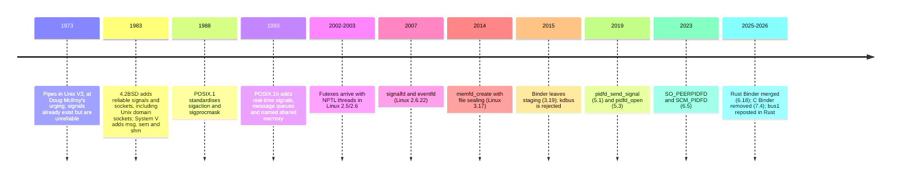
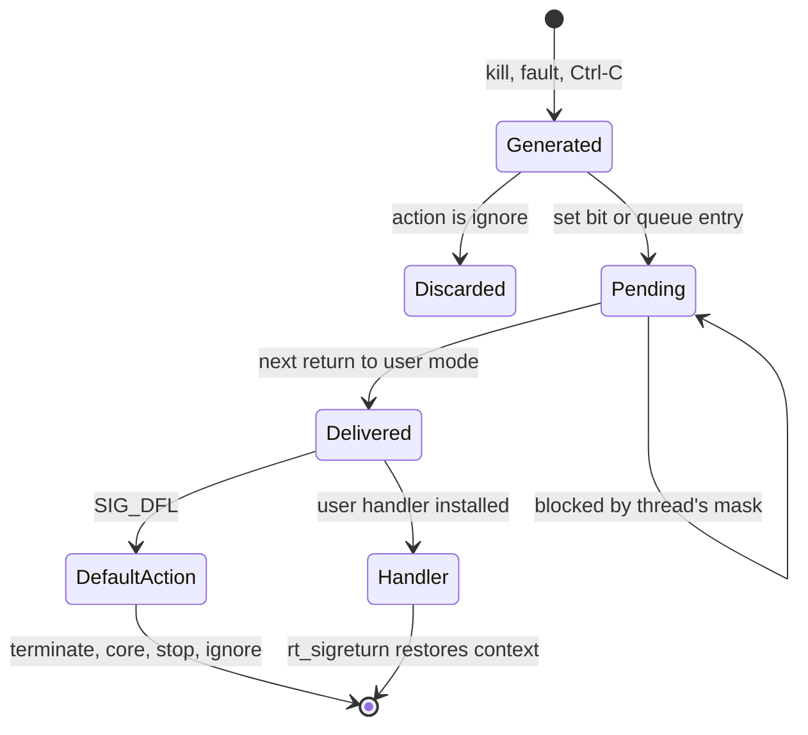

---
tags:
  - operating-systems
  - foundations
  - signals-and-ipc
status: complete
sources:
  - https://man7.org/linux/man-pages/man7/signal.7.html
  - https://man7.org/linux/man-pages/man7/signal-safety.7.html
  - https://man7.org/linux/man-pages/man2/sigaction.2.html
  - https://man7.org/linux/man-pages/man2/signalfd.2.html
  - https://man7.org/linux/man-pages/man2/pidfd_open.2.html
  - https://www.man7.org/linux/man-pages/man2/pidfd_send_signal.2.html
  - https://man7.org/linux/man-pages/man7/pipe.7.html
  - https://man7.org/linux/man-pages/man7/unix.7.html
  - https://man7.org/linux/man-pages/man7/shm_overview.7.html
  - https://man7.org/linux/man-pages/man2/memfd_create.2.html
  - https://man7.org/linux/man-pages/man7/mq_overview.7.html
  - https://man7.org/linux/man-pages/man7/sysvipc.7.html
  - https://man7.org/linux/man-pages/man2/futex.2.html
  - https://man7.org/linux/man-pages/man2/eventfd.2.html
  - https://github.com/torvalds/linux/blob/master/kernel/signal.c
  - https://github.com/torvalds/linux/blob/master/arch/x86/kernel/signal.c
  - https://github.com/torvalds/linux/blob/master/fs/pipe.c
  - https://dbus.freedesktop.org/doc/dbus-specification.html
  - https://varlink.org/
  - https://source.android.com/docs/core/architecture/hidl/binder-ipc
  - https://lkml.indiana.edu/2305.2/07457.html
  - https://phoronix.com/news/Rust-Binder-For-Linux-6.18
  - https://phoronix.com/news/Linux-7.4-Char-Misc
  - https://lwn.net/Articles/1065490/
  - https://lkml.iu.edu/2603.1/11652.html
  - https://lkml.iu.edu/2603.1/13800.html
  - https://lkml.iu.edu/2603.3/04497.html
  - https://lwn.net/Articles/1059673/
created: 2026-11-26
updated: 2026-11-26
---

## Table Of Contents

---

- [[#TL;DR|TL;DR]]
- [[#The Problem|The Problem]]
- [[#Foundations|Foundations]]
    - [[#Two Kinds of Communication - Notification and Data|Two Kinds of Communication - Notification and Data]]
    - [[#The IPC Menu|The IPC Menu]]
    - [[#Copy vs Share|Copy vs Share]]
- [[#How We Got Here|How We Got Here]]
- [[#How It Works|How It Works]]
    - [[#Signals - Generation, Pending and Delivery|Signals - Generation, Pending and Delivery]]
    - [[#Inside Delivery - the Signal Frame|Inside Delivery - the Signal Frame]]
    - [[#Async-Signal Safety and EINTR|Async-Signal Safety and EINTR]]
    - [[#Taming Signals - signalfd and pidfds|Taming Signals - signalfd and pidfds]]
    - [[#Pipes and FIFOs|Pipes and FIFOs]]
    - [[#Unix Domain Sockets and Passing File Descriptors|Unix Domain Sockets and Passing File Descriptors]]
    - [[#Shared Memory, memfd and Futexes|Shared Memory, memfd and Futexes]]
    - [[#Message Queues and System V IPC|Message Queues and System V IPC]]
    - [[#Message Buses - D-Bus, Binder, Varlink|Message Buses - D-Bus, Binder, Varlink]]
    - [[#What It Costs - Measured Round Trips|What It Costs - Measured Round Trips]]
- [[#Where It Is Now|Where It Is Now]]
- [[#Trade-offs & Open Problems|Trade-offs & Open Problems]]
- [[#Resources|Resources]]
- [[#Related Notes|Related Notes]]

## ***TL;DR***
---
*Processes are isolated on purpose, so the kernel provides deliberate holes in that isolation: signals to interrupt a process with a numbered event, and IPC mechanisms (pipes, sockets, shared memory, message queues, buses) to move data. Choosing one is a choice about copying versus sharing, and about who wakes whom.*

- **Signals are software interrupts.** The kernel marks a signal pending on a process or thread, and on the next return to user mode it either applies a default action (terminate, core dump, stop, ignore) or diverts the thread into a handler by building a frame on its stack ([signal(7)](https://man7.org/linux/man-pages/man7/signal.7.html)).
- **Signals are hard to use correctly.** A handler can run between any two instructions, so it may only call async-signal-safe functions, and blocking system calls can fail with `EINTR`. Modern code turns signals into file-descriptor events with `signalfd()`, and targets processes by **pidfd** instead of a recyclable PID number.
- **Data IPC comes in two shapes.** *Copying* channels (pipes, Unix sockets, message queues) copy bytes through the kernel and give you blocking, ordering and back-pressure for free. *Sharing* (shared memory, `memfd`) maps the same pages into both processes: zero copies, but you must synchronise yourself, usually with atomics and futexes.
- **Unix sockets are the workhorse.** They carry bytes or datagrams, the peer's credentials, and even open file descriptors (`SCM_RIGHTS`), which is how D-Bus, Wayland and systemd pass capabilities between processes ([unix(7)](https://man7.org/linux/man-pages/man7/unix.7.html)).
- **The expensive part is waking the other side,** not moving bytes. On the cloud VM this note was written on, a one-byte pipe or socket round trip took about 26 µs, while two processes spinning on shared memory exchanged a value in about 50 to 170 ns.
- **Where it is now (Nov 2026):** Linux 7.4 removes the C Android Binder driver in favour of the Rust rewrite merged in 6.18 ([Phoronix](https://phoronix.com/news/Linux-7.4-Char-Misc)); bus1, a capability-based kernel IPC bus first proposed in 2016, was reposted in Rust in March 2026 ([LWN](https://lwn.net/Articles/1065490/)); and an RFC adds IPC channels to [[io_uring]].

## ***The Problem***
---
*Every process has its own address space so that one bug or attacker can't read or corrupt another process (see [[Virtual Memory and Paging]]). But useful systems are made of cooperating processes: a shell pipeline, a browser's sandboxed renderers, a desktop's services. The kernel must let them talk without giving up the isolation.*

Cooperating processes need four things, and no single mechanism gives all of them:

| Need | Example | Mechanisms |
|---|---|---|
| **Notify** something happened | Child exited; user pressed Ctrl-C; reload config | Signals, `eventfd`, pidfd polling |
| **Move a stream of bytes** | `grep foo log | sort` | Pipes, stream sockets |
| **Exchange discrete messages** | "Open this URL", RPC calls | Datagram/seqpacket sockets, message queues, Binder, D-Bus |
| **Share a large data structure** | Video frames, a database buffer pool | Shared memory + futexes |

Underneath sit three design questions that recur in every section: **who copies the data** (kernel, or nobody), **who can talk to whom** (naming and permissions), and **how a waiting process is woken** (the cost that dominates small messages).

## ***Foundations***
---
*Separate notification from data transfer, know the menu of mechanisms, and understand why copying is safe but sharing is fast.*

#### **Two Kinds of Communication - Notification and Data**

- **Signals** carry almost no data: a number from 1 to 64 (plus, for real-time signals, one integer or pointer). They are about *interrupting* control flow, which makes them powerful and dangerous.
- **IPC channels** carry data and are passive: the receiver asks for data when it is ready, usually through the normal file-descriptor interface (`read`, `write`, `poll`), so they fit into event loops, [[io_uring]] and the rest of Unix's "everything is a file" design.

#### **The IPC Menu**

| Mechanism | Shape | Named by | Kernel copies? | Crosses machines? |
|---|---|---|---|---|
| Pipe | Byte stream, one direction | Inherited fd only | Yes | No |
| FIFO (named pipe) | Byte stream | Path in the file system | Yes | No |
| Unix socket (`SOCK_STREAM`) | Byte stream, two-way | Path, abstract name, or `socketpair()` | Yes | No |
| Unix socket (`SOCK_DGRAM`, `SOCK_SEQPACKET`) | Messages with boundaries | Same | Yes | No |
| POSIX message queue | Prioritised messages | `/name` in `mqueue` fs | Yes | No |
| System V msg/sem/shm | Messages, semaphore sets, segments | Integer key | Msgs yes; shm no | No |
| POSIX shared memory / `memfd` | Shared pages | `/name` in `/dev/shm`, or an fd | No | No |
| `eventfd` | A 64-bit counter | fd | (8 bytes) | No |
| TCP/UDP socket | Stream or datagram | IP address and port | Yes | Yes |
| Binder (Android), D-Bus, Varlink | RPC on top of the above | Service names | Varies | No |

#### **Copy vs Share**

A copying channel touches each byte twice: the writer's `write()` copies from user memory into a kernel buffer, the reader's `read()` copies it out. That costs memory bandwidth but buys a lot: the receiver gets a private snapshot the sender can't change afterwards (no time-of-check-to-time-of-use bugs), the kernel enforces ordering, and a full buffer blocks the writer (back-pressure).

Shared memory maps the same physical pages into both address spaces, so a store by one process is visible to the other with no system call at all. That is the fastest possible path, but now the processes share every problem of threads: races, torn writes, and a malicious peer that changes data while you read it (see [[Locks and Synchronization]] and [[Lock-Free Data Structures and Memory Ordering]]). Big systems combine the two: a socket to set up and to notify, shared memory for bulk data.

## ***How We Got Here***
---
*Unix began with pipes and crude signals, the 1980s added reliable signals, sockets and System V IPC, POSIX standardised them, and Linux spent the 2000s to 2020s turning every event into a file descriptor and every process reference into a pidfd.*



- **Unreliable signals.** In early Unix a handler was reset to the default after each delivery, so a second signal arriving before the handler re-installed itself killed the process. There was no way to block a signal temporarily. BSD and then POSIX `sigaction()` fixed both: handlers stay installed, and each thread has a **signal mask** of blocked signals ([sigaction(2)](https://man7.org/linux/man-pages/man2/sigaction.2.html)).
- **Two IPC families.** BSD built sockets, which work across machines and within one (`AF_UNIX`); AT&T's System V built message queues, semaphores and shared memory named by integer keys. POSIX later defined cleaner versions of the System V trio named by strings and usable as file descriptors.
- **Everything becomes an fd.** Linux made signals (`signalfd`), counters (`eventfd`), timers (`timerfd`), anonymous memory (`memfd`) and processes (`pidfd`) into file descriptors, so a single `epoll` or io_uring loop can wait for all of them, and they can be passed over Unix sockets.
- **The kernel bus debate.** D-Bus, the desktop and systemd message bus, runs as a user-space daemon, so each message crosses two sockets. **kdbus** tried to move it into the kernel and was rejected in 2015 over complexity and design objections; its successor **bus1** (2016) was not merged either. Android meanwhile shipped **Binder**, an in-kernel RPC and object-reference mechanism, and upstreamed it.

## ***How It Works***
---
*First signals, from the moment one is sent to the moment a handler runs, then each data channel and what the kernel does for it, and finally real measurements.*

#### **Signals - Generation, Pending and Delivery**

A signal is **generated** (by `kill()`, by the kernel after a fault, by the terminal driver on Ctrl-C), becomes **pending**, and is later **delivered**. Per [signal(7)](https://man7.org/linux/man-pages/man7/signal.7.html):

| Signal | Default action | Typical source |
|---|---|---|
| `SIGINT` (2) | Terminate | Ctrl-C from the terminal |
| `SIGKILL` (9) | Terminate; cannot be caught, blocked or ignored | `kill -9`, the OOM killer |
| `SIGSEGV` (11) | Core dump | Invalid memory access ([[Interrupts and Exceptions]]) |
| `SIGPIPE` (13) | Terminate | Writing to a pipe with no reader |
| `SIGTERM` (15) | Terminate | Polite shutdown request |
| `SIGCHLD` (17 on x86) | Ignore | A child stopped or exited |
| `SIGSTOP` (19) / `SIGCONT` (18) | Stop / continue; `SIGSTOP` can't be caught | Job control, debuggers |
| `SIGRTMIN`..`SIGRTMAX` (34–64 as seen by glibc programs) | Terminate | Application-defined |

The kernel's bookkeeping, in [kernel/signal.c](https://github.com/torvalds/linux/blob/master/kernel/signal.c):

- A **process-directed** signal (from `kill()`) goes to a shared pending set for the whole thread group; any thread that doesn't block it may take it. A **thread-directed** signal (from a fault, or `tgkill()`) goes to that thread's private pending set.
- Each standard signal is a single bit, so if `SIGCHLD` is sent three times while blocked, it is delivered **once**. Real-time signals are queued, one entry per send, with an attached value, and are delivered lowest number first.
- When a signal is made pending on a thread, the kernel sets the `TIF_SIGPENDING` flag on it and wakes it if it sleeps interruptibly.
- Delivery happens only on the way back to user mode: after a system call, interrupt or exception, the exit path checks the flag and calls `get_signal()` (see [[System Calls and the User-Kernel Boundary]]). If the target thread is running user code on another CPU, the kernel kicks that CPU with an inter-processor interrupt so the thread passes through the kernel and notices the signal promptly; a thread blocked in an uninterruptible sleep (state `D`) won't see it until it wakes.



#### **Inside Delivery - the Signal Frame**

To run a handler, the kernel must make an interrupted thread call a function and then resume exactly where it was. On x86-64 ([arch/x86/kernel/signal.c](https://github.com/torvalds/linux/blob/master/arch/x86/kernel/signal.c)):

1. It pushes an **`rt_sigframe`** onto the user stack (or the alternate stack from `sigaltstack()`, needed when handling stack overflow): the saved registers, FPU/vector state, the old signal mask and a `siginfo_t` describing the cause.
2. It sets the saved instruction pointer to the handler and the return address to `sa_restorer`, a tiny libc stub.
3. It blocks the signal (and anything in `sa_mask`) while the handler runs, then returns to user mode, landing in the handler.
4. When the handler returns, the stub calls the **`rt_sigreturn`** system call, and the kernel reloads every register and the old mask from the frame.

Because the frame is in user memory, a forged frame is an attack primitive (sigreturn-oriented programming), which is one reason for shadow stacks and other hardening (see [[Kernel Security Hardening]]). The frame's size also grows with vector state: AVX-512 alone adds over 2 KB, which once broke programs with small alternate stacks.

#### **Async-Signal Safety and EINTR**

A handler interrupts the program at an arbitrary instruction, possibly inside `malloc()` while it holds the allocator's lock. If the handler calls `malloc()` too, it deadlocks or corrupts the heap. So POSIX lists the **async-signal-safe** functions a handler may call: `write`, `_exit`, `kill`, `sem_post` and about a hundred more, but not `printf`, `malloc` or `pthread_mutex_lock` ([signal-safety(7)](https://man7.org/linux/man-pages/man7/signal-safety.7.html)).

The safe pattern is to do almost nothing in the handler:

```c
static volatile sig_atomic_t got_sigterm = 0;

static void on_term(int sig) {
    (void)sig;
    got_sigterm = 1;              /* only set a flag: always safe */
}

int main(void) {
    struct sigaction sa = { .sa_handler = on_term, .sa_flags = SA_RESTART };
    sigemptyset(&sa.sa_mask);
    sigaction(SIGTERM, &sa, NULL);
    while (!got_sigterm)
        do_some_work();           /* the main loop checks the flag */
    clean_up_and_exit();
}
```

In plain words: the handler only records that the signal happened, and the normal program reacts at a safe point. `volatile sig_atomic_t` guarantees the compiler re-reads the flag and that the write can't be torn. `SA_RESTART` asks the kernel to restart system calls the signal interrupted; without it, a blocked `read()` returns `-1` with `errno == EINTR` and every caller must retry.

#### **Taming Signals - signalfd and pidfds**

Two Linux additions remove most of the pain:

- **`signalfd()`** ([man](https://man7.org/linux/man-pages/man2/signalfd.2.html)): block the signals with `sigprocmask()`, then read them as structures from a file descriptor. No handler, no async-safety rules, and the fd plugs into `epoll` or io_uring like any other event. systemd and most modern daemons work this way.
- **pidfds.** A PID is just a number, and after a process exits its number can be reused, so `kill(pid, SIGTERM)` can hit an unrelated process ("PID reuse race"). A **pidfd** is a file descriptor referring to one specific process: `pidfd_open()` or `clone3(CLONE_PIDFD)` gives one, `pidfd_send_signal()` signals exactly that process, and the fd becomes readable when it exits, so a parent can `poll` for child exit instead of handling `SIGCHLD` ([pidfd_open(2)](https://man7.org/linux/man-pages/man2/pidfd_open.2.html), [pidfd_send_signal(2)](https://www.man7.org/linux/man-pages/man2/pidfd_send_signal.2.html)). Linux 7.1 extended this with `CLONE_AUTOREAP` and `CLONE_PIDFD_AUTOKILL` ([LWN, Feb 2026](https://lwn.net/Articles/1059673/)); see [[Processes and Threads]].

#### **Pipes and FIFOs**

`pipe()` returns two fds: a read end and a write end. In the kernel ([fs/pipe.c](https://github.com/torvalds/linux/blob/master/fs/pipe.c)) a pipe is a ring of page-sized buffers, 16 by default, so **64 KiB** on 4 KiB-page systems; `fcntl(F_SETPIPE_SZ)` can raise it up to `/proc/sys/fs/pipe-max-size` (1 MiB default) ([pipe(7)](https://man7.org/linux/man-pages/man7/pipe.7.html)).

- A write of up to **`PIPE_BUF` = 4096 bytes** is atomic: it won't be interleaved with another writer's data. Bigger writes may be split.
- A reader blocks on an empty pipe; a writer blocks on a full one. That blocking is the back-pressure that makes `producer | consumer` work without unbounded memory.
- When the last writer closes, readers get end-of-file. When the last reader closes, writers get `SIGPIPE` (or `EPIPE` if it's ignored).
- `splice()` and `vmsplice()` move pages into and out of a pipe without copying, which is how `sendfile`-style zero-copy paths are built.

A **FIFO** (`mkfifo`) is the same object with a name in the file system, so unrelated processes can open it.

Worked example: how long can `yes | slow_consumer` run ahead? The pipe holds 64 KiB, `yes` writes 2-byte lines (`"y\n"`), so it can write $65536 / 2 = 32768$ lines before it blocks and waits for the consumer.

#### **Unix Domain Sockets and Passing File Descriptors**

`AF_UNIX` sockets look like network sockets but stay inside the kernel: no IP stack, no checksums ([unix(7)](https://man7.org/linux/man-pages/man7/unix.7.html)). Three types: `SOCK_STREAM` (bytes), `SOCK_DGRAM` (unreliable in theory, but reliable and ordered on Linux), and `SOCK_SEQPACKET` (reliable, ordered, with message boundaries). Their two special abilities explain why they are the default IPC on Linux:

- **Credentials.** `SO_PEERCRED` returns the peer's PID, UID and GID as of `connect()`, checked by the kernel, so a server can authorise a client without passwords. Since Linux 6.5, `SO_PEERPIDFD` and `SCM_PIDFD` hand over a pidfd instead, closing the PID-reuse race for authorisation, which D-Bus and polkit adopted ([patch series, 2023](https://lkml.indiana.edu/2305.2/07457.html)).
- **Passing file descriptors.** An `SCM_RIGHTS` control message carries open fds. The kernel installs new descriptors in the receiver that point to the *same* open file, socket, memfd or pidfd. This is capability passing: a privileged broker opens a file and hands the descriptor to a sandboxed process that could never have opened it itself. Chrome's sandbox, Wayland compositors (sending GPU buffers as dma-buf fds) and systemd's socket activation all depend on it.

```c
/* Send one fd over a connected Unix socket */
struct msghdr msg = {0};
char buf[CMSG_SPACE(sizeof(int))] = {0}, dummy = '*';
struct iovec io = { .iov_base = &dummy, .iov_len = 1 };
msg.msg_iov = &io;  msg.msg_iovlen = 1;
msg.msg_control = buf;  msg.msg_controllen = sizeof(buf);
struct cmsghdr *c = CMSG_FIRSTHDR(&msg);
c->cmsg_level = SOL_SOCKET;  c->cmsg_type = SCM_RIGHTS;
c->cmsg_len = CMSG_LEN(sizeof(int));
memcpy(CMSG_DATA(c), &fd_to_send, sizeof(int));
sendmsg(sock, &msg, 0);
```

In plain words: the fd travels in an "ancillary data" header beside one ordinary byte of payload; the receiver's `recvmsg()` gets a new fd number for the same open file.

#### **Shared Memory, memfd and Futexes**

To share memory, both processes `mmap()` the same object with `MAP_SHARED`:

- **POSIX shm:** `shm_open("/name")` creates a file in the `tmpfs` at `/dev/shm`; size it with `ftruncate()` and map it ([shm_overview(7)](https://man7.org/linux/man-pages/man7/shm_overview.7.html)).
- **`memfd_create()`** makes an anonymous memory file with no name at all, shared by passing its fd over a Unix socket, so no global namespace and no leftover files. **Seals** (`F_SEAL_WRITE`, `F_SEAL_SHRINK`, `F_SEAL_GROW`) let the receiver verify the sender can no longer change or truncate it, removing the "peer modifies the data while I read it" problem ([memfd_create(2)](https://man7.org/linux/man-pages/man2/memfd_create.2.html)).

Shared memory needs its own synchronisation. The standard tool is the **futex** ("fast user-space mutex"): an aligned 32-bit integer in shared memory. Processes update it with atomic instructions and only make a system call when they must sleep (`FUTEX_WAIT`: "sleep if the value is still X") or wake someone (`FUTEX_WAKE`). Uncontended locking never enters the kernel ([futex(2)](https://man7.org/linux/man-pages/man2/futex.2.html); details in [[Locks and Synchronization]]). Lock-free ring buffers in shared memory, with an `eventfd` or futex only to wake a sleeping consumer, are how high-rate systems (audio servers, trading systems, the io_uring rings themselves) move data ([[Lock-Free Data Structures and Memory Ordering]]).

#### **Message Queues and System V IPC**

- **POSIX message queues** (`mq_open`) hold whole messages with priorities; `mq_receive()` returns the oldest highest-priority one. They are fds on Linux (`mqueue` file system), so they can be polled, and `mq_notify()` can signal when a message arrives. Limits are small by default (10 messages of 8 KiB) ([mq_overview(7)](https://man7.org/linux/man-pages/man7/mq_overview.7.html)).
- **System V IPC** (`msgget`, `semget`, `shmget`) predates file descriptors: objects are named by integer keys, live until explicitly removed (`ipcrm`), and can't be polled. They remain for compatibility; PostgreSQL, for example, moved most of its shared memory off System V in 9.3 ([sysvipc(7)](https://man7.org/linux/man-pages/man7/sysvipc.7.html)). IPC namespaces isolate these objects per container ([[Containers, Namespaces and cgroups]]).

#### **Message Buses - D-Bus, Binder, Varlink**

Raw channels connect two endpoints. Larger systems need naming ("connect me to the network manager"), method calls, broadcast signals and access control. Three designs dominate Linux:

| | D-Bus | Binder | Varlink |
|---|---|---|---|
| Where | User-space daemon (`dbus-daemon` or `dbus-broker`) on Unix sockets | Kernel driver `/dev/binder`, Android | Direct Unix socket per peer, no broker |
| Message format | Binary, typed, marshalled | Parcels; supports object references and fds | JSON |
| Copies per message | Client → broker → server (two hops) | One: kernel copies into a buffer the receiver has mapped | One hop |
| Security | Policy in broker, peer credentials | Kernel tracks references; SELinux checks per call | Peer credentials |
| Used by | Desktops, systemd, polkit | Every Android app and system service | systemd components (resolved, userdb, sysinstall) |

**Binder** is worth understanding because it shows what kernel-level IPC can add: the kernel copies the message once, directly into a memory region that the receiving process has mapped read-only; it translates object handles so one process can hold a reference to an object living in another; it tracks references across processes so objects die when the last remote reference does; and it lets the calling thread's priority pass to the server thread ([Android Binder docs](https://source.android.com/docs/core/architecture/hidl/binder-ipc)). The same ideas (handles as unforgeable capabilities, one copy, synchronous call semantics) are central to microkernel IPC, where every system service is a separate process ([[Microkernels and seL4]]).

#### **What It Costs - Measured Round Trips**

A one-byte message exchanged 200,000 times between two processes, run three times on the 4-vCPU Intel Xeon cloud VM (Firecracker, Linux 6.18) this note was written on, Nov 26 2026:

| Mechanism | Round trip (3 runs) | What dominates |
|---|---|---|
| Pipe | 25.6 – 27.4 µs | Sleep, wake-up and cross-CPU interrupt, twice |
| Unix stream socket pair | 26.5 – 27.9 µs | Same |
| Shared memory + futex wait/wake | 22.6 – 24.2 µs | Same: the wake is still a system call and a sleep |
| Shared memory, both sides spinning | 46 – 172 ns | Moving one cache line between cores |

How to read it: the mechanisms that put the receiver to sleep all cost about the same, because the cost is the scheduler putting one task to sleep and the kernel sending an inter-processor interrupt to wake the other, not the copy of one byte. In a VM those wake-ups also exit to the hypervisor, which is why these numbers are several times higher than the few microseconds typical on bare metal. Spinning avoids the sleep entirely and is about 100 to 500× faster, at the price of burning a whole CPU while waiting. Real systems spin briefly, then sleep (adaptive waiting), or batch many messages per wake-up.

## ***Where It Is Now***
---
*As of November 2026: Android's IPC is now Rust code in the mainline kernel, kernel-level message buses are being argued about again, and small fixes keep extending the pidfd and fd-centric model.*

- **Rust Binder replaces C Binder.** Google's Rust rewrite of Binder, motivated by reference-counting, locking and bounds-checking bugs in the 6,000-line C driver, was merged for Linux 6.18 ([Phoronix, Sept 2025](https://phoronix.com/news/Rust-Binder-For-Linux-6.18)). For Linux 7.4 (in release candidates now), Greg Kroah-Hartman removed the C version: "the rust version is stable and will be used going forward in a few billion devices" ([Phoronix](https://phoronix.com/news/Linux-7.4-Char-Misc)). See [[Rust in the Linux Kernel]].
- **bus1 returns.** David Rheinsberg reposted bus1 on 31 March 2026, stripped down and rewritten in Rust, as kernel-mediated, capability-based messaging along the lines of D-Bus. LWN notes it is unclear whether the kernel community wants in-kernel IPC of this kind ([LWN, 2 Apr 2026](https://lwn.net/Articles/1065490/)).
- **io_uring IPC channels.** An RFC from March 2026 adds IPC channel infrastructure to io_uring, a high-bandwidth path that would let processes exchange messages through rings instead of socket system calls ([RFC, Daniel Hodges](https://lkml.iu.edu/2603.1/11652.html)). It is a proposal, not merged.
- **Peeking at POSIX message queues.** Two competing 2026 proposals add non-destructive reads to POSIX message queues, one as a new system call and one as `fcntl(F_MQ_PEEK)`, useful for checkpoint/restore and debugging ([syscall series](https://lkml.iu.edu/2603.1/13800.html), [fcntl RFC](https://lkml.iu.edu/2603.3/04497.html)).
- **pidfds everywhere.** With `SO_PEERPIDFD` (6.5), pidfs as a real file system, and `CLONE_AUTOREAP` (7.1), a process reference is now a first-class, race-free object, and tools such as systemd, D-Bus brokers and polkit use pidfds to identify peers.

## ***Trade-offs & Open Problems***
---
*Every IPC choice trades safety for speed or simplicity for power. The open questions are whether richer IPC belongs in the kernel, and how to make signals stop being a trap.*

| Choice | Gain | Cost |
|---|---|---|
| Copy (pipes, sockets) | Snapshot semantics, kernel-enforced ordering and back-pressure | Two copies, a syscall per message |
| Share (shm, memfd) | No copies, no syscalls on the fast path | You build synchronisation; peer can mutate data unless sealed |
| Signals for notification | Work on any process, need no setup | Async-safety rules, `EINTR`, coalescing of standard signals |
| In-kernel bus (Binder, bus1) | One copy, kernel-tracked object references, priority inheritance | Large privileged code; kdbus and bus1 both failed upstream once |
| User-space broker (D-Bus) | Easy to change, policy in user space | Two hops per message; the broker is a bottleneck |
| Brokerless (Varlink, direct sockets) | Simple and fast | No central naming or broadcast |

Open problems:

- **Signals and threads mix badly.** Which thread gets a process-directed signal is unspecified, and libraries can't safely install handlers without coordinating with the application. Most robust programs block everything and use `signalfd` or a dedicated thread.
- **Wake-up latency dominates small messages,** especially in VMs, so the frontier is in batching and polling (io_uring, shared rings) rather than faster system calls.
- **Is in-kernel IPC worth it?** Binder succeeded in a controlled ecosystem; whether a general-purpose kernel bus can win the mainline argument is being tested again by bus1 in 2026.

## ***Resources***
---
*Michael Kerrisk's man pages are the reference for every interface here; read signal(7) and unix(7) first, then kernel/signal.c to see delivery, then the Binder and bus1 material for where IPC design is going.*

**Manual pages (man7.org, Michael Kerrisk)**
- [signal(7)](https://man7.org/linux/man-pages/man7/signal.7.html), [signal-safety(7)](https://man7.org/linux/man-pages/man7/signal-safety.7.html), [sigaction(2)](https://man7.org/linux/man-pages/man2/sigaction.2.html), [signalfd(2)](https://man7.org/linux/man-pages/man2/signalfd.2.html).
- [pidfd_open(2)](https://man7.org/linux/man-pages/man2/pidfd_open.2.html), [pidfd_send_signal(2)](https://www.man7.org/linux/man-pages/man2/pidfd_send_signal.2.html).
- [pipe(7)](https://man7.org/linux/man-pages/man7/pipe.7.html), [unix(7)](https://man7.org/linux/man-pages/man7/unix.7.html), [eventfd(2)](https://man7.org/linux/man-pages/man2/eventfd.2.html).
- [shm_overview(7)](https://man7.org/linux/man-pages/man7/shm_overview.7.html), [memfd_create(2)](https://man7.org/linux/man-pages/man2/memfd_create.2.html), [futex(2)](https://man7.org/linux/man-pages/man2/futex.2.html).
- [mq_overview(7)](https://man7.org/linux/man-pages/man7/mq_overview.7.html), [sysvipc(7)](https://man7.org/linux/man-pages/man7/sysvipc.7.html).

**Kernel source**
- [kernel/signal.c](https://github.com/torvalds/linux/blob/master/kernel/signal.c): generation, pending sets, `get_signal()`.
- [arch/x86/kernel/signal.c](https://github.com/torvalds/linux/blob/master/arch/x86/kernel/signal.c): building the `rt_sigframe`.
- [fs/pipe.c](https://github.com/torvalds/linux/blob/master/fs/pipe.c): the pipe ring buffer.

**Buses and protocols**
- [D-Bus specification](https://dbus.freedesktop.org/doc/dbus-specification.html), [Varlink](https://varlink.org/), [Android Binder IPC](https://source.android.com/docs/core/architecture/hidl/binder-ipc).

**Kernel news, 2023–2026**
- [Add SCM_PIDFD and SO_PEERPIDFD](https://lkml.indiana.edu/2305.2/07457.html): Alexander Mikhalitsyn, May 2023.
- [Rust Binder for 6.18](https://phoronix.com/news/Rust-Binder-For-Linux-6.18) and [Linux 7.4 char/misc: C Binder removed](https://phoronix.com/news/Linux-7.4-Char-Misc): Phoronix.
- [IPC medley: message-queue peeking, io_uring, and bus1](https://lwn.net/Articles/1065490/): LWN, 2 April 2026.
- [io_uring: add IPC channel infrastructure (RFC)](https://lkml.iu.edu/2603.1/11652.html): March 2026.
- [mqueue non-destructive peek](https://lkml.iu.edu/2603.1/13800.html) and [F_MQ_PEEK RFC](https://lkml.iu.edu/2603.3/04497.html): March 2026.
- [As ye clone(), so shall ye AUTOREAP](https://lwn.net/Articles/1059673/): LWN, Feb 2026.

## Related Notes

- [[Processes and Threads]] — What signals target; pidfds, `clone3` and process creation.
- [[System Calls and the User-Kernel Boundary]] — Signals are delivered on the return-to-user path; `EINTR` and syscall restart.
- [[Interrupts and Exceptions]] — Hardware faults become `SIGSEGV`, `SIGFPE` and `SIGBUS`.
- [[Locks and Synchronization]] — Futexes, the synchronisation primitive under shared-memory IPC.
- [[Lock-Free Data Structures and Memory Ordering]] — Single-producer/single-consumer rings in shared memory.
- [[Virtual Memory and Paging]] — How `MAP_SHARED` maps the same physical pages into two address spaces.
- [[io_uring]] — Shared submission and completion rings, and a proposed IPC channel.
- [[Containers, Namespaces and cgroups]] — IPC namespaces and per-container `/dev/shm`.
- [[Microkernels and seL4]] — Where IPC speed decides the whole OS's performance.
- [[Rust in the Linux Kernel]] — Rust Binder and bus1.
- [[Kernel Security Hardening]] — Sigreturn-oriented programming and shadow stacks.
- [[Boot Process]] — PID 1's special signal semantics and orphan reaping.
- [[Kernel Bypass Networking]] — Shared-memory rings taken to their extreme for network I/O.
