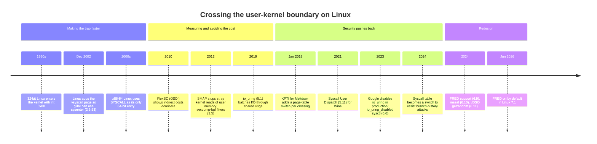
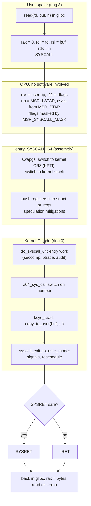
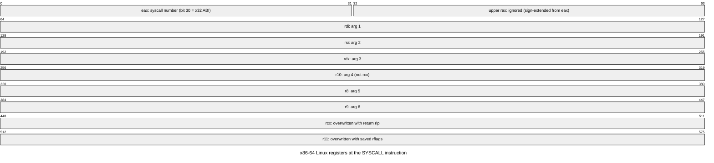
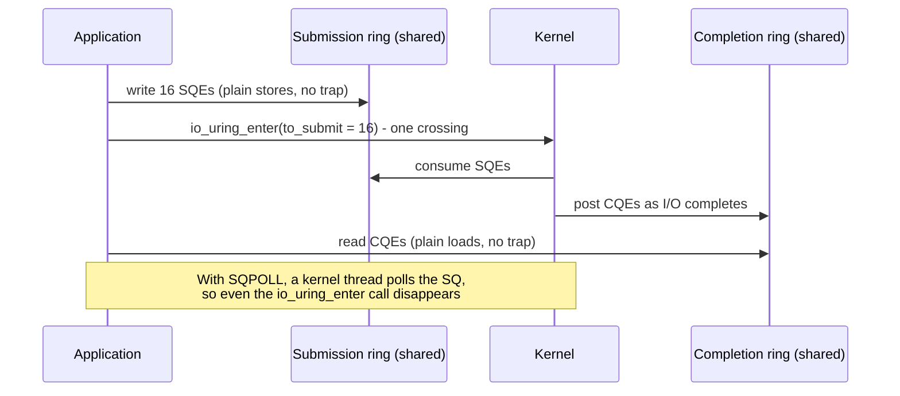

---
tags:
  - operating-systems
  - foundations
  - system-calls-and-the-user-kernel-boundary
status: draft
sources:
  - https://man7.org/linux/man-pages/man2/syscall.2.html
  - https://man7.org/linux/man-pages/man7/vdso.7.html
  - https://man7.org/linux/man-pages/man2/seccomp.2.html
  - https://man7.org/linux/man-pages/man7/io_uring.7.html
  - https://github.com/torvalds/linux/blob/master/arch/x86/entry/entry_64.S
  - https://github.com/torvalds/linux/blob/master/arch/x86/entry/syscall_64.c
  - https://github.com/torvalds/linux/blob/master/arch/x86/kernel/cpu/common.c
  - https://github.com/torvalds/linux/blob/master/arch/x86/entry/syscalls/syscall_64.tbl
  - https://github.com/torvalds/linux/blob/master/Documentation/admin-guide/kernel-parameters.txt
  - https://docs.kernel.org/arch/x86/pti.html
  - https://docs.kernel.org/7.1/arch/x86/x86_64/fred.html
  - https://docs.kernel.org/userspace-api/seccomp_filter.html
  - https://docs.kernel.org/7.1/userspace-api/mseal.html
  - https://kernel.org/doc/html/latest/admin-guide/syscall-user-dispatch.html
  - https://documentation-service.arm.com/static/63a065c41d698c4dc521cb1c
  - https://docs.riscv.org/reference/isa/v20260120/priv/priv-intro.html
  - https://lwn.net/Articles/18411
  - https://lkml.indiana.edu/hypermail/linux/kernel/0212.2/0261.html
  - https://www.read.seas.harvard.edu/~kohler/class/aosref/soares10flexsc.pdf
  - https://usenix.org/conference/osdi10/flexsc-flexible-system-call-scheduling-exception-less-system-calls
  - https://lwn.net/Articles/517475/
  - https://www.usenix.org/conference/usenixsecurity17/technical-sessions/presentation/wang-pengfei
  - https://www.brendangregg.com/blog/2018-02-09/kpti-kaiser-meltdown-performance.html
  - https://lwn.net/Articles/776703/
  - https://archives.kernel-recipes.org/wp-content/uploads/2025/01/kernel-recipes-2019-axboe.pdf
  - https://arxiv.org/html/2512.04859v1
  - https://security.googleblog.com/2023/06/learnings-from-kctf-vrps-42-linux.html
  - https://lkml.iu.edu/hypermail/linux/kernel/2306.3/06672.html
  - https://www.collabora.com/news-and-blog/news-and-events/new-year-new-kernel-collabora-contributions-linux-511.html
  - https://lists.snapcraft.io/archives/kernel-team/2024-April/150352.html
  - https://lkml.iu.edu/hypermail/linux/kernel/2310.3/05701.html
  - https://phoronix.com/news/Linux-SEV-TDX-int-0x80-Misuse
  - https://lwn.net/Articles/980447
  - https://lkml.iu.edu/hypermail/linux/kernel/2407.1/08104.html
  - https://phoronix.com/news/Linux-6.12-Random
  - https://phoronix.com/news/glibc-getrandom-vDSO-Merged
  - https://blog.trailofbits.com/2024/10/25/a-deep-dive-into-linuxs-new-mseal-syscall/
  - https://kernel.org/doc/html/v6.15/userspace-api/mseal.html
  - https://www.phoronix.com/news/Intel-FRED-Merged-Linux-6.9
  - https://www.phoronix.com/news/Linux-7.1-Enabled-Intel-FRED
  - https://lwn.net/Articles/1067250/
  - https://lwn.net/Articles/1078356/
  - https://www.hwcooling.net/en/performance-boost-for-intel-cpus-impact-of-fred-measured/
  - https://lwn.net/Articles/1043527/
  - https://lwn.net/Articles/1056336/
  - https://lwn.net/Articles/1072173/
  - https://lkml.iu.edu/2607.2/09598.html
  - https://lkml.iu.edu/2606.2/06313.html
  - https://lwn.net/Articles/1037202/
  - https://phoronix.com/news/Linux-7.3-Released
created: 2026-11-26
updated: 2026-11-26
---

## Table Of Contents

---

- [[#TL;DR|TL;DR]]
- [[#The Problem|The Problem]]
- [[#Foundations|Foundations]]
    - [[#Privilege Levels on Three Architectures|Privilege Levels on Three Architectures]]
    - [[#Traps, Exceptions and Interrupts|Traps, Exceptions and Interrupts]]
    - [[#The System Call Contract|The System Call Contract]]
    - [[#One Address Space, Two Views|One Address Space, Two Views]]
- [[#How We Got Here|How We Got Here]]
- [[#How It Works|How It Works]]
    - [[#The Path of One System Call|The Path of One System Call]]
    - [[#The x86-64 SYSCALL Instruction and Its MSRs|The x86-64 SYSCALL Instruction and Its MSRs]]
    - [[#The Register ABI|The Register ABI]]
    - [[#Entry Code and Dispatch|Entry Code and Dispatch]]
    - [[#Getting Back Out: SYSRET or IRET|Getting Back Out: SYSRET or IRET]]
    - [[#Touching User Memory Safely|Touching User Memory Safely]]
    - [[#What a System Call Costs|What a System Call Costs]]
    - [[#The KPTI Tax|The KPTI Tax]]
    - [[#Not Crossing at All: the vDSO|Not Crossing at All: the vDSO]]
    - [[#Crossing Less Often: Batching and io_uring|Crossing Less Often: Batching and io_uring]]
    - [[#Guarding the Door: seccomp and Syscall User Dispatch|Guarding the Door: seccomp and Syscall User Dispatch]]
- [[#Where It Is Now|Where It Is Now]]
    - [[#FRED Replaces the 1980s Entry Path|FRED Replaces the 1980s Entry Path]]
    - [[#More of the Kernel Moves Into the vDSO|More of the Kernel Moves Into the vDSO]]
    - [[#Sealing What the Kernel Maps for You|Sealing What the Kernel Maps for You]]
    - [[#Entry Code Keeps Being Rewritten|Entry Code Keeps Being Rewritten]]
- [[#Trade-offs & Open Problems|Trade-offs & Open Problems]]
- [[#Resources|Resources]]
- [[#Related Notes|Related Notes]]

## ***TL;DR***
---
*A system call is the one sanctioned door from an unprivileged program into the kernel: a special instruction flips the CPU into a higher privilege level and jumps to a fixed kernel entry point. Its direct cost is a few hundred cycles, but its hidden cost (polluted caches, TLB flushes, speculation mitigations) is often larger, so most modern work is about crossing the boundary less often or more cheaply.*

- **The mechanism:** user code puts a syscall number and up to six arguments in registers and runs `syscall` (x86-64), `svc #0` (arm64) or `ecall` (RISC-V). The CPU raises its privilege, jumps to an address the kernel configured at boot, and the kernel looks up the handler by number ([syscall(2)](https://man7.org/linux/man-pages/man2/syscall.2.html)).
- **The cost:** a null syscall round trip was about **150 cycles** on a 2010 Nehalem core, but the kernel's work evicted user data from caches and cut the application's instructions-per-cycle by up to **65%** afterwards ([FlexSC, OSDI 2010](https://usenix.org/conference/osdi10/flexsc-flexible-system-call-scheduling-exception-less-system-calls)). After Meltdown, **KPTI** added a page-table switch to every entry and exit ([kernel docs](https://docs.kernel.org/arch/x86/pti.html)).
- **The workarounds:** the **vDSO** runs some "syscalls" (`clock_gettime`, and since Linux 6.11 `getrandom`) as plain function calls in user space; **[[io_uring]]** batches I/O through shared rings so many operations cost one crossing or none; **seccomp** filters which calls a process may make.
- **Where it is now (Nov 2026):** Intel's **FRED** replaces the decades-old IDT/`SYSCALL`/`IRET` entry machinery; Linux has supported it since 6.9 and turned it on by default in **Linux 7.1 (released 14 June 2026)** ([LWN](https://lwn.net/Articles/1067250/), [LWN](https://lwn.net/Articles/1078356/)). `mseal` (Linux 6.10) lets programs and the kernel lock down mappings, including the vDSO itself.

## ***The Problem***
---
*Programs must not be able to touch hardware, other programs' memory or the kernel's own data directly, yet they constantly need the kernel to do those things for them. The system call is the controlled crossing point, and every design choice about it trades safety against speed.*

An operating system has to give many untrusted programs shared access to one machine. That needs three guarantees at once:

| Requirement | What goes wrong without it | What enforces it |
|---|---|---|
| **Isolation** | A buggy or hostile program reads another's memory or overwrites the kernel | CPU privilege levels plus page tables; see [[Virtual Memory and Paging]] |
| **Controlled entry** | A program jumps into the middle of kernel code and skips the permission checks | The CPU only enters the kernel at addresses the kernel registered |
| **Validated arguments** | A program passes a pointer to kernel memory and gets the kernel to copy secrets out | Kernel checks every user pointer and copies data with special routines |

The catch is speed. A database or web server may make tens of thousands of system calls per second per CPU. Each crossing switches privilege, saves registers, runs security mitigations and pollutes caches. Brendan Gregg estimated that KPTI alone, at 50,000 syscalls per second per CPU, could cost about 2%, and in bad cases (large working sets, no PCID) far more ([Gregg, Feb 2018](https://www.brendangregg.com/blog/2018-02-09/kpti-kaiser-meltdown-performance.html)). So the boundary is a constant tension between "check everything" and "cross as rarely and cheaply as possible".

## ***Foundations***
---
*Four ideas carry the rest of the note: CPUs run code at different privilege levels; the only way up is a trap; a system call is a numbered, register-based contract; and user and kernel share one address space with different permissions.*

#### **Privilege Levels on Three Architectures**
Every mainstream CPU marks the currently running code with a privilege level. Privileged instructions (changing page tables, disabling interrupts, talking to devices) fault if run at the lower level.

| Architecture | Levels | Where Linux runs | Where apps run | Instruction to go up one level |
|---|---|---|---|---|
| x86-64 | Rings 0 to 3 (only 0 and 3 used in practice) | Ring 0 | Ring 3 | `syscall` (64-bit), `int 0x80` or `sysenter` (32-bit) |
| Arm AArch64 | Exception levels EL0 to EL3 | EL1 | EL0 | `svc` (to EL1), `hvc` (to EL2), `smc` (to EL3) |
| RISC-V | U (0), S (1), M (3); level 2 reserved | S-mode | U-mode | `ecall` |

Arm's documentation states the rule that holds on all three: "the current privilege level can only change when the processor takes an exception or returns from an exception" ([Arm, AArch64 Exception Model](https://documentation-service.arm.com/static/63a065c41d698c4dc521cb1c)). Arm's typical layout is applications at EL0, a rich OS at EL1, a hypervisor at EL2 and firmware at EL3. RISC-V defines User, Supervisor and Machine modes, and the OS talks to the firmware below it through the **SBI** (supervisor binary interface) ([RISC-V Privileged ISA](https://docs.riscv.org/reference/isa/v20260120/priv/priv-intro.html)). The levels above the kernel (EL2, EL3, M-mode, x86 VMX root) matter for [[Virtualization and Hypervisors]].

#### **Traps, Exceptions and Interrupts**
A **trap** is any event that makes the CPU stop the current instruction stream, raise privilege and jump to a handler the kernel registered. They come in three flavours, covered in depth in [[Interrupts and Exceptions]]:

- **Synchronous, on purpose:** the program asks for it (`syscall`, `svc`, `ecall`, `int 0x80`). This is a system call.
- **Synchronous, by accident:** the instruction failed (page fault, divide by zero, invalid opcode).
- **Asynchronous:** a device or timer interrupt arrives between instructions.

On x86 all three historically went through the **IDT** (interrupt descriptor table), a table of 256 handler addresses indexed by a vector number. `int 0x80` is literally "take the trap at vector 128"; faster dedicated instructions were added later.

#### **The System Call Contract**
A system call is an ABI, not a function call. The program and kernel agree on:

1. **A number** naming the call. On x86-64, `read` is 0, `write` is 1, `getpid` is 39, `getrandom` is 318, `io_uring_setup` is 425 and `mseal` is 462 ([syscall_64.tbl](https://github.com/torvalds/linux/blob/master/arch/x86/entry/syscalls/syscall_64.tbl)). Numbers differ per architecture.
2. **Registers** for the number, up to six arguments and the return value (table below).
3. **An error convention:** Linux returns a negative errno value (for example `-ENOSYS` for an unknown number); the C library turns that into `-1` plus `errno`.

#### **One Address Space, Two Views**
On Linux the kernel is mapped into the top of every process's virtual address space; page-table entries mark those pages "supervisor only". So the kernel can read a user buffer directly by address, which is fast, but dangerous: the pointer came from an untrusted program, might point into kernel memory, might be unmapped, and might change while the kernel reads it. Everything in [[#Touching User Memory Safely|Touching User Memory Safely]] follows from this layout, and KPTI later partly undid it. See [[Virtual Memory and Paging]].

## ***How We Got Here***
---
*The story is a series of attempts to make the crossing cheaper (faster instructions, the vDSO, batching), interrupted by attacks that made it more expensive again (Meltdown, Spectre-style branch attacks) and that pushed a redesign of the entry path itself.*



- **`int 0x80` and the vsyscall page.** On the Pentium 4 the `int` instruction was very slow. In December 2002 Linus measured `getppid()` at about **1761 cycles** with `int 0x80`/`iret` versus **641 cycles** with `sysenter`/`sysexit` ([LKML, Dec 2002](https://lkml.indiana.edu/hypermail/linux/kernel/0212.2/0261.html)). Not every CPU had `sysenter`, so his fix (kernel 2.5.53) mapped a read-only page into every process holding the best syscall code for the current CPU; glibc jumped there instead of executing `int 0x80`. `gettimeofday()` ran in just over half the time on a Pentium 4 ([LWN, Dec 2002](https://lwn.net/Articles/18411)). That page grew into the **vDSO**.
- **64-bit simplifies things.** On x86-64, the kernel source states that `SYSCALL` "is the only entry point used for 64-bit system calls" ([entry_64.S](https://github.com/torvalds/linux/blob/master/arch/x86/entry/entry_64.S)). `int 0x80` survives only for 32-bit programs.
- **The cost turns out to be mostly indirect.** FlexSC (Soares and Stumm, OSDI 2010) showed that the cycles spent in the trap itself were small compared with the damage the kernel did to the application's caches and branch predictors ([paper](https://www.read.seas.harvard.edu/~kohler/class/aosref/soares10flexsc.pdf)). Their "exception-less" design, with shared syscall pages and kernel threads, is a direct ancestor of io_uring's rings.
- **Security makes it expensive again.** Meltdown (2018) let user code read kernel memory speculatively, so KPTI unmapped the kernel from user page tables, adding a CR3 switch to every crossing ([kernel docs](https://docs.kernel.org/arch/x86/pti.html)). Later branch-predictor attacks added more work on entry; see [[Transient Execution Attacks and Mitigations]].
- **Redesign.** Intel's FRED (Flexible Return and Event Delivery) replaces IDT delivery, `SYSCALL`/`SYSRET` and `IRET` with one new mechanism; Linux enabled it by default in 7.1 ([LWN, Apr 2026](https://lwn.net/Articles/1067250/)).

## ***How It Works***
---
*A system call on x86-64 Linux is: libc loads registers and runs `SYSCALL`; the CPU jumps to `entry_SYSCALL_64`; assembly saves user state and switches stacks and page tables; C code dispatches by number; the handler copies arguments in with checked helpers; and the kernel returns with `SYSRET` if it can, or `IRET` if it must.*

#### **The Path of One System Call**



Here is the user side with no C library in the way, so you can see the contract directly:

```c
#include <unistd.h>

static long raw_write(int fd, const void *buf, unsigned long len)
{
    long ret;
    __asm__ volatile ("syscall"
        : "=a"(ret)                       /* rax: return value      */
        : "a"(1),                         /* rax: __NR_write = 1    */
          "D"(fd), "S"(buf), "d"(len)     /* rdi, rsi, rdx: args    */
        : "rcx", "r11", "memory");        /* SYSCALL clobbers these */
    return ret;                           /* negative means -errno  */
}
```

*In plain words:* put the number 1 ("write") in `rax`, the three arguments in `rdi`, `rsi`, `rdx`, run `syscall`, and read the answer back from `rax`. The compiler is told that `rcx` and `r11` get destroyed, because the CPU uses them to remember where to return and what the flags were.

#### **The x86-64 SYSCALL Instruction and Its MSRs**
`SYSCALL` is fast because it does almost nothing. The kernel's own description ([entry_64.S](https://github.com/torvalds/linux/blob/master/arch/x86/entry/entry_64.S)): it "saves rip to rcx, clears rflags.RF, then saves rflags to r11, then loads new ss, cs, and rip from previously programmed MSRs. rflags gets masked by a value from another MSR... SYSCALL does not save anything on the stack and does not change rsp."

Three model-specific registers (MSRs) are written once per CPU at boot ([common.c](https://github.com/torvalds/linux/blob/master/arch/x86/kernel/cpu/common.c)):

| MSR | Linux writes | Meaning |
|---|---|---|
| `MSR_LSTAR` | address of `entry_SYSCALL_64` | Where 64-bit `SYSCALL` jumps |
| `MSR_STAR` | kernel and user code-segment selectors | What `cs`/`ss` become on entry and on `SYSRET` |
| `MSR_SYSCALL_MASK` (FMASK) | CF, PF, ZF, SF, TF, **IF**, DF, AC, ... | RFLAGS bits cleared on entry; clearing IF means interrupts start off, clearing AC means SMAP is active |

The important consequence: on entry the CPU is in ring 0 but still on the **user's stack** with the **user's GS base** and (with KPTI) the **user's page tables**. The first few instructions of the kernel must fix all of that before touching anything else, which is why this code is assembly and why it has been the site of several serious bugs.

#### **The Register ABI**
The kernel uses the same registers as the C calling convention except that the fourth argument goes in `r10`, because `SYSCALL` overwrites `rcx` ([entry_64.S](https://github.com/torvalds/linux/blob/master/arch/x86/entry/entry_64.S)). The entry code sign-extends the low 32 bits of `rax` because "syscall numbers are treated as int", and bit 30 of the number selects the old x32 ABI (`__X32_SYSCALL_BIT`, see [syscall_64.c](https://github.com/torvalds/linux/blob/master/arch/x86/entry/syscall_64.c)).



Across architectures ([syscall(2)](https://man7.org/linux/man-pages/man2/syscall.2.html)):

| Arch | Instruction | Number in | Args 1 to 6 | Return in |
|---|---|---|---|---|
| x86-64 | `syscall` | `rax` | `rdi rsi rdx r10 r8 r9` | `rax` |
| i386 | `int $0x80` | `eax` | `ebx ecx edx esi edi ebp` | `eax` |
| arm64 | `svc #0` | `w8` | `x0` to `x5` | `x0` |
| RISC-V | `ecall` | `a7` | `a0` to `a5` | `a0` |

Calls that need more, or extensible, arguments (for example `clone3` and `sched_setattr`) take a pointer to a struct plus its size instead.

#### **Entry Code and Dispatch**
The first instructions of `entry_SYSCALL_64` are, in order: `swapgs` (switch to the kernel's per-CPU GS base), save the user `rsp` in a scratch slot, `SWITCH_TO_KERNEL_CR3` (the KPTI page-table switch), load the kernel stack, then push the user's registers into a `struct pt_regs` on that stack. Before calling C it runs `IBRS_ENTER`, `UNTRAIN_RET` and `CLEAR_BRANCH_HISTORY`, three speculation mitigations ([entry_64.S](https://github.com/torvalds/linux/blob/master/arch/x86/entry/entry_64.S)). The C side, `do_syscall_64`, also randomizes the kernel stack offset on every call and runs "entry work" such as seccomp, ptrace and audit hooks.

The **syscall table** used to be an array of function pointers indexed by number. Since April 2024 x86-64 dispatches through a generated `switch` instead ([commit by Linus Torvalds](https://lists.snapcraft.io/archives/kernel-team/2024-April/150352.html), tied to CVE-2024-2201). The current code ([syscall_64.c](https://github.com/torvalds/linux/blob/master/arch/x86/entry/syscall_64.c)):

```c
#define __SYSCALL(nr, sym) case nr: return __x64_##sym(regs);

static noinline long x64_sys_call(const struct pt_regs *regs, unsigned int nr)
{
	switch (nr) {
	#include <asm/syscalls_64.h>
	default: return __x64_sys_ni_syscall(regs);
	}
}

static __always_inline bool do_syscall_x64(struct pt_regs *regs, unsigned long nr)
{
	if (likely(nr < NR_syscalls)) {
		nr = array_index_nospec(nr, NR_syscalls);
		regs->ax = x64_sys_call(regs, (unsigned int)nr);
		return true;
	}
	return false;
}
```

*In plain words:* the build turns the syscall table file into one `case` per call. The bounds check is followed by `array_index_nospec`, which stops the CPU from speculatively using an out-of-range number. A `switch` compiled to conditional branches means a mispredicted branch "just causes speculatively running the wrong system call (harmless)", whereas a mispredicted indirect call through the table could be steered by an attacker to arbitrary gadgets ([commit message](https://lists.snapcraft.io/archives/kernel-team/2024-April/150352.html)). The old `sys_call_table[]` array still exists, but only for tracing. Each `__x64_sys_*` stub unpacks arguments from `pt_regs`, so handlers never see raw user registers.

#### **Getting Back Out: SYSRET or IRET**
`SYSRET` is the fast return: it restores `rip` from `rcx` and `rflags` from `r11`. It is only safe in a "completely clean" state, so `do_syscall_64` checks ([syscall_64.c](https://github.com/torvalds/linux/blob/master/arch/x86/entry/syscall_64.c)):

| Condition for SYSRET | Why |
|---|---|
| `rcx == rip` and `r11 == rflags` in the saved state | Something (ptrace, a signal) may have changed where to return |
| `cs`/`ss` equal the values in `MSR_STAR` | SYSRET can only load those |
| Return address below `TASK_SIZE_MAX` | "On Intel CPUs, SYSRET with non-canonical RCX/RIP will #GP in kernel space. This essentially lets the user take over the kernel, since userspace controls RSP." |
| `RF` and `TF` flags clear | SYSRET cannot restore RF and would trap immediately on TF |

If any check fails, the kernel uses `IRET`, which is slower but restores everything from the stack. That Intel `SYSRET` quirk is a good example of why the entry path is considered fragile, and one motivation for FRED.

#### **Touching User Memory Safely**
A syscall handler must never dereference a user pointer directly. It uses `copy_from_user`, `copy_to_user`, `get_user` and `put_user`, which check that the range lies in user space, handle page faults (returning an error instead of crashing), and temporarily allow the access. A simplified example of the pattern:

```c
SYSCALL_DEFINE2(example_set, const struct example_args __user *, uargs,
		size_t, usize)
{
	struct example_args args;

	if (usize != sizeof(args))
		return -EINVAL;
	if (copy_from_user(&args, uargs, sizeof(args)))   /* returns bytes NOT copied */
		return -EFAULT;
	/* From here on, only use the kernel copy 'args', never 'uargs'. */
	return do_example(&args);
}
```

*In plain words:* the `__user` annotation marks the pointer as untrusted so static checkers complain if it is dereferenced. The handler copies the struct into kernel memory once and works only on that copy.

Two hardware and design defences back this up:

- **SMAP** (Supervisor Mode Access Prevention): with it on, any kernel access to a user page faults unless the AC flag is set. `copy_from_user` sets it with `STAC` and clears it with `CLAC`, so a stray dereference of a user pointer elsewhere in the kernel crashes instead of being exploitable. Linux support was queued for 3.7 in 2012, for CPUs from Haswell on ([LWN, Sep 2012](https://lwn.net/Articles/517475/)). `MSR_SYSCALL_MASK` clears AC on every entry, so SMAP is always armed when kernel code starts.
- **Copy once.** If the kernel reads the same user value twice (once to check, once to use), another thread can change it in between. Wang et al. found **90 double-fetch** sites in the Linux kernel (57 in drivers) and confirmed several exploitable bugs ([USENIX Security 2017](https://www.usenix.org/conference/usenixsecurity17/technical-sessions/presentation/wang-pengfei)). The same race is why seccomp filters can only look at register values, never at the memory a pointer refers to ([kernel docs](https://docs.kernel.org/userspace-api/seccomp_filter.html)).

#### **What a System Call Costs**
FlexSC split the cost into two parts ([Soares and Stumm, OSDI 2010](https://www.read.seas.harvard.edu/~kohler/class/aosref/soares10flexsc.pdf)), measured on a 2.3 GHz Core i7 (Nehalem) with Linux 2.6.33:

| Cost | Measured | What it is |
|---|---|---|
| **Direct** | 150 cycles for a null syscall (79 to enter, 71 to leave) | The mode switch itself |
| **Indirect: cache pollution** | One `pwrite` evicted 373 L1 d-cache lines, 985 L2 lines, 3160 L3 lines and 44 d-TLB entries | The kernel's code and data push the application's out |
| **Indirect: slower user code afterwards** | Xalan's user IPC dropped by up to 65% with a `pwrite` every 1,000 to 2,000 instructions; recovery took up to 14,000 cycles | The application runs slowly until its caches refill |

They also found kernel-mode code ran at an IPC of about 0.32, up to 8 times slower than user code, and that typical servers make a syscall every 2,445 (BIND), 3,368 (Apache) or 12,435 (MySQL) instructions. Their exception-less design (shared syscall pages, kernel worker threads, no trap per call) raised Apache throughput by up to **116%** and MySQL by up to **40%** with no application changes ([USENIX](https://usenix.org/conference/osdi10/flexsc-flexible-system-call-scheduling-exception-less-system-calls)).

A useful back-of-the-envelope model for the fraction of a CPU spent crossing the boundary:

$$
\text{overhead} \approx \frac{r \cdot (c_{\text{direct}} + c_{\text{indirect}})}{f}
$$

*Reading:* syscalls per second $r$, times cycles lost per syscall, divided by clock frequency $f$ in cycles per second.

**Worked example.** A server core at $f = 2.3 \times 10^9$ Hz makes $r = 50{,}000$ syscalls per second.
- Direct cost only, $c = 150$ cycles: $50{,}000 \times 150 / 2.3\times 10^9 \approx 0.33\%$. Small.
- With KPTI, add two CR3 writes per round trip at "on the order of a hundred cycles" each ([kernel docs](https://docs.kernel.org/arch/x86/pti.html)): $c \approx 350$, giving $\approx 0.76\%$.
- Gregg estimated about **2%** at this rate ([Gregg, 2018](https://www.brendangregg.com/blog/2018-02-09/kpti-kaiser-meltdown-performance.html)). The gap, roughly 600 more cycles per call, is the indirect term: TLB refills and cache misses after each return. This mixes numbers from different machines, so treat it as an order-of-magnitude check, but it shows the general lesson: the hidden cost is usually larger than the visible one.

#### **The KPTI Tax**
Meltdown let user code speculatively read any mapped kernel address. KPTI (formerly KAISER, merged for Linux 4.15 and backported in early 2018) keeps **two page-table sets** per process: a full one for kernel mode and a user one that maps only what is needed to enter and leave the kernel (entry code, IDT, the per-CPU `cpu_entry_area`) ([kernel docs](https://docs.kernel.org/arch/x86/pti.html)). Every entry and exit switches CR3.

| Factor | Effect | Source |
|---|---|---|
| CR3 write | About 100 cycles, twice per round trip | [kernel docs](https://docs.kernel.org/arch/x86/pti.html) |
| No PCID | Every CR3 write flushes the whole TLB, so every syscall flushes it | [kernel docs](https://docs.kernel.org/arch/x86/pti.html) |
| PCID (full support since 4.14) | A 100 MB working-set test fell from about 2.1% to 0.5% overhead | [Gregg](https://www.brendangregg.com/blog/2018-02-09/kpti-kaiser-meltdown-performance.html) |
| Huge pages | Turned the loss into a small gain in Gregg's test (fewer TLB entries to refill) | [Gregg](https://www.brendangregg.com/blog/2018-02-09/kpti-kaiser-meltdown-performance.html) |
| Range | "Anything from 1% to over 800%", depending on syscall rate and working set | [Gregg](https://www.brendangregg.com/blog/2018-02-09/kpti-kaiser-meltdown-performance.html) |

Today the default is `pti=auto`: "kernel detects whether your CPU model is vulnerable to issues that PTI mitigates", so CPUs with hardware Meltdown fixes skip it ([kernel-parameters.txt](https://github.com/torvalds/linux/blob/master/Documentation/admin-guide/kernel-parameters.txt)). See [[Transient Execution Attacks and Mitigations]].

#### **Not Crossing at All: the vDSO**
Some calls only read information the kernel already publishes, like the current time. The **vDSO** (virtual dynamic shared object) is a small ELF library the kernel maps into every process; it contains user-mode code that reads kernel-maintained data pages, so `gettimeofday()` "becomes an ordinary function call with a few memory accesses" ([vdso(7)](https://man7.org/linux/man-pages/man7/vdso.7.html)).

- x86-64 exports `__vdso_clock_gettime`, `__vdso_gettimeofday`, `__vdso_time` and `__vdso_getcpu`; the C library calls them automatically.
- The kernel passes the vDSO's base address in the auxiliary vector as `AT_SYSINFO_EHDR`, and the address is randomized at every `execve`.
- The vDSO still contains a real `SYSCALL` as a fallback when the fast path cannot answer ([entry_64.S](https://github.com/torvalds/linux/blob/master/arch/x86/entry/entry_64.S)).

The vDSO's clock reads are what make cheap, frequent timestamps possible, which matters for tracing and for the timekeeping discussed in [[Time and Clocks]] and [[Clock Synchronization]].

#### **Crossing Less Often: Batching and io_uring**
If you cannot avoid the kernel, you can amortize the crossing. [[io_uring]] (merged in v5.1-rc1, March 2019 ([Axboe, Kernel Recipes 2019](https://archives.kernel-recipes.org/wp-content/uploads/2025/01/kernel-recipes-2019-axboe.pdf))) puts a **submission queue** and **completion queue** in memory shared by the application and the kernel ([LWN, Jan 2019](https://lwn.net/Articles/776703/)):



With `IORING_SETUP_SQPOLL`, "there is no need for you to call io_uring_enter(2)" at all ([io_uring(7)](https://man7.org/linux/man-pages/man7/io_uring.7.html)). This is FlexSC's idea, productized. A 2025 study for database systems found that submitting 16 operations per batch cut CPU cycles per operation by roughly 5 to 6 times, but that naively swapping io_uring in gave only 1.06 to 1.10 times speedups; redesigned systems reached 2.05 to 2.31 times. SQPOLL has costs too: waking its thread took about 30 µs ([Jasny et al., arXiv Dec 2025, PVLDB 19](https://arxiv.org/html/2512.04859v1)). The further extreme, skipping the kernel entirely for networking, is [[Kernel Bypass Networking]].

#### **Guarding the Door: seccomp and Syscall User Dispatch**
The syscall boundary is also the narrowest point at which to restrict a program.

**seccomp** lets a process install a BPF filter that runs on every syscall it makes. The filter sees only this struct, never memory behind pointers ([seccomp(2)](https://man7.org/linux/man-pages/man2/seccomp.2.html)):

```c
struct seccomp_data {
    int      nr;                  /* system call number */
    __u32    arch;                /* AUDIT_ARCH_* value */
    __u64    instruction_pointer; /* CPU instruction pointer */
    __u64    args[6];             /* up to six system call arguments */
};
```

*In plain words:* the filter can say "allow `read`, deny `ptrace`, kill on anything else", and it can test argument values, but it cannot read the filename a pointer refers to. That limitation is deliberate, to avoid the time-of-check-to-time-of-use race described above ([kernel docs](https://docs.kernel.org/userspace-api/seccomp_filter.html)).

Possible results, from highest precedence: `KILL_PROCESS`, `KILL_THREAD`, `TRAP` (send SIGSYS), `ERRNO`, `USER_NOTIF` (ask a supervisor process, since Linux 5.0), `TRACE`, `LOG`, `ALLOW`. When several filters are stacked, the strictest result wins. BPF filtering arrived for x86 in Linux 3.5 and the dedicated `seccomp()` call in 3.17 ([seccomp(2)](https://man7.org/linux/man-pages/man2/seccomp.2.html)). Containers, browsers and Android all rely on it; see [[Containers, Namespaces and cgroups]], [[MicroVMs and Sandboxing]] and [[Kernel Security Hardening]]. Programmable checks at this boundary also overlap with [[eBPF]].

**Syscall User Dispatch** (Linux 5.11, by Collabora for Wine) solves a different problem: Windows code running under Wine issues raw syscalls that Linux would misinterpret ([Collabora, Feb 2021](https://www.collabora.com/news-and-blog/news-and-events/new-year-new-kernel-collabora-contributions-linux-511.html)). A thread calls `prctl(PR_SET_SYSCALL_USER_DISPATCH, ...)` with an address range that may make syscalls directly (the native libraries) and a one-byte **selector** in its own memory; syscalls from elsewhere are turned into SIGSYS for user space to emulate. Flipping the selector costs one store, not a syscall. The kernel docs warn it "is not a mechanism for sandboxing system calls", because a malicious program can just change the selector ([kernel docs](https://kernel.org/doc/html/latest/admin-guide/syscall-user-dispatch.html)).

## ***Where It Is Now***
---
*As of November 2026 (mainline at 7.4-rc4), the x86 entry path is being replaced by FRED, which is on by default since Linux 7.1; the vDSO keeps absorbing hot syscalls such as `getrandom`; `mseal` lets processes lock down their own mappings; and the entry code is still being consolidated and re-tuned for speculation attacks.*

#### **FRED Replaces the 1980s Entry Path**
FRED (Flexible Return and Event Delivery) is Intel's replacement for IDT event delivery and `IRET`, aiming for "lower-latency privilege transitions" and more robust entry and exit that set up the full supervisor or user context in hardware ([kernel docs](https://docs.kernel.org/7.1/arch/x86/x86_64/fred.html)).

| Old mechanism | Under FRED |
|---|---|
| IDT jumps straight to a per-vector handler | One entry point per ring; software dispatches by event type, then vector |
| `SYSCALL`/`SYSENTER` jump via `MSR_LSTAR` etc. | `SYSCALL` goes through the ring-3 FRED entry point; the old MSRs need no setup ([common.c](https://github.com/torvalds/linux/blob/master/arch/x86/kernel/cpu/common.c)) |
| `SYSRET`, `SYSEXIT`, `IRET` | `ERETU` (to ring 3) and `ERETS` (stay in ring 0); `SYSRET` and `SYSEXIT` raise #UD |
| Software `swapgs` on every entry | Hardware swaps the GS base; `SWAPGS` is disallowed |
| Non-reentrant IST stacks | Four stack levels; only `ERETx` lowers the level |
| Partial state saves, transient `%cr2`/`%dr6` windows, ESPFIX | Full state saved and restored atomically; no ESPFIX needed |

The removal of `swapgs` and of the `SYSRET` canonical-address trap eliminates two of the oldest sources of x86 entry bugs described above.

Timeline, verified:
- **Linux 6.9 (May 2024):** FRED support merged, off by default ([Phoronix](https://www.phoronix.com/news/Intel-FRED-Merged-Linux-6.9), [LWN](https://lwn.net/Articles/1067250/)).
- **Oct 2025:** KVM patches (v9) to let guests use FRED were still under review; Sean Christopherson asked that they follow CET virtualization, merged in 6.18 ([LWN, Oct 2025](https://lwn.net/Articles/1043527/)). Whether FRED for guests has since merged is unconfirmed as of November 2026.
- **April 2026:** Phoronix benchmarked FRED (with `fred=on`) on Intel Panther Lake laptops and reported up to 48% faster PostgreSQL and up to 79% faster FIO, with little change for browsers and games; the biggest wins were in syscall- and I/O-heavy work ([HWCooling summary of Phoronix, Apr 2026](https://www.hwcooling.net/en/performance-boost-for-intel-cpus-impact-of-fred-measured/)). These are one outlet's numbers on one laptop platform.
- **Linux 7.1 (released 14 June 2026):** FRED enabled by default when the CPU has it ([LWN, Apr 2026](https://lwn.net/Articles/1067250/), [LWN](https://lwn.net/Articles/1078356/)); `fred=on` is documented as "the default setting" ([kernel-parameters.txt](https://github.com/torvalds/linux/blob/master/Documentation/admin-guide/kernel-parameters.txt)). Phoronix names Panther Lake as the first beneficiary and expects AMD Zen 6 and Intel Diamond Rapids to use it ([Phoronix, Apr 2026](https://www.phoronix.com/news/Linux-7.1-Enabled-Intel-FRED)).

#### **More of the Kernel Moves Into the vDSO**
- **vDSO `getrandom()` (Linux 6.11, September 2024, x86-64 first).** Jason Donenfeld's series lets libc generate kernel-quality random numbers without a syscall. Per-thread state lives in a new `MAP_DROPPABLE` mapping that the kernel can zero under memory pressure, is wiped on fork and is never dumped. A shared generation counter tells user space when to reseed (for example after a VM fork), and the generator is a stack-free ChaCha20. Donenfeld reported "around 15x" faster `uint32_t` generation ([LWN, Jul 2024](https://lwn.net/Articles/980447), [pull request, Jul 2024](https://lkml.iu.edu/hypermail/linux/kernel/2407.1/08104.html)).
- **Linux 6.12 (late 2024)** ported it to arm64, PowerPC (32 and 64-bit), s390x and LoongArch ([Phoronix, Sep 2024](https://phoronix.com/news/Linux-6.12-Random)).
- **glibc 2.41 (early 2025)** uses it automatically ([Phoronix, Nov 2024](https://phoronix.com/news/glibc-getrandom-vDSO-Merged)).

The pattern is general: when a syscall is hot and its answer can be computed from data the kernel can safely share, it migrates into the vDSO.

#### **Sealing What the Kernel Maps for You**
`mseal(addr, len, flags)` (Linux 6.10, July 2024, from Chrome's security team) permanently seals a range so that `mprotect`, `munmap`, `mremap`, `mmap` over it and destructive `madvise` calls fail with `-EPERM` ([kernel docs](https://docs.kernel.org/7.1/userspace-api/mseal.html), [Trail of Bits, Oct 2024](https://blog.trailofbits.com/2024/10/25/a-deep-dive-into-linuxs-new-mseal-syscall/)). It stops an attacker who has hijacked a syscall from making code writable or punching holes in memory. Sealed memory is not immutable: `/proc/self/mem`, `ptrace` and `userfaultfd` can still write it.

**Linux 6.15 (2025)** added `CONFIG_MSEAL_SYSTEM_MAPPINGS`, which seals the kernel-provided mappings (vDSO, vvar, uprobes and, on arm compat, sigpage) on x86-64, arm64 and s390 ([6.15 docs](https://kernel.org/doc/html/v6.15/userspace-api/mseal.html)); the 7.1 docs add LoongArch. It breaks checkpoint/restore, UML, gVisor and rr, which move those mappings, so it "cannot be enabled universally" ([7.1 docs](https://docs.kernel.org/7.1/userspace-api/mseal.html)).

#### **Entry Code Keeps Being Rewritten**
- **Generic entry for arm64.** x86, RISC-V, LoongArch and s390 share the kernel's generic syscall entry/exit code. Huawei's Jinjie Ruan has been converting arm64: v11 (January 2026) reported a 3.8% `perf bench` basic-syscall speedup on Kunpeng 920 from the switch alone and about 9% with follow-ups ([LWN, Jan 2026](https://lwn.net/Articles/1056336/)); v15 (May 2026) measured roughly ±1.8% in QEMU ([LWN, May 2026](https://lwn.net/Articles/1072173/)); v17 was posted on 21 July 2026 ([LKML](https://lkml.iu.edu/2607.2/09598.html)). Its merge is unconfirmed as of November 2026. One stated benefit is that features such as Syscall User Dispatch then work the same on every architecture.
- **32-bit entry is fading.** Linux 6.7 (January 2024) added `ia32_emulation=` to turn off 32-bit syscalls at boot ([x86/entry pull, Oct 2023](https://lkml.iu.edu/hypermail/linux/kernel/2310.3/05701.html)). The motivation included an `int 0x80` attack on confidential VMs: a malicious hypervisor injecting an interrupt on vector 0x80 could make the guest kernel run a "syscall" with whatever was in the registers. The fix checks the APIC's in-service bit to tell software `int 0x80` from an injected interrupt, and 32-bit emulation stays off by default on AMD SEV guests ([Phoronix](https://phoronix.com/news/Linux-SEV-TDX-int-0x80-Misuse)).
- **Speculation hardening has a cost.** In June 2026 a "significant system call latency regression" was bisected on LKML; Peter Zijlstra proposed making `-fno-jump-tables` unconditional on x86-64 and dropping `array_index_nospec()` from syscall dispatch, and H. Peter Anvin welcomed it ([LKML, Jun 2026](https://lkml.iu.edu/2606.2/06313.html)). The size of the regression and whether the patch merged are unconfirmed.
- **New hooks on the exit path.** The rseq **time-slice extension** lets a thread inside a short critical section ask the scheduler for a brief reprieve; the grant is handled in `exit_to_user_mode()` and ended with a new `rseq_slice_yield()` syscall ([LWN, Sep 2025](https://lwn.net/Articles/1037202/)). It is number 471 in the current mainline x86-64 table ([syscall_64.tbl](https://github.com/torvalds/linux/blob/master/arch/x86/entry/syscalls/syscall_64.tbl)). See [[CPU Scheduling]].
- **Release context:** Linux 7.3 was released on 18 October 2026 ([Phoronix](https://phoronix.com/news/Linux-7.3-Released)); mainline is at 7.4-rc4 at the time of writing.

## ***Trade-offs & Open Problems***
---
*Every design here trades isolation against speed, and the trade keeps moving as hardware changes and new attacks appear. The open questions are how much of the kernel to expose without a trap, and how to keep safety checks on paths that deliberately avoid the trap.*

| Approach | Saves | Costs | Fails how |
|---|---|---|---|
| Plain synchronous syscall | Nothing; simplest | Direct plus indirect cost on every call | Slow at high call rates, worse with KPTI |
| vDSO | The whole crossing | Only works for read-mostly data the kernel can publish | Bugs or exposure in shared pages; fallback still traps |
| Batching (io_uring, `sendmmsg`, `readv`) | Crossings per operation | New APIs, more complex code, latency spikes from big batches | Large new kernel attack surface |
| SQPOLL / exception-less | Even the submit crossing | A polling kernel thread burns a CPU; wakeups take tens of µs | Wastes cores when idle |
| Kernel bypass | The kernel entirely | Lose kernel protection, scheduling and tooling | Each app reimplements the stack |
| Removing mitigations (`pti=off`, etc.) | Entry/exit cycles | Reopens known attacks | Unsafe on vulnerable CPUs |

Open problems worth tracking:
- **Security tools versus fast paths.** With io_uring a seccomp filter sees one `io_uring_enter` call (or none, with SQPOLL), not the individual reads, opens and sends it carries, so syscall-based filtering and auditing lose visibility. Google found about 60% of its kCTF exploit submissions in a year targeted io_uring and disabled it on production servers and ChromeOS ([Google, Jun 2023](https://security.googleblog.com/2023/06/learnings-from-kctf-vrps-42-linux.html)); Linux 6.6 added an `io_uring_disabled` sysctl ([patch](https://lkml.iu.edu/hypermail/linux/kernel/2306.3/06672.html)). How to get batching without a blind spot is open; see [[Kernel Security Hardening]].
- **Mitigations on the hot path.** Each new speculation attack adds instructions to entry (`IBRS_ENTER`, `UNTRAIN_RET`, `CLEAR_BRANCH_HISTORY`), and each costs every syscall. The June 2026 latency regression thread shows the kernel still re-balancing this ([LKML](https://lkml.iu.edu/2606.2/06313.html)).
- **How much hardware will help.** FRED makes entry cleaner and, per early benchmarks, faster; whether AMD's implementation behaves the same, and how much FRED recovers of the post-Meltdown losses on server parts, is something I found no public measurements of yet.
- **Copy semantics.** Every argument copy is a chance for a double-fetch or a missing check. Whether safer abstractions (for example in [[Rust in the Linux Kernel]]) can make "read once" the default across drivers is still open.
- **Different boundaries entirely.** [[Microkernels and seL4]] make every service a cross-domain call, so their IPC path is the syscall path; [[Unikernels and Library OSes]] remove the boundary by linking app and kernel together. Both are bets on where the boundary should be.

## ***Resources***
---
*Start with syscall(2) and the comments at the top of `entry_64.S`, then read FlexSC for why cost is subtle and Gregg's KPTI post for what mitigations do in practice. For the current state, the kernel's FRED and mseal docs plus LWN's merge-window coverage are the best sources.*

**Kernel source and documentation**
- [syscall(2)](https://man7.org/linux/man-pages/man2/syscall.2.html): per-architecture instruction and register tables.
- [vdso(7)](https://man7.org/linux/man-pages/man7/vdso.7.html): what the vDSO exports and how a program finds it.
- [seccomp(2)](https://man7.org/linux/man-pages/man2/seccomp.2.html) and [Seccomp BPF docs](https://docs.kernel.org/userspace-api/seccomp_filter.html): filter actions and their precedence.
- [io_uring(7)](https://man7.org/linux/man-pages/man7/io_uring.7.html): the shared-ring model and SQPOLL.
- [entry_64.S](https://github.com/torvalds/linux/blob/master/arch/x86/entry/entry_64.S), [syscall_64.c](https://github.com/torvalds/linux/blob/master/arch/x86/entry/syscall_64.c), [common.c](https://github.com/torvalds/linux/blob/master/arch/x86/kernel/cpu/common.c), [syscall_64.tbl](https://github.com/torvalds/linux/blob/master/arch/x86/entry/syscalls/syscall_64.tbl): the real x86-64 entry, dispatch, MSR setup and syscall table; the comments are excellent.
- [Page Table Isolation](https://docs.kernel.org/arch/x86/pti.html): how KPTI works and what it costs.
- [FRED](https://docs.kernel.org/7.1/arch/x86/x86_64/fred.html): the new x86 event-delivery architecture.
- [mseal](https://docs.kernel.org/7.1/userspace-api/mseal.html) and [6.15 version](https://kernel.org/doc/html/v6.15/userspace-api/mseal.html): memory sealing and system-mapping sealing.
- [Syscall User Dispatch](https://kernel.org/doc/html/latest/admin-guide/syscall-user-dispatch.html): selector-based redirection for emulators.
- [kernel-parameters.txt](https://github.com/torvalds/linux/blob/master/Documentation/admin-guide/kernel-parameters.txt): `pti=`, `fred=`, `ia32_emulation=`.

**Architecture references**
- [Learn the architecture: AArch64 Exception Model](https://documentation-service.arm.com/static/63a065c41d698c4dc521cb1c): Arm, exception levels and SVC/HVC/SMC.
- [RISC-V Privileged ISA, introduction](https://docs.riscv.org/reference/isa/v20260120/priv/priv-intro.html): U/S/M modes and the SBI.

**Papers**
- [FlexSC: Flexible System Call Scheduling with Exception-Less System Calls](https://www.read.seas.harvard.edu/~kohler/class/aosref/soares10flexsc.pdf): Soares and Stumm, OSDI 2010 ([USENIX page](https://usenix.org/conference/osdi10/flexsc-flexible-system-call-scheduling-exception-less-system-calls)). The classic measurement of direct versus indirect cost.
- [How Double-Fetch Situations Turn into Double-Fetch Vulnerabilities](https://www.usenix.org/conference/usenixsecurity17/technical-sessions/presentation/wang-pengfei): Wang et al., USENIX Security 2017.
- [io_uring for High-Performance DBMSs: When and How to Use It](https://arxiv.org/html/2512.04859v1): Jasny et al., arXiv Dec 2025 (PVLDB 19). Batching gains and costs, measured.

**LWN and mailing lists**
- [How to speed up system calls](https://lwn.net/Articles/18411): LWN, Dec 2002, and [Linus's cycle counts](https://lkml.indiana.edu/hypermail/linux/kernel/0212.2/0261.html).
- [Supervisor mode access prevention](https://lwn.net/Articles/517475/): LWN, Sep 2012.
- [Ringing in a new asynchronous I/O API](https://lwn.net/Articles/776703/): LWN, Jan 2019, the io_uring design.
- [Another try for getrandom() in the vDSO](https://lwn.net/Articles/980447): LWN, Jul 2024, and the [6.11 pull request](https://lkml.iu.edu/hypermail/linux/kernel/2407.1/08104.html).
- [The first half of the 7.1 merge window](https://lwn.net/Articles/1067250/): LWN, Apr 2026, FRED on by default; [kernel release status](https://lwn.net/Articles/1078356/) for the 7.1 date.
- [Enable FRED with KVM VMX](https://lwn.net/Articles/1043527/): Oct 2025.
- [arm64 generic entry v11](https://lwn.net/Articles/1056336/), [v15](https://lwn.net/Articles/1072173/), [v17](https://lkml.iu.edu/2607.2/09598.html): 2026.
- [rseq time slice extension](https://lwn.net/Articles/1037202/): Gleixner, Sep 2025.
- [Syscall latency regression thread](https://lkml.iu.edu/2606.2/06313.html): LKML, Jun 2026.
- [Syscall dispatch as a switch](https://lists.snapcraft.io/archives/kernel-team/2024-April/150352.html): Apr 2024 (Ubuntu backport of Linus's commit).
- [x86/entry changes for 6.7](https://lkml.iu.edu/hypermail/linux/kernel/2310.3/05701.html): `ia32_emulation=` and SYSRET checks in C.
- [io_uring_disabled sysctl patch](https://lkml.iu.edu/hypermail/linux/kernel/2306.3/06672.html): Jun 2023.

**Practitioner posts and analysis**
- [KPTI/KAISER Meltdown Initial Performance Regressions](https://www.brendangregg.com/blog/2018-02-09/kpti-kaiser-meltdown-performance.html): Brendan Gregg, Feb 2018. How syscall rate, PCID and huge pages shape overhead.
- [Learnings from kCTF VRP's 42 Linux kernel exploits](https://security.googleblog.com/2023/06/learnings-from-kctf-vrps-42-linux.html): Google, Jun 2023.
- [A deep dive into Linux's new mseal syscall](https://blog.trailofbits.com/2024/10/25/a-deep-dive-into-linuxs-new-mseal-syscall/): Trail of Bits, Oct 2024.
- [Faster IO through io_uring](https://archives.kernel-recipes.org/wp-content/uploads/2025/01/kernel-recipes-2019-axboe.pdf): Jens Axboe, Kernel Recipes 2019.
- [Collabora's contributions to Linux 5.11](https://www.collabora.com/news-and-blog/news-and-events/new-year-new-kernel-collabora-contributions-linux-511.html): Feb 2021, Syscall User Dispatch.
- Phoronix release coverage: [FRED merged for 6.9](https://www.phoronix.com/news/Intel-FRED-Merged-Linux-6.9), [FRED default in 7.1](https://www.phoronix.com/news/Linux-7.1-Enabled-Intel-FRED), [vDSO getrandom on more architectures](https://phoronix.com/news/Linux-6.12-Random), [glibc vDSO getrandom](https://phoronix.com/news/glibc-getrandom-vDSO-Merged), [int 0x80 in SEV/TDX guests](https://phoronix.com/news/Linux-SEV-TDX-int-0x80-Misuse), [Linux 7.3 released](https://phoronix.com/news/Linux-7.3-Released); and [HWCooling on Phoronix's FRED benchmarks](https://www.hwcooling.net/en/performance-boost-for-intel-cpus-impact-of-fred-measured/), Apr 2026.

## Related Notes

- [[Processes and Threads]] — The process is what a syscall acts on behalf of; `pt_regs` and the kernel stack are per thread.
- [[Interrupts and Exceptions]] — The same trap machinery (IDT, now FRED) delivers syscalls, faults and device interrupts.
- [[Virtual Memory and Paging]] — Why the kernel lives in every address space, and what KPTI and PCID change.
- [[io_uring]] — Shared submission and completion rings that amortize or remove syscall crossings.
- [[eBPF]] — The same in-kernel bytecode family that seccomp filters use, and a way to trace syscalls cheaply.
- [[Transient Execution Attacks and Mitigations]] — Meltdown, Spectre and branch-history attacks that made entry and exit more expensive.
- [[Kernel Security Hardening]] — SMAP, seccomp, mseal and attack-surface reduction such as disabling io_uring.
- [[Kernel Bypass Networking]] — The extreme answer to syscall cost: do not enter the kernel at all.
- [[Containers, Namespaces and cgroups]] — Container runtimes rely on seccomp profiles at this boundary.
- [[MicroVMs and Sandboxing]] — gVisor and microVMs move the syscall boundary to a stronger isolation layer.
- [[Microkernels and seL4]] — Where the syscall is IPC and its cost dominates the design.
- [[Unikernels and Library OSes]] — Designs that remove the user-kernel boundary.
- [[CPU Scheduling]] — Exit-to-user is where rescheduling happens; rseq time-slice extension hooks in there.
- [[Rust in the Linux Kernel]] — Possible safer abstractions for user pointers and copies.
- [[Virtualization and Hypervisors]] — The privilege levels above the kernel (EL2, VMX root) and FRED in guests.
- [[Time and Clocks]] — Why cheap `clock_gettime` through the vDSO matters for timestamps.
- [[Clock Synchronization]] — The clocks the vDSO reads are the ones NTP and PTP discipline.
- [[Compiler, Assembler, Linker, and Loader]] — The vDSO is an ELF shared object the loader finds via the auxiliary vector.
- [[Signals and IPC]] — Signal delivery on the exit-to-user path, the signal frame and `rt_sigreturn`.
