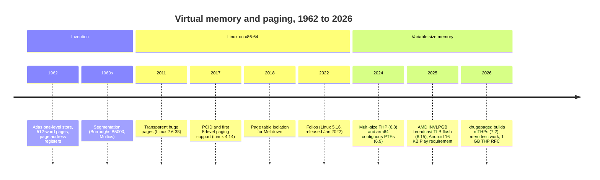
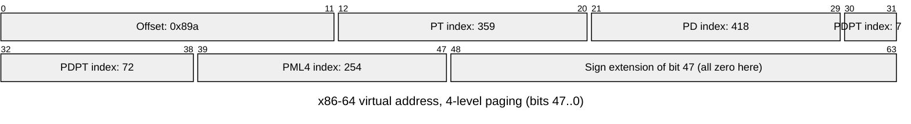
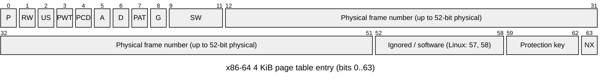
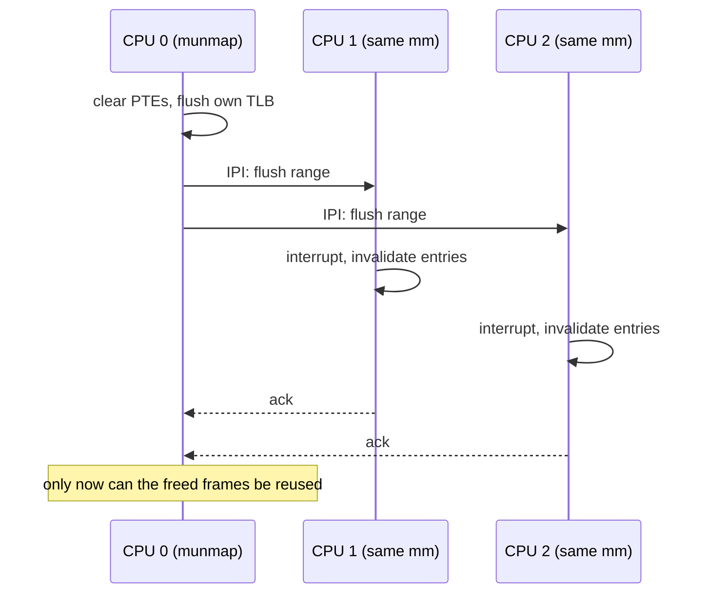
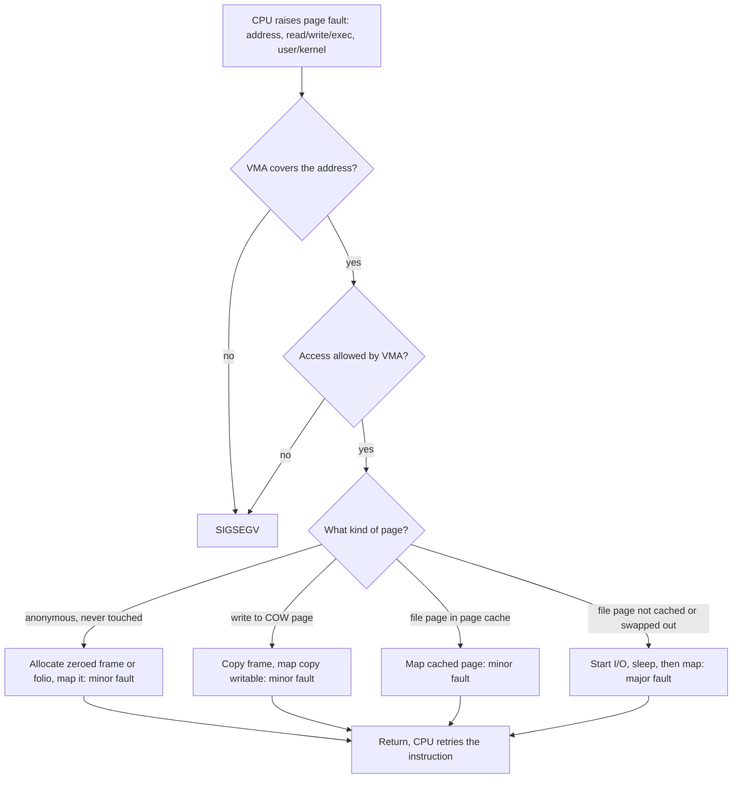

---
tags:
  - operating-systems
  - foundations
  - virtual-memory-and-paging
status: draft
sources:
  - https://ethw.org/Milestones:Atlas_Computer_and_the_Invention_of_Virtual_Memory,_1957-1962
  - https://pages.cs.wisc.edu/~remzi/Classes/736/Spring2000/Papers/atlas.pdf
  - https://pages.cs.wisc.edu/~remzi/OSTEP/vm-segmentation.pdf
  - https://pages.cs.wisc.edu/~remzi/OSTEP/vm-tlbs.pdf
  - https://docs.kernel.org/next/x86/x86_64/5level-paging.html
  - https://raw.githubusercontent.com/torvalds/linux/master/arch/x86/include/asm/pgtable_types.h
  - https://raw.githubusercontent.com/torvalds/linux/master/arch/x86/include/asm/tlbflush.h
  - https://lore.kernel.org/all/20170905214438.3pznwbpssqztaod7@pd.tnic/T/
  - https://kernel.org/doc/html/v6.7/arch/x86/pti.html
  - https://docs.kernel.org/mm/overcommit-accounting.html
  - https://docs.kernel.org/admin-guide/mm/hugetlbpage.html
  - https://kernel.org/doc/html/latest/admin-guide/mm/transhuge.html
  - https://docs.kernel.org/6.8/admin-guide/mm/transhuge.html
  - https://docs.kernel.org/admin-guide/sysctl/kernel.html
  - https://docs.kernel.org/6.19/arch/arm64/memory.html
  - https://docs.riscv.org/reference/isa/v20240411/priv/svnapot.html
  - https://www.phoronix.com/news/Linux-5.18-RISC-V
  - https://lwn.net/Articles/422857/
  - https://lwn.net/Articles/874684
  - https://lkml.iu.edu/hypermail/linux/kernel/2312.0/02618.html
  - https://launchpad.net/bugs/2059316
  - https://lwn.net/Articles/1008298/
  - https://lwn.net/Articles/1016009/
  - https://lwn.net/Articles/1016416
  - https://lwn.net/Articles/lsfmmbpf2025/
  - https://lwn.net/Articles/lsfmmbpf2026/
  - https://lwn.net/Articles/1071484/
  - https://lwn.net/Articles/1071716/
  - https://lwn.net/Articles/1073071/
  - https://lwn.net/Articles/1073418/
  - https://lwn.net/Articles/1073425/
  - https://lwn.net/Articles/1077208/
  - https://lwn.net/Articles/1078539/
  - https://lwn.net/Articles/1093199/
  - https://lkml.iu.edu/2606.0/11320.html
  - https://phoronix.com/news/linux-7.0-mm
  - https://phoronix.com/news/Linux-7.3-Released
  - https://phoronix.com/news/Linux-7.4-MM
  - https://android-developers.googleblog.com/2025/05/prepare-play-apps-for-devices-with-16kb-page-size.html
  - https://www.usenix.org/conference/osdi21/presentation/hunter
  - https://courses.physics.illinois.edu/ece598ms/fa2019/papers/paper223.pdf
  - https://arxiv.org/pdf/1910.05398
  - https://arxiv.org/abs/2309.06180
created: 2026-11-26
updated: 2026-11-26
---

## Table Of Contents

---

- [[#TL;DR|TL;DR]]
- [[#The Problem|The Problem]]
- [[#Foundations|Foundations]]
    - [[#Virtual and Physical Addresses|Virtual and Physical Addresses]]
    - [[#Pages and Frames|Pages and Frames]]
    - [[#What Virtual Memory Buys You|What Virtual Memory Buys You]]
    - [[#Minor and Major Page Faults|Minor and Major Page Faults]]
- [[#How We Got Here|How We Got Here]]
- [[#How It Works|How It Works]]
    - [[#Multi-Level Page Tables on x86-64|Multi-Level Page Tables on x86-64]]
    - [[#Worked Example: Splitting an Address|Worked Example: Splitting an Address]]
    - [[#The Page Table Entry|The Page Table Entry]]
    - [[#The TLB|The TLB]]
    - [[#PCIDs and ASIDs|PCIDs and ASIDs]]
    - [[#TLB Shootdowns|TLB Shootdowns]]
    - [[#Page Faults and Demand Paging|Page Faults and Demand Paging]]
    - [[#Copy-on-Write|Copy-on-Write]]
    - [[#mmap|mmap]]
    - [[#Huge Pages: hugetlbfs and THP|Huge Pages: hugetlbfs and THP]]
    - [[#Multi-Size THP and Contiguous PTEs|Multi-Size THP and Contiguous PTEs]]
    - [[#Folios|Folios]]
    - [[#Paging Under a Hypervisor|Paging Under a Hypervisor]]
- [[#Where It Is Now|Where It Is Now]]
    - [[#Kernel Releases in 2026|Kernel Releases in 2026]]
    - [[#LSFMM+BPF 2025 and 2026|LSFMM+BPF 2025 and 2026]]
    - [[#Page Sizes on Arm, RISC-V and Android|Page Sizes on Arm, RISC-V and Android]]
    - [[#Memory Tiering Hooks|Memory Tiering Hooks]]
    - [[#Paging Outside the Kernel|Paging Outside the Kernel]]
- [[#Trade-offs & Open Problems|Trade-offs & Open Problems]]
- [[#Resources|Resources]]
- [[#Related Notes|Related Notes]]

## ***TL;DR***
---
*Every address a program uses is a fiction: the CPU translates it, page by page, through tables the kernel controls. That one indirection gives isolation between processes, lets the kernel promise more memory than exists, and lets memory be shared and loaded lazily; the price is translation cost, which the TLB and bigger pages fight.*

- **The mechanism:** memory is cut into fixed-size **pages** (4 KiB by default on x86-64). A per-process **page table** maps each virtual page to a physical frame plus permission bits. The **MMU** walks that table on every miss in the **TLB**, a small cache of recent translations ([OSTEP, TLBs](https://pages.cs.wisc.edu/~remzi/OSTEP/vm-tlbs.pdf)).
- **The origin:** the Atlas computer at Manchester (inaugurated December 1962) paged 512-word blocks between core and drum automatically and called it a "one-level store" ([IEEE Milestone](https://ethw.org/Milestones:Atlas_Computer_and_the_Invention_of_Virtual_Memory,_1957-1962)).
- **The tricks it enables:** demand paging (load nothing until touched), copy-on-write `fork()`, `mmap()` of files, shared libraries, overcommit.
- **The costs:** a TLB miss on x86-64 can take 4 memory references (5 with 5-level paging), and up to 24 inside a VM ([Bhargava et al., ASPLOS 2008](https://courses.physics.illinois.edu/ece598ms/fa2019/papers/paper223.pdf)). Changing a mapping means invalidating stale TLB entries on other CPUs (a **shootdown**).
- **Where it is now (Nov 2026):** Linux is moving from 4 KiB pages toward variable-size memory: **folios** (since 5.16), **multi-size THP** (since 6.8), and since Linux 7.2 (2026) khugepaged can build mTHPs automatically ([LWN, Jun 2026](https://lwn.net/Articles/1078539/)). Android requires 16 KiB-page-ready apps since Nov 2025, 1 GB transparent huge pages and per-process page sizes were debated at LSFMM+BPF 2026, and `struct page` itself is being replaced ([LWN, May 2026](https://lwn.net/Articles/1073425/)).

## ***The Problem***
---
*Many programs share one pool of physical memory. Without a layer of indirection, each would have to know where it was loaded, could read or corrupt every other program, and could never use more memory than is physically free.*

| Problem without virtual memory | What goes wrong | What paging does about it |
|---|---|---|
| **No isolation** | A stray pointer in one program overwrites another program or the kernel. | Each process gets its own page table; pages not in it simply do not exist for that process. |
| **Relocation** | A program compiled to run at address 0x400000 can't run if another program already occupies it. | Every process sees the same layout; the table maps it wherever frames are free. See [[Compiler, Assembler, Linker, and Loader]]. |
| **Fragmentation** | Variable-sized regions leave holes too small to use (external fragmentation, [OSTEP](https://pages.cs.wisc.edu/~remzi/OSTEP/vm-segmentation.pdf)). | Fixed-size frames: any free frame fits any page. |
| **Memory is smaller than demand** | A program that reserves 10 GB but touches 1 GB still needs 10 GB. | Pages get frames only when first touched, so reservations are cheap and the kernel can **overcommit**. |
| **Duplication** | Fifty processes linked to the same C library each hold a copy. | One set of frames mapped read-only into all fifty. |

The catch is speed. Translation sits on the path of every load, store and instruction fetch, so the design is a running fight to keep translation almost free.

## ***Foundations***
---
*Four ideas carry the rest of the note: an address the program sees is not the address the memory sees, memory is managed in fixed-size pages, that indirection is what buys isolation, overcommit and sharing, and a page fault is the kernel's chance to fix up a missing translation.*

#### **Virtual and Physical Addresses**
A **virtual address** is what an instruction uses. A **physical address** is what goes out to the memory controller. The **memory-management unit (MMU)** in the CPU converts one into the other using tables that only the kernel can write. A process can't name physical memory directly, so it can't reach memory that isn't mapped for it. Crossing into the kernel to ask for more memory is a system call; see [[System Calls and the User-Kernel Boundary]].

#### **Pages and Frames**
The virtual address space is cut into **pages**, physical memory into **frames** of the same size. A virtual address splits into a **virtual page number (VPN)** and an **offset** within the page. Translation replaces the VPN with a **physical frame number (PFN)** and keeps the offset:

$$
\text{PA} = \text{PFN}(\text{VPN}) \times P + \text{offset}, \qquad \text{VPN} = \lfloor \text{VA} / P \rfloor,\; \text{offset} = \text{VA} \bmod P
$$

*In plain English: chop the address into "which page" and "where in the page", look up which frame holds that page, and glue the frame number back onto the same offset.* With $P = 4096$ the offset is the low 12 bits.

#### **What Virtual Memory Buys You**
- **Isolation.** Each [[Processes and Threads|process]] has its own page table; threads in one process share it. The kernel is mapped into every address space but marked supervisor-only.
- **Overcommit.** Linux by default refuses only obvious overcommits (mode 0); mode 1 always grants; mode 2 caps total commitments at swap plus a share of RAM, 50% by default ([kernel docs](https://docs.kernel.org/mm/overcommit-accounting.html)). Overcommit works because untouched pages cost nothing.
- **Sharing.** The same frame can appear in many page tables: shared libraries, the [[Page Cache and Memory Reclaim|page cache]] under `mmap()`, shared memory, and copy-on-write pages after `fork()`.
- **Laziness.** Nothing has to be in memory until it is touched (demand paging), and cold pages can be written to swap and dropped.

#### **Minor and Major Page Faults**
When the MMU finds no valid translation, or the access breaks a permission, the CPU raises a **page fault** exception and runs the kernel's handler; see [[Interrupts and Exceptions]].

| Kind | What the kernel does | Typical cost |
|---|---|---|
| **Minor (soft)** | The data is already in RAM (a zero page to hand out, a page-cache page, a COW copy). Just allocate or link a frame and fill in the PTE. | Microseconds |
| **Major (hard)** | The data must be read from disk or swap first. The faulting thread sleeps on I/O. | Tens of microseconds (NVMe) to milliseconds (disk) |
| **Invalid** | No mapping covers the address, or the access is forbidden. | The process gets `SIGSEGV`. |

## ***How We Got Here***
---
*Paging was invented to fake a big memory out of a small core and a drum; segmentation competed with it for two decades; and since then the story has been about making translation cheaper as memories grew from kilobytes to terabytes.*



| Year | Step | Problem it answered | Source |
|---|---|---|---|
| 1962 | **Atlas one-level store.** Fixed 512-word pages moved automatically between a 16K-word core and 96K-word drum; one page address register per core page, matched associatively; a "learning program" chose pages to evict. | Programmers were hand-managing overlays between fast and slow storage. | [IEEE Milestone](https://ethw.org/Milestones:Atlas_Computer_and_the_Invention_of_Virtual_Memory,_1957-1962), [Lavington, CACM 1978](https://pages.cs.wisc.edu/~remzi/Classes/736/Spring2000/Papers/atlas.pdf) |
| 1960s | **Segmentation.** Variable-sized segments (code, heap, stack) with base and bounds; the Burroughs B5000 and Multics used many fine-grained segments. | Sharing and protecting logical units of a program. Lost to paging largely because variable sizes cause external fragmentation. | [OSTEP, Segmentation](https://pages.cs.wisc.edu/~remzi/OSTEP/vm-segmentation.pdf) |
| 1960s to 1990s | **Paging wins, page tables go multi-level, TLBs get ASIDs.** E.g. the MIPS R4000 tagged TLB entries with an 8-bit ASID and a global bit. | Flat page tables are huge; flushing the TLB on every context switch is slow. | [OSTEP, TLBs](https://pages.cs.wisc.edu/~remzi/OSTEP/vm-tlbs.pdf) |
| 2011 | **Transparent huge pages** (2.6.38): 2 MB pages for anonymous memory with fallback, plus `khugepaged`. Mel Gorman measured gains up to about 10%. | TLB reach with 4 KiB pages was far below memory sizes; hugetlbfs needed admin setup. | [LWN, Jan 2011](https://lwn.net/Articles/422857/) |
| 2017 | **PCID support and the first kernel that can enable 5-level paging** (4.14, off by default then). | Flushing on every address-space switch; 256 TiB virtual limit. | [x86/mm pull for 4.14](https://lore.kernel.org/all/20170905214438.3pznwbpssqztaod7@pd.tnic/T/) |
| 2018 | **Page table isolation (PTI/KPTI).** Separate user and kernel page tables to block Meltdown; PCID keeps the switch cheap. | Speculative reads of kernel memory through the shared mapping. See [[Transient Execution Attacks and Mitigations]]. | [kernel docs](https://kernel.org/doc/html/v6.7/arch/x86/pti.html) |
| 2021 to 2022 | **Folios** merged for 5.16. | `struct page` could not say "this is the head of a multi-page unit". | [LWN, Nov 2021](https://lwn.net/Articles/874684) |
| 2024 | **Multi-size THP** for anonymous memory (6.8) and **arm64 transparent contiguous PTEs** (6.9). | 2 MB is too coarse; 4 KiB is too small. | [6.8 docs](https://docs.kernel.org/6.8/admin-guide/mm/transhuge.html), [mTHP v8](https://lkml.iu.edu/hypermail/linux/kernel/2312.0/02618.html), [Launchpad](https://launchpad.net/bugs/2059316) |

## ***How It Works***
---
*A translation is a tree walk the hardware does on a TLB miss. Everything else in this section is either a way to avoid that walk (TLBs, PCIDs, huge pages, contiguous PTEs), a way to keep it correct when mappings change (shootdowns), or a way to fill the tree lazily (page faults, COW, mmap).*

#### **Multi-Level Page Tables on x86-64**
A flat table for a 48-bit space with 4 KiB pages would need $2^{36}$ entries of 8 bytes, 512 GiB per process. So the table is a **radix tree**: each level is one 4 KiB page holding 512 eight-byte entries, so each level consumes 9 bits of the address. Missing subtrees cost nothing.

| Mode | Levels (top to bottom) | Virtual bits | Virtual space | Physical space |
|---|---|---|---|---|
| 4-level | PML4 (PGD), PDPT (PUD), PD (PMD), PT (PTE) | 48 | 256 TiB | 64 TiB |
| 5-level (LA57) | PML5 added on top (Linux calls it P4D when it folds) | 57 | 128 PiB | 4 PiB |

Limits from the [kernel's 5-level paging doc](https://docs.kernel.org/next/x86/x86_64/5level-paging.html). The register `CR3` holds the physical address of the top table. A 5-level kernel still boots on 4-level hardware by folding the extra level at runtime. By default Linux never hands user space addresses above 47 bits; a program opts in per allocation by passing an `mmap()` hint above that line, so old code that hides tags in high pointer bits keeps working.

Linux code walks the tree with one helper per level. A simplified sketch, modeled on the kernel's page-table API (locking and huge-page checks left out):

```c
pte_t *walk(struct mm_struct *mm, unsigned long addr)
{
    pgd_t *pgd = pgd_offset(mm, addr);     /* bits 56..48 or 47..39 */
    p4d_t *p4d = p4d_offset(pgd, addr);    /* folded away on 4-level */
    pud_t *pud = pud_offset(p4d, addr);    /* bits 38..30: may be a 1 GB leaf */
    pmd_t *pmd = pmd_offset(pud, addr);    /* bits 29..21: may be a 2 MB leaf */
    if (pmd_none(*pmd))
        return NULL;                       /* nothing mapped: fault will fill it */
    return pte_offset_map(pmd, addr);      /* bits 20..12: the 4 KiB leaf */
}
```

*In plain words: each step takes 9 bits of the address as an index into the current table, reads the entry, and follows its frame number to the next table. The `p4d` step costs nothing on a 4-level machine because the kernel compiles or folds it away. A PUD or PMD entry can itself be the leaf, which is how 1 GB and 2 MB pages work: the walk just stops early.*

#### **Worked Example: Splitting an Address**
Take the user address `0x00007f123456789a` on a 4-level system:



| Field | Bits | Value |
|---|---|---|
| PML4 index | 47..39 | 254 |
| PDPT index | 38..30 | 72 |
| PD index | 29..21 | 418 |
| PT index | 20..12 | 359 |
| Offset | 11..0 | 0x89a |

The walk reads entry 254 of the table at `CR3`, then entry 72 of the table that points to, then 418, then 359; the last entry's PFN plus `0x89a` is the physical address. Four dependent memory reads. If the PD entry had the page-size bit set, the walk would stop there and the low 21 bits (`0x16789a`) would be the offset inside a 2 MB page: three reads.

With 5-level paging the same scheme just adds one more 9-bit field (bits 56..48). For example `0x00ff123456789abc` splits into indices 255, 36, 209, 179, 393 and offset `0xabc`.

Bits 63..48 must copy bit 47 (or bits 63..57 copy bit 56 under LA57), so addresses are **canonical**: user space in the bottom half, the kernel in the top half.

#### **The Page Table Entry**
Each entry is 64 bits. The low bits are flags the hardware checks and sets; the middle holds the frame number; the top holds protection keys and no-execute. Bit positions from Linux's [`pgtable_types.h`](https://raw.githubusercontent.com/torvalds/linux/master/arch/x86/include/asm/pgtable_types.h):



| Bit | Name | Meaning |
|---|---|---|
| 0 | Present | Translation valid. Clear means any access faults, which is how swapped-out and not-yet-touched pages are marked. |
| 1 | RW | Writable. Clear on COW pages so the first write faults. |
| 2 | User | Reachable from user mode. Clear for kernel pages. |
| 3, 4 | PWT, PCD | Cache write-through / cache disable (with PAT, the memory type). |
| 5 | Accessed | Set by the CPU on use. Reclaim reads and clears it to find cold pages. |
| 6 | Dirty | Set by the CPU on write. A dirty file page must be written back before reuse. |
| 7 | PAT (4 KiB) / PS (upper levels) | In a PMD or PUD entry this is the page-size bit: "this entry is a 2 MB or 1 GB page". |
| 8 | Global | Keep in the TLB across `CR3` switches; used for kernel mappings (but see PTI). |
| 12..51 | PFN | Physical frame number. 4 PiB of physical space = $2^{52}$ bytes. |
| 59..62 | Protection key | One of 16 keys checked against the PKRU register (user-space memory protection keys). |
| 63 | NX | No-execute. |

#### **The TLB**
The **translation lookaside buffer** is a small cache of recent translations; OSTEP's "typical" TLB has 32, 64 or 128 fully associative entries, and modern CPUs add a larger second-level TLB ([OSTEP](https://pages.cs.wisc.edu/~remzi/OSTEP/vm-tlbs.pdf)). What matters is **TLB reach**: entries times page size.

$$
\text{reach} = N_{\text{entries}} \times P, \qquad T_{\text{access}} \approx T_{\text{hit}} + (1 - h)\, T_{\text{walk}}
$$

*In plain English: the TLB can only cover as much memory as it has entries times the page size; every miss adds a page walk, so the average access cost grows with the miss rate $(1-h)$.*

**Worked example.** A hypothetical 1,536-entry second-level TLB covers $1536 \times 4\,\text{KiB} = 6$ MiB with 4 KiB pages, but $1536 \times 2\,\text{MiB} = 3$ GiB with 2 MB pages. A server with a 100 GB working set misses constantly with 4 KiB pages. The cost is real: on large multi-socket machines the Mitosis study measured up to 40% of runtime spent servicing TLB misses with 4 KiB pages, and found up to 86% of leaf PTEs on a remote socket ([Mitosis, ASPLOS 2020](https://arxiv.org/pdf/1910.05398)). The CPU softens walks with paging-structure caches for the upper levels, but bigger pages are the main lever.

#### **PCIDs and ASIDs**
A plain TLB holds translations for one address space, so switching `CR3` used to flush it. An **address-space identifier** (ASID; Intel calls it **PCID**) tags each entry with its owner, so entries from several processes can coexist and a switch flushes nothing ([OSTEP](https://pages.cs.wisc.edu/~remzi/OSTEP/vm-tlbs.pdf)).

- Linux enabled PCID on x86 in **4.14** (2017) ([pull request](https://lore.kernel.org/all/20170905214438.3pznwbpssqztaod7@pd.tnic/T/)).
- Linux does not give every process a permanent PCID. Each CPU keeps a small cache of recently used address spaces: `#define TLB_NR_DYN_ASIDS 6`, "because 6 should be plenty and struct tlb_state will fit in two cache lines" ([tlbflush.h](https://raw.githubusercontent.com/torvalds/linux/master/arch/x86/include/asm/tlbflush.h)).
- With **PTI**, every process has two page tables (full kernel view, and a user view mapping only entry/exit code). Without PCID each `CR3` write on every syscall and interrupt would flush the whole TLB; with it, the kernel uses separate PCIDs and defers user-side flushes until return to user space. Cost: an order-1 PGD (about 4 KB extra per process) and CR3 writes of "on the order of a hundred cycles" per kernel entry and exit ([PTI docs](https://kernel.org/doc/html/v6.7/arch/x86/pti.html)).
- Arm and RISC-V have ASIDs in the architecture; arm64 also uses them to avoid flushes.

#### **TLB Shootdowns**
TLBs are not kept coherent by hardware the way data caches are. When the kernel unmaps a page, changes its permissions or migrates it, every CPU that may have cached the old translation must drop it. On x86 that traditionally means sending an **inter-processor interrupt (IPI)** to each such CPU and waiting.



The waiting is the problem: the frames can't be reused until every CPU confirms. Linux batches flushes during reclaim, flushes lazily for CPUs not currently running that `mm`, and since **Linux 6.15** uses AMD's **INVLPGB** broadcast instruction instead of IPIs on processes active on three or more CPUs. In Rik van Riel's benchmark on a 36-core AMD Milan, TLB invalidation fell from about 40% to about 4% of CPU time; combined with an LRU fix, throughput rose from 527k to 1,157k loops/second ([LWN patch posting, Feb 2025](https://lwn.net/Articles/1008298/); [LSFMM+BPF 2025 report](https://lwn.net/Articles/1016009/)). Intel's equivalent, RAR, was listed as follow-up work.

#### **Page Faults and Demand Paging**
`mmap()` and `brk()` only create a **VMA** (a virtual memory area: a range plus permissions and a backing object). Frames arrive later, one fault at a time:



To avoid one process-wide lock serializing every fault, Linux handles most faults under a **per-VMA lock**; a major fault drops it during I/O and retries under the process-wide `mmap_lock`, which still causes contention and stalls on Android, as Barry Song showed at LSFMM+BPF 2026 ([LWN, May 2026](https://lwn.net/Articles/1073071/)).

You can watch demand paging and COW from user space by counting minor faults:

```c
#include <stdio.h>
#include <string.h>
#include <sys/mman.h>
#include <sys/resource.h>
#include <sys/wait.h>
#include <unistd.h>

static long minflt(void) { struct rusage r; getrusage(RUSAGE_SELF, &r); return r.ru_minflt; }

int main(void) {
    size_t len = 64 << 20;                       /* reserve 64 MiB */
    char *p = mmap(NULL, len, PROT_READ | PROT_WRITE,
                   MAP_PRIVATE | MAP_ANONYMOUS, -1, 0);
    long before = minflt();
    memset(p, 1, len);                           /* touch every page */
    printf("parent faults: %ld\n", minflt() - before);

    if (fork() == 0) {                           /* child shares frames, read-only */
        before = minflt();
        for (size_t i = 0; i < len; i += 4096) p[i] = 2;   /* each write: COW copy */
        printf("child COW faults: %ld\n", minflt() - before);
        _exit(0);
    }
    wait(NULL);
    return 0;
}
```

*In plain words: the `mmap()` costs nothing; the `memset` takes one minor fault per page, about 16,384 with 4 KiB pages, and far fewer if THP or mTHP hands out bigger folios. After `fork()` the child's first write to each page faults again to make its private copy. The exact counts tell you which page sizes the kernel actually used.*

#### **Copy-on-Write**
`fork()` does not copy memory. It copies the page tables, marks private writable pages read-only in both parent and child, and bumps a reference count. The first write by either side faults; the kernel copies the frame (or, if the faulting side is the last user, simply makes it writable again). `exec()` right after `fork()` then throws the tables away having copied almost nothing. The same trick backs `MAP_PRIVATE` file mappings and the shared zero page. COW interacts badly with large folios: a write to one 4 KiB piece of a 64 KiB folio splits it or copies only part, which Ryan Roberts flagged at LSFMM+BPF 2025 ([LWN](https://lwn.net/Articles/1016009/)).

#### **mmap**
`mmap()` is the one call that creates every kind of mapping:

| Flags | Backing | Typical use |
|---|---|---|
| `MAP_PRIVATE \| MAP_ANONYMOUS` | Zero-filled memory, swap-backed | `malloc` arenas, thread stacks; see [[Memory Allocators]] |
| `MAP_SHARED \| MAP_ANONYMOUS` | Shared memory (shmem) | Memory shared with children |
| `MAP_PRIVATE` on a file | Page cache, COW on write | Loading executables and shared libraries |
| `MAP_SHARED` on a file | Page cache, writes go back to the file | Databases, memory-mapped I/O; see [[Page Cache and Memory Reclaim]] and [[File Systems]] |
| `MAP_HUGETLB` | hugetlbfs pool | Pre-reserved huge pages |

`madvise()` then tunes a range after the fact (`MADV_HUGEPAGE`, `MADV_DONTNEED`, `MADV_COLLAPSE`).

#### **Huge Pages: hugetlbfs and THP**
Two ways to get 2 MB (PMD) or 1 GB (PUD) pages on x86-64:

| | hugetlbfs | Transparent huge pages (THP) |
|---|---|---|
| Setup | Admin reserves a pool: `/proc/sys/vm/nr_hugepages`, or `hugepagesz=2M hugepages=512` at boot (most reliable, memory not yet fragmented) | None; kernel tries on fault, falls back to small pages |
| Sizes | 2 MB and 1 GB on x86 | 2 MB (PMD); smaller sizes via mTHP |
| Swappable | No; pool pages are reserved for huge-page use | Yes (split first, or swapped as a unit) |
| App changes | `mmap(MAP_HUGETLB)`, `shmget`, or a hugetlbfs file | None, or `madvise(MADV_HUGEPAGE)` |
| Source | [hugetlbpage docs](https://docs.kernel.org/admin-guide/mm/hugetlbpage.html) | [transhuge docs](https://kernel.org/doc/html/latest/admin-guide/mm/transhuge.html) |

THP is controlled by `/sys/kernel/mm/transparent_hugepage/enabled` and `defrag` (default `madvise`: only `MADV_HUGEPAGE` regions stall for compaction). **khugepaged** scans in the background and collapses runs of small pages into huge ones; `max_ptes_none` caps how many empty slots it will fill with zeroes, which is the knob between "more huge pages" and "more wasted RAM". `MADV_COLLAPSE` collapses a range on demand regardless of the sysfs settings ([transhuge docs](https://kernel.org/doc/html/latest/admin-guide/mm/transhuge.html)).

Huge pages pay off at fleet scale when the allocator cooperates: Google's hugepage-aware TCMalloc (Temeraire) gave 7.7% more requests per second across eight applications, 2.4% less RAM, and 6% fewer TLB miss stalls fleet-wide ([Hunter et al., OSDI 2021](https://www.usenix.org/conference/osdi21/presentation/hunter)). See [[Memory Allocators]].

#### **Multi-Size THP and Contiguous PTEs**
2 MB is often too coarse: it wastes memory (internal fragmentation) and needs a 2 MB physically contiguous block. 4 KiB is too fine. **Multi-size THP (mTHP)**, merged in **Linux 6.8**, lets anonymous faults allocate any power-of-two size in between (16K, 32K, 64K...), still mapped by ordinary PTEs ([6.8 docs](https://docs.kernel.org/6.8/admin-guide/mm/transhuge.html)). Each size has its own switch:

```sh
# allow 64 KiB anonymous folios everywhere; leave 2 MB under the global setting
echo always  > /sys/kernel/mm/transparent_hugepage/hugepages-64kB/enabled
echo inherit > /sys/kernel/mm/transparent_hugepage/hugepages-2048kB/enabled
cat /sys/kernel/mm/transparent_hugepage/hugepages-64kB/stats/anon_fault_alloc
```

*In plain words: the PMD size defaults to `inherit` (follow the global knob) and every other size defaults to `never`, so mTHP is opt-in; per-size counters show whether allocations succeed or fall back ([transhuge docs](https://kernel.org/doc/html/latest/admin-guide/mm/transhuge.html)).*

The TLB payoff comes from hardware that can merge contiguous, aligned PTEs into one TLB entry:

| Architecture | Mechanism | Size |
|---|---|---|
| arm64 | Contiguous bit (PTE_CONT) on a run of PTEs; Linux sets it transparently for user mappings since 6.9 | 64 KiB with 4 KiB pages |
| RISC-V | **Svnapot**: N bit marks a naturally aligned power-of-two run; only 64 KiB is standardized | 64 KiB (16 × 4 KiB) |
| AMD | Coalescing without software bits, if the PTEs match | Small aligned runs |

Sources: [Launchpad 6.9 backport](https://launchpad.net/bugs/2059316) (kernel build on Ampere AltraMax from 6m30s to 5m17s, about 19%), [RISC-V Svnapot spec](https://docs.riscv.org/reference/isa/v20240411/priv/svnapot.html), [LWN on AMD coalescing](https://lwn.net/Articles/1016009/). NVIDIA reported up to 10x on some GPU workloads with mTHP plus arm64 contpte ([mTHP v8 thread](https://lkml.iu.edu/hypermail/linux/kernel/2312.0/02618.html)).

#### **Folios**
For decades every 4 KiB frame had a `struct page`, and a huge page was a "head" page plus "tail" pages; any function given a `struct page *` couldn't tell which it held. A **folio** is a type that always means "the head of a power-of-two group of pages", so code that takes a folio handles the whole unit at once. Folios were merged for **5.16** ([LWN, Nov 2021](https://lwn.net/Articles/874684)) and have spread through the page cache, swap, reclaim and filesystems since; mTHP is "anonymous memory in large folios". The next step, discussed at LSFMM+BPF 2026, is **memdescs**: replacing `struct page` with a descriptor eventually only 8 bytes long that points to a type-specific structure (folio, slab, page-table `ptdesc`, netmem...). A prototype shrank `struct page` to 32 bytes; Matthew Wilcox called the 8-byte goal "still a distant goal" ([LWN, May 2026](https://lwn.net/Articles/1073425/)).

#### **Paging Under a Hypervisor**
A virtual machine has its own page tables (guest virtual to guest physical), and the hypervisor has another (guest physical to host physical): Intel **EPT**, AMD **NPT**. On a TLB miss the hardware walks both, and every guest page-table pointer must itself be translated. With $n$ guest levels and $m$ host levels the walk needs

$$
nm + n + m
$$

*references, which for 4-level guest and host tables is $16 + 4 + 4 = 24$, six times a native walk* ([Bhargava et al., ASPLOS 2008](https://courses.physics.illinois.edu/ece598ms/fa2019/papers/paper223.pdf)). That is why huge pages matter even more inside VMs; see [[Virtualization and Hypervisors]].

## ***Where It Is Now***
---
*As of November 2026, the big shift is from one page size to many: Linux manages memory in variable-size folios, builds mTHPs automatically, and is arguing about 1 GB transparent pages and 64 KiB base pages. Phones moved to 16 KiB pages, and the same paging idea now runs GPU memory for LLM serving.*

#### **Kernel Releases in 2026**
- **Linux 7.0** (merge window Feb 2026): MM changes included faster allocation of gigantic folios (120 × 1 GB folios from 3.605 s to 0.431 s), batched clearing of contiguous huge pages to speed faults on 2 MB and larger pages, and swap-in unification (about 20% on a Redis benchmark) ([Phoronix, Feb 2026](https://phoronix.com/news/linux-7.0-mm)).
- **Linux 7.2** (merge window closed 28 Jun 2026): **khugepaged can now create mTHPs automatically**, Nico Pache's series after 19 revisions since a January 2025 RFC. It records which PTEs are occupied during a PMD scan and picks the best mTHP sizes; `max_ptes_none` is restricted to 0 or 511 for mTHP to stop "creep" toward ever larger sizes; file and shmem collapse stay PMD-only. The same window removed the separate read-only-file THP option for the page cache ([LWN, Jun 11](https://lwn.net/Articles/1077208/), [LWN, Jun 29](https://lwn.net/Articles/1078539/), [v19 cover letter](https://lkml.iu.edu/2606.0/11320.html)). Selftests for mTHP collapse followed in 7.3 ([patch, Sep 2026](https://lwn.net/Articles/1093199/)).
- **Linux 7.3** released 18 Oct 2026 ([Phoronix](https://phoronix.com/news/Linux-7.3-Released)).
- **Linux 7.4** (in release candidates now, 7.4-rc4 docs): 539 MM patches, including a DAMON-based auto-tuned huge-page collapse mechanism, DAMON monitoring for HugeTLB memory, and more page-to-folio conversions in swap I/O ([Phoronix, Oct 2026](https://phoronix.com/news/Linux-7.4-MM)).

#### **LSFMM+BPF 2025 and 2026**
The annual kernel summit's memory-management track is the best snapshot of where paging is heading ([2025 index](https://lwn.net/Articles/lsfmmbpf2025/), Montreal, Mar 2025; [2026 index](https://lwn.net/Articles/lsfmmbpf2026/), Zagreb, May 2026).

| Topic | Year | State of play | Source |
|---|---|---|---|
| Large folios for executable text | 2025 | 64 KiB text folios gave about 4 to 8% on most workloads vs about 12% for a full 64 KiB kernel; Wilcox agreed "the kernel should use 64KB pages for text". | [LWN, Apr 2025](https://lwn.net/Articles/1016416) |
| Reducing TLB pressure | 2025 | INVLPGB merged for 6.15; mTHP creation and splitting still weak; Wilcox: mTHP's main win may be shorter LRU lists. | [LWN, Apr 2025](https://lwn.net/Articles/1016009/) |
| 64 KiB base pages on 4 KiB kernels | 2026 | Arm: per-process page sizes (2 to 17% on a benchmark mix). x86: split `PAGE_SIZE` into hardware and kernel sizes; met with skepticism. | [LWN, May 11 2026](https://lwn.net/Articles/1071484/) |
| 1 GB transparent huge pages | 2026 | February 2026 RFC from Usama Arif; Hildenbrand proposed shmem-only first; compaction can't yet build 1 GB blocks; Johannes Weiner reported his employer rolling out 1 GB huge pages with gains. | [LWN, May 12 2026](https://lwn.net/Articles/1071716/) |
| Removing the page mapcount | 2026 | `NO_PAGE_MAPCOUNT` (experimental since 6.15) trades exact PSS/pagemap statistics for simpler large-folio mapping; Hildenbrand wants it default. | [LWN, May 27 2026](https://lwn.net/Articles/1073418/) |
| memdescs replacing `struct page` | 2026 | Multi-year; prototype at 32 bytes; 8 bytes "a distant goal". | [LWN, May 28 2026](https://lwn.net/Articles/1073425/) |
| Major-fault handling | 2026 | `mmap_lock` retries after I/O stall threads; no decision. | [LWN, May 22 2026](https://lwn.net/Articles/1073071/) |

The 2026 track also covered tier-aware memory-controller limits, private memory nodes, CXL, MGLRU, swap tables and BPF-controlled memory management (titles in the [2026 index](https://lwn.net/Articles/lsfmmbpf2026/)); those belong to [[Page Cache and Memory Reclaim]] and [[CXL and Memory Tiering]].

#### **Page Sizes on Arm, RISC-V and Android**
- **x86-64** has a fixed 4 KiB base page, with 2 MB and 1 GB huge pages.
- **arm64** supports 4 KiB, 16 KiB and 64 KiB granules. Linux uses 3 or 4 levels with 4 KiB pages (39- or 48-bit VAs) and 2 levels with 64 KiB pages (42-bit); 52-bit VAs need 64 KiB pages under the documented LVA scheme and, like x86 LA57, are opt-in per `mmap()` hint ([arm64 memory docs](https://docs.kernel.org/6.19/arch/arm64/memory.html)).
- **RISC-V** has Sv39, Sv48 and Sv57 (5-level, landed for Linux 5.18 in 2022) ([Phoronix, Mar 2022](https://www.phoronix.com/news/Linux-5.18-RISC-V)) plus Svnapot for 64 KiB contiguous runs.
- **Android** added 16 KiB page support in Android 15. Since **1 November 2025**, new apps and updates on Google Play targeting Android 15+ must support 16 KiB pages. Google's measured gains: app launch 3 to 30% faster, 4.5% average battery improvement, camera launch 4.5 to 6.6% faster, about 8% faster boot ([Android Developers, May 2025](https://android-developers.googleblog.com/2025/05/prepare-play-apps-for-devices-with-16kb-page-size.html)). The practical break is native code that hard-codes 4096 or ELF segments aligned to 4 KiB.

#### **Memory Tiering Hooks**
With CXL-attached and other slower memory exposed as [[NUMA]] nodes, the page table's accessed bits and NUMA hinting faults become the sensor for hot and cold pages. Linux's `numa_balancing=2` (memory tiering mode) periodically unmaps pages, catches the resulting faults to find hot pages in slow memory and promotes them, capped by `numa_balancing_promote_rate_limit_MBps` ([sysctl docs](https://docs.kernel.org/admin-guide/sysctl/kernel.html)). Hot-page detection and multiple hotness sources were 2025 summit topics ([2025 index](https://lwn.net/Articles/lsfmmbpf2025/)). The full story is in [[CXL and Memory Tiering]].

#### **Paging Outside the Kernel**
The paging idea keeps getting borrowed. [[PagedAttention]] (vLLM, SOSP 2023) stores each request's [[KV Cache]] in fixed-size blocks mapped through a per-request block table, with sharing and copy-on-write, so GPU memory is no longer lost to fragmentation ([Kwon et al.](https://arxiv.org/abs/2309.06180)). It is the OS page table, rebuilt in user space on a GPU.

## ***Trade-offs & Open Problems***
---
*Page size is the central dial: bigger pages mean fewer TLB misses and less bookkeeping but more wasted memory, harder allocation and costlier copy-on-write. Most open problems are about getting the benefits of big pages without paying those costs, and about keeping translation coherent as core counts and memory tiers grow.*

| Choice | Gains | Costs |
|---|---|---|
| 4 KiB base pages | Little waste, easy allocation, universal ABI | Small TLB reach, millions of `struct page`s, deep walks |
| 16 / 64 KiB base pages | 16x reach at 64 KiB; fewer faults; measured 2 to 17% on Arm | More RAM per process, breaks code that assumes 4096 |
| mTHP (16 to 64 KiB folios) | Most of the TLB gain with 4 KiB ABI | Splitting on partial `madvise`, COW and swap; architecture-specific coalescing rules |
| 2 MB THP | Big reach, 3-level walk | Bloat, compaction stalls, latency spikes |
| 1 GB pages | Reach for terabyte machines | Hard to allocate after fragmentation; splitting and migration unsolved for THP |
| hugetlbfs | Guaranteed, predictable | Static pool, not swappable, admin work |
| 5-level paging | 128 PiB VA, 4 PiB PA | One more level on every walk |

Open problems worth tracking:
- **Making large folios first-class.** Folios larger than a PMD, mixed-size mappings and mapcount removal must all land before 1 GB THP and memdescs can ([LWN](https://lwn.net/Articles/1071716/), [LWN](https://lwn.net/Articles/1073418/)).
- **Fragmentation.** Every larger size depends on finding contiguous physical memory; compaction works at PMD granularity today ([LWN](https://lwn.net/Articles/1071716/)).
- **Shootdown scaling.** IPIs scale with core count; broadcast invalidation needs global ASIDs, which are scarce ([LWN](https://lwn.net/Articles/1008298/)).
- **Page tables as a NUMA problem.** On big machines page tables themselves sit on the wrong socket; replication (Mitosis) helps but isn't mainline ([Mitosis](https://arxiv.org/pdf/1910.05398)).
- **Security.** KPTI and other isolation schemes put page-table switching back on hot paths; address-space isolation for the kernel was a 2025 summit topic ([2025 index](https://lwn.net/Articles/lsfmmbpf2025/)). See [[Transient Execution Attacks and Mitigations]] and [[Kernel Security Hardening]].
- **Fault-path locking.** Per-VMA locks removed most `mmap_lock` contention, but major faults still fall back to it ([LWN](https://lwn.net/Articles/1073071/)).

## ***Resources***
---
*Start with OSTEP's paging and TLB chapters for the mechanics, then the kernel's THP and 5-level docs for Linux specifics, then LWN's LSFMM+BPF coverage for where it is going.*

**Textbooks and history**
- [OSTEP: Paging: Faster Translations (TLBs)](https://pages.cs.wisc.edu/~remzi/OSTEP/vm-tlbs.pdf): Arpaci-Dusseau. TLBs, ASIDs, hit rates.
- [OSTEP: Segmentation](https://pages.cs.wisc.edu/~remzi/OSTEP/vm-segmentation.pdf): why variable-size segments lost to pages.
- [The Manchester Mark I and Atlas: A Historical Perspective](https://pages.cs.wisc.edu/~remzi/Classes/736/Spring2000/Papers/atlas.pdf): Lavington, CACM 1978.
- [IEEE Milestone: Atlas and the Invention of Virtual Memory](https://ethw.org/Milestones:Atlas_Computer_and_the_Invention_of_Virtual_Memory,_1957-1962): dates and sizes.

**Kernel documentation and source**
- [5-level paging](https://docs.kernel.org/next/x86/x86_64/5level-paging.html): address-space limits and the `mmap()` hint.
- [Transparent Hugepage Support](https://kernel.org/doc/html/latest/admin-guide/mm/transhuge.html): THP, mTHP, khugepaged, sysfs knobs.
- [HugeTLB Pages](https://docs.kernel.org/admin-guide/mm/hugetlbpage.html): hugetlbfs pools.
- [Page Table Isolation](https://kernel.org/doc/html/v6.7/arch/x86/pti.html): KPTI design and costs.
- [Overcommit accounting](https://docs.kernel.org/mm/overcommit-accounting.html) and [kernel sysctls (numa_balancing)](https://docs.kernel.org/admin-guide/sysctl/kernel.html).
- [Memory Layout on AArch64 Linux](https://docs.kernel.org/6.19/arch/arm64/memory.html).
- [`pgtable_types.h`](https://raw.githubusercontent.com/torvalds/linux/master/arch/x86/include/asm/pgtable_types.h) and [`tlbflush.h`](https://raw.githubusercontent.com/torvalds/linux/master/arch/x86/include/asm/tlbflush.h): PTE bits and PCID handling.
- [RISC-V Svnapot](https://docs.riscv.org/reference/isa/v20240411/priv/svnapot.html).

**Papers**
- [Accelerating Two-Dimensional Page Walks for Virtualized Systems](https://courses.physics.illinois.edu/ece598ms/fa2019/papers/paper223.pdf): Bhargava et al., ASPLOS 2008. The 24-reference nested walk.
- [Mitosis: Transparently Self-Replicating Page-Tables](https://arxiv.org/pdf/1910.05398): Achermann et al., ASPLOS 2020. Page-walk cost on big NUMA machines.
- [Beyond malloc efficiency to fleet efficiency](https://www.usenix.org/conference/osdi21/presentation/hunter): Hunter et al., OSDI 2021. Hugepage-aware allocation at Google.
- [Efficient Memory Management for LLM Serving with PagedAttention](https://arxiv.org/abs/2309.06180): Kwon et al., SOSP 2023.

**LWN and patch history**
- [Transparent huge pages merged for 2.6.38](https://lwn.net/Articles/422857/) (Jan 2011) and [Folios merged for 5.16](https://lwn.net/Articles/874684) (Nov 2021).
- [Multi-size THP for anonymous memory, v8](https://lkml.iu.edu/hypermail/linux/kernel/2312.0/02618.html): Ryan Roberts, Dec 2023.
- [AMD broadcast TLB invalidation](https://lwn.net/Articles/1008298/): Rik van Riel, Feb 2025.
- [LSFMM+BPF 2025](https://lwn.net/Articles/lsfmmbpf2025/) and [LSFMM+BPF 2026](https://lwn.net/Articles/lsfmmbpf2026/) coverage indexes.
- [Automatic mTHP creation in 7.2](https://lwn.net/Articles/1077208/) and [The rest of the 7.2 merge window](https://lwn.net/Articles/1078539/): Jun 2026.

**Release and platform news**
- [Linux 7.0 MM changes](https://phoronix.com/news/linux-7.0-mm), [Linux 7.3 released](https://phoronix.com/news/Linux-7.3-Released), [Linux 7.4 MM merge](https://phoronix.com/news/Linux-7.4-MM): Phoronix, 2026.
- [Prepare Play apps for devices with 16 KB page size](https://android-developers.googleblog.com/2025/05/prepare-play-apps-for-devices-with-16kb-page-size.html): Android Developers, May 2025.

## Related Notes

- [[Processes and Threads]] — Each process owns an address space; threads share one.
- [[System Calls and the User-Kernel Boundary]] — `mmap()`, `brk()`, `madvise()` and the kernel half of every address space.
- [[Interrupts and Exceptions]] — A page fault is an exception; shootdowns use IPIs.
- [[Memory Allocators]] — The buddy allocator hands out frames and folios; user-space allocators decide whether huge pages pay off.
- [[Page Cache and Memory Reclaim]] — File pages, swap, accessed bits and reclaim, the other side of demand paging.
- [[CXL and Memory Tiering]] — Hot/cold page detection and promotion across memory tiers.
- [[Virtualization and Hypervisors]] — EPT/NPT nested paging and the 24-reference walk.
- [[Transient Execution Attacks and Mitigations]] — Meltdown and KPTI's split page tables.
- [[Kernel Security Hardening]] — NX, SMEP/SMAP-style permission bits and address-space isolation.
- [[File Systems]] — Large folios in the page cache depend on filesystem support.
- [[Compiler, Assembler, Linker, and Loader]] — How executables are laid out into the pages that `mmap()` maps.
- [[PagedAttention]] — LLM serving's reuse of paging for the KV cache.
- [[KV Cache]] — The memory PagedAttention pages.
