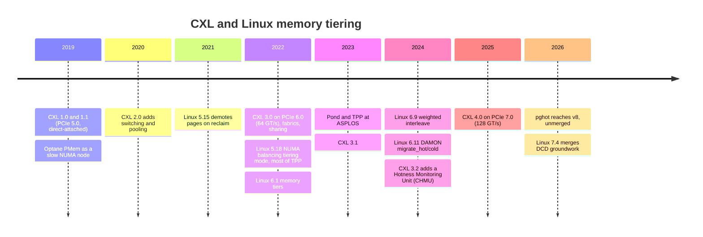
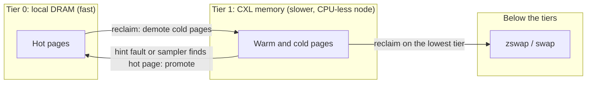

---
tags:
  - operating-systems
  - memory-management
  - cxl
  - memory-tiering
  - numa
  - linux-kernel
  - frontier
status: complete
sources:
  - https://www.microsoft.com/en-us/research/publication/pond-cxl-based-memory-pooling-systems-for-cloud-platforms/
  - https://arxiv.org/pdf/2203.00241
  - https://arxiv.org/abs/2206.02878v2
  - https://www.businesswire.com/news/home/20251118275848/en/CXL-Consortium-Releases-the-Compute-Express-Link-4.0-Specification-Increasing-Speed-and-Bandwidth
  - https://www.blocksandfiles.com/ai-ml/2025/11/24/cxl-40-doubles-bandwidth-and-stretches-memory-pooling-to-multi-rack-setups/1709444
  - https://computeexpresslink.org/wp-content/uploads/2025/11/CXL_4.0-White-Paper_FINAL.pdf
  - https://kernel.org/doc/Documentation/ABI/testing/sysfs-kernel-mm-memory-tiers
  - https://docs.kernel.org/driver-api/cxl/allocation/reclaim.html
  - https://docs.kernel.org/admin-guide/sysctl/kernel.html
  - https://lwn.net/Articles/956866/
  - https://lkml.rescloud.iu.edu/2406.1/06401.html
  - https://lwn.net/Articles/1092001/
  - https://lwn.net/Articles/1085868/
  - https://lwn.net/Articles/1074494/
  - https://lwn.net/Articles/1099278/
  - https://phoronix.com/news/Linux-7.4-CXL
  - https://businesswire.com/news/home/20241203881716/en/CXL-Consortium-Announces-Compute-Express-Link-3.2-Specification-Release
created: 2026-11-26
updated: 2026-11-26
---

## Table Of Contents

---

- [[#TL;DR|TL;DR]]
- [[#The Problem|The Problem]]
- [[#Foundations|Foundations]]
    - [[#Three Protocols on One Wire|Three Protocols on One Wire]]
    - [[#Device Types|Device Types]]
    - [[#CXL Memory Is a NUMA Node Without CPUs|CXL Memory Is a NUMA Node Without CPUs]]
- [[#How We Got Here|How We Got Here]]
- [[#How It Works|How It Works]]
    - [[#Memory Tiers and Abstract Distance|Memory Tiers and Abstract Distance]]
    - [[#Demotion on Reclaim|Demotion on Reclaim]]
    - [[#Promotion of Hot Pages|Promotion of Hot Pages]]
    - [[#Interleaving for Bandwidth|Interleaving for Bandwidth]]
    - [[#Pooling and Dynamic Capacity|Pooling and Dynamic Capacity]]
- [[#Where It Is Now|Where It Is Now]]
- [[#Trade-offs & Open Problems|Trade-offs & Open Problems]]
- [[#Resources|Resources]]
- [[#Related Notes|Related Notes]]

## ***TL;DR***
---
*CXL (Compute Express Link) lets a server add memory over a PCIe-style cable instead of a DIMM slot. That memory is slower than local DRAM, so the kernel has to decide which pages live where; that decision is "memory tiering".*

- **What CXL is.** An open interconnect that runs cache-coherent memory traffic over the PCIe physical layer. A Type 3 "memory expander" card shows up to Linux as a NUMA node with memory and no CPUs.
- **Why anyone wants it.** DRAM can be about **half the cost of a cloud server**, and at Azure up to **25%** of it sits stranded (allocated to no VM) at the 95th percentile ([Pond, ASPLOS 2023](https://arxiv.org/pdf/2203.00241)). CXL adds capacity and bandwidth past the DIMM-slot limit and lets several hosts share a pool.
- **The cost.** CXL memory adds about **70 to 90 ns** over local DRAM for small pools and **over 180 ns** at rack scale (Pond), roughly the penalty of a far socket or worse.
- **What the kernel does.** It groups nodes into *memory tiers* by speed, **demotes** cold pages to slow tiers instead of swapping them out, and **promotes** hot pages back up, using NUMA hinting faults (and in new work, hardware samplers) to find them.
- **Status, Nov 2026.** Demotion, promotion via `numa_balancing=2`, memory tiers, weighted interleave and DAMON-based migration are all upstream. The CXL 4.0 spec (Nov 2025) doubles the link to 128 GT/s. Linux 7.4 merges groundwork for *Dynamic Capacity Devices* but keeps them disabled. AMD's "pghot" promotion rework reached v8 without being merged.

## ***The Problem***
---
*Memory has hit two walls at once: you can't attach enough of it to a CPU socket, and what you do attach is used badly. CXL fixes the first wall in hardware and makes the second a placement problem for the OS.*

- **Capacity and bandwidth per core stopped growing.** Core counts rose faster than DDR channels per socket, so bandwidth and capacity per core fell. More DIMM slots cost board space, pins and power.
- **Stranding.** A cloud host sells VMs with fixed memory sizes. When the cores are all sold, leftover DRAM is wasted; when the DRAM is all sold, leftover cores are. Pond measured about **6%** of Azure DRAM stranded at 75% core utilisation, rising past **10%** near 85% and up to **25%** at the 95th percentile ([Pond](https://arxiv.org/pdf/2203.00241)).
- **Cold memory is common.** Meta found large parts of its fleet's memory are rarely touched for minutes at a time, which is what made a cheaper, slower tier attractive ([TPP](https://arxiv.org/abs/2206.02878v2)).

Adding slower memory only helps if the hot data stays in fast memory. If an application's working set lands in the slow tier, it runs slower than it would have with less, faster memory. So the OS problem is: **find hot and cold pages cheaply, and move them between tiers without the moving itself costing more than it saves.**

## ***Foundations***
---
*CXL reuses PCIe's wires but adds memory semantics: loads and stores, not DMA. To software, the result looks like the [[NUMA]] systems the kernel has managed for 20 years, with one new twist: a node that is slower than every other node, and has no CPUs.*

### Three Protocols on One Wire

| Protocol | What it carries | Used by |
|---|---|---|
| **CXL.io** | PCIe-equivalent config, discovery, DMA, interrupts | Every CXL device |
| **CXL.cache** | A device caching *host* memory coherently | Accelerators, SmartNICs |
| **CXL.mem** | The host issuing loads and stores to *device* memory | Memory expanders, accelerators with memory |

The key point is CXL.mem: the CPU's memory controller treats device memory like any other physical memory. A `mov` instruction reaches it; no driver call sits on the access path.

### Device Types

- **Type 1:** caches host memory (CXL.io + CXL.cache). A SmartNIC with a coherent cache.
- **Type 2:** an accelerator with its own memory (all three). A GPU or FPGA whose memory the host can map coherently; see [[Heterogeneous Memory and GPU Drivers]].
- **Type 3:** a memory expander (CXL.io + CXL.mem). DRAM, possibly with compression, behind a CXL controller. This is the type that matters for tiering.

### CXL Memory Is a NUMA Node Without CPUs

Firmware describes CXL memory windows (ACPI CEDT) and their performance (HMAT for the host, CDAT read from the device). Linux's CXL driver builds a *region* out of one or more devices, then hands it to the memory-hotplug path, which onlines it as a new NUMA node with no CPUs. Administrators can online it into `ZONE_MOVABLE` so the kernel never puts unmovable allocations there, which keeps it removable ([LWN, Sep 2026](https://lwn.net/Articles/1092001/), Gregory Price in comments).

That one decision (expose CXL as a NUMA node) is why tiering reuses NUMA machinery: page migration, memory policies, cpusets, NUMA hinting faults. Pond took the same idea into VMs as a **zero-core NUMA node** ("zNUMA"): the guest sees pool memory as a node with no vCPUs and naturally prefers its local node.

## ***How We Got Here***
---
*Tiered memory first arrived with Intel Optane persistent memory around 2019; the kernel features built for Optane were renamed and reused when Optane died and CXL took its place.*

- **Optane first.** Persistent memory configured as volatile capacity appeared as a CPU-less node. Dave Hansen's demotion patches and Ying Huang's NUMA-balancing tiering mode were written for it.
- **Meta's TPP** ("Transparent Page Placement", ASPLOS 2023) combined proactive demotion, faster allocation on the top tier and rate-limited promotion. It got within **1%** of an all-DRAM baseline and about **18%** better than default Linux; most of it was merged in **Linux 5.18** ([TPP](https://arxiv.org/abs/2206.02878v2)).
- **Microsoft's Pond** (ASPLOS 2023) showed the cloud economics: pooling across 8 to 16 sockets could cut DRAM by about **7 to 9%**, using a machine-learning model over ~200 hardware counters to predict which VMs tolerate pool memory ([Pond](https://arxiv.org/pdf/2203.00241)).
- **Generalising.** Aneesh Kumar's memory-tier framework (6.1) replaced a hard-coded "DRAM above PMem" rule with tiers computed from performance data. Gregory Price's weighted interleave (6.9) added bandwidth spreading ([LWN](https://lwn.net/Articles/956866/)). SK hynix's Honggyu Kim added DAMON actions that migrate hot and cold regions (6.11) ([patches](https://lkml.rescloud.iu.edu/2406.1/06401.html)).

## ***How It Works***
---
*Four mechanisms do the work: tiers rank the nodes, demotion pushes cold pages down instead of swapping them, promotion pulls hot pages up, and interleaving spreads bandwidth-bound data across both. Each is a NUMA tool repurposed.*

### Memory Tiers and Abstract Distance

Each node gets an *abstract distance* computed from HMAT/CDAT latency and bandwidth; nodes with similar distance share a tier. Tiers appear in sysfs as `/sys/devices/virtual/memory_tiering/memory_tierN/nodelist`, where a smaller N is faster ([sysfs ABI](https://kernel.org/doc/Documentation/ABI/testing/sysfs-kernel-mm-memory-tiers)). From the tiers the kernel derives a *demotion target* for each node.

### Demotion on Reclaim

Normally, reclaim evicts cold pages to swap or drops clean file pages (see [[Page Cache and Memory Reclaim]]). With `/sys/kernel/mm/numa/demotion_enabled` set, `vmscan` first tries to **migrate** cold pages to the demotion node. A migration keeps the data in memory, so a later access is a slower load, not a major fault ([kernel docs](https://docs.kernel.org/driver-api/cxl/allocation/reclaim.html)).

Two details from the docs matter in practice:

- In 6.15 and earlier, demotion ignored `cpuset.mems`, so a container's pages could leave its allowed nodes. Later kernels try to respect it, but shared pages first touched by another cgroup (libc, for example) can still be demoted.
- With both zswap and demotion enabled, zswap prefers storing compressed pages in the slowest CXL tier until it fills.

### Promotion of Hot Pages

Promotion is the hard half: a page in CXL memory is accessed by hardware with no kernel involvement, so the kernel must *sample* to learn it is hot. With `kernel.numa_balancing=2`, NUMA balancing periodically unmaps ranges of slow-tier pages. The next touch takes a cheap *hinting fault*; the kernel records it and promotes pages whose fault pattern says "hot", capped by `numa_balancing_promote_rate_limit_MBps` ([sysctl docs](https://docs.kernel.org/admin-guide/sysctl/kernel.html)). The rate limit exists because a promotion is a copy of 4 KiB or more plus a TLB shootdown.

As LWN put it in Sep 2026: demotion "works reasonably well"; promotion is where either hot pages stay slow or cold pages get promoted ([LWN](https://lwn.net/Articles/1092001/)). Fault sampling also costs CPU time and adds latency to the access it catches. That is why CXL 3.2 (Dec 2024) defines a Hotness Monitoring Unit (CHMU) on the device ([CXL Consortium](https://businesswire.com/news/home/20241203881716/en/CXL-Consortium-Announces-Compute-Express-Link-3.2-Specification-Release)), and why AMD's pghot work adds hardware samplers (below).

### Interleaving for Bandwidth

Some data is bandwidth-bound, not latency-bound (an LLM's weights read in a stream, a large scan). For that, the best placement is *spread across both tiers* in proportion to bandwidth. `MPOL_WEIGHTED_INTERLEAVE` (6.9) lets a process interleave pages across nodes with per-node weights.

**Worked example (illustrative numbers).** If local DRAM gives 300 GB/s and one CXL card gives 60 GB/s, weights of 5:1 put 5 pages in DRAM for every 1 in CXL, so both links saturate together and total bandwidth approaches 360 GB/s instead of 300.

The cost of putting a fraction $f$ of accesses in the slow tier is a weighted average:

$$L_{avg} = (1-f)\,L_{DRAM} + f\,L_{CXL}$$

*In words: the average memory latency is each tier's latency weighted by how often you hit it.* With Pond's 8-socket numbers ($L_{DRAM} \approx 85$ ns, $L_{CXL} \approx 155$ ns) and 20% of accesses landing on CXL: $0.8 \times 85 + 0.2 \times 155 = 68 + 31 = 99$ ns, about **16% slower** on average. Push only the coldest 2% of accesses there and it is $0.98 \times 85 + 0.02 \times 155 \approx 86.4$ ns, under 2% slower. That gap is the whole case for good placement.

### Pooling and Dynamic Capacity

A **pool** is a CXL device (or switch-attached set) whose capacity is carved among several hosts. CXL 2.0 allowed static carving; **Dynamic Capacity Devices (DCD)** let the device add and release *extents* to a host at runtime, so capacity follows demand without a reboot. On the Linux side, extents surface as DAX devices that can be onlined as memory ([LWN, Oct 2026](https://lwn.net/Articles/1099278/)). Sharing (several hosts mapping the *same* memory, CXL 3.0) is a further step that needs coherence across hosts and is mostly unexplored in mainline.

## ***Where It Is Now***
---
*As of November 2026, the basic tiering machinery is upstream and stable; the active fights are over better hotness detection and per-cgroup tier limits, while hardware moves to CXL 4.0 and dynamic capacity.*

**Specs and hardware.**
- **CXL 4.0** (18 Nov 2025) moves to PCIe 7.0 at **128 GT/s**, double CXL 3.x at the same latency, adds *bundled ports* that aggregate several physical ports into one logical link, a native x2 width and support for four retimers to reach across racks ([CXL Consortium](https://www.businesswire.com/news/home/20251118275848/en/CXL-Consortium-Releases-the-Compute-Express-Link-4.0-Specification-Increasing-Speed-and-Bandwidth), [Blocks & Files](https://www.blocksandfiles.com/ai-ml/2025/11/24/cxl-40-doubles-bandwidth-and-stretches-memory-pooling-to-multi-rack-setups/1709444)). Multi-rack CXL 4 systems are expected late 2026 to 2027.
- AI inference is now the main pitch: KV caches that don't fit in GPU or host DRAM are an obvious capacity tier.

**Kernel, by release.**

| Item | State, Nov 2026 |
|---|---|
| Demotion, `numa_balancing=2`, memory tiers | Upstream since 5.15 to 6.1 |
| Weighted interleave, DAMON migrate actions | Upstream (6.9, 6.11); `samples/damon/mtier.c` shows DAMON-driven tiering |
| DCD groundwork (mailbox, partitions, interrupts) | **Merged for Linux 7.4** (26 Oct 2026); DCD itself still disabled ([Phoronix](https://phoronix.com/news/Linux-7.4-CXL)) |
| Rest of DCD (extents, DAX) | Under review; prep series at v15 ([LWN](https://lwn.net/Articles/1099278/)) |
| **pghot** (AMD, Bharata Rao) | v8 (Jul 2026), unmerged, "far away from being mergeable" per David Hildenbrand ([LWN](https://lwn.net/Articles/1092001/)) |
| Tier-aware memcg limits (Joshua Hahn) | Under discussion; competing Kylin series folded in |
| Non-temporal-store demotion | RFC (May 2026) ([LWN](https://lwn.net/Articles/1074494/)) |

**pghot in detail.** It merges hotness data from several sources (NUMA hint faults, AMD IBS hardware sampling, with PTE accessed-bit scanning planned) and promotes from a per-node `kmigrated` thread. It costs **1 byte per slow-tier page** (~256 MB per TB of CXL at 4 KiB pages), or 4 bytes in a "precision mode" that also records which node touched the page. Its v8 benchmarks on DRAM + CPU-less CXL systems: NAS BT **2.26x** and Graph500 BFS **2.49 to 2.68x** over no tiering, matching mainline NUMAB=2, and llama.cpp decode **1.41x** against mainline's 1.09x ([v8 cover letter](https://lwn.net/Articles/1085868/)). Pushback: Matthew Wilcox doubts customers want it; Andrew Morton and SeongJae Park ask why DAMON can't do it; Meta (Gregory Price) supports it.

**Demotion copies.** A May 2026 RFC copies demoted folios with non-temporal stores, which don't pull data into the cache. In a 64 GB test, read traffic on the CXL device fell from about 64 GB to almost zero while write traffic was unchanged ([LWN](https://lwn.net/Articles/1074494/)).

## ***Trade-offs & Open Problems***
---
*Tiering trades capacity for unpredictability: you get more memory per dollar, but performance now depends on a heuristic guessing your access pattern correctly, and some workloads lose.*

| Choice | Gains | Costs |
|---|---|---|
| CXL as a NUMA node | Reuses migration, policies, cpusets; transparent to apps | Allocators and old NUMA heuristics weren't built for a node much slower than all others |
| Demote instead of swap | No major faults; data stays byte-addressable | Slow-tier pages still cost latency on every access |
| Fault-based promotion | No hardware support needed | CPU overhead, sampling lag, extra fault latency |
| Hardware hotness (AMD IBS, CXL CHMU) | Cheaper, finer-grained | Vendor-specific; more code paths to maintain |
| Weighted interleave | Uses aggregate bandwidth | Every access pays an averaged latency |
| Pooling / DCD | Cuts stranded DRAM | Pool failure hits many hosts; blast radius and security of shared memory |

**Open problems.**

- **Hot-page detection.** No consensus on one framework: NUMA balancing, DAMON and pghot overlap, and maintainers want one answer before merging another.
- **Fairness and isolation.** Whoever allocates first gets DRAM. Per-cgroup tier limits address this, but Michal Hocko questioned whether memcg should control tiers at all ([LWN](https://lwn.net/Articles/1092001/)); research such as Equilibria (2026) studies multi-tenant fairness.
- **Huge pages and folios.** Migrating a 2 MiB folio is costly; splitting it loses TLB reach (see [[Virtual Memory and Paging]]).
- **Is it worth it?** Matthew Wilcox's question stands: some argue the savings are smaller than vendors claim, and Pond's own estimate is single-digit DRAM savings.
- **Sharing across hosts.** CXL 3.x multi-host shared memory needs software coherence and failure handling that operating systems don't have yet.

## ***Resources***
---
*Read Pond and TPP for why and how, the kernel's CXL docs for current behaviour, and LWN's 2026 tiering roundup for what is still contested.*

**Papers**
- [Pond: CXL-Based Memory Pooling Systems for Cloud Platforms](https://arxiv.org/pdf/2203.00241): Li et al., Microsoft and CMU, ASPLOS 2023.
- [TPP: Transparent Page Placement for CXL-Enabled Tiered-Memory](https://arxiv.org/abs/2206.02878v2): Maruf et al., Meta, ASPLOS 2023.

**Specs**
- [CXL 4.0 announcement](https://www.businesswire.com/news/home/20251118275848/en/CXL-Consortium-Releases-the-Compute-Express-Link-4.0-Specification-Increasing-Speed-and-Bandwidth): CXL Consortium, Nov 2025.
- [CXL 3.2 announcement](https://businesswire.com/news/home/20241203881716/en/CXL-Consortium-Announces-Compute-Express-Link-3.2-Specification-Release): CXL Consortium, Dec 2024.
- [CXL 4.0 white paper](https://computeexpresslink.org/wp-content/uploads/2025/11/CXL_4.0-White-Paper_FINAL.pdf): CXL Consortium.
- [CXL 4.0 doubles bandwidth](https://www.blocksandfiles.com/ai-ml/2025/11/24/cxl-40-doubles-bandwidth-and-stretches-memory-pooling-to-multi-rack-setups/1709444): Blocks & Files, Nov 2025.

**Kernel docs**
- [CXL reclaim and demotion](https://docs.kernel.org/driver-api/cxl/allocation/reclaim.html): kernel.org.
- [Memory tiers sysfs ABI](https://kernel.org/doc/Documentation/ABI/testing/sysfs-kernel-mm-memory-tiers): kernel.org.
- [numa_balancing sysctls](https://docs.kernel.org/admin-guide/sysctl/kernel.html): kernel.org.

**State of play**
- [Recent work in memory tiering](https://lwn.net/Articles/1092001/): Jonathan Corbet, LWN, Sep 2026.
- [pghot v8](https://lwn.net/Articles/1085868/): Bharata Rao, Jul 2026.
- [Demote using non-temporal stores](https://lwn.net/Articles/1074494/): RFC, May 2026.
- [DCD prep series v15](https://lwn.net/Articles/1099278/): Oct 2026.
- [Linux 7.4 CXL changes](https://phoronix.com/news/Linux-7.4-CXL): Phoronix, Oct 2026.
- [Weighted interleave](https://lwn.net/Articles/956866/): LWN.
- [DAMON-based tiering for CXL](https://lkml.rescloud.iu.edu/2406.1/06401.html): Honggyu Kim, SK hynix, 2024.

## Related Notes

- [[NUMA]] — The placement machinery tiering reuses: nodes, policies, NUMA balancing.
- [[Virtual Memory and Paging]] — Page tables, accessed bits and the hinting faults promotion relies on.
- [[Page Cache and Memory Reclaim]] — Reclaim, swap and zswap, the path demotion plugs into.
- [[Memory Allocators]] — Zones, nodes and GFP flags that decide where new pages land.
- [[Heterogeneous Memory and GPU Drivers]] — Type 2 devices and device memory as another tier.
- [[Containers, Namespaces and cgroups]] — cpusets and memcg, where per-tier limits are being added.
- [[Locks and Synchronization]] — Why lock-heavy code suffers when its data sits on a slow node.
- [[Virtualization and Hypervisors]] — Pond's zNUMA nodes and pool memory for VMs.
- [[CXL Memory Pooling and Sharing]] — Multi-host pools and shared CXL memory: topologies, coherence and partial failure (Distributed Systems).
