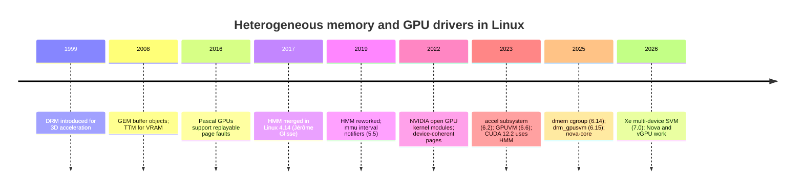
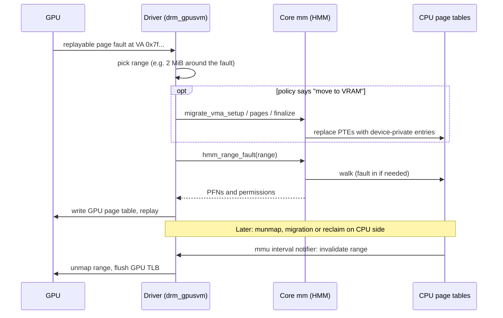

---
tags:
  - operating-systems
  - memory-management
  - gpu
  - hmm
  - drm
  - device-drivers
  - linux-kernel
  - frontier
status: complete
sources:
  - https://docs.kernel.org/mm/hmm.html
  - https://docs.kernel.org/gpu/rfc/gpusvm.html
  - https://docs.kernel.org/gpu/drm-mm.html
  - https://docs.kernel.org/accel/introduction.html
  - https://developer.nvidia.com/blog/simplifying-gpu-application-development-with-heterogeneous-memory-management
  - https://developer.nvidia.com/blog/nvidia-grace-hopper-superchip-architecture-in-depth/
  - https://lists.freedesktop.org/archives/dri-devel/2025-January/485282.html
  - https://lkml.rescloud.iu.edu/hypermail/linux/kernel/2606.1/09601.html
  - https://phoronix.com/news/linux-7.0-graphics-drivers
  - https://phoronix.com/news/Linux-7.3-DRM
  - https://phoronix.com/news/NVIDIA-Nova-Rust-Linux-7.3
  - https://phoronix.com/news/NVIDIA-Nova-Linux-7.4-Changes
  - https://www.phoronix.com/news/Nova-Driver-LPC-2026
  - https://phoronix.com/news/NVIDIA-Upstream-vGPU-Nova
  - https://lwn.net/Articles/1087111/
created: 2026-11-26
updated: 2026-11-26
---

## Table Of Contents

---

- [[#TL;DR|TL;DR]]
- [[#The Problem|The Problem]]
- [[#Foundations|Foundations]]
    - [[#Two Memories, Two Page Tables|Two Memories, Two Page Tables]]
    - [[#Three Ways to Share|Three Ways to Share]]
    - [[#struct page for Memory the CPU Can't Touch|struct page for Memory the CPU Can't Touch]]
- [[#How We Got Here|How We Got Here]]
- [[#How It Works|How It Works]]
    - [[#Mirroring: hmm_range_fault and mmu Notifiers|Mirroring: hmm_range_fault and mmu Notifiers]]
    - [[#Migrating to Device Memory|Migrating to Device Memory]]
    - [[#The DRM Stack|The DRM Stack]]
    - [[#Accelerators Outside DRM Graphics|Accelerators Outside DRM Graphics]]
- [[#Where It Is Now|Where It Is Now]]
- [[#Trade-offs & Open Problems|Trade-offs & Open Problems]]
- [[#Resources|Resources]]
- [[#Related Notes|Related Notes]]

## ***TL;DR***
---
*GPUs and AI accelerators have their own memory and their own page tables. Heterogeneous memory support is how the kernel lets them share a process's address space, so one pointer works on both CPU and device and pages move to whoever uses them.*

- **The pieces.** **HMM** (Heterogeneous Memory Management) lets a driver mirror a process's CPU page tables into the device's, using `hmm_range_fault()` to read them and mmu notifiers to hear about changes; **device-private memory** gives GPU memory `struct page`s so the kernel's migration code can move pages into and out of VRAM ([kernel docs](https://docs.kernel.org/mm/hmm.html)).
- **The drivers.** Graphics and compute drivers live in **DRM**, which supplies buffer objects (GEM), a VRAM manager (TTM), a job scheduler, GPU virtual-address management (GPUVM) and, since 2025, a shared-virtual-memory helper (**drm_gpusvm**). Pure AI accelerators use DRM's **accel** subsystem.
- **Why it matters.** With HMM, CUDA on Linux can use plain `malloc` memory on PCIe GPUs (CUDA 12.2, 2023) ([NVIDIA](https://developer.nvidia.com/blog/simplifying-gpu-application-development-with-heterogeneous-memory-management)); with hardware coherence (NVLink-C2C, CXL Type 2) the GPU shares the CPU's page table outright.
- **Status, Nov 2026.** Intel's Xe uses drm_gpusvm, across several GPUs since Linux 7.0; NVIDIA's open-source **Nova** driver, written in Rust, grows every release and now carries NVIDIA's vGPU upstreaming; a **dmem cgroup** limits device memory per container (6.14), with reclaim under review.

## ***The Problem***
---
*A discrete GPU is a second computer with its own memory, attached over a bus. Programs that share data with it have historically had to copy it explicitly and keep two copies in sync by hand.*

- **Separate memories.** A data-centre GPU has tens to hundreds of GB of HBM at several TB/s; the host has DRAM at a few hundred GB/s; they are joined by PCIe (tens of GB/s) or a faster coherent link.
- **Explicit copies.** The classic model is allocate on the device, `cudaMemcpy` to it, launch, copy back. Pointers in one memory mean nothing in the other, so pointer-rich data (trees, graphs, linked structures) must be flattened.
- **Pinned memory.** For DMA, host buffers are pinned so the OS can't move or swap them, which takes memory away from the rest of the system ([[Page Cache and Memory Reclaim]]).
- **OS blindness.** The kernel doesn't see or manage device memory as memory: no reclaim, no accounting, no migration policy, no cgroup limits. Each vendor's driver reimplemented its own memory manager.

The OS question: **can the kernel's virtual memory system extend to devices**, so one address space spans CPU and GPU, pages migrate on demand, and the kernel keeps every copy coherent?

## ***Foundations***
---
*A device that walks its own page tables sees a process through a copy of the CPU's mappings. Keeping that copy correct, and moving pages between memories, are the two jobs the kernel took on.*

### Two Memories, Two Page Tables

A GPU has an MMU and page tables of its own, often with larger page sizes (64 KiB or 2 MiB). When a GPU thread touches an address that isn't mapped, modern GPUs raise a **replayable page fault**: the GPU stalls that work, the driver fixes the mapping, and the access is replayed, just like a CPU page fault ([[Virtual Memory and Paging]]). Everything below builds on that capability.

### Three Ways to Share

| Approach | How CPU and device agree on memory | Examples |
|---|---|---|
| Explicit copies | They don't; software copies buffers | Classic CUDA/OpenCL, most graphics |
| Software coherence (HMM) | Device mirrors CPU page tables; only one side holds a page at a time; driver migrates on faults | PCIe GPUs with CUDA HMM, Intel Xe SVM, AMD KFD SVM |
| Hardware coherence | Device uses the CPU's page tables (ATS) and the link keeps caches coherent at cache-line granularity | Grace Hopper (NVLink-C2C), AMD MI300A, CXL Type 2 |

Hardware coherence is faster and simpler for software, but needs a coherent link; software coherence works over plain PCIe at page granularity ([[Unified Memory]] covers the CUDA side).

### struct page for Memory the CPU Can't Touch

Linux's memory management works on `struct page`. To let the generic migration code move pages into VRAM, the driver registers VRAM as **ZONE_DEVICE** memory of type `MEMORY_DEVICE_PRIVATE`: each VRAM page gets a `struct page`, but the CPU can't map it. A process page that lives in VRAM is represented in the CPU page table by a special *device-private swap entry*; if the CPU touches it, the fault handler calls back into the driver to migrate it home. AMD (Alex Sierra, 2022) added `MEMORY_DEVICE_COHERENT` for device memory the CPU *can* access coherently ([kernel docs](https://docs.kernel.org/mm/hmm.html)).

## ***How We Got Here***
---
*HMM was proposed by Red Hat in 2014, merged in 2017 when no driver used it, rebuilt around 2019, and became central once GPU compute and AI made shared virtual memory a requirement.*



- **DRM** began in 1999 for 3D acceleration and grew into the home of all GPU drivers: KMS (display modesetting, 2008), GEM buffer objects (Intel, 2008), TTM for discrete VRAM, dma-buf (2012) to share buffers between devices.
- **HMM.** Jérôme Glisse (Red Hat) spent years on HMM; it merged in 4.14 (2017) before any upstream driver used it. Jason Gunthorpe and Christoph Hellwig reworked it in 2019 around `hmm_range_fault()` and mmu interval notifiers, and nouveau, amdgpu (for ROCm's SVM) and later Intel's Xe adopted it.
- **NVIDIA's shift.** NVIDIA's open-source kernel modules (May 2022, for Turing and newer) enabled HMM support in CUDA 12.2 (2023): on Linux 6.1.24+ with the open modules, GPU code can dereference any `malloc` or `mmap` pointer, with pages migrating in 4 KiB units ([NVIDIA](https://developer.nvidia.com/blog/simplifying-gpu-application-development-with-heterogeneous-memory-management)). Grace Hopper (2023) went further with hardware coherence over a 900 GB/s NVLink-C2C link ([NVIDIA](https://developer.nvidia.com/blog/nvidia-grace-hopper-superchip-architecture-in-depth/)).
- **Common helpers.** As every driver reinvented VM management, DRM grew shared pieces: **drm_gpuvm** for VM_BIND-style GPU address spaces, **drm_gpusvm** (Matthew Brost, Intel) for HMM-based SVM ([docs](https://docs.kernel.org/gpu/rfc/gpusvm.html)), and the **dmem** cgroup controller for device memory limits ([pull, Jan 2025](https://lists.freedesktop.org/archives/dri-devel/2025-January/485282.html)).

## ***How It Works***
---
*A shared-virtual-memory driver does three things: on a GPU fault, read the CPU's mapping and install it on the GPU; on a CPU-side change, invalidate the GPU's copy; and decide when a page should live in VRAM instead of system RAM.*



### Mirroring: hmm_range_fault and mmu Notifiers

The driver registers an **mmu interval notifier** for each range it mirrors. To populate the GPU page table it calls `hmm_range_fault()`, which walks the CPU page tables (faulting pages in if asked) and returns the physical frame numbers. The pattern, from the kernel docs, is a retry loop:

```c
again:
    range.notifier_seq = mmu_interval_read_begin(&interval_sub);
    mmap_read_lock(mm);
    ret = hmm_range_fault(&range);          /* snapshot CPU mappings */
    mmap_read_unlock(mm);
    if (ret == -EBUSY) goto again;

    take_lock(driver->update);
    if (mmu_interval_read_retry(&interval_sub, range.notifier_seq)) {
        release_lock(driver->update);
        goto again;                          /* CPU side changed meanwhile */
    }
    /* program device page table from range.hmm_pfns[] */
    release_lock(driver->update);
```

In plain words: take a sequence number, snapshot the CPU's mappings, then, under the driver's own lock, check that nothing invalidated the range in the meantime; if something did, start over. `hmm_range_fault()` must be called with the mmap lock held; current docs (7.4-rc) prefer `hmm_range_fault_unlocked_timeout()`, which is called without it, followed by the same `mmu_interval_read_retry()` check ([kernel docs](https://docs.kernel.org/mm/hmm.html)). When the CPU side later unmaps, migrates, or reclaims a page, the notifier callback fires and the driver must tear down the GPU mapping before the core kernel proceeds. This is how the kernel stays the single source of truth without trusting the GPU.

### Migrating to Device Memory

Reading system RAM over PCIe is slow, so hot data should live in VRAM. `migrate_vma_setup()`, `migrate_vma_pages()` and `migrate_vma_finalize()` move a range: the kernel isolates the source pages and unmaps them, the driver copies with the GPU's DMA engines, and the CPU page tables get device-private entries. A later CPU access faults and the driver migrates the page back.

**Worked example (illustrative).** PCIe 5.0 x16 moves about 64 GB/s each way in theory. Migrating a 2 MiB chunk at an effective 50 GB/s takes

$$t = \frac{2\ \text{MiB}}{50\ \text{GB/s}} \approx \frac{2.1 \times 10^6\ \text{B}}{5 \times 10^{10}\ \text{B/s}} \approx 42\ \mu s$$

*In words: chunk size divided by link bandwidth.* Moving the same 2 MiB as 512 separate 4 KiB faults adds a fault round trip each (tens of µs per GPU fault is common), so fault overhead, not bandwidth, would dominate. That is why SVM helpers migrate and map in large chunks and why programs that can, prefetch.

### The DRM Stack

| Piece | Job |
|---|---|
| **KMS** | Display: modes, planes, page flips |
| **GEM** | Buffer objects with handles; mmap, sharing between processes |
| **TTM** | Placement and eviction of buffers between VRAM and system RAM |
| **drm_sched** | Queues GPU jobs, tracks completion with dma-fences, handles timeouts and resets |
| **dma-buf / dma-fence** | Share buffers and completion signals across devices and drivers |
| **drm_gpuvm** | Tracks a GPU virtual address space for VM_BIND (user space chooses GPU VAs) |
| **drm_gpusvm** | Common HMM-based shared virtual memory: ranges, notifiers, migration to VRAM |

Older drivers use explicit buffer objects; compute stacks add SVM on top. The kernel side also hosts firmware loading: modern NVIDIA, AMD and Intel GPUs run a large share of the driver on an on-GPU microcontroller (NVIDIA's GSP), so the kernel driver becomes a messenger to firmware.

### Accelerators Outside DRM Graphics

NPUs and AI accelerators that don't draw anything use **DRM accel** (`/dev/accel/accel*`, Linux 6.2), reusing GEM, scheduling and dma-buf without display baggage ([accel docs](https://docs.kernel.org/accel/introduction.html)). Drivers include Intel's NPU (`ivpu`), Habana Gaudi (`habanalabs`), Qualcomm's Cloud AI (`qaic`) and AMD's XDNA NPU (`amdxdna`).

## ***Where It Is Now***
---
*As of November 2026, shared virtual memory has moved from vendor code into common DRM helpers, device memory is gaining cgroup control, and NVIDIA's upstream story is being rebuilt in Rust.*

- **Intel Xe** uses drm_gpusvm, and Linux 7.0 (Apr 2026) extended SVM across **multiple devices** ([Phoronix](https://phoronix.com/news/linux-7.0-graphics-drivers)).
- **AMD is converging on the same helpers.** Huang Rui's amdgpu SVM rewrite on drm_gpusvm and drm_pagemap reached v9 in August 2026: phase 1 covers one GPU with retryable faults (XNACK on), behind a default-off `CONFIG_DRM_AMDGPU_SVM`, tested on MI300X and MI60; XNACK-off and multi-GPU come in later phases ([v9](https://lwn.net/Articles/1087111/)).
- **NVIDIA Nova** (Rust, for GSP-based GPUs from Turing on) adds functionality every release, in 7.3 and again in 7.4 ([Phoronix 7.3](https://phoronix.com/news/NVIDIA-Nova-Rust-Linux-7.3), [7.4](https://phoronix.com/news/NVIDIA-Nova-Linux-7.4-Changes)). NVIDIA builds its upstream **vGPU** support on top of Nova ([Phoronix](https://phoronix.com/news/NVIDIA-Upstream-vGPU-Nova)), and at LPC 2026 in Prague (Oct 2026) John Hubbard (NVIDIA) and Danilo Krummrich (Red Hat) set the goal of Nova replacing NVIDIA's out-of-tree open kernel modules and, in time, Nouveau on Turing and newer. GSP boots from Turing through Blackwell, but Nova isn't ready for end users and has no timeline; VMs, Vulkan compute and CUDA are planned ([Phoronix](https://www.phoronix.com/news/Nova-Driver-LPC-2026)). See [[Rust in the Linux Kernel]].
- **Device memory in cgroups.** The **dmem** controller (6.14) caps how much VRAM a cgroup may allocate; a series adding **reclaim** (evicting a cgroup's buffers when it exceeds its limit) reached v6 in June 2026 ([v6](https://lkml.rescloud.iu.edu/hypermail/linux/kernel/2606.1/09601.html)). See [[Containers, Namespaces and cgroups]].
- **Hardware coherence spreads.** NVLink-C2C superchips (Grace Hopper, Grace Blackwell, Vera Rubin) and AMD's MI300A APU expose GPU memory as NUMA nodes the kernel can manage, which ties GPU memory to the tiering work in [[CXL and Memory Tiering]].
- **Linux 7.3** brought further DRM work across old and new GPUs ([Phoronix](https://phoronix.com/news/Linux-7.3-DRM)).

## ***Trade-offs & Open Problems***
---
*Shared virtual memory trades explicit, predictable copies for convenience and automatic placement, and the kernel takes on new responsibilities for memory it can't directly touch.*

| Choice | Gains | Costs |
|---|---|---|
| Explicit copies | Predictable, fastest when done well | Programmer effort; no pointer sharing |
| HMM software coherence | Works on PCIe; any pointer is valid on the GPU | Fault latency; page-granularity ping-pong when CPU and GPU share data |
| Hardware coherence | Cache-line sharing, no faults for remote access | Needs special links and chips |
| Common DRM helpers | Less duplicated, better-reviewed code | Helpers must fit very different hardware |
| Firmware-heavy GPUs | Smaller kernel drivers | Large closed firmware blobs on the trust path |

**Open problems.**

- **Placement policy.** When should a page move to VRAM, and when should the GPU read it remotely? Each driver has its own heuristics; nothing like NUMA balancing exists for devices.
- **Reclaim and overcommit.** VRAM is not swappable in the normal sense; evicting buffers to system RAM under pressure, fairly across cgroups, is what dmem reclaim is starting to address.
- **Multi-device.** Pages shared between several GPUs (and the CPU) need peer-to-peer migration and coherent invalidation across devices.
- **Security.** A GPU that can walk process page tables or access memory coherently is a powerful DMA agent; IOMMU and confidential-computing work must cover it.

## ***Resources***
---
*The kernel's HMM page explains the core mechanism; the GPU SVM doc shows how a modern driver uses it; NVIDIA's HMM post shows the user-visible payoff.*

**Kernel docs**
- [Heterogeneous Memory Management (HMM)](https://docs.kernel.org/mm/hmm.html): kernel.org.
- [GPU SVM](https://docs.kernel.org/gpu/rfc/gpusvm.html): kernel.org.
- [DRM memory management](https://docs.kernel.org/gpu/drm-mm.html): kernel.org.
- [Compute accelerators](https://docs.kernel.org/accel/introduction.html): kernel.org.

**Vendors**
- [Simplifying GPU application development with HMM](https://developer.nvidia.com/blog/simplifying-gpu-application-development-with-heterogeneous-memory-management): NVIDIA, 2023.
- [Grace Hopper superchip architecture](https://developer.nvidia.com/blog/nvidia-grace-hopper-superchip-architecture-in-depth/): NVIDIA.

**State of play**
- [dmem cgroup pull](https://lists.freedesktop.org/archives/dri-devel/2025-January/485282.html): Jan 2025.
- [dmem cgroup reclaim v6](https://lkml.rescloud.iu.edu/hypermail/linux/kernel/2606.1/09601.html): Jun 2026.
- [amdgpu SVM on drm_gpusvm, v9](https://lwn.net/Articles/1087111/): Huang Rui, Aug 2026.
- [Linux 7.0 graphics drivers](https://phoronix.com/news/linux-7.0-graphics-drivers), [Linux 7.3 DRM](https://phoronix.com/news/Linux-7.3-DRM): Phoronix.
- [Nova in 7.3](https://phoronix.com/news/NVIDIA-Nova-Rust-Linux-7.3), [Nova in 7.4](https://phoronix.com/news/NVIDIA-Nova-Linux-7.4-Changes), [Nova at LPC 2026](https://www.phoronix.com/news/Nova-Driver-LPC-2026), [vGPU on Nova](https://phoronix.com/news/NVIDIA-Upstream-vGPU-Nova): Phoronix.

## Related Notes

- [[Virtual Memory and Paging]] — Page tables, faults and TLBs, which GPUs now mirror.
- [[NUMA]] — Device memory exposed as CPU-less nodes.
- [[CXL and Memory Tiering]] — Type 2 devices and device memory as one more tier.
- [[Page Cache and Memory Reclaim]] — Pinning, migration and reclaim that device memory complicates.
- [[Containers, Namespaces and cgroups]] — The dmem controller for device memory limits.
- [[Rust in the Linux Kernel]] — Nova, Tyr and the Rust DRM abstractions.
- [[Interrupts and Exceptions]] — Device faults and interrupts that drive the fault path.
- [[Unified Memory]] — The CUDA programming model built on HMM and hardware coherence.
- [[Virtualization and Hypervisors]] — GPU passthrough and vGPU.
