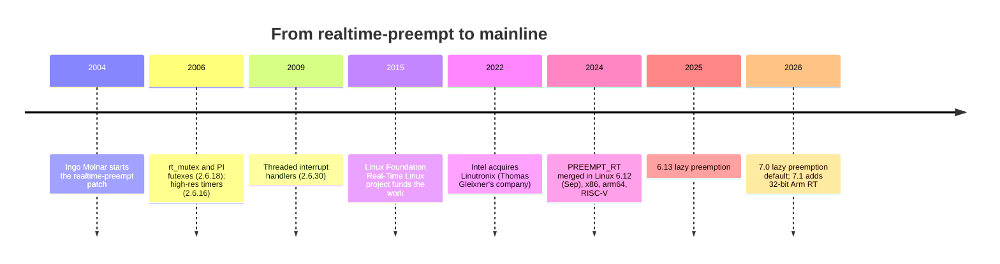
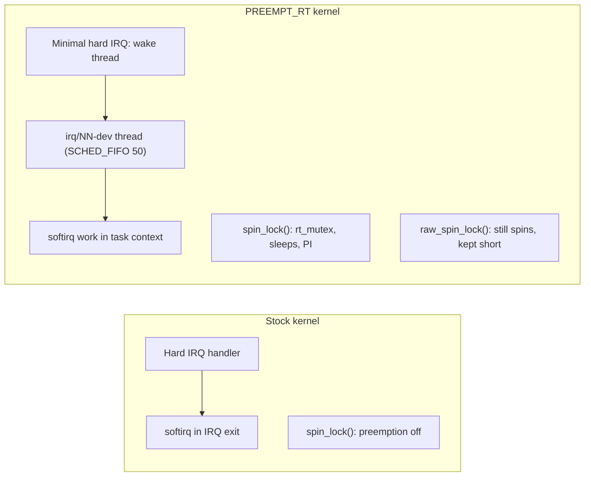

---
tags:
  - operating-systems
  - real-time
  - preempt-rt
  - scheduling
  - linux-kernel
  - frontier
status: draft
sources:
  - https://docs.kernel.org/core-api/real-time/differences.html
  - https://docs.kernel.org/core-api/real-time/architecture-porting.html
  - https://www.kernel.org/doc/html/latest/locking/locktypes.html
  - https://phoronix.com/news/Linux-6.12-Does-Real-Time
  - https://heise.de/-9935651
  - https://www.suse.com/c/suse-contributions-real-time-linux-kernel
  - https://en.wikipedia.org/wiki/PREEMPT_RT
  - https://phoronix.com/news/linux-7.1-arm-rt
  - https://patchew.org/linux/20251219101502.GB1132199@noisy.programming.kicks-ass.net
  - https://phoronix.com/news/linux-7.0-aws-postgresql-drop
  - https://lkml.iu.edu/2602.3/02843.html
  - https://www.osadl.org/Continuous-latency-monitoring.qa-farm-monitoring.0.html
  - https://www.thegoodpenguin.co.uk/blog/improving-real-time-performance-with-the-realtime-linux-analysis-tool-rtla/
created: 2026-11-26
updated: 2026-11-26
---

## Table Of Contents

---

- [[#TL;DR|TL;DR]]
- [[#The Problem|The Problem]]
- [[#Foundations|Foundations]]
    - [[#Hard, Firm and Soft Real-Time|Hard, Firm and Soft Real-Time]]
    - [[#Latency Is the Longest Non-Preemptible Path|Latency Is the Longest Non-Preemptible Path]]
    - [[#Priority Inversion|Priority Inversion]]
- [[#How We Got Here|How We Got Here]]
- [[#How It Works|How It Works]]
    - [[#Sleeping Spinlocks|Sleeping Spinlocks]]
    - [[#Threaded Interrupts and Softirqs|Threaded Interrupts and Softirqs]]
    - [[#Everything Else That Had to Change|Everything Else That Had to Change]]
    - [[#Running a Real-Time Task|Running a Real-Time Task]]
    - [[#Measuring Latency|Measuring Latency]]
- [[#Where It Is Now|Where It Is Now]]
- [[#Trade-offs & Open Problems|Trade-offs & Open Problems]]
- [[#Resources|Resources]]
- [[#Related Notes|Related Notes]]

## ***TL;DR***
---
*PREEMPT_RT is the Linux build option that makes the kernel preemptible almost everywhere, so a high-priority task can run within a bounded, small delay after it becomes ready. It took about 20 years out of tree and was merged in Linux 6.12 (2024).*

- **Goal.** Bounded *worst-case* latency, not speed. A real-time system is judged by its slowest response, because a robot arm or a motor controller fails on the one late reply.
- **How.** Most spinlocks become sleeping, priority-inheriting locks; interrupt handlers and softirqs run in schedulable kernel threads; and the remaining code that can't be preempted is kept short ([kernel docs](https://docs.kernel.org/core-api/real-time/differences.html)).
- **What you get.** On tuned hardware, worst-case wake-up latencies in the tens of microseconds, measured continuously by OSADL's test farm ([OSADL](https://www.osadl.org/Continuous-latency-monitoring.qa-farm-monitoring.0.html)), against milliseconds possible on a stock kernel under load.
- **What it costs.** Throughput: more context switches, lock overhead and handler threads. It is a config option (`CONFIG_PREEMPT_RT`), not the default.
- **Status, Nov 2026.** In mainline since **6.12** for x86, arm64 and RISC-V; **32-bit Arm** joined in **Linux 7.1** ([Phoronix](https://phoronix.com/news/linux-7.1-arm-rt)). Its by-products, lazy preemption among them, now shape every kernel: 7.0 made `PREEMPT_LAZY` the default.

## ***The Problem***
---
*A general-purpose kernel optimises the average case and can delay a task by milliseconds when it holds a lock or handles interrupts. Control systems need a guaranteed upper bound instead.*

A task becomes ready (a timer fires, a sensor raises an interrupt) but can't run until the kernel reaches a point where it may switch. In a stock kernel, many places can't be preempted:

- code holding a **spinlock** (preemption is disabled for its duration),
- **interrupt handlers** and **softirqs** (network and block processing can run for long bursts),
- regions with interrupts or preemption explicitly disabled.

Any of these can be long and data-dependent: a softirq draining thousands of packets, a lock held while walking a long list. The delay a high-priority task sees is the length of the longest such section anywhere in the kernel, plus scheduling overhead. A general-purpose kernel never promised to bound that.

Industrial control, robotics, pro audio, 5G radio processing and automotive systems all want Linux's drivers, networking and tools *and* a bound. The alternatives were a separate RTOS, or a co-kernel (RTLinux, RTAI, Xenomai) running real-time tasks under Linux, with two programming models.

## ***Foundations***
---
*Three ideas explain real-time Linux: what "real-time" promises, why latency equals the longest non-preemptible path, and why locks shared with low-priority tasks break priorities unless the kernel intervenes.*

### Hard, Firm and Soft Real-Time

| Kind | A missed deadline means | Examples |
|---|---|---|
| Hard | System failure | Motor control, flight control, airbag |
| Firm | The late result is useless, but occasional misses are tolerable | Video frames, radio slots |
| Soft | Quality degrades | Audio playback, games |

PREEMPT_RT gives *deterministic* behaviour with low worst-case latency; whether that counts as "hard" depends on the hardware, drivers, and how the whole system is validated. Safety-certified hard real-time usually still means a certified RTOS or a hypervisor partition.

### Latency Is the Longest Non-Preemptible Path

The wake-up latency of the highest-priority task is roughly:

$$L_{max} \approx L_{irq} + \max_{s}\,(\text{non-preemptible section } s) + L_{sched}$$

*In words: hardware interrupt delay, plus the longest stretch of kernel code that can't be interrupted by the scheduler, plus the time to switch to the task.* The middle term dominates and is the one PREEMPT_RT attacks: it doesn't make the kernel faster, it makes almost every section preemptible, so the maximum becomes the few remaining raw-spinlock and interrupt-off regions, which kernel developers keep deliberately short.

**Worked example.** A 1 kHz control loop has a 1000 µs period. If the measured worst-case wake-up latency is 80 µs, the loop loses at most 8% of each period to jitter and the remaining 920 µs is guaranteed compute time. On a stock kernel where a network softirq burst can hold off the task for 3 ms, the same loop would miss three deadlines in a row.

### Priority Inversion

A low-priority task L holds a lock; high-priority H blocks on it; a medium-priority M preempts L. Now H waits on M, which it should never do. The fix is **priority inheritance**: while L holds a lock H wants, L runs at H's priority ([[Locks and Synchronization]]). On a real-time kernel, every lock that can be contended by real-time tasks must support this, which is why spinlocks had to change.

## ***How We Got Here***
---
*PREEMPT_RT was developed out of tree from 2004 to 2024 and much of it was upstreamed piece by piece along the way; the final merge was the last 5% after the rest had already reshaped the kernel.*



- **Spin-off features.** Many things now in every kernel started in the RT tree: high-resolution timers, `rt_mutex` and PI futexes, threaded interrupts, preemptible RCU, lockdep improvements, `NO_HZ`, and the latency tracers that grew into ftrace ([Wikipedia](https://en.wikipedia.org/wiki/PREEMPT_RT), [SUSE](https://www.suse.com/c/suse-contributions-real-time-linux-kernel)).
- **Funding.** For years the patch survived on a few maintainers, chiefly Thomas Gleixner. The Linux Foundation's Real-Time Linux collaborative project (2015) funded the final upstreaming.
- **The last blocker was printk.** Printing a kernel message to a slow serial console happened in whatever context called `printk()`, with locks held, which could stall a real-time task for milliseconds. The fix, *nbcon* consoles that print from their own threads or atomically on panic, took years. When enough was in, Linus merged the switch that enables `PREEMPT_RT` for **6.12** in September 2024 ([Phoronix](https://phoronix.com/news/Linux-6.12-Does-Real-Time), [heise](https://heise.de/-9935651)).

## ***How It Works***
---
*PREEMPT_RT rewrites the meaning of a few kernel primitives so that code which used to block preemption becomes schedulable, then relies on priority inheritance to keep priorities correct.*



### Sleeping Spinlocks

On PREEMPT_RT, `spinlock_t` and `rwlock_t` are implemented on top of `rt_mutex` ([lock types](https://www.kernel.org/doc/html/latest/locking/locktypes.html)):

- A contended waiter **sleeps** instead of spinning, and the holder can be **preempted** by a higher-priority task.
- Waiters donate their priority to the owner (priority inheritance).
- `spin_lock_irq()` and `spin_lock_irqsave()` **no longer disable hardware interrupts**; with threaded handlers, they don't need to.
- `raw_spinlock_t` keeps the old spinning, preemption-off behaviour, for the scheduler, interrupt controllers and the few places that truly can't sleep. Code under a raw spinlock must be short and bounded and can't allocate memory.
- Per-CPU data protected only by "preemption off" gets an explicit **local_lock**, which is a real lock on RT and compiles to preempt-disable otherwise.

```c
/* Same source, two meanings */
spin_lock(&dev->lock);   /* stock: spin, preemption off
                            RT:    rt_mutex, may sleep, holder preemptible */
raw_spin_lock(&rq->lock);/* both:  spin, preemption off: keep it tiny */
```

In plain words: driver code keeps calling `spin_lock()`, but on a real-time build that call can put the caller to sleep, so the code inside must not assume it runs with preemption or interrupts off.

### Threaded Interrupts and Softirqs

- All interrupt handlers are **force-threaded**: the hardware handler only acknowledges the device and wakes a kernel thread (`irq/NN-name`), which runs at `SCHED_FIFO` priority 50 by default and can be re-prioritised ([[Interrupts and Exceptions]]). A real-time task at priority 80 therefore preempts a disk or network interrupt.
- **Softirqs** (networking, timers, tasklets) run in task context, in the thread that raised them or in `ksoftirqd`, instead of on interrupt exit. The old global "softirq BKL" taken by `local_bh_disable()` was replaced by explicit per-subsystem local locks.
- Timers that must fire in hard interrupt context are marked as such (`HRTIMER_MODE_HARD`); others expire in a softirq thread.

### Everything Else That Had to Change

| Area | Change on PREEMPT_RT |
|---|---|
| RCU | Preemptible RCU, with priority boosting of preempted readers ([[Read-Copy-Update (RCU)]]) |
| printk | nbcon consoles print from dedicated threads; atomic printing only on panic |
| Memory allocation | Not allowed under raw spinlocks or with interrupts off |
| CPU migration | `migrate_disable()` pins a task to its CPU without disabling preemption |
| Scheduling | Deadline servers (6.12) give starved fair tasks a guaranteed slice, the job RT throttling did crudely ([[CPU Scheduling]]) |

### Running a Real-Time Task

A minimal real-time thread in C:

```c
#include <sched.h>
#include <sys/mman.h>
#include <time.h>

struct sched_param sp = { .sched_priority = 80 };
sched_setscheduler(0, SCHED_FIFO, &sp);   /* fixed priority, above IRQ threads */
mlockall(MCL_CURRENT | MCL_FUTURE);       /* no page faults later */

struct timespec next;
clock_gettime(CLOCK_MONOTONIC, &next);
for (;;) {
        next.tv_nsec += 1000000;           /* 1 ms period */
        if (next.tv_nsec >= 1000000000) { next.tv_nsec -= 1000000000; next.tv_sec++; }
        clock_nanosleep(CLOCK_MONOTONIC, TIMER_ABSTIME, &next, NULL);
        control_step();                    /* must finish well within 1 ms */
}
```

In plain words: run at real-time priority 80, lock all memory so a page fault can never delay the loop, then wake every millisecond on an absolute timeline so lateness doesn't accumulate.

System tuning does the rest: isolate CPUs for real-time work (`isolcpus`, cpusets), stop the tick and RCU callbacks there (`nohz_full`, `rcu_nocbs`), steer device interrupts elsewhere, and disable deep CPU idle states and firmware interrupts (SMIs) that add hardware latency ([[Interrupts and Exceptions]]). `SCHED_DEADLINE` is the alternative to fixed priorities when tasks have known runtimes and periods.

### Measuring Latency

- **cyclictest** (rt-tests) wakes threads on a timer and records how late each wake-up is; its maximum over hours under stress load is the standard figure. OSADL runs it continuously on dozens of boards and publishes the results ([OSADL](https://www.osadl.org/Continuous-latency-monitoring.qa-farm-monitoring.0.html)).
- **rtla** (Real-Time Linux Analysis, in `tools/tracing/rtla`) uses the kernel's `timerlat` and `osnoise` tracers to measure latency *and* say which interrupt, thread or hardware event caused the worst case ([Good Penguin](https://www.thegoodpenguin.co.uk/blog/improving-real-time-performance-with-the-realtime-linux-analysis-tool-rtla/)).

## ***Where It Is Now***
---
*As of November 2026, PREEMPT_RT is two years into mainline life: architectures are still being added, its ideas have spread into the default preemption model, and the costs of that spread are being argued over.*

- **Architectures.** At merge, x86, arm64 and RISC-V could select it. **Linux 7.1** (Jun 2026) added real-time support for **32-bit Arm** ([Phoronix](https://phoronix.com/news/linux-7.1-arm-rt)). The kernel now documents what an architecture needs to support PREEMPT_RT ([porting guide](https://docs.kernel.org/core-api/real-time/architecture-porting.html)).
- **The RT tree continues.** Out-of-tree `-rt` releases still track mainline for remaining pieces and testing, for example v7.0-rc1-rt1 alongside v6.19.3-rt1 and v6.18.13-rt4 in Feb 2026 ([announcement](https://lkml.iu.edu/2602.3/02843.html)).
- **Lazy preemption for everyone.** RT's preemption model generalised into `PREEMPT_LAZY` (6.13). Peter Zijlstra's "further restrict the preemption modes" patch made lazy the default in **7.0**, keeping `PREEMPT_NONE` and `PREEMPT_VOLUNTARY` only for architectures that can't do better ([patch](https://patchew.org/linux/20251219101502.GB1132199@noisy.programming.kicks-ass.net)). That exposed throughput regressions: an AWS engineer reported PostgreSQL pgbench at about half speed on Graviton4 with 7.0, caused by a user-space spinlock holder being preempted ([Phoronix](https://phoronix.com/news/linux-7.0-aws-postgresql-drop), see [[CPU Scheduling]]).
- **Priority inheritance generalised.** Proxy execution (6.17 onward) extends the inheritance idea beyond `rt_mutex` to ordinary mutexes and deadline tasks ([[Locks and Synchronization]]).
- **Distributions.** Ubuntu Pro, RHEL for Real Time and SUSE Linux Enterprise Real Time ship RT kernels, now built from mainline sources plus small deltas.

## ***Trade-offs & Open Problems***
---
*Real-time Linux trades average throughput and code simplicity for a bound on the worst case, and that bound is only as good as the least-careful driver and the hardware underneath.*

| Gain | Cost |
|---|---|
| Bounded, low worst-case latency | Lower throughput: more context switches, lock overhead, handler threads |
| One OS for real-time and general work | Every driver must be correct with sleeping spinlocks; raw spinlocks need justification |
| Priority inheritance everywhere it matters | PI chains are complex and costly when long |
| Tunable per system (priorities, isolation) | Achieving the bound requires expert tuning and validation |

**Open problems.**

- **Hardware you can't preempt.** SMIs, firmware, CPU power states and shared caches add latency no kernel can remove; GPUs and accelerators are mostly outside the real-time model.
- **Certification.** Safety standards (IEC 61508, ISO 26262) want evidence about the whole code base; a 30-million-line kernel is hard to certify, so safety-critical paths often run beside Linux under a hypervisor or on a separate core.
- **Driver discipline.** One driver doing a long operation under a raw spinlock or with interrupts off breaks the bound for the whole machine; finding it is what rtla and tracing are for.
- **Throughput side effects of RT ideas.** The lazy-preemption default shows that RT-style preemption can hurt spin-heavy workloads; how to get latency without those cliffs is open.
- **Interaction with extensible scheduling.** BPF schedulers sit below the RT class ([[sched_ext and Pluggable Scheduling]]); mixing pluggable policies with RT guarantees is unexplored.

## ***Resources***
---
*Start with the kernel's "how realtime kernels differ" page and the lock-types page; use rtla and OSADL's farm to understand real numbers.*

**Kernel docs**
- [How realtime kernels differ](https://docs.kernel.org/core-api/real-time/differences.html): kernel.org.
- [Porting an architecture to support PREEMPT_RT](https://docs.kernel.org/core-api/real-time/architecture-porting.html): kernel.org.
- [Lock types and their rules](https://www.kernel.org/doc/html/latest/locking/locktypes.html): kernel.org.

**History and status**
- [Real-time PREEMPT_RT merged for Linux 6.12](https://phoronix.com/news/Linux-6.12-Does-Real-Time): Phoronix, Sep 2024.
- [After 20 years, Linux is real-time capable](https://heise.de/-9935651): heise, Sep 2024.
- [SUSE contributions to real-time Linux](https://www.suse.com/c/suse-contributions-real-time-linux-kernel): SUSE.
- [PREEMPT_RT](https://en.wikipedia.org/wiki/PREEMPT_RT): Wikipedia.
- [Linux 7.1 supports RT on Arm](https://phoronix.com/news/linux-7.1-arm-rt): Phoronix, 2026.
- [sched: Further restrict the preemption modes](https://patchew.org/linux/20251219101502.GB1132199@noisy.programming.kicks-ass.net): Peter Zijlstra, Dec 2025.
- [PostgreSQL performance halved by Linux 7.0](https://phoronix.com/news/linux-7.0-aws-postgresql-drop): Phoronix, Apr 2026.

**Measuring**
- [OSADL QA Farm latency monitoring](https://www.osadl.org/Continuous-latency-monitoring.qa-farm-monitoring.0.html): OSADL.
- [Improving real-time performance with rtla](https://www.thegoodpenguin.co.uk/blog/improving-real-time-performance-with-the-realtime-linux-analysis-tool-rtla/): The Good Penguin.

## Related Notes

- [[CPU Scheduling]] — RT and deadline classes, preemption models, lazy preemption and deadline servers.
- [[Locks and Synchronization]] — rt_mutex, priority inheritance, proxy execution and lock types on RT.
- [[Interrupts and Exceptions]] — Threaded IRQs, softirqs, NO_HZ_FULL and IRQ affinity.
- [[Read-Copy-Update (RCU)]] — Preemptible RCU and priority boosting.
- [[sched_ext and Pluggable Scheduling]] — The BPF scheduling class that sits below the RT classes.
- [[Processes and Threads]] — Scheduling policies and priorities as seen by user space.
- [[Microkernels and seL4]] — The verified, certifiable route to hard real-time.
- [[Kernel Architectures]] — Co-kernel designs (Xenomai) versus a fully preemptible monolith.
- [[Virtualization and Hypervisors]] — Partitioning hypervisors that run an RTOS beside Linux.
