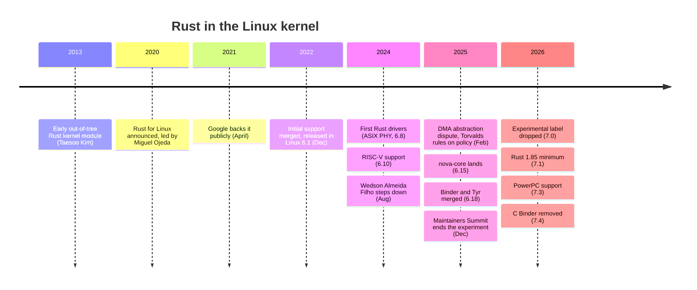

---
tags:
  - operating-systems
  - linux
  - rust
  - memory-safety
  - kernel-development
  - frontier
status: draft
sources:
  - https://www.microsoft.com/en-us/msrc/blog/2019/07/a-proactive-approach-to-more-secure-code
  - https://chromium.org/Home/chromium-security/memory-safety
  - https://security.googleblog.com/2022/12/memory-safe-languages-in-android-13.html
  - https://blog.google/security/rust-in-android-move-fast-fix-things/
  - https://docs.kernel.org/rust/general-information.html
  - https://docs.kernel.org/rust/coding-guidelines.html
  - https://docs.kernel.org/rust/quick-start.html
  - https://rust-for-linux.com/rust-version-policy
  - https://raw.githubusercontent.com/torvalds/linux/master/samples/rust/rust_minimal.rs
  - https://en.wikipedia.org/wiki/Rust_for_Linux
  - https://lwn.net/Articles/908347/
  - https://lwn.net/Articles/1006805/
  - https://lkml.iu.edu/hypermail/linux/kernel/2502.2/08504.html
  - https://lwn.net/Articles/1050174/
  - https://lpc.events/event/19/contributions/2068/attachments/1859/3981/2025-12-11%20-%20LPC%202025%20-%20Rust%20for%20Linux.pdf
  - https://patchew.org/linux/20251213000042.23072-1-ojeda@kernel.org
  - https://lwn.net/Articles/1055590/
  - https://lkml.iu.edu/2604.1/05692.html
  - https://www.phoronix.com/news/Rust-DRM-For-Linux-7.1
  - https://www.phoronix.com/news/Linux-7.3-PowerPC-Rust
  - https://phoronix.com/news/Linux-7.4-Rust
  - https://phoronix.com/news/Linux-7.4-Char-Misc
  - https://lwn.net/Articles/1083202/
  - https://lwn.net/Articles/1098617/
  - https://goals.rust-lang.org/2026/roadmap-rust-for-linux.html
  - https://itsfoss.com/news/first-linux-kernel-rust-cve/
  - https://www.collabora.com/news-and-blog/news-and-events/kernel-618-tyr-advances-rust-in-linux.html
  - https://www.theregister.com/2025/11/03/debian_apt_to_require_rust/
  - https://phoronix.com/news/Rust-Binder-For-Linux-6.18
  - https://www.memorysafety.org/blog/linux-kernel-2025-update/
  - https://lkml.indiana.edu/hypermail/linux/kernel/2408.3/05874.html
  - https://asahilinux.org/2025/02/passing-the-torch/
  - https://phoronix.com/news/linux-7.0-rust
  - https://www.theregister.com/2023/04/27/microsoft_windows_rust/
  - https://www.heise.de/en/news/Linux-Kernel-Rust-Support-Officially-Approved-11109808.html
  - https://phoronix.com/news/Linux-7.3-RandStruct-Rust
created: 2026-11-26
updated: 2026-11-26
---

## Table Of Contents

---

- [[#TL;DR|TL;DR]]
- [[#The Problem|The Problem]]
- [[#Foundations|Foundations]]
    - [[#Ownership Replaces Manual Cleanup|Ownership Replaces Manual Cleanup]]
    - [[#Safe and Unsafe|Safe and Unsafe]]
    - [[#Errors Are Values|Errors Are Values]]
    - [[#Pinning — Objects That Must Not Move|Pinning — Objects That Must Not Move]]
- [[#How We Got Here|How We Got Here]]
- [[#How It Works|How It Works]]
    - [[#Bindings, Abstractions, Drivers|Bindings, Abstractions, Drivers]]
    - [[#A Minimal Module|A Minimal Module]]
    - [[#The Build and the Toolchain|The Build and the Toolchain]]
    - [[#What Is Written in Rust|What Is Written in Rust]]
- [[#Where It Is Now|Where It Is Now]]
    - [[#No Longer an Experiment|No Longer an Experiment]]
    - [[#The 2026 Releases|The 2026 Releases]]
    - [[#The Rust Language Side|The Rust Language Side]]
- [[#Trade-offs & Open Problems|Trade-offs & Open Problems]]
- [[#Resources|Resources]]
- [[#Related Notes|Related Notes]]

## ***TL;DR***
---
*Linux now accepts kernel code written in Rust alongside C, so new drivers can be written in a language whose compiler rules out most memory-safety bugs. What started in 2020 as an experiment lost its "experimental" label in Linux 7.0 (April 2026), and by Linux 7.4 the Rust Android Binder driver has replaced the C one.*

- **Why.** About 70% of serious security bugs at Microsoft and in Chromium are memory-safety bugs. Android's Rust code shows about **0.2** memory-safety vulnerabilities per million lines against about **1,000** for its C and C++ ([Google, Nov 2025](https://blog.google/security/rust-in-android-move-fast-fix-things/)).
- **How.** Rust code calls the C kernel through generated *bindings*, which are wrapped once in safe *abstractions* in the `kernel` crate. Drivers use only the abstractions, so the `unsafe` code sits in a few reviewed places ([kernel docs](https://docs.kernel.org/rust/general-information.html)).
- **What it buys.** Use-after-free, double free, forgotten unlocks, missing error unwinding and data races become compile errors instead of CVEs. Cleanup runs automatically through `Drop`; errors propagate through `Result` and `?`.
- **Status, Nov 2026.** Rust is a permanent part of the kernel (decided at the Maintainers Summit, December 2025). In tree: Binder, the Nova NVIDIA driver, the Tyr Arm Mali driver, null_blk, two PHY drivers and the DRM panic QR code. Supported on x86_64, ARM64, ARM32, RISC-V, LoongArch, PowerPC and UML.
- **The cost.** Every C API a Rust driver needs must get a safe wrapper and someone to maintain it. That cross-language burden, not the language itself, caused the project's fights in 2024 and 2025.

## ***The Problem***
---
*C gives kernel developers full control and no protection: every pointer, buffer length, lock and error path must be handled correctly by hand, forever. At the kernel's scale, the mistakes that slip through are the largest single source of serious vulnerabilities.*

The evidence comes from the biggest C and C++ codebases:

| Codebase | Memory-safety share | Source |
|---|---|---|
| Microsoft (all products) | ~70% of CVEs each year | [MSRC, Jul 2019](https://www.microsoft.com/en-us/msrc/blog/2019/07/a-proactive-approach-to-more-secure-code) |
| Chromium | ~70% of high-severity security bugs (912 bugs since 2015) | [Chromium](https://chromium.org/Home/chromium-security/memory-safety) |
| Android, 2019 | 76% of vulnerabilities | [Google, Dec 2022](https://security.googleblog.com/2022/12/memory-safe-languages-in-android-13.html) |
| Android, 2022 | 35% (223 down to 85 a year) as new code shifted to Rust | same |
| Android, 2025 | below 20% for the first time | [Google, Nov 2025](https://blog.google/security/rust-in-android-move-fast-fix-things/) |

Android's experience is the key result: the share fell not because old C was rewritten but because *new* code stopped being written in C. Vulnerabilities concentrate in new code, so changing the language of new code changes the curve.

The kernel has the same shape. Most new kernel code is drivers, and drivers are where bugs live: they handle device-controlled input, run with full privilege (see [[Kernel Architectures]]) and are often written by people who know the hardware better than the kernel's locking rules. The bug classes Google names as motivation for the Rust Binder are reference counting, locking and bounds checking ([Phoronix, Sep 2025](https://phoronix.com/news/Rust-Binder-For-Linux-6.18)). Each is a rule C documents in comments and Rust checks at compile time.

## ***Foundations***
---
*Four Rust ideas carry nearly all of the benefit in kernel code: ownership with automatic cleanup, a hard line between safe and unsafe code, errors as values the compiler forces you to handle, and pinning for objects whose address must never change.*

### Ownership Replaces Manual Cleanup

*Every value has exactly one owner, and when the owner goes out of scope its `Drop` code runs. That replaces C's hand-written `goto err_free` ladders.*

In C, a function that allocates three things and fails on the third must free the first two in the right order, on every error path. In Rust, each acquired resource is a value with a `Drop` implementation; returning early drops whatever was already acquired, in reverse order. The compiler also enforces borrowing:

- **`&T` (shared borrow):** many readers, no writers.
- **`&mut T` (exclusive borrow):** one writer, no readers.
- A borrow can't outlive the thing it points to, which rules out use-after-free.

Locks become guards: locking a `Mutex<T>` returns a guard, the protected `T` is reachable only through that guard, and dropping the guard unlocks. "Forgot to unlock" and "touched the data without the lock" stop compiling. This is the same discipline [[Locks and Synchronization]] describes for C, moved from convention into the type system.

### Safe and Unsafe

*Rust code is safe by default. Anything the compiler can't check (raw pointers, calls into C) must sit in an `unsafe` block, which marks exactly where human review must focus.*

The kernel's rules ([coding guidelines](https://docs.kernel.org/rust/coding-guidelines.html)):

- Every `unsafe` block is preceded by a `// SAFETY:` comment explaining why its preconditions hold.
- Every `unsafe fn` documents its contract in a `# Safety` section.
- Drivers ("leaf modules") should not call the raw C bindings at all; they use the safe abstractions in the `kernel` crate ([general information](https://docs.kernel.org/rust/general-information.html)).

`unsafe` doesn't turn off the borrow checker; it only allows the handful of operations the compiler can't verify. Android reports about **4%** of its Rust lives inside `unsafe` ([Google, Nov 2025](https://blog.google/security/rust-in-android-move-fast-fix-things/)).

### Errors Are Values

*C returns a negative errno and hopes the caller checks it; Rust returns a `Result` the caller can't ignore, and `?` makes propagating it one character.*

| | C | Rust in the kernel |
|---|---|---|
| Failure signal | `return -ENOMEM;` | `Err(ENOMEM)` inside `Result<T>` |
| Checking | Optional; forgetting compiles | Mandatory; ignoring a `Result` warns, using the `T` requires handling the error |
| Propagating | `if (ret) goto err;` | `?` |
| Cleanup on failure | Hand-written unwind labels | Automatic via `Drop` |
| Allocation | `kmalloc(size, GFP_KERNEL)` may return `NULL` | Every allocation takes GFP flags and returns `Result`; there is no panicking `push` |

The guidelines say a fallible approach "should be used, typically returning a `Result`" in almost all cases; panics should be rare ([coding guidelines](https://docs.kernel.org/rust/coding-guidelines.html)). That matters because a kernel panic takes down the machine. Allocation flags and the allocators behind them are covered in [[Memory Allocators]].

### Pinning — Objects That Must Not Move

*Many kernel objects are linked to by address, so moving one after initialisation corrupts every pointer to it. Rust moves values freely by default, so the kernel needs a way to say "this never moves".*

List heads, mutexes, wait queues and work items all embed pointers to themselves or are pointed to from shared structures. A Rust move is a `memcpy` to a new address, which would silently break them. `Pin<P>` is Rust's promise that the pointee won't move; the kernel's **pin-init** library goes further and *initialises* objects directly in their final place, so they never exist at a temporary address ([Rust for Linux](https://en.wikipedia.org/wiki/Rust_for_Linux), first included in Linux 6.4). Linux 7.4 extended pin-init with tuple structs and safe self-references ([Phoronix, Oct 2026](https://phoronix.com/news/Linux-7.4-Rust)). The Rust project's 2026 "in-place initialization" goal targets the same need, partly so large objects aren't built on the small kernel stack and then copied ([LWN, Oct 2026](https://lwn.net/Articles/1098617/)).

## ***How We Got Here***
---
*Rust in Linux went from a mailing-list proposal to a permanent part of the kernel in about five years, with the technical work moving faster than the social agreement about who maintains the C-to-Rust boundary.*



Key moments:

- **2020–2022.** The project was announced on the kernel list in 2020 with Miguel Ojeda leading it ([memorysafety.org](https://www.memorysafety.org/blog/linux-kernel-2025-update/)). Linus Torvalds merged deliberately minimal support for Linux 6.1, released December 2022 ([LWN](https://lwn.net/Articles/908347/)). It could build a module and little else; the point was to land the infrastructure.
- **2024: first users, first departures.** The ASIX PHY driver in 6.8 was the first Rust driver; 6.10 added RISC-V ([Wikipedia](https://en.wikipedia.org/wiki/Rust_for_Linux)). In August 2024 Wedson Almeida Filho, one of the core developers, retired from the project, citing "the nontechnical nonsense" ([LKML](https://lkml.indiana.edu/hypermail/linux/kernel/2408.3/05874.html)).
- **January–February 2025: the DMA dispute.** Christoph Hellwig rejected a Rust wrapper for the DMA-mapping API ("No rust code in kernel/dma, please"), even after Danilo Krummrich offered to maintain it separately ([LWN, Jan 2025](https://lwn.net/Articles/1006805/)). Asahi Linux lead Hector Martin resigned in the fallout ([Asahi](https://asahilinux.org/2025/02/passing-the-torch/)). On 20 February Torvalds settled the policy: a C maintainer isn't forced to take or care about Rust code, but "'ignore the Rust side' automatically also means that you don't have any *say* on the Rust side" ([LKML](https://lkml.iu.edu/hypermail/linux/kernel/2502.2/08504.html)).
- **2025: real drivers.** Linux 6.15 brought nova-core, the start of the Rust NVIDIA driver. Linux 6.18 (December 2025, a long-term release) merged Rust Binder and Tyr plus abstractions for USB, IRQs, regulators, maple trees, scatterlists and DMA ([Collabora](https://www.collabora.com/news-and-blog/news-and-events/kernel-618-tyr-advances-rust-in-linux.html)).
- **December 2025: the verdict.** At the Maintainers Summit Torvalds said it was time to drop the "experimental" label ([LWN](https://lwn.net/Articles/1050174/)); Ojeda's patch titled "rust: conclude the Rust experiment" replaced it with "Rust is here to stay" ([patch](https://patchew.org/linux/20251213000042.23072-1-ojeda@kernel.org)).

## ***How It Works***
---
*Rust code never talks to C directly in a driver: generated bindings sit at the bottom, safe hand-written abstractions in the `kernel` crate sit above them, and drivers are written against the abstractions.*

### Bindings, Abstractions, Drivers

*The layering is what keeps `unsafe` contained: each C API is wrapped once, reviewed once, and then used safely by every driver.*

```mermaid
flowchart TB
    subgraph Rust["Rust (no_std, links only core)"]
        D["Drivers / leaf modules<br/>Binder, Nova, Tyr, null_blk, PHY"]
        K["kernel crate (rust/kernel/)<br/>safe abstractions: Mutex, KVec, Device, DRM, USB, DMA..."]
        B["bindings (generated by bindgen)<br/>raw unsafe extern \"C\" declarations"]
        H["rust/helpers/<br/>C wrappers for inline functions and macros"]
    end
    subgraph C["C kernel"]
        API["Core kernel APIs<br/>locks, allocators, driver model, DRM, net..."]
    end
    D -->|"safe calls only"| K
    K -->|"unsafe, with SAFETY comments"| B
    K --> H
    B --> API
    H --> API
```

- **bindgen** reads the C headers and generates Rust declarations. They are all `unsafe` to call.
- **`rust/helpers/`** holds small C functions that wrap things bindgen can't see: `static inline` functions and macros.
- **The `kernel` crate** provides "as-safe-as-possible" types over those bindings ([general information](https://docs.kernel.org/rust/general-information.html)). For example, `KVec<T>` wraps the kernel allocator and `kernel::sync::Mutex<T>` wraps the C mutex.
- **Kernel Rust is `#![no_std]`**: it links only `core`, not Rust's standard library, because there's no OS underneath to provide files or threads.

### A Minimal Module

*The smallest useful Rust module, from `samples/rust/rust_minimal.rs` in mainline, shows the whole pattern: a declarative module header, a fallible init that returns `Result`, and cleanup in `Drop`.*

```rust
use kernel::prelude::*;

module! {
    type: RustMinimal,
    name: "rust_minimal",
    authors: ["Rust for Linux Contributors"],
    description: "Rust minimal sample",
    license: "GPL",
}

struct RustMinimal { numbers: KVec<i32> }

impl kernel::Module for RustMinimal {
    fn init(_module: &'static ThisModule) -> Result<Self> {
        pr_info!("Rust minimal sample (init)\n");
        let mut numbers = KVec::new();
        numbers.push(72, GFP_KERNEL)?;   // allocation can fail; -ENOMEM returns early
        numbers.push(108, GFP_KERNEL)?;
        Ok(RustMinimal { numbers })
    }
}

impl Drop for RustMinimal {               // runs on rmmod, replaces module_exit()
    fn drop(&mut self) { pr_info!("My numbers are {:?}\n", self.numbers); }
}
```

Source: [rust_minimal.rs](https://raw.githubusercontent.com/torvalds/linux/master/samples/rust/rust_minimal.rs) (trimmed).

**In plain words.** `module!` generates the boilerplate C would put in `module_init`, `module_exit` and `MODULE_LICENSE`. `init` builds the module's state and returns it; if either `push` fails, `?` returns the error to the loader, and the half-built `KVec` is freed automatically. When the module unloads, the state is dropped, `Drop::drop` prints, and then the `KVec` frees its memory. There's no line that frees anything, and no way to forget one.

### The Build and the Toolchain

*Rust support is a normal Kconfig option, but it depends on a specific toolchain: rustc, the Rust standard library sources, bindgen and libclang, and in practice an LLVM build of the whole kernel.*

- **Config.** `CONFIG_RUST` ("Rust support") lives under General setup; `make LLVM=1 rustavailable` explains why it is or isn't offered ([quick start](https://docs.kernel.org/rust/quick-start.html)).
- **Compiler.** The best-supported build is `make LLVM=1`; mixing GCC for C with rustc for Rust is "very experimental".
- **Minimum versions.**

| Kernel | Minimum rustc | Note |
|---|---|---|
| 6.11 – 6.x (incl. 6.18 LTS) | 1.78.0 | First fixed minimum ([policy](https://rust-for-linux.com/rust-version-policy)) |
| 7.1 onward | 1.85.0 | Policy now tracks Debian Stable's rustc; bindgen minimum 0.71.1 ([7.1 pull](https://lkml.iu.edu/2604.1/05692.html)) |

- **Performance knob.** Calling C helpers out of line costs a function call each. Linux 7.1 added an experimental `CONFIG_RUST_INLINE_HELPERS` that inlines them via `llvm-link`, worth about **2%** on null_blk ([7.1 pull](https://lkml.iu.edu/2604.1/05692.html)).
- **Docs.** rustdoc for the `kernel` crate is generated with `make LLVM=1 rustdoc` and hosted at rust.docs.kernel.org.

### What Is Written in Rust

*By late 2026 Rust is no longer only samples: it ships in Android phones, GPU drivers and the [[Block Layer and IO Schedulers|block layer]]'s test driver.*

| Component | Kind | Status (Nov 2026) |
|---|---|---|
| **Binder** | Android IPC driver | Merged 6.18; the C version removed in 7.4 |
| **Nova** (nova-core + nova-drm) | NVIDIA GPU driver, GSP-based, Turing and later | Growing each release; "not yet ready for end-user use" as of Mar 2026 |
| **Tyr** | Arm Mali GPU driver (Collabora, Arm, Google) | Merged 6.18; limited to Mali-G610 |
| **DRM panic QR code** | Shows a QR code on a kernel panic | Mainline |
| **null_blk (rnull)** | Block-layer test driver | Mainline |
| **ASIX and AMCC QT2025 PHYs** | Network PHY drivers | Mainline |
| Apple AGX, NVMe, ashmem | GPU, storage, Android shared memory | Out of tree; ashmem ships in Android 16 on 6.12 |

Sources: [LPC 2025 slides](https://lpc.events/event/19/contributions/2068/attachments/1859/3981/2025-12-11%20-%20LPC%202025%20-%20Rust%20for%20Linux.pdf), [LWN, Dec 2025](https://lwn.net/Articles/1050174/), [LWN, Feb 2026](https://lwn.net/Articles/1055590/), [Phoronix, Mar 2026](https://www.phoronix.com/news/Rust-DRM-For-Linux-7.1), [Phoronix, Oct 2026](https://phoronix.com/news/Linux-7.4-Char-Misc).

**Worked example: why new code matters.** Expected memory-safety vulnerabilities in new code scale with its size and its language's density:

$$
\mathbb{E}[\text{vulns}] = \rho \times \frac{\text{lines}}{10^6}
$$

**In plain English:** $\rho$ is vulnerabilities per million lines. Android measured $\rho \approx 1000$ for C/C++ and $\rho \approx 0.2$ for Rust ([Google, Nov 2025](https://blog.google/security/rust-in-android-move-fast-fix-things/)). Take a new GPU driver of 50,000 lines. In C: $1000 \times 0.05 = 50$ expected memory-safety vulnerabilities over its life. In Rust: $0.2 \times 0.05 = 0.01$. Even if kernel Rust were 10 times worse than Android's, that's 0.1. These are Android's numbers, not the kernel's, so treat them as an order of magnitude, not a forecast.

## ***Where It Is Now***
---
*As of November 2026, Rust is a permanent, multi-architecture part of Linux with its first production driver fully replacing a C one. The bottleneck has moved from "should we" to "which C subsystems have safe abstractions yet".*

### No Longer an Experiment

*The December 2025 Maintainers Summit turned five years of trial into policy.*

At the summit ([LWN, 13 Dec 2025](https://lwn.net/Articles/1050174/)):

- Torvalds said that after nearly five years it was time to drop the "experimental" label.
- Rust code in the kernel grew about **5x** over 2025; Ojeda's LPC slides put it at more than **4x** since LPC 2024, with about **2,500** patch series from about **300** submitters and about **30** maintainers and reviewers ([LPC 2025](https://lpc.events/event/19/contributions/2068/attachments/1859/3981/2025-12-11%20-%20LPC%202025%20-%20Rust%20for%20Linux.pdf)).
- Debian enabled Rust in its kernels for the "forky" release.
- Dave Airlie said DRM is "about a year away" from *requiring* Rust for new drivers, and that core kernel code depending on Rust is one to two years away.

Days later the first CVE against kernel Rust code was issued: **CVE-2025-68260**, a race in Rust Binder that causes a crash, not code execution. Greg Kroah-Hartman noted 159 CVEs were issued for C code the same day ([It's FOSS, Dec 2025](https://itsfoss.com/news/first-linux-kernel-rust-cve/)). The removal patch landed in the 7.0 merge window, and Linux 7.0 (April 2026) shipped without the label ([Phoronix, Feb 2026](https://phoronix.com/news/linux-7.0-rust)).

### The 2026 Releases

*Each 2026 release added abstractions and architectures; 7.4 was the first to delete a C driver because its Rust replacement was ready.*

| Kernel | Released | Rust changes |
|---|---|---|
| 7.0 | Apr 2026 | "Experimental" label removed |
| 7.1 | Jun 2026 | Rust 1.85 / bindgen 0.71.1 minimum; inline helpers option; DRM: DMA-coherent rework, GPU buddy allocator, shmem GEM helper, more Nova and Tyr ([Phoronix](https://www.phoronix.com/news/Rust-DRM-For-Linux-7.1)) |
| 7.3 | 18 Oct 2026 | Rust on 32-bit and 64-bit PowerPC, marked maintained ([Phoronix](https://www.phoronix.com/news/Linux-7.3-PowerPC-Rust)) |
| 7.4 | rc phase now, expected Dec 2026 | ~17k new lines of Rust, new `mem` and `ratelimit` modules, pin-init gains ([Phoronix](https://phoronix.com/news/Linux-7.4-Rust)); **C Binder removed**: "the rust version is stable and will be used going forward in a few billion devices" (Kroah-Hartman, [Phoronix](https://phoronix.com/news/Linux-7.4-Char-Misc)) |

Rust now builds for x86_64, ARM64, ARM32, RISC-V, LoongArch, PowerPC and UML. Tyr shows what still slows drivers down: in February 2026 it was blocked on missing abstractions for GEM shmem, GPUVM, io-pgtable and a new job scheduler ([LWN](https://lwn.net/Articles/1055590/)).

Outside the kernel tree, the pull is the same. Android's 6.12 kernel is the first with Rust enabled and a production Rust driver ([Google, Nov 2025](https://blog.google/security/rust-in-android-move-fast-fix-things/)). Debian's APT package manager planned to hard-depend on Rust from May 2026, which threatens ports to architectures without a Rust compiler ([The Register, Nov 2025](https://www.theregister.com/2025/11/03/debian_apt_to_require_rust/)). Microsoft has Rust in the Windows kernel's GDI code ([The Register, Apr 2023](https://www.theregister.com/2023/04/27/microsoft_windows_rust/)), and Asterinas builds a Linux-compatible "framekernel" entirely in Rust (see [[Kernel Architectures]]).

### The Rust Language Side

*The kernel still needs unstable Rust features; the Rust project made "Rust for Linux" one of its flagship roadmaps to remove them.*

- By December 2025 only two unstable *language* features remained in use: `arbitrary_self_types` and `derive_coerce_pointee` ([LPC 2025](https://lpc.events/event/19/contributions/2068/attachments/1859/3981/2025-12-11%20-%20LPC%202025%20-%20Rust%20for%20Linux.pdf)).
- The Rust project's 2026 roadmap for Linux lists arbitrary self types, `derive(CoercePointee)`, build-std, field projections, in-place initialization, a `Move` trait and stabilising the remaining compiler flags ([Rust goals](https://goals.rust-lang.org/2026/roadmap-rust-for-linux.html)). The roadmap grew from 1 goal in 2024 to 13 ([LWN, Oct 2026](https://lwn.net/Articles/1098617/)).
- **GCC.** Two routes are in progress. **gccrs**, a new Rust front end for GCC, can parse kernel code but doesn't yet produce correct output for all of it ([LWN, Jul 2026](https://lwn.net/Articles/1083202/)). **rustc_codegen_gcc** uses GCC as rustc's backend and remains experimental; Linux 7.3 included fixes to prepare for it.

## ***Trade-offs & Open Problems***
---
*Rust removes whole classes of bugs inside drivers, but it adds a second language at every boundary, a toolchain dependency the kernel never had, and a maintenance question that is social as much as technical.*

| Benefit | Cost |
|---|---|
| Memory-safety and data-race bugs become compile errors | Every C API needs a safe wrapper and an owner before drivers can use it |
| Automatic cleanup and mandatory error handling | Abstractions must track C API changes; who fixes them when C changes was the 2025 fight |
| `unsafe` confined to reviewed places | Bugs at the boundary still happen (CVE-2025-68260 was a data race in Binder) |
| Attracts new contributors and maintainers ([LWN](https://lwn.net/Articles/1050174/)) | Reviewers must read two languages; burnout and departures in 2024–2025 |
| Strong types for hardware state (GPU drivers) | Depends on LLVM in practice; GCC-only builds not yet possible |

**Open problems.**

- **Abstraction coverage.** The rate-limiting step for new drivers is whether the subsystem they need has safe bindings yet ([heise, Dec 2025](https://www.heise.de/en/news/Linux-Kernel-Rust-Support-Officially-Approved-11109808.html)); Tyr waited on four.
- **Toolchain.** Unstable features, LLVM dependence and a minimum rustc tied to Debian Stable all constrain distros and older architectures. s390 status is unclear, some drivers don't work on big-endian, and MIPS is still in progress ([LWN](https://lwn.net/Articles/1050174/)).
- **Interaction with hardening.** Linux 7.3 disables RandStruct (randomised struct layout) by default when Rust is enabled ([Phoronix](https://phoronix.com/news/Linux-7.3-RandStruct-Rust)), a trade with [[Kernel Security Hardening]].
- **Core code in Rust.** Drivers are leaves; nothing in the core kernel yet *depends* on Rust. Airlie's 1–2 year estimate for that is the next real test, because then every architecture and every build must have Rust.
- **Measuring the payoff.** There is no authoritative count of Rust lines in the tree or kernel-specific vulnerability density yet; the strongest evidence is still Android's.

## ***Resources***
---
*Start with LWN's Maintainers Summit report for the state of play, the kernel's own Rust docs for how code is written, and Google's Android posts for the evidence that motivated it all.*

**Kernel docs and project pages**
- [Rust quick start](https://docs.kernel.org/rust/quick-start.html): kernel.org.
- [Rust general information](https://docs.kernel.org/rust/general-information.html): bindings vs abstractions, `no_std`.
- [Rust coding guidelines](https://docs.kernel.org/rust/coding-guidelines.html): SAFETY comments, error handling.
- [Rust version policy](https://rust-for-linux.com/rust-version-policy): Rust for Linux project.
- [rust_minimal.rs](https://raw.githubusercontent.com/torvalds/linux/master/samples/rust/rust_minimal.rs): the sample module.

**State of the project**
- [The state of the kernel Rust experiment](https://lwn.net/Articles/1050174/): Jonathan Corbet, LWN, Dec 2025.
- [Rust for Linux, LPC 2025 slides](https://lpc.events/event/19/contributions/2068/attachments/1859/3981/2025-12-11%20-%20LPC%202025%20-%20Rust%20for%20Linux.pdf): Miguel Ojeda, Dec 2025.
- [rust: conclude the Rust experiment](https://patchew.org/linux/20251213000042.23072-1-ojeda@kernel.org): Ojeda, Dec 2025.
- [Rust for v7.1 pull request](https://lkml.iu.edu/2604.1/05692.html): Ojeda, Apr 2026.
- [The future for Tyr](https://lwn.net/Articles/1055590/): Daniel Almeida, LWN, Feb 2026.
- [Progress toward compiling Linux with gccrs](https://lwn.net/Articles/1083202/): LWN, Jul 2026.
- [An update on Rust's project goals](https://lwn.net/Articles/1098617/): LWN, Oct 2026.
- [Rust for Linux 2026 roadmap](https://goals.rust-lang.org/2026/roadmap-rust-for-linux.html): Rust Project Goals.

**Policy and conflict**
- [Resistance to Rust abstractions for DMA mapping](https://lwn.net/Articles/1006805/): LWN, Jan 2025.
- [Re: Rust kernel policy](https://lkml.iu.edu/hypermail/linux/kernel/2502.2/08504.html): Linus Torvalds, Feb 2025.

**Evidence on memory safety**
- [Rust in Android: move fast and fix things](https://blog.google/security/rust-in-android-move-fast-fix-things/): Jeff Vander Stoep, Google, Nov 2025.
- [Memory Safe Languages in Android 13](https://security.googleblog.com/2022/12/memory-safe-languages-in-android-13.html): Google, Dec 2022.
- [A proactive approach to more secure code](https://www.microsoft.com/en-us/msrc/blog/2019/07/a-proactive-approach-to-more-secure-code): Microsoft MSRC, Jul 2019.
- [Chromium memory safety](https://chromium.org/Home/chromium-security/memory-safety): Chromium project.

## Related Notes

- [[Kernel Architectures]] — Monolithic kernels and language-based "framekernels" like Asterinas that use Rust for isolation.
- [[Locks and Synchronization]] — The locking rules Rust's guards turn into type checks.
- [[Read-Copy-Update (RCU)]] — Another concurrency pattern Rust abstractions must model safely.
- [[Memory Allocators]] — The kmalloc/GFP allocators behind `KVec` and fallible allocation.
- [[Kernel Security Hardening]] — Other ways the kernel defends against memory bugs, and how Rust interacts with them.
- [[Formally Verified OS Components]] — The stronger, costlier route to the same goal.
- [[Microkernels and seL4]] — Isolation by address space instead of by type system.
- [[Interrupts and Exceptions]] — Contexts where Rust code must not sleep or allocate with blocking flags.
- [[Processes and Threads]] — The kernel threads and work items pin-init exists to initialise safely.
- [[Virtualization and Hypervisors]] — Where Rust already dominates: Firecracker, Cloud Hypervisor and crosvm.
- [[MicroVMs and Sandboxing]] — Rust VMMs built from rust-vmm crates.
